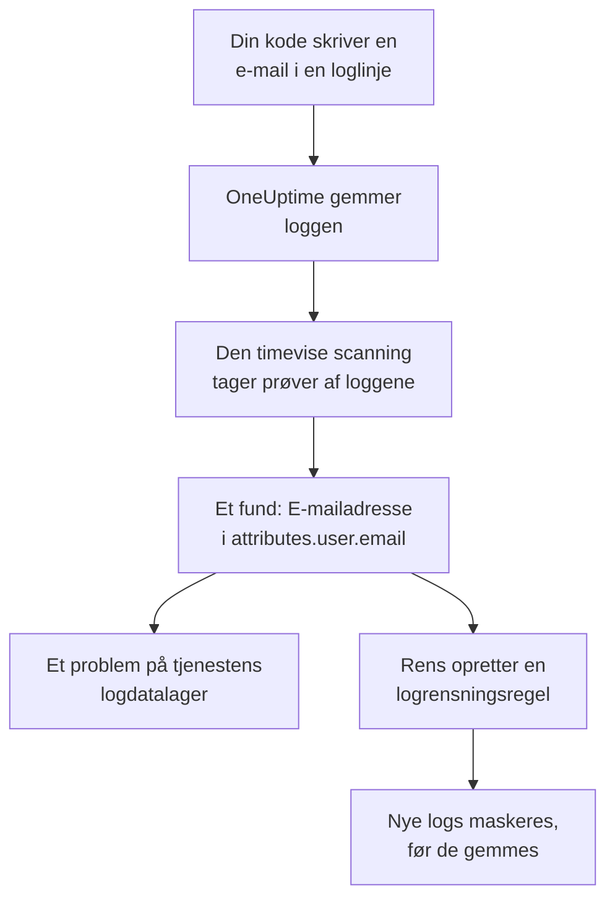

# Følsomme data i telemetri

Telemetri indeholder alt, hvad din kode skriver: en e-mailadresse i en loglinje, et kortnummer i en span-attribut, et token i en stack trace, en kundes spørgsmål i en prompt. Datasikkerhed behandler hver tjenestes logs, traces, undtagelser og AI-samtaler og hver RUM-applikations sessioner som datalagre for sig. Den tager prøver af dem hver time, finder følsomme data i dem, ligesom den gør i en bucket, og **Rens** gør et fund til en rensningsregel, der fra da af maskerer de data ved indtagelse.

Der er intet at sætte op: hver tjenestes telemetri scannes hver time, medmindre **Scan telemetri** er slået fra i projektets indstillinger.

:::cards
- [Hvad der læses](#hvad-der-læses): Attributterne, brødteksterne, beskederne og prompterne i hvert signal.
- [Sådan tager en scanning prøver](#sådan-tager-en-scanning-prøver): De nyeste poster fra hver tjeneste, hver time.
- [Rens](#rens): Maskér et fund ved indtagelse med ét klik.
- [Hvad der tæller som renset](#hvad-der-tæller-som-renset): Når en rensningsregel allerede dækker et fund.
:::

## Sådan virker det

Et fund, som en rensningsregel dækker, markeres som renset: det, der er tilbage af de data, er gamle data, der venter på, at deres opbevaring udløber, ikke en lækage, der stadig flyder. De to telemetrikontroller tæller kun det, ingen regel dækker, så deres problem løses, når hvert fund er renset (se [Telemetrikontroller](/docs/data-security/checks-and-issues#telemetri)).

## Hvad der læses

| Datalager | Hvad der læses | Hvor et fund peger hen |
| --- | --- | --- |
| Logs | Hver attribut og brødteksten | `attributes.<key>`, `body` |
| Traces | Hver span-attribut og attributterne i hver span-hændelse | `attributes.<key>`, `events.<event>.<key>` |
| Undtagelser | Beskeden, stack tracen og attributterne | `message`, `stackTrace`, `attributes.<key>` |
| AI-samtaler | Prompterne og svarene i hvert AI-kald, under de nøgler, GenAI-konventionerne lægger dem i, og hver anden attribut | Den nøgle, de ligger i, f.eks. `gen_ai.input.messages` eller `gen_ai.prompt[].content` |
| Sessionsafspilninger | Attributterne på en RUM-applikations spans og logs, dens sessioners attributter, de egenskaber, `identify()` gav dens brugere, og den brugerreference, den har fået oplyst | `spans.attributes.<key>`, `logs.attributes.<key>`, `sessions.attributes.<key>`, `sessions.identifiedUserTraits.<key>`, `sessions.identifiedUserLabel` |

Nummererede nøgler samles i én placering: `gen_ai.prompt.3.content` er `gen_ai.prompt[].content`, så de tyve beskeder i en chat er ét fund, ikke tyve. Attributter, som OneUptime selv tilføjer, og som starter med `oneuptime.`, læses ikke.

### Hvorfor en afspilnings optagelse aldrig læses

En sessionsafspilnings optagelse indeholder teksten på de sider, folk så. Det kræver en tilladelse for sig at se den, og et fund læst ud af den ville vise maskeret sidetekst til alle, der kan læse Datasikkerhed. Derfor læses en afspilning kun via sine attributter: de spans, logs og sessionsdetaljer, der ligger ved siden af optagelsen. Optageren maskerer allerede det, den optager i browseren, og logrensningsregler kører også over optagelser (se [Sessionsafspilning](/docs/telemetry/session-replay)).

### AI-samtaler

Et AI-kalds prompt rummer hele chatten før personens nyeste besked, så op til 16.384 tegn af hver værdi i et AI-kald læses. Når AI-samtaler indeholder følsomme data, følger to ting mere: den AI-udbyder, kaldene gik til, er en datastrøm for de data, og [Følsomme data sendes til en AI-udbyder](/docs/data-security/checks-and-issues#ai) fejler på datalageret.

Samtalerne fra et [AI-værktøj i virksomheden](/docs/telemetry/ai-company-tools) udelades. Kun Project Owners og Project Admins må læse dem, og et fund havner der, hvor alle, der læser Datasikkerhed, læser det, så de tjenesters spans læses aldrig, og deres AI-samtaler rapporteres som ikke læst.

## Sådan tager en scanning prøver

Hver time læses hvert signals nyeste poster fra den seneste time, og de klassificeres felt for felt ligesom ethvert andet datalagers (se [Felter og kolonner](/docs/data-security/data-types#felter-og-kolonner)):

| Grænse | Værdi |
| --- | --- |
| Poster fra hver tjeneste og hvert signal | **Prøvestørrelse for telemetri**, 500 som standard, aldrig mere end 1.000 |
| Tjenester eller RUM-applikationer, der læses pr. signal | De 200 travleste |
| Poster i én læsning | 5.000, delt mellem tjenesterne; 500 for AI-kald |
| Tegn i en logbrødtekst, en undtagelsesbesked eller en stack trace | 8.192 |
| Tegn i en attributværdi | 4.096 |
| Tegn i en værdi i et AI-kald | 16.384 |
| Attributter i én post | 128; 64 for et AI-kald |
| Hændelser i ét span og attributter i én hændelse | 16 og 32 |
| Placeringer i ét datalager | 500 |

Hver værdi afkortes i databasen, så ingen lang værdi forlader den, og hver læsning stopper efter 30 sekunder. En læsning, der fejler, noteres som en advarsel på de datalagre, den gjaldt; scanningen fortsætter med den næste.

For at udelade noget tilføjer du det til datalagerets **Scanningsundtagelser**: en placering angivet fuldt ud (`attributes.http.url`), alt under en placering (`attributes.http`) eller en attributnøgle angivet alene (`http.url`).

## Rens

**Rens** på et fund opretter den rensningsregel, der fra da af skjuler den datatype på den placering, eller peger på den aktiverede regel, der allerede gør det:

:::steps
### Åbn fundet

Åbn telemetridatalageret - f.eks. en tjenestes **Protokoller** - og fundet.

### Tryk på Rens

Klik på **Rens**. OneUptime opretter en logrensningsregel for logs og en RUM-applikations logs og en trace-rensningsregel for spans, undtagelser og AI-kald, på den del af posten, fundet ligger i.

### Ret også koden

Reglen maskerer nye data, før de gemmes. Data, der allerede er gemt, bliver liggende, indtil deres opbevaring udløber, så ret den kode, der skriver dem: fundet nævner tjenesten og attributten.
:::

Reglen er opkaldt efter det, den skjuler, f.eks. "Data Security: Email address in attributes.user.email", og står sammen med dine andre rensningsregler (se [Drop-filtre og rensningsregler](/docs/telemetry/drop-filters-and-scrub-rules#rens-følsomme-data)). Den er en af disse:

| Fund | Regel, som Rens opretter |
| --- | --- |
| E-mailadresse, kortnummer, amerikansk socialsikringsnummer, telefonnummer eller IP-adresse | Typens indbyggede mønster. Kortnumre, socialsikringsnumre og telefonnumre maskeres, resten erstattes helt. |
| En værdi under en nøgle, der ligner noget følsomt, f.eks. `password` eller `token` | En regel af typen **Sensitive Attribute Keys**, som erstatter hele værdien af hver sådan attribut |
| Enhver anden datatype, et mønster kan finde | En regel af typen **Brugerdefineret regex**, lavet ud fra datatypens egne mønstre, som erstatter hver værdi af samme form |

Nogle fund kan ikke renses af en regel, og **Rens** siger hvorfor:

- En datatype, der kun findes ud fra feltnavne, f.eks. en persons navn: intet mønster kan finde den. Omdøb attributten til en nøgle, som en regel for følsomme nøgler skjuler, eller stop med at sende den.
- En datatype, der kun kan skelnes fra andre værdier ved ordene omkring den, f.eks. et routingnummer: en regel ville skjule langt mere end den datatype.
- En dokumentmærkning: at skjule ordet ville ikke skjule dokumentet.
- En af dine egne datatyper: tilføj selv en brugerdefineret rensningsregel med dens mønster.
- En sessions egne detaljer (`sessions.*`): indtagelse af sessionsafspilninger kører ingen rensningsregler.

**Rens** opretter reglen som dig, med dine egne tilladelser: Project Owners og Project Admins kan trykke på den, og det kan et team også, der må oprette logrensningsregler og trace-rensningsregler for spans, undtagelser og AI-kald.

## Hvad der tæller som renset

Et fund markeres kun som renset, når indtagelsen ville køre en aktiveret regel over det, og reglen ville finde dets datatype:

- **De rigtige poster.** Logregler dækker logs og en RUM-applikations logs. Trace-regler dækker spans, undtagelser og AI-kald: en undtagelse er en kopi af sit spans undtagelseshændelse, så de regler, der renser hændelser, renser den.
- **Den rigtige del.** Reglens **Felter, der skal renses** omfatter den del af posten, fundet ligger i, eller reglen lader dem stå på standard.
- **Et mønster, der finder typen.** En indbygget **Mønstertype** finder sin egen datatype: **E-mailadresse** finder e-mailadresser, **Kreditkortnummer** kortnumre, **SSN (CPR-nummer)** amerikanske socialsikringsnumre, **Telefonnummer** telefonnumre og **IP-adresse** IP-adresser. **Sensitive Attribute Keys** dækker hver værdi under en nøgle, der ligner noget følsomt, uanset hvad værdien er.
- **Dine egne brugerdefinerede mønstre tæller aldrig.** En **Brugerdefineret regex** dækker kun et fund, når den er præcis det mønster, **Rens** opretter for dets type. Et fund gemmer kun maskerede prøver, som intet mønster kan afprøves på, så OneUptime kan ikke bevise, at dit mønster skjuler dataene, og et fund, der fejlagtigt kaldes renset, er en lækage, ingen kigger på.

En regel, der er slået fra, eller som intet renser, tæller aldrig. Dækningen beregnes igen efter hver scanning, så en regel, du tilføjer eller fjerner manuelt, ændrer inden for en time, hvad der er markeret som renset.

## Næste trin

:::cards
- [Drop-filtre og rensningsregler](/docs/telemetry/drop-filters-and-scrub-rules): Hver indstilling for rensningsregler og de regler, du selv skriver.
- [Datasikkerhedskontroller og problemer](/docs/data-security/checks-and-issues): De to telemetrikontroller og AI-kontrollerne.
- [Datastrømme, adgang og residens](/docs/data-security/flows-access-residency): De AI-udbydere og værter, dine tjenester sender data til.
:::
