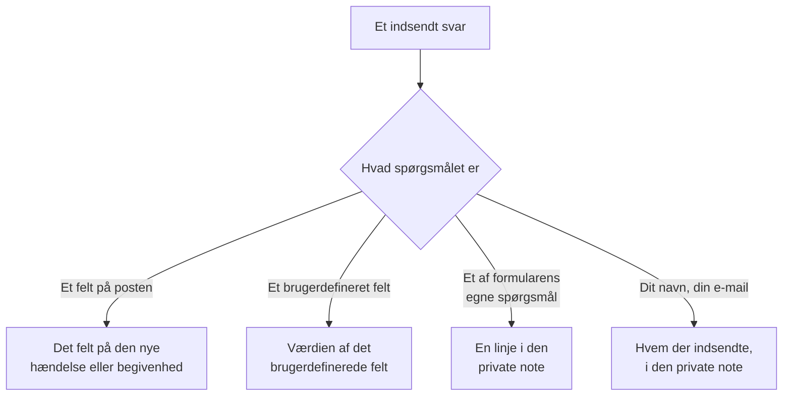

# Byg en formular

En formulars side **Byg** er der, hvor du bestemmer, hvad den spørger om, og hvordan dens side ser ud. Spørgsmålene er til venstre, i den rækkefølge, den offentlige side viser dem; **Tilføj et spørgsmål**, til højre, viser alt, hvad du kan tilføje. Over spørgsmålene, foldet sammen, er formularens [branding](#branding): dens logo og favicon. Navngivne sæt af svar, som folk kan starte formularen fra — som hver især også kan gøre et spørgsmål påkrævet, valgfrit eller skjult for deres eget tilfælde — er på dens side **Skabeloner**: se [Skabeloner](#skabeloner).

:::cards
- [Byggeren](#byggeren): Tilføj, redigér, flyt og gem spørgsmål.
- [Hvad du kan tilføje](#hvad-du-kan-tilføje): Dine egne spørgsmål, postens felter, brugerdefinerede felter og indsenderen.
- [Skjulte spørgsmål](#skjulte-spørgsmål): Besvares af en skabelon, aldrig af den, der indsender.
- [Skabeloner](#skabeloner): Én formular, og ét link, til hvert tilfælde, dit team ofte melder.
:::

## Hvor hvert svar ender

Hvert svar gemmes også med indsendelsen, på formularens side **Indsendelser**. Et felt, formularen ikke spørger om, eller som efterlades tomt, udfyldes fra formularens [indstillinger Ved indsendelse](/docs/forms/on-submit).

## Byggeren

:::steps
### Tilføj et spørgsmål

Vælg, hvad du vil tilføje, i **Tilføj et spørgsmål**. Det nye spørgsmål indsættes efter det valgte, eller til sidst, og bliver valgt.

### Redigér det, hvor det er

Vælg et kort for at redigere det: dets spørgsmål, hjælpetekst, svartype og muligheder, om det er påkrævet eller skjult, og knapperne til at duplikere eller slette det. **Færdig** lukker det.

### Sæt det på plads

Træk et kort i dets håndtag for at flytte det, eller brug **Flyt op** og **Flyt ned** på det valgte kort — på en telefon, eller fra tastaturet.

### Gem formularen

**Gem ændringer** gemmer alle ændringer på én gang. Indtil du gemmer, siger byggeren **Ikke-gemte ændringer** og tilbyder **Kassér ændringer**, og browseren spørger, før du forlader siden.
:::

- **Formularens overskrift** viser dens navn og beskrivelse, som den offentlige side vil gøre. **Rediger navn og beskrivelse** ændrer dem.
- **Spørgsmålene** er kort. Hvert viser spørgsmålet, som folk vil se det, med et mærke, der siger, hvad det er knyttet til — **Hændelse · Alvorlighed**, **Brugerdefineret felt · Region**, **Indsender · E-mail**, eller dets svartype for et af formularens egne spørgsmål. En rød stjerne markerer et påkrævet spørgsmål, og et mærke **Skjult** et [skjult](#skjulte-spørgsmål) spørgsmål.
- **Grænser.** En formular kan have op til 50 spørgsmål. Folk, der må læse en formular, men ikke redigere den, ser byggeren skrivebeskyttet.

## Branding

**Branding**, foldet sammen over spørgsmålene, er, hvordan formularens side ser ud: dit logo øverst på siden, over formularens navn, og dit favicon i browserfanen, mens formularen er åben. Indtil du uploader dine egne, viser formularen OneUptimes logo og favicon.

Sammenfoldet viser sektionen **Logo** og **Favicon** — vist som angivet, så snart formularen har sine egne — og siger, hvilke af OneUptimes der stadig gælder. Fold den ud for at se begge, som siden viser dem: logoet, som det står øverst på siden, og faviconet i en browserfane ved siden af formularens navn, som er fanens titel.

**Rediger branding** ændrer dem i én dialog:

| Felt | Hvad det er |
| --- | --- |
| **Logo** | Vises øverst på formularens side, over dens navn, i stedet for OneUptimes logo. Et PNG-, JPEG-, GIF-, WebP- eller SVG-billede på højst 512 KB. Fjern det for at gå tilbage til OneUptimes logo. |
| **Logo Alt Text** | Hvad logoet siger, læst op af skærmlæsere: som regel din organisations navn. Spørges om, så snart der er et logo. Lad det være tomt, så springer skærmlæsere logoet over — formularens navn følger alligevel efter det. At fjerne logoet rydder det også. |
| **Favicon** | Ikonet i browserfanen, mens formularen er åben, i stedet for OneUptimes favicon. Et PNG-, JPEG-, GIF-, WebP-, SVG- eller ICO-billede på højst 128 KB; et kvadratisk PNG, SVG eller ICO virker bedst. Fjern det for at gå tilbage til OneUptimes favicon. |

Logoet beholder højden på det OneUptime-logo, det erstatter, og et bredt logo tilpasses sidens bredde. Hvert billede tjekkes, når det gemmes — fra dashboardet, API'en, Terraform eller en arbejdsgang: det skal være uploadet i formularens eget projekt, være af en af typerne ovenfor og ikke være større end sin grænse. Et logo, der ikke er et af de billeder, afvises med "The logo must be a PNG, JPEG, GIF, WebP or SVG image.", et for stort et med "The logo must be 512 KB or smaller.", og et, hvis upload er væk — eller som blev uploadet i et andet projekt — med "The logo's file could not be found. Upload the logo again." Et favicon afvises på samme måde, med "The favicon must be a PNG, JPEG, GIF, WebP, SVG or ICO image.", "The favicon must be 128 KB or smaller." og "The favicon's file could not be found. Upload the favicon again."

**Forhåndsvisning** viser logoet, som siden gør. Folk, der må læse en formular, men ikke redigere den, ser dens branding uden **Rediger branding**. Logoet og faviconet når kun formularens side inde i selve formularen — se [Deling & sikkerhed](/docs/forms/sharing-and-security#hvad-der-beskytter-en-formular).

## Hvad du kan tilføje

**Tilføj et spørgsmål** viser fire grupper: formularens egne **Spørgsmål**, **Hændelsesfelter** eller **Felter for planlagt vedligeholdelse** for det, formularen opretter, **Brugerdefinerede felter** og **Indsender**.

### Formularens egne spørgsmål

| Svartype | Hvad indsenderen giver |
| --- | --- |
| **Kort svar** | Én linje tekst. |
| **Afsnit** | Flere linjer tekst. |
| **Formateret tekst** | Tekst med formatering og links. |
| **Tal** | Et tal. |
| **Rulleliste** | Ét valg fra en liste. |
| **Flervalg** | Et vilkårligt antal valg fra en liste. |
| **Afkrydsningsfelt** | En boks at sætte flueben i, som en bekræftelse. |
| **Dato** | En dag. |
| **Dato og klokkeslæt** | En dag og et klokkeslæt. |

En rulleliste eller et flervalg viser de **Valgmuligheder**, du giver det, hver med en valgfri farve (knappen ved siden af en mulighed åbner et sæt navngivne farver, med **Brugerdefineret farve** til en præcis kode), mellem én og 100 af dem. At skifte et spørgsmål mellem **Rulleliste** og **Flervalg** beholder dets muligheder; et spørgsmål, der bliver en af dem, starter med to, du kan omdøbe, og et, der holder op med at være en af dem, mister dem. **Duplikér** kopierer et af formularens egne spørgsmål lige under det.

Svarene på disse spørgsmål gemmes med indsendelsen og vises i den private note på det, formularen opretter — de udfylder ikke noget felt. For at udfylde et felt skal du tilføje selve feltet, fra de næste to grupper.

### Felter på det, formularen opretter

Felterne på en hændelse, eller på en planlagt vedligeholdelsesbegivenhed, som en indsender kan besvare. Svaret bliver feltets værdi.

| Hændelsesfelt | Besvares med |
| --- | --- |
| **Titel** | Én linje, op til 500 tegn. |
| **Beskrivelse** | Formateret tekst, op til 20.000 tegn. |
| **Alvorlighed** | En af dine hændelsesalvorligheder. |
| **Monitorer** | Enhver af de monitorer, du tilbyder — hændelsens berørte monitorer. |
| **Etiketter** | Enhver af de etiketter, du tilbyder. |
| **Påvirkning startede** | En dato og et klokkeslæt: hvornår problemet startede, som indsenderen husker det. |

| Felt for planlagt vedligeholdelse | Besvares med |
| --- | --- |
| **Titel** | Én linje, op til 100 tegn. |
| **Beskrivelse** | Formateret tekst, op til 20.000 tegn. |
| **Begynder den** | En dato og et klokkeslæt. Altid spurgt om og altid påkrævet. |
| **Slutter den** | En dato og et klokkeslæt efter **Begynder den**. Altid spurgt om og påkrævet. |
| **Monitorer** | Enhver af de monitorer, du tilbyder. |
| **Statussider** | Enhver af de statussider, du tilbyder. |
| **Etiketter** | Enhver af de etiketter, du tilbyder. |

Hvert felt kan kun spørges om én gang; listen markerer dem, der allerede er på formularen, med **Tilføjet**. Et felt, formularen ikke spørger om — eller som efterlades tomt — udfyldes fra formularens [indstillinger Ved indsendelse](/docs/forms/on-submit).

**Tilbudte valg.** En offentlig side må ikke vise hele dit projekt for fremmede, så et felt, der besvares ved at vælge poster, tilbyder kun dem, du vælger. **Monitorer**, **Etiketter** og **Statussider** viser præcis de valg, du tilbyder, og spørges ikke om, før du tilbyder mindst ét. **Alvorlighed** tilbyder alle hændelsesalvorligheder, medmindre du indsnævrer den, da alvorligheder ikke er hemmelige. Svar uden for de tilbudte valg afvises.

### Brugerdefinerede felter

Dine brugerdefinerede felter for hændelser — eller for planlagt vedligeholdelse, på en vedligeholdelsesformular — hvert et spørgsmål, hvis svar bliver feltets værdi. Spørgsmålet tager sin type og sine muligheder fra det brugerdefinerede felt og starter med dets navn som spørgsmål og dets beskrivelse som hjælpetekst, som du kan ændre.

En formular spørger kun om de brugerdefinerede felter, du føjer til den, uanset hvad **Vis ved oprettelse** siger: hvert felt, en formular spørger om, viser sit navn, sin beskrivelse og sine muligheder for alle med linket. Når et brugerdefineret felt slettes, bliver dets spørgsmål på formularen, men spørges ikke længere om, og dets kort siger det — slet spørgsmålet. Et felt, der oprettes igen med samme navn, er et nyt felt: tilføj det igen.

Et brugerdefineret felt, der kopierer sin værdi fra et brugerdefineret monitorfelt, siger det på sit kort: når hændelsen eller begivenheden har monitorer, der er enige om en værdi for det, erstatter den værdi indsenderens svar.

### Indsender

**Dit navn** og **Din e-mail** spørger, hvem der indsender. De gemmes med indsendelsen og nævnes i den private note, så dit team kan følge op, og vises aldrig på selve hændelsen eller begivenheden. OneUptime sender aldrig e-mail til indsenderen. Udelad dem, eller gør dem valgfrie, for at tage imod anonyme indsendelser.

E-mailen skal være én almindelig adresse, som `ada@example.com` — ikke et navn med adressen i vinkelparenteser, og ikke en liste af adresser. Navn og e-mail er hver op til 100 tegn.

## En ny formulars spørgsmål

En ny formular starter med de spørgsmål, den næsten altid bør stille, så den virker i det øjeblik, den oprettes: **Titel**, påkrævet; **Beskrivelse**; for en vedligeholdelsesformular **Begynder den** og **Slutter den**; og **Dit navn** og **Din e-mail**, påkrævet. Deres ordlyd er på dit dashboards sprog. Ændr, skjul eller fjern dem, som du vil — undtagen en vedligeholdelsesbegivenheds start og slut, uden hvilke ingen begivenhed kan planlægges. Når dine egne spørgsmål siger det hele, så skjul **Beskrivelse** i stedet for at efterlade en boks, ingen burde skrive i: se [Skjulte spørgsmål](#skjulte-spørgsmål).

## Påkrævede spørgsmål

**Påkrævet** betyder, at formularen ikke kan indsendes uden et svar. Et svar, der kun består af mellemrum, tabulatorer eller linjeskift, tæller som intet svar, og en påkrævet **Afkrydsningsfelt** skal have et flueben. Serveren tjekker hvert påkrævet spørgsmål igen, når formularen indsendes, så en anmodning, der laves uden siden, også holdes op mod dem.

Et spørgsmål, der ikke er påkrævet, må efterlades tomt: dets felt udfyldes så fra indstillingerne Ved indsendelse, som om formularen ikke havde spurgt om det.

## Skjulte spørgsmål

Slå **Skjult** til på et kort, så vises spørgsmålet ikke længere på formularen. Ingen bliver spurgt, så det er aldrig påkrævet, og en indsendelse kan ikke besvare det — anmodningen læses ikke engang for det. Kun den [skabelon](#skabeloner), en indsendelse starter fra, besvarer det, og det forbliver ubesvaret, når indsenderen ikke starter fra nogen skabelon, eller fra en, der lader det være tomt. En skabelon kan også alligevel spørge om et skjult spørgsmål, for sit eget tilfælde: se [Sådan spørger en skabelon om hvert spørgsmål](#sådan-spørger-en-skabelon-om-hvert-spørgsmål).

Skjul et spørgsmål, når svaret er dit teams at bestemme, ikke indsenderens:

- **Hændelsens beskrivelse**, når de spørgsmål, du tilføjede, siger det hele. Skjult inviterer den ikke længere nogen til at skrive der; giv hver skabelon den standardtekst, du sender i dens tilfælde, eller lad hændelser starte uden.
- **Et brugerdefineret felt, som dine arbejdsgange eller regler læser**, som en notifikationstype, sat af hver skabelon.
- **Et af formularens egne spørgsmål**, hvis svar kun dit team har brug for i den private note.

Et skjult spørgsmål beholder sin plads, sin etiket og sine indstillinger, så du kan vise det igen når som helst. Et felt, uden hvilket formularens mål ikke kan oprettes — en vedligeholdelsesbegivenheds **Begynder den** og **Slutter den** — kan ikke skjules. Et skjult spørgsmåls svar tjekkes og gemmes præcis, som et indtastet svar ville blive, og gemmes med indsendelsen.

## Skabeloner

En formulars side **Skabeloner** indeholder navngivne sæt af svar, som folk kan starte formularen fra — ét for hvert tilfælde, dit team ofte melder, som **Applikationsnedbrud**, **Planlagt vedligeholdelse** eller **Tjeneste gendannet** — så én formular, og ét link, dækker dem alle.

:::steps
### Tilføj en skabelon

Klik på **Tilføj skabelon**. Editoren har to dele. **Spørgsmål** viser hvert spørgsmål på formularen med, hvordan denne skabelon spørger om det — se [Sådan spørger en skabelon om hvert spørgsmål](#sådan-spørger-en-skabelon-om-hvert-spørgsmål). **Svar** viser dem igen, skjulte inklusive og ingen af dem påkrævet: udfyld det, skabelonen skal besvare, og overlad resten til den, der indsender. Et svar på et spørgsmål, skabelonen ikke spørger om, siger det under sig — det bruges, som det er.

### Vælg standarden

**Standard** gør den til den skabelon, formularen åbner med. Kun én skabelon kan være standarden, og en formular, hvis eneste skabelon er dens standard, er simpelthen en forudfyldt formular.

### Del dens link

**Kopiér link** kopierer skabelonens eget link, som åbner formularen udfyldt med den. Se [Deling & sikkerhed](/docs/forms/sharing-and-security#et-link-til-hver-skabelon).
:::

Hver skabelon viser, hvad den udfylder, og de spørgsmål, den spørger om på sin egen måde, som **Dato for planlagt vedligeholdelse · Skjult**, og har **Rediger**, **Duplikér** — en kopi lige efter den, navngivet som **Applikationsnedbrud 2** —, **Flyt op** og **Flyt ned**, til den rækkefølge, formularen viser dem i, og **Slet**.

På den offentlige side viser en formular med skabeloner dem over sine spørgsmål, under **Start fra en skabelon**. At vælge en udfylder formularen og stiller spørgsmålene, som den skabelon stiller dem; indsenderen kan stadig ændre ethvert svar, før der indsendes, og at vælge en anden starter formularen forfra fra den. Siden åbner med den skabelon, dens link nævner, ellers med standarden, ellers med ingen. **Forhåndsvisning** viser også skabelonerne og åbner på standarden.

> [!IMPORTANT]
> Alle, der åbner linket, ser hver skabelons navn og dens svar på de spørgsmål, den spørger om — sådan udfylder siden sig selv. En skabelons svar på spørgsmål, den ikke spørger om, forlader aldrig serveren, så hold alt internt i et skjult spørgsmål.

Hvert svar i hver skabelon tjekkes mod sit spørgsmål, når skabelonerne gemmes — en mulighed, spørgsmålet tilbyder, en post, formularen tilbyder, tekst, der passer —, og det samme gælder hvert spørgsmål, en skabelon spørger om på sin egen måde, og gemningen afvises med en besked, der nævner skabelonen og problemet, uanset om den kommer fra dashboardet, API'en eller Terraform. En skabelons navn er op til 100 tegn og unikt i formularen, og en formular har op til 50 skabeloner. Når du senere ændrer spørgsmålene, bruges en skabelons svar på et spørgsmål, du fjernede, eller som ikke længere passer til det, simpelthen ikke, og næste gang den skabelon gemmes, droppes det. At gemme de andre skabeloner afvises aldrig af den grund: det, en skabelon allerede indeholdt, tjekkes ikke igen.

### Sådan spørger en skabelon om hvert spørgsmål

Forskellige tilfælde kræver forskellige spørgsmål: et nedbrud kræver den berørte applikation og ikke et vedligeholdelsesvindue, planlagt vedligeholdelse kræver vinduet. I stedet for at bygge en formular til hvert tilfælde kan du lade hver skabelon stille formularens spørgsmål på sin egen måde. I en skabelons **Spørgsmål** har hvert spørgsmål én af disse:

| Indstilling | Når nogen starter fra skabelonen |
| --- | --- |
| **Formularens standard** | Spørgsmålet stilles, som formularen stiller det — påkrævet, valgfrit eller skjult, som dets kort i byggeren siger. Vælgeren siger hvilket, som **Formularens standard (Skjult)**, og følger kortet, når du ændrer det. |
| **Påkrævet** | Spørgsmålet stilles, og formularen kan ikke indsendes uden et svar. |
| **Valgfrit** | Spørgsmålet stilles og må efterlades tomt. |
| **Skjult** | Spørgsmålet stilles ikke. Skabelonens eget svar på det, hvis den har et, er svaret, som for et spørgsmål, formularen skjuler. |

Én hændelsesformular kan således dække begge tilfælde:

| Spørgsmål | Applikationsnedbrud | Planlagt vedligeholdelse |
| --- | --- | --- |
| Applikationens navn | Påkrævet | Påkrævet |
| Berørte faciliteter | Påkrævet | Valgfrit |
| Dato for planlagt vedligeholdelse | Skjult | Påkrævet |

Hvert spørgsmål starter på **Formularens standard**, og det gør hvert spørgsmål, du senere føjer til formularen, også, i hver skabelon. En vedligeholdelsesbegivenheds **Begynder den** og **Slutter den** spørges altid om og er altid påkrævede: ingen skabelon kan ændre dem. En skabelon kan skjule alle andre spørgsmål og selv besvare dem: dens link er så en formular med én knap, **Indsend** — praktisk til et tilfælde som **Tjeneste gendannet**.

Siden følger den skabelon, indsenderen vælger: at vælge en anden tegner formularen igen med den skabelons spørgsmål, og **Forhåndsvisning** gør det samme. Serveren holder hver indsendelse op mod de spørgsmål, den skabelon, den nævner, stiller, uanset hvad der sendte den: et spørgsmål, skabelonen kræver, skal besvares, og et, den skjuler, læses ikke fra anmodningen — skabelonens eget svar bruges. En indsendelse, der ikke nævner nogen skabelon, eller en skabelon, der siden er slettet, holdes op mod formularens egne indstillinger. Et spørgsmål, formularen skjuler, vises kun for den offentlige side, når en skabelon spørger om det.

## Når byggeren markerer et spørgsmål

Et kort, hvor noget er galt, siger hvad, med ravgul:

| Kortet siger | Hvad der er galt |
| --- | --- |
| **Dette brugerdefinerede felt er slettet, så spørgsmålet stilles ikke. Slet spørgsmålet.** | Den offentlige side udelader spørgsmålet. |
| **Vælg mindst ét valg at tilbyde, ellers stilles spørgsmålet ikke.** | Et felt, der besvares ved at vælge poster, tilbyder ingen: vælg de monitorer, etiketter eller statussider, det tilbyder. |
| **Tilføj mindst én valgmulighed.** | En rulleliste eller et flervalg har intet at vælge imellem. |
| **Skriv spørgsmålet.** | Spørgsmålet har ingen tekst. |

Formularen kan ikke gemmes, mens et spørgsmål har et af de sidste tre: **Gem ændringer** siger, hvilket spørgsmål og hvad der er galt, og forhåndsvisningen udelader sådan et spørgsmål. At gemme tjekker også spørgsmålene som helhed og afvises med en besked, der nævner problemet, når for eksempel to spørgsmål beder om samme felt, eller en vedligeholdelsesformular ikke spørger om, hvornår vedligeholdelsen starter og slutter — uanset om spørgsmålene kommer fra byggeren, API'en, Terraform eller en arbejdsgang.

## Forhåndsvisning

**Forhåndsvisning** åbner formularen præcis, som folk ser den via dens link — samme logo, spørgsmål, felter, muligheder og tjek, dens liste af skabeloner, og kun de spørgsmål, den valgte skabelon stiller — og lader dig udfylde den. Intet, du indtaster der, indsendes: **Indsend** tjekker kun dine svar, og **Udfyld igen** starter forfra. Forhåndsvisningen viser spørgsmålene, som de er i byggeren, gemt eller ej, og siger, når den udelader et markeret spørgsmål.

## Hvad indsenderen ser

Den offentlige side viser formularens logo — OneUptimes logo, indtil du uploader dit — derefter formularens navn og beskrivelse, dens skabeloner, hvis den har nogen, de spørgsmål, den stiller — som den valgte skabelon stiller dem, eller dem, den ikke skjuler, når ingen skabelon er valgt — og **Indsend**, og browserfanen viser formularens navn og dens favicon. Den er på indsenderens sprog, når OneUptime har det — det sprog, indsenderen senest valgte i OneUptime i den browser, eller ellers det, browseren beder om — og ellers på engelsk. Dine spørgsmål, muligheder og hjælpetekster vises, som du skrev dem.

Efter indsendelsen siger siden "Tak — dit svar er sendt." og giver nummeret på det, der blev oprettet — "Dit referencenummer er INC-42." — efterfulgt af formularens takkebesked, hvis du skrev en på siden **Del**. **Send et nyt svar** åbner en tom formular. Indsenderen får ingen e-mail og ingen vej tilbage til hændelsen eller begivenheden.

## Størrelsesgrænser

| Svar | Grænse |
| --- | --- |
| En hændelses **Titel** | 500 tegn, uden at tælle mellemrum i hver ende. |
| En vedligeholdelsesbegivenheds **Titel** | 100 tegn. |
| **Beskrivelse** | 20.000 tegn. |
| Ethvert andet tekstsvar | 10.000 tegn. |
| Et flervalgssvar | 100 valg. |
| **Dit navn**, **Din e-mail** | 100 tegn hver. |

En indsendelse, der overskrider en grænse, udelader et påkrævet svar eller giver et svar, der ikke passer til sit spørgsmål, afvises med en besked, der siger hvilket, og intet oprettes. Svar på spørgsmål, formularen ikke stiller, ignoreres.

## Næste trin

:::cards
- [Hvad en indsendelse opretter](/docs/forms/on-submit): Hvordan svarene og indstillingerne Ved indsendelse bliver til en hændelse eller en vedligeholdelsesbegivenhed.
- [Deling & sikkerhed](/docs/forms/sharing-and-security): Del linket, et link til hver skabelon, og hvad der beskytter dem.
- [Hændelsesindstillinger og automatisering](/docs/incidents/settings): Brugerdefinerede felter og skabeloner for hændelser.
:::
