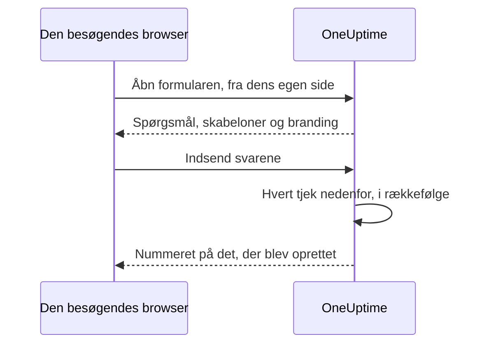

# Deling & sikkerhed

En formular er åben for alle, der har dens link, og hver indsendelse kan tilkalde dit vagthold eller sætte et vedligeholdelsesvindue i din kalender. Denne side handler om formularens side **Del** — linket, at slå formularen fra, beskeden efter indsendelse og IP-tilladelseslisten — og hvert andet tjek, en anmodning passerer på vejen.

:::cards
- [Del linket](#del-linket): Kopiér det, åbn det, og nulstil det, når det spreder sig for langt.
- [Et link til hver skabelon](#et-link-til-hver-skabelon): Ét bogmærke pr. tilfælde, én formular bag dem alle.
- [Hvad der beskytter en formular](#hvad-der-beskytter-en-formular): Hvert tjek, en anmodning passerer, i rækkefølge.
- [Fejlfinding](#fejlfinding): Hvad hver besked på formularens side betyder, og hvad du skal gøre.
:::

## Siden Del

| Kort | Hvad det indeholder |
| --- | --- |
| **Status** | **Modtager indsendelser** — om formularens link virker. |
| **Delingslink** | Linket, med **Kopiér link**, **Åbn formular** og **Nulstil link**. |
| **Efter indsendelse** | Den **Takkebesked**, folk ser, når de har indsendt, under nummeret på det, formularen oprettede. |
| **Adgang** | **IP-tilladelsesliste**. |

## Del linket

Kortet **Delingslink** viser formularens link, som `https://oneuptime.com/accounts/form/<share-key>`:

- **Kopiér link** kopierer det.
- **Åbn formular** åbner formularen i en ny fane, som folk ser den.
- **Nulstil link** giver formularen et nyt link, efter at du har bekræftet. Det gamle link holder op med at virke med det samme og viser beskeden om, at formularen ikke er tilgængelig, så alle, du delte det med, skal have det nye. Brug det, når et link har spredt sig længere, end det burde.

Alle med linket kan åbne formularen og indsende den, uden en OneUptime-konto og uden at logge ind. At være logget ind ændrer intet: OneUptime ved kun, hvem der indsendte, ud fra det navn og den e-mail, der er indtastet i formularen. Så behandl linket som et telefonnummer til dit vagthold. Del det, hvor de folk, der skal bruge det, finder det — en intranetside, en support-runbook, en fastgjort chatbesked — og ikke på et offentligt websted, medmindre du vil have indsendelser fra hvem som helst.

Linket indeholder en tilfældig nøgle for sig selv, ikke formularens ID. På en selvhostet installation serveres det fra din egen OneUptime-vært og virker kun på den adresse, `HTTP_PROTOCOL` og `HOST` konfigurerer: åbnet under et andet navn for serveren, eller på dens IP-adresse, afvises formularens anmodninger som kommende fra et andet websted.

Links til de gamle hændelsesformularer, `/accounts/incident-form/<share-key>`, åbner den samme formular på dens nye adresse.

### Et link til hver skabelon

Hver af formularens [skabeloner](/docs/forms/building#skabeloner) har sit eget link: formularens link med `?template=` og skabelonens id, som `https://oneuptime.com/accounts/form/<share-key>?template=<template-id>`. **Kopiér link** på formularens side **Skabeloner** kopierer det. Det åbner formularen med den skabelon udfyldt, så et team kan gemme ét bogmærke pr. tilfælde, mens du beholder én formular. Når indsenderen vælger en anden skabelon, følger adressen i browseren med, så det link, der kopieres, er formularen, som den ses.

En skabelons link er formularens link: det virker, så længe formularen står på **Modtager indsendelser**, og **Nulstil link** trækker det tilbage sammen med resten. Et link, der nævner en skabelon, du har slettet, åbner formularen, som om det ikke nævnte nogen — med standardskabelonen, hvis der er en.

### Slå en formular fra

For at holde op med at tage imod indsendelser uden at slette formularen skal du slå **Modtager indsendelser** fra. Linket viser så "Denne formular er ikke tilgængelig. Den kan være slået fra, eller linket kan være forældet.", og kortet **Delingslink** minder dig om, at formularen er slået fra. Slå den til igen, så virker det samme link igen.

### Takkebeskeden

Efter en indsendelse siger siden "Tak — dit svar er sendt." og giver nummeret på det, der blev oprettet, og derefter din **Takkebesked**, i Markdown. Brug den til at sige, hvad der sker nu, og hvor man skal henvende sig, når noget haster. Uden en viser siden kun standardbeskeden.

Et billede i formularens beskrivelse eller takkebesked vises for alle, der åbner linket, så længe formularen står på **Modtager indsendelser**. Slå formularen fra, eller tag billedet ud, så er billedet privat igen, medmindre noget andet, alle ser, stadig indeholder det.

## Hvad der beskytter en formular

Hver anmodning passerer disse tjek, i denne rækkefølge:

1. Anmodningen skal komme fra formularens egen side, ikke fra et andet websted — se [Anmodninger fra andre websteder](#anmodninger-fra-andre-websteder).
2. Den skal være inden for hastighedsgrænserne.
3. Formularen skal findes, stå på **Modtager indsendelser** og høre til et projekt på en plan, der omfatter formularer.
4. Den skal komme fra en adresse på **IP-tilladelsesliste**, når formularen har en.
5. En indsendelse skal bestå captchaen, når instansen har captcha slået til.
6. Hvert svar skal være inden for størrelsesgrænserne og passe til sit spørgsmål — se [Byg en formular](/docs/forms/building#størrelsesgrænser).
7. Det, svarene og indstillingerne danner, skal kunne oprettes: en hændelse skal have en alvorlighed, en begivenhed en slutning efter sin start.
8. En indsendelse skal passe inden for formularens timekvote — se [Hastighedsgrænser](#hastighedsgrænser).

En formulars logo og favicon er en del af formularen: de sendes inde i det svar, der åbner den, i base64, først når den har bestået de første fire tjek, og aldrig fra en adresse for sig selv. Ingen kan hente dem uden formularen, og ingen fil kan hentes via sit id gennem en formular; selve filerne forbliver private. En formular viser kun billeder, der er uploadet i dens eget projekt: en fil fra et andet projekt afvises, når formularen gemmes, og sendes aldrig til dens side.

### IP-tilladelsesliste

For at begrænse en formular til dine egne netværk:

:::steps
1. Åbn formularens side **Del**.
2. På kortet **Adgang** skal du klikke på **Rediger IP-tilladelsesliste**.
3. Angiv ét netværk pr. linje, og gem. Kortet viser dem derefter under **IP-tilladelsesliste**.
:::

Hver linje er en af disse:

| Post | Eksempel | Bemærkning |
| --- | --- | --- |
| En IPv4-adresse | `203.0.113.7` | |
| En IPv6-adresse | `2001:db8::7` | Matcher, uanset hvordan den er skrevet, med versaler eller med sine nuller skrevet ud. |
| Et IPv4-interval, i CIDR-notation | `10.0.0.0/8` | IPv6-intervaller understøttes ikke — angiv hver IPv6-adresse på sin egen linje. |

En IPv4-adresse skal skrives som en sådan: skrevet på IPv6-måden, som `::ffff:203.0.113.7`, afvises den. Listen tjekkes, hver gang den gemmes — fra dashboardet, API'en, Terraform eller en arbejdsgang —, og en linje, der aldrig kan matche, afvises med en besked, der nævner den. Lad listen være tom for at tillade alle netværk. Så snart den har en post, afvises en anmodning, hvis adresse ikke kan fastslås.

På OneUptime Cloud kræver det at angive IP-tilladelseslisten **Scale**-planen — både når en formular oprettes med en via API'en, og når den redigeres —, ligesom IP-tilladelseslisten for et [offentligt dashboard](/docs/dashboards/sharing). At tømme den virker på alle planer.

### Anmodninger fra andre websteder

En browser fortæller en server, hvilken side der sendte en anmodning. Når et andet websteds side får en besøgendes browser til at åbne eller indsende en formular, afvises anmodningen med "This form can only be used from its own page." — før nogen hastighedsgrænse tæller den, og uanset linket, så svaret ikke siger noget om, hvilke formularer der findes.

En anmodning afvises, når dens header `Sec-Fetch-Site` er til stede og siger andet end `same-origin` eller `none`, eller når dens header `Origin` er til stede og ikke er din OneUptime-adresse — `HTTP_PROTOCOL` og `HOST`, med porten, når `HOST` har en. En indsendelse skal også sendes som JSON (`application/json`); en, der sendes som en websides formularfelter, eller som ren tekst, afvises med "The request must be a JSON object holding the form's answers in "data".". At læse en formular kræver også den header, formularens side tilføjer til hver anmodning, den laver, `X-OneUptime-Form: 1`: en side kan ikke få en browser til at tilføje en header uden et script, og et andet websteds script, der tilføjer en, afslører sig selv med sin `Origin`.

### Hastighedsgrænser

At åbne en formular og at indsende den begrænses pr. netværksadresse, og at indsende begrænses også pr. formular:

- **At åbne en formular** — pr. formular fra én adresse, og pr. adresse på tværs af alle formularer, med plads til, at et helt kontor åbner linket på én gang. Over en af dem viser siden "For mange anmodninger. Prøv igen senere." Hvis hastighedsbegrænseren ikke kan nås, åbner formularer stadig.
- **At indsende, pr. adresse** — pr. formular fra én adresse, og pr. adresse på tværs af alle formularer. Over en af dem ser indsenderen "For mange indsendelser fra dit netværk. Vent et par minutter, og prøv igen." Alle bag én adresse — et kontornetværk, en VPN-gateway — deler disse grænser, og hver indsendelse tæller, også en, der derefter afvises for et forkert svar.
- **At indsende, pr. formular** — hvor mange poster én formular må oprette på en time, fra alle adresser tilsammen, så selv indsendelser fra mange adresser på én gang kun kan tilkalde dig et begrænset antal gange i timen. Kun en indsendelse, der har bestået alle andre tjek, tæller, lige før dens post oprettes. Over den ser alle "Denne formular modtager for mange indsendelser lige nu. Prøv igen senere.", indtil vinduet er omme. **Nulstil link** starter det nye link med en frisk kvote.

Hver grænse svarer `429` med en header `Retry-After`, i sekunder, og siden fortæller indsenderen, hvornår der kan prøves igen. Vinduerne er faste, ikke glidende. Hvis hastighedsbegrænseren ikke kan nås, afvises indsendelser i stedet for at blive lukket igennem uden at blive talt: API'en svarer `503`, og indsenderen ser "Indsendelser kan ikke modtages lige nu. Prøv igen om et par minutter."

På en selvhostet installation ændrer disse miljøvariabler i OneUptime-appen grænserne:

| Variabel | Standard | Hvad den angiver |
| --- | --- | --- |
| `FORM_RATE_LIMIT_WINDOW_SECONDS` | `60` | Vinduet for at åbne formularer, i sekunder. |
| `FORM_RATE_LIMIT_PER_FORM_AND_IP_PER_WINDOW` | `120` | Hvor ofte én adresse må åbne én formular pr. vindue. |
| `FORM_RATE_LIMIT_PER_IP_PER_WINDOW` | `600` | Hvor ofte én adresse må åbne formularer pr. vindue, på tværs af alle formularer. |
| `FORM_SUBMIT_RATE_LIMIT_WINDOW_SECONDS` | `900` | Vinduet for indsendelsesgrænserne pr. adresse, i sekunder. |
| `FORM_SUBMIT_RATE_LIMIT_PER_FORM_AND_IP_PER_WINDOW` | `10` | Indsendelser til én formular fra én adresse pr. vindue. |
| `FORM_SUBMIT_RATE_LIMIT_PER_IP_PER_WINDOW` | `30` | Indsendelser fra én adresse pr. vindue, på tværs af alle formularer. |
| `FORM_SUBMIT_RATE_LIMIT_PER_FORM_WINDOW_SECONDS` | `3600` | Vinduet for grænsen pr. formular, i sekunder. |
| `FORM_SUBMIT_RATE_LIMIT_PER_FORM_PER_WINDOW` | `60` | Poster, én formular må oprette pr. vindue, fra alle adresser tilsammen. |

Hver variabel læser også sit gamle navn, med `INCIDENT_FORM_` foran i stedet for `FORM_` — som `INCIDENT_FORM_SUBMIT_RATE_LIMIT_PER_FORM_PER_WINDOW` —, så en installation, der havde justeret hændelsesformularer, beholder sine grænser; det nye navn vinder, når begge er angivet. Hverken `config.env` eller Helm-chartets værdier sender dem videre: tilføj dem selv til miljøet for containeren `app` — med `app.extraEnv`, eller chartets fælles `extraEnv`, i Helm-chartet, eller i en `docker-compose.override.yml` til Docker Compose. `TRUSTED_PROXY_HOPS` bestemmer, hvilken adresse grænserne pr. adresse tæller.

### Captcha

Når din OneUptime-instans har hCaptcha slået til, viser formularen en captcha, og en indsendelse, der ikke har bestået den, afvises. Der er ingen indstilling pr. formular. En selvhostet installation slår captcha til med `CAPTCHA_ENABLED`, `CAPTCHA_SITE_KEY` og `CAPTCHA_SECRET_KEY` — de samme indstillinger, der beskytter tilmelding. Uden den bærer hastighedsgrænserne og IP-tilladelseslisten belastningen.

## Fejlfinding

:::details Linket siger, at formularen ikke er tilgængelig
"Denne formular er ikke tilgængelig. Den kan være slået fra, eller linket kan være forældet." Siden giver det samme svar uanset årsagen, så den aldrig fortæller en fremmed, om en formular findes:

- **Modtager indsendelser** er slået fra på siden **Del**.
- Linket blev erstattet med **Nulstil link**. Del det nye.
- Formularen blev slettet.
- På OneUptime Cloud er projektet under **Growth**-planen, eller dets abonnement er ikke betalt.
- Linket blev afkortet, da det blev kopieret.
:::

:::details Formularen kan kun åbnes fra et tilladt netværk
"Denne formular kan kun åbnes fra et tilladt netværk." Indsenderens adresse er ikke på formularens **IP-tilladelsesliste**: tilføj vedkommendes netværk, eller tøm listen. På en selvhostet installation bag en proxy eller en load balancer skal du tjekke `TRUSTED_PROXY_HOPS` — når den er for lav, ser OneUptime din proxys adresse i stedet for indsenderens. Siden siger det samme, når formularen blev åbnet på en anden adresse end din egen OneUptimes: åbn linket præcis, som kortet **Delingslink** viser det.
:::

:::details For mange indsendelser
"For mange indsendelser fra dit netværk. Vent et par minutter, og prøv igen." Alle bag én adresse deler grænserne pr. adresse, hvilket betyder noget under et stort nedbrud, når mange melder på én gang. Siden siger, hvornår der kan prøves igen. "Denne formular modtager for mange indsendelser lige nu. Prøv igen senere." er i stedet kvoten pr. formular: den handler ikke om indsenderens netværk, og meldinger tages imod igen, når vinduet er omme. Hvis indsendelserne ikke er ægte, fordi linket har spredt sig længere, end det burde, stopper **Nulstil link** det gamle link med det samme.
:::

:::details Indsendelser kan ikke modtages lige nu
"Indsendelser kan ikke modtages lige nu. Prøv igen om et par minutter." Hastighedsbegrænseren kunne ikke nås, så indsendelser afvises i stedet for at blive lukket igennem uden at blive talt. At åbne formularen virker stadig. På en selvhostet installation skal du tjekke, at Valkey, den cache, hastighedsbegrænseren tæller i, kører og kan nås fra OneUptime-appen.
:::

:::details Denne formular kan ikke oprette en hændelse, fordi den ikke har nogen alvorlighed
Formularen spørger ikke om en alvorlighed, dens indstillinger nævner ingen — eller den nævnte blev slettet — og dens hændelsesskabelon angiver heller ingen. Vælg en alvorlighed på formularens side **Ved indsendelse**. Se [Ingen alvorlighed, ingen hændelse](/docs/forms/on-submit#sådan-bliver-en-indsendelse-til-en-hændelse).
:::

:::details En indsendelse afvises
Beskeden siger, hvad der er galt: et påkrævet svar mangler eller er kun mellemrum, et svar er for langt eller passer ikke til sit spørgsmål, e-mailadressen er ikke én almindelig adresse, eller et vedligeholdelsesvindue slutter, før det starter. "Captcha-verifikationen mislykkedes. Prøv igen." betyder, at captchaen ikke blev bestået eller er udløbet: løs den igen. På en selvhostet installation, hvor hver indsendelse fejler captchaen, skal du tjekke, at `CAPTCHA_SITE_KEY` og `CAPTCHA_SECRET_KEY` begge er angivet.
:::

:::details Et spørgsmål er ikke på formularen
Byggeren markerer spørgsmål, den udelader fra den offentlige formular — et brugerdefineret felt, der blev slettet, for eksempel —, og **Forhåndsvisning** siger, når den udelader et. Se [Når byggeren markerer et spørgsmål](/docs/forms/building#når-byggeren-markerer-et-spørgsmål). Et spørgsmål med mærket **Skjult** udelades med vilje: kun skabeloner besvarer det. Se [Skjulte spørgsmål](/docs/forms/building#skjulte-spørgsmål). Et spørgsmål kan også være på formularen for én skabelon og ikke for en anden: hver skabelon kan skjule et spørgsmål eller stille et, formularen skjuler. Åbn skabelonens **Rediger**, og tjek dens **Spørgsmål**. Se [Sådan spørger en skabelon om hvert spørgsmål](/docs/forms/building#sådan-spørger-en-skabelon-om-hvert-spørgsmål).
:::

:::details En skabelon udfylder ikke et spørgsmål
En skabelons svar bruges kun, så længe det stadig passer til sit spørgsmål: en mulighed, spørgsmålet stadig tilbyder, en post, formularen stadig tilbyder, tekst, der ikke er for lang. Redigér skabelonen, besvar spørgsmålet igen, og gem den. Se [Skabeloner](/docs/forms/building#skabeloner).
:::

:::details Hændelsen eller begivenheden er ikke på statussiden
Det er med vilje: hændelser fra en formular oprettes skjulte, og vedligeholdelsesbegivenheder forbliver skjulte, medmindre formularens indstillinger under **Offentliggørelse** siger andet. Se [Hvad en indsendelse opretter](/docs/forms/on-submit).
:::

:::details Ingen blev tilkaldt
En formulars hændelse kører de vagtpolitikker, dens indstillinger og dens skabelon nævner, og hvad dine vagtregler tilføjer, som enhver anden hændelse. Uden nogen af dem tilkaldes ingen. Tilføj en vagtpolitik på formularens side **Ved indsendelse**, eller skriv en vagtregel, der matcher dens hændelser — på en etiket, formularen altid tilføjer, for eksempel.
:::

## Næste trin

:::cards
- [Formularer – overblik](/docs/forms/index): Hvad formularer er til, rettigheder og API'en.
- [Byg en formular](/docs/forms/building): Spørgsmålene, skjulte spørgsmål og skabeloner.
- [Hvad en indsendelse opretter](/docs/forms/on-submit): Den hændelse eller begivenhed, hver indsendelse opretter.
:::
