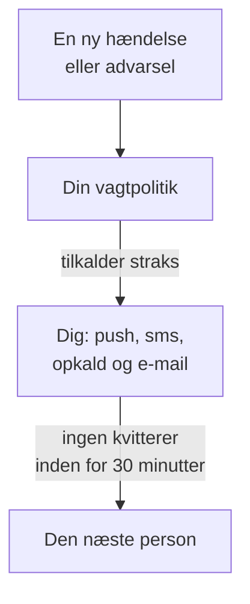

# Bliv tilkaldt via opkald, SMS eller push

Når du har fulgt denne guide, bliver du tilkaldt på din telefon via push-notifikation, sms eller opkald ved hver ny hændelse og advarsel i dit projekt. Den næste person tilkaldes, hvis ingen kvitterer inden for 30 minutter, og et testkald, du har kvitteret for, viser, at det virker. Undervejs følger du den guidede opsætning **Tilkalde den rette person, når noget går ned**, og det tager omkring 10 minutter.

## Det skal du bruge

- Et projekt, du ejer: sms og opkald slås til af projektets ejer, og en vagtpolitik oprettes af ejeren eller en administrator.
- Din mobiltelefon.
- De teammedlemmer, der skal tilkaldes, tilføjet til projektet: [Inviter personer](/docs/permissions/inviting-people) viser hvordan.

:::tabs
@tab OneUptime Cloud
Push-notifikationer er gratis på alle planer. Sms og opkald betales fra projektets saldo, som starter på 0.00 USD, og når du tilføjer et telefonnummer, sendes der en sms, så saldoen skal først være over 1.00 USD. Når du tilføjer saldo, trækkes beløbet på projektets kort. Free-planen har plads til én person og én eskaleringsregel: kun du bliver tilkaldt, og tilkaldet gentages i stedet for at gå videre til en anden.
@tab Selvhostet
Din server skal kunne sende e-mail, sms og opkald. Dens masteradministrator sætter dem op på `/admin/setup`, med en test for hver, som [Selv-hosting-guide](/docs/installation/self-hosting-guide) viser. Push-notifikationer når appen via OneUptimes push-relay, uden at noget skal sættes op.
:::

## Trin

:::steps
### Åbn den guidede opsætning

På siden **Hjem** i dit projekt klikker du på **Opsæt en vagtpolitik** i tjeklisten **Velkommen til OneUptime 👋**. Et nyt projekts startside spørger først **Hvad vil du gøre først?**: sæt flueben ved **Tilkalde den rette person, når noget går ned**, og klik på **Fortsæt**. Mangler trinnet, eller er det allerede udført, så tryk på `Ctrl+K` (`Cmd+K` på en Mac), skriv `get paged`, og vælg **Tilkalde den rette person, når noget går ned**.

### Hent appen på din telefon

Installér OneUptime On-Call fra App Store eller Google Play, og log ind: så registreres din telefon til push-notifikationer. Tilbage i opsætningen klikker du på **Kontrollér igen**: **Mobilapp eller browser** under **Hvordan skal vi nå dig?** viser nu din telefon.

### Slå sms og opkald til

Nye projekter starter med sms og telefonopkald slået fra. Ejer du projektet, så klik på **Slå sms og opkald til**; alle andre får at vide, hvem der kan. Er saldoen på OneUptime Cloud 1.00 USD eller mindre, så klik på **Tilføj saldo**, indtast 20 til 1.000 USD under **Beløb (USD)**, og klik på **Genoplad**.

### Tilføj dit telefonnummer

Skriv dit mobilnummer med landekode i **Dit telefonnummer**, for eksempel `+15551234567`, og klik på **Send mig en kode på sms**. Indtast koden fra sms'en, og klik på **Bekræft**: det samme nummer bliver også ringet op ved tilkald. Klik på **Fortsæt**. Vil du kun tilkaldes via appen og e-mail, så udelad nummeret, og klik straks på **Fortsæt**.

### Vælg, hvem der ellers tilkaldes

Under **Hvem har ellers vagt?** er du allerede med i **Tilkaldes først**. Klik på **Tilføj teammedlemmer** for at tilkalde andre sammen med dig, og klik derefter på **Gem og fortsæt**. I et projekt, der endnu ikke har en vagtpolitik, oprettes `Default on-call policy`, som tilkalder dem ved hver ny hændelse og advarsel. I et projekt, der har en, vælger du den under **Vagtpolitik** og tilføjer i stedet personer under **Føj til den første eskaleringsregel**. Kan nogen ikke nås endnu, bliver trinnet stående på **Når en tilkaldelse dem?**: klik på **Send påmindelse om opsætning** for dem og derefter på **Fortsæt**.

### Bestem, hvad der sker, hvis ingen svarer

Under **Hvad hvis ingen svarer?** beholder du **Tilkald en anden**, vælger, hvem det skal være, under **Tilkaldes derefter** og lader **Minutter at vente** stå på `30` eller ændrer det. Klik på **Gem og fortsæt**. På Free-planen tilbyder trinnet i stedet **Tilkald de samme personer igen**, med **Antal nye tilkaldelser** på `2`.

### Send et testkald

Under **Send et testkald** klikker du på **Test denne politik**. Vælg en **Alvorlighed**, og klik på **Send testkald**. Politikkens første eskaleringsregel tilkaldes, som en rigtig hændelse ville tilkalde den, og der står TEST i hver besked. Der oprettes ingen hændelse, og ingen statusside eller abonnent får besked.

### Kvittér for testkaldet

Åbn linket i sms'en eller e-mailen, og kvittér for tilkaldet dér, eller tryk 1 under opkaldet. Appen viser, at tilkaldet er kommet frem, men kan ikke kvittere for en test. Klik derefter på **Færdig** i dialogen og på **Fortsæt**.
:::

## Tjek, at det virker

- Testtrinnet viser, hvem der kvitterede for tilkaldet, hvordan og hvor hurtigt.
- Opsætningen slutter med **Tilkaldelse er sat op**, hentet fra det, der faktisk er gemt: **Hvem der tilkaldes**, **Hvis ingen svarer** og **Testet**. Et problem med selve politikken, for eksempel en person, den ikke kan nå, står under **Kræver opmærksomhed**.
- På **Hjem** markerer tjeklisten **Opsæt en vagtpolitik** som udført. Var det det sidste trin, er tjeklisten væk.

Tilkalder politikken en anden, kan du også se eskaleringen: klik på **Åbn vagtpolitikken** i oversigten og derefter på **Test denne politik**. Slå **Gå gennem hvert eskaleringsniveau** til, send testen, og lad være med at kvittere for det første tilkald: den næste person tilkaldes op til 2 minutter senere.

## Hvad der kan gå galt

:::details Knappen Send mig en kode på sms mangler
Sms er slået fra eller kan ikke sendes, og trinnet siger hvorfor. Kun en projektejer eller en person, der administrerer fakturering, ser **Slå sms og opkald til**. På OneUptime Cloud skjuler en saldo på 1.00 USD eller mindre feltet. På en selvhostet server, der ikke kan sende sms, ser masteradministratoren **Sæt sms og opkald op**, der åbner Admin Dashboard, så Twilio kan tilføjes, sådan som [Twilio-integration](/docs/self-hosted/twilio-integration) viser.
:::

:::details Tilføj saldo siger, at der ikke blev fundet nogen betalingsmetode
Når du tilføjer saldo, trækkes beløbet på projektets kort. Tilføj et kort under **Projektindstillinger → Fakturering og fakturaer → Fakturering** med **Tilføj betalingsmetode**, og tilføj derefter saldo igen. Indtil da tilkalder appen og e-mailen dig stadig.
:::

:::details Selvhostet: nummeret afvises, fordi der ikke er sat en Twilio-konto op
Kun masteradministratoren får på forhånd besked om, at serveren ikke kan sende sms. Bed vedkommende om at sætte sms og opkald op på `/admin/setup`. Klik imens på **Fortsæt**: appen og e-mailen tilkalder dig stadig.
:::

:::details Koden eller testkaldet kommer aldrig frem
Tjek først nummerets landekode. Efter et testkald lukker du dialogen med **Færdig** og klikker på **Jeg modtog den ikke**: den siger, hvad du skal tjekke, og **Åbn mine notifikationsmetoder** viser alle de måder, du kan nås på. På en selvhostet server sender du en test-sms fra `/admin/setup` og kører `npm run doctor` på serveren.
:::

## Næste skridt

:::cards
- [Vagtplaner](/docs/on-call/schedules): Del vagterne, så hvert tilkald går til den, der har vagt. På Cloud fra Growth-planen.
- [Eskaleringsregler](/docs/on-call/escalation-rules): Føj niveauer, teams og vagtplaner til politikken.
- [Sådan når man mig](/docs/notifications/on-call-rules): Vælg, hvilken metode der når dig først, og hvornår.
- [Udgiv en statusside](/docs/guides/status-page): Fortæl dine kunder, hvad der sker, på dit eget domæne.
:::
