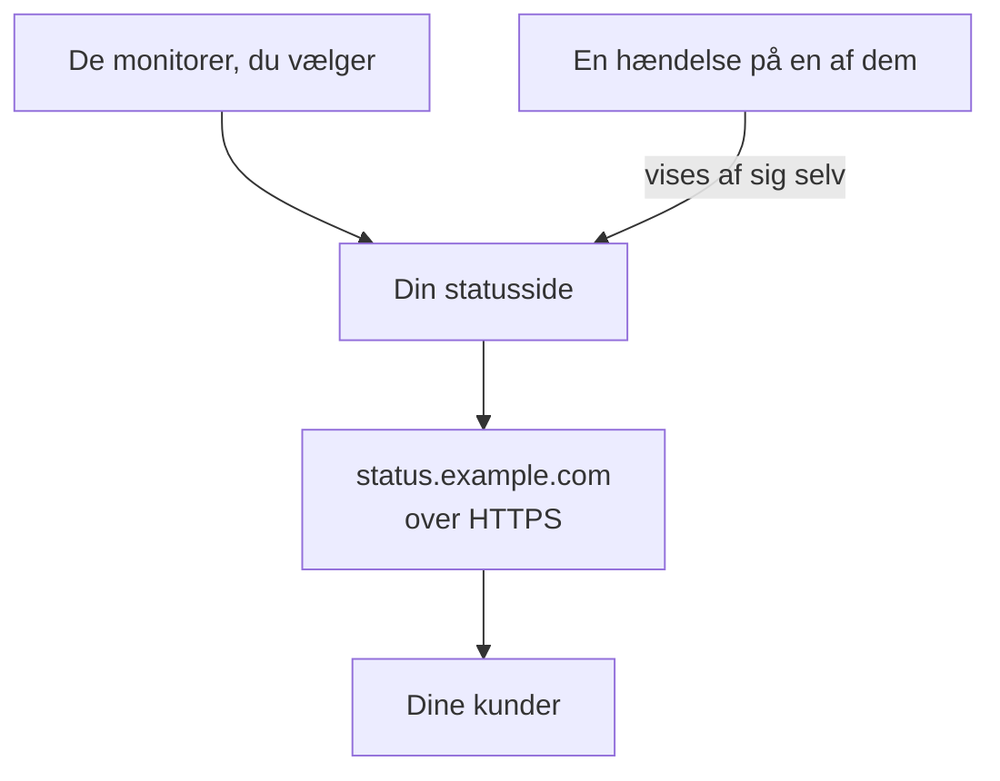

# Udgiv en statusside

Når du har fulgt denne guide, åbner dine kunder en statusside på din egen adresse, for eksempel `status.example.com`, over HTTPS. Den viser de monitorer, du vælger, med deres status og oppetid, og en hændelse på en af dem vises der af sig selv. Undervejs følger du den guidede opsætning **Udgiv en statusside** og tilføjer derefter dit domæne under sidens **Brugerdefinerede domæner**: omkring 15 minutter plus den tid, din DNS-udbyder skal bruge.

## Det skal du bruge

- Mindst én monitor: en statusside viser monitorer. Har du ingen endnu, tilbyder den guidede opsætning først **Konfigurer en monitor**.
- Rollen som projektejer eller administrator: siden kræver tilladelse til at oprette statussider, og dit domæne kræver tilladelse til at tilføje og bekræfte projektets domæner.
- Et domæne, du har kontrol over, og adgang til dets DNS-poster hos din DNS-udbyder.

:::tabs
@tab OneUptime Cloud
Et brugerdefineret domæne og dets gratis SSL-certifikat følger med alle planer. Free-planen har én statusside pr. projekt: har du allerede en, så åbn dens **Brugerdefinerede domæner**, og start ved trinnet, der tilføjer dit domæne. En ny statusside er offentlig; at gøre den privat kræver Growth-planen.
@tab Selvhostet
Din server skal have sit eget værtsnavn med en A-post, der peger på den, for eksempel `oneuptime.example.com`, og svare på port 80 og 443. Angiv det som `STATUS_PAGE_CNAME_RECORD` i `config.env` (`statusPage.cnameRecord` i Helm-chartet) i stedet for eksempelværdien dér. Gratis certifikater kræver også `LETS_ENCRYPT_ACCOUNT_KEY` (`letsEncrypt.accountKey`): en privat nøgle lavet med openssl og kodet i base64. Genstart OneUptime, når du har ændret dem. **Tilføj brugerdefineret domæne** tjekker serveren først og viser, hvad der stadig mangler.
:::

## Trin

:::steps
### Åbn den guidede opsætning

På siden **Hjem** i dit projekt klikker du på **Udgiv en statusside** i tjeklisten **Velkommen til OneUptime 👋**. Et nyt projekts startside spørger først **Hvad vil du gøre først?**: sæt flueben ved **Fortælle mine kunder det via en statusside**, og klik på **Fortsæt**. Mangler trinnet, eller er det allerede udført, så tryk på `Ctrl+K` (`Cmd+K` på en Mac), skriv `status page`, og vælg **Udgiv en statusside**.

### Giv den et navn, og vælg, hvad den viser

Under **Giv den et navn, og vælg, hvad den viser** beholder du forslaget i **Statussidens navn** eller skriver dit eget. Under **Hvad den viser** sætter du flueben ved de monitorer, dine kunder skal se, eller klikker på **Vælg alle**. Klik på **Opret statussiden**. Fra nu af er siden offentlig på sit link og viser kun de monitorer, du satte flueben ved.

### Se, hvad dine kunder ser

Under **Det er dette, dine kunder ser** åbner du adressen under **Offentligt link**: dine monitorer står på listen med deres status. Tilbage i opsætningen klikker du på **Ser godt ud**.

### Åbn Brugerdefinerede domæner

Opsætningen slutter med en oversigt. Under **Gør den til din egen (valgfrit)** klikker du på **Dit eget domæne**. Statussidens **Brugerdefinerede domæner** åbner.

### Tilføj dit domæne

Klik på **Tilføj brugerdefineret domæne**. I **Domæne** skriver du den adresse, dine kunder skal åbne, for eksempel `status.example.com`, og klikker på **Fortsæt**. **DNS-opsætning** åbner med de poster, der skal tilføjes.

### Tilføj DNS-posterne

Hos din DNS-udbyder tilføjer du hver post, som **DNS-opsætning** viser, med dens **Type**, **Navn** og **Værdi**: en CNAME-post, der peger adressen mod OneUptime, og, første gang projektet bruger dette domæne, en TXT-post, der viser, at projektet ejer det. Sætter din udbyder selv domænet på hvert navn, så skriv kun delen foran, for eksempel `status`, og `@` for selve domænet.

### Tjek posterne

Hold **DNS-opsætning** åben, og klik på **Tjek nu**. Under hver post står der, hvad der blev slået op, og hvad der kom tilbage. TXT-posten kommer først: indtil den er fundet, bliver domænet ikke tilføjet, så klik på **Tjek nu** igen, indtil den findes. Så snart CNAME-posten er fundet, siger dialogen **Din CNAME-post er bekræftet.**, og et gratis SSL-certifikat udstedes, normalt inden for 15 minutter.
:::

## Tjek, at det virker

- Åbn `https://status.example.com` med din egen adresse: din statusside åbner uden certifikatadvarsel.
- På **Brugerdefinerede domæner** står der **Certifikat udstedt, fornyes automatisk.** under domænets **Status**. Der kan stå **Udsteder et gratis certifikat, normalt inden for 15 minutter.** et stykke tid, selvom siden allerede åbner.
- På **Hjem** markerer tjeklisten **Udgiv en statusside** som udført: det sker, så snart en statusside viser en monitor. Var det det sidste trin, er tjeklisten væk.

Mere skal der ikke til: OneUptime fornyer selv certifikatet. Når domænet står på listen, tjekker OneUptime dets CNAME-post hvert 15. minut og bekræfter det, når posten er live, også selvom du lukker **DNS-opsætning**.

## Hvad der kan gå galt

:::details Domænet står ikke på listen, efter at DNS-opsætning blev lukket
**DNS-opsætning** blev lukket, før dens TXT-post blev fundet, så domænet blev aldrig tilføjet. Klik på **Tilføj brugerdefineret domæne**, skriv den samme adresse, klik på **Fortsæt** og derefter på **Tjek nu**, indtil dialogen finder begge poster.
:::

:::details Domænet bliver stående på Venter på DNS
Åbn **DNS-opsætning** fra domænets række, og klik på **Tjek nu**: den siger, hvad den fandt. Tjek, at postens navn er hele adressen, for eksempel `status.example.com`, og at dens værdi er den, **DNS-opsætning** viser. Svarer navnet med en adresse, har det en A-post, eller din DNS-udbyder proxyer det: erstat A-posten, eller sæt navnet til kun DNS. Til et roddomæne, for eksempel `example.com`, bruger du din udbyders ALIAS-, ANAME- eller CNAME-flattening-post.
:::

:::details Status siger, at der ikke kunne udstedes et gratis certifikat
En CAA-post på dit domæne, der udelader `letsencrypt.org`, blokerer certifikatet. På en selvhostet server skal Let's Encrypt kunne nå serveren på port 80. Ret årsagen: OneUptime bliver selv ved med at prøve, og **Tjek nu** i **DNS-opsætning** bestiller igen, højst én gang hvert 15. minut pr. domæne.
:::

:::details Selvhostet: serveren er ikke klar til brugerdefinerede domæner
**Tilføj brugerdefineret domæne** siger **Denne server er endnu ikke klar til brugerdefinerede domæner** med en linje for hver ting, der stadig mangler, og hvad der skal ændres: indstillingerne under [Det skal du bruge](#det-skal-du-bruge). Uden `LETS_ENCRYPT_ACCOUNT_KEY` siger et bekræftet domæne **Bekræftet. Bruger din egen proxys HTTPS.**: lever dets HTTPS fra din egen proxy. [Statusside – branding og domæner](/docs/status-pages/branding-and-domains#før-du-starter) har detaljerne.
:::

## Næste skridt

:::cards
- [Statusside – branding og domæner](/docs/status-pages/branding-and-domains): Dit logo, dine farver, header-links og sidefod.
- [Abonnenter og meddelelser](/docs/status-pages/subscribers): Lad kunder abonnere, og send meddelelser.
- [Planlagt vedligeholdelse – Oversigt](/docs/scheduled-maintenance/index): Fortæl kunderne om planlagt arbejde, før det starter.
- [Bliv tilkaldt via opkald, SMS eller push](/docs/guides/paging): Bliv tilkaldt, når en af monitorerne går ned.
:::
