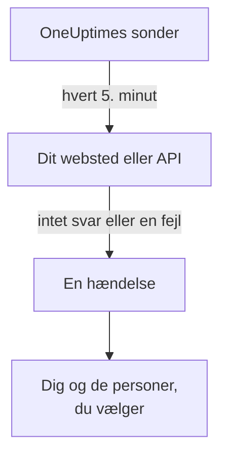

# Få besked, når dit websted eller API går ned

Når du har fulgt denne guide, tjekker OneUptime dit websted eller API hvert 5. minut, åbner en hændelse, når det holder op med at svare eller svarer med en fejl, og giver dig besked. Et testkald, du har kvitteret for, viser, at beskeden når frem til dig. Undervejs følger du den guidede opsætning **Vide, når mit website eller API er nede**, og det tager omkring 5 minutter.

## Det skal du bruge

- Et OneUptime-projekt, hvor du må oprette monitorer: det må ejere, administratorer og medlemmer. For at oprette en konto og et projekt følger du første del af [Hurtigstart](/docs/introduction/quickstart#opret-et-projekt).
- Adressen, der skal tjekkes, for eksempel `https://example.com`. Til et API vælger du et endpoint, der svarer på et almindeligt `GET` uden nøgle, for eksempel et sundhedstjek: et svar som `401` tæller som nede.

:::tabs
@tab OneUptime Cloud
Sonder i flere regioner tjekker adressen, så den skal kunne nås fra internettet. Free-planen har plads til 10 aktive monitorer.
@tab Selvhostet
Adressen tjekkes fra din servers egen sonde, så den skal kunne nås derfra. For at du kan få e-mails, skal serveren kunne sende dem: dens masteradministrator sætter det op på `/admin/setup`, som [Selv-hosting-guide](/docs/installation/self-hosting-guide) viser. Masteradministratoren bliver ikke ejer af det, vedkommende opretter, så vedkommende tilføjer sig selv på monitorens side **Ejere** for at få e-mails.
:::

## Trin

:::steps
### Åbn den guidede opsætning

Siden **Hjem** i et nyt projekt spørger først **Hvad vil du gøre først?**: sæt flueben ved **Vide, når mit website eller API er nede**, og klik på **Fortsæt**. Klik derefter på **Opret din første overvågning** i tjeklisten **Velkommen til OneUptime 👋**. Mangler trinnet i tjeklisten, så tryk på `Ctrl+K` (`Cmd+K` på en Mac), skriv `website down`, og vælg **Vide, når mit website eller API er nede**.

### Indtast adressen

Under **Hvad skal vi tjekke?** skriver du adressen i **Adresse på website eller API**. Er det et API-endpoint, så sæt flueben ved **Dette er et API-endpoint**. Klik på **Start tjekket**: sonderne tjekker adressen med det samme, og en sætning fortæller, hvad de fandt. Klik på **Fortsæt**.

### Vælg, hvem der får besked

Under **Hvem skal have besked?** afhænger det af projektet, hvad du ser:

- Har projektet endnu ingen vagtpolitik eller vagtregel, er du allerede med i **Hvem der tilkaldes**. Klik på **Tilføj teammedlemmer** for at tilføje personer, der allerede er med i projektet, og klik derefter på **Gem og fortsæt**. Dermed oprettes `Default on-call policy`, som tilkalder dem ved hver ny hændelse og advarsel i projektet.
- Har projektet en vagtpolitik eller vagtregel, afgør projektets egne regler, hvem der tilkaldes: klik på **Fortsæt**.
- Som medlem må du ikke sætte tilkaldelse op, så trinnet fortæller, at du får e-mails som monitorens ejer: klik på **Fortsæt**.

### Send dig selv en test

Under **Send en test** klikker du på **Send mig et testkald**. Vælg en **Alvorlighed**, og klik på **Send testkald**. Testen når dig på samme måde som et rigtigt tilkald, og der står TEST i hver besked. Der oprettes ingen hændelse.

### Kvittér for testkaldet

Åbn linket i e-mailen, og kvittér for tilkaldet dér. Et bekræftet telefonnummer virker også, så snart sms og opkald er slået til for projektet: åbn linket i sms'en, eller tryk 1 under opkaldet. Klik derefter på **Færdig** i dialogen og på **Fortsæt**.
:::

## Tjek, at det virker

- Opsætningen slutter med en oversigt, hentet fra det, der faktisk er gemt: **Tjekket**, **Når den går ned**, **Hvem der får besked** og **Testet**.
- Klik på **Åbn monitoren** og derefter på **Vis kæden** på kortet **Når den går ned**: så vises kæden fra monitoren til de personer, den når, og der står **Intet stopper kæden.**, når intet ville stoppe den.
- På **Hjem** markerer tjeklisten **Opret din første overvågning** som udført, så snart det første tjek kommer ind. Var det det sidste trin, er tjeklisten væk.

Vil du senere sætte en anden adresse op, så åbn opsætningen igen, og klik på **Tjek en anden adresse**.

## Hvad der kan gå galt

:::details Det første tjek melder aldrig tilbage
Siger sætningen, at ingen placering tjekker adressen, har monitoren ingen sonde; bliver den ved med at sige, at adressen tjekkes, er monitorens sonde ikke forbundet. Åbn **Monitorer → Indstillinger → Sonder** for at se hver sondes status. På en selvhostet server tjekker masteradministratoren serverens sonde på `/admin/setup`. Åbn derefter monitoren, tilføj en forbundet sonde til den, og åbn opsætningen igen.
:::

:::details Webstedet virker, men monitoren siger, at det er nede
Monitoren tæller det som nede, når der ikke kommer noget svar, eller når svaret ligger uden for 200 til 399. En firewall, der blokerer sonderne, ser ud som manglende svar: på OneUptime Cloud tillader du adresserne på [IP-adresser](/docs/configuration/ip-addresses); på en selvhostet server tillader du den maskine, sonden kører på. Hvordan du ændrer reglen, står i [Websted-monitor](/docs/monitor/website-monitor) eller [API-monitor](/docs/monitor/api-monitor).
:::

:::details Der kan ikke kvitteres for testkaldet
Der er ikke kommet nogen besked, du kan kvittere fra, hvilket på en selvhostet server som regel betyder, at serveren endnu ikke kan sende e-mail: trinnet siger det, og masteradministratoren ser **Opsæt e-mail**. Sæt det op, og klik derefter på **Send endnu en test**, eller klik på **Spring testen over**, og kom tilbage senere. Efter en test lukker du dialogen med **Færdig** og klikker på **Jeg modtog den ikke**: den siger, hvad du skal tjekke.
:::

## Næste skridt

:::cards
- [Bliv tilkaldt via opkald, SMS eller push](/docs/guides/paging): Bliv tilkaldt på din telefon, og tilkald den næste person, hvis ingen svarer.
- [Udgiv en statusside](/docs/guides/status-page): Vis monitoren for dine kunder, på dit eget domæne.
- [Kriterier og statusser](/docs/monitor/criteria-and-statuses): Bestem præcis, hvornår en monitor tæller som nede.
:::
