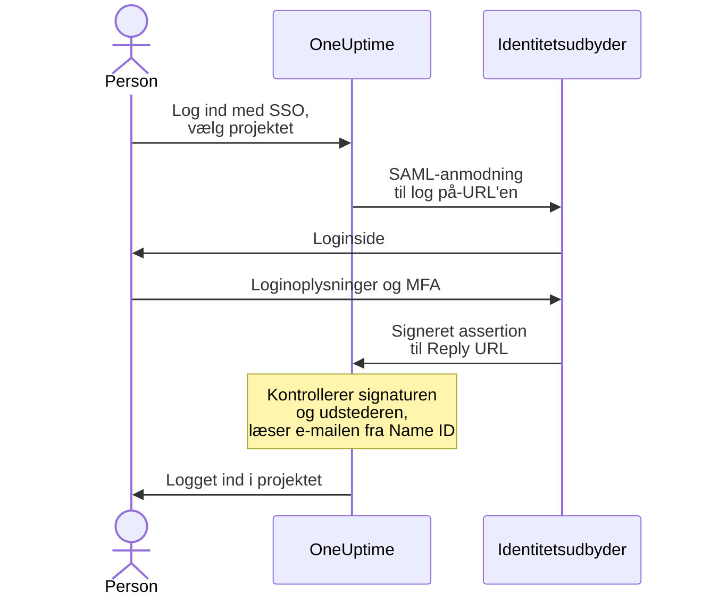

# SSO

Med single sign-on (SSO) logger personerne i dit projekt ind i OneUptime gennem din organisations identitetsudbyder (IdP) via SAML 2.0 eller OpenID Connect. Du styrer adgang, adgangskoder og multifaktorgodkendelse ét sted, og du kan kræve SSO for alle i projektet.

> [!NOTE]
> **Udgave:** SSO, herunder "Require SSO to sign in", er en del af alle OneUptime-udgaver: selvhostede installationer får det i Community Edition uden at skulle bruge en licens. På OneUptime Cloud er det tilgængeligt fra planen **Scale** og opefter. Se [Enterprise Edition](/docs/self-hosted/enterprise) for, hvad hver udgave indeholder.

:::cards
- [Opsæt en SAML-udbyder](#opsætning-af-sso): Opret den i OneUptime, og giv din IdP to URL'er.
- [Vejledninger til identitetsudbydere](#vejledninger-til-identitetsudbydere): Keycloak, Microsoft Entra ID og Okta, trin for trin.
- [OpenID Connect](#openid-connect-oidc): Log ind via en OIDC-app i stedet.
- [Kræv SSO](#kræv-sso-for-dit-projekt): Gør SSO til den eneste vej ind i projektet.
:::

## Sådan fungerer SAML-login

En SAML-udbyder forbinder ét projekt med én applikation i din identitetsudbyder. Den, der logger ind, vælger projektet på OneUptimes side **Log ind med SSO**, logger ind hos din IdP og kommer tilbage logget ind.



OneUptime læser kun få ting fra den assertion, din IdP sender:

| Fra assertionen | Hvad OneUptime gør med det |
| --- | --- |
| Signatur | Kontrollerer den med udbyderens **Offentligt certifikat**. Svaret skal være signeret og må ikke være krypteret. |
| Issuer | Skal svare præcist til udbyderens **Udsteder**. |
| Audience | Skal være udbyderens **Identifikator (Entity ID)**. Et svar, som din IdP lavede til en anden applikation, afvises. |
| Recipient og Destination | Skal være udbyderens **Svar-URL**, den adresse, svaret blev sendt til. |
| `NotBefore` og `NotOnOrAfter` | Svaret accepteres kun, så længe de tillader det, og senest 10 minutter efter, at det blev udstedt, med 3 minutters spillerum for ure, der ikke går ens. |
| Name ID | Personens e-mailadresse. Den skal være en gyldig e-mailadresse. |
| Navneattributter | Personens navn, som bruges, når OneUptime opretter kontoen: et visningsnavn (`displayName` eller `http://schemas.microsoft.com/identity/claims/displayname`) eller et for- og efternavn (`firstName` og `lastName` eller claimene `givenname` og `surname`, som Microsoft Entra ID sender som standard). Valgfri. |
| `http://schemas.microsoft.com/identity/claims/objectidentifier` | Personens objekt-ID, som Microsoft Entra ID sender som standard. Det første login via udbyderen knytter kontoen til det, og et senere login, der angiver kontoens e-mailadresse med et andet objekt-ID, afvises. Valgfri. |

Hvert svar logger kun ind én gang. Sendes det igen, for eksempel når du går tilbage i browseren efter at have logget ind, afvises det: log ind igen.

Personer, der logger ind for første gang, kommer med i udbyderens **Teams**, og de afgør, hvad personen kan gøre: se [Roller og teams for SSO-brugere](#roller-og-teams-for-sso-brugere).

> [!NOTE]
> På OneUptime Cloud logger OneUptime ikke en person ind, første gang vedkommende logger ind i projektet med en af projektets SAML- eller OIDC-udbydere; i stedet sender OneUptime et link pr. e-mail. Personen åbner linket, bekræfter, at projektets single sign-on må logge vedkommende ind, og fortsætter med at logge ind. Linket gælder i 24 timer. Det sker én gang pr. projekt og igen, hvis personen forlader projektet og vender tilbage. En person, du inviterer, og hvis login styres af SSO, får ikke en sådan mail, uanset om vedkommende allerede har en OneUptime-konto: vælger personen en af projektets udbydere på den side, invitationen åbner, logges vedkommende ind med det samme, fordi linket i invitationen allerede har bevist, at postkassen er personens. Selvhostede installationer logger personer ind med det samme. På OneUptime Cloud får ethvert login, der ikke går direkte igennem, det samme svar, uanset om adressen har en konto: den, der endnu ikke har en konto, får også mailen, og kontoen oprettes, når personen bekræfter, mens en blokeret konto eller en OneUptime-administrator ikke får nogen mail. En selvhostet installation afviser i stedet de to med én besked.

På OneUptime Cloud optager en person, der kommer med i projektet via SSO, en plads, præcis som en person, du inviterer. Hvis din plan har et fast antal pladser, og de alle er optaget, kan nye personer ikke komme med via SSO, før en plads bliver ledig.

## Opsætning af SSO

Du skal have tilladelse til at tilføje SSO-udbydere — **Projektejer**, **Projektadministrator** eller **Create Project SSO** — og på OneUptime Cloud planen **Scale**. Se [vejledningerne til identitetsudbydere](#vejledninger-til-identitetsudbydere) for din identitetsudbyders side.

:::steps
1. **Gå til projektindstillinger**

   - Åbn dit OneUptime-projekt
   - Gå til **Projektindstillinger** > **Sikkerhed** > **SSO**

2. **Opret SSO-konfigurationen**

   - Klik på **Tilføj SAML-udbyder**
   - Indtast et **Navn** til SSO-konfigurationen (f.eks. "Keycloak SAML" eller "Okta SAML")
   - Indtast **Log på-URL** fra din identitetsudbyder
   - Indtast **Udsteder** (Entity ID) fra din identitetsudbyder
   - Indsæt **Offentligt certifikat** fra din identitetsudbyder
   - I trinnet **Login** starter **Teams** med dit projekts medlemsteam: personer, der logger ind for første gang, kommer med i disse teams. Kun teams, du selv kunne invitere nogen til, accepteres: et team, der giver mere adgang, end du har, nævnes under **Teams**
   - Resten er allerede udfyldt under **Flere felter**: **Signaturmetode** (`RSA-SHA256`), **Digest-metode** (`SHA256`) og en beskrivelse ("Sign in with" og navnet). Ændr dem kun, hvis din identitetsudbyder kræver det

3. **Hent OneUptimes SSO-metadata**
   - Når du gemmer, åbnes dialogen **SSO-konfiguration**. Du kan åbne den igen med knappen **Vis SSO-konfiguration**
   - Kopiér **Identifikator (Entity ID)**, f.eks. `https://oneuptime.com/<project-id>/<provider-id>` — den skal bruges i din IdP-konfiguration
   - Kopiér **Svar-URL (Assertion Consumer Service-URL)**, f.eks. `https://oneuptime.com/identity/idp-login/<project-id>/<provider-id>` — den skal bruges i din IdP-konfiguration
   - En ny udbyder starter slået fra. Når din IdP har disse to værdier, skal du redigere udbyderen og slå **Aktiveret** til

4. **Test udbyderen**
   - Åbn linket i kortet **SSO-loginlink**, og vælg udbyderen på den side, der åbnes. Du sendes til din identitetsudbyders loginside og tilbage til OneUptime, logget ind
   - Når det virker, kan du [kræve SSO](#kræv-sso-for-dit-projekt) for projektet
:::

## Vejledninger til identitetsudbydere

Vælg din identitetsudbyder. Hver vejledning henter IdP'ens værdier, opretter udbyderen i OneUptime og giver derefter IdP'en OneUptimes **Identifikator (Entity ID)** og **Svar-URL**.

:::tabs
@tab Keycloak
Keycloak er en populær open source-løsning til identitets- og adgangsstyring. Du skal bruge en kørende Keycloak-instans med et realm og administratoradgang til både Keycloak og OneUptime.

:::steps
1. **Saml dit realms værdier**

   - **Log på-URL**: `https://<your-keycloak-domain>/auth/realms/<your-realm>/protocol/saml`
   - **Udsteder**: `https://<your-keycloak-domain>/auth/realms/<your-realm>`
   - **Certifikat**: realmets signeringscertifikat. Åbn `https://<your-keycloak-domain>/auth/realms/<your-realm>/protocol/saml/descriptor` og kopiér værdien `X509Certificate`, eller åbn **Realm settings** > **Keys** og klik på **Certificate** ved RS256-nøglen

   Keycloak 17 og nyere leverer disse URL'er uden præfikset `/auth`. Sæt certifikatet mellem sine egne linjer, sådan her:

   ```text
   -----BEGIN CERTIFICATE-----
   MIICnzCCAYcCBgFyPZ8QFzANBgkqhkiG.......
   -----END CERTIFICATE-----
   ```

2. **Opret udbyderen i OneUptime**

   Gå til **Projektindstillinger** > **Sikkerhed** > **SSO**, klik på **Tilføj SAML-udbyder**, og udfyld:
   - **Navn**: et beskrivende navn (f.eks. `my-project-oneuptime`)
   - **Log på-URL** og **Udsteder**: værdierne ovenfor
   - **Offentligt certifikat**: certifikatet mellem sine egne linjer `BEGIN CERTIFICATE` og `END CERTIFICATE`
   - **Signaturmetode** og **Digest-metode**: allerede angivet under **Flere felter** (`RSA-SHA256` og `SHA256`)

   Gem, og kopiér **Identifikator (Entity ID)** og **Svar-URL (Assertion Consumer Service-URL)** fra dialogen, der åbnes.

3. **Opret Keycloak-klienten**

   Åbn **Clients** i dit realm i Keycloak, og opret en klient, eller rediger en eksisterende:
   - **Client Protocol** (klienttype): `saml`
   - **Client ID**: **Identifikator (Entity ID)** fra OneUptime
   - **Root URL** og **Valid Redirect URIs**: din OneUptime-URL
   - **Assertion Consumer Service POST Binding URL**: **Svar-URL (Assertion Consumer Service-URL)** fra OneUptime

4. **Juster klientindstillingerne**

   - Sæt **Name ID Format** til `email`, og slå **Force Name ID Format** til, så Keycloak altid sender e-mailen som Name ID
   - Slå **Client signature required** (under **Signing keys config**) fra på klientens fane **Keys**: OneUptime signerer ikke sine login-anmodninger

5. **Slå udbyderen til, og test den**

   Rediger udbyderen i OneUptime, og slå **Aktiveret** til; åbn derefter linket i kortet **SSO-loginlink**, og vælg udbyderen. Du bør blive sendt til Keycloaks loginside og tilbage til OneUptime.
:::
@tab Microsoft Entra ID
Microsoft Entra ID (tidligere Azure AD / Active Directory) er Microsofts cloudbaserede identitetstjeneste. Du skal bruge en lejer, der understøtter virksomhedsapplikationer med SAML-SSO, og administratoradgang til både Entra ID og OneUptime. Findes OneUptime i Microsoft Entra-applikationsgalleriet, så tilføj appen derfra på OneUptime Cloud: den leveres med de claims, OneUptime læser, og mønstrene for OneUptimes URL'er.

:::steps
1. **Opret en virksomhedsapplikation i Entra ID**

   - Log ind i [Microsoft Entra admin center](https://entra.microsoft.com)
   - Gå til **Identity** > **Applications** > **Enterprise applications**, og klik på **+ New application**
   - Fra galleriet: søg efter OneUptime, vælg den, og klik på **Create**
   - Ellers: klik på **+ Create your own application**, indtast et navn (f.eks. "OneUptime"), vælg **Integrate any other application you don't find in the gallery (Non-gallery)**, og klik på **Create**

2. **Kopiér Entra ID's SAML-værdier**

   - Gå til **Single sign-on** i applikationen, og vælg **SAML**
   - Download **Certificate (Base64)** under **SAML Certificates**, åbn filen i en teksteditor, og kopiér indholdet
   - Kopiér **Login URL** og **Microsoft Entra Identifier** (**Azure AD Identifier** i ældre lejere) under **Set up OneUptime**

3. **Opret udbyderen i OneUptime**

   Gå til **Projektindstillinger** > **Sikkerhed** > **SSO**, klik på **Tilføj SAML-udbyder**, og udfyld:
   - **Navn**: et beskrivende navn (f.eks. `Azure AD SAML`)
   - **Log på-URL**: **Login URL**
   - **Udsteder**: **Microsoft Entra Identifier**
   - **Offentligt certifikat**: Base64-certifikatet, inklusive linjerne `BEGIN CERTIFICATE` og `END CERTIFICATE`
   - **Signaturmetode** og **Digest-metode**: allerede angivet under **Flere felter** (`RSA-SHA256` og `SHA256`)

   Gem, og kopiér **Identifikator (Entity ID)** og **Svar-URL (Assertion Consumer Service-URL)** fra dialogen, der åbnes.

4. **Giv Entra ID OneUptimes URL'er**

   Klik på **Edit** under **Basic SAML Configuration**, og angiv:
   - **Identifier (Entity ID)**: **Identifikator (Entity ID)** fra OneUptime
   - **Reply URL (Assertion Consumer Service URL)**: **Svar-URL** fra OneUptime

   Klik på **Save**.

5. **Send e-mailen som Name ID**

   Klik på **Edit** under **Attributes & Claims**. Applikationen fra galleriet har allerede disse indstillinger: kontrollér dem.
   - Sæt **Unique User Identifier (Name ID)** til brugerens e-mailadresse: `user.mail`, eller `user.userprincipalname`, hvor det er e-mailadressen
   - Sæt **Name identifier format** til `Email address`
   - Behold Entra ID's standardclaims: nye konti får personens navn fra `givenname` og `surname`, og kontoen knyttes til personens objekt-ID, `objectidentifier`. Tilføj eventuelt et claim med navnet `http://schemas.microsoft.com/identity/claims/displayname` og kildeattributten `user.displayname`, så nye konti i stedet får visningsnavnet. OneUptime ignorerer de øvrige claims

6. **Tildel brugere og grupper**

   Klik på **+ Add user/group** under applikationens **Users and groups**, vælg de brugere og grupper, der skal have SSO-adgang, og klik på **Assign**.

7. **Slå udbyderen til, og test den**

   Rediger udbyderen i OneUptime, og slå **Aktiveret** til; åbn derefter linket i kortet **SSO-loginlink**, og vælg udbyderen. Du bør blive sendt til Microsofts loginside og tilbage til OneUptime.
:::
@tab Okta
Okta er en udbredt identitetsplatform med SAML-SSO. Du skal bruge en Okta-organisation med administratoradgang og administratoradgang til OneUptime. Findes OneUptime i Okta Integration Network, så tilføj appen derfra på OneUptime Cloud: den logger personer ind fra OneUptimes side **Log ind med SSO** og fra deres Okta-dashboard, giver dem en konto ved deres første login og beder om to ID'er i stedet for OneUptimes URL'er.

:::steps
1. **Føj OneUptime til Okta**

   - Gå til **Applications** > **Applications** i Okta Admin Console
   - Fra Okta Integration Network: klik på **Browse App Catalog**, søg efter OneUptime, og klik på **Add Integration**. Okta beder om **OneUptime Project ID** og **OneUptime SSO Provider ID**, før OneUptime kan vise dem: indtast `0` i begge indtil videre; du erstatter dem i trin 4. Klik på **Done**, og fortsæt med trin 2
   - Ellers: klik på **Create App Integration**, vælg **SAML 2.0**, og klik på **Next**, indtast "OneUptime" som **App name**, og klik på **Next**
   - Okta beder om OneUptimes URL'er, før den viser sine egne. Indtast indtil videre din OneUptime-adresse (for eksempel `https://oneuptime.com`) som **Single sign-on URL** og som **Audience URI (SP Entity ID)**: du erstatter begge i trin 4
   - Sæt **Name ID format** til `EmailAddress` og **Application username** til `Email`
   - Klik på **Next**, vælg **I'm an Okta customer adding an internal app**, og klik på **Finish**

2. **Kopiér Oktas SAML-værdier**

   Find det aktive certifikat under **SAML Signing Certificates** på applikationens fane **Sign On**:
   - Klik på **Actions** > **View IdP metadata**, og kopiér **Log på-URL** (Identity Provider Single Sign-On URL) og **Udsteder** (Identity Provider Issuer)
   - Klik på **Actions** > **Download certificate**, åbn filen `.cert` i en teksteditor, og kopiér indholdet

3. **Opret udbyderen i OneUptime**

   Gå til **Projektindstillinger** > **Sikkerhed** > **SSO**, klik på **Tilføj SAML-udbyder**, og udfyld:
   - **Navn**: et beskrivende navn (f.eks. `Okta SAML`)
   - **Log på-URL** og **Udsteder**: Oktas værdier
   - **Offentligt certifikat**: certifikatet, inklusive linjerne `BEGIN CERTIFICATE` og `END CERTIFICATE`
   - **Signaturmetode** og **Digest-metode**: allerede angivet under **Flere felter** (`RSA-SHA256` og `SHA256`)

   Gem, og kopiér **Identifikator (Entity ID)** og **Svar-URL (Assertion Consumer Service-URL)** fra dialogen, der åbnes.

4. **Giv Okta OneUptimes URL'er**

   For applikationen fra Okta Integration Network skal du klikke på **Edit** under **App Settings** på fanen **General** og angive:
   - **OneUptime Project ID** og **OneUptime SSO Provider ID**: de to ID'er i **Identifikator (Entity ID)** fra OneUptime, `https://oneuptime.com/<project-id>/<provider-id>`

   Klik på **Save**, og kontrollér, at **Application username format** er `Email` på fanen **Sign On**.

   For din egen applikation skal du klikke på **Edit** under **SAML Settings** på fanen **General** og derefter på **Next** og angive:
   - **Single sign-on URL**: **Svar-URL (Assertion Consumer Service-URL)** fra OneUptime
   - **Audience URI (SP Entity ID)**: **Identifikator (Entity ID)** fra OneUptime

   Tilføj eventuelt attribute statements med navnene `firstName`, med værdien `user.firstName`, og `lastName`, med værdien `user.lastName`, så nye konti får personens navn. Klik på **Next** og derefter på **Finish**.

5. **Tildel personer**

   Klik på **Assign** > **Assign to People** eller **Assign to Groups** på fanen **Assignments**, vælg, hvem der får SSO-adgang, klik på **Assign** for hver, og derefter på **Done**.

6. **Slå udbyderen til, og test den**

   Rediger udbyderen i OneUptime, og slå **Aktiveret** til; åbn derefter linket i kortet **SSO-loginlink**, og vælg udbyderen. Du bør blive sendt til Oktas loginside og tilbage til OneUptime.
:::
@tab Andre
OneUptimes SSO bruger SAML 2.0 og fungerer med enhver kompatibel identitetsudbyder:

:::steps
1. Hent din identitetsudbyders **Log på-URL** (dens SSO-endepunkt), **Udsteder** (dens Entity ID) og **Offentligt certifikat** (dens X.509-signeringscertifikat). Hvis din IdP først viser dem, når der findes en applikation, så opret applikationen med din OneUptime-adresse som midlertidige URL'er.
2. Opret udbyderen i OneUptime med disse værdier, og kopiér **Identifikator (Entity ID)** og **Svar-URL (Assertion Consumer Service-URL)** fra dialogen **SSO-konfiguration** (eller via **Vis SSO-konfiguration**).
3. Sæt **Assertion Consumer Service URL / Reply URL** og **Entity ID / Audience URI** til OneUptimes værdier i din identitetsudbyders SAML-applikation, og sæt **Name ID Format** til e-mailadresse.
4. **Signaturmetode** (`RSA-SHA256`) og **Digest-metode** (`SHA256`) er allerede angivet under **Flere felter**; ændr dem kun, hvis din identitetsudbyder signerer anderledes
5. Slå **Aktiveret** til for udbyderen, og test den med linket i kortet **SSO-loginlink**.
:::
:::

## OpenID Connect (OIDC)

Et projekt kan også logge ind via en OpenID Connect-udbyder som Google Workspace, Okta, Microsoft Entra ID, Auth0 eller Keycloak. Du skal have tilladelse til at tilføje OIDC-udbydere (**Projektejer**, **Projektadministrator** eller **Create Project OIDC**) og på OneUptime Cloud planen **Scale**.

:::steps
1. Registrer en app (en OIDC-klient) hos din identitetsudbyder, der må bruge authorization code-flowet med PKCE, og kopiér dens **Udsteder-URL**, **Klient-ID** og **Klienthemmelighed**.
2. Gå til **Projektindstillinger** > **Sikkerhed** > **SSO** i OneUptime. Klik på **Tilføj OIDC-udbyder** under SAML-udbyderne.
3. Indtast et **Navn** (det, personer ser på loginsiden), **Udsteder-URL**, **Klient-ID** og **Klienthemmelighed**. Du kan også indsætte udbyderens discovery-URL i **Udsteder-URL** i stedet.
4. I trinnet **Login** starter **Teams** med dit projekts medlemsteam: personer, der logger ind for første gang, kommer med i disse teams. Resten er allerede udfyldt under **Flere felter**: **Discovery-URL** (udstederen efterfulgt af `/.well-known/openid-configuration`), **Omfang** (`openid email profile`), claim-navnene `email` og `name` og en beskrivelse ("Sign in with" og navnet). Ændr dem kun, hvis din udbyder kræver det. Kun teams, du selv kunne invitere nogen til, accepteres: et team, der giver mere adgang, end du har, nævnes under **Teams**.
5. Gem. Dialogen **OIDC-konfiguration** åbnes med **Redirect URI**: tilføj den til din apps tilladte redirect-URI'er. En ny udbyder starter slået fra, så rediger den bagefter, og slå **Aktiveret** til.
6. Åbn linket i kortet **SSO-loginlink**, og vælg udbyderen for at logge ind via den, før du kræver SSO for projektet.
:::

## Log også ud af identitetsudbyderen

Når man logger ud af OneUptime, forbliver man logget ind hos identitetsudbyderen, så på en delt computer, som en NOC-skærm eller en kiosk, kommer den næste, der vælger udbyderen på login-siden, ind som den, der gik. Slå **Log også ud af identitetsudbyderen** til under **Flere felter** på en SAML- eller OIDC-udbyder for at afslutte sessionen hos udbyderen, når nogen logger ud af OneUptime. Den er slået fra som standard: På en personlig bærbar ville den også logge personen ud af alle andre apps, der bruger udbyderen. Den gælder for personer, der logger ind i en browser, efter at den er slået til; mobilappen logger kun ud af OneUptime.

:::tabs
@tab SAML
Angiv din identitetsudbyders log ud-URL som udbyderens **Log ud-URL** under **Flere felter**: Uden den kan kontakten ikke slås til. Giv derefter din identitetsudbyder **Single Logout-URL** fra dialogen **SSO-konfiguration** og det certifikat, som OneUptime signerer sine log ud-anmodninger med, via **Download signeringscertifikat** i samme dialog.

| Identitetsudbyder | Log ud-URL | Hvor Single Logout-URL'en og certifikatet skal hen |
| --- | --- | --- |
| Okta | **Identity Provider Single Logout URL**, under **View SAML setup instructions** på fanen **Sign On** | Rediger **SAML Settings** på fanen **General**, klik på **Show Advanced Settings**, og vælg **Allow application to initiate Single Logout**. Sæt **Single Logout URL** til Single Logout-URL'en og **SP Issuer** til identifikatoren (Entity ID), og upload certifikatet som **Signature Certificate**. |
| Microsoft Entra ID | **Logout URL**, under **Set up OneUptime** | Sæt **Logout Url (Optional)** i **Basic SAML Configuration** til Single Logout-URL'en. Entra ID har ikke brug for et certifikat. |
| Keycloak | Realmens SAML-endpoint, det samme som log på-URL'en | Sæt **Logout Service Redirect Binding URL** på klientens fane **Advanced** til Single Logout-URL'en. Lad **Front channel logout** være slået til. Keycloak har ikke brug for et certifikat, så længe **Client signature required** er slået fra, som ovenfor. |

Efter at have logget ud der sender identitetsudbyderen browseren tilbage til Single Logout-URL'en, som åbner login-siden eller siger, at identitetsudbyderen ikke bekræftede log ud. Når personen logger ud hos identitetsudbyderen eller af en anden app, der bruger den, logger en identitetsudbyder, der sender log ud-anmodninger til sine apps, som Keycloak og Microsoft Entra ID gør, også personen ud af OneUptime. OneUptime tager kun imod en anmodning, som identitetsudbyderen har signeret.
@tab OpenID Connect
Browseren går til udbyderens egen log ud, så snart OneUptime har logget den ud, og udbyderen sender den tilbage til OneUptimes login-side. Registrer den side hos din udbyder: Dialogen **OIDC-konfiguration** viser den som omdirigerings-URI efter log ud, som udbydere kalder en post-logout redirect URI. En udbyder, hvis discovery-dokument ikke nævner noget `end_session_endpoint`, som Google, kan ikke slå den til.

| Identitetsudbyder | Hvor omdirigerings-URI'en efter log ud registreres |
| --- | --- |
| Okta | Klik på **Edit** i **General Settings** på app-integrationens fane **General**, og tilføj den til **Sign-out redirect URIs**. |
| Microsoft Entra ID | Tilføj den i app-registreringens **Authentication** til **Redirect URIs** for platformen **Web**. **Front-channel logout URL** er en anden indstilling, som OneUptime ikke bruger. |
| Auth0 | Tilføj den i applikationens **Settings** til **Allowed Logout URLs**. En tenant, der blev oprettet før 14. november 2023, skal også have **RP-Initiated Logout End Session Endpoint Discovery** slået til i sine **Advanced**-indstillinger, så dens discovery-dokument nævner et `end_session_endpoint`. |
| Keycloak | Tilføj den i klientens indstillinger til **Valid post logout redirect URIs** (Keycloak 19 og nyere). |

En udbyder, hvor den ikke er registreret, viser sin egen fejlside, efter at nogen har logget ud af OneUptime, i stedet for at sende dem tilbage; de er logget ud af OneUptime alligevel.
:::

## Log ind igen for at bekræfte, at det er dig

Før nogen ændrer, hvordan de logger ind, eller sletter deres konto, beder OneUptime dem om at [bekræfte, at det er dem](/docs/introduction/your-account#bekræft-at-det-er-dig). En person, der kun logger ind via din identitetsudbyder, uden adgangskode eller adgangsnøgle i OneUptime, bekræfter med **Log ind igen**: OneUptime sender personen til udbyderen og beder den få personen til at logge ind igen. Det tæller kun, når udbyderen siger, at personen loggede ind på eller efter det tidspunkt, plus eller minus et minut for de to ure. En udbyder, der logger personen direkte ind igen med en session, den allerede har, eller ikke oplyser, hvornår personen loggede ind, bekræfter intet, og personen får besked om at bede dig ændre det.

:::tabs
@tab SAML
OneUptime sender `ForceAuthn="true"` og læser, hvornår personen loggede ind, fra assertionens `AuthnInstant`.

| Identitetsudbyder | Hvad du skal indstille |
| --- | --- |
| Okta | Rediger **SAML Settings** på fanen **General**, klik på **Show Advanced Settings**, og sæt **Honor Force Authentication** til **Yes**. Står den på **No**, ignorerer Okta anmodningen. OneUptime minder dig om det ved siden af en Okta-udbyder. |
| Microsoft Entra ID | Intet: Entra ID efterkommer anmodningen, og dens `AuthnInstant` er, hvornår personen loggede ind. |
| Keycloak | Intet: Keycloak efterkommer anmodningen, men 26.8.2 og ældre kan springe den over, når login genstartes på Keycloaks loginside, hvilket 26.8.3 og 27.0.0 retter. Dens `AuthnInstant` er, hvornår den svarer, ikke hvornår personen loggede ind, så OneUptime kan ikke kontrollere, at Keycloak bad dem logge ind igen, og siger det ved siden af udbyderen. Forbind Keycloak via OpenID Connect for en kontrol, som OneUptime selv foretager. |
| Google Workspace | Intet at indstille. Google oplyser ikke, om den efterkommer anmodningen. Dens `AuthnInstant` er, hvornår personen sidst loggede ind på Google, så en, der stadig er logget ind på Google, logger først ud af Google. |
@tab OpenID Connect
OneUptime sender `prompt=login` og `max_age=0`, til Microsoft Entra ID kun `prompt=login`, og læser, hvornår personen loggede ind, fra ID-tokenets `auth_time`.

| Identitetsudbyder | Hvad du skal indstille |
| --- | --- |
| Okta | Intet: Okta efterkommer begge og sender altid `auth_time`. |
| Microsoft Entra ID | Klik i appregistreringens **Token configuration** på **Add optional claim**, vælg **ID**, og tilføj `auth_time`: Entra ID sender den kun som en valgfri claim. Den efterkommer `prompt=login`. OneUptime sender den ikke `max_age`, som Microsoft ikke dokumenterer, og som ifølge rapporter får Entra ID til at svare med et ID-token, der allerede er udløbet. |
| Keycloak | Behold klientomfanget `basic` på klienten: det indeholder `auth_time`. Keycloak 25 og nyere giver alle klienter dette omfang. |
| Google Workspace | Slå **Session age claims** til for OAuth-klienten under **Google Auth Platform** > **Settings** > **Advanced Settings**; appen skal være udgivet og verificeret. Google efterkommer ingen af anmodningerne, så OneUptime beder i stedet om `auth_time`, og en, der stadig er logget ind på Google, logger først ud af Google. |
:::

## Roller og teams for SSO-brugere

OneUptime overtager ikke roller eller grupper fra din identitetsudbyder. Hvad en person kan gøre, afhænger af de teams, vedkommende er med i: en udbyder tilføjer nye personer til sine **Teams**, og du administrerer teams og deres tilladelser i OneUptime, som beskrevet i [Brugere, teams og tilladelser](/docs/permissions/index). Brug [SCIM](/docs/identity/scim) til at holde teammedlemskaber i takt med din identitetsudbyder. Hvert team, nogen bliver medlem af, når de logger ind, registreres på teamets side **Auditlogs** som en ændring foretaget af den person, der loggede ind.

En udbyders teams afgør, hvad de personer, der logger ind med den, kan gøre, så en udbyder gemmes kun med teams, som den, der gemmer den, kunne invitere nogen til. Hver gemning kontrollerer dem igen: en udbyder, hvis teams giver mere adgang, end du har, kan kun ændres af en person, hvis adgang dækker dem, for eksempel en Projektejer. Udbydere, der blev gemt før denne kontrol, bliver ved med at logge personer ind i deres teams. Alle, der må redigere en udbyder, kan stadig slå den fra, så den kan stoppes med det samme.

## Domæner

**Log ind med SSO** beder om en e-mailadresse og tilbyder de udbydere, der betjener adressens domæne. Den læser ingen konto: en adresse med en konto i dit projekt og en adresse helt uden konto får det samme svar, så siden siger intet om, hvem der har en konto. For at blive tilbudt der angiver en udbyder de domæner, den betjener:

1. Tilføj dit domæne under **Projektindstillinger** > **Avanceret** > **Domæner**, klik på **Bekræft domæne** i dets række, og tilføj den viste TXT-post til domænets DNS. Så snart posten er fundet, er domænet bekræftet.
2. Rediger udbyderen, og vælg domænet under **Domæner** i trinnet **Login**. Kun projektets bekræftede domæner vises.

**Log ind med SSO** tilbyder derefter udbyderen til alle adresser på det domæne, uanset hvem der skriver dem. Domænet skal passe præcist: `acme.com` dækker ikke `eu.acme.com`, så tilføj hvert domæne, folk logger ind med.

Udbydere, der blev sat op, før domæner fandtes, fik deres projekts bekræftede domæner, da OneUptime blev opgraderet: hvert domæne, projektet havde bekræftet, medmindre et andet projekt også havde bekræftet det. Vælg selv et sådant domæne, hvis det er dit. Et domæne, der blev tilføjet, men aldrig bekræftet, blev ikke givet til nogen udbyder.

En udbyder, der ikke angiver noget bekræftet domæne, tilbydes ikke til nogen der. Dens kolonne **Domæner** viser **Intet bekræftet domæne**, og en meddelelse over dine udbydere nævner den og siger, hvad du skal gøre. Så længe projektet ikke har noget bekræftet domæne, åbner meddelelsens **Bekræft et domæne** siden **Domæner**.

Den, hvis e-mail er på et andet domæne, for eksempel en ekstern konsulent, finder heller ingen udbyder der. Del dit projekts SSO-loginlink med vedkommende: kopiér det fra kortet **SSO-loginlink** under dine udbydere. Det viser projektets udbydere og beder ikke om nogen e-mailadresse, så det siger intet om, hvem der har en konto. Et login, der starter hos din identitetsudbyder, virker også, uanset domænet.

## Kræv SSO for dit projekt

En opsat udbyder forhindrer ikke nogen i at logge ind med en adgangskode. For at gøre SSO til den eneste vej ind i projektet skal du bruge kontakten **Kræv SSO for at logge ind** under **Projektindstillinger** > **Sikkerhed** > **SSO**, under dine udbydere:

:::steps
1. Test først din udbyder med linket i kortet **SSO-loginlink**.
2. Slå **Kræv SSO for at logge ind** til. OneUptime spørger, før noget gemmes: fra da af skal alle i projektet, også dig, logge ind med SSO for at åbne det, og alle, der er logget ind med en adgangskode, er udelukket fra projektet, indtil de logger ind med SSO.
3. Klik på **Kræv SSO** for at bekræfte. Kontakten gemmer med det samme; der er ingen separat knap til at gemme.
:::

For at slå **Kræv SSO for at logge ind** til skal der være en udbyder, der logger personer ind i projektet: en af projektets egne SAML- eller OIDC-udbydere, der er slået til, eller en global udbyder, der er slået til og logger personer ind i projektet. Uden en sådan afviser OneUptime og beder dig først slå en udbyder til for projektet og teste den. Vælger du en udbyder, som projektet kræver, skal det være en af disse, og det samme spørges om, når du senere kræver en anden udbyder.

En gemning, der sender **Kræv SSO for at logge ind** som slået til, mens det allerede er slået til, eller som nævner den udbyder, projektet allerede kræver, kontrolleres på samme måde — API'et, Terraform og andre værktøjer sender ofte alle indstillinger ved hver gemning. Så længe projektet ikke har en udbyder, der logger personer ind, eller den krævede udbyder er blevet slået fra siden, afvises en sådan gemning derfor med de samme ord, uanset hvad den ellers ændrer: slå først en udbyder til, kræv en anden, eller slå **Kræv SSO for at logge ind** fra.

Et nyt projekt følger samme regel. Det har endnu ingen egen udbyder, så at oprette det med **Kræv SSO for at logge ind** allerede slået til — det kan kun en master-admin — kræver en global udbyder, der er slået til og logger personer ind i alle projekter, og uden en sådan afvises det med de samme ord. Opret projektet, opsæt og test dets udbyder, og slå derefter kontakten til.

Så længe hele serveren kræver SSO (**Admin** > **Indstillinger** > **Single sign-on** > **Kræv SSO for at logge ind**), kræver oprettelse af ethvert projekt også en sådan global udbyder, ellers kunne ingen, heller ikke den, der opretter projektet, åbne det. Uden en sådan afvises oprettelsen af et projekt, og meddelelsen beder en serveradministrator slå en til. Master-admins kan stadig oprette projekter.

At slå **Kræv SSO for at logge ind** fra gemmes, så snart du slår kontakten om, og lukker medlemmer ind med deres adgangskode med det samme — medmindre nogen slår den til igen i præcis det øjeblik; så kan en appserver være op til et minut om at følge med. Projektejere, Projektadministratorer og medlemmer med tilladelsen **Edit Project** kan ændre den; alle andre ser kontakten låst sammen med den tilladelse, de ville have brug for.

> [!NOTE]
> På OneUptime Cloud kræver det planen **Scale** at kræve SSO, mens det virker på alle planer at slå det fra. Under Scale viser **Projektindstillinger** > **Sikkerhed** > **SSO** planens opgraderingstilbud; et projekt, som en Scale-prøveperiode efterlod med krav om SSO, finder også **Kræv SSO for at logge ind** der, under tilbuddet, så det kan slås fra. At slå det til igen kræver **Scale**.

### Styr dine brugeres login med SSO

At kræve SSO holder dit projekts data bag din identitetsudbyder, men dine brugere kan stadig opsætte en adgangskode, adgangsnøgler og tofaktorgodkendelse i OneUptime, som dit projekt aldrig beder om. Så længe **Kræv SSO for at logge ind** er slået til, forhindrer en anden kontakt under den, **Styr login med SSO**, det.

En persons login styres af SSO, når alle de projekter, vedkommende hører til, inklusive ethvert projekt, vedkommende er inviteret til, kræver SSO og har **Styr login med SSO** slået til. Vedkommende kan så ikke opsætte en adgangskode, en adgangsnøgle, en sikkerhedsnøgle, en godkendelsesapp, backupkoder eller tofaktorgodkendelse, **Glemt adgangskode?** sender intet link, og vedkommendes **Brugerprofil** nævner identitetsudbyderen i stedet for at tilbyde de indstillinger. Intet ændrer sig ved login: Adgangskoden logger stadig vedkommende ind i OneUptime, og dit projekt beder om SSO som før.

Reglen kontrolleres hver gang, så:

- **En person i et projekt, der ikke styrer login**: Så snart vedkommende er medlem af eller inviteret til et projekt, der ikke kræver SSO eller ikke har **Styr login med SSO** slået til, får vedkommende sine indstillinger tilbage, og vedkommendes **Brugerprofil** nævner det projekt som grunden. Forlader vedkommende det, styres login igen. En konto kan høre til mange organisationer, så én organisation bestemmer aldrig over en andens projekter.
- **Projekter med forskellige udbydere**: En person i to projekter, der begge styrer login, hver med sin egen identitetsudbyder, styres, og profilen nævner begge udbydere.
- **Master-admins** beholder altid deres egne indstillinger.
- **Det, folk har opsat før**, bevares, ubrugt af dit projekt, indtil det ryddes: af Projektejere i dit projekt (se nedenfor) eller af en serveradministrator på personens side **Godkendelse** i Admin Dashboard med **Ryd loginindstillinger**.

**Styr login med SSO** gemmes, så snart du slår kontakten om, sletter intet, og slår du den fra, får alle straks deres indstillinger tilbage. Den, der kan ændre **Kræv SSO for at logge ind**, kan ændre den, på de samme planer. Når **Kræv SSO for at logge ind** er slået fra, er den skjult og ændrer intet.

### Ryd det, dine brugere har gemt før

Mens **Styr login med SSO** er slået til, ser Projektejere i dit projekt under den, hvor mange af dets brugere der stadig har en adgangskode eller tofaktorgodkendelse gemt i OneUptime. **Ryd loginindstillinger** sletter, efter at have spurgt, deres adgangskoder med eventuelle links til nulstilling eller login, adgangsnøgler, sikkerhedsnøgler, godkendelsesapps og backupkoder, slår tofaktorgodkendelse fra og afslutter de sessioner, de loggede ind i uden SSO. Det kan ikke fortrydes.

En konto kan høre til mange organisationer, så du kan kun rydde indstillingerne for de personer, din organisation er ansvarlig for. Din organisation er de projekter, du ejer: En persons indstillinger ryddes kun, når alle de projekter, vedkommende hører til, inklusive ethvert projekt, vedkommende er inviteret til, er projekter, du er **Projektejer** af, og har **Styr login med SSO** slået til. Alle andre beholder deres indstillinger:

- en person, der er medlem af eller inviteret til et projekt, du ikke ejer, eller et projekt, der ikke styrer login med SSO;
- en person, der kun er inviteret til dit projekt og endnu ikke er blevet medlem;
- master-admins og dig selv: Skift dine egne i din **Brugerprofil**.

Hver person, hvis indstillinger ryddes, får en e-mail om, hvad der blev fjernet, og at vedkommende nu logger ind med SSO, og dine projekters auditlogs registrerer rydningen som din. Kun en **Projektejer** kan rydde, logget ind i dashboardet: aldrig med en API-nøgle.

## Slå en udbyder fra eller slet den

| Hvad du ændrer | Personer, der loggede ind med udbyderen |
| --- | --- |
| Slå den fra eller slet den | Logger ind med SSO igen ved deres næste anmodning, hvor SSO er påkrævet |
| Et nyt certifikat eller klienthemmelighed, andre URL'er, et nyt navn eller andre teams | Forbliver logget ind |
| Slå den til | Kan logge ind med den med det samme |

At slå en SAML- eller OIDC-udbyder fra eller slette den afslutter de logins, den har givet. I et projekt, der kræver SSO, selv eller fordi hele serveren gør det:

- Alle, der loggede ind med den, skal logge ind med SSO igen ved deres næste anmodning, og de sider, de har åbne, holder straks op med at modtage liveopdateringer.
- En MCP-klient, som nogen forbandt efter at have logget ind med den, holder op med at virke i projektet. Forbind den igen efter at have logget ind med SSO.
- At slå udbyderen til igen bringer ikke disse logins tilbage: personerne logger ind med den igen.

At ændre alt andet ved en udbyder holder alle logget ind: et nyt certifikat eller klienthemmelighed, andre URL'er, et nyt navn eller andre teams. Deres logins blev kontrolleret, da de blev givet, og næste login bruger de nye indstillinger.

Så længe projektet kræver SSO, holder OneUptime en vej ind åben: du kan ikke slå den sidste udbyder, som personer kan logge ind i projektet med — globale udbydere, der logger personer ind i det, medregnet — eller den udbyder, projektet kræver, fra eller slette den. Slå først **Kræv SSO for at logge ind** fra.

At slå en udbyder til lader personer logge ind med den med det samme.

Når hele serveren kræver SSO (**Admin** > **Indstillinger** > **Single sign-on** > **Kræv SSO for at logge ind**), beholder hvert projekt en vej ind på samme måde, også et projekt, der ikke selv kræver SSO: slå først en anden udbyder til for det.

Globale udbydere følger samme regel: en ændring af en global udbyder eller dens tilknyttede projekter, der ville efterlade et projekt, der kræver SSO, uden udbyder, afvises og nævner projektet. Se [Global SSO](/docs/identity/global-sso#slå-en-udbyder-fra-eller-slet-den).

Hvor hverken projektet eller serveren kræver SSO, stopper det nye logins med udbyderen at slå den fra. Personer, der allerede er logget ind, forbliver logget ind, ligesom personer, der loggede ind med en adgangskode.

## Udbydere under planen Scale

En SAML- eller OIDC-udbyder, som et projekt stadig har, bliver ved med at logge personer ind, efter at en Scale-prøveperiode slutter, eller planen nedgraderes. Derfor viser siden **SSO** under Scale projektets udbydere under opgraderingstilbuddet (**SAML-udbydere, der stadig er sat op**, **OIDC-udbydere, der stadig er sat op**):

- **Slå fra** stopper en udbyder med det samme. OneUptime spørger først.
- **Slet** fjerner den.

At tilføje en udbyder, ændre en eller slå den til igen kræver **Scale**. Hvem der må hvad, er det samme som med Scale: at slå en udbyder fra kræver tilladelse til at redigere den, at slette den tilladelse til at slette den.

Så længe projektet stadig kræver SSO, viser siden **SSO** også **Kræv SSO for at logge ind**: slå det fra, før du slår den sidste udbyder fra. Indtil da kan den sidste udbyder, som personer kan logge ind med, hverken slås fra eller slettes, så ingen bliver udelukket fra projektet.

En statussides side **Single sign-on** viser dens egne udbydere på samme måde, på fanerne **SAML** og **OIDC**. Så længe statussiden stadig kræver SSO, viser begge faner også **Kræv SSO for at logge ind**: slå det fra, før du slår dens udbydere fra, ellers kan dens private brugere slet ikke logge ind.

## Fejlfinding

:::details "SSO Config not found"
Udbyderen er slået fra, eller linket gælder en udbyder, der ikke længere findes. En ny udbyder starter slået fra: rediger den, og slå **Aktiveret** til.
:::

:::details "No teams added."
Personen er endnu ikke med i projektet, og udbyderen har ingen **Teams** at føje vedkommende til. Rediger udbyderen, og vælg mindst ét team, for eksempel dit projekts medlemsteam.
:::

:::details "Issuer URL does not match"
Issuer i din IdP's assertion er ikke udbyderens **Udsteder**. Kopiér den igen fra din IdP — Keycloak-realmets URL, **Microsoft Entra Identifier** eller Oktas Identity Provider Issuer — så de to stemmer præcist overens.
:::

:::details "SAML Audience does not match"
Svarets audience er ikke denne udbyders **Identifikator (Entity ID)**: din IdP lavede svaret til en anden applikation. Sæt applikationens entity ID i din IdP til **Identifikator (Entity ID)** fra **Vis SSO-konfiguration** – **Client ID** i Keycloak, **Identifier (Entity ID)** i Entra ID, **Audience URI (SP Entity ID)** i Okta. En IdP, der er sat op med kun OneUptimes adresse som entity ID, for eksempel `https://oneuptime.com`, virker fortsat.
:::

:::details "SAML Recipient does not match"
Svarets recipient er ikke denne udbyders **Svar-URL**: svaret blev sendt til en anden adresse. Sæt applikationens reply URL i din IdP til **Svar-URL (Assertion Consumer Service-URL)** fra **Vis SSO-konfiguration** – **Assertion Consumer Service POST Binding URL** i Keycloak, **Reply URL (Assertion Consumer Service URL)** i Entra ID, **Single sign-on URL** i Okta. "SAML Destination does not match" har samme årsag og samme løsning.
:::

:::details "SAML response has expired"
Svaret nåede frem til OneUptime senere, end din IdP tillader, eller mere end 10 minutter efter, at det blev udstedt: log ind igen. Hvis det bliver ved med at ske, går uret i din IdP eller på OneUptime-serveren forkert; OneUptime tillader, at de er 3 minutter fra hinanden. "SAML response is not valid yet" er samme problem den anden vej.
:::

:::details "SAML response was already used"
Hvert svar fra din IdP logger kun ind én gang. Går du tilbage i browseren efter at have logget ind, eller genindlæser du den side, din IdP sendte dig igennem, sendes det samme svar igen: log ind igen, fra OneUptime eller fra din IdP.
:::

:::details "This account is linked to someone else."
Microsoft Entra ID loggede en person ind med e-mailadressen på en konto, der via denne udbyder er knyttet til et andet objekt-ID: en anden person har nu adressen i Entra ID, eller personens Entra ID-konto er blevet oprettet igen. OneUptime afviser loginforsøget, så den, der får adressen næste gang, ikke kan bruge kontoen. Hvis kontoen tilhører personen, så fjern vedkommende fra projektet, og tilføj vedkommende igen: ved næste login knyttes kontoen til personens nye objekt-ID.
:::

:::details Login mislykkes med en signatur- eller certifikatfejl
Indsæt IdP'ens aktuelle signeringscertifikat i **Offentligt certifikat**, inklusive linjerne `BEGIN CERTIFICATE` og `END CERTIFICATE`. For Entra ID skal du downloade certifikatet i formatet **Base64**, ikke det rå; for Okta det aktive signeringscertifikat; for Keycloak certifikatet fra det rigtige realm.
:::

:::details "Encrypted SAML Responses are not supported"
OneUptime dekrypterer ikke assertions. Slå kryptering af assertions fra for applikationen i din IdP, så den sender en ukrypteret, signeret assertion.
:::

:::details "SAML response did not include a valid email address"
OneUptime læser e-mailadressen fra Name ID. Sæt Name ID til brugerens e-mail: **Name ID Format** `email` med **Force Name ID Format** i Keycloak, **Unique User Identifier (Name ID)** i Entra ID, eller **Name ID format** `EmailAddress` og **Application username** `Email` i Okta. Adressen skal svare til personens OneUptime-konto.
:::

:::details Entra ID: AADSTS700016
**Identifier (Entity ID)** i Entra ID svarer ikke til OneUptimes. Kopiér den igen fra **Vis SSO-konfiguration**; de to værdier skal være identiske.
:::

:::details Okta: 404 eller en audience, der ikke passer
**Single sign-on URL** i Okta skal være præcis OneUptimes **Svar-URL**, og **Audience URI** præcis OneUptimes **Identifikator (Entity ID)**. Kontrollér, at begge har erstattet de midlertidige værdier.
:::

:::details Brugeren er ikke tildelt applikationen
Entra ID og Okta logger kun personer ind, der er tildelt applikationen. Tildel brugeren eller en gruppe, vedkommende er med i.
:::

:::details Keycloak: omdirigeringsløkke
Kontrollér, at **Valid Redirect URIs** og **Assertion Consumer Service POST Binding URL** er angivet som ovenfor, på klienten i det rigtige realm.
:::

## Næste trin

:::cards
- [Global SSO](/docs/identity/global-sso): Én identitetsudbyder til alle projekter på en selvhostet instans.
- [SCIM](/docs/identity/scim): Lad din identitetsudbyder tilføje og fjerne personer automatisk.
- [Brugere, teams og tilladelser](/docs/permissions/index): Hvad de teams, nye personer kommer med i, giver dem lov til.
:::
