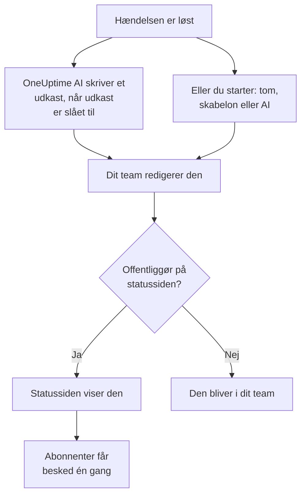

# Postmortem-analyser

En postmortem er gennemgangen efter en hændelse: hvad der skete, hvorfor, hvad det kostede dine brugere, og hvad der ændres nu. I OneUptime skriver du den på selve hændelsen. Den kan starte fra din egen skabelon eller fra et udkast fra OneUptime AI, og den kan offentliggøres på din statusside som hændelsens afsluttende opdatering.

:::cards
- [Skriv en postmortem](#skriv-en-postmortem): På hændelsens Postmortem-side, i fem trin.
- [Start fra en skabelon eller et AI-udkast](#start-fra-en-skabelon-eller-et-ai-udkast): Din disposition, eller en som OneUptime AI udfylder.
- [Offentliggør den på din statusside](#offentliggør-den-på-din-statusside): Vis den til kunderne, og giv abonnenter besked én gang.
- [Postmortems for episoder](#postmortems-for-episoder): Én gennemgang for en gruppe hændelser.
:::

## Sådan bliver en postmortem til

En postmortem har tre dele, alle på hændelsen: noten, skrevet i Markdown; dens vedhæftninger, som skærmbilleder og rapporter; og om den er på din statusside. De ligger på hændelsens side **Postmortem** under **Undersøgelse** i dens sidemenu.

## Skriv en postmortem

:::steps
### Åbn postmortem

Åbn hændelsen, og klik på **Postmortem** under **Undersøgelse** i dens sidemenu. Kortet **Postmortem-note** viser noten, vedhæftningerne, og om postmortem er på statussiden.

### Klik på Rediger obduktionsnote

Dialogen **Rediger obduktionsnote** åbner på sit første trin, **Postmortem**.

### Skriv noten, og vedhæft filer

Skriv **Postmortem-note** i Markdown: hvad der skete, konsekvenserne, hvordan det blev løst, og opfølgningen. Tilføj skærmbilleder, rapporter eller tidslinjer under **Postmortem-vedhæftninger**.

### Vælg, om den skal offentliggøres

Klik på **Næste**. På trinnet **Statusside** er **Offentliggør på statussiden** slået fra, så postmortem bliver i dit team. For at vise den til kunderne, se [Offentliggør den på din statusside](#offentliggør-den-på-din-statusside).

### Gem postmortem

Klik på **Gem ændringer**. Kortet viser noten og vedhæftningerne.
:::

Hver ændring af noten registreres i hændelsens feed og postes i hændelsens Slack- eller Microsoft Teams-kanal, hvis den har en. Så længe postmortem ikke er offentliggjort, hører ingen abonnent på statussiden om den.

At skrive en postmortem kræver rollen Project Owner, Project Admin, Project Member, Incident Admin eller Incident Member, eller en brugerdefineret rolle med tilladelsen Edit Incident. Alle, der kan læse hændelsen, kan læse dens postmortem.

## Start fra en skabelon eller et AI-udkast

To knapper på kortet udfylder noten for dig: **Generate with AI**, og **Anvend skabelon**, så snart projektet har en postmortem-skabelon. Begge åbner den samme editor som **Rediger obduktionsnote**, med noten udfyldt og resten af postmortem uændret. Intet gemmes, før du klikker på **Gem ændringer**, så læs noten, og ret den først.

### Anvend en skabelon

**Anvend skabelon** vises, så snart projektet har en postmortem-skabelon. Du opretter dem under **Hændelser → Indstillinger → Postmortem-skabeloner**: se [Postmortem-skabeloner](/docs/incidents/settings#postmortem-skabeloner). På OneUptime Cloud kræver skabeloner Growth-planen.

Klik på **Anvend skabelon**, vælg en under **Vælg skabelon** i dialogen **Anvend postmortem-skabelon**, og klik på **Anvend skabelon**. Har projektet kun én skabelon, er den allerede valgt.

### Generér den med AI

Klik på **Generate with AI**. Dialogen **Generate Postmortem with AI** tilbyder en disposition under **Vælg skabelon**: **Standard Postmortem**, **Detailed Technical Postmortem** eller **Brief Postmortem**, og derefter dine egne postmortem-skabeloner. **Template Preview** viser dispositionen, og du kan ændre den, før du genererer.

Klik på **Generate with AI** nederst i dialogen. OneUptime AI læser hændelsen (dens beskrivelse, grundårsag og afhjælpning, dens statustidslinje, dens offentlige og private noter, beskederne i dens Slack- eller Microsoft Teams-kanal og det, der blev sagt i [dens opkald](/docs/workspace-connections/video-calls#transskriptioner-af-opkald)) og skriver postmortem efter din disposition. Derefter åbner editoren med resultatet.

At generere kræver, at AI er slået til for projektet under **Projektindstillinger → AI → AI Features**, og en LLM-udbyder: se [LLM-udbydere](/docs/ai/llm-provider). Det kræver også rollen Project Owner eller Project Admin, eller en brugerdefineret rolle med tilladelsen Edit Incident: andre roller kan skrive postmortem, men ikke generere den.

### Lad OneUptime AI skrive et udkast, når en hændelse løses

Med **Skriv et udkast til en postmortem, når en hændelse er løst** slået til skriver OneUptime AI et udkast til postmortem, hver gang en hændelse løses, gemmer det som noten og poster det i hændelsens feed, så dit team kan gennemgå det. Kontakten ligger under **Hændelser → AI → Indstillinger** og er slået til for nye projekter.

- Den erstatter aldrig en note, der allerede er skrevet.
- Den skriver aldrig i en postmortem, der allerede er offentliggjort, hvor udkastet ville nå statussiden ugennemgået.
- Den kræver, at AI er slået til for projektet, og stopper resten af dagen, når projektet når sine daglige AI-grænser. Se [Automatisk postmortem](/docs/ai/ai-sre#automatisk-postmortem).

## Offentliggør den på din statusside

En offentliggjort postmortem er hændelsens afsluttende opdatering til dine kunder: statussiden viser noten, fremhævet i hændelsens tidslinje, med dens vedhæftninger til download.

:::steps
### Åbn trinnet Statusside

Klik på **Rediger obduktionsnote**, og derefter på **Næste** for at komme til trinnet **Statusside**.

### Slå Offentliggør på statussiden til

Slå **Offentliggør på statussiden** til. Der vises to felter mere: **Underret abonnenter**, som er slået til, og **Postmortem offentliggjort den**, som står på nu.

### Bestem, hvem der får besked, og hvornår den vises

Slå **Underret abonnenter** fra for at offentliggøre uden at give abonnenter besked. Ændr **Postmortem offentliggjort den** for at vise et andet tidspunkt ved siden af postmortem.

### Offentliggør

Klik på **Gem ændringer**. Kortet viser nu **Postmortem synlig på statussiden?**, **Underret abonnenter**, **Abonnentnotifikationsstatus** og **Postmortem offentliggjort den**.
:::

Det, der afgør, om kunderne ser den og hører om den:

- **Hændelsen skal være på statussiden.** En statusside viser kun en postmortem på en hændelse, den viser: **Synlig på statussiden** slået til, og hændelsen ikke privat.
- **Noten skal sige noget.** En postmortem, der offentliggøres med en tom note, vises ikke, og ingen får besked.
- **Abonnenter får besked én gang**, første gang statussiden viser postmortem. At gemme den igen, eller redigere den, mens den er offentliggjort, opdaterer siden uden at give nogen besked. At tage den af og offentliggøre den igen giver dem besked igen. En postmortem, der offentliggøres, mens dens hændelse er skjult, sendes, når hændelsen gøres synlig.
- **Underret abonnenter læses, når notifikationen sendes.** At slå den til, efter at postmortem er offentliggjort, sender intet.

**Abonnentnotifikationsstatus** viser, om notifikationen er sendt, og tilbyder **Prøv igen**, når den mislykkedes. Se [Postmortem](/docs/status-pages/subscribers#hændelsens-postmortem) for hvert tilfælde, og [Prøv igen og send igen](/docs/status-pages/subscribers#prøv-igen-og-send-igen).

**Postmortem offentliggjort den** er også det tidspunkt, hvor postmortem regnes som offentliggjort for målingen **Tid til postmortem**: se [Færdige målinger](/docs/incidents/settings#færdige-målinger).

## Postmortems for episoder

En hændelsesepisode har også en side **Postmortem** under **Undersøgelse**: én gennemgang for alle hændelser i episoden. Klik på **Rediger obduktion** for at skrive den. **Anvend skabelon** og **Generate with AI** fungerer som på en hændelse, og AI læser episoden og dens medlemshændelser.

En episodes postmortem er kun noten: den har ingen vedhæftninger, og ingen statusside viser den. OneUptime AI skriver ikke et udkast af sig selv, når en episode løses. At generere en kræver rollen Project Owner eller Project Admin, eller en brugerdefineret rolle med tilladelsen Edit Incident Episode.

Advarsler og planlagte vedligeholdelsesbegivenheder har ingen postmortem.

## Via API'et

En postmortem er et sæt felter på hændelsen, som læses og skrives via `/api/incident` ligesom resten af hændelsen:

| Felt | Hvad det er |
| --- | --- |
| `postmortemNote` | Noten, i Markdown. |
| `showPostmortemOnStatusPage` | Om postmortem er offentliggjort på dine statussider. Starter som `false`. |
| `notifySubscribersOnPostmortemPublished` | Om abonnenter får besked, når den offentliggøres. Starter som `true`. |
| `postmortemPostedAt` | Det tidspunkt, statussiden viser ved siden af den. |

At skrive `showPostmortemOnStatusPage` som `true` oven på en skrevet `postmortemNote` offentliggør postmortem, ligesom dialogen gør.

## Fejlfinding

:::details Anvend skabelon er ikke på kortet
Projektet har endnu ingen postmortem-skabelon, eller din rolle kan ikke læse dem. Opret en under **Hændelser → Indstillinger → Postmortem-skabeloner**. På OneUptime Cloud kræver skabeloner Growth-planen.
:::

:::details Generate with AI siger, at AI er slået fra, eller at du mangler tilladelse
Slå AI til under **Projektindstillinger → AI → AI Features**. At generere kræver rollen Project Owner eller Project Admin, eller en brugerdefineret rolle med tilladelsen Edit Incident, også for nogen, der kan redigere postmortem.
:::

:::details Postmortem er ikke på statussiden
Tjek tre ting: **Offentliggør på statussiden** er slået til, noten er ikke tom, og hændelsen vises på statussiden (**Synlig på statussiden** slået til, og ikke privat).
:::

:::details Abonnenterne fik ikke besked om postmortem
**Underret abonnenter** var slået fra ved offentliggørelsen, eller hændelsen er skjult: så sendes den, så snart hændelsen gøres synlig. **Abonnentnotifikationsstatus** på kortet fortæller, hvilken det var.
:::

:::details Der kom intet AI-udkast, da hændelsen blev løst
Hændelsen havde allerede en note, postmortem var allerede offentliggjort, eller **Skriv et udkast til en postmortem, når en hændelse er løst** er slået fra. AI skal være slået til for projektet, og projektet må ikke have nået sine daglige AI-grænser.
:::

## Næste trin

:::cards
- [Hændelser – Oversigt](/docs/incidents/index): Hændelsens andre sider, fra erklæring til løsning.
- [Hændelsesindstillinger og automatisering](/docs/incidents/settings): Postmortem-skabeloner og målingen af tid til postmortem.
- [Abonnenter og meddelelser](/docs/status-pages/subscribers): Alt, hvad en statusside fortæller sine abonnenter.
- [AI SRE](/docs/ai/ai-sre): Hvad OneUptime AI gør af sig selv efter en hændelse.
:::
