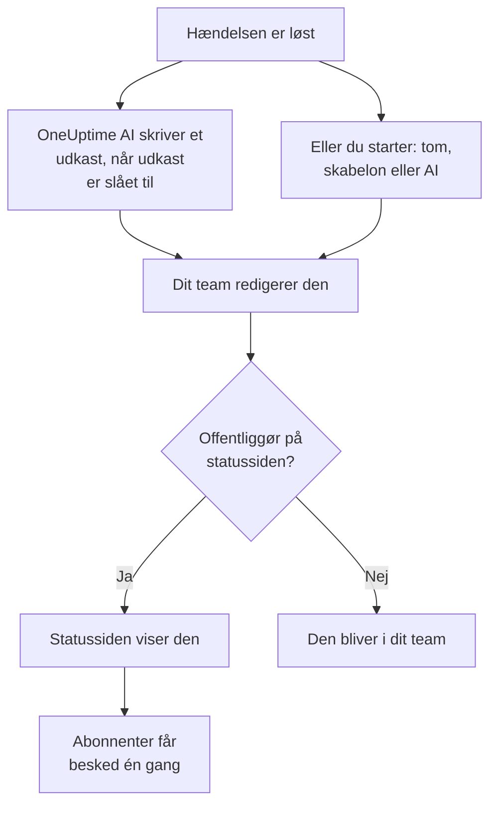

# Postmortem-analyser

En postmortem er gennemgangen efter en hændelse: hvad der skete, hvorfor, hvad det kostede dine brugere, og hvad der ændres nu. I OneUptime skriver du den på selve hændelsen. Den kan starte fra din egen skabelon eller fra et udkast fra OneUptime AI, og den kan offentliggøres på din statusside som hændelsens afsluttende opdatering. Hver postmortem har også en status, og **Hændelser → Postmortem-analyser** viser postmortem for hver hændelse, så du kan se, hvilke der stadig mangler.

:::cards
- [Skriv en postmortem](#skriv-en-postmortem): På hændelsens Postmortem-side, i fem trin.
- [Start fra en skabelon eller et AI-udkast](#start-fra-en-skabelon-eller-et-ai-udkast): Din disposition, eller en som OneUptime AI udfylder.
- [Offentliggør den på din statusside](#offentliggør-den-på-din-statusside): Vis den til kunderne, og giv abonnenter besked én gang.
- [Følg, hvor langt hver postmortem er](#følg-hvor-langt-hver-postmortem-er): Ikke startet, Kladde, Fuldført eller en status, du selv laver.
- [Se alle postmortems](#se-alle-postmortems): Filtrér efter ejer, alvorlighed og status for at finde dem, der stadig mangler.
- [Postmortems for episoder](#postmortems-for-episoder): Én gennemgang for en gruppe hændelser.
:::

## Sådan bliver en postmortem til

En postmortem har tre dele, alle på hændelsen: noten, skrevet i Markdown; dens vedhæftninger, som skærmbilleder og rapporter; og om den er på din statusside. De ligger på hændelsens side **Postmortem** under **Undersøgelse** i dens sidemenu. En postmortem har også en status, der siger, hvor langt den er nået, og ejere: hændelsens ejere.

## Skriv en postmortem

:::steps
### Åbn postmortem

Åbn hændelsen, og klik på **Postmortem** under **Undersøgelse** i dens sidemenu. Kortet **Postmortem** viser postmortemmens **Status** og **Ejere**, noten, vedhæftningerne, og om postmortem er på statussiden.

### Klik på Skriv postmortem

Dialogen **Skriv postmortem** åbner på sit første trin, **Postmortem**. Når postmortem er skrevet, hedder kortets knap **Rediger obduktionsnote**, og den åbner de samme trin.

### Skriv noten, og vedhæft filer

Skriv **Postmortem-note** i Markdown: hvad der skete, konsekvenserne, hvordan det blev løst, og opfølgningen. Tilføj skærmbilleder, rapporter eller tidslinjer under **Postmortem-vedhæftninger**.

### Vælg, om den skal offentliggøres

Klik på **Næste**. På trinnet **Statusside** er **Offentliggør på statussiden** slået fra, så postmortem bliver i dit team. For at vise den til kunderne, se [Offentliggør den på din statusside](#offentliggør-den-på-din-statusside).

### Gem postmortem

Klik på **Gem ændringer**. Kortet viser noten og vedhæftningerne. Postmortemmens status flyttes fra **Ikke startet** til **Kladde**: se [Sådan flytter en postmortem sig](#sådan-flytter-en-postmortem-sig).
:::

Hver ændring af noten registreres i hændelsens feed og postes i hændelsens Slack- eller Microsoft Teams-kanal, hvis den har en. Så længe postmortem ikke er offentliggjort, hører ingen abonnent på statussiden om den.

At skrive en postmortem kræver rollen Project Owner, Project Admin, Project Member, Incident Admin eller Incident Member, eller en brugerdefineret rolle med tilladelsen Edit Incident. Alle, der kan læse hændelsen, kan læse dens postmortem.

## Start fra en skabelon eller et AI-udkast

To knapper udfylder noten for dig. Så længe intet er skrevet, står de ved siden af **Skriv postmortem**: **Start fra skabelon**, så snart projektet har en postmortem-skabelon, og **Generate with AI**. Når postmortem er skrevet, ligger de i menuen **⋯** ved siden af **Rediger obduktionsnote**, som **Anvend skabelon** og **Generate with AI**. Begge åbner den samme editor, med noten udfyldt og resten af postmortem uændret. Intet gemmes, før du klikker på **Gem ændringer**, så læs noten, og ret den først.

### Anvend en skabelon

**Anvend skabelon** vises, så snart projektet har en postmortem-skabelon. Du opretter dem under **Hændelser → Indstillinger → Postmortem-skabeloner**: se [Postmortem-skabeloner](/docs/incidents/settings#postmortem-skabeloner). På OneUptime Cloud kræver skabeloner Growth-planen.

Klik på **Start fra skabelon**, eller på **Anvend skabelon** i menuen **⋯**, vælg en under **Vælg skabelon** i dialogen **Anvend postmortem-skabelon**, og klik på **Anvend skabelon**. Har projektet kun én skabelon, er den allerede valgt.

### Generér den med AI

Klik på **Generate with AI**. Dialogen **Generate Postmortem with AI** tilbyder en disposition under **Vælg skabelon**: **Standard Postmortem**, **Detailed Technical Postmortem** eller **Brief Postmortem**, og derefter dine egne postmortem-skabeloner. **Template Preview** viser dispositionen, og du kan ændre den, før du genererer.

Klik på **Generate with AI** nederst i dialogen. OneUptime AI læser hændelsen (dens beskrivelse, grundårsag og afhjælpning, dens statustidslinje, dens offentlige og private noter, beskederne i dens Slack- eller Microsoft Teams-kanal og det, der blev sagt i [dens opkald](/docs/workspace-connections/video-calls#transskriptioner-af-opkald)) og skriver postmortem efter din disposition. Derefter åbner editoren med resultatet.

At generere kræver, at AI er slået til for projektet under **Projektindstillinger → AI → AI Features**, og en LLM-udbyder: se [LLM-udbydere](/docs/ai/llm-provider). Det kræver også rollen Project Owner eller Project Admin, eller en brugerdefineret rolle med tilladelsen Edit Incident: andre roller kan skrive postmortem, men ikke generere den.

### Lad OneUptime AI skrive et udkast, når en hændelse løses

Med **Skriv et udkast til en postmortem, når en hændelse er løst** slået til skriver OneUptime AI et udkast til postmortem, hver gang en hændelse løses, gemmer det som noten og poster det i hændelsens feed, så dit team kan gennemgå det. Kontakten ligger under **Hændelser → AI → Indstillinger** og er slået til for nye projekter.

- Den erstatter aldrig en note, der allerede er skrevet.
- Den skriver aldrig i en postmortem, der allerede er offentliggjort, hvor udkastet ville nå statussiden ugennemgået.
- Den kræver, at AI er slået til for projektet, og stopper resten af dagen, når projektet når sine daglige AI-grænser. Se [Automatisk postmortem](/docs/ai/ai-sre#automatisk-postmortem).
- Er transskriptionen af hændelsens opkald stadig på vej, når hændelsen løses, venter den, til OneUptime AI har læst den, så udkastet medtager, hvad der blev sagt i opkaldet: op til seks timer, mens udbyderen forbereder transskriptionen. Se [Optag og transskribér hvert opkald](/docs/workspace-connections/video-calls#optag-og-transskribér-hvert-opkald).

#### Vælg, hvilke hændelser der får et udkast, og dets skabelon

Uden regler får hver løst hændelse et udkast i OneUptime AI's standardopbygning. **Postmortem-regler** under **Yderligere indstillinger** på samme side ændrer det:

- En regel matcher **Alle hændelser** eller **Kun hændelser, der opfylder betingelserne** på monitorer, alvorligheder, labels, monitorlabels, titel og beskrivelse, som en AI-regel gør.
- Dens **Skabeloner** er de postmortem-skabeloner, udkastet må følge. Uden nogen følger udkastet standardopbygningen; med én følger det den skabelon; med flere den, som OneUptime AI finder passer bedst til hændelsen. Udkastets indlæg i feedet nævner den skabelon, det fulgte.
- Dens **LLM-udbyder** under **Flere felter** er den udbyder, OneUptime AI skriver udkastet og vælger dets skabelon med. Med ingen valgt er det projektets standardudbyder, ellers den globale. Udkastets indlæg i feedet nævner den udbyder, en regel valgte, eller den, der blev brugt i stedet, og hvorfor. Se [Hvilken LLM-udbyder en regel bruger](/docs/ai/ai-sre#hvilken-llm-udbyder-en-regel-bruger).
- Den første aktiverede regel, der matcher hændelsen, afgør det, regnet fra toppen af listen: træk en regel for at flytte den. En hændelse, som ingen regel matcher, får intet udkast, og det får ingen hændelse, så længe reglerne ikke kan læses.
- **Skriv et udkast til en postmortem, når en hændelse er løst** er stadig den eneste kontakt, der slår udkast fra. Regler afgør kun de udkast, OneUptime AI skriver af sig selv: **Generate with AI** tilbyder alle opbygninger, uanset hvad reglerne siger.
- Det kræver rollen Project Owner eller Project Admin at oprette, redigere og omsortere regler. På OneUptime Cloud kræver skabeloner Growth-planen: under den afgør reglerne stadig, hvilke hændelser der får et udkast, og hvert udkast følger standardopbygningen.

## Offentliggør den på din statusside

En offentliggjort postmortem er hændelsens afsluttende opdatering til dine kunder: statussiden viser noten, fremhævet i hændelsens tidslinje, med dens vedhæftninger til download.

:::steps
### Åbn trinnet Statusside

Klik på **Rediger obduktionsnote**, og derefter på **Næste** for at komme til trinnet **Statusside**.

### Slå Offentliggør på statussiden til

Slå **Offentliggør på statussiden** til. Der vises to felter mere: **Underret abonnenter**, som er slået til, og **Postmortem offentliggjort den**, som står på nu.

### Bestem, hvem der får besked, og hvornår den vises

Slå **Underret abonnenter** fra for at offentliggøre uden at give abonnenter besked. Ændr **Postmortem offentliggjort den** for at vise et andet tidspunkt ved siden af postmortem.

### Offentliggør

Klik på **Gem ændringer**. Kortet viser nu **Postmortem synlig på statussiden?**, **Underret abonnenter**, **Abonnentnotifikationsstatus** og **Postmortem offentliggjort den**.
:::

Det, der afgør, om kunderne ser den og hører om den:

- **Hændelsen skal være på statussiden.** En statusside viser kun en postmortem på en hændelse, den viser: **Synlig på statussiden** slået til, og hændelsen ikke privat.
- **Noten skal sige noget.** En postmortem, der offentliggøres med en tom note, vises ikke, og ingen får besked.
- **Abonnenter får besked én gang**, første gang statussiden viser postmortem. At gemme den igen, eller redigere den, mens den er offentliggjort, opdaterer siden uden at give nogen besked. At tage den af og offentliggøre den igen giver dem besked igen. En postmortem, der offentliggøres, mens dens hændelse er skjult, sendes, når hændelsen gøres synlig.
- **Underret abonnenter læses, når notifikationen sendes.** At slå den til, efter at postmortem er offentliggjort, sender intet.

**Abonnentnotifikationsstatus** viser, om notifikationen er sendt, og tilbyder **Prøv igen**, når den mislykkedes. Se [Postmortem](/docs/status-pages/subscribers#hændelsens-postmortem) for hvert tilfælde, og [Prøv igen og send igen](/docs/status-pages/subscribers#prøv-igen-og-send-igen).

**Postmortem offentliggjort den** er også det tidspunkt, hvor postmortem regnes som offentliggjort for målingen **Tid til postmortem**: se [Færdige målinger](/docs/incidents/settings#færdige-målinger).

## Følg, hvor langt hver postmortem er

Hver hændelses postmortem har en af projektets postmortem-statusser, vist under **Status** øverst på dens kort **Postmortem**. Et nyt projekt har fire. En postmortem i **Ikke startet** eller **Kladde** mangler stadig; en i **Fuldført** eller **Ikke nødvendig** gør ikke:

| Status | Hvad den betyder | Mangler stadig |
| --- | --- | --- |
| **Ikke startet** | Ingen har skrevet denne postmortem endnu. | Ja |
| **Kladde** | Postmortem er ved at blive skrevet. | Ja |
| **Fuldført** | Postmortem er skrevet og færdig. | Nej |
| **Ikke nødvendig** | Denne hændelse har ikke brug for en postmortem. | Nej |

### Sådan flytter en postmortem sig

OneUptime flytter en postmortem af sig selv på tre tidspunkter:

- En ny hændelses postmortem starter i **Ikke startet**, eller i **Kladde**, når hændelsen erklæres med en note, eller i **Fuldført**, når den note offentliggøres samtidig.
- Den første note i en postmortem i **Ikke startet** flytter den til **Kladde**, uanset om nogen skriver den, anvender en skabelon, eller OneUptime AI skriver et udkast.
- Når den offentliggøres på statussiden, flyttes den til **Fuldført**, medmindre den allerede er færdig.

Den flytter sig aldrig tilbage: at tømme noten eller tage postmortem af statussiden lader dens status blive, hvor den er. En status, som nogen vælger i samme gemning, gælder altid.

### Flyt den selv

Klik på statussen, på hændelsens side **Postmortem** eller i dens række på listen over postmortems, og vælg en under **Flyt postmortem til**. Postmortem flyttes med det samme. At flytte en postmortem kræver de roller, der skriver en, og alle, der kan læse hændelsen, kan se, hvor langt dens postmortem er.

### Lav dine egne statusser

Har din proces et trin for sig selv, for eksempel en gennemgang, så tilføj en status til det. Åbn **Hændelser → Indstillinger → Postmortem-statusser**, klik på **Opret Postmortem-status**, og giv den et navn, for eksempel **Til gennemgang**, en farve og en beskrivelse. En ny status kommer lige over **Fuldført**; træk en status for at ændre dens placering.

Hvor en status står, afgør, hvad den tæller som, vist under **Tæller som**: over **Kladde** som **Ikke startet**, fra **Kladde** og nedad som **I gang**, fra **Fuldført** og nedad som **Færdig**, og så mangler den ikke længere. **Til gennemgang**, imellem dem, mangler stadig; **Ikke nødvendig**, under **Fuldført**, gør ikke.

**Ikke startet**, **Kladde** og **Fuldført** er indbyggede, fordi OneUptime flytter postmortems til dem: du kan omdøbe dem og give dem en anden farve, men ikke slette eller arkivere dem, og de beholder deres rækkefølge. Arkivér en status, du ikke bruger længere, fra menuen **⋯** i dens række: ingen kan flytte en postmortem til den igen, postmortems i den bliver der, indtil nogen flytter dem, og listen filtrerer stadig efter den. **Arkiverede postmortem-statusser**, foldet sammen under tabellen, viser dem, med **Fjern fra arkiv** til at hente en tilbage. At oprette, redigere og slette statusser kræver rollen Project Owner, Project Admin eller Incident Admin, eller en brugerdefineret rolle med den tilsvarende tilladelse til postmortem-statusser.

## Se alle postmortems

**Hændelser → Postmortem-analyser** viser postmortem for hver hændelse i projektet, den nyeste først, med kolonnerne **Hændelse**, **Titel**, **Postmortem-status**, **Alvorlighed**, **Ejere** og **Erklæret**. **Vis** i en række åbner hændelsens side **Postmortem**.

Over listen tæller en flise pr. status de postmortems, der er i den. Klik på en flise for kun at vise dem, og klik igen for at vise dem alle.

Filtrér listen med chippene over den: **Ejer**, en person eller et team; **Alvorlighed**; **Postmortem-status**; **Hændelsesstatus**; **Etiketter**; og **Berørte ressourcer**. For at se, hvilke postmortems et team stadig skylder for dine alvorligste hændelser, vælger du teamet under **Ejer**, alvorligheden under **Alvorlighed**, og **Ikke startet** og **Kladde** under **Postmortem-status**. Filtrene står i sidens adresse, så du kan gemme listen som bogmærke eller dele den.

For at ændre mange på én gang skal du vælge dem og åbne **Massehandlinger**: **Skift postmortem-status** flytter dem alle til én status, for eksempel **Ikke nødvendig** for hændelser, der ikke har brug for en, og **Add Owner** og **Remove Owner** ændrer, hvem der ejer dem.

## Postmortems for episoder

En hændelsesepisode har også en side **Postmortem** under **Undersøgelse**: én gennemgang for alle hændelser i episoden. Klik på **Rediger obduktion** for at skrive den. **Anvend skabelon** og **Generate with AI** fungerer som på en hændelse, og AI læser episoden og dens medlemshændelser.

En episodes postmortem er kun noten: den har ingen vedhæftninger, og ingen statusside viser den. OneUptime AI skriver ikke et udkast af sig selv, når en episode løses. At generere en kræver rollen Project Owner eller Project Admin, eller en brugerdefineret rolle med tilladelsen Edit Incident Episode. Den har heller ingen status, og listen over postmortems udelader den.

Advarsler og planlagte vedligeholdelsesbegivenheder har ingen postmortem.

## Via API'et

En postmortem er et sæt felter på hændelsen, som læses og skrives via `/api/incident` ligesom resten af hændelsen:

| Felt | Hvad det er |
| --- | --- |
| `postmortemNote` | Noten, i Markdown. |
| `showPostmortemOnStatusPage` | Om postmortem er offentliggjort på dine statussider. Starter som `false`. |
| `notifySubscribersOnPostmortemPublished` | Om abonnenter får besked, når den offentliggøres. Starter som `true`. |
| `postmortemPostedAt` | Det tidspunkt, statussiden viser ved siden af den. |
| `postmortemStatusId` | Postmortemmens status: en af projektets statusser, under `/api/incident-postmortem-status`. |

At skrive `showPostmortemOnStatusPage` som `true` oven på en skrevet `postmortemNote` offentliggør postmortem, ligesom dialogen gør. Det flytter også postmortem til **Fuldført**, medmindre samme skrivning sætter `postmortemStatusId`.

## Fejlfinding

:::details Anvend skabelon er ikke på kortet
Projektet har endnu ingen postmortem-skabelon, eller din rolle kan ikke læse dem. Opret en under **Hændelser → Indstillinger → Postmortem-skabeloner**. På OneUptime Cloud kræver skabeloner Growth-planen.
:::

:::details Generate with AI siger, at AI er slået fra, eller at du mangler tilladelse
Slå AI til under **Projektindstillinger → AI → AI Features**. At generere kræver rollen Project Owner eller Project Admin, eller en brugerdefineret rolle med tilladelsen Edit Incident, også for nogen, der kan redigere postmortem.
:::

:::details Postmortem er ikke på statussiden
Tjek tre ting: **Offentliggør på statussiden** er slået til, noten er ikke tom, og hændelsen vises på statussiden (**Synlig på statussiden** slået til, og ikke privat).
:::

:::details Abonnenterne fik ikke besked om postmortem
**Underret abonnenter** var slået fra ved offentliggørelsen, eller hændelsen er skjult: så sendes den, så snart hændelsen gøres synlig. **Abonnentnotifikationsstatus** på kortet fortæller, hvilken det var.
:::

:::details Der kom intet AI-udkast, da hændelsen blev løst
Hændelsen havde allerede en note, postmortem var allerede offentliggjort, ingen postmortem-regel matchede den, eller **Skriv et udkast til en postmortem, når en hændelse er løst** er slået fra. AI skal være slået til for projektet, og projektet må ikke have nået sine daglige AI-grænser. Er transskriptionen af hændelsens opkald på vej, kommer udkastet, når OneUptime AI har læst den.
:::

:::details En postmortems status flyttede sig ikke, da dens note blev skrevet
Kun en postmortem i **Ikke startet**, eller i en egen status over **Kladde**, flytter sig af sig selv, ved sin første note. En, der allerede er i gang eller færdig, bliver, hvor den er, og det samme gør en status, som nogen valgte i samme gemning. Flyt den selv via dens status: se [Flyt den selv](#flyt-den-selv).
:::

## Næste trin

:::cards
- [Hændelser – Oversigt](/docs/incidents/index): Hændelsens andre sider, fra erklæring til løsning.
- [Hændelsesindstillinger og automatisering](/docs/incidents/settings): Postmortem-skabeloner og målingen af tid til postmortem.
- [Abonnenter og meddelelser](/docs/status-pages/subscribers): Alt, hvad en statusside fortæller sine abonnenter.
- [AI SRE](/docs/ai/ai-sre): Hvad OneUptime AI gør af sig selv efter en hændelse.
:::
