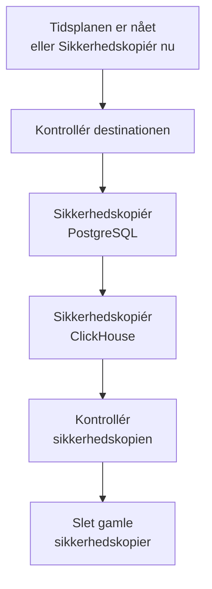

# Sikkerhedskopier

Sikkerhedskopiér en selvhostet OneUptime til lager, du selv ejer, efter en tidsplan, og gendan den fra Admin Dashboard. En sikkerhedskopi rummer PostgreSQL med dine projekter, monitorer, hændelser, statussider og brugere, og ClickHouse med dine logs, traces og metrics. Sikkerhedskopier gemmes så mange dage, du vælger, ældre slettes for dig, og enhver sikkerhedskopi kan gendannes på stedet. Sikkerhedskopier er en del af Enterprise Edition.

:::cards
- [Opsæt sikkerhedskopier](#opsæt-sikkerhedskopier): Vælg en destination, test den, og vælg en tidsplan.
- [Destinationer](#destinationer): Hvad hver anbefalet destination beder om.
- [Gendan en sikkerhedskopi](#gendan-en-sikkerhedskopi): Hvad der erstattes, og hvordan de aktuelle data holdes sikre.
- [Flyt til en ny server](#flyt-til-en-ny-server): Gendan én installations sikkerhedskopier på en anden.
:::

## Sådan virker en sikkerhedskopi



- **Konsistent.** PostgreSQL dumpes i én transaktion, så dumpet er databasen, som den var i ét øjeblik, mens OneUptime kører videre. ClickHouse sikkerhedskopierer hver tabel, som den var, da det læste tabellens parts.
- **Direkte til destinationen.** Outputtet fra `pg_dump` streames til lageret, mens det skrives, og ClickHouse skriver selv sin sikkerhedskopi til lageret. Intet skrives til serverens disk, uanset hvor store dataene er.
- **Kontrolleret.** Før sikkerhedskopien tæller, læser `pg_restore` dumpet tilbage fra destinationen, og ClickHouses egen registrering af sin sikkerhedskopi findes der. Dumpets SHA-256 gemmes med sikkerhedskopien, og en gendannelse kontrollerer den, før den erstatter noget. En sikkerhedskopi, der mislykkes eller annulleres, sletter det, den har skrevet, så destinationen kun rummer hele sikkerhedskopier.
- **Krypteret.** Sikkerhedskopier sendes til lageret over HTTPS, medmindre du angiver et `http://`-endpoint. Amazon S3, Google Cloud Storage, Azure Blob Storage og Cloudflare R2 krypterer alt, hvad de gemmer; på andet lager skal du slå bucketens kryptering af data i hvile til. Destinationens loginoplysninger gemmes krypteret og vises aldrig igen.
- **Én ad gangen.** Der kører kun én sikkerhedskopi eller gendannelse ad gangen på hele installationen. De andre venter på deres tur.

Hver sikkerhedskopi er en mappe for sig i destinationens mappe (`oneuptime/backups/`, medmindre du vælger en anden), opkaldt efter det tidspunkt, den startede, i UTC:

```text
oneuptime/backups/20261024T020000Z-3f2a9c1b/manifest.json
oneuptime/backups/20261024T020000Z-3f2a9c1b/postgres.dump
oneuptime/backups/20261024T020000Z-3f2a9c1b/clickhouse/
```

`manifest.json` skrives til sidst: den fortæller, hvad sikkerhedskopien rummer, og hvilken version af OneUptime der lavede den.

## Før du begynder

- **Enterprise Edition** med en licens, der omfatter sikkerhedskopier. Sikkerhedskopier kører i prøveperioden og henstandsperioden. Uden licens laves der ingen nye sikkerhedskopier, og gendannelse og sletning af sikkerhedskopier virker stadig. Se [Enterprise Edition](/docs/self-hosted/enterprise).
- **En masteradministrator.** Sikkerhedskopier opsættes i Admin Dashboard.
- **En bucket eller container kun til sikkerhedskopier** og loginoplysninger, der må læse, skrive, liste og slette i den.
- **En destination, som ClickHouse også når.** ClickHouse skriver selv sin sikkerhedskopi til lageret, så dets netværk skal kunne nå lageret, ligesom OneUptimes.
- **For at gendanne PostgreSQL en databasebruger, der må oprette databaser.** En gendannelse skriver i en ny database ved siden af den aktive. Den PostgreSQL, der følger med OneUptime, forbinder som superbruger, som må det.

## Opsæt sikkerhedskopier

:::steps
### Åbn siden med sikkerhedskopier

Gå i Admin Dashboard til **Indstillinger → Sikkerhedskopier**, og klik på **Opsæt sikkerhedskopier**.

### Vælg, hvor sikkerhedskopier gemmes

Vælg en af de anbefalede destinationer. Hvad hver af dem beder om, står under [Destinationer](#destinationer).

### Udfyld forbindelsen

Udfyld det, destinationen beder om. En mappe, en region og de indstillinger, de fleste lader være, venter under **Flere felter**, og **Opsætningsvejledning** åbner destinationens afsnit på denne side.

### Test destinationen

Klik på **Test destinationen**. OneUptime skriver, læser, lister og sletter en lille testfil, kontrollerer, at `pg_dump` kan sikkerhedskopiere din PostgreSQL, og beder ClickHouse skrive en testsikkerhedskopi af definitionerne af sine tabeller. Intet gemmes, og en kontrol, der mislykkes, fortæller, hvad du skal ændre.

### Vælg, hvornår sikkerhedskopier kører

Vælg **Hvor ofte** og klokkeslættet i **Kl. (UTC)**, og for ugentlige sikkerhedskopier **Ugedag**. **Behold sikkerhedskopier i (dage)** er 30, medmindre du ændrer det. Slå **Sikkerhedskopiér også ClickHouse** fra for kun at sikkerhedskopiere PostgreSQL.

### Begynd at sikkerhedskopiere

Klik på **Begynd at sikkerhedskopiere**. Den første sikkerhedskopi kører på det næste planlagte tidspunkt, og **Sikkerhedskopiér nu** starter en med det samme.
:::

Siden viser derefter, hvordan det går med sikkerhedskopierne: hvornår den seneste kørte, hvor stor den var, og hvor lang tid den tog, og hvornår den næste kører. En sikkerhedskopi, der er i gang, viser det trin, den er nået til, og **Se trin** viser hvert trin, mens det kører.

## Destinationer

| Destination | Lager | Logger ind med |
| --- | --- | --- |
| [Amazon S3](#amazon-s3) | Amazon S3 | En adgangsnøgle |
| [Cloudflare R2](#cloudflare-r2) | S3-kompatibelt lager | Et R2 API-token |
| [Backblaze B2](#backblaze-b2) | S3-kompatibelt lager | En applikationsnøgle |
| [Wasabi](#wasabi) | S3-kompatibelt lager | En adgangsnøgle |
| [MinIO](#minio) | S3-kompatibelt lager | En adgangsnøgle |
| [Google Cloud Storage](#google-cloud-storage) | Google Cloud Storage | En HMAC-nøgle |
| [Azure Blob Storage](#azure-blob-storage) | Azure Blob Storage | Et SAS-token eller en adgangsnøgle |
| [Andet S3-kompatibelt lager](#andet-s3-kompatibelt-lager) | S3-kompatibelt lager | En adgangsnøgle |

En nøgle til Amazon S3 eller andet S3-kompatibelt lager skal have `s3:PutObject`, `s3:GetObject`, `s3:ListBucket`, `s3:DeleteObject` og `s3:AbortMultipartUpload` på mappen og intet andet:

```json
{
  "Version": "2012-10-17",
  "Statement": [
    {
      "Effect": "Allow",
      "Action": "s3:ListBucket",
      "Resource": "arn:aws:s3:::my-backups"
    },
    {
      "Effect": "Allow",
      "Action": [
        "s3:PutObject",
        "s3:GetObject",
        "s3:DeleteObject",
        "s3:AbortMultipartUpload"
      ],
      "Resource": "arn:aws:s3:::my-backups/oneuptime/backups/*"
    }
  ]
}
```

### Amazon S3

| Felt | Hvad du skal angive |
| --- | --- |
| **Bucket** | Den bucket, sikkerhedskopier skrives til. Brug den kun til sikkerhedskopier. |
| **Region** | Bucketens region. Den starter på `us-east-1`. |
| **Adgangsnøgle-id** | En adgangsnøgle med tilladelserne ovenfor. |
| **Hemmelig adgangsnøgle** | Nøglens hemmelighed. |
| **Mappe** | Under **Flere felter**. Står den tom, gemmes sikkerhedskopier i `oneuptime/backups/`. |

Amazon S3 krypterer hver fil, det gemmer, og OneUptime beder om det (SSE-S3) for hver fil, det skriver.

### Cloudflare R2

Angiv din kontos S3 API-adresse som **Endpoint**, `https://<account-id>.r2.cloudflarestorage.com`, fra bucketens indstillinger i R2. Angiv derefter **Bucket** og **Adgangsnøgle-id** og **Hemmelig adgangsnøgle** for et R2 API-token, der må læse og skrive objekter i den. Det koster intet at læse sikkerhedskopier tilbage fra R2.

### Backblaze B2

Angiv bucketens S3-endpoint, som vises på dens Buckets-side i Backblaze, for eksempel `https://s3.us-west-004.backblazeb2.com`, som **Endpoint**. Angiv derefter **Bucket** og en applikationsnøgles nøgle-id og nøgle som **Adgangsnøgle-id** og **Hemmelig adgangsnøgle**. Regionen læses fra endpointet.

### Wasabi

Angiv tjeneste-URL'en for bucketens region, for eksempel `https://s3.us-east-1.wasabisys.com`, som **Endpoint**, og derefter **Bucket** og en adgangsnøgle. Regionen læses fra endpointet.

### MinIO

Angiv din MinIO-servers S3 API-adresse, for eksempel `https://minio.example.com:9000`, som **Endpoint**, og derefter **Bucket** og en adgangsnøgle, hvis politik må læse, skrive, liste og slette i den. Både OneUptime og ClickHouse skal kunne nå adressen.

### Google Cloud Storage

Angiv **Bucket** og **HMAC-adgangsnøgle** og **HMAC-hemmelighed** for en tjenestekonto med rollen Storage Object Admin på bucketten. Opret nøglen i Cloud Storages indstillinger, på fanen Interoperabilitet. OneUptime og ClickHouse når bucketten gennem Cloud Storages S3-kompatible API.

### Azure Blob Storage

Angiv **Lagerkonto** og **Container**, og vælg under **Log ind med**, hvordan der logges ind: et **SAS-token** med tilladelserne Læs, Tilføj, Opret, Skriv, Slet og List på containeren, eller en **Adgangsnøgle** til lagerkontoen. Et SAS-token kan begrænses til containeren og er derfor det sikreste valg. **Cloud** og **Mappe** venter under **Flere felter**.

### Andet S3-kompatibelt lager

For Ceph, DigitalOcean Spaces, Hetzner Object Storage og alt lager med en S3 API angiver du dets S3-adresse som **Endpoint**, og derefter **Bucket** og en adgangsnøgle. **Region** under **Flere felter** skal kun angives, hvis lageret beder om en. Står den tom, læses den fra endpointet, ellers er den `us-east-1`.

## Tidsplan og opbevaring

| Indstilling | Hvad den gør |
| --- | --- |
| **Hvor ofte** | **Hver time**, **Hver 6. time**, **Hver 12. time**, **Hver dag** eller **Hver uge**. Hver dag passer til de fleste installationer. |
| **Kl. (UTC)** | Den time, sikkerhedskopier starter, i UTC, med din egen tid vist ved siden af. Hver 6. eller 12. time regnes fra den: ved `02:00` kører sikkerhedskopier hver 6. time kl. 02:00, 08:00, 14:00 og 20:00. Sikkerhedskopier hver time kører på hele timen. |
| **Ugedag** | Den dag, ugentlige sikkerhedskopier kører. |
| **Behold sikkerhedskopier i (dage)** | Fra 1 til 3650 dage. 30, medmindre du ændrer det. |
| **Sikkerhedskopiér også ClickHouse** | Slået til, medmindre du slår det fra. PostgreSQL sikkerhedskopieres altid. |

Efter hver sikkerhedskopi slettes de sikkerhedskopier, der startede for mere end **Behold sikkerhedskopier i (dage)** siden, på destinationen og fra listen, undtagen den nyeste sikkerhedskopi, der lykkedes, som beholdes, uanset hvor gammel den er. At slå sikkerhedskopier fra, eller en licens, der udløber, efterlader dig derfor aldrig uden en sikkerhedskopi at gendanne.

**Slå planlagte sikkerhedskopier fra** i statuskortets menu stopper tidsplanen. **Sikkerhedskopiér nu** virker stadig, og ingen sikkerhedskopi slettes. **Slå til** starter tidsplanen igen.

## Gendan en sikkerhedskopi

:::warning Hvad en gendannelse erstatter
En gendannelse erstatter de aktuelle data med sikkerhedskopiens. Alt, der er ændret, siden sikkerhedskopien blev lavet, går tabt, medmindre du først sikkerhedskopierer de aktuelle data.
:::

:::steps
### Vælg sikkerhedskopien

Klik i tabellen **Sikkerhedskopier** på **Gendan** ved den sikkerhedskopi, du vil tilbage til. OneUptime kontrollerer først sikkerhedskopien: at dens filer er på destinationen og uændrede, hvilken version af OneUptime der lavede den, og at denne server kan gendanne den.

### Vælg, hvad der skal gendannes

Markér **PostgreSQL: projekter, monitorer, hændelser, brugere**, **ClickHouse: logfiler, traces og metrics** eller begge. Dialogen viser, hvor mange projekter, brugere og monitorer sikkerhedskopien rummer, og hvor mange der er nu.

### Hold de aktuelle data sikre

**Sikkerhedskopiér de aktuelle data først** er markeret: gendannelsen begynder med en sikkerhedskopi af de data, den erstatter, så du kan vende tilbage til dem. Fjern kun markeringen, hvis du har en anden kopi, for uden den kan gendannelsen ikke fortrydes.

### Bekræft

Skriv `restore`, og klik på **Gendan**.
:::

En gendannelse kører trin for trin, og siden viser hvert af dem:

| Trin | Hvad der sker |
| --- | --- |
| **Kontrollér sikkerhedskopien** | Sikkerhedskopiens filer er der, og denne installation kan gendanne den. |
| **Sikkerhedskopiér de aktuelle data** | En sikkerhedskopi af de aktuelle data, medmindre du fjernede markeringen. |
| **Gendan PostgreSQL** | Sikkerhedskopien gendannes i en ny database ved siden af den aktive og kontrolleres. |
| **Gendan ClickHouse** | Den aktive telemetri lægges til side, og sikkerhedskopiens gendannes i stedet. |
| **Skift til de gendannede data** | Den gendannede database overtager den aktives navn på et øjeblik. |
| **Opdater de gendannede data** | Denne versions databasemigreringer kører på de gendannede data. |
| **Ryd op** | Det, der blev lagt til side, fjernes. |

OneUptime kører videre på de aktuelle data indtil skiftet, og intet, den bruger, ændres før da. En gendannelse, der mislykkes eller annulleres før skiftet, efterlader alt, som det var, og en, der mislykkes under skiftet, lægger det tilbage, den lagde til side. Telemetri, der ankommer, mens ClickHouse gendannes, gemmes ikke. Når PostgreSQL er gendannet, bliver du muligvis logget ud: log ind med en konto, der findes i sikkerhedskopien.

:::details Gendannelsen siger, at sikkerhedskopien blev lavet med en anden ENCRYPTION_SECRET
De loginoplysninger, OneUptime gemmer, som en destinations nøgle, er krypteret med `ENCRYPTION_SECRET`. Angiv den `ENCRYPTION_SECRET`, sikkerhedskopien blev lavet med, før du gendanner, ellers kan disse loginoplysninger ikke læses bagefter.
:::

## Flyt til en ny server

:::steps
### Installér OneUptime på den nye server

Installér Enterprise Edition i den version, der lavede sikkerhedskopierne, eller en nyere.

### Opsæt den samme destination

Opsæt under **Indstillinger → Sikkerhedskopier** den destination, dine sikkerhedskopier ligger på. Siden finder de sikkerhedskopier, der allerede ligger der, og viser dem, klar til gendannelse. **Find sikkerhedskopier** i statuskortets menu søger igen.

### Gendan den nyeste sikkerhedskopi

Gendan den som ovenfor. En sikkerhedskopi, som en ældre version af OneUptime lavede, opdateres til denne version. En sikkerhedskopi, som en nyere version lavede, kan gendannes, når du har opdateret.
:::

## Når en sikkerhedskopi mislykkes

Statuskortet viser **Den seneste sikkerhedskopi mislykkedes** med fejlen, og **Se trin** viser det trin, den stoppede ved, og hvorfor. Hver masteradministrator får også en e-mail, højst én gang hver 12. time, så længe sikkerhedskopier bliver ved med at mislykkes. En gendannelse, der mislykkes, meldes altid via e-mail.

## Fejlfinding

:::details ClickHouse kan ikke nå destinationen
ClickHouse forbinder selv til lageret. Lad dets netværk nå destinationens adresse, ligesom OneUptimes, og test derefter destinationen igen.
:::

:::details pg_dump mangler eller er for gammel
Enterprise-imaget indeholder `pg_dump` og `pg_restore` 16, 17 og 18, som sikkerhedskopierer PostgreSQL 18 og alle tidligere versioner. På et andet image skal du installere PostgreSQL-klientværktøjerne eller sætte `BACKUP_POSTGRES_BIN_DIR` til den mappe, der indeholder dem. `pg_dump` skal være mindst lige så ny som din PostgreSQL-server.
:::

:::details Gendannelse af PostgreSQL kræver én ændring
En gendannelse opretter en database, hvilket OneUptimes databasebruger skal have lov til. Kør dette på PostgreSQL som superbruger, med dit `DATABASE_USERNAME` i stedet for `oneuptime`, og gendan derefter igen:

```sql
ALTER USER oneuptime CREATEDB;
```
:::

:::details En sikkerhedskopi ligger på en tidligere destination
Når du har skiftet destination, bliver de sikkerhedskopier, der blev lavet på den gamle, stående i listen, markeret med **På en tidligere destination**. Opsæt den destination igen for at gendanne en af dem, eller slet den fra listen: dens filer bliver, hvor de er.
:::

## Næste trin

:::cards
- [Enterprise Edition](/docs/self-hosted/enterprise): Licenser, og hvad Enterprise Edition tilføjer.
- [Opgradering](/docs/installation/upgrading): Lav en sikkerhedskopi før hver opgradering.
- [Docker Compose](/docs/installation/docker-compose): Kør OneUptime på én server.
:::
