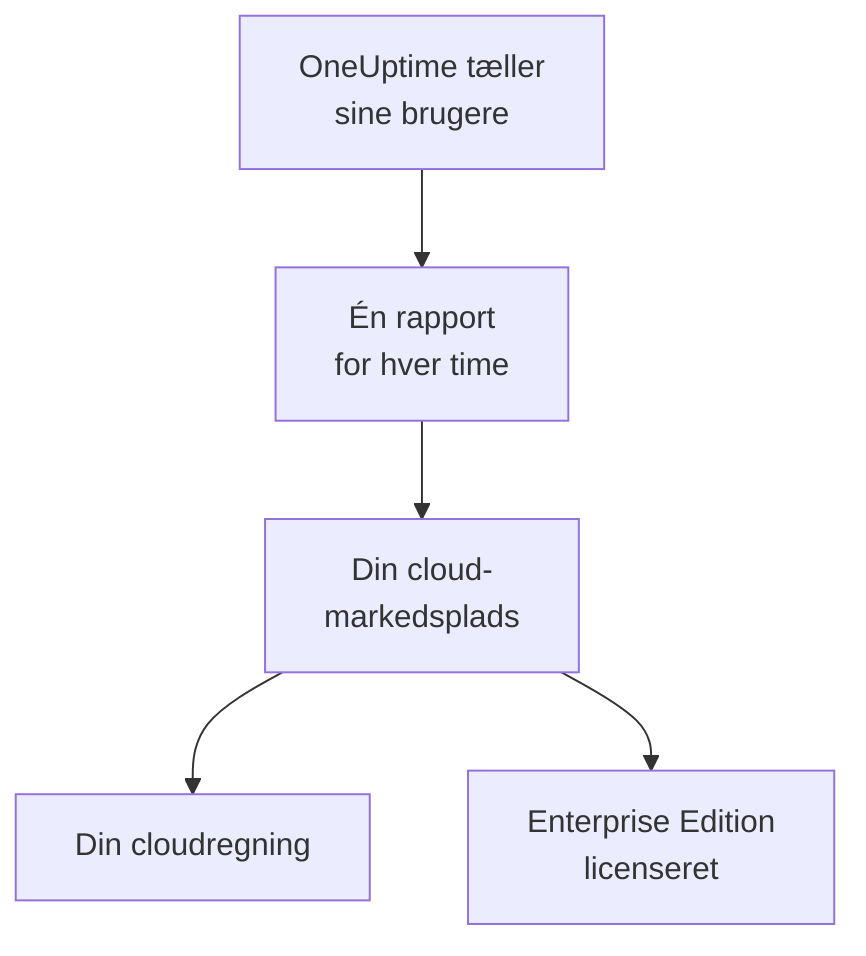

# Cloud-markedspladser

Køb OneUptime Enterprise på AWS Marketplace, Microsoft Marketplace eller Google Cloud Marketplace, og kør det i dit eget Kubernetes-cluster. Markedspladsen fakturerer hver bruger af din installation pr. time på din cloudregning, og dit abonnement giver licens til Enterprise Edition: Der er ingen licensnøgle at aktivere.

:::cards
- [Installér OneUptime](#installér-oneuptime): På Amazon EKS, Azure Kubernetes Service eller Google Kubernetes Engine.
- [Sådan fungerer faktureringen](#sådan-fungerer-faktureringen): USD 0.10 pr. bruger pr. time, rapporteret hver time.
- [Opgradering](#opgradering): Sådan når en ny release dit cluster.
- [Fejlfinding](#fejlfinding): Når udgavemærket advarer om markedspladsen.
:::

## Sådan fungerer det

OneUptime tæller sine brugere hvert 15. minut og rapporterer hver time én gang til den markedsplads, du købte det på, med det højeste antal brugere, det så i løbet af timen. Markedspladsen sætter timen på din cloudregning. Hver rapport, markedspladsen accepterer, fortæller også OneUptime, at dit abonnement er aktivt, og det holder Enterprise Edition licenseret.



| | AWS | Microsoft | Google Cloud |
| --- | --- | --- | --- |
| Produkt på markedspladsen | Ikke offentligt endnu: [kontakt os](https://oneuptime.com/enterprise/demo) | [OneUptime Enterprise](https://marketplace.microsoft.com/en-us/product/oneupitme.oneuptime-enterprise) | Ikke offentligt endnu: [kontakt os](https://oneuptime.com/enterprise/demo) |
| Kører på | Amazon EKS | Azure Kubernetes Service (AKS) | Google Kubernetes Engine (GKE) |
| Du installerer det med | Helm, fra produktets registry | Azure-portalen | Google Cloud-konsollen |
| OneUptime rapporterer med | IAM-rollen på dets Kubernetes-tjenestekonto | Den administrerede identitet, Azure giver installationen | Den rapporteringshemmelighed, Google Cloud Marketplace opretter til udrulningen |
| Nye releases | Du opgraderer med Helm | Mindre versioner installeres for dig | Du opgraderer manuelt |

## Før du begynder

- **Et Kubernetes-cluster** i markedspladsens cloud med mindst 3 noder på 4 vCPU'er og 16 GiB hukommelse, en standard-StorageClass og understøttelse af `LoadBalancer`-tjenester. OneUptime kører sin egen PostgreSQL, ClickHouse og Valkey i clusteret; dimensionér dem ud fra [Dimensionering og kapacitetsplanlægning](/docs/installation/sizing).
- **Et domænenavn** til OneUptime, for eksempel `oneuptime.example.com`, som du kan pege på clusterets load balancer.
- **Udgående HTTPS** fra clusteret til markedspladsen, så OneUptime kan rapportere sit brugerantal: `metering.marketplace.<region>.amazonaws.com` og `sts.<region>.amazonaws.com` på AWS, `marketplaceapi.microsoft.com` på Azure, `servicecontrol.googleapis.com` og `oauth2.googleapis.com` på Google Cloud.

## Installér OneUptime

### AWS Marketplace

På AWS rapporterer OneUptime sit brugerantal med en IAM-rolle, som EKS giver OneUptimes Kubernetes-tjenestekonto (IAM-roller til tjenestekonti). AWS Marketplace tager kun imod forbrug fra EKS, når det er signeret på den måde.

:::steps
1. Abonnér på OneUptime Enterprise via AWS Marketplace. Klik derefter på **Continue to Configuration**, vælg versionen, og klik på **Continue to Launch**.
2. Giv clusteret en IAM OIDC-udbyder, hvis det ikke har en endnu, og opret tjenestekontoen `oneuptime` med en IAM-rolle, der har politikken `AWSMarketplaceMeteringFullAccess`, med kommandoerne nedenfor. Kør dem i stedet for `eksctl`-kommandoen i trin 1 af launch-sidens **General launch instructions**: Den kommando tilknytter en rolle, som du først selv skulle oprette.
3. Log Helm ind i produktets registry, og installér chartet med kommandoerne i trin 2 af **General launch instructions**. I kommandoen `helm install` skal du sætte `serviceAccount.name` til `oneuptime`, `host` til dit domænenavn og `httpProtocol` til `https`, hvis der er et certifikat foran OneUptime.
4. [Åbn OneUptime](#åbn-oneuptime).
:::

```bash
eksctl utils associate-iam-oidc-provider --cluster <cluster> --approve
eksctl create iamserviceaccount --name oneuptime --namespace oneuptime --cluster <cluster> \
  --attach-policy-arn arn:aws:iam::aws:policy/AWSMarketplaceMeteringFullAccess \
  --approve --override-existing-serviceaccounts
```

Gem værdierne fra trin 3 i en fil, og angiv den ved hver `helm upgrade`:

```yaml title="values.yaml"
host: oneuptime.example.com
httpProtocol: https
serviceAccount:
  name: oneuptime
```

### Microsoft Marketplace

På Azure er OneUptime en Kubernetes-applikation: AKS installerer OneUptime som en clusterudvidelse og giver det den administrerede identitet, som det rapporterer sit brugerantal med.

:::steps
1. Åbn OneUptime Enterprise på Microsoft Marketplace i Azure-portalen, eller åbn dit AKS-cluster, og vælg **Extensions + applications** > **Add**. Vælg derefter planen, og klik på **Create**.
2. Vælg abonnement og ressourcegruppe, og om du vil installere på et eksisterende AKS-cluster eller oprette et nyt.
3. I trinnet **OneUptime** angiver du et navn til installationen, dit domænenavn og dets protokol.
4. Vælg **Review + create** og derefter **Create**. Installationen tager et par minutter; den er færdig, når **Extensions + applications** viser dens provisioneringstilstand som **Succeeded**.
5. [Åbn OneUptime](#åbn-oneuptime).
:::

Brugerdefinerede målere virker på AKS-clustere, men ikke på Azure Arc-aktiveret Kubernetes, så OneUptime Enterprise på Microsoft Marketplace kan kun installeres på AKS.

### Google Cloud Marketplace

På Google Cloud kører Marketplace et udrulningsprogram, der installerer OneUptime i det namespace, du vælger, sammen med en rapporteringshemmelighed, som OneUptime rapporterer sit brugerantal med.

:::steps
1. Åbn OneUptime Enterprise på Google Cloud Marketplace i Google Cloud-konsollen, og vælg **Configure**.
2. Vælg GKE-clusteret og namespacet, og angiv et navn til installationen, dit domænenavn og dets protokol.
3. Vælg **Deploy**. Udrulningen tager et par minutter; den er færdig, når applikationen vises som klar under **Kubernetes Engine** > **Applications**.
4. [Åbn OneUptime](#åbn-oneuptime).
:::

## Åbn OneUptime

OneUptime starter med at migrere sin database, hvilket tager et par minutter på en ny installation. Peg derefter dit domænenavn på OneUptimes load balancer:

```bash
kubectl get service --namespace <namespace>
```

Den tjeneste, hvis navn ender på `-nginx`, har en `EXTERNAL-IP`: Opret en DNS-post for dit domænenavn, der peger på den. Åbn domænenavnet, og tilmeld dig. Den første konto på en ny installation bliver dens masteradministrator, som kan åbne Admin-dashboardet på `/admin`.

Inden for en time viser udgavemærket Enterprise Edition, licenseret gennem din markedsplads. Masteradministratorer ser udgavemærket i headeren på Admin-dashboardet og i bunden af Dashboardet.

## Sådan fungerer faktureringen

| Hvad | Sådan fungerer det |
| --- | --- |
| Pris | USD 0.10 pr. bruger pr. time, cirka USD 73 pr. bruger pr. måned. |
| Hvem tæller med | Alle med et OneUptime-login på installationen. Abonnenter på statussider og de personer, der logger ind på en privat statusside, tæller ikke med. |
| Hvornår | OneUptime tæller sine brugere hvert 15. minut og rapporterer hver time én gang, med det højeste antal brugere, det så i løbet af timen. En time, hvor OneUptime ikke kørte, faktureres ikke. |
| Hvor | På din regning fra AWS, Azure eller Google Cloud, via markedspladsen. |
| Indgår ikke | Selve clusteret: Din cloududbyder fakturerer dets noder, diske og load balancere som sædvanligt. |

Hver installation faktureres for sig, så en staging-installation faktureres også. Ønsker du årspriser, mængderabatter eller en pris for installationer uden for produktion, så bed [sales@oneuptime.com](mailto:sales@oneuptime.com) om et privat tilbud, som du accepterer på markedspladsen.

Kan en rapport ikke sendes på grund af et netværksproblem eller et nedbrud på markedspladsen, sender OneUptime den igen ved næste kørsel. Hver rapport har en nøgle for sin time, så en time aldrig faktureres to gange.

## Sådan fungerer licenseringen

Dit abonnement på markedspladsen er din licens. Hver rapport, markedspladsen accepterer, giver licens til alle enterprise-funktioner, for alle brugere, i de næste 72 timer. En licensnøgle fra OneUptime virker også på den samme installation: Installationen kører på den af de to, der er bedst.

| Hvad der sker | Hvad udgavemærket viser |
| --- | --- |
| Markedspladsen accepterer timerapporterne | Enterprise Edition, licenseret gennem din markedsplads. |
| Ingen rapport er blevet accepteret i 72 timer | **Enterprise Edition (Marketplace Reports Failing)**: Alle enterprise-funktioner virker fortsat i en henstandsperiode på 30 dage. |
| Markedspladsen svarer, at installationen ikke har et abonnement, eller henstandsperioden slutter | **Enterprise Edition (Marketplace Subscription Ended)**: Enterprise-funktionerne stopper, ligesom når en [licens udløber](/docs/self-hosted/enterprise#når-en-licens-udløber-eller-mangler). |

Markedspladsen afviser et abonnement, der er opsagt eller suspenderet, og en installation, der ikke er den, du købte. Overvågning, advarsler, hændelser, vagtordning og statussider virker fortsat i alle tilfælde, og intet slettes. Abonnér igen, så giver den næste accepterede rapport licens til Enterprise Edition igen, uden genstart.

## Opgradering

| Markedsplads | Sådan når en ny release dit cluster |
| --- | --- |
| AWS Marketplace | Hver release er en ny version af produktet på markedspladsen. Kør `helm upgrade` med chartet fra produktets registry, den nye version og din værdifil. |
| Microsoft Marketplace | AKS installerer nye mindre versioner og rettelsesversioner for dig. En ny hovedversion venter, til du accepterer den. Du kan slå automatiske opgraderinger fra på installationens side i **Extensions + applications**. |
| Google Cloud Marketplace | Google Cloud Marketplace beholder en udrulning på den version, den installerede, og opdaterer den aldrig. Kontakt [support](https://oneuptime.com/support), før du flytter en udrulning til en ny version. |

OneUptime migrerer sin database, når den nye release starter. Læs [opgraderingsnoterne](/docs/installation/upgrading), før du skifter til en ny hovedversion.

Opgradér gennem markedspladsen. En installation fra markedspladsen sammenligner sig ikke med OneUptimes releases på GitHub: De versioner, din markedsplads tilbyder, er dem, du opgraderer til.

## Indstillinger og skalering

Din regning ændrer sig ikke, når du skalerer: OneUptime faktureres pr. bruger. Flere replikaer eller større noder ændrer kun det, din cloududbyder fakturerer for clusteret.

| Markedsplads | Hvor dine indstillinger ligger |
| --- | --- |
| AWS Marketplace | Din værdifil. Alle indstillinger i [Helm-chartet](https://artifacthub.io/packages/helm/oneuptime/oneuptime) virker, undtagen de medfølgende operatorer. |
| Microsoft Marketplace | Installationens konfigurationsindstillinger, på dens side i **Extensions + applications** eller med `az k8s-extension update --configuration-settings`. Hver indstilling er en værdi i chartet, for eksempel `autoscaling.enabled=true`. |
| Google Cloud Marketplace | Felterne i udrulningsformularen. Alt andet ændrer du med `kubectl`, på udrulningens egne ressourcer. |

- **Skalér OneUptime** med chartets indstillinger for replikaer og autoskalering (`deployment.replicaCount`, `autoscaling.enabled` og hver tjenestes egne tilsidesættelser), og noderne med dit clusters autoscaler.
- **Behold markedspladsindstillingerne, sådan som produktet sætter dem**: `enterpriseMarketplace` og, på AWS, `serviceAccount`. Uden dem kan OneUptime ikke rapportere, og Enterprise Edition er ikke licenseret.
- **Operatorerne KEDA, CloudNativePG og Altinity ClickHouse følger ikke med**, fordi en markedsplads kun leverer de images, der indgår i produktet. Til datalagre med høj tilgængelighed peger du OneUptime på administrerede tjenester med `externalPostgres`, `externalRedis` og `externalClickhouse`.

Faktureringen afhænger ikke af, hvor mange replikaer der kører: Kun én kørsel ad gangen rapporterer, og hver time har én rapport.

## Fejlfinding

:::details Udgavemærket viser Enterprise Edition (Marketplace Reports Failing)
OneUptime kan ikke rapportere til markedspladsen. Hver linje, OneUptime logger om problemet, begynder med `OneUptime Enterprise marketplace billing`; en linje, der siger, at forbruget "cannot be reported", nævner, hvad der mangler. De typiske årsager:

- **AWS:** Tjenestekontoen `oneuptime` har ingen IAM-rolle, eller rollen har ikke politikken `AWSMarketplaceMeteringFullAccess` (`AWSMarketplaceMeteringRegisterUsage` er ikke nok). Tilknyt politikken til rollen, eller opret rollen med `eksctl`-kommandoen under [AWS Marketplace](#aws-marketplace), og genstart derefter OneUptimes pods med `kubectl rollout restart deployment --namespace oneuptime`.
- **Azure:** Installationen er ikke Microsoft Marketplace-applikationen, for eksempel fordi den blev installeret med Helm, så den har ingen identitet eller plan at rapportere med. Installér den fra Azure-portalen.
- **Google Cloud:** Udrulningens rapporteringshemmelighed er blevet slettet eller udskiftet.
- **Alle markedspladser:** En firewall eller proxy blokerer den udgående HTTPS, der er beskrevet under [Før du begynder](#før-du-begynder).

Forbruget gemmes, mens du retter fejlen, og faktureres, så snart OneUptime kan rapportere igen. Forbrug, der er ældre end 30 dage, faktureres ikke.
:::

:::details Udgavemærket viser Enterprise Edition (Marketplace Subscription Ended)
Markedspladsen har afvist installationen: Abonnementet er blevet opsagt eller suspenderet, eller installationen er ikke den, der blev købt på markedspladsen. Kontrollér abonnementet på markedspladsen, og abonnér igen; den næste accepterede rapport giver licens til Enterprise Edition igen. Udgavemærket viser det samme, når rapporterne er blevet ved med at fejle i hele henstandsperioden.
:::

:::details Podsene sidder fast i Pending efter installationen
OneUptimes databaser skal bruge vedvarende volumener. Giv clusteret en standard-StorageClass: På Amazon EKS installerer du tilføjelsen til Amazon EBS CSI-driveren.
:::

## Næste trin

:::cards
- [Enterprise Edition](/docs/self-hosted/enterprise): Hvad Enterprise Edition tilføjer, og hvad der stopper, når en licens udløber.
- [Opgradering](/docs/installation/upgrading): Opgraderingsnoterne for hver release.
- [Dimensionering og kapacitetsplanlægning](/docs/installation/sizing): Dimensionér datalagrene til din telemetri.
- [Arkitektur](/docs/self-hosted/architecture): Hvad der kører i dit cluster.
- [Kubernetes-agent](/docs/telemetry/kubernetes-agent#installer-som-amazon-eks-tilføjelse): Også gratis på AWS Marketplace, som Amazon EKS-tilføjelse, til clustere, der sender data til OneUptime.
:::
