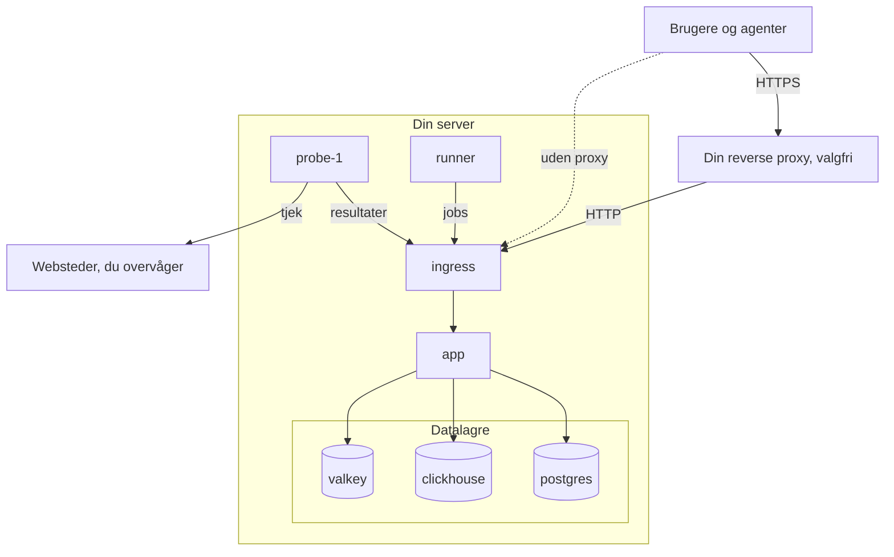

# Docker Compose

Kør en komplet, gratis OneUptime-instans på én Linux-server med Docker Compose. Denne side fører dig fra en ny server til en kørende instans og dækker derefter HTTPS, sikring til produktion, backups, opdateringer og fjernelse.

:::cards
- [Installér OneUptime](#installér-oneuptime): Fra en ny server til din første konto i seks trin.
- [Opsæt HTTPS](#opsæt-https): Lad OneUptime hente et certifikat, eller sæt din egen proxy foran.
- [Tjekliste til produktion](#tjekliste-til-produktion): Hvad der skal være på plads, før der kommer rigtig trafik.
- [Opdatér OneUptime](#opdatér-oneuptime): Skift til den nyeste release.
:::

## Sådan fungerer det

Docker Compose kører hver del af OneUptime som en container på din server. Al trafik kommer ind gennem containeren `ingress`, som sender den videre til `app`. Appen gemmer sine data i PostgreSQL, ClickHouse og Valkey. En medfølgende probe kører dine monitorers tjek og melder tilbage gennem ingressen.



| Tjeneste | Image | Hvad den gør |
| --- | --- | --- |
| `ingress` | `oneuptime/nginx` | Modtager al trafik på port 80 og 443 og sender den videre til appen. Leverer HTTPS, når OneUptime administrerer certifikatet. |
| `app` | `oneuptime/app` | Dashboardet, API'et, statussider, indtag af telemetri og baggrundsworkerne. |
| `probe-1` | `oneuptime/probe` | En global probe, der kører dine monitorers tjek. Den bruger værtens netværk. |
| `runner` | `oneuptime/runner` | Instansens Runner, der kører AI-kodeløsninger. Den bruger værtens netværk. |
| `postgres` | `postgres:15` | Konfiguration og tilstand: monitorer, hændelser, brugere. Gemt i volumet `postgres`. |
| `clickhouse` | `clickhouse/clickhouse-server:26.7` | Telemetri: logs, metrikker, traces og exceptions. Gemt i volumet `clickhouse`. |
| `valkey` | `valkey/valkey:9.1-alpine` | Cache og køer. Den gemmer intet på disk. |

> [!NOTE]
> Tjenesten `valkey` kører [Valkey](https://valkey.io), den BSD-licenserede fork af Redis 7.2, konfigureret via indstillingerne `VALKEY_*` i `config.env`. Enhver server, der taler Redis-protokollen, virker — peg `VALKEY_HOST` på en administreret Redis, hvis du foretrækker det. Indtil 13.0.0 hed disse indstillinger `REDIS_*`; de gamle navne læses stadig, containeren svarer stadig på værtsnavnet `redis`, og `npm run update` omskriver dem ikke, så en ældre `config.env` behøver ingen ændringer.

Til produktion i stor skala, eller når du har brug for høj tilgængelighed, så brug i stedet [Helm-chartet](https://artifacthub.io/packages/helm/oneuptime/oneuptime) på Kubernetes: Docker Compose kører én kopi af hver tjeneste på én server.

## Krav

Vælg serverens størrelse ud fra, hvad du vil køre på den. Det er telemetri (logs, metrikker, traces), der bestemmer hukommelse og disk; se [Dimensionering og kapacitetsplanlægning](/docs/installation/sizing), når du kender dine mængder.

| | Anbefalet | Minimum til et homelab |
| --- | --- | --- |
| **Hukommelse** | 16 GB | 8 GB |
| **CPU** | 8 kerner | 4 kerner |
| **Disk** | 400 GB | 20 GB |
| **System** | Ubuntu 22.04, eller et andet Linux baseret på Debian, Ubuntu eller RHEL | Det samme |
| **Arkitektur** | x86-64 (`amd64`) eller ARM (`arm64`) | Det samme |

Minimum til et homelab passer til personlig og eksperimentel brug — nogle kører OneUptime på en Raspberry Pi.

Du har også brug for:

- **Docker** med pluginet **Docker Compose v2** (kommandoen `docker compose`).
- **Git**, til at hente OneUptime.
- **Node.js og npm**, som kører scriptene `npm start` og `npm run update`, der pakker Docker Compose ind.
- **Port 80 og 443** ledige på serveren. Tabellen nedenfor viser hver port, OneUptime bruger på værten.

| Værtsport | Bruges af | Indstilling | Hvad den bruges til |
| --- | --- | --- | --- |
| 80 | `ingress` | `ONEUPTIME_HTTP_PORT` | Dashboardet, API'et, indtag af telemetri og validering hos Let's Encrypt. |
| 443 | `ingress` | `STATUS_PAGE_HTTPS_PORT` | HTTPS til din instans, når OneUptime administrerer certifikatet, og til statussider og dashboards på egne domæner. |
| 5400 | `postgres` | Angivet i `docker-compose.yml` | Lader `npm run backup` nå PostgreSQL. Hold den lukket mod internettet. |
| 3874 | `probe-1` | `GLOBAL_PROBE_1_PORT` | Probens egen server. Intet uden for serveren har brug for den. |
| 3876 | `runner` | `ONEUPTIME_RUNNER_PORT` | Runnerens egen server. Intet uden for serveren har brug for den. |

Der findes også en [videogennemgang](https://youtu.be/j1SWmMW2oL4) af installationen.

## Installér OneUptime

:::steps
### Klon release-branchen

Branchen `release` indeholder filerne til den nyeste release.

```bash
git clone --depth 1 --single-branch --branch release https://github.com/OneUptime/oneuptime.git
cd oneuptime
```

### Opret config.env

Alle OneUptimes indstillinger ligger i `config.env`. Start ud fra eksemplet:

```bash
cp config.example.env config.env
```

### Angiv værtsnavnet

Åbn `config.env`, og sæt `HOST` til det domænenavn eller den IP-adresse, folk skal bruge for at nå OneUptime, uden `http://`. Behold kun `localhost` for at prøve OneUptime på din egen computer.

```ini title="config.env"
HOST=oneuptime.example.com
```

### Generér tilfældige hemmeligheder

Eksempelfilen indeholder pladsholderhemmeligheder, der er offentlige på GitHub. Erstat hver af dem med sin egen tilfældige værdi:

```bash
while grep -q "please-change-this-to-random-value" config.env; do
  sed -i "0,/please-change-this-to-random-value/{s/please-change-this-to-random-value/$(openssl rand -hex 32)/}" config.env
done
grep -c "please-change-this" config.env
```

Den sidste kommando udskriver `0`: Der er ingen pladsholder tilbage. Løkken bruger GNU `sed`, som alle Linux-servere har. Det er disse indstillinger, den udfylder:

| Indstilling | Hvad den beskytter |
| --- | --- |
| `ONEUPTIME_SECRET` | Kald mellem OneUptimes egne tjenester. |
| `ENCRYPTION_SECRET` | De hemmeligheder, OneUptime gemmer, som integrationstokens og SMTP-adgangskoder, og de login-tokens, den udsteder. |
| `DATABASE_PASSWORD`, `CLICKHOUSE_PASSWORD`, `VALKEY_PASSWORD` | De tre datalagre. |
| `REGISTER_PROBE_KEY` | Registrering af prober hos din instans. |
| `GLOBAL_PROBE_1_KEY`, `GLOBAL_PROBE_2_KEY` | De globale prober, Docker Compose kan køre (`probe-1` kører som standard). |
| `ONEUPTIME_RUNNER_KEY` | Den medfølgende Runner. |

> [!IMPORTANT]
> Angiv hemmelighederne før første start, og behold dem derefter. PostgreSQL tager kun sin adgangskode, når den opretter sin database, og ændrer du `ENCRYPTION_SECRET` senere, bliver hver værdi, der er krypteret med den gamle, ulæselig.

### Start OneUptime

:::tabs
@tab npm
```bash
npm start
```
@tab Docker CLI
```bash
(export $(grep -v '^#' config.env | xargs) && docker compose up --remove-orphans -d)
```
:::

Første start tager flere minutter: Docker henter imagesne, og OneUptime opretter sine databaser. `npm start` venter, til hver del svarer, og slutter med **OneUptime is up!**

### Opret den første konto

Åbn `http://` efterfulgt af din `HOST` (for eksempel `http://localhost`), og tilmeld dig. Den første konto på en ny instans bliver dens masteradministrator, som kan åbne Admin Dashboard på `/admin`.

Alle, der kan nå siden, kan tilmelde sig efter dig. For at forhindre det åbner du Admin Dashboard, går til **Indstillinger > Godkendelse** og slår **Tillad tilmelding** fra. Personer, du inviterer til et projekt, kan stadig oprette deres konto.
:::

## Opsæt HTTPS

OneUptime leverer almindelig HTTP, indtil du vælger en af to måder at tilføje HTTPS på:

| | Lad OneUptime hente et certifikat | Brug din egen reverse proxy |
| --- | --- | --- |
| **TLS ender ved** | OneUptimes `ingress`, med et gratis certifikat fra Let's Encrypt, som den selv fornyer | Din proxy: Caddy, Nginx eller en load balancer |
| **Du skal bruge** | Et offentligt domænenavn, der peger på serveren, og port 80 og 443, der kan nås fra internettet | En proxy og et certifikat til dit domæne |
| **Indstillinger** | `PROVISION_SSL=true`, `HTTP_PROTOCOL=https` | `PROVISION_SSL=false`, `HTTP_PROTOCOL=https`, `TRUSTED_PROXY_HOPS=2` |
| **Statussider på egne domæner** | Virker uden yderligere opsætning | Din proxy skal også betjene de domæner |

Hvis du lægger statussider eller dashboards på egne domæner, er det enklest at lade OneUptime håndtere TLS: Ingressen bestiller og leverer selv certifikaterne til de domæner.

### Lad OneUptime hente et certifikat

:::steps
#### Peg dit domæne på serveren

Opret en DNS-post `A` (eller `AAAA` til IPv6) for dit domæne med serverens offentlige IP-adresse som værdi.

#### Slå hentning af certifikater til

Angiv disse værdier i `config.env`:

```ini title="config.env"
HOST=oneuptime.example.com
PROVISION_SSL=true
HTTP_PROTOCOL=https
```

`HOST` skal være et domænenavn: OneUptime kan ikke få et certifikat til en IP-adresse eller til `localhost`.

#### Genstart med de nye indstillinger

```bash
npm start
```

#### Åbn din instans over HTTPS

Åbn `https://oneuptime.example.com`. OneUptime bestiller certifikatet ved start og tjekker det derefter hver time og fornyer det, når der er mindre end 30 dage tilbage. Indtil det første certifikat kommer, som regel inden for få minutter, leverer ingressen et midlertidigt selvsigneret certifikat, og din browser advarer dig.
:::

### Brug din egen reverse proxy

Disse trin kører proxyen på samme server som OneUptime. Kører din proxy på en anden maskine, så spring det første trin over, og peg proxyen på port 80 på denne server.

:::steps
#### Flyt ingressen væk fra port 80 og 443

Proxyen skal bruge port 80 og 443, så flyt ingressen til andre porte. Proben og Runneren bruger værtens netværk og når OneUptime gennem `http://localhost`, så de flytter med:

```ini title="config.env"
ONEUPTIME_HTTP_PORT=8080
STATUS_PAGE_HTTPS_PORT=8443
GLOBAL_PROBE_1_ONEUPTIME_URL=http://localhost:8080
ONEUPTIME_RUNNER_ONEUPTIME_URL=http://localhost:8080
```

#### Fortæl OneUptime, at den står bag en proxy

```ini title="config.env"
HOST=oneuptime.example.com
HTTP_PROTOCOL=https
PROVISION_SSL=false
TRUSTED_PROXY_HOPS=2
```

`HTTP_PROTOCOL=https` får de links, OneUptime bygger, til at bruge HTTPS. `TRUSTED_PROXY_HOPS=2` tæller din proxy og OneUptimes ingress, så OneUptime læser den besøgendes rigtige adresse til IP-tilladelseslister og hastighedsbegrænsninger. Læg én til for hver yderligere proxy, der tilføjer til `X-Forwarded-For`, som et CDN eller en load balancer.

#### Genstart OneUptime på de nye porte

```bash
(export $(grep -v '^#' config.env | xargs) && docker compose up --remove-orphans -d)
bash Tests/Scripts/status-check.sh localhost:8080
```

`npm start` tjekker `http://localhost` på port 80, hvor din proxy kommer til at ligge, så tjek selv den nye port. Scriptet slutter med **OneUptime is up!**

#### Konfigurér proxyen

:::tabs
@tab Caddy
```text title="Caddyfile"
oneuptime.example.com {
	reverse_proxy localhost:8080
}
```
Caddy henter og fornyer selv certifikatet, omdirigerer HTTP til HTTPS og sender WebSocket-forbindelser igennem. Genindlæs Caddy, når du har ændret filen, for eksempel med `sudo systemctl reload caddy`.
@tab Nginx
```nginx title="/etc/nginx/conf.d/oneuptime.conf"
map $http_upgrade $oneuptime_connection_upgrade {
    default upgrade;
    ""      close;
}

server {
    listen 80;
    server_name oneuptime.example.com;
    return 301 https://$host$request_uri;
}

server {
    listen 443 ssl;
    server_name oneuptime.example.com;

    ssl_certificate     /etc/letsencrypt/live/oneuptime.example.com/fullchain.pem;
    ssl_certificate_key /etc/letsencrypt/live/oneuptime.example.com/privkey.pem;

    # The limits OneUptime's own ingress uses.
    client_max_body_size 50M;
    proxy_read_timeout 300s;
    proxy_send_timeout 300s;

    proxy_http_version 1.1;
    proxy_set_header Host $host;
    proxy_set_header X-Forwarded-For $proxy_add_x_forwarded_for;
    proxy_set_header X-Forwarded-Proto $scheme;
    proxy_set_header Upgrade $http_upgrade;
    proxy_set_header Connection $oneuptime_connection_upgrade;

    location / {
        proxy_pass http://127.0.0.1:8080;
    }

    # MCP clients keep a stream open.
    location /mcp {
        proxy_pass http://127.0.0.1:8080;
        proxy_buffering off;
        proxy_read_timeout 86400s;
        proxy_send_timeout 86400s;
    }
}
```
Certifikatstierne er der, hvor Certbot lægger et certifikat fra Let's Encrypt; brug stierne til dit eget certifikat, hvis det kommer et andet sted fra. Kontrollér filen, og genindlæs Nginx med `sudo nginx -t && sudo systemctl reload nginx`.
:::

#### Åbn din instans gennem proxyen

Åbn `https://oneuptime.example.com`. Du bør se OneUptimes loginside, leveret med din proxys certifikat.
:::

> [!NOTE]
> Bag din egen proxy skal du sende telemetri over OTLP/HTTP (`/otlp`). OTLP over gRPC når kun OneUptime, når dens egen ingress afslutter TLS (`PROVISION_SSL=true`).

## Tjekliste til produktion

Docker Compose kører én kopi af hver tjeneste på én server, hvilket passer til små teams og homelabs. Gå denne liste igennem, før du stoler på den.

| Område | Hvad du gør |
| --- | --- |
| **Hemmeligheder** | Ingen værdi i `config.env` er stadig en pladsholder `please-change-this-to-random-value`. Se [Generér tilfældige hemmeligheder](#generér-tilfældige-hemmeligheder). |
| **HTTPS** | Folk når OneUptime over HTTPS, og `HTTP_PROTOCOL=https` er angivet. Se [Opsæt HTTPS](#opsæt-https). |
| **Tilmeldinger** | Når dit team har konti, så slå **Tillad tilmelding** fra under **Indstillinger > Godkendelse** i Admin Dashboard. |
| **Firewall** | Kun port 80 og 443 (og SSH) er åbne mod internettet. PostgreSQL er udgivet på port 5400 til backups: Luk den med din cloududbyders firewall, for `ufw`-regler gælder ikke for porte, Docker udgiver. |
| **Backups** | PostgreSQL tages der backup af hver dag, og kopierne forlader serveren. Se [Backup og gendannelse](#backup-og-gendannelse). |
| **E-mail** | Der er sat en mailserver op under **Indstillinger > Notifikationer > E-mails** i Admin Dashboard, så OneUptime kan sende invitationer og notifikationer. Se [SMTP](/docs/emails/smtp). |
| **Disk** | Den ledige plads overvåges. ClickHouse vokser med den telemetri, du gemmer (se [Dimensionering og kapacitetsplanlægning](/docs/installation/sizing)); hver containers log er begrænset til 1000 MB. |
| **Opdateringer** | OneUptime opdateres mindst én gang om ugen. Der kommer ofte nye releases. Se [Opdatér OneUptime](#opdatér-oneuptime). |
| **Høj tilgængelighed** | Hvis du har brug for det, så skift til [Helm-chartet](https://artifacthub.io/packages/helm/oneuptime/oneuptime) på Kubernetes. |

## Backup og gendannelse

PostgreSQL indeholder alt, hvad du konfigurerer: monitorer, hændelser, statussider, brugere. `npm run backup` dumper det til en fil i mappen `Backups`.

:::steps
### Giv backupscriptet databasens adgangskode

Sæt i `config.env` værdien `DATABASE_BACKUP_PASSWORD` til værdien af `DATABASE_PASSWORD`. Scriptet læser `config.env` som ren tekst, så det medfølgende `${DATABASE_PASSWORD}` bliver aldrig udfyldt.

### Kør backuppen

```bash
npm run backup
```

Det beder om din sudo-adgangskode og skriver `Backups/db-<day of the month>.backup`, så daglige backups erstatter dem fra en måned tidligere. Kør det mindst én gang om dagen.

### Kopiér backupperne væk fra serveren

En backup på samme disk som databasen overlever ikke, at den disk går tabt.
:::

ClickHouse gemmer din telemetri i Docker-volumet `oneuptime_clickhouse`, og intet script tager backup af det. Hvis du skal beholde den telemetri, så tag backup af volumet med et ClickHouse-værktøj som [clickhouse-backup](https://github.com/Altinity/clickhouse-backup), eller kopiér det, mens OneUptime er stoppet.

For at gendanne PostgreSQL angiver du værdierne `DATABASE_RESTORE_*` i `config.env`: `DATABASE_RESTORE_PASSWORD` til værdien af `DATABASE_PASSWORD`, som ved backups, og `DATABASE_RESTORE_FILENAME` til den backup, der skal gendannes, for eksempel `db-31.backup`. Kør derefter `bash restore.sh`. Den database, der gendannes til, skal allerede findes; på en kørende installation gør den det.

> [!CAUTION]
> `restore.sh` sletter hvert objekt fra backuppen i måldatabasen, før det genoprettes. Det spørger, før det går i gang; kontrollér det databasenavn, det viser.

## Opdatér OneUptime

Tag backup først, og kør derefter:

```bash
git checkout release
git pull
npm run update
```

`npm run update` beder om din sudo-adgangskode, tilføjer nye indstillinger fra `config.example.env` til din `config.env` (dine egne værdier bliver), henter de nye images og genstarter OneUptime. Ligesom `npm start` slutter det med **OneUptime is up!**

At skifte til en ny hovedversion (fra 13 til 14, for eksempel) kan kræve mere: Læs [Opgradering af OneUptime](/docs/installation/upgrading), før du går i gang.

`APP_TAG=release` i `config.env` henter altid den nyeste release af Community Edition. For at blive på én version sætter du `APP_TAG` til dens nummer, for eksempel `14.0.22`. Til Enterprise Edition er taggene `enterprise-release` og `enterprise-14.0.22`.

## Afinstallér OneUptime

Stop OneUptime, og fjern dens containere og netværk:

```bash
npm run down
```

Dine data bliver i volumerne `oneuptime_postgres` og `oneuptime_clickhouse`, og mappen `oneuptime` beholder `config.env` og dine backups. For også at slette dataene:

```bash
(export $(grep -v '^#' config.env | xargs) && docker compose down --volumes --remove-orphans)
```

Slet derefter mappen `oneuptime`.

> [!CAUTION]
> `--volumes` sletter hver monitor, hændelse, bruger og al telemetri for altid. Tag backup først, hvis du kunne få brug for noget af det.

## Fejlfinding

:::details Docker siger "permission denied", når du kører npm start
Din bruger kan ikke nå Docker-dæmonen. Føj den til gruppen `docker`, log derefter ud og ind igen:

```bash
sudo usermod -aG docker $USER
```
:::

:::details Ingressen kan ikke starte, fordi port 80 eller 443 er i brug
Et andet program på serveren, ofte en webserver, holder porten. Stop det, eller flyt ingressen til andre porte, og sæt programmet foran OneUptime som beskrevet i [Brug din egen reverse proxy](#brug-din-egen-reverse-proxy).
:::

:::details npm start slutter med "Maximum retries reached"
Tjekket, som `npm start` slutter med, gav op, før OneUptime svarede. Første start kan tage længere tid, end tjekket venter, mens images hentes og databaserne oprettes. Se, hvad der kører, og læs loggene:

```bash
npm run ps
npm run logs
```

Når hver container kører, så kør tjekket igen med `npm run status-check`. Har du flyttet ingressen væk fra port 80, så tjek i stedet dens nye port: `bash Tests/Scripts/status-check.sh localhost:8080`.
:::

:::details Nogle sider indlæses, men liveopdateringer eller uploads fejler
Åbn OneUptime på adressen i `HOST`. Ingressen sender anmodninger videre efter værtsnavn: Kun `HOST` og `localhost` når hele applikationen, og ethvert andet navn, som serverens IP-adresse, behandles som en statussides domæne. Sæt `HOST` til det navn, folk bruger, og kør derefter `npm start`.
:::

:::details Browseren advarer om certifikatet, efter at du har angivet PROVISION_SSL
Indtil Let's Encrypt udsteder certifikatet, leverer ingressen et midlertidigt selvsigneret certifikat. Hvis advarslen bliver ved i mere end et par minutter, så tjek at:

- `HOST` er et domænenavn, ikke en IP-adresse og ikke `localhost`.
- Domænets DNS-post peger på denne server.
- Port 80 kan nås fra internettet, så Let's Encrypt kan validere domænet.

Når en bestilling fejler, logger appen en fejl, der begynder med `CoreSSL:EnsurePrimaryHostCertificate`, efterfulgt af årsagen:

```bash
(export $(grep -v '^#' config.env | xargs) && docker compose logs app) | grep -A 5 CoreSSL
```
:::

:::details Den medfølgende probe viser Afbrudt, efter at du har flyttet ingressens port
Admin Dashboard viser proben under **Indstillinger > Overvågning > Globale probes**. Den når OneUptime på `GLOBAL_PROBE_1_ONEUPTIME_URL`, som som standard er `http://localhost` (port 80). Sæt den til ingressens nye port, for eksempel `http://localhost:8080`, sæt `ONEUPTIME_RUNNER_ONEUPTIME_URL` på samme måde, og genstart OneUptime.
:::

## Næste trin

:::cards
- [Opgradering af OneUptime](/docs/installation/upgrading): Hvad hver hovedversion kræver af dig.
- [Dimensionering og kapacitetsplanlægning](/docs/installation/sizing): Planlæg hukommelse og disk til din telemetri.
- [Selvhostet arkitektur](/docs/self-hosted/architecture): Hvordan komponenterne hænger sammen.
- [Enterprise Edition](/docs/self-hosted/enterprise): Hvad Enterprise-imaget tilføjer, og dets licens.
:::
