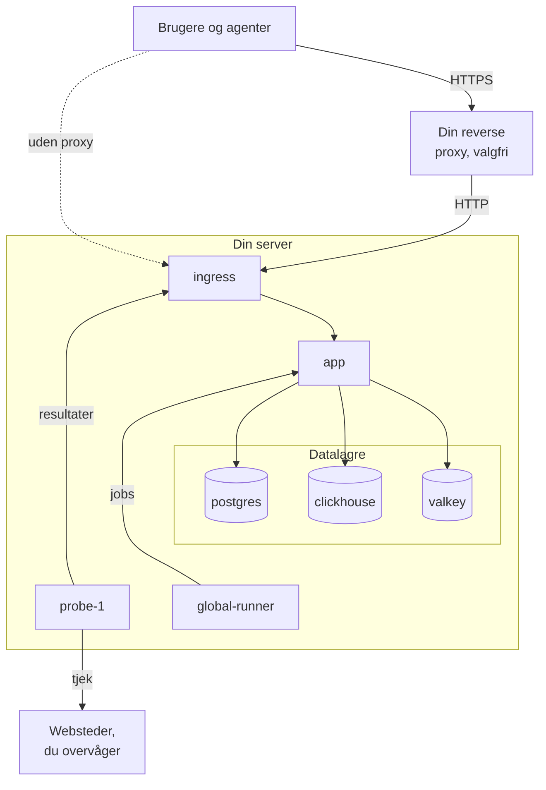

# Docker Compose

Kør en komplet, gratis OneUptime-instans på én Linux-server med Docker Compose. Denne side fører dig fra en ny server til en kørende instans og dækker derefter HTTPS, sikring til produktion, backups, opdateringer og fjernelse. Vil du i stedet arbejde på OneUptimes egen kode, så se [Lokal udvikling](/docs/installation/local-development).

:::cards
- [Installér OneUptime](#installér-oneuptime): Fra en ny server til din første konto i fem trin.
- [Opsæt HTTPS](#opsæt-https): Lad OneUptime hente et certifikat, eller sæt din egen proxy foran.
- [Tjekliste til produktion](#tjekliste-til-produktion): Hvad der skal være på plads, før der kommer rigtig trafik.
- [Opdatér OneUptime](#opdatér-oneuptime): Skift til den nyeste release.
:::

## Sådan fungerer det

Docker Compose kører hver del af OneUptime som en container på din server. Al trafik kommer ind gennem containeren `ingress`, som sender den videre til `app`. Appen gemmer sine data i PostgreSQL, ClickHouse og Valkey. En medfølgende probe kører dine monitorers tjek og melder tilbage gennem ingressen.



| Tjeneste | Image | Hvad den gør |
| --- | --- | --- |
| `ingress` | `oneuptime/nginx` | Modtager al trafik på port 80 og 443 og sender den videre til appen. Leverer HTTPS, når OneUptime administrerer certifikatet. |
| `app` | `oneuptime/app` | Dashboardet, API'et, statussider, indtag af telemetri og baggrundsworkerne. |
| `probe-1` | `oneuptime/probe` | En global probe, der kører dine monitorers tjek. Den bruger værtens netværk. |
| `global-runner` | `oneuptime/runner` | Den medfølgende globale Runner, der kører runbooks' JavaScript-trin og OneUptime AI's koderettelser for alle projekter. |
| `postgres` | `postgres:15` | Konfiguration og tilstand: monitorer, hændelser, brugere. Gemt i volumet `postgres`. |
| `clickhouse` | `clickhouse/clickhouse-server:26.7` | Telemetri: logs, metrikker, traces og exceptions. Gemt i volumet `clickhouse`. |
| `valkey` | `valkey/valkey:9.1-alpine` | Cache og køer. Den gemmer intet på disk. |

> [!NOTE]
> Tjenesten `valkey` kører [Valkey](https://valkey.io), den BSD-licenserede fork af Redis 7.2, konfigureret via indstillingerne `VALKEY_*` i `config.env`. Enhver server, der taler Redis-protokollen, virker — peg `VALKEY_HOST` på en administreret Redis, hvis du foretrækker det. Indtil 13.0.0 hed disse indstillinger `REDIS_*`; de gamle navne læses stadig, containeren svarer stadig på værtsnavnet `redis`, og `npm run update` omskriver dem ikke, så en ældre `config.env` behøver ingen ændringer.

Til produktion i stor skala, eller når du har brug for høj tilgængelighed, så brug i stedet [Helm-chartet](https://artifacthub.io/packages/helm/oneuptime/oneuptime) på Kubernetes: Docker Compose kører én kopi af hver tjeneste på én server.

## Krav

Vælg serverens størrelse ud fra, hvad du vil køre på den. Det er telemetri (logs, metrikker, traces), der bestemmer hukommelse og disk; se [Dimensionering og kapacitetsplanlægning](/docs/installation/sizing), når du kender dine mængder.

| | Anbefalet | Minimum til et homelab |
| --- | --- | --- |
| **Hukommelse** | 16 GB | 8 GB |
| **CPU** | 8 kerner | 4 kerner |
| **Disk** | 400 GB | 20 GB |
| **System** | Ubuntu 22.04, eller et andet Linux baseret på Debian, Ubuntu eller RHEL | Det samme |
| **Arkitektur** | x86-64 (`amd64`) eller ARM (`arm64`) | Det samme |

Minimum til et homelab passer til personlig og eksperimentel brug — nogle kører OneUptime på en Raspberry Pi.

Du har også brug for:

- **Docker** med pluginet **Docker Compose v2** (kommandoen `docker compose`).
- **Git**, til at hente OneUptime.
- **Node.js og npm**, som kører scriptene `npm start` og `npm run update`, der pakker Docker Compose ind.
- **Port 80 og 443** ledige på serveren. Tabellen nedenfor viser hver port, OneUptime bruger på værten.

| Værtsport | Bruges af | Indstilling | Hvad den bruges til |
| --- | --- | --- | --- |
| 80 | `ingress` | `ONEUPTIME_HTTP_PORT` | Dashboardet, API'et, indtag af telemetri og validering hos Let's Encrypt. |
| 443 | `ingress` | `STATUS_PAGE_HTTPS_PORT` | HTTPS til din instans, når OneUptime administrerer certifikatet, og til statussider og dashboards på egne domæner. |
| 5400 | `postgres` | `DATABASE_PUBLISHED_PORT` | Lader `npm run backup` og `restore.sh` nå PostgreSQL fra selve serveren. Den er kun udgivet på `127.0.0.1`. |
| 3874 | `probe-1` | `GLOBAL_PROBE_1_PORT` | Probens egen server. Intet uden for serveren har brug for den. |

Der findes også en [videogennemgang](https://youtu.be/j1SWmMW2oL4) af installationen.

## Installér OneUptime

På en ny Ubuntu-, Debian- eller RHEL-baseret server kan én kommando køre trinene nedenfor for dig. Den installerer Docker, Git og Node.js, hvor de mangler, kloner release-branchen til en mappe `oneuptime`, spørger om den adresse, folk vil bruge, og kører `npm start`:

```bash
curl -fsSL https://oneuptime.com/install.sh | bash
```

:::steps
### Klon release-branchen

Branchen `release` indeholder filerne til den nyeste release.

```bash
git clone --depth 1 --single-branch --branch release https://github.com/OneUptime/oneuptime.git
cd oneuptime
```

### Opret config.env

Alle OneUptimes indstillinger ligger i `config.env`. Start ud fra eksemplet:

```bash
cp config.example.env config.env
```

### Angiv værtsnavnet

Åbn `config.env`, og sæt `HOST` til det domænenavn eller den IP-adresse, folk skal bruge for at nå OneUptime, uden `http://`. Behold kun `localhost` for at prøve OneUptime på din egen computer.

```ini title="config.env"
HOST=oneuptime.example.com
```

### Start OneUptime

:::tabs
@tab npm
```bash
npm start
```
@tab Docker CLI
```bash
sh Scripts/Install/WithConfig.sh docker compose up --remove-orphans -d
```
Erstat selv pladsholderhemmelighederne før første start, som [Generér tilfældige hemmeligheder](#generér-tilfældige-hemmeligheder) viser: Kun `npm start` gør det for dig.
:::

`npm start` tjekker først serveren: Docker, hukommelse, diskplads, de porte, OneUptime bruger, og `HOST`. Den stopper ved alt, der ville forhindre OneUptime i at virke, og siger, hvad du skal ændre. Derefter giver den hver pladsholderhemmelighed i `config.env` sin egen tilfældige værdi, starter OneUptime og venter, til hver del svarer. Første start tager flere minutter, mens Docker henter imagesne, og OneUptime opretter sine databaser. Den slutter med **OneUptime is up!** og den adresse, du skal åbne.

### Opret den første konto

Åbn `http://` efterfulgt af din `HOST` (for eksempel `http://localhost`), og tilmeld dig. Den første konto på en ny instans bliver dens masteradministrator, som kan åbne Admin Dashboard på `/admin`.

Alle, der kan nå siden, kan tilmelde sig efter dig. For at forhindre det åbner du Admin Dashboard, går til **Indstillinger > Godkendelse** og slår **Tillad tilmelding** fra. Personer, du inviterer til et projekt, kan stadig oprette deres konto.
:::

### Generér tilfældige hemmeligheder

`config.example.env` leverer hver hemmelighed som en pladsholder, der er offentlig på GitHub. `npm start` giver hver af dem sin egen tilfældige værdi, før den starter noget, og nævner de indstillinger, den har udfyldt:

| Indstilling | Hvad den beskytter |
| --- | --- |
| `ONEUPTIME_SECRET` | Kald mellem OneUptimes egne tjenester. |
| `ENCRYPTION_SECRET` | De hemmeligheder, OneUptime gemmer, som integrationstokens og SMTP-adgangskoder, og de login-tokens, den udsteder. |
| `DATABASE_PASSWORD`, `CLICKHOUSE_PASSWORD`, `VALKEY_PASSWORD` | De tre datalagre. |
| `REGISTER_PROBE_KEY` | Registrering af prober hos din instans. |
| `GLOBAL_PROBE_1_KEY`, `GLOBAL_PROBE_2_KEY` | De globale prober, Docker Compose kan køre (`probe-1` kører som standard). |
| `GLOBAL_RUNNER_KEY` | Den medfølgende globale Runner, der kører alle projekters JavaScript-trin og AI-koderettelser. |

> [!IMPORTANT]
> Behold hemmelighederne, når OneUptime er startet. PostgreSQL tager kun sin adgangskode, når den opretter sin database, og ændrer du `ENCRYPTION_SECRET` senere, bliver hver værdi, der er krypteret med den gamle, ulæselig. Derfor sætter `npm start` kun `DATABASE_PASSWORD` og `ENCRYPTION_SECRET` på en ny installation, før PostgreSQL opretter sin database.

Med Docker CLI erstatter du selv pladsholderne før første start:

```bash
while grep -q "please-change-this-to-random-value" config.env; do
  sed -i "0,/please-change-this-to-random-value/{s/please-change-this-to-random-value/$(openssl rand -hex 32)/}" config.env
done
grep -c "please-change-this" config.env
```

Den sidste kommando udskriver `0`: Der er ingen pladsholder tilbage. Løkken bruger GNU `sed`, som alle Linux-servere har.

## Opsæt HTTPS

OneUptime leverer almindelig HTTP, indtil du vælger en af to måder at tilføje HTTPS på:

| | Lad OneUptime hente et certifikat | Brug din egen reverse proxy |
| --- | --- | --- |
| **TLS ender ved** | OneUptimes `ingress`, med et gratis certifikat fra Let's Encrypt, som den selv fornyer | Din proxy: Caddy, Nginx eller en load balancer |
| **Du skal bruge** | Et offentligt domænenavn, der peger på serveren, og port 80 og 443, der kan nås fra internettet | En proxy og et certifikat til dit domæne |
| **Indstillinger** | `PROVISION_SSL=true`, `HTTP_PROTOCOL=https` | `PROVISION_SSL=false`, `HTTP_PROTOCOL=https`, `TRUSTED_PROXY_HOPS=2` |
| **Statussider på egne domæner** | Virker uden yderligere opsætning | Din proxy skal også betjene de domæner |

Hvis du lægger statussider eller dashboards på egne domæner, er det enklest at lade OneUptime håndtere TLS: Ingressen bestiller og leverer selv certifikaterne til de domæner.

Med `HTTP_PROTOCOL=https` bygger OneUptime HTTPS-links, holder login-cookies på HTTPS og beder browsere om kun at nå din `HOST` over HTTPS. En browser holder sig til det i et år, på alle porte under det navn, så hvis `HOST` en dag skal svare over almindelig HTTP igen, så sæt `HSTS_MAX_AGE_SECONDS=0` i `config.env` et stykke tid før: Browsere glemmer reglen ved deres næste besøg.

### Lad OneUptime hente et certifikat

:::steps
#### Peg dit domæne på serveren

Opret en DNS-post `A` (eller `AAAA` til IPv6) for dit domæne med serverens offentlige IP-adresse som værdi. Med en `AAAA`-post skal du også slå IPv6 til for OneUptime: se [Besøgendes adresser](#besøgendes-adresser).

#### Slå hentning af certifikater til

Angiv disse værdier i `config.env`:

```ini title="config.env"
HOST=oneuptime.example.com
PROVISION_SSL=true
HTTP_PROTOCOL=https
```

`HOST` skal være et domænenavn: OneUptime kan ikke få et certifikat til en IP-adresse eller til `localhost`.

#### Genstart med de nye indstillinger

```bash
npm start
```

#### Åbn din instans over HTTPS

Åbn `https://oneuptime.example.com`. OneUptime bestiller certifikatet ved start og tjekker det derefter hver time og fornyer det, når der er mindre end 30 dage tilbage. Indtil det første certifikat kommer, som regel inden for få minutter, leverer ingressen et midlertidigt selvsigneret certifikat, og din browser advarer dig.
:::

### Brug din egen reverse proxy

Disse trin kører proxyen på samme server som OneUptime. Kører din proxy på en anden maskine, så spring det første trin over, peg proxyen på port 80 på denne server, og lad med din cloududbyders firewall kun proxyen nå port 80 og 443: en besøgende, der når OneUptime uden om proxyen, kan vælge den adresse, OneUptime tæller vedkommende efter.

:::steps
#### Flyt ingressen væk fra port 80 og 443

Proxyen skal bruge port 80 og 443, så flyt ingressen til andre porte, kun udgivet på serverens loopback-adresse `127.0.0.1`, så besøgende kun når OneUptime gennem din proxy:

```ini title="config.env"
ONEUPTIME_HTTP_PORT=127.0.0.1:8080
STATUS_PAGE_HTTPS_PORT=127.0.0.1:8443
```

Proben bruger værtens netværk og når OneUptime gennem `http://localhost`. `npm start` flytter den til ingressens nye port, `http://localhost:8080`, og siger det.

#### Fortæl OneUptime, at den står bag en proxy

```ini title="config.env"
HOST=oneuptime.example.com
HTTP_PROTOCOL=https
PROVISION_SSL=false
TRUSTED_PROXY_HOPS=2
```

`HTTP_PROTOCOL=https` får de links, OneUptime bygger, til at bruge HTTPS. `TRUSTED_PROXY_HOPS=2` tæller din proxy og OneUptimes ingress, så OneUptime læser den besøgendes rigtige adresse til IP-tilladelseslister og hastighedsbegrænsninger. Læg én til for hver yderligere proxy, der tilføjer til `X-Forwarded-For`, som et CDN eller en load balancer.

#### Genstart OneUptime på de nye porte

```bash
npm start
```

`npm start` tjekker OneUptime på dens nye port, `localhost:8080`, og slutter med **OneUptime is up!**

#### Konfigurér proxyen

:::tabs
@tab Caddy
```text title="Caddyfile"
oneuptime.example.com {
	reverse_proxy localhost:8080
}
```
Caddy henter og fornyer selv certifikatet, omdirigerer HTTP til HTTPS og sender WebSocket-forbindelser igennem. Genindlæs Caddy, når du har ændret filen, for eksempel med `sudo systemctl reload caddy`.
@tab Nginx
```nginx title="/etc/nginx/conf.d/oneuptime.conf"
map $http_upgrade $oneuptime_connection_upgrade {
    default upgrade;
    ""      close;
}

server {
    listen 80;
    server_name oneuptime.example.com;
    return 301 https://$host$request_uri;
}

server {
    listen 443 ssl;
    server_name oneuptime.example.com;

    ssl_certificate     /etc/letsencrypt/live/oneuptime.example.com/fullchain.pem;
    ssl_certificate_key /etc/letsencrypt/live/oneuptime.example.com/privkey.pem;

    # The limits OneUptime's own ingress uses.
    client_max_body_size 50M;
    proxy_read_timeout 300s;
    proxy_send_timeout 300s;

    proxy_http_version 1.1;
    proxy_set_header Host $host;
    proxy_set_header X-Forwarded-For $proxy_add_x_forwarded_for;
    proxy_set_header X-Forwarded-Proto $scheme;
    proxy_set_header Upgrade $http_upgrade;
    proxy_set_header Connection $oneuptime_connection_upgrade;

    location / {
        proxy_pass http://127.0.0.1:8080;
    }

    # MCP clients keep a stream open.
    location /mcp {
        proxy_pass http://127.0.0.1:8080;
        proxy_buffering off;
        proxy_read_timeout 86400s;
        proxy_send_timeout 86400s;
    }
}
```
Certifikatstierne er der, hvor Certbot lægger et certifikat fra Let's Encrypt; brug stierne til dit eget certifikat, hvis det kommer et andet sted fra. Kontrollér filen, og genindlæs Nginx med `sudo nginx -t && sudo systemctl reload nginx`.
:::

Begge sender `X-Forwarded-Proto`, som fortæller OneUptime, at en besøgende kom over HTTPS. Enhver anden proxy skal også sende den, ellers holdes login-cookies for statussider og dashboards på dine egne domæner ikke på HTTPS.

#### Åbn din instans gennem proxyen

Åbn `https://oneuptime.example.com`. Du bør se OneUptimes loginside, leveret med din proxys certifikat.
:::

> [!NOTE]
> Bag din egen proxy skal du sende telemetri over OTLP/HTTP (`/otlp`). OTLP over gRPC når kun OneUptime, når dens egen ingress afslutter TLS (`PROVISION_SSL=true`).

## Besøgendes adresser

OneUptime tæller hver besøgende efter den adresse, vedkommende forbinder fra: login-grænserne, de andre grænser pr. adresse og IP-tilladelseslisterne for statussider og dashboards læser den alle. To opsætninger kræver en indstilling, for at den adresse er den besøgendes egen:

| Opsætning | Indstilling |
| --- | --- |
| Folk når OneUptime via IPv6, for eksempel gennem en `AAAA`-post | IPv6 på OneUptimes netværk, i `docker-compose.override.yml` |
| Din egen reverse proxy står foran OneUptime | `TRUSTED_PROXY_HOPS=2`, med ingressen udgivet på `127.0.0.1` (se [Brug din egen reverse proxy](#brug-din-egen-reverse-proxy)) |

Uden IPv6 på OneUptimes netværk giver Docker hver besøgende, der kommer via IPv6, videre til OneUptime fra én adresse af sin egen, og OneUptime tæller dem alle som én besøgende: én persons mislykkede logins kan låse de andre ude. At slå IPv6 til kræver Docker Engine 27 eller nyere (`docker version` viser din).

:::steps
### Slå IPv6 til

Opret `docker-compose.override.yml` ved siden af `docker-compose.yml`, eller føj dette til den, du har; `npm start` og `npm run update` læser den:

```yaml title="docker-compose.override.yml"
networks:
  oneuptime:
    enable_ipv6: true
```

### Genstart OneUptime

```bash
npm stop
npm start
```

OneUptime stopper og starter igen med IPv6 på sit netværk. Dine data bevares. Docker kan ikke fjerne et netværk, som en container af din egen stadig er forbundet til, for eksempel en reverse proxy: frakobl den først fra OneUptimes netværk, og forbind den igen bagefter. Stopper `npm start` med `has active endpoints`, så frakobl den og kør `npm stop` og `npm start` igen.

### Tjek netværket

```bash
docker network ls --quiet --filter name=_oneuptime | xargs docker network inspect | grep EnableIPv6
```

Den skriver `"EnableIPv6": true,`.
:::

Når flere personer logger ind fra den samme private netværksadresse, siger siden **OneUptime-tilstand** i Admin Dashboard det, med den indstilling, der ændrer det.

## Tjekliste til produktion

Docker Compose kører én kopi af hver tjeneste på én server, hvilket passer til små teams og homelabs. Gå denne liste igennem, før du stoler på den.

| Område | Hvad du gør |
| --- | --- |
| **Hemmeligheder** | Ingen værdi i `config.env` er stadig en pladsholder `please-change-this-to-random-value`. Se [Generér tilfældige hemmeligheder](#generér-tilfældige-hemmeligheder), og [Skift databasens adgangskode](#skift-databasens-adgangskode) for en installation, der startede med pladsholderen i `DATABASE_PASSWORD`. |
| **HTTPS** | Folk når OneUptime over HTTPS, og `HTTP_PROTOCOL=https` er angivet. Se [Opsæt HTTPS](#opsæt-https). |
| **Tilmeldinger** | Når dit team har konti, så slå **Tillad tilmelding** fra under **Indstillinger > Godkendelse** i Admin Dashboard. |
| **Firewall** | Kun port 80 og 443 (og SSH) er åbne mod internettet. OneUptime udgiver kun PostgreSQLs port 5400 på `127.0.0.1`. Luk enhver anden port, du udgiver, med din cloududbyders firewall: `ufw`-regler gælder ikke for porte, Docker udgiver. |
| **Besøgendes adresser** | Siden **OneUptime-tilstand** i Admin Dashboard melder ikke, at flere personer logger ind fra den samme adresse. Se [Besøgendes adresser](#besøgendes-adresser). |
| **Backups** | PostgreSQL tages der backup af hver dag, og kopierne forlader serveren. Se [Backup og gendannelse](#backup-og-gendannelse). |
| **E-mail** | Der er sat en mailserver op under **Indstillinger > Notifikationer > E-mails** i Admin Dashboard, så OneUptime kan sende invitationer og notifikationer. Se [SMTP](/docs/emails/smtp). |
| **Disk** | Den ledige plads overvåges. ClickHouse vokser med den telemetri, du gemmer (se [Dimensionering og kapacitetsplanlægning](/docs/installation/sizing)); hver containers log er begrænset til 1000 MB. |
| **Opdateringer** | OneUptime opdateres mindst én gang om ugen. Der kommer ofte nye releases. Se [Opdatér OneUptime](#opdatér-oneuptime). |
| **Høj tilgængelighed** | Hvis du har brug for det, så skift til [Helm-chartet](https://artifacthub.io/packages/helm/oneuptime/oneuptime) på Kubernetes. |

### Skift databasens adgangskode

PostgreSQL beholder den adgangskode, den blev oprettet med, så ændrer du kun `DATABASE_PASSWORD` i `config.env`, låser du OneUptime ude af sin database. For at give en installation, der startede med pladsholderen, sin egen adgangskode skal du ændre den i PostgreSQL og i `config.env` samtidig og derefter starte OneUptime igen:

```bash
NEW_PASSWORD=$(openssl rand -hex 32) &&
  echo "ALTER USER CURRENT_USER PASSWORD '$NEW_PASSWORD';" | sh Scripts/Install/WithConfig.sh sh -c 'docker compose exec -T postgres psql -v ON_ERROR_STOP=1 -U "$DATABASE_USERNAME" -d "$DATABASE_NAME"' &&
  sed -i "s/^DATABASE_PASSWORD=.*/DATABASE_PASSWORD=$NEW_PASSWORD/" config.env
npm start
```

Har du angivet `DATABASE_BACKUP_PASSWORD` og `DATABASE_RESTORE_PASSWORD`, så giv dem også den nye værdi.

## Backup og gendannelse

PostgreSQL indeholder alt, hvad du konfigurerer: monitorer, hændelser, statussider, brugere. `npm run backup` dumper det til en fil i mappen `Backups`. Enterprise Edition kan også sikkerhedskopiere PostgreSQL og ClickHouse efter en tidsplan til dit eget lager fra Admin Dashboard: se [Sikkerhedskopier](/docs/installation/backups).

:::steps
### Giv backupscriptet databasens adgangskode

Sæt i `config.env` værdien `DATABASE_BACKUP_PASSWORD` til værdien af `DATABASE_PASSWORD`. Scriptet læser `config.env` som ren tekst, så det medfølgende `${DATABASE_PASSWORD}` bliver aldrig udfyldt.

### Kør backuppen

```bash
npm run backup
```

Det beder om din sudo-adgangskode og skriver `Backups/db-<day of the month>.backup`, så daglige backups erstatter dem fra en måned tidligere. Kør det mindst én gang om dagen.

### Kopiér backupperne væk fra serveren

En backup på samme disk som databasen overlever ikke, at den disk går tabt.
:::

Kun selve serveren når PostgreSQL: Den svarer på port 5400 på `127.0.0.1`. For at tage backup af den fra en anden maskine skal du åbne en SSH-tunnel fra den maskine og derefter forbinde til dens egen port 5400:

```bash
ssh -N -L 5400:127.0.0.1:5400 you@oneuptime.example.com
```

:::details Udgiv PostgreSQL på en adresse i et privat netværk
Hvis et værktøj på dit private netværk skal nå PostgreSQL uden en tunnel, så udgiv den også på serverens adresse i det netværk, på en port for sig. Opret `docker-compose.override.yml` ved siden af `docker-compose.yml`; `npm start` og `npm run update` læser den:

```yaml title="docker-compose.override.yml"
services:
  postgres:
    ports:
      - "10.0.0.5:5401:5432"
```

Brug serverens egen private adresse i stedet for `10.0.0.5`, aldrig en offentlig, og giv først PostgreSQL sin egen adgangskode (se [Skift databasens adgangskode](#skift-databasens-adgangskode)). Kør derefter `npm start`, så svarer PostgreSQL også på port 5401 på den adresse.
:::

ClickHouse gemmer din telemetri i Docker-volumet `oneuptime_clickhouse`, og intet script tager backup af det. Hvis du skal beholde den telemetri, så tag backup af volumet med et ClickHouse-værktøj som [clickhouse-backup](https://github.com/Altinity/clickhouse-backup), eller kopiér det, mens OneUptime er stoppet.

For at gendanne PostgreSQL angiver du værdierne `DATABASE_RESTORE_*` i `config.env`: `DATABASE_RESTORE_PASSWORD` til værdien af `DATABASE_PASSWORD`, som ved backups, og `DATABASE_RESTORE_FILENAME` til den backup, der skal gendannes, for eksempel `db-31.backup`. Kør derefter `bash restore.sh`. Den database, der gendannes til, skal allerede findes; på en kørende installation gør den det.

> [!CAUTION]
> `restore.sh` sletter hvert objekt fra backuppen i måldatabasen, før det genoprettes. Det spørger, før det går i gang; kontrollér det databasenavn, det viser.

## Opdatér OneUptime

Tag backup først, og kør derefter:

```bash
git checkout release
git pull
npm run update
```

`npm run update` tilføjer nye indstillinger fra `config.example.env` til din `config.env` (dine egne værdier bliver), henter de nye images og genstarter OneUptime. Ligesom `npm start` slutter det med **OneUptime is up!**

At skifte til en ny hovedversion (fra 13 til 14, for eksempel) kan kræve mere: Læs [Opgradering af OneUptime](/docs/installation/upgrading), før du går i gang.

`APP_TAG=release` i `config.env` henter altid den nyeste release af Community Edition. For at blive på én version sætter du `APP_TAG` til dens nummer, for eksempel `14.0.22`. Til Enterprise Edition er taggene `enterprise-release` og `enterprise-14.0.22`.

## Afinstallér OneUptime

Stop OneUptime, og fjern dens containere og netværk:

```bash
npm run down
```

Dine data bliver i volumerne `oneuptime_postgres` og `oneuptime_clickhouse`, og mappen `oneuptime` beholder `config.env` og dine backups. For også at slette dataene:

```bash
sh Scripts/Install/WithConfig.sh docker compose down --volumes --remove-orphans
```

Slet derefter mappen `oneuptime`.

> [!CAUTION]
> `--volumes` sletter hver monitor, hændelse, bruger og al telemetri for altid. Tag backup først, hvis du kunne få brug for noget af det.

## Fejlfinding

:::details npm start stopper, før den starter OneUptime
`npm start` tjekker først serveren og stopper ved alt, der ville forhindre OneUptime i at virke: Docker eller dets Compose-plugin mangler, Docker kører ikke eller er uden for din brugers rækkevidde, et andet program holder en port, eller `HOST` er en adresse, ingen browser kan åbne. Hver linje markeret med ✗ siger, hvad du skal ændre. Ret det, og kør derefter `npm start` igen. Tager et tjek fejl om din server, så start uden tjekkene:

```bash
ONEUPTIME_SKIP_PREFLIGHT=true npm start
```
:::

:::details Docker siger "permission denied", når du kører npm start
Din bruger kan ikke nå Docker-dæmonen. Føj den til gruppen `docker`, log derefter ud og ind igen:

```bash
sudo usermod -aG docker $USER
```
:::

:::details Ingressen kan ikke starte, fordi port 80 eller 443 er i brug
Et andet program på serveren, ofte en webserver, holder porten. `npm start` tjekker portene, før den starter noget, og nævner den container, der holder en af dem, når Docker kører den. Stop programmet, eller flyt ingressen til andre porte, og sæt programmet foran OneUptime som beskrevet i [Brug din egen reverse proxy](#brug-din-egen-reverse-proxy).
:::

:::details npm start slutter med "Maximum retries reached"
Tjekket, som `npm start` slutter med, gav op, før OneUptime svarede. Første start kan tage længere tid, end tjekket venter, mens images hentes og databaserne oprettes. Se, hvad der kører, og læs loggene:

```bash
npm run ps
npm run logs
```

Når hver container kører, så kør tjekket igen med `npm run status-check`. Det tjekker ingressen på den port, `ONEUPTIME_HTTP_PORT` angiver.
:::

:::details Browseren viser "OneUptime er ikke sat op til denne adresse"
Du åbnede OneUptime på en anden adresse end dens `HOST`, for eksempel serverens IP-adresse, mens `HOST` stadig er `localhost`. Siden viser `HOST`-linjen for den adresse, du åbnede, med en knap, der kopierer den: Sæt linjen ind i `config.env`, og kør derefter `npm start`. Åbnede du adressen i `HOST`, og siger siden, at din proxy ikke sendte den videre, så indstil proxyen til at give det værtsnavn videre, som browseren bad om: Caddy gør det som standard, Nginx med `proxy_set_header Host $host;` og Apache med `ProxyPreserveHost On`.
:::

:::details Nogle sider indlæses, men liveopdateringer eller uploads fejler
Åbn OneUptime på adressen i `HOST`. Ingressen sender anmodninger videre efter værtsnavn: Kun `HOST` og `localhost` når hele applikationen, og ethvert andet navn, som serverens IP-adresse, behandles som en statussides domæne. Sæt `HOST` til det navn, folk bruger, og kør derefter `npm start`.
:::

:::details Tilmelding eller login fejler med "Page not found"
Tilmeldingssiden indlæses, men tilmelding fejler med `Page not found - /identity/signup`, og login med `Page not found - /identity/login`. Anmodningen nåede OneUptime under et andet værtsnavn end `HOST`, så ingressen sendte den videre som en statussides eget domæne, hvor OneUptimes egen tilmelding og login ikke findes. Tjek begge dele:

- `HOST` er den adresse, folk åbner, med porten, hvis de bruger en, som `oneuptime.example.com:8080`. Kør `npm start`, når du har ændret den.
- En proxy foran OneUptime giver det værtsnavn videre, som browseren bad om. Caddy gør det som standard, Nginx med `proxy_set_header Host $host;` som i [Brug din egen reverse proxy](#brug-din-egen-reverse-proxy), og Apache med `ProxyPreserveHost On`.
:::

:::details Browseren advarer om certifikatet, efter at du har angivet PROVISION_SSL
Indtil Let's Encrypt udsteder certifikatet, leverer ingressen et midlertidigt selvsigneret certifikat. Hvis advarslen bliver ved i mere end et par minutter, så tjek at:

- `HOST` er et domænenavn, ikke en IP-adresse og ikke `localhost`.
- Domænets DNS-post peger på denne server.
- Port 80 kan nås fra internettet, så Let's Encrypt kan validere domænet.

Når en bestilling fejler, logger appen en fejl, der begynder med `CoreSSL:EnsurePrimaryHostCertificate`, efterfulgt af årsagen:

```bash
sh Scripts/Install/WithConfig.sh docker compose logs app | grep -A 5 CoreSSL
```
:::

:::details Den medfølgende probe viser Afbrudt, efter at du har flyttet ingressens port
Admin Dashboard viser proben under **Indstillinger > Overvågning > Globale probes**. Den når OneUptime på `GLOBAL_PROBE_1_ONEUPTIME_URL`, som som standard er `http://localhost` (port 80). `npm start` flytter den til ingressens port, så længe den peger på `localhost`. Har du sat den til en anden adresse eller startet OneUptime med Docker CLI, så sæt den til ingressens nye port, for eksempel `http://localhost:8080`, og genstart OneUptime.
:::

## Næste trin

:::cards
- [Opgradering af OneUptime](/docs/installation/upgrading): Hvad hver hovedversion kræver af dig.
- [Dimensionering og kapacitetsplanlægning](/docs/installation/sizing): Planlæg hukommelse og disk til din telemetri.
- [Selvhostet arkitektur](/docs/self-hosted/architecture): Hvordan komponenterne hænger sammen.
- [Enterprise Edition](/docs/self-hosted/enterprise): Hvad Enterprise-imaget tilføjer, og dets licens.
:::
