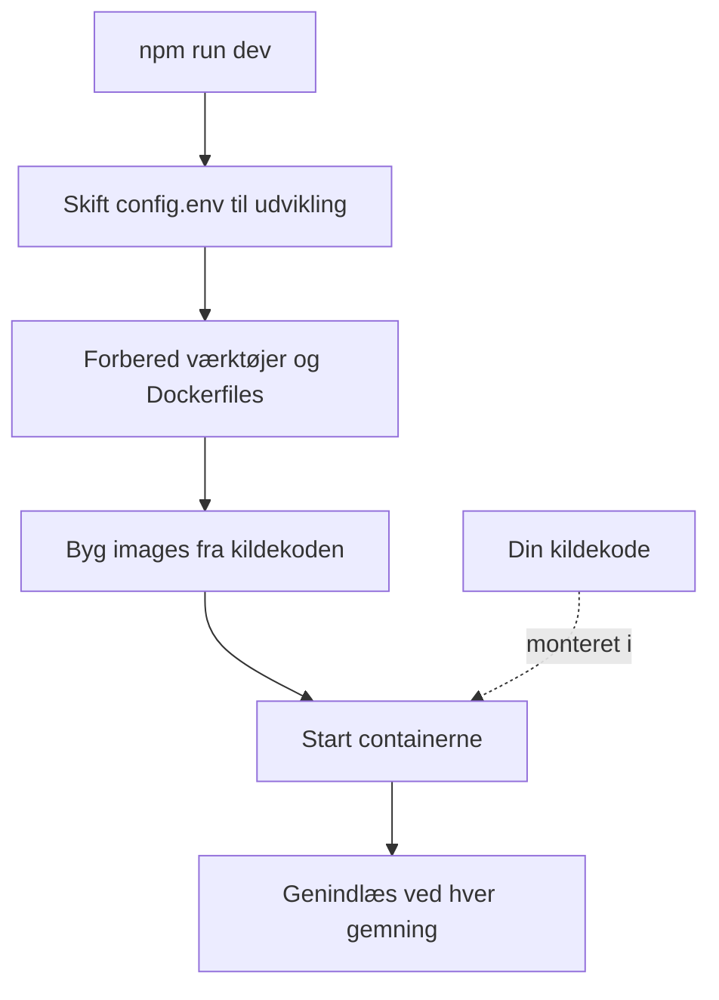

# Lokal udvikling

Kør OneUptime fra kildekoden på din egen computer for at arbejde på det. Udviklingsstakken bygger hver tjeneste fra dit checkout, monterer din kildekode i containerne og genindlæser dem, når du gemmer en fil.

Vil du i stedet køre en udgivet version, så brug [Docker Compose](/docs/installation/docker-compose).

## Sådan fungerer udviklingsstakken

`npm run dev` forbereder dit checkout og starter derefter stakken, der er defineret i `Scripts/Dev/docker-compose.dev.yml`:



| Fase | Hvad der sker |
| --- | --- |
| Skift til udvikling | Sætter `ENVIRONMENT=development` i `config.env`. |
| Forbered | Beder om din sudo-adgangskode, installerer manglende værktøjer (Git, curl, Node.js, Docker, gomplate, ts-node), kører `git pull` på din nuværende branch, tilføjer nye indstillinger fra `config.example.env` til `config.env` og genererer en `Dockerfile` ud fra hver `Dockerfile.tpl`. |
| Byg | Bygger et image for hver tjeneste fra kildekoden. Det første build tager et stykke tid. |
| Kør | Starter containerne med din kildekode monteret i dem. |
| Genindlæs | Appen genstarter sit API, når en serverfil ændres, og genbygger dashboardene, mens du redigerer dem. |

Når repositoryets mappe `ee/` findes, indlæser Appen Enterprise Edition derfra. Sæt `ONEUPTIME_EDITION=community` i `config.env` for i stedet at køre Community Edition.

## Før du går i gang

| Du skal bruge | Bemærkninger |
| --- | --- |
| **Docker** | Docker Desktop på macOS og Windows eller Docker Engine med Docker Compose v2-pluginet på Linux. |
| **Node.js 26 eller nyere og npm** | Den version, repositoryets `package.json` kræver, og som CI bruger. |
| **Git** | Til at klone repositoryet. |
| **Sudo-adgang** | `npm run dev` beder om din adgangskode, før det installerer noget. |
| **Port 80 og 443 ledige** | Stakken serverer OneUptime på `http://localhost` (port 80) og HTTPS på port 443. |

## Start udviklingsstakken

:::steps
### Klon repositoryet

```bash
git clone https://github.com/OneUptime/oneuptime.git
cd oneuptime
```

### Opret config.env

```bash
cp config.example.env config.env
```

Eksempelværdierne fungerer, som de er, til udvikling. Du kan ændre dem, men du behøver ikke.

### Start stakken

```bash
npm run dev
```

Den beder om din sudo-adgangskode, bygger derefter images og starter containerne i baggrunden. Følg Appens opstart med `docker logs -f oneuptime-app-1`.

### Åbn OneUptime

Åbn `http://localhost` og tilmeld dig. Den første konto bliver master-admin, som kan åbne Admin Dashboard på `http://localhost/admin`.
:::

## Arbejd på koden

Rediger filerne under `packages/` og gem: Containerne opfanger ændringen.

Før du åbner en pull request, så tjek din ændring på din computer, uden for containerne. Installer afhængighederne til det én gang: Kør `npm install` i repositoryets rod, til ESLint og migreringsværktøjerne, og derefter `npm run install-modules`, som sletter og geninstallerer hver pakkes `node_modules` og tager et stykke tid.

:::steps
### Kompilér det, du har ændret

Kør compileren i hver pakke, du har ændret, for eksempel Appen:

```bash
cd packages/App
npm run compile
```

### Lint kun dine filer

Angiv fra repositoryets rod de filer, du har ændret:

```bash
npx eslint --fix packages/App/path/to/File.ts
```

Undgå `npm run lint` og `npm run fix-lint`: De linter hele repositoryet.

### Kør de tests, der dækker din ændring

Kør fra pakken de testfiler, der betyder noget, i stedet for hele suiten:

```bash
cd packages/App
npx jest Tests/path/to/YourChange.test.ts
```
:::

### Databasemigreringer

| Database | Sådan tilføjer du en migrering |
| --- | --- |
| PostgreSQL | Ændr modellen, og kør derefter `npm run generate-postgres-migration` i stedet for at skrive migreringen i hånden. Registrer den nye fil i `packages/Common/Server/Infrastructure/Postgres/SchemaMigrations/Index.ts`: Den kører ikke, før den står der. `npm run check-postgres-schema-drift` viser enhver sætning, der stadig mangler. |
| ClickHouse | Skriv migreringen i hånden i `packages/App/FeatureSet/Workers/DataMigrations` efter forbillede af de eksisterende. |

## Reference

### Kommandoer

Kør dem fra repositoryets rod.

| Opgave | Kommando |
| --- | --- |
| Start stakken, eller anvend ændringer i `config.env` | `npm run dev` |
| Genbyg images efter en ændring af afhængigheder | `npm run build`, derefter `npm run dev` |
| Genbyg images helt fra bunden | `npm run force-build-dev`, derefter `npm run dev` |
| Vis de kørende containere | `docker ps` |
| Følg én tjenestes logs | `docker logs -f oneuptime-app-1` |
| Stop stakken og fjern dens containere | `npm run down` |

`npm run down` beholder dine data: PostgreSQL- og ClickHouse-volumenerne overlever den.

### Porte

Udviklingsstakken udgiver datalagrene, så du kan forbinde til dem med dine egne værktøjer. Adgangskoderne står i `config.env`.

| Tjeneste | Adresse | Log ind med |
| --- | --- | --- |
| OneUptime | `http://localhost` | Den konto, du oprettede |
| PostgreSQL | `localhost:5400` | Bruger `postgres`, database `oneuptimedb`, adgangskode `DATABASE_PASSWORD` |
| ClickHouse | `localhost:8189` (HTTP), `localhost:9034` (native) | Bruger `default`, database `oneuptime`, adgangskode `CLICKHOUSE_PASSWORD` |
| Valkey | `localhost:6310` | Adgangskode `VALKEY_PASSWORD` |

## Fejlfinding

:::details npm run dev stopper ved git pull
`npm run dev` kører `git pull` på din nuværende branch, før det bygger. Git nægter på en branch uden upstream, eller når pull ville overskrive dine ikke-committede ændringer. Sæt branchens upstream (for eksempel ved at pushe den med `git push -u origin <branch>`), eller commit dit arbejde, og kør så `npm run dev` igen.
:::

:::details npm run dev stopper, mens det installerer et værktøj
Installer selv værktøjet, for eksempel gomplate eller ts-node, og kør `npm run dev` igen: Det springer alle værktøjer over, der allerede er installeret.
:::

:::details En tjeneste fejler, efter du har ændret dens afhængigheder
Images indeholder stadig de gamle afhængigheder. Genbyg dem med `npm run build`, og start så stakken igen med `npm run dev`. Er det ikke nok, så genbyg helt fra bunden med `npm run force-build-dev`.
:::

:::details Port 80 eller 443 er allerede i brug
Et andet program på din computer, ofte en lokal webserver, optager porten. Stop det, og kør så `npm run dev` igen.
:::

## Næste trin

:::cards
- [Selvhostet arkitektur](/docs/self-hosted/architecture): Hvordan de tjenester, du lige har startet, hænger sammen.
- [Docker Compose](/docs/installation/docker-compose): Kør en udgivet version på en server.
- [API-reference](/docs/api-reference/api-reference): Kald API'et på din lokale instans.
:::
