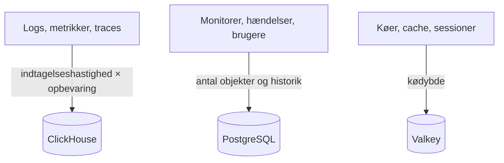

# Dimensionering og kapacitetsplanlægning

Planlæg CPU, hukommelse og disk til en selvhostet OneUptime på Kubernetes med [Helm-chartet](https://artifacthub.io/packages/helm/oneuptime/oneuptime). Dimensionér de tre datalagre – **ClickHouse**, **PostgreSQL** og **Valkey** – og applikationen hver for sig, start fra et af niveauerne nedenfor, og justér, når du har rigtige tal.

> [!IMPORTANT]
> Chartets standardværdier er ikke en produktionsdimensionering. De tjenester, det kører som standard, sætter **ingen CPU- eller hukommelses-requests eller -grænser**, og PostgreSQL og ClickHouse får små volumener på **25 Gi**, så chartet kan installeres på ethvert cluster. Til alt ud over en prøve sætter du selv ressourcer og lager med tallene på denne side.

Kører du i stedet Docker Compose-installationen på en enkelt server? Den er enklere at dimensionere: Se [kravene](/docs/installation/docker-compose#requirements) (16 GB hukommelse, 8 kerner og 400 GB disk anbefales).

:::cards
- [Hvad der får hvert datalager til at vokse](#what-drives-each-datastore): Tre lagre, der vokser med tre forskellige ting.
- [Startniveauer](#starting-tiers): Små, mellemstore og store udgangspunkter.
- [Høj tilgængelighed](#high-availability): Replikaer og failover for hvert datalager.
- [Opbevaring](#retention-and-how-it-affects-storage): Indstillingen, der ganger din disk.
:::

## Dimensionér din installation

:::steps
1. Find ud af, hvor meget telemetri du sender: antal GB logs, metrikker og traces om dagen. Mål det på en lille installation, hvis du kan.
2. Beslut, hvor mange dage du vil gemme det. Opbevaringen ganger ClickHouses disk (se [Opbevaring](#retention-and-how-it-affects-storage)).
3. Beregn ClickHouses disk med [lagerformlen](#storage-formula) og derefter PostgreSQL's og Valkeys ud fra deres egne afsnit.
4. Vælg det [startniveau](#starting-tiers), der ligger tættest på dine tal, og sæt dets CPU, hukommelse og lager i dine Helm-values.
5. Slå [høj tilgængelighed](#high-availability) til for de datalagre, der har brug for det, og følg så det faktiske forbrug og justér.
:::

## Hvad der får hvert datalager til at vokse

OneUptime skal bruge tre datalagre i produktion. Hvert vokser med noget forskelligt, så dimensionér dem uafhængigt af hinanden.



| Datalager | Hvad det gemmer | Hvad der bestemmer størrelsen |
| --- | --- | --- |
| **ClickHouse** | Al telemetri – logs, metrikker, traces, exceptions, profiler | Telemetri: **indtagelseshastighed × opbevaring**. Det er ~95 % af dit lager og den største omkostning. |
| **PostgreSQL** | Konfiguration og tilstand – monitorer, hændelser, alarmer, brugere, teams, projekter, workflows, statussider, dashboards | **Antal objekter og historik**, ikke telemetrimængden. Vokser langsomt. |
| **Valkey** | Cache, arbejdskøer og sessioner | **Kødybde og aktive sessioner**. Hukommelsesbundet og beskedent. Ikke en autoritativ datakilde. |

OneUptime har aldrig brug for objektlager (S3, MinIO) for at køre, og det flytter ikke ældre telemetri til objektlager. Du skal kun bruge objektlager, hvis du vælger backups til objektlager: Barman Cloud-pluginet til CloudNativePG eller [clickhouse-backup](https://github.com/Altinity/clickhouse-backup) til ClickHouse. Chartets egen CloudNativePG-backup (`postgresOperator.cnpg.backup`) tager volumen-snapshots og kræver intet objektlager. CloudNativePG sletter aldrig gamle snapshots: Ryd selv op i dem, ellers bliver de ved med at vokse.

## ClickHouse – den største faktor

Næsten hele dit lager og en stor del af din hukommelse går til ClickHouse, fordi hver loglinje, hvert metrikpunkt, hvert trace-span og hver exception ligger der.

### Lagerformel

```text
ClickHouse disk ≈ (daily raw telemetry GB ÷ compression) × retention days × replicas × 1.3 (headroom)
```

Komprimeringen afhænger af signalet:

| Signal | Typisk komprimering | Hvad der ændrer den |
| --- | --- | --- |
| Logs | Cirka 5:1 | Logs komprimeres godt. |
| Metrikker | Cirka 2:1 | Høj **kardinalitet** af labels puster disk og hukommelse hurtigere op end den rå mængde. Hold kardinaliteten af labels lav. |
| Traces | Midt imellem | De span-attributter, du sender. |

### Regneeksempel

En flåde på **10 clustere**, hver med cirka 10 noder og 100 pods, der logger på INFO-niveau, producerer groft regnet **50–150 GB rå logs pr. cluster over 30 dage** (cirka 1,7–5 GB om dagen pr. cluster). For hele flåden, med metrikker og traces lagt til og efter komprimering, så budgettér med groft regnet **5–15 GB komprimeret telemetri om dagen**.

| Opbevaring | Én replika | 2 replikaer + 30 % reserve |
| --- | --- | --- |
| 30 dage | ~150–450 GB | **~0,4–1,2 TB** |
| 90 dage | ~0,45–1,35 TB | **~1,2–3,5 TB** |

Lageret vokser **lineært med opbevaringen**: Et vindue på 90 dage koster cirka tre gange så meget som et på 30.

### Hukommelse og disktype

- **Brug NVMe eller SSD.** Telemetri er skrivetung med udbrud af aggregeringslæsninger; ClickHouse har det svært på roterende diske.
- **Giv ClickHouse rigeligt med hukommelse.** Aggregeringsforespørgsler bruger meget hukommelse. Som tommelfingerregel dimensionerer du hukommelsen til 25–50 % af dine *varme* (nyligt forespurgte) komprimerede data, med en praktisk nedre grænse på 16 GB for enhver rigtig produktionsflåde.
- **Hold styr på metrikkernes kardinalitet.** Den er den største enkeltstående løftestang for både ClickHouses hukommelse og disk. Håndhæv labelkonventioner med lav kardinalitet, hvor du indsamler metrikker, og hold øje med antallet af aktive serier.

## PostgreSQL – konfiguration og tilstand

PostgreSQL gemmer din konfiguration og driftstilstand, ikke telemetri, så det vokser langsomt og forbliver lille ved siden af ClickHouse. Selv store installationer ligger typisk i titalsvis af GB. Standardvolumenet på **25 Gi** er fint til små installationer; planlæg 50–100 GB til større, med plads til historikken for hændelser og alarmer.

Med mange replikaer af app, workers og probes kan databaseforbindelserne slippe op før lageret. Hver pod åbner som standard op til 50 forbindelser, og det medfølgende PostgreSQL tillader 500. Netop derfor indeholder chartet en valgfri connection pooler, **PgBouncer** (`pgbouncer.enabled`): Slå den til for installationer med mange replikaer.

## Valkey – cache, køer og sessioner

Cachelaget kører [Valkey](https://valkey.io), det BSD-licenserede fork af Redis 7.2, som cache, arbejdskø og sessionslager. Enhver server med Redis-protokollen kan træde i stedet, og dimensioneringen nedenfor gælder begge veje. Det er **hukommelsesbundet**, og persistens er **slået fra som standard**: Det er ikke en autoritativ datakilde og kan genopbygges. Dimensionér det efter kødybde og samtidige sessioner; 2–8 GB hukommelse dækker de fleste installationer. Dets eviction-politik er `noeviction`, så hold øje med hukommelsen, hvis køer hober sig op under vedvarende belastning.

## Applikationens regnekraft

Ud over datalagrene dimensionerer du de tilstandsløse workloads. Hver kører **uden ressource-requests eller -grænser**, indtil du sætter dem, og med én replika, undtagen telemetry writeren, der kører med to.

| Workload | Values-nøgle | Vokser med |
| --- | --- | --- |
| App: dashboard, API og indtagelse | `app` | Brugere, API-kald og indkommende telemetri |
| Workers, når de er skilt fra appen | `worker` | Telemetri og behandling af baggrundsjob |
| Probes | `probes` | Antallet af aktive monitorer |
| Ingress-gateway | `nginx` | Mængden af forespørgsler |
| Telemetry writer, når den er slået til | `telemetryWriter` | Ikke med belastningen: Den samler hver telemetri-indsættelse i ClickHouse, så den dimensioneres efter, hvad ClickHouse kan klare |

Chartet indeholder **KEDA**, så appen, workers, probes og Runner kan skalere efter deres køefterslæb. Slå `keda.enabled` til sammen med hver tjenestes egen `keda.enabled` (for eksempel `app.keda.enabled`). På et cluster, der endnu ikke har KEDA, kræver den første installation en ekstra omgang: Se chartets [KEDA-vejledning](https://github.com/OneUptime/oneuptime/blob/master/HelmChart/Docs/Keda.md). Tjenester, som KEDA ikke styrer, kan i stedet bruge en autoscaler baseret på CPU eller hukommelse (`autoscaling`).

## Startniveauer

Vælg det niveau, der ligger tættest på dit miljø, som udgangspunkt, følg så det faktiske forbrug (`kubectl top pods`, diskvæksten i ClickHouse og PostgreSQL), og justér.

- **Lille / PoC** – 1–3 clustere, ≤30 noder, ≤5 GB/dag rå telemetri, 30 dages opbevaring.
- **Mellem / Produktionsflåde** – ~10 clustere, ~100 noder, 10–30 GB/dag rå telemetri, 30–90 dages opbevaring.
- **Stor / Flere flåder** – 50+ clustere, 500+ noder, 100+ GB/dag rå telemetri, 90 dages opbevaring.

| | Lille / PoC | Mellem / Produktionsflåde | Stor / Flere flåder |
| --- | --- | --- | --- |
| **ClickHouse** | 4 vCPU / 16 GB / 200 GB NVMe | 8 vCPU / 32 GB / 1–3 TB NVMe | 16+ vCPU / 64–128 GB / 5–15 TB NVMe, **shardet** |
| **PostgreSQL** | 2 vCPU / 4 GB / 50 GB SSD | 4 vCPU / 8 GB / 100 GB SSD | 8 vCPU / 16–32 GB / 250 GB SSD (+ PgBouncer) |
| **Valkey** | 1 vCPU / 2 GB | 2 vCPU / 4 GB | 4 vCPU / 8–16 GB |
| **Forudsat opbevaring** | 30 dage | 30–90 dage | 90 dage |

Disse niveauer dimensionerer OneUptimes backend. Den agent, du installerer på hvert overvåget cluster, er beskrevet på siden [Kubernetes-agent](/docs/telemetry/kubernetes-agent), som også viser, hvordan du skærer ned på den datamængde, den sender.

## Høj tilgængelighed

Chartets indbyggede datalagre kører som standard som **enkeltinstanser**. Til høj tilgængelighed i produktion:

| Datalager | Til høj tilgængelighed |
| --- | --- |
| **PostgreSQL** | Slå den medfølgende [CloudNativePG](https://cloudnative-pg.io)-operator til (`postgresOperator.cnpg.enabled`) med **3 instanser** (`postgresOperator.cnpg.instances`): en primær og to hot standbys med automatisk failover. |
| **ClickHouse** | Slå den medfølgende [Altinity](https://github.com/Altinity/clickhouse-operator)-operator til (`clickhouseOperator.altinity.enabled`) med **2 eller flere replikaer pr. shard** (`clickhouseOperator.altinity.cluster.replicasCount`). Dens medfølgende ClickHouse Keeper kører på **3 noder** for quorum. Tilføj shards (`shardsCount`), når én nodes disk eller hukommelse bliver grænsen. |
| **Valkey** | Chartet replikerer det ikke. Peg OneUptime på et eksternt administreret Redis eller Valkey med automatisk failover (`externalValkey`). OneUptime forbinder til én enkelt vært og port, så brug tjenestens primære endpoint, ikke et i cluster-tilstand. |

> [!WARNING]
> Slår du en af operatorerne til for en eksisterende installation, starter en ny, tom database: Ingen af dem kopierer dataene fra den enkeltinstansdatabase, den erstatter. Migrér dine data, som chartets vejledninger beskriver – for [PostgreSQL](https://github.com/OneUptime/oneuptime/blob/master/HelmChart/Docs/MigratePostgresStandaloneToOperator.md) og for [ClickHouse](https://github.com/OneUptime/oneuptime/blob/master/HelmChart/Docs/MigrateClickhouseStandaloneToOperator.md).

## Opbevaring, og hvordan den påvirker lageret

Opbevaring af telemetri er en **ClickHouse-TTL talt i dage**. Hver udgave har projektets standard under **Projektindstillinger > Telemetri og APM > Dataopbevaring** (**Standardopbevaring (dage)**); når intet er sat, er den 15 dage. [Enterprise Edition](/docs/self-hosted/enterprise) tilføjer tilsidesættelser: pr. signal (logs, traces, metrikker, profiler), pr. log-alvorlighed og trace-status og pr. tjeneste eller ressource.

Logs og metrikker slettes én dag ad gangen, ved den første midnat (ClickHouse-servertid) efter deres opbevaring udløber, så ClickHouse slipper for at omskrive hver dag af dem hvert par timer, mens den udløber. Lige før midnat ligger der stadig op til én dag mere end opbevaringsvinduet på disken: Dimensionér logs og metrikker til **opbevaringsdage + 1**.

Fordi opbevaringen ganger ClickHouses lager, skal du beslutte den, før du dimensionerer disken. OneUptime arkiverer **ikke** gammel telemetri og flytter den heller ikke til objektlager. Til flerårig opbevaring af compliance-hensyn forlænger du opbevaringsvinduet og dimensionerer ClickHouses lager derefter, eller du eksporterer til et eksternt arkiv efter eget valg.

## Mål, før du binder dig

Telemetrimængden svinger enormt med applikationslogs' detaljeringsgrad, antallet af namespaces, scrape-intervallet og om DEBUG-logning er slået til et sted. Brug niveauerne ovenfor som udgangspunkter: **indsaml fra dit miljø i mindst fire uger**, mål de faktiske GB om dagen for hvert signal, og dimensionér så opbevaring og lager ud fra rigtige data.

## Næste trin

:::cards
- [Docker Compose](/docs/installation/docker-compose): Krav til en installation på en enkelt server.
- [Selvhostet arkitektur](/docs/self-hosted/architecture): Hvordan komponenterne hænger sammen.
- [Kubernetes-agent](/docs/telemetry/kubernetes-agent): Collectoren, der sender et clusters telemetri.
- [Enterprise Edition](/docs/self-hosted/enterprise): Tilsidesættelser af opbevaring og de andre Enterprise-funktioner.
:::
