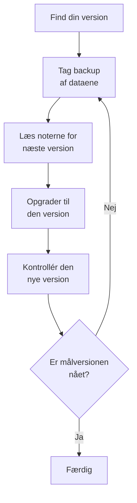

# Opgradering

Opgrader en selvhostet OneUptime-installation – med Docker Compose, eller med Kubernetes og Helm – til en nyere version. Følg fremgangsmåden nedenfor, og læs noterne for hver hovedversion mellem den, du kører, og den, du skal til.

:::cards
- [Sådan opgraderer du](#sådan-opgraderer-du): Fremgangsmåden for Docker Compose og Kubernetes.
- [Noterne for hver version](#find-noterne-for-din-version): Hvad hver hovedversion kræver af dig, på et øjeblik.
- [Images til Community Edition og Enterprise Edition](#images-til-community-edition-og-enterprise-edition): Hvilket image du kører fra 14 og frem.
- [Opgradering fra OneUptime 13 → 14](#opgradering-fra-oneuptime-13-14): Den nyeste hovedversion.
:::

## Sådan opgraderer du

Tre regler gør en opgradering sikker:

- **Opgrader én hovedversion ad gangen** (for eksempel 6 → 7 → 8). Spring ikke nogen hovedversion over.
- **Spring gerne mindre versioner og rettelsesversioner over** (for eksempel 8.1 → 8.4), så længe du følger deres udgivelsesnoter.
- **Tag en backup før hver opgradering**, og kontrollér, at du kan gendanne den.



:::steps
### Find din nuværende version

Åbn som masteradministrator udgavemærket i headeren på Admin-dashboardet: **This installation** viser den version, du kører. Instansen oplyser den også på `/version`:

```bash
curl http://localhost/version
```

Erstat `http://localhost` med adressen på din instans. Svaret er JSON, som `{"version":"14.0.22","commit":"..."}`.

### Tag backup af dine data

Tag backup af PostgreSQL, og af ClickHouse, hvis du har brug for dens telemetri. Med Docker Compose, se [Backup og gendannelse](/docs/installation/docker-compose#backup-og-gendannelse). På Kubernetes bruger du dine volume-snapshots eller chartets CloudNativePG-backups.

### Læs noterne for den næste hovedversion

Du finder dem i [tabellen nedenfor](#find-noterne-for-din-version). Gør det, de beder om, før du opgraderer: nogle trin, som at omdøbe Helm-værdier, skal gøres først.

### Kør opgraderingen

:::tabs
@tab Docker Compose
```bash
git checkout release
git pull
npm run update
```
`npm run update` tilføjer nye indstillinger til din `config.env` uden at ændre dine egne, henter de nye images og genstarter OneUptime.
@tab Kubernetes
```bash
helm repo update
helm upgrade my-oneuptime oneuptime/oneuptime -f values.yaml
```
Brug dit eget releasenavn og din egen værdifil. Chartet kører databasemigreringerne i sit eget Job, før de nye pods betjener trafik.
:::

### Kontrollér den nye version

Med Docker Compose slutter `npm run update` med **OneUptime is up!** På Kubernetes venter du, til alle pods er `Running` og klar:

```bash
kubectl get pods -n <namespace>
```

Kontrollér derefter din version igen, som i det første trin. Hvis du endnu ikke har nået din målversion, så gå tilbage til [Tag backup af dine data](#tag-backup-af-dine-data), og gå videre til den næste hovedversion.
:::

### Find noterne for din version

| Opgradering | Hvad du skal gøre |
| --- | --- |
| [13 → 14](#opgradering-fra-oneuptime-13-14) | Vælg en udgave. Docker Compose-installationer, der sætter `IS_ENTERPRISE_EDITION=true`, skifter til `APP_TAG=enterprise-release`. Aktivér en licens på Enterprise Edition. Gem IPv6-overvågninger af typen Ping, Port og SSL igen. |
| [12 → 13](#opgradering-fra-oneuptime-12-13) | Som regel intet: Redis bliver til Valkey, og de gamle navne på indstillingerne virker fortsat. Kører du Docker Compose i hånden? Tilføj `--remove-orphans`. Bruger du din egen cache? Læs [Hvis du kører din egen cache](#hvis-du-kører-din-egen-cache). |
| [11 → 12](#opgradering-fra-oneuptime-11-12) | Udrul Runbook Agents igen som Runners. Med Docker Compose: sæt `ONEUPTIME_RUNNER_KEY`. Med Helm: omdøb `aiAgent:` til `runner:`. Tildel igen de Runner-tilladelser, som API-nøgler havde direkte. |
| [10 → 11](#opgradering-fra-oneuptime-10-11) | SCIM og teams' compliance-indstillinger kræver Enterprise Edition. For at beholde din telemetrihistorik skal du omdøbe de gamle ClickHouse-tabeller før opgraderingen. |
| [9 → 10](#opgradering-fra-oneuptime-9-10) | Intet. |
| [8 → 9](#opgradering-fra-oneuptime-8-9) | Med Helm: fjern tilsidesættelser af `oneuptimeIngress` fra dine værdier. |
| [7 → 8](#opgradering-fra-oneuptime-7-8) | Med Helm: skift til den nye værdistruktur for Postgres, Redis og ClickHouse. Tag en backup først. |

## Images til Community Edition og Enterprise Edition

OneUptime leverer nu applikationen som to images. **Community Edition** er open source under Apache 2.0-licensen og omfatter SAML- og OIDC-single sign-on, globalt SSO og "Require SSO for login". **Enterprise Edition** tilføjer enterprise-modulerne fra repositoriets mappe `ee/`: SCIM, team-compliance, auditlogs og Admin-dashboardets enterprise-Health-dashboards. Før denne ændring kørte begge udgaver den samme kode, og `IS_ENTERPRISE_EDITION` afgjorde, hvilke funktioner der var slået til. Nu afgør imaget det, og Community-imaget indeholder ikke mappen `ee/`.

Siden [Enterprise Edition](/docs/self-hosted/enterprise) har den fulde sammenligning af funktioner, licensdetaljerne og det, der sker, når du skifter udgave.

### Hvad du skal gøre før opgraderingen

- **Community Edition uden SCIM:** intet. Opgrader som sædvanligt.
- **Helm med `image.type: enterprise-edition`:** intet. Chartet henter allerede `enterprise-`-images, som nu indeholder enterprise-modulerne.
- **Docker Compose med `IS_ENTERPRISE_EDITION=true`:** skift til Enterprise-imaget, når du opgraderer, ved at sætte `APP_TAG=enterprise-release` (eller `enterprise-<version>`) i `config.env`. `APP_TAG=release` er Community-imaget, og `IS_ENTERPRISE_EDITION=true` slår ikke længere noget til. `npm run update` foretager denne ændring for dig, så længe `IS_ENTERPRISE_EDITION=true` (`release` bliver til `enterprise-release`, en fastlåst `13.0.7` bliver til `enterprise-13.0.7`) og udskriver, hvad den ændrede. Applikationen **nægter nu at starte**, når `IS_ENTERPRISE_EDITION=true` er sat på Community-imaget, i stedet for i stilhed at stoppe SCIM-provisionering og auditlogning. Fejlen fortæller, hvad du skal sætte: `APP_TAG=enterprise-<version>` for at beholde Enterprise Edition, eller `IS_ENTERPRISE_EDITION=false` for at køre Community Edition.
- **Community-image med SCIM allerede sat op:** SCIM-provisionering stopper med denne opgradering, også deprovisionering. Skift til Enterprise-imaget for at beholde den. Ellers skal du læse [Skifte fra Enterprise til Community](/docs/self-hosted/enterprise#switching-from-enterprise-to-community), før du opgraderer. Den forklarer, hvad der stopper, og hvem du skal fjerne først. For at køre Community Edition skal du også sætte `IS_ENTERPRISE_EDITION=false`. Single sign-on påvirkes ikke: Community-imaget leverer det også.

Din konfiguration slettes aldrig, og et skift af udgave kræver ingen migrering i nogen retning.

### Licenser efter opgraderingen

Enterprise Edition kontrollerer nu sin licens:

- **En installation med en licensnøgle** fortsætter med at køre. Den kontrollerer licensen hos OneUptime ved opstart og én gang om dagen. Hvis licensen udløber, fortsætter alt med at virke i en henstandsperiode på 30 dage, hvorefter det samme sker som for en installation uden licens.
- **En installation uden licens**, for eksempel en, der kørte Enterprise Edition kun med `IS_ENTERPRISE_EDITION=true`, får en prøveperiode på 14 dage fra første opstart af denne version. **Hvis du bruger SCIM eller auditlogning, så aktivér en licens, før prøveperioden slutter.** Efter prøveperioden stopper SCIM-provisionering, og auditlogningen holder op med at registrere. Enterprise-konfigurationen bliver også skrivebeskyttet, og enterprise-Health-dashboards låses. Single sign-on påvirkes ikke. Alt genoptages, uden genstart, så snart du aktiverer en licens. Prøveperioden er til evaluering: brug af Enterprise Edition i produktion kræver et OneUptime Enterprise-abonnement. Se [Når en licens udløber eller mangler](/docs/self-hosted/enterprise#when-a-license-expires-or-is-missing).
- **Installationer uden netværksadgang** kan aktivere med et signeret licenstoken i stedet for en nøgle. Se [Offlineaktivering](/docs/self-hosted/enterprise#offline-activation-air-gapped-installs).

### Kunder på OneUptime Cloud

For dig ændrer intet sig. OneUptime Cloud kører Enterprise Edition, og din plan afgør stadig, hvilke funktioner du får: SSO, OIDC, SCIM og team-compliance fra Scale-planen og opefter, og auditlogs på Enterprise-planen. Projekter på Scale-planen ser nu de indstillinger for SSO, OIDC, SCIM og team-compliance, der før viste en opfordring til at opgradere.

### Ændringer i API'et og endpoints

- `GET /api/global-config/license` returnerer kun licensnøglen, licenstokenet, listen over instanser, instans-ID'et og versionsoplysningerne til masteradministratorer. Andre kaldere får udgaven og licensstatussen.
- Selvhostede installationer leverer ikke længere licensserverens endpoints under `/api/enterprise-license/`. Kun oneuptime.com bruger dem.
- SCIM-endpoints beholder præcis deres stier på Enterprise Edition, så identitetsudbyderens konfiguration ændrer sig ikke. På Community Edition returnerer de `404`. På Enterprise Edition afviser de forespørgsler, mens licensen er udløbet (efter prøveperioden eller henstandsperioden), og de svarer igen, så snart en licens er aktiveret.
- SSO- og OIDC-endpoints (SAML-login- og ACS-URL'erne, OIDC-redirect-URI'erne og det globale SSO's endpoints) beholder præcis deres stier og leveres af begge udgaver i enhver licensstatus.

## Opgradering fra OneUptime 13 → 14

OneUptime 14 deler applikationen i to udgaver, og det image, du henter, afgør, hvilken du kører. **Community Edition** (Apache-2.0, tags `release` og `<version>`) omfatter SAML SSO, OpenID Connect, globalt SSO og "Require SSO for login". Den indeholder ikke repositoriets mappe `ee/`, så SCIM-provisionering, teams' compliance-indstillinger, auditlogs, Admin-dashboardets **Health**-dashboards og Admin-dashboardets **Query Console** findes slet ikke i det image. **Enterprise Edition** (tags `enterprise-release` og `enterprise-<version>`) indeholder dem, og den kontrollerer en Enterprise-licens, mens den kører, hvilket OneUptime 13 aldrig gjorde. Single sign-on afhænger ikke af den licens.

[Images til Community Edition og Enterprise Edition](#images-til-community-edition-og-enterprise-edition) ovenfor er referencen for denne ændring: hvad hver udgave indeholder, hvad du skal sætte for hver type udrulning, og hvad licensen gør. Dette afsnit er selve opgraderingen. Opgrader fra 13 – hvis du stadig er på 12, så tag 12 → 13 først.

Intet bliver slettet, i nogen af udgaverne. Single sign-on virker ens i begge: din SSO- og OIDC-konfiguration og dine indstillinger for "Require SSO for login" bevares, som de er. Din SCIM-konfiguration og de auditlogs, der er registreret indtil nu, bliver i databasen. Community Edition leverer dem bare ikke, og et skift af udgave kræver ingen migrering i nogen retning.

### Hvad du skal gøre

1. **Beslut, hvilken udgave denne installation kører.** Hvis du bruger SCIM-provisionering, teams' compliance-indstillinger eller auditlogs, eller vil have Admin-dashboardets **Health**-dashboards, er det Enterprise Edition. Ellers er der intet at beslutte: Community Edition er det, du allerede har, og den omfatter SAML SSO og OpenID Connect.
2. **Med Helm: angiv udgaven i din værdifil:** `image.type: enterprise-edition` (standarden er `community-edition`). Rør ikke `image.tag` – chartet tilføjer selv præfikset `enterprise-`, så `image.tag: release` henter `oneuptime/app:enterprise-release`. Denne værdi er ikke ny. Hvis du allerede kører `enterprise-edition`, er der intet at ændre: det tag, du allerede henter, indeholder nu `ee/`.
3. **Med Docker Compose: sæt `APP_TAG=enterprise-release`** (eller `enterprise-<version>` for at låse en version fast) i `config.env`. `APP_TAG=release` er Community-imaget. Det er det eneste, der stopper en installation på 13: på 13 var en Enterprise-installation med Compose `APP_TAG=release` plus `IS_ENTERPRISE_EDITION=true`, og den kombination **nægter nu at starte** i stedet for at komme op som Community Edition med SCIM-provisionering og auditlogning stoppet i stilhed. `npm run update` omskriver `APP_TAG` for dig, så længe `IS_ENTERPRISE_EDITION=true` (`release` bliver til `enterprise-release`, en fastlåst `13.0.8` bliver til `enterprise-13.0.8`) og udskriver, hvad den ændrede. Henter du i stedet images i hånden, så sæt selv `APP_TAG` først.
4. **På Enterprise Edition: aktivér en licens.** En installation uden licens får en prøveperiode på 14 dage, regnet fra dens første opstart af Enterprise Edition – ved en opgradering er det den dag, du opgraderer, ikke den dag, du først installerede OneUptime. En masteradministrator aktiverer den fra udgavemærket i headeren på Admin-dashboardet; installationer uden netværksadgang aktiverer i stedet med et signeret token. Se [Licenser](/docs/self-hosted/enterprise#licensing).
5. **Hvis denne installation skal køre Community Edition, mens din identitetsudbyder deprovisionerer brugere via SCIM, så gennemgå, hvem der har adgang, før du opgraderer.** SCIM-deprovisionering stopper, så personer, du fjerner i din identitetsudbyder, beholder deres OneUptime-konti, og medmindre "Require SSO for login" gælder for dem, kan enhver, der stadig kan nå postkassen for en af disse konti, sætte en adgangskode med "Glemt adgangskode" og logge ind. Fjern disse brugere først: [Skifte fra Enterprise til Community](/docs/self-hosted/enterprise#switching-from-enterprise-to-community).
6. **Hvis du overvåger IPv6-adresser med Ping-, Port- eller SSL-overvågninger, så gem disse overvågninger igen efter opgraderingen.** Mål, der blev gemt før 14, kan være gemt afkortet – se [IPv6-overvågninger af typen Ping, Port og SSL](#ipv6-overvågninger-af-typen-ping-port-og-ssl).

### Udgaver: hvad der ændrede sig, og hvad der ikke gjorde

| | Til og med 13 | Fra 14 |
| --- | --- | --- |
| Enterprise-kode | i hvert image; `IS_ENTERPRISE_EDITION=true` slog den til | i `ee/`, og kun i `enterprise-`-images |
| Vælger i Helm | `image.type` | `image.type` – uændret, men imagene er nu forskellige |
| Vælger i Compose | `IS_ENTERPRISE_EDITION=true` | `APP_TAG=enterprise-release` |
| Enterprise-licens | aldrig kontrolleret under kørsel | kontrolleret ved opstart og én gang om dagen |
| SSO- og OIDC-endpoints | de samme stier i begge udgaver | de samme stier i begge udgaver, uanset licensstatus |
| SCIM-endpoints | de samme stier i begge udgaver | de samme stier på Enterprise; `404` på Community |
| Din enterprise-konfiguration | gemt, anvendt | gemt i begge tilfælde, anvendt på Enterprise |

Der kører én migrering: en kolonne `enterpriseEditionFirstSeenAt`, der må være tom, på tabellen `GlobalConfig`, som har én række, så den er øjeblikkelig. Der er ingen ClickHouse-migrering, intet fjernes, og et skift af udgave kræver ingen migrering i nogen retning.

### Licensens forløb på Enterprise Edition

- **En installation uden licens** kører en prøveperiode på 14 dage, regnet fra Enterprise Editions første opstart. I prøveperioden virker alle enterprise-funktioner, og udgavemærket advarer, før den slutter. Prøveperioden er til evaluering: brug af Enterprise Edition i produktion kræver et abonnement under OneUptime Enterprise License.
- **En licens, der udløber,** får en henstandsperiode på 30 dage fra udløbsdatoen, hvor alle enterprise-funktioner virker, og udgavemærket advarer.
- **Efter prøveperioden, eller efter den henstandsperiode,** og indtil en licens er aktiveret: SCIM-forespørgsler fra din identitetsudbyder afvises, og auditlogningen holder op med at registrere. Enterprise-konfigurationen bliver skrivebeskyttet – du kan stadig se den, slette den og nulstille et SCIM-bearer-token, hvilket er det, en hændelse kræver – og Admin-dashboardets Health-dashboards og Query Console låses.
- **Intet slettes, og kerneovervågningen påvirkes aldrig.** Overvågninger, advarsler, hændelser, vagter, statussider og telemetri ligger uden for licensen, og det gør login også: login med SSO og OIDC, "Require SSO for login" og login med adgangskode for alle brugere, masteradministratorer medregnet, virker ens i enhver licensstatus. Når du aktiverer en licens, genoprettes SCIM-provisionering og auditlogning med den konfiguration, du allerede har, uden genstart.
- **En licensnøgle, du allerede har, accepteres**, som licens med status "unverified": dens udløbsdato og pladsgrænse kommer fra det, licensserveren allerede har oplyst til denne installation, og den får den samme henstandsperiode på 30 dage efter udløbet. Licenser, der udstedes fra nu af, er signerede og verificeres af applikationen selv. Du behøver ikke en ny nøgle til denne opgradering.
- **En nøgle, hvis udløb denne installation aldrig har registreret,** fortsætter med at virke i prøveperioden i stedet for at stoppe. Licensserveren skriver nøglen og udløbsdatoen hver for sig, så en installation kan have en nøgle, hvis udløb den aldrig har fået oplyst. Sådan en installation behandles præcis som en installation uden licens: alle enterprise-funktioner virker i prøveperioden på 14 dage, regnet fra Enterprise Editions første opstart, og efter prøveperioden stopper de samme ting som ovenfor. Pladsgrænsen håndhæves ikke, mens licensen er i denne tilstand, fordi installationens licenspost allerede er ufuldstændig. En masteradministrator, der genaktiverer licensen fra udgavemærket, eller den daglige licenssynkronisering, der henter udløbet fra oneuptime.com, genopretter den uden genstart.

Den fulde tabel over tilstande står i [Når en licens udløber eller mangler](/docs/self-hosted/enterprise#when-a-license-expires-or-is-missing).

### Docker Compose: vælg image-tagget

```bash
git checkout release # Please make sure you're on release branch.
git pull
npm run update
```

- **`npm run update` flytter `APP_TAG`, så længe `IS_ENTERPRISE_EDITION=true`**, til Enterprise-imaget i samme version, og udskriver, hvad den ændrede. Den bevarer dine kommentarer og anførselstegn, lader et `APP_TAG`, der allerede er et `enterprise-`-tag, være i fred og ændrer intet ved en anden kørsel.
- **Hvis du henter images i hånden, springes det over**, og applikationen stopper så ved opstart med en fejl, der præcis siger, hvad du skal sætte: `APP_TAG=enterprise-<version>` for at beholde Enterprise Edition, eller `IS_ENTERPRISE_EDITION=false` for at køre Community Edition.
- **For bevidst at skifte til Community Edition** sætter du `APP_TAG=release` og `IS_ENTERPRISE_EDITION=false`. Læs først punkt 5 ovenfor, hvis din identitetsudbyder deprovisionerer brugere via SCIM.
- Intet andet i `config.env` skal ændres for denne udgivelse.

### Helm: vælg image-typen

```bash
helm repo update
helm upgrade my-oneuptime oneuptime/oneuptime -f values.yaml
```

- **En installation, der allerede er på `image.type: enterprise-edition`, behøver ikke at ændre nogen værdi.** Chartet har længe sat præfikset foran tagget; det nye er, at `enterprise-`-images indeholder `ee/`. Licensen gælder for den fra denne udgivelse, efter forløbet ovenfor.
- **`image.tag: release` er standarden**, så et chart, der er blevet på det flydende tag, går til 14 ved sin næste opgradering uden nogen ændring af værdier. Hvis den installation har SCIM sat op på `community-edition`, så sæt `image.type: enterprise-edition` i samme opgradering.
- **`IS_ENTERPRISE_EDITION` udsendes stadig af chartet**, udledt af `image.type`, så de to aldrig kan være uenige. Den styrer intet. At tvinge den til `true` via `extraEnv` på et Community-image får blot applikationen til at nægte at starte. Sæt aldrig `ONEUPTIME_EDITION` via chartet.
- **Chartets probes respekterer igen `probes.<key>.allowPrivateNetworkMonitors`** ([#3879](https://github.com/OneUptime/oneuptime/issues/3879)). Intet ændrer sig, medmindre du sætter den – standarden forbliver `false` – og den gælder for overvågningerne i alle projekter på instansen, fordi chartets probes er globale probes. Loopback, link-local og `169.254.169.254` forbliver blokeret, uanset hvad du sætter.

### Andre ændringer i 14

Disse ændringer ændrer, hvordan OneUptime opfører sig efter opgraderingen, og de fleste kræver intet af dig. Læs dem, hvis du bruger brugerdefinerede roller eller API-nøgler, der består af enkeltstående tilladelser, egne tilstande for hændelser, advarsler eller vedligeholdelse, Terraform eller API'et, SSO, eller apps til Slack og Microsoft Teams.

:::details Læs de øvrige ændringer i 14
- **OTLP-indtagelse bekræfter først en batch, når køen har accepteret den.** 13 svarede først `200` og satte i kø bagefter, så en batch, som køen afviste, gik tabt i stilhed. 14 svarer i stedet `503` med `Telemetry queue unavailable. Please retry.`, og gRPC-endpointet returnerer `UNAVAILABLE`; begge kan prøves igen, og exportere prøver igen. Det gælder logs, metrikker, traces og profiler. Du behøver ikke gøre noget, men exporteres nye forsøg og køens modtryk er nu synlige, hvor data før forsvandt – godt at vide, hvis du dimensionerer indtagelseskapaciteten.
- **Admin-dashboardets Health-dashboards og Query Console kræver Enterprise Edition**, sammen med sundhedsadvarslerne for PostgreSQL og Valkey. På 13 fulgte de med blot `IS_ENTERPRISE_EDITION=true`, så det er et synligt tab for en Community-installation, der brugte dem. Kapacitetsovervågning af ClickHouse og oprydningen af den, migreringsstatus, globale probes og supportpakken findes i begge udgaver.
- **HTTPS-overvågninger, der når en IP-adresse gennem en probes proxy, virker igen.** Proben sendte IP-adressen som TLS-servernavn, hvilket ikke er et gyldigt servernavn, og som Node afviser blankt, så en overvågning af `https://<private IP>` fra en global probe med `PROBE_ALLOW_PRIVATE_NETWORK_MONITORS` fejlede i handshaket. Proben udelader nu servernavnet for et IP-mål og kontrollerer certifikatet mod selve IP-adressen. Mål angivet med værtsnavn ændrer sig ikke.
- **`oneuptime`-CLI'en oplyser sin rigtige version** med `--version` i stedet for en pladsholder.
- **En ny advarsel eller episode starter i den tilstand, som oprettelsen angiver.** API'et, Terraform (`current_alert_state_id`, `current_incident_state_id`) og workflows kan angive den tilstand, som en advarsel, en advarselsepisode eller en hændelsesepisode starter i, som dashboardets felt **Indledende tilstand** gør. Før blev den tilstand erstattet af projektets oprettelsestilstand; en Terraform-konfiguration, der satte den, fik en anden værdi end planlagt. En oprettelse, der ikke angiver nogen tilstand, starter stadig i oprettelsestilstanden, og en tilstand fra et andet projekt afvises. Se [Den tilstand, en ny post starter i](/docs/api-reference/api-reference).
- **En post, der oprettes allerede bekræftet eller løst, tilkalder ingen.** En hændelse, advarsel eller episode, der oprettes i en senere tilstand – via **Indledende tilstand**, en skabelons starttilstand, API'et, Terraform eller et workflow – kører ikke længere sine vagtpolitikker; dens feed siger det i stedet. En post, der oprettes løst, bliver heller ikke længere grupperet i en episode, afhjulpet, undersøgt af OneUptime AI eller givet en Slack- eller Microsoft Teams-kanal, og en hændelse, der oprettes løst, lader sine overvågningers status og overvågning være og starter ingen SLA. En post, der oprettes bekræftet, starter sin SLA som allerede besvaret. Poster, der oprettes i oprettelsestilstanden, som alle dem en overvågning åbner, ændrer sig ikke. Se [Erklæret allerede bekræftet eller løst](/docs/incidents/declaring-incidents#erklæret-allerede-bekræftet-eller-løst).
- **En tilstand efter din løste tilstand tæller som løst overalt.** En hændelse, advarsel eller episode i en tilstand, du har placeret efter den løste tilstand – en tilstand **Closed** under **Løst**, for eksempel – talte som løst nogle steder og som åben andre steder. De følger nu alle én regel: projektets løste tilstand, og enhver tilstand efter den, er løst. Poster i sådan en tilstand forsvinder fra listerne **Aktive hændelser** og **Aktive advarsler** og deres tællere i sidemenuen, fra dashboards' lister over hændelser og advarsler, fra aktive episoder og fra mobilappens lister over åbne poster; opsummeringer i Slack og Microsoft Teams tæller dem som løste, og statussiders tidslinjer viser sådan en række som løst. En overvågning eller en SLO-burn-rate-regel, hvis hændelse eller advarsel er i sådan en tilstand, åbner en ny, næste gang den udløses, hvor den før tog den gamle for stadig åben. At flytte en hændelse direkte til sådan en tilstand løser den, som **Løst** gør, og at flytte den forbi **Løst** genåbner ikke længere en episode og starter ikke en ny SLA for hændelsen. Projekter, hvis egne tilstande alle ligger over den løste tilstand, mærker ingen forskel. Se [Listen over aktive hændelser](/docs/incidents/states-and-severities#listen-aktive-hændelser).
- **En tilstand efter din bekræftede tilstand tæller som bekræftet overalt.** En hændelse, advarsel eller episode i en tilstand, du har placeret mellem dine bekræftede og løste tilstande – en tilstand **Investigating** under **Bekræftet**, for eksempel – stoppede allerede vagtopkald, men mobilappen og Microsoft Teams tilbød stadig **Acknowledge** for den, og at bekræfte en advarsel eller episode i den tilstand (fra Teams, Slack eller en vagtside) flyttede den tilbage til **Bekræftet**. De følger nu alle én regel: projektets bekræftede tilstand, enhver tilstand efter den og en løst tilstand tæller som bekræftet. **Acknowledge** tilbydes ikke længere nogen steder for sådan en post, og at bekræfte den afvises ("... is already acknowledged.") i stedet for at flytte den tilbage; en vagthavende, der bekræfter sit eget opkald for den, afslutter blot opkaldet. At flytte en post direkte til sådan en tilstand markerer nu hændelsens SLA som besvaret – hvor den før forblev ubesvaret, indtil hændelsen var løst, hvilket kunne bryde svarmålet – og tæller som dens bekræftelse i oversigtens tid til bekræftelse, metrikken **Time to Acknowledge**, målingerne og MTTA i opsummeringer i Slack og Microsoft Teams. En post, der blev løst uden at være bekræftet, tæller nu som bekræftet i det øjeblik, den blev løst, som oversigten allerede viste. Listefiltrene **Bekræftet** viser også poster i de tilstande, og attributten `isAcknowledgedState` i metrikken **Time in State** er `true` for dem. Projekter, hvis egne tilstande alle ligger over den bekræftede tilstand, mærker ingen forskel. Se [Hvad bekræftelse gør](/docs/incidents/states-and-severities#hvad-bekræftelse-gør).
- **Episoder bevæger sig gennem deres tilstande efter den regel, hændelser og advarsler følger.** En hændelses- eller advarselsepisode kunne flyttes tilbage op ad sin liste over tilstande – en løst episode tilbage til **Bekræftet**, for eksempel – fra dashboardets tilstandstidslinje, Slack, Microsoft Teams, API'et eller Terraform, og flytningen gik videre til dens hændelser eller advarsler. Nu afvises en flytning til en tilstand, der i rækkefølgen kommer før episodens nuværende, med den fejl, en hændelse får ("Episode cannot transition to Acknowledged state from Resolved state because Acknowledged is before Resolved in the order of incident states."), og intet ændrer sig. En grupperingsregels indstilling **Genåbn nyligt løste episoder** genåbner stadig en episode, som OneUptimes egen flytning. For at rette en tilstand, der er sat ved en fejl, sletter du dens række fra episodens tilstandstidslinje, som for en hændelse; episoden vender tilbage til tilstanden i sin sidste tilbageværende række, og at slette den række, der løste den, rydder dens løsningstidspunkt. En episode flytter kun hver af sine hændelser eller advarsler derhen, hvor deres egen tilstand ville gå: en, der allerede er i den tilstand eller længere, bliver, hvor den er.
- **En skrivning af en posts nuværende tilstand følger samme regel.** At opdatere den nuværende tilstand for en hændelse, advarsel, episode eller planlagt vedligeholdelsesbegivenhed gennem API'et eller Terraform (`currentIncidentStateId`, `currentAlertStateId`, `currentScheduledMaintenanceStateId`) afvises, før noget gemmes, når den flytter posten tilbage op ad sin liste, med samme fejl. Før nåede skrivningen posten, og tilstandstidslinjen afviste den bagefter, så posten blev efterladt i en tilstand, som dens tidslinje aldrig havde haft. At skrive en hændelsesepisodes tilstand registrerer den nu i episodens tilstandstidslinje og flytter dens hændelser, som skrivning af en advarselsepisodes tilstand allerede gjorde. En Terraform-plan, der sætter en tidligere tilstand, fejler ved apply; sæt tilstande i deres rækkefølge, eller skift tilstand med en række i tilstandstidslinjen.
- **Change State i Slack og Microsoft Teams tilbyder kun de tilstande, en post må gå til som det næste.** En post i den sidste tilstand, den kan nå, får svaret "There is no later state to move this incident to." i stedet for en formular, hvor hvert valg ville blive afvist. Menuen **Change state to** i dashboardets header følger samme regel.
- **Fejlen for en planlagt vedligeholdelsesbegivenhed, der flyttes tilbage op ad sin liste, lyder nu som de andre:** "Scheduled Maintenance cannot transition to Scheduled state from Ongoing state because Scheduled is before Ongoing in the order of scheduled maintenance states." (før stod der `ScheduledMaintenance` og `scheduledMaintenance states`). Et script, der sammenlignede med den gamle tekst, skal bruge den nye. Se [Rækkefølgen er en reel begrænsning](/docs/incidents/states-and-severities#rækkefølgen-er-en-reel-begrænsning-ikke-en-visningspræference).
- **At løse en hændelse giver kun de overvågninger tilbage, den holder.** OneUptime registrerer nu, om en hændelse holder sine overvågningers status. En hændelse, der allerede er løst én gang og derefter genåbnet, sætter ikke længere sine overvågninger tilbage til operationelle, når den løses igen, så en status, de har fået i mellemtiden – fra deres probes, fra vedligeholdelse eller sat i hånden – bliver stående; at ændre dens overvågninger, eller den status, den sætter dem i, mens den er åben, får den til at holde dem igen. Hændelser fra før opgraderingen giver deres overvågninger tilbage ved næste løsning, som de altid har gjort. Se [Hvad løsning gør](/docs/incidents/states-and-severities#hvad-løsning-gør).
- **En hændelses eller advarsels episode sættes kun gennem episodens medlemmer.** `incidentEpisodeId` og `alertEpisodeId` (og relationerne `incidentEpisode` og `alertEpisode`) er skrivebeskyttede. API'et, Terraform (`incident_episode_id`, `alert_episode_id`), MCP-værktøjer og workflows kunne skrive dem uden at tilføje posten til episoden: episodens oversigt viste så en hændelse eller advarsel, som dens side **Medlemmer** ikke havde, og en post, der blev oprettet med en episode sat, blev aldrig grupperet. En oprettelse eller opdatering, der sender en af dem, afvises nu med en besked, der henviser til episodens medlemmer: tilføj posten med `POST /api/incident-episode-member` (eller `/api/alert-episode-member`), og slet det medlem for at fjerne den, så følger referencen til episoden med. Læsning ændrer sig ikke. En Terraform-konfiguration, der sætter `incident_episode_id` eller `alert_episode_id`, skal fjerne den, så snart du opgraderer provideren, som nu kun læser dem; ressourcerne `oneuptime_incident_episode_member` og `oneuptime_alert_episode_member` styrer medlemskabet. Se [Den episode, en hændelse eller advarsel er i](/docs/api-reference/api-reference).
- **Nye eskaleringsregler for indgående opkald ringer i 20 sekunder, ikke 30.** Mange telefoner sender et ubesvaret opkald til telefonsvareren inden for 30 sekunder, og en telefonsvarer, der svarer, afslutter opkaldet der i stedet for at sende det videre til den næste regel. Dashboardets felt **Ringetid (i sekunder)**, API'et (`escalateAfterSeconds`) og Terraform-provideren (`escalate_after_seconds`) starter nu en ny regel på 20. Regler, der allerede findes, beholder deres ringetid: opgraderingen ændrer kun kolonnens standardværdi. En Terraform-konfiguration, der udelader `escalate_after_seconds`, vil planlægge `30 -> 20` for de regler, den styrer, så snart du opgraderer provideren; sæt `escalate_after_seconds = 30` for at beholde 30. Se [Politik for indgående opkald](/docs/on-call/incoming-call-policy).
- **Opsummeringer i Slack og Microsoft Teams beholder deres tidspunkt på dagen, når uret stilles om.** En opsummering har nu en tidszone, og dens tidsplan læses på det ur. Indtil nu blev den læst i UTC, så en opsummering sat til 09:00 i Berlin kom der kl. 08:00, når vintertiden vendte tilbage. Opgraderingen giver hver eksisterende opsummering tidszonen fra dens opretters profil, det ur, dashboardet viste den, eller UTC, når den ikke har en opretter med en tidszone (en API-nøgle oprettede den), hvilket er det, den blev læst i indtil nu. Ingen næste udsendelse flytter sig under opgraderingen; fra dens næste udsendelse vender en opsummering, der var forskudt en time, tilbage til tidspunktet for sin første opsummering, og en månedlig opsummering den 29. til 31. glider ikke længere til den 28. API'et og Terraform (`timezone`) accepterer navnet på en IANA-tidszone; en opsummering, der oprettes uden, får tidszonen fra opretterens profil, eller UTC, når en API-nøgle opretter den, og et navn, der ikke er en tidszone, afvises. Se [Opsummeringer](/docs/workspace-connections/slack).
- **En hændelses eller advarsels feedpost "opdateret" registrerer kun det, der ændrede sig.** At gemme kortet **Hændelsesdetaljer** efter kun at have ændret titlen, eller en API-klient, et workflow eller et script, der skrev en hændelse eller advarsel tilbage uændret, tilføjede en post, der gentog titlen, beskrivelsen, rodårsagen, afhjælpningsnoterne og de labels, den havde – også slået op i hændelsens eller advarslens Slack- og Microsoft Teams-kanaler –, og hver skrivning med labels eller kontakten **Send påmindelser** genstartede påmindelsesintervallet, selv når intet ændrede sig, så en hændelse, der ofte blev redigeret, blev ved med at udskyde sine påmindelser. Nu skrives hver linje for en værdi, der ændrede sig, og intet for en gemning, der intet ændrede; påmindelsesreglen anvendes igen, og intervallet starter forfra, kun når alvorligheden eller labels ændrer sig, eller når **Send påmindelser** slås til eller fra. Tekst, der læses ens, tæller som ens (bortset fra linjeskift og mellemrum omkring den), og labels som den samme mængde i enhver rækkefølge. Advarsler registrerer nu også en ændret rodårsag på deres side, som de før mistede, medmindre titlen ændrede sig samtidig, og en tømt beskrivelse, rodårsag eller afhjælpningsnoter. At fjerne alle labels registreres som "All labels removed.". Se [Hvad feedet registrerer](/docs/incidents/notes-owners-and-feed#hvad-feedet-registrerer).
- **En planlagt vedligeholdelsesbegivenheds eller en overvågnings feedpost "opdateret" registrerer også kun det, der ændrede sig.** At gemme en begivenheds kort **Maintenance Details** eller **Berørte ressourcer**, eller en overvågnings detaljer, uden at ændre noget, eller en API-klient, et workflow, Terraform eller et script, der skrev en begivenhed eller overvågning tilbage uændret, tilføjede en post, der gentog titlen (en overvågnings navn), vinduet, beskrivelsen, påmindelserne, statussiderne, de berørte ressourcer og de labels, den havde – også slået op i dens Slack- og Microsoft Teams-kanaler –, og hver skrivning med en begivenheds labels eller dens kontakt **Send påmindelser** genstartede dens påmindelsesinterval. Nu skrives hver linje for en værdi, der ændrede sig, og intet for en gemning, der intet ændrede; en begivenheds påmindelsesregel anvendes kun igen, når dens labels ændrer sig, eller når **Send påmindelser** slås til eller fra. Et tidspunkt tæller som ens, når det angiver det samme øjeblik, uanset hvordan det er skrevet, og påmindelser, statussider, berørte ressourcer og labels som den samme mængde i enhver rækkefølge. At tømme en begivenheds beskrivelse, påmindelser, statussider eller labels, eller en overvågnings beskrivelse eller labels, registreres nu, og en overvågnings navn, beskrivelse og labelnavne vises, som de blev skrevet, i stedet for at blive læst som Markdown. En begivenhed, der flyttes fra **Planlagt** direkte til en egen tilstand placeret mellem **Igangværende** og **Afsluttet**, starter nu, som **Igangværende** gør: dens overvågninger går til dens **Skift overvågningsstatus til**, hvor de indtil nu blev, som de var. Se [Planlagte vedligeholdelsesbegivenheder](/docs/status-pages/subscribers#planlagte-vedligeholdelsesbegivenheder).
- **En vedligeholdelsesbegivenhed i en egen tilstand før Igangværende starter til tiden og vises som kommende.** En planlagt vedligeholdelsesbegivenhed, der blev flyttet fra **Planlagt** til en egen tilstand placeret over **Igangværende** – et trin "Confirmed", for eksempel – blev aldrig startet ved sin **Begynder den**: dens overvågninger kom ikke i vedligeholdelse, og dens ejere og abonnenter blev ikke underrettet, før nogen flyttede den i hånden. Den forsvandt også fra de kommende begivenheder på dens statussider og deres RSS- og Atom-feeds, fra Microsoft Teams-appens planlagte vedligeholdelse, og påmindelserne til dens abonnenter før begivenheden blev kasseret. Nu starter den til tiden som en begivenhed, der er efterladt i **Planlagt**, og indtil da vises den og huskes som en kommende. En begivenhed i sådan en tilstand, hvis start allerede er passeret, startes inden for et minut efter opgraderingen – og afsluttes et minut senere, hvis dens **Slutter den** også er passeret –, og dens ejere og abonnenter underrettes som ved enhver start og afslutning; så flyt hver sådan efterladt begivenhed videre, eller slet den, før du opgraderer. En egen tilstand placeret før **Planlagt** – et udkast eller et godkendelsestrin – overlades stadig til et menneske, som før. Fire mindre ændringer følger med. Hver tilstandsændring for en begivenhed beregner straks status for de netværkssteder, den dækker, også når den går tilbage, fordi posten for dens nuværende tilstand blev slettet fra dens **Tilstandstidslinje**, hvor et skridt tilbage indtil nu ventede på femminuttersscanningen. En begivenhed er fuldført i **Fuldført** og i enhver egen tilstand placeret efter den – "Archived": dens ejeres påmindelser planlægges ikke længere igen for den efter en ændring af påmindelsesreglen, Microsoft Teams behandler den som lukket, når den leder efter reaktioner, der skal blive til noter, og dens feed og statussidens tidslinje markerer den som afsluttet. Begivenhedens kort **Målinger** behandler en begivenhed i en egen tilstand placeret efter **Afsluttet** som slut, som dens header gør, og "at gå ind i den afsluttede tilstand" og "at gå ind i den fuldførte tilstand" er overgangene til en tilstand, hvor begivenheden er slut eller fuldført, så en begivenhed, der fuldføres direkte fra **Igangværende**, registrerer sin afslutning der. Og en tilstand, der bærer mere end ét af de fire indbyggede flag, læses nu ens i begivenhedens header og på serveren. Projekter uden egne tilstande ser kun ændringerne af netværkssteder og målinger. Se [Planlagte vedligeholdelsesbegivenheder](/docs/status-pages/subscribers#planlagte-vedligeholdelsesbegivenheder).
- **En vedligeholdelsesbegivenhed i en egen tilstand efter Igangværende tæller som i gang overalt.** En planlagt vedligeholdelsesbegivenhed, der blev flyttet fra **Igangværende** til en egen tilstand placeret over **Afsluttet** – et trin "Verifying", for eksempel – holdt sine overvågninger i vedligeholdelse, men intet andet så den som i gang: oversigten på dens statussider udelod den helt, de netværkssteder og telemetriserier, den dækker, blev ikke længere dæmpet, SLO-burn-rate-advarsler på dens overvågninger blev udløst, listerne **Igangværende** under **Planlagt vedligeholdelse** og **Hjem**, deres menumærker og feltet **Igangværende vedligeholdelse** udelod den, Microsoft Teams-appen viste den ikke, og intet afsluttede den ved dens **Slutter den**: den blev i den tilstand, med sine overvågninger i vedligeholdelse, indtil nogen flyttede den. De følger nu alle én regel: en begivenhed er i gang i den igangværende tilstand og i enhver egen tilstand placeret mellem **Igangværende** og **Afsluttet**. Sådan en begivenhed afsluttes ved sin **Slutter den** som en igangværende og underretter sine abonnenter, hvis **Når begivenheden slutter** er slået til, så en begivenhed, der er blevet i "Verifying" efter sin afslutning, afsluttes inden for et minut efter opgraderingen. En egen tilstand placeret efter **Afsluttet** – "Reviewing" – er slut: at flytte en begivenhed dertil fra **Igangværende** eller fra "Verifying" afslutter den nu, som **Afsluttet** gør, hvor dens overvågninger indtil nu blev i vedligeholdelse for altid, og begivenhedens header tilbyder ikke længere **Markér som Afsluttet** for den. En tilstand placeret før **Igangværende** venter stadig på starten. At flytte en begivenhed i hånden til en egen tilstand, der starter eller afslutter den, udløser **Underret statussideabonnenter**, som **Markér som Igangværende** eller **Markér som Afsluttet** ville. Statussidens side med planlagte begivenheder og dens RSS- og Atom-feeds viser også en igangværende begivenhed, der startede før sidens historikvindue. Projekter, hvis egne tilstande alle ligger før **Igangværende**, mærker ingen forskel. Tre mindre rettelser følger med: at flytte en begivenheds **Begynder den** flytter dens første påmindelse med, når dens påmindelsesregel venter på starten; at fjerne dens sidste berørte ressource ud over overvågninger registreres i dens feed som "No other affected resources."; og en **Begynder den** eller **Slutter den**, der er skrevet uden tidszone, sammenlignes som UTC, som den gemmes, så en server, der ikke kører i UTC, ikke længere registrerer en flytning, der ikke fandt sted. Se [Planlagte vedligeholdelsesbegivenheder](/docs/status-pages/subscribers#planlagte-vedligeholdelsesbegivenheder).
- **At gemme en hemmelighed tilbage uændret ændrer intet.** En overvågningshemmelighed, en workflowvariabel, en runbook-hemmelighed eller -loginoplysning, en LLM-udbyders API-nøgle, en OIDC-klienthemmelighed og de andre værdier, OneUptime gemmer krypteret, krypteres igen ved hver gemning, så en gemning, der sendte en af dem tilbage uændret, lignede en ændring: den kørte postens **On Update**-workflows, sendte posten til åbne dashboards og tilføjede en post i auditloggen. En værdi, der skrives tilbage uændret, tæller nu som uændret; en ny værdi gør stadig alle tre ting og forbliver gemt krypteret.
- **På OneUptime Cloud holder API-nøgler op med at virke under deres plan, og SCIM fjerner kun personer.** Et projekts API-nøgler kræver **Growth**, og dets SCIM-forbindelser – projektets og dets statussiders – kræver **Scale**. Indtil nu fortsatte de med at virke, efter at en prøveperiode sluttede, eller projektet skiftede til en lavere plan. Nu afvises hver forespørgsel med en af projektets API-nøgler – REST API'et, Terraform, CLI'en, MCP-klienter forbundet med en API-nøgle – med `402` og en besked, der nævner planen, og hver SCIM-forespørgsel, der ville tilføje eller ændre personer eller grupper, afvises med `402` i SCIM-fejlformatet. SCIM deaktiverer, sletter og fjerner stadig personer på alle planer, så den, der forlader jer, mister stadig sin adgang. Intet slettes: de virker fuldt igen, som de er, så snart projektet er tilbage på planen, inden for et minut. Projektets ejere får en e-mail, når en planændring stopper dem, og ejerne af projekter, der allerede lå under disse planer, får én e-mail efter denne opgradering om, hvad der stoppede, og hvordan de slår det til igen. **Projektindstillinger** > **Fakturering** oplyser, hvor mange en lavere plan stopper eller begrænser. Personer, der logger ind, MCP-klienter forbundet ved login, nøgler til indtagelse af telemetri, probe-nøgler og agentnøgler påvirkes ikke, og selvhostede installationer (uden planer) mærker ingen forskel. Se [API-nøgler og SCIM under deres plan](/docs/api-reference/api-reference).
- **En kontakt, der skrives som tekst, er den kontakt, der gemmes, og en gemning, der intet ændrer, starter intet.** API'et, Terraform og workflows kan sende et til/fra-felt som tekst eller som tal: `"true"`, `"yes"`, `"on"`, `"1"` eller `1` for til, `"false"`, `"no"`, `"off"`, `"0"` eller `0` for fra. Databasen gemte dem altid som til eller fra, men OneUptime selv læste teksten: en planlagt vedligeholdelsesbegivenhed, der blev sendt med `"isVisibleOnStatusPage": "true"`, dukkede op på sin statusside med sine billeder efterladt private, så de ikke indlæstes der, og en overvågning, der blev sendt med `"isArchived": "false"`, forblev ikke-arkiveret, men blev markeret med, hvem der havde arkiveret den, og hvornår. Nu er hver af disse værdier det til eller fra, databasen gemmer, overalt hvor OneUptime læser den. En værdi, databasen ikke kan gemme, som `"maybe"`, `""` eller `2`, afvises med `400` og en besked, der nævner feltet (`isEnabled must be true or false.`), i stedet for med en serverfejl; det omfatter `""` for en SLO-burn-rate-regels advarsels- og hændelsesindstillinger, som før blev læst som deres standard. At skrive en post tilbage med de værdier, den allerede har – en slukket kontakt sendt som slukket, et antal på 0 som 0, de samme labels i en anden rækkefølge – starter ikke længere dens **On Update**-workflows, sender ingen opdatering i realtid og tilføjer ingen post i auditloggen, og en post for en reel ændring nævner kun de ændrede felter. Et workflows **Listen on** hører nu kun de felter, en opdatering ændrer, og hører hver ændring af dem: et workflow, der lytter på en kontakt, kører også, når kontakten slås fra, hvilket det før gik glip af. Se [Kontakter](/docs/api-reference/api-reference).
- **Runners er flyttet fra Projektindstillinger til Runbooks.** Runners ligger nu under **Runbooks → Runbook-agenter** (`…/runbooks/runners`) og Runner-loginoplysninger under **Runbooks → Runbook-agenter → Loginoplysninger** (`…/runbooks/runner-credentials`), ved siden af de runbooks, hvis trin de kører. De gamle URL'er `…/settings/runners` og `…/settings/runner-credentials` viderestiller, så bogmærker fortsætter med at virke. Intet andet ændrer sig: Runners beholder deres ID'er, nøgler, kapaciteter og tilladelser, og de kører stadig AI-koderettelser og AI-afhjælpningskommandoer. Et Runner-image, der er ældre end denne udgivelse, skriver stadig "Project Settings > Runners" i sine logbeskeder; læs det som Runbooks → Runbook-agenter.
- **Opdateringer i realtid slutter med det login, der åbnede dem, og spørger om det, enhver forespørgsel spørger om.** En åben sides opdateringer i realtid – tællerne i headeren, live-logs, AI-chatten – stopper nu, når dens login slutter: ved logud, en ændring af adgangskoden, en blokering, eller når adgangstokenet på 15 minutter udløber. Et minut før tokenet udløber, fornyer siden sit login og forbinder igen af sig selv, så dens opdateringer i realtid fortsætter; et login, der ikke kan fornyes, sender personen til login-siden, som før. Et projekt, der kræver SSO, eller en instans, der kræver det, giver kun opdateringer i realtid til sider, der er logget ind med SSO, og sender en side uden til login med SSO, som dens forespørgsler allerede gjorde – også sider, der allerede var åbne, da kravet blev slået til. En ændring af nogens tilladelser, en blokering eller tab af rollen som masteradministrator når straks vedkommendes åbne sider, på hver applikationsserver i stedet for kun den, der foretog ændringen: hver applikationsserver holder én ekstra forbindelse til Valkey, abonneret på kanalen `oneuptime:realtime:access-changes`. Når den kanal ikke kan nås, indhenter en server tilladelser inden for 30 sekunder, en blokering inden for et minut og en session eller et nyligt krævet SSO-login inden for adgangstokenets 15 minutter. Se [Brugere, teams og tilladelser](/docs/permissions/index).
- **At slå et projekts SSO-udbyder fra, eller slette den, afslutter de logins, den gav.** Hvor SSO er påkrævet, skal personer, der loggede ind med en SAML- eller OIDC-udbyder, der slås fra eller slettes, logge ind med SSO igen ved deres næste forespørgsel, deres åbne sider holder op med at få opdateringer i realtid, og MCP-klienter, de forbandt med det login, skal forbindes igen. At slå udbyderen til igen bringer ikke de logins tilbage, og en udbyder, der allerede var slået fra ved opgraderingen, tæller som slået fra ved opgraderingen. Et nyt certifikat eller en ny klienthemmelighed holder alle logget ind. Så længe et projekt kræver SSO, kan dets sidste udbyder, og den udbyder, det kræver, ikke slås fra eller slettes, før "Require SSO for Login" er slået fra; når hele serveren kræver SSO, kan et projekts sidste udbyder ikke slås fra eller slettes, før en anden er slået til. Se [SSO](/docs/identity/sso#slå-en-udbyder-fra-eller-slet-den).
- **Globale SSO-udbydere og statussiders SSO-udbydere afslutter deres logins på samme måde, og at slå "Require SSO for Login" til kræver en udbyder.** At slå en global SAML- eller OIDC-udbyder fra, eller slette den, afslutter de logins, den gav, som et projekts udbyder gør, og at slå den til igen bringer dem ikke tilbage; en global udbyder, der allerede var slået fra ved opgraderingen, tæller som slået fra ved opgraderingen. En ændring af en global udbyder eller dens tilknyttede projekter, der ville efterlade et projekt, som kræver SSO – selv eller fordi hele serveren kræver det – uden en udbyder at logge ind med, afvises med navnene på projekterne. At slå "Require SSO for Login" til, for et projekt eller for hele serveren, afvises, så længe ingen udbyder ville logge folk ind der; beskeden siger, hvad du skal sætte op først. At slå en statussides SSO- eller OIDC-udbyder fra, eller slette den, logger de private brugere ud, den loggede ind, og en statusside, der kræver SSO, holder ikke længere sessioner åbne, der er startet med en adgangskode. Private brugere, som kun SSO nogensinde har logget ind, logger ind én gang til efter opgraderingen. Se [Globalt SSO](/docs/identity/global-sso#slå-en-udbyder-fra-eller-slet-den) og [Statussider](/docs/status-pages/index#sso-og-oidc).
- **At oprette et projekt følger også SSO-reglerne, og ændringer, der lader folk logge ind, når straks hver applikationsserver.** Så længe hele serveren kræver SSO for at logge ind, kræver det at oprette et projekt en aktiveret global SSO-udbyder, der logger folk ind på alle projekter, da et nyt projekt endnu ikke har sin egen udbyder; uden en sådan afvises oprettelsen af et projekt, og beskeden beder en serveradministrator om at slå en til. Masteradministratorer kan stadig oprette projekter. Et projekt, der oprettes med "Require SSO for Login" allerede slået til, kræver det samme. At slå en udbyder eller en global udbyders tilknytning til, fjerne en global udbyders begrænsning til dens tilknyttede projekter og slå "Require SSO for Login" fra, for et projekt eller for hele serveren, når nu straks hver applikationsserver, som ændringer, der afslutter logins, allerede gjorde, i stedet for når en anden servers cachede svar udløber et minut senere. Kun når to ændringer af samme indstilling gemmes på nøjagtigt samme tidspunkt, kan en applikationsserver stadig bruge op til et minut på at indhente det. Se [SSO](/docs/identity/sso#kræv-sso-for-dit-projekt) og [Globalt SSO](/docs/identity/global-sso#gennemtving-sso).
- **At gemme "Require SSO for Login" slået til igen kontrolleres, som når den slås til.** En gemning, der sender "Require SSO for Login" slået til – for et projekt eller for hele serveren – eller som angiver et projekts påkrævede udbyder, kontrolleres nu også, når indstillingen allerede har den værdi, som API'et, Terraform og andre værktøjer, der sender hver indstilling ved hver gemning, gør. Så længe ingen udbyder ville logge folk ind der, eller et projekts påkrævede udbyder er slået fra, afvises sådan en gemning med den besked, som det at slå den til giver, uanset hvad der ellers ændrer sig: slå en udbyder til først, eller slå indstillingen fra. At slå den fra og tømme den påkrævede udbyder afvises aldrig. Se [SSO](/docs/identity/sso#kræv-sso-for-dit-projekt).
- **En post, du ikke må læse, kan ikke længere ændres eller slettes, og en ændring via ID, der intet når, siger det.** En ændring eller sletning – fra dashboardet, API'et, Terraform, MCP-værktøjer eller et workflow – når nu kun de poster, dens kalder må læse, og en post, der læses gennem en anden, kun gennem en post, som dens kalder må læse. De roller, OneUptime leverer, virker som før: hver rolle, der må ændre eller slette en slags post, må læse den, advarselsroller ser stadig, hvilke hændelser deres advarsler er knyttet til, telemetriroller læser stadig reglerne for metrik-pipelines og source maps, og alle læser stadig loggen over de notifikationer, der er sendt til dem. Det, der ændrer sig, gælder brugerdefinerede roller og API-nøgler, der består af enkeltstående tilladelser:
  - En tilladelse til at ændre eller slette en slags post kræver en til at læse den: `EditProjectIncident` uden en tilladelse til at læse hændelser ændrer ingen hændelse. En rolle, hvis læsninger er begrænset til nogle labels eller nogle ejere, ændrer og sletter kun de poster, uanset hvor brede dens tilladelser til at ændre eller slette er, og en blokering af læsning fjerner også ændring og sletning.
  - En post, der læses gennem en anden – en hændelses eller advarsels noter, en statussides meddelelser og domæner, en vagtpolitiks eskaleringsregler og lignende – kræver en tilladelse til at læse den anden post: `ReadIncidentInternalNote` uden en tilladelse til at læse hændelser når nu ingen note, hvor den før nåede alle hændelsers noter. En blokering med labels på læsning af hændelser udelader noterne for de hændelser, der bærer dem.
  - At ændre eller slette en post via dens ID (`PUT` eller `DELETE /api/<resource>/<id>`, og ruterne `update-item` og `delete-item`) svarer `404`, når posten ikke findes, eller kalderen ikke må læse den, og `422`, når kalderen må læse den, men ikke ændre den. En sletning svarede før `200` uden at slette noget, og en opdatering `422` i begge tilfælde. Terraform læser et `404` under en destroy som allerede slettet.

  Giv en brugerdefineret rolle eller en API-nøgle læsetilladelsen ved siden af hver tilladelse til at ændre eller slette, og den overordnede posts læsetilladelse ved siden af tilladelsen til en note eller en meddelelse. En API-nøgle med Project Admin læser nu også projektets SSO- og OIDC-udbydere, som den allerede kunne ændre. Se [Ændre eller slette en post, du ikke må læse](/docs/api-reference/api-reference) og [Brugere, teams og tilladelser](/docs/permissions/index).
- **En post, der læses gennem en anden, oprettes kun under en post, som dens opretter må læse.** Noterne, tilstandstidslinjen og feedet for en hændelse, advarsel, episode eller planlagt vedligeholdelsesbegivenhed, en statussides meddelelser, domæner, grupper og ejere, en vagtpolitiks eskaleringsregler og de andre poster, der læses gennem en anden, oprettes – fra dashboardet, API'et, Terraform eller MCP-værktøjer – kun under en post, som kalderen må læse, efter den regel, dens læsning følger: de labels eller ejere, kalderens læsetilladelse når, minus det, en blokering med labels på dens læsning fjerner. En post, kalderen ikke må læse, afvises, som om den ikke fandtes, med det `400`, der nævner feltet og ID'et, og intet skrives. En privat hændelse, advarsel eller episode accepterer dem kun fra sine ejere, direkte eller via et team, og fra projektets ejere og administratorer. En meddelelse oprettes kun på statussider, kalderen må læse, hver eneste af dem, og en kalder, hvis tilladelse til at læse statussider kun når nogle af dem, angiver mindst én. De roller, OneUptime leverer, virker som før, og det gør en brugerdefineret rolle eller API-nøgle også, der læser de poster, den opretter under, i hele projektet. Det, der ændrer sig, gælder dem, der består af enkeltstående tilladelser: `CreateIncidentInternalNote` uden en tilladelse til at læse hændelser opretter nu ingen note, hvor den før kunne tilføje en til enhver hændelse, og med `ReadProjectIncident` begrænset til nogle labels eller til omfanget **Ejede** tilføjer den kun noter til de hændelser. En overvågnings statustidslinje følger samme regel: en hændelse, som nogen erklærer eller ændrer, ændrer status for de overvågninger, den person må læse, og lader de andre være, som de er. Giv en brugerdefineret rolle eller en API-nøgle læsetilladelsen for den post, den opretter under, ved siden af hver af disse tilladelser til at oprette. Se [Poster, en forespørgsel angiver](/docs/api-reference/api-reference) og [Brugere, teams og tilladelser](/docs/permissions/index).
- **En post, der flyttes under en anden eller får flere poster i en liste, får kun poster, som den, der ændrer den, må læse, og en tilladelse til at oprette begrænset til labels eller til omfanget Ejede gælder også den post, den opretter.** En ændring, der flytter en post, der læses gennem en anden – en meddelelse, der sættes på flere statussider, en regel, der flyttes til en anden tjeneste – følger den regel, en oprettelse følger: hver post, den tilføjer som overordnet, skal være en, kalderen må læse, ellers afvises ændringen med det `400`, der nævner feltet og ID'et, og intet skrives. De poster, en oprettelse eller ændring opremser – en hændelses overvågninger, en advarsels tjenester, en planlagt vedligeholdelsesbegivenheds statussider – holder sig til kalderens tilladelse til at læse den slags post, når kalderen har en, og under alle omstændigheder til en blokering med labels på kalderens læsning. Det, en ændring lader blive, hvor det er, som overordnet eller i en liste, kontrolleres ikke igen. En tilladelse til at oprette, der er begrænset til labels, opretter kun poster, der bærer en af dens labels – for en post uden egne labels: poster under en, der bærer en –, medmindre en anden tilladelse til at oprette den slags post når hele projektet, og en blokering med labels på en tilladelse til at oprette afviser en post, der bærer en af dens labels; begge afvises med et `422`, der nævner labels. En tilladelse til at oprette med omfanget **Ejede** opretter kun en overvågning, en statusside eller en anden post med egne ejere for en person, som bliver dens ejer, og en note kun på en hændelse, som den person eller et af personens teams ejer. Roller og API-nøgler, hvis tilladelser når hele projektet, virker som før; giv en, der er begrænset til labels, en af de labels på hver post, den opretter. De ejere, der vælges, når man opretter en overvågning, hændelse, advarsel, planlagt vedligeholdelsesbegivenhed, statusside eller skabelon, og den første eskaleringsregel, der vælges, når man opretter en vagtpolitik, tilføjes for deres opretter, selv når opretterens læsning ikke når den nye post. Et valg, som opretterens tilladelse til at tilføje det ikke når – begrænset til labels, den nye post ikke bærer, for eksempel – får oprettelsen afvist, og intet gemmes. Se [Poster, en forespørgsel angiver](/docs/api-reference/api-reference) og [Brugere, teams og tilladelser](/docs/permissions/index).
- **Den ene post, en skrivning angiver, og en ændring af en posts labels holder sig også til kalderens tilladelser.** Den ene post, som en oprettelse eller ændring angiver i et felt for sig – en advarsels overvågning, den overvågning, en statussideressource viser, et omkostningsbudgets tjeneste, den hændelse, en runbook-kørsel er knyttet til – følger den regel, som de poster, en skrivning opremser, følger, under hvert af dens to navne: en post uden for kalderens tilladelse til at læse den slags post, eller med en label, som en blokering af læsningen fjerner, afvises med det `400`, der nævner feltet og ID'et, og intet skrives. En ændring kontrollerer det kun, når den angiver en anden post. OneUptimes globale probes og AI-agenter forbliver åbne for alle projekter. De poster, en tjeneste udfylder for sin kalder – de overvågninger, statussider og vagtpolitikker, som en hændelsesskabelon tilføjer til en hændelse, der erklæres ud fra den – kontrolleres på samme måde, før noget gemmes, og før hændelsen får sit nummer. En ændring af de labels, en post bærer, holder den inden for kalderens tilladelse til at ændre den: er tilladelsen begrænset til labels, beholder posten en af dem, og en blokering med labels på ændring af den afviser at give den en af blokeringens labels; begge dele afvises med et `422`, der nævner labels. En opretter, hvis tilladelse til at oprette kun når det, vedkommende ejer, bliver ejer lige efter gemningen, før der sker andet med posten, og når det mislykkes, fjernes posten igen, og oprettelsen afvises med et `500`. Ejerne af overvågninger, hændelser, advarsler, planlagte vedligeholdelsesbegivenheder og deres skabeloner læses nu gennem den post, de ejer, som en statussides og en tjenestes gør. Roller og API-nøgler, hvis tilladelser når hele projektet, virker som før; giv en brugerdefineret rolle eller en API-nøgle, der er begrænset til labels, læsning af de poster, den angiver. Se [Poster, en forespørgsel angiver](/docs/api-reference/api-reference) og [Brugere, teams og tilladelser](/docs/permissions/index).
- **Det, et abonnement, en regels Run Now, en liste over LLM-udbydere og godkendelsen af en AI-kommandoplan når, holder sig inden for det, de har lov til.**
  - Et abonnement på en statusside angiver kun ressourcer fra sin egen statusside. En tilmelding eller ændring på statussiden angiver kun de ressourcer, siden viser, så ikke en, hvis overvågning er arkiveret, og en oprettelse eller ændring foretaget af teamet, en API-nøgle eller et workflow angiver kun ressourcer fra abonnentens side; enhver anden ressource afvises med det `400`, der nævner feltet og ID'et, ligesom en, der ikke findes. En ændring spørger kun om de ressourcer, den tilføjer, så et abonnement beholder det, det allerede angiver. Et abonnement, der er gemt før dette, og som angiver en anden sides ressource, bliver ladt, som det er: det får kun besked om begivenheder gennem ressourcerne på sin egen side, som det altid har gjort.
  - **Run Now** på et netværks regler for tildeling af steder, enhedslabels og automatisk import kræver tilladelser, der når hele projektet, som enhver anden regels **Run Now** gør: at redigere reglen, og `EditNetworkDevice` – eller, for en regel for automatisk import, `CreateNetworkDevice`, og `CreateProjectMonitor`, når reglen har en overvågningsskabelon. En tilladelse, der er begrænset til labels eller til ejede ressourcer, afvises med et `422`, og det gør et teams blokering med labels på de ressourcer, en kørsel ændrer, også, ved enhver regels **Run Now**: kørslen ville også ændre de ressourcer, der bærer de labels. Giv en rolle eller en API-nøgle, der kører regler, disse tilladelser med alle ressourcer i projektet som omfang.
  - LLM-udbydere læses kun af de medlemmer af projektet, der må læse dets indstillinger (`ProjectOwner`, `ProjectAdmin`, `ProjectMember`, `Viewer`, `SettingsAdmin`, `SettingsMember`, `SettingsViewer` og `ReadProjectLlm`); en forespørgsel, der ikke er logget ind, får et `401`. Listen over globale LLM-udbydere på **Projektindstillinger → AI → LLM-udbydere** viser deres navn, beskrivelse og pris til enhver, der er logget ind.
  - At godkende en AI-kommandoplan med en SSH-kommando kræver tilladelse til at læse runbook-loginoplysninger (`ReadRunbookCredential`, eller `ProjectOwner` eller `ProjectAdmin`), som det kræver at angive en loginoplysning i et runbook-trin; uden den afvises godkendelsen med et `422`, og intet køres. At gemme en regel for automatisk afhjælpning, der lader OneUptime AI køre sine kommandoer uden at spørge – OneUptime AI, der sammensætter kommandoer, **Ret uden at spørge** og en liste over tilladte kommandoer – kræver den samme tilladelse, når gemningen slår det til (også når en sådan regel slås til) eller tilføjer mønstre eller Runners til listen over tilladte kommandoer. Regler, der allerede kører sådan, fortsætter, og at indsnævre dem eller slå det fra kræver ikke mere. At slå **Kører AI-afhjælpningskommandoer** til for en Runner, der har SSH-loginoplysninger, kræver den samme tilladelse; en Runner, der allerede kører dem, fortsætter med det. `ProjectMember` og runbook-rollerne godkender sådanne planer, så snart `ReadRunbookCredential` er tilføjet til deres team.
  Se [Lade abonnenter vælge ressourcer og begivenhedstyper](/docs/status-pages/subscribers#lad-abonnenter-vælge-ressourcer-og-hændelsestyper), [Kør regler på eksisterende ressourcer](/docs/configuration/run-rules-now#før-du-begynder) og [Brugere, teams og tilladelser](/docs/permissions/index).
- **Hvem der ejer en ressource, og en indstilling med legitimationsoplysninger, angives kun af en, der må læse dem.** Ejerne af enhver ressource – vagtpolitikker og vagtplaner, overvågningsgrupper, dashboards, politikker for indgående opkald, workflows, runbooks, probes, værter og klynger, SLO'er og resten – opremses, læses, tilføjes og fjernes nu gennem den ressource, de ejer, som en overvågnings, en statussides og en tjenestes gør: en rolle eller API-nøgle, der er begrænset til labels, når ejerne af de ressourcer, der bærer dens labels, en blokering med labels på læsning af ressourcen udelader dens ejere, og en tilladelse alene til ejere når ingen. Ejerne af politikker for indgående opkald følger nu politikkens egne roller (`SettingsAdmin`, `SettingsMember`, `SettingsViewer`) i stedet for vagtrollerne. En oprettelse eller ændring, der angiver en SMTP-server, en udbyder af opkald og sms, en runbook-loginoplysning, SNMP-legitimationsoplysninger, en videoopkaldsforbindelse eller en API-nøgle – en statussides SMTP-server eller udbyder af opkald og sms, en politik for indgående opkalds udbyder, den loginoplysning, en Kubernetes-klynge giver OneUptime AI, en netværksenheds eller et steds SNMP-legitimationsoplysninger, et videoopkalds forbindelse, nøglen for en API-nøgletilladelse, loginoplysningen for en runbooks SSH- og Kubernetes-trin – kræver en tilladelse til at læse den slags indstilling og afvises ellers med det `400`, der nævner feltet og ID'et; en ændring, der beholder den indstilling, en post allerede angiver, kontrolleres ikke. En rolle, der redigerer statussider, men ikke må læse projektets SMTP-servere eller udbydere af opkald og sms, som `StatusPageAdmin`, vælger ikke længere en til en statusside; en runbook-forfatter har brug for `ReadRunbookCredential` for at angive en loginoplysning i et trin. At søge efter numre at købe og at opremse de numre, en udbyder af opkald og sms ejer, kræver den samme læsning af den udbyder, de angiver. Hvor et projekt er købt – dets forhandler, dets forhandlerplan og dets licens – sættes kun af OneUptime: en oprettelse af et projekt, der sender `resellerId`, `resellerPlanId`, `resellerLicenseId` eller deres relationer, afvises med et `400`, der nævner feltet, som en ændring af dem allerede blev. Se [Poster, en forespørgsel angiver](/docs/api-reference/api-reference) og [Brugere, teams og tilladelser](/docs/permissions/index).
- **Hver tildeling og hvert omfang indsnævrer det, de når, og en læsning via ID af en post, du ikke må læse, svarer `404`.** Den samme regel gælder nu de steder, hvor den endnu ikke nåede:
  - At læse én post via dens ID (`POST /api/<resource>/<id>/get-item`) svarer `404`, når posten ikke findes, ligger i et andet projekt eller er en, kalderen ikke må læse – det samme svar i hvert tilfælde, som en ændring eller sletning via ID allerede giver. Før svarede den `200` med en tom body. Dashboardet viser sådan en post som ikke fundet, som før. MCP-værktøjerne svarer med en ikke-fundet-fejl, der henviser til listeværktøjet, og CLI'en afslutter med kode `3`. Terraform-provideren fjerner en ressource, den ikke længere kan læse, fra sin state, når den opdaterer, og den næste plan opretter den igen: giv den API-nøgle, Terraform bruger, tilladelserne, og de labels, der skal til for at læse hver ressource, den styrer (se [Fejlfinding](/docs/terraform/troubleshooting#a-resource-leaves-the-state-and-the-next-apply-creates-it-again)).
  - En tilladelse **All Operational Resources**, der er begrænset til labels (`ReadAllOperationalResources`, `EditAllOperationalResources`, `DeleteAllOperationalResources`), nåede alle projektets overvågninger, hændelser, statussider og andre operationelle ressourcer, uanset deres labels. Nu når den dem, der bærer en af dens labels, som hver ressources egen tilladelse, der er begrænset til de samme labels, gør, og en blokering med labels på den fjerner de ressourcer, der bærer de labels, fra det, den giver. Et team eller en API-nøgle, der har brug for alle ressourcer, har tilladelsen med omfanget **Alle**.
  - Når en rolle kun må læse hændelser med omfanget **Ejede**, er de poster, der læses gennem en hændelse – dens noter, tilstandstidslinje, feed og lignende – dem for de hændelser, som rollens personer eller deres teams ejer, både for læsning, ændring og sletning, uanset omfanget af tilladelsen til selve posterne. Det samme gælder advarsler, episoder, planlagt vedligeholdelse, overvågninger, vagtpolitikker, statussider og enhver anden post, som andre læses gennem: en episodes noter, eller en statussides meddelelser, nåede før dem for alle episoder eller statussider.
  - At slette telemetri – logs, traces, metrikker, undtagelser, profiler og sessionsoptagelser – holder sig til de ressourcer, hvis telemetri kalderen både må læse og slette, minus dem, en blokering med labels fjerner, og sker i ét projekt ad gangen: en forespørgsel på tværs af alle kalderens projekter afvises. En sletning af én række via dens ID, der intet når, svarer `404`, eller `422`, når kalderen må læse rækken, men ikke slette den.
  - En statussides SAML- og OIDC-loginudbydere læses af `ProjectOwner`, `ProjectAdmin`, `ProjectMember`, `Viewer` og tilladelserne **Read Status Page SSO** og **Read Status Page OIDC**, og ikke længere af ethvert medlem, der må læse statussiden. Statussidens egen loginside påvirkes ikke.

  Se [Læse én post via dens ID](/docs/api-reference/api-reference) og [Brugere, teams og tilladelser](/docs/permissions/index).
- **Runbook Member kører runbooks og bygger ingen.** `RunbookMember` kunne oprette og slette runbooks, Runners og deres ejere, men ikke redigere dem. Nu åbner den runbooks og deres kørsler og kører dem – starter en kørsel, fuldfører eller springer dens trin over, annullerer den – og opretter, ændrer og sletter ingen af dem: giv `RunbookAdmin` til de personer, der bygger runbooks. En rolle kører også kun de runbooks, dens labels og dens omfang af ejede ressourcer når, læst med rollens egen tildeling: før kunne en `RunbookMember`, der var begrænset til nogle labels, køre enhver runbook i projektet, fra runbookens side, dens API eller ved at godkende et forslag til afhjælpning. **Run Now** er låst, med begrundelsen i værktøjstippet, for den, der ikke må køre runbooks. `WorkflowMember` tilføjer og fjerner ikke længere et workflows ejere. Se [Tilladelser](/docs/runbooks/configuration#tilladelser).
- **Faktureringsrollerne gør det, de siger.** `BillingViewer` læser projektets faktureringssider og -poster – planen og abonnementet, fakturaer, forbrug, saldi, AI-kreditter, betalingsmetoder og kontaktoplysningerne til fakturering – og ændrer intet. `BillingMember` downloader også fakturaer og ændrer kontaktoplysningerne til fakturering, og `BillingAdmin` gør det, `BillingMember` gør, og slår sms, telefonopkald, WhatsApp og Telegram til og fra. Før kunne et team eller en API-nøgle med kun `BillingViewer` eller `BillingMember` intet læse af det, og faktureringssiden fejlede for alle undtagen ejerne. **Manage Billing** læser og betaler nu også fakturaer. At ændre planen, betalingsmetoderne eller saldiene og at betale fakturaer kræver stadig `ProjectOwner` eller **Manage Billing**: de knapper er låst for alle andre og siger, hvem der må.
- **Ejernes e-mails følger teamblokeringer.** De e-mails, et projekts ejere får – planændringer, afbrydelsen på grund af planen, AI-grænser og -kreditter, lave saldi – går til de medlemmer, der har `ProjectOwner`, og ikke længere til nogen, som et team blokerer fra den. En ventende invitation er ikke medlemskab.
- **Hver rolles beskrivelse siger, hvad rollen gør.** Beskrivelserne i rollevælgeren er holdt op mod hver rolles tilladelser. Dem, der lovede mere, end rollen gør – `SettingsAdmin`s API-nøgler, teams, labels, SSO og domæner, `TelemetryAdmin`s pipelines og indtagelsesnøgler, `MonitorAdmin`s probes og hemmeligheder, `StatusPageAdmin`s SSO – siger nu, hvad den gør, og dem, der sagde for lidt, som `ProjectMember`s "can view most resources", siger, hvad den ændrer. Ingen anden rolle har mistet noget, den kunne: kun `RunbookMember` og `WorkflowMember` ovenfor har. **Create Team** tilbydes ikke længere til `ProjectMember`, `SettingsAdmin` og `SettingsMember`: et teams navn kræver `ProjectAdmin` eller **Create Team**, så de kunne aldrig oprette et.
- **En forbindelse til Slack, Microsoft Teams eller GitHub, der ikke bliver færdig, siger hvorfor, på den side, den startede fra.** En forbindelse, der fejlede under afslutningen – en tokenudveksling, som Slack afviste, en læsning eller skrivning, der fejlede – kunne efterlade browseren ventende uden noget svar; en afvist Slack- eller GitHub-forbindelse endte på en bar fejlside, og dem fra Microsoft Teams og GitHub kunne vise, hvad Microsoft eller GitHub havde svaret. Nu går browseren altid tilbage til den side, forbindelsen startede fra – Slack eller Microsoft Teams i Projektindstillinger eller i dine egne brugerindstillinger, GitHub under Kode-repositorier – som på dit sprog siger, at forbindelsen ikke blev oprettet og hvorfor, med forbindelsesknappen lige ved siden af. Det, udbyderen svarede, står kun i serverloggen. Et link, der ikke længere kan bruges, går til `/dashboard/connect-return`, som åbner udbyderens side i det projekt, du har åbent. Intet at konfigurere: redirect-URL'erne for Slack-appen, Microsoft-appregistreringen og GitHub App forbliver de samme. Se [Slack](/docs/self-hosted/slack-integration#fejlfinding), [Microsoft Teams](/docs/self-hosted/microsoft-teams-integration#forbindelsen-blev-ikke-fuldført) og [GitHub](/docs/self-hosted/github-integration#fejlfinding).
- **En serveradministrator er ikke bundet af nogen plan i et projekt.** Hvor fakturering er slået til, blev en forespørgsel, som en serveradministrator lavede i et projekt gennem API'ets egne ruter – en testnotifikation, start af en GitHub-forbindelse – bundet af projektets plan, mens oprettelse af poster aldrig blev det. Nu gælder én regel overalt: en serveradministrator, der handler i et projekt, er ikke bundet af nogen plan, og alle andre er bundet af projektets. Installationer med fakturering slået fra, standarden for selvhosting, mærker ingen forskel.
- **At skifte en tilstand kræver tilstandstidslinjens tilladelse og intet andet.** En hændelse, advarsel, episode eller planlagt vedligeholdelsesbegivenhed skifter tilstand, og en overvågning skifter status, ved en ny række i dens tilstandstidslinje, og posten tager derefter den nye tilstand. Den anden skrivning blev lavet med dine egne tilladelser, så en brugerdefineret rolle med **Create Incident State Timeline**, men uden **Edit Incident** – eller et team med en blokering på **Edit Incident** – fik sin ændring registreret på tidslinjen og afvist på hændelsen, som beholdt sin gamle tilstand. OneUptime skriver nu selv postens tilstand, så snart tidslinjerækken er tilladt, så de roller skifter tilstande. Hvis du brugte en blokering af redigering for at forhindre et team i at skifte tilstande, så bloker i stedet tilstandstidslinjens tilladelse til at oprette. En note, der slås op sammen med en ændring, kræver stadig notens egen tilladelse. Et tilstandsskift, der fejlede efter at være startet, holder heller ikke længere den næste ændring af samme post tilbage: den næste går straks videre, hvor den før ventede omkring ti sekunder og så gik videre uden den lås, der forhindrer to ændringer i at krydse hinanden. Se [Skifte en tilstand](/docs/permissions/index#ændring-af-en-tilstand).
- **At bekræfte advarsler, mens du erklærer en hændelse, kræver det samme som at bekræfte dem alle andre steder.** At erklære en hændelse ud fra advarsler med feltet til at bekræfte dem afkrydset – `acknowledgeAlertsToLink` i API'et – krævede **Edit Alert** ud over **Create Alert State Timeline** for hver advarsel, den bekræftede, mere end at bekræfte de samme advarsler én ad gangen på deres egne sider. Nu kræver den kun **Create Alert State Timeline**, indsnævret af dine labels, ejere og hver advarsels privatliv, som på advarslens side, så en brugerdefineret rolle med den tilladelse, men uden **Edit Alert** – eller et team med en blokering på **Edit Alert** – bekræfter advarslerne, mens den erklærer. En blokering på **Create Alert State Timeline** forhindrer stadig et team i det, og de indbyggede roller mærker ingen forskel. Dashboardets felt beder om det samme, og Terraform erklærer ikke hændelser ud fra advarsler, så intet ændrer sig der. Se [Bekræfte advarslerne, mens du erklærer](/docs/incidents/linked-alerts#bekræft-advarslerne-mens-du-erklærer).
- **En politik for indgående opkalds telefonnumre følger politikkens roller.** At slå numre op – `POST /api/notification/phone-number/search` og `/list-owned` – kræver tilladelse til at læse politikker for indgående opkald og til at læse konfigurationer for opkald og sms, så **Viewer** og **Settings**-rollerne kan nu slå numre op, og en brugerdefineret rolle med kun **Read Incoming Call Policy**, som blev lukket ind og derefter fik at vide, at konfigurationen ikke blev fundet, afvises med "Looking up phone numbers needs permission to read incoming call policies and call and SMS settings." At købe, tilknytte og frigive et nummer – `/purchase`, `/assign-existing` og `/release` – kræver tilladelse til at redigere politikker for indgående opkald, som **Settings Admin** og **Settings Member** nu har her, som de har på selve politikken. Et teams blokering uden labels på en af tilladelserne fjerner den, hvor den før blev ignoreret. Dashboardets knapper **Add Phone Number** og **Frigiv** bliver på skærmen, låst, for enhver, som API'et ville afvise. At købe et nummer debiterer stadig din egen Twilio-konto og kræver ingen faktureringstilladelse. Terraform styrer ikke telefonnumre, så intet ændrer sig der. Se [Hvem der må tilføje og frigive telefonnumre](/docs/on-call/incoming-call-policy#hvem-der-kan-tilføje-og-frigive-telefonnumre).
- **Formularer i Slack og Microsoft Teams handler som det OneUptime-medlem, der bruger dem.** Slacks `/incident` og `/maintenance`, Microsoft Teams' kort `create incident` og `create maintenance` og vælgerne **Execute On-Call Policy** viste alle projektets alvorligheder, overvågninger, overvågningsstatusser, vagtpolitikker og labels, og Slacks `/incident` var åben for alle i workspacet, forbundet eller ej. Nu bliver en, hvis chatkonto ikke er forbundet til OneUptime, bedt om at forbinde den, en, der ikke må erklære en hændelse, oprette en begivenhed eller køre en politik, får det at vide, før nogen formular åbner, hver liste indeholder kun det, medlemmet må læse, og indsendelsen sker med medlemmets egne tilladelser: en post, medlemmet ikke må læse, eller en fra et andet projekt, afvises som en, projektet ikke har, og intet oprettes. Teams' visninger af overvågninger og vagtpolitikker læser også som medlemmet, og at eskalere en politik fra et kort kræver tilladelsen til at køre en. Ingen projektindstilling bringer erklæring fra Slack uden en forbundet konto tilbage. REST API'et og Terraform ændrer sig ikke. Se [Slack](/docs/workspace-connections/slack) og [Microsoft Teams](/docs/workspace-connections/microsoft-teams).
- **Knapper i Slack og Microsoft Teams handler som det OneUptime-medlem, der trykker på dem.** **Acknowledge**, **Resolve**, **Change State**, **Mark as Ongoing**, **Mark as Complete**, **Add Note** og **Execute On-Call Policy** på hændelser, advarsler, episoder og planlagte vedligeholdelsesbegivenheder, og noter, der gemmes fra en besked med en reaktion, laver nu den ændring, dashboardet laver for samme handling, med medlemmets egne tilladelser, og tilskriver den medlemmet. Et medlem, der ikke må lave den ændring i OneUptime, en post uden for medlemmets labels eller fra et andet projekt, og en ændring, som projektets plan ikke omfatter, afvises, og intet ændrer sig. Microsoft Teams' **Acknowledge** og **Resolve** krævede tilladelse til at redigere hændelsen eller advarslen; ligesom dashboardets tilstandspanel kræver de nu tilladelse til at skifte dens tilstand (**Create Incident State Timeline**, **Create Alert State Timeline**), så gennemgå brugerdefinerede roller, der har den ene af de to og ikke den anden. **Change State** viser kun de tilstande, medlemmet må læse. Teams' **Escalate** kører sin politik for den hændelse, advarsel eller episode, kortet handler om, og et kort, der ikke handler om nogen af dem, får i stedet et svar. At køre en arkiveret vagtpolitik, også fra en posts **Udfør vagtpolitik** eller gennem API'et, tilkalder ingen, og dens kørselslog siger hvorfor, som erklæring af en hændelse med en sådan allerede gjorde. Se [Slack](/docs/workspace-connections/slack) og [Microsoft Teams](/docs/workspace-connections/microsoft-teams).
- **Ask AI's handlinger udføres som den person, der spurgte.** At bekræfte eller løse en hændelse eller advarsel, tilkalde via en vagtpolitik, køre en runbook, ændre en hændelses alvorlighed, starte en AI-undersøgelse og skrive kode til et repository fra Ask AI laver nu den ændring, dashboardet laver for samme handling, med den spørgende persons egne tilladelser, labels og ejere, og tilskriver den personen. Bekræftelse og løsning krævede tilladelse til at redigere hændelsen eller advarslen; ligesom dashboardets tilstandspanel kræver de nu tilladelse til at skifte dens tilstand (**Create Incident State Timeline**, **Create Alert State Timeline**). Tilkaldelse krævede tilladelse til at redigere hændelser og kræver nu tilladelse til at køre vagtpolitikker (**Create On-Call Duty Policy Execution Log**), og kørsel af en runbook krævede tilladelse til at redigere runbooks og kræver nu tilladelse til at starte runbook-kørsler (**Create Runbook Execution**), så gennemgå brugerdefinerede roller, der har den gamle tilladelse og ikke den nye. En afvist handling ændrer intet, og Ask AI siger hvorfor. AI'ens svar i Slack og Microsoft Teams, og autonome AI-undersøgelser, foretager ingen af disse handlinger. Se [Ask AI](/docs/ai/ask-ai#actions-are-made-as-you).
- **En SSH-loginoplysning når kun en Runner, der kører OneUptime AI's kommandoer, gennem en, der må læse runbook-loginoplysninger.** At oprette en SSH-runbook-loginoplysning med en Runner, der har **Kører AI-afhjælpningskommandoer** slået til, eller at tilføje sådan en Runner til en loginoplysning, kræver nu tilladelse til at læse runbook-loginoplysninger (`ReadRunbookCredential`, eller `ProjectOwner` eller `ProjectAdmin`), som det allerede kræver at slå den kontakt til for en Runner, der har SSH-loginoplysninger; uden den afvises gemningen med et `422`, der nævner Runneren. Loginoplysninger beholder de Runners, de var tildelt før opgraderingen, og at fjerne Runners, at gemme en loginoplysning med de Runners, den har, og Kubernetes-loginoplysninger kræver ikke mere. Oprettelse af sådan en loginoplysning og slåning af kontakten til foretaget af en uden den tilladelse gemmes én ad gangen i et projekt: sådan en gemning, der venter for længe på en anden, eller som ikke kan nå Valkey, afvises med et `400`, der beder dig prøve igen om et øjeblik. At gemme en Runner uden at ændre dens kontakt – at redigere dens beskrivelse, for eksempel – venter aldrig og kræver ingen Valkey, uanset hvem der gemmer den. Et workflows trin handler som en Project Admin, men får aldrig lånt læsningen af runbook-loginoplysninger eller af nogen anden indstilling med legitimationsoplysninger: et trin, der ville lade OneUptime AI's kommandoer bruge en runbook-loginoplysning, eller som angiver en SMTP-server, en udbyder af opkald og sms, SNMP-legitimationsoplysninger, en videoopkaldsforbindelse, en API-nøgle eller en runbook-loginoplysning, afvises, og dets kørselslog siger, at en person, der må læse dem, skal lave ændringen. Opgradering fra 14.0.26 til og med 14.0.31: de udgivelser spurgte i stedet om den person, der sidst gemte et workflows trin, registreret i en skrivebeskyttet kolonne `lastSavedByUserId` på workflows. Den kolonne fjernes ved opstart, API'et og Terraform returnerer den ikke længere, og et trin afvises, uanset hvem der gemte workflowet. Se [Runners, der kører OneUptime AI's kommandoer](/docs/runbooks/credentials#runners-der-kører-oneuptime-ais-kommandoer) og [Hvad workflowtrin kan gøre](/docs/workflows/configuration#hvad-workflow-trin-må-gøre).
- **En LLM-udbyders Yderligere parametre læses som dens API-nøgle, og dens Basis-URL ændres kun af dem, der må læse dem.** En udbyders **Yderligere parametre** sendes til udbyderen med hver forespørgsel og kan indeholde et token eller en header, så de læses nu kun af projektets ejere og administratorer (`ProjectOwner`, `ProjectAdmin`), som **API-nøgle** allerede blev. Andre medlemmer, og API-nøgler med deres roller, får et `422`, når de beder om `additionalParams`; de kan i stedet læse det nye skrivebeskyttede felt `hasAdditionalParams`, som siger, om der er gemt parametre, og som udledes af dem ved hver læsning. Medlemmer, der må redigere en udbyder, kan stadig erstatte dens API-nøgle og dens parametre. API-nøglen og parametrene sendes til udbyderens **Basis-URL**, så at ændre `baseUrl` kræver nu også `ProjectOwner` eller `ProjectAdmin`; alle andre får et `422`, der nævner, hvem der må ændre den. Terraform-provideren og MCP-serveren udelader det, en API-nøgle ikke må læse, så en Terraform-API-nøgle, der styrer `additional_params` eller `base_url`, har brug for `ProjectOwner` eller `ProjectAdmin`. Alle, der læser en udbyder, læser dens **Basis-URL**, så hold nøgler og tokens ude af den. Se [Hvem der kan se en udbyder](/docs/ai/llm-provider#opsætning-af-en-llm-udbyder).
- **Probes og AI-agenter læses kun af medlemmer af deres projekt.** At læse et projekts probes eller AI-agenter kræver en rolle, der må læse dem, som **Viewer**, **Settings Viewer**, **Read Probe** eller **Read AI Agent** (og overvågningsrollerne, for probes), og en forespørgsel uden en indlogget bruger eller en API-nøgle besvares med et `401`. Den, der må læse, oprette eller redigere overvågninger, en overvågnings probes, netværksenheder, deres søgescanninger eller netværkssteder, læser det, en probe-vælger viser af projektets probes – navn, beskrivelse, ikon, status og om nye overvågninger starter med den – men ikke en probes nøgle, version, labels eller rapport over pakkeopsamling. En probes nøgle forbliver hos projektets ejere og administratorer. Listerne over globale probes og globale AI-agenter svarer kun brugere, der er logget ind.
- **En opdatering eller sletning angiver sit projekt.** En indlogget brugers opdatering eller sletning af et projekts poster, der ikke angiver noget projekt (ingen header `tenantid`), eller som spørger på tværs af alle brugerens projekter (headeren `is-multi-tenant-query`), afvises med et `400`, der siger, at projekt-ID'et skal sendes med. Sådan en forespørgsel fejlede før med et `500`. API-nøgler handler i deres eget projekt, og Dashboardet og mobilappen sender altid projektet med en ændring, så ingen af dem påvirkes. Se [Ændringer foretages i ét projekt ad gangen](/docs/api-reference/api-reference).
- **En databasesætning, som appen holder op med at vente på, annulleres.** Når en sætning kører ud over `DATABASE_QUERY_TIMEOUT_MS` (35 sekunder som standard), annullerer appen den nu i databasen og lukker den forbindelse, den kørte på, i stedet for kun at opgive den. Bag PgBouncer fortsatte sådan en sætning med at køre, og en oprettelse, den var en del af, kunne blive committet af den næste forespørgsel, der brugte forbindelsen, efter at den første havde fået at vide, at den fejlede. En forespørgsel, hvis sætning kører så længe, venter nu op til 5 sekunder mere på, at databasen bekræfter annulleringen, og fejler så som før. Chartets PgBouncer afviser nu en sætning, der har ventet 30 sekunder i sin kø på en ledig serverforbindelse (`pgbouncer.queryWaitTimeoutSeconds`; PgBouncers egen standard er 120 sekunder), så den aldrig starter, efter at appen har opgivet den. Hvis du kører din egen PgBouncer eller et administreret endpoint med pooling, så sæt dens `query_wait_timeout` under `DATABASE_QUERY_TIMEOUT_MS`, og behold `statement_timeout` sat på appens databaserolle: den afslutter stadig en sætning, hvis annullering ikke kan nå databasen. En ændring af SSO-loginindstillinger, eller af de Runners og loginoplysninger, OneUptime AI må bruge, hvis skrivning blev annulleret, giver nu straks sin lås tilbage i stedet for at holde andre sådanne ændringer tilbage i op til et minut.
- Se [Ændringer i API'et og endpoints](#ændringer-i-apiet-og-endpoints) ovenfor for de endpoints, der er flyttet eller strammet, herunder `GET /api/global-config/license` og licensserverens endpoints, som selvhostede installationer ikke længere leverer.
:::

### Workflowtrin handler som en Project Admin

Et workflows trin Find, Create, Update og Delete og dets triggere On Create, On Update og On Delete handlede hidtil som OneUptime selv: ingen kontrol af tilladelser, kolonner eller plan gjaldt for dem. Nu handler de som en **Project Admin** i workflowets projekt, på projektets plan. Se [Hvad workflowtrin kan gøre](/docs/workflows/configuration#hvad-workflow-trin-må-gøre).

Hvad der ændrer sig for et eksisterende workflow:

- Et trin, der gav et team eller en API-nøgle en tilladelse, som en Project Admin ikke har – **Project Owner**, fakturering eller sletning af projektet, eller enhver tilladelse uden for en Project Admins – afvises, og det gør et trin, der føjer nogen til et team med flere tilladelser end en Project Admin, som ejernes team, også.
- Et trin, der redigerede eller slettede en feedpost, skrev en notifikationslog, satte en værdi, som OneUptime holder for sig selv (et verificeret CNAME, et teams beskyttelseskontakter, den primære hændelsesrolle, notifikations- og påmindelsesfelter, hvem der har vagt nu, et SLO's resultater, en privat brugers token til nulstilling af adgangskode…) eller flyttede en post til en anden overordnet, afvises. Listen står på den side.
- Et trin **Create One Incident**, der erklærede ud fra en skabelon ved at sende `createdIncidentTemplateId`, afvises. Vælg i stedet skabelonen i trinnets indstilling **Incident Template**, og tag `createdIncidentTemplateId` ud af dets **JSON Object**. Trinnet erklærer så hændelsen ud fra skabelonen, som dashboardet gør – alt, hvad trinnet sætter, vinder, også en tilstand –, tilføjer skabelonens ejere og registrerer skabelonen. Kørselsloggen for et trin, der stadig sender kolonnen, henviser til indstillingen. Se [Erklære en hændelse ud fra en skabelon](/docs/workflows/components#erklær-en-hændelse-ud-fra-en-skabelon).
- Et trin, der vælger, hvem der oprettede en probe eller en AI-agent, afvises.
- Et trin, der angiver en SMTP-server, en udbyder af opkald og sms, SNMP-legitimationsoplysninger, en videoopkaldsforbindelse, en API-nøgle eller en runbook-loginoplysning, afvises – et, der sætter en statussides SMTP-server, for eksempel, eller giver en API-nøgle en tilladelse. Et trin får aldrig lånt læsningen af indstillinger med legitimationsoplysninger: en person, der må læse dem, skal lave den ændring. Et trin, der beholder den, en post allerede angiver, eller tømmer den, afvises ikke.
- På OneUptime Cloud afvises et trin, der opretter eller ændrer noget, som projektets plan ikke omfatter, med den plan, det kræver, som dashboardet gør.
- Et Update-trin skriver ikke længere projektet: en post bliver i sit projekt, som før.

Et afvist trin tager sit output **Error** uden at lave den afviste ændring, og dets kørselslog nævner trinnet og årsagen (et trin Create Many stopper ved den afviste post og beholder dem, det oprettede før den). Efter opgraderingen bør du gennemgå dine workflows' **Kørsler** for afviste trin.

Hvad der ikke ændrer sig: API'et, Terraform og MCP-serveren holdt allerede deres kaldere til disse kontroller og gør det stadig, så intet ændrer sig for dem. Workflowtrin, der taler med andre systemer (API, e-mail, chat, Custom Code, AI), påvirkes ikke. Hvem der må redigere eller køre et workflow, er uændret.

Auditloggen registrerer nu de ændringer, et workflows trin laver, og nævner workflowet ved det navn, det havde på det tidspunkt. Før var de systemhændelser, der kun blev registreret, når **Gem systemhændelser** var slået til. Auditloggens to nye kolonner, `workflowId` og `workflowName`, tilføjes ved opstart; poster, der blev skrevet før opgraderingen, læses som før.

Handlinger i Slack og Microsoft Teams er også bundet af projektets plan: at tilkalde via en vagtpolitik fra chatten på en plan, der ikke omfatter vagter, afvises med den plan, det kræver, som i dashboardet.

### IPv6-overvågninger af typen Ping, Port og SSL

Et Ping- eller Port-mål, der blev indsat med mellemrum omkring – hvilket er det, du får, når du kopierer en adresse ud af et looking glass eller en routerkonfiguration – blev gemt afkortet: `2001:518:2800:9::2 ` blev til værten `2001` med porten `518`. Begge halvdele er gyldige, så intet fejlede, og ingen fejl blev vist; overvågningen holdt blot øje med en vært, som ingen havde skrevet. IPv4-adresser blev aldrig påvirket, fordi der ikke er noget kolon at dele ved. 14 retter fortolkningen, sammen med IPv6-Ping-overvågninger på macOS- og FreeBSD-probes, der fejlede øjeblikkeligt og permanent (og blev meldt som reelle nedbrud), og IPv6-SSL-overvågninger, der fejlede med `ENOTFOUND`.

Der er ingen migrering for mål, der allerede er gemt, så **åbn hver IPv6-overvågning af typen Ping, Port og SSL igen efter opgraderingen, og gem den igen**, og kontrollér det mål, den viser. Forvent, at overvågninger, der fejlede permanent på macOS- eller FreeBSD-probes, begynder at melde sandheden, hvilket kan løse hændelser eller rejse nye.

### Kubernetes-agentens chart: Kubernetes-AI-agenten

Chartet `kubernetes-agent` kører nu som standard **Kubernetes-AI-agenten**: én lille, skrivebeskyttet pod (`component=ai-agent`, image `oneuptime/kubernetes-ai-agent`), der lader OneUptime AI køre `kubectl`, mens den undersøger en hændelse eller advarsel på den klynge. Den erstatter den Runner i klyngen, som `aiAccess.enabled=true` installerede. Den har intet at gøre med den AI Agent, der blev udfaset i OneUptime 12 ([Hvis du kørte den selvstændige AI Agent](#hvis-du-kørte-den-selvstændige-ai-agent)).

- **Opgrader OneUptime-serveren før chartet.** AI-agenten har brug for et API, som ældre servere ikke har. Mod sådan en logger den "This OneUptime server does not have the Kubernetes AI agent API" og prøver igen hvert 5. minut – og chartopgraderingen har allerede fjernet den gamle Runner i klyngen. Indtil du kan opgradere serveren, så installer den chartversion, der passer til den (`--version <your OneUptime version>`).
- **Spejl imaget, eller fravælg agenten, hvis dine opgraderinger venter.** Chartopgraderingen tilføjer en pod, der henter `docker.io/oneuptime/kubernetes-ai-agent`. Hvis dine noder henter gennem et spejl eller en liste over tilladte images, og du opgraderer med `--wait` eller `--atomic`, med Terraform eller med Flux, så spejl imaget og sæt `aiAgent.image.repository` (og `aiAgent.imagePullSecrets` for et privat registry), eller send `--set aiAgent.enabled=false` med. Ellers bliver podden aldrig klar, opgraderingen får timeout, og `--atomic` ruller hele releasen tilbage.
- **Indstillinger under `aiAccess` føres videre.** Skriveadgang, listen over namespaces, kontakten for nodeoperationer og `aiAccess.extraEnv` gælder fortsat, indtil du sætter den tilsvarende værdi `aiAgent.*`, som altid vinder. `aiAccess.enabled=false` slår ikke AI-agenten fra – det gør `--set aiAgent.enabled=false` – og `aiAccess.image` og `aiAccess.resources` føres ikke videre.
- **Klyngers AI-indstillinger bevares**, med to ændringer foretaget af serveropgraderingen: en klynge, hvis Runner nogen havde frakoblet eller slettet (Runneren i klyngen eller en anden), starter med kubectl-adgang slået fra, og **Automatisk** eller **Spring godkendelse over** på en klynge, hvis projekt aldrig slog **Enable AI Command Execution** til, bliver til **Bed om godkendelse**.
- **Brug `helm rollback` til at nedgradere chartet**, ikke `helm upgrade --version <older version>`: et ældre charts skema afviser de `aiAgent`-værdier, der er gemt på releasen. Inden for en uge efter opgraderingen bringer rollbacken Runneren i klyngen tilbage, og den forbinder igen af sig selv, så snart AI-agenten er stoppet. Derefter kan OneUptime have fjernet den gamle Runner, og den tilbagerullede bruges ikke, før du knytter den til klyngen igen med API'et eller Terraform (klyngens **AI Access Runner**; en Project Owner, en Project Admin eller **Edit Auto Remediation Rule** må gøre det), eller du opgraderer chartet igen.

```bash
helm repo update
helm upgrade kubernetes-agent oneuptime/kubernetes-agent \
  --namespace oneuptime-agent --reset-then-reuse-values \
  --set aiAgent.enabled=true
```

Brug dit eget releasenavn og namespace, hvis de er anderledes. Afsnittet [Opgradere agenten](/docs/telemetry/kubernetes-agent) på siden om Kubernetes-agenten har detaljerne, og [AI SRE – Klyngeadgang](/docs/ai/ai-sre#cluster-access-let-oneuptime-ai-run-kubectl) forklarer, hvad agenten må gøre, og hvordan du lader den rette det, den finder.

### Hvad AI må gøre, sættes på AI-agenten

Undersøgelse og rettelser på en Kubernetes-klynge eller en infrastrukturressource er nu AI-agentens egne indstillinger – chartets `aiAgent.investigation` og `aiAgent.fixes`, eller `ONEUPTIME_AI_INVESTIGATION` og `ONEUPTIME_AI_FIXES`, hvor en ressources AI-agent kører. Agenten melder dem, OneUptime anvender dem, og AI-agentens side viser dem skrivebeskyttet: **Skift** viser kommandoen for hver mulighed i stedet for at gemme noget.

- **Indstillinger, du har valgt, bliver.** En klynge eller ressource, hvis AI-indstillinger nogen har valgt på dens AI-agents side, beholder dem, indtil dens agents konfiguration angiver dem. En agent eller et chart, der er ældre end denne udgivelse, melder intet, og siden sætter dem som før.
- **En konfiguration, der angiver dem, vinder.** OneUptime afviser så en ændring foretaget alle andre steder – AI-agentens side, API'et, Terraform – indtil konfigurationen holder op med at angive dem. Listen over tilladte kommandoer bliver på siden.
- **Intet valgt endnu: agentens standarder.** Undersøgelse slået til, og rettelser på **Bed om godkendelse**, når agenten har skriveadgang, ellers **Fra**.
- En klynge, hvis AI-kommandoer kører gennem en Runner, du har tilknyttet, beholder sine indstillinger på siden.

[AI SRE – Klyngeadgang](/docs/ai/ai-sre#cluster-access-let-oneuptime-ai-run-kubectl) og [AI-agenter til infrastruktur](/docs/ai/infrastructure-ai-agents#what-ai-may-do-set-by-the-agent) har kommandoerne.

### Aktivér AI er den eneste AI-kontakt

**Projektindstillinger → AI Features** havde tre kontakter. **Enable Auto-Remediation** og **Enable AI Command Execution (for Runners)** er væk: automatisk afhjælpning og AI-kommandoer på Runners kører, når **Aktivér AI** er slået til. At slå **Aktivér AI** fra stopper dem sammen med alle andre AI-funktioner, herunder regler for automatisk afhjælpning, der starter en runbook uden AI. Et projekt, der allerede har **Aktivér AI** slået fra, holder derfor op med at køre de regler efter opgraderingen; slå **Aktivér AI** til for at beholde dem.

De to kontakter holdt nogle rettelser tilbage. For at intet skal begynde at ændre dine systemer uden et menneske, når de forsvinder, lader serveropgraderingen de rettelser spørge først:

- I et projekt, der havde slået **Enable Auto-Remediation** fra, bliver regler på **Full Auto** til **Suggest**, og klynger og ressourcer sat til **Automatisk** eller **Spring godkendelse over** bliver til **Bed om godkendelse**.
- I et projekt, der aldrig slog **Enable AI Command Execution** til, bliver regler på **Full Auto**, der lader AI sammensætte kommandoer, til **Suggest**. En Kubernetes-klynge, som AI når gennem en Runner, du har knyttet til den (med en Kubernetes-loginoplysning), går fra **Automatisk** eller **Spring godkendelse over** til **Bed om godkendelse**. Klynger, der nås gennem Kubernetes-AI-agenten, beholder deres tilstand, og det gør ressourcer også: de har aldrig haft brug for den kontakt.

Intet slås fra. Regler, klynger og ressourcer, som en af kontakterne holdt tavse, begynder at foreslå rettelser, og hver rettelse venter stadig på et menneske. For at holde automatisk afhjælpning ude af et projekt slår du **Aktivér AI** fra, eller slår **Ret nye hændelser automatisk** og **Ret nye advarsler automatisk** fra (Hændelser eller Advarsler → AI → Indstillinger; se [Rettelse af nye hændelser og advarsler har sin egen kontakt](#rettelse-af-nye-hændelser-og-advarsler-har-sin-egen-kontakt)). API-klienter og Terraform-konfigurationer, der sætter `enableAutoRemediation` eller `enableAiCommandExecution` (`enable_auto_remediation` eller `enable_ai_command_execution` i Terraform), bør holde op med at sætte dem.

### Nye projekter starter med alle AI-funktioner slået til

Et projekt, der oprettes efter opgraderingen, starter med alle AI-funktioner slået til, ikke kun automatisk undersøgelse af hændelser og advarsler: udkast til postmortems (Hændelser → AI → Indstillinger), og AI Insights med dets pull requests med rettelser og automatisk arkivering af undtagelser for forventede afvisninger (AI → Indsigter → Indstillinger). De pull requests, OneUptime AI åbner for hændelser og advarsler, hører til rettelserne, som starter slået fra; se [Pull request-kontakterne hører til rettelserne](#pull-request-kontakterne-hører-til-rettelserne).

Projekter, der allerede findes, beholder deres indstillinger; opgraderingen slår intet til. Slået til betyder heller ikke, at det kører: hver funktion har stadig brug for en LLM-udbyder (og AI-kreditter på OneUptime Cloud), og dem, der åbner pull requests, har brug for et forbundet repository og en Runner med kapaciteten til koderettelser. Slå hvilken som helst af dem fra på dens indstillingsside, eller dem alle med **Aktivér AI**.

Et projekt, der oprettes via API'et og sætter et af disse felter til `false`, holder det slået fra. Terraform-providerens standard for disse attributter er stadig `false`, så et projekt, der oprettes med Terraform, starter med dem slået fra, medmindre dets konfiguration sætter dem til `true`.

### AI har som standard ingen grænser

Hver grænse for det arbejde, AI udfører på egen hånd, er nu valgfri, og en grænse, som ingen har sat, gælder ikke. Hvor et eksisterende projekt lod en af disse indstillinger stå tom, fik det tidligere en standard og får nu ingen grænse:

| Indstilling | Før | Nu |
| --- | --- | --- |
| **Minimum Severity To Investigate** (advarsler) | Projektets to øverste alvorlighedsniveauer | Alle alvorligheder |
| **Re-investigation Cooldown (Minutes)** (hændelser og advarsler) | 30 minutter | Ingen ventetid: alle hændelser og advarsler undersøges |
| **Max Concurrent Incident Investigations**, **Max Concurrent Alert Investigations** | 3, og en værdi, du satte, blev holdt inden for 1–25 | Ingen grænse: hver undersøgelse starter med det samme |
| **Daily Incident AI Fix Task Limit**, **Daily Alert AI Fix Task Limit** | 25 pr. UTC-dag | Ingen grænse |
| AI-arbejde uden for hændelser og advarsler: sortering af indsigter, og rettelsesopgaver for undtagelser, indsigter og ydeevne | 3 kørsler ad gangen, 25 rettelsesopgaver pr. UTC-dag | Ingen grænse |
| **Max Open Fix Pull Requests** (et repositorys side **Indstillinger**) | 5 | Intet loft |

Værdier, som et projekt allerede har sat, bevares præcist, og intet migreres. De virker som før, bortset fra at et loft for samtidighed ikke længere holdes på højst 25: det kan være et hvilket som helst tal fra 1 og op. Undersøgelser venter kun i kø på en ledig plads i en bane, der har et loft, og en undersøgelse i kø udløber stadig efter 30 minutter. 0 sætter stadig på pause, hvor det gjorde før: en daglig grænse for rettelsesopgaver på 0 sætter den banes rettelsesopgaver på pause, og en **Max Open Fix Pull Requests** på 0 blokerer AI-pull requests med rettelser på det repository. En ventetid holdes stadig på højst 1440 minutter (et døgn).

For at beholde de gamle grænser sætter du dem selv: **Minimum Severity To Investigate**, ventetiden, lofterne for samtidighed og de daglige grænser for rettelsesopgaver på **Hændelser → AI → Indstillinger** og **Advarsler → AI → Indstillinger**, og **Max Open Fix Pull Requests** på hvert repositorys side **Indstillinger**. AI-arbejde uden for hændelser og advarsler har ingen indstilling, så det kører uden disse grænser. Intet ændrer sig for **Daily Incident AI Token Limit** og **Daily Alert AI Token Limit** (0 sætter stadig den bane på pause) eller for tidsgrænsen for undersøgelser: de var allerede ikke sat som standard, hvilket betyder ingen grænse.

AI-siderne har også ændret sig i sidemenuerne for Hændelser og Advarsler. Hver menus afsnit **AI**, lige efter **Episoder** og foldet sammen, indtil du åbner det, rummer alt, hvad OneUptime AI gør for den type signal: **Indsigter** og **Protokoller**, som er nye, derefter **Indstillinger**, den side, der hed **Undersøgelse**, og **Regler for automatisk afhjælpning**, den side, der hed **Afhjælpning**. Deres adresser er flyttet fra `…/settings/ai` og `…/settings/auto-remediation-rules` til `…/ai/settings` og `…/ai/auto-remediation-rules`. De gamle adresser åbner de nye sider, så bogmærker fortsætter med at virke.

### AI Logs får et indeks til de daglige AI-grænser

Et projekts daglige AI-grænser (**Projektindstillinger → AI Features → Yderligere indstillinger**) og de daglige tokengrænser for hændelser og advarsler lægger dagens AI Logs sammen før hvert AI-kald. Indtil nu læste det alle AI Logs, som projektet nogensinde havde skrevet, og en selvhostet installation beholder dem alle. Opgraderingen tilføjer et indeks på AI Logs (`LlmLog`), på projektet og tidspunktet for hvert kald, så hver kontrol kun læser dagens. Siden med AI Logs viser også et projekts logs hurtigere.

Intet at gøre: indekset bygges online under opgraderingen (`CREATE INDEX CONCURRENTLY`), og AI-kald fortsætter med at virke, mens det bygges. På en stor AI Logs-tabel tager det et par minutter. Opbygningen venter højst to minutter bag en enkelt langvarig transaktion, som en backup, og kører højst femten. Hvis den ikke kan blive færdig, fuldføres opgraderingen alligevel, grænserne fortsætter med at virke uden indekset, og loggen siger det og hvordan du bygger det. Kør dette på OneUptime-databasen, uden for en transaktion, når som helst:

```sql
CREATE INDEX CONCURRENTLY IF NOT EXISTS "IDX_LLM_LOG_PROJECT_CREATED_AT"
  ON "LlmLog" ("projectId", "createdAt");
```

Hvis loggen siger, at en ufærdig (INVALID) kopi er blevet efterladt, så slet den først med `DROP INDEX CONCURRENTLY IF EXISTS "IDX_LLM_LOG_PROJECT_CREATED_AT";`. Det sker, når en backup kører under opgraderingen: backuppen holder tabellen, til den er færdig. Et indeks, du bygger på denne måde før opgraderingen, bevares, som det er.

På Helm med `migrate.hook: true` venter `helm upgrade` på migreringerne, som standard i 5 minutter. Hvis din AI Logs-tabel er meget stor, så kør denne opgradering med `--timeout 20m`.

### Rettelse af nye hændelser og advarsler har sin egen kontakt

**Hændelser → AI → Indstillinger** og **Advarsler → AI → Indstillinger** har hver en ny kontakt, **Ret nye hændelser automatisk** og **Ret nye advarsler automatisk**. Mens den er slået fra, rettes intet nyt af den slags: ingen rettelse af en Kubernetes-klynge eller vært, og ingen regel for automatisk afhjælpning. Den starter slået fra, også for nye projekter, fordi den lader OneUptime AI ændre din infrastruktur. **Aktivér AI** slår stadig al AI fra på én gang.

Opgraderingen lader hvert projekt blive ved med at rette det, det rettede før:

- Kontakten er slået til for hændelser (eller advarsler) i et projekt, der havde en aktiveret regel for automatisk afhjælpning for dem, eller rettelser slået til for nogen af sine Kubernetes-klynger eller værter. Alle andre steder er den slået fra.
- Med regler sat op rettes nu kun de hændelser, der matcher en af dem. Indtil nu rettede OneUptime AI alle hændelser på de klynger og værter, den var knyttet til, uanset hvad reglerne sagde, så et projekt med aktiverede regler og rettelser slået til for en klynge eller vært får én regel mere, **Fix every incident with OneUptime AI** (eller **Fix every alert with OneUptime AI**), som matcher alle og lader OneUptime AI rette dem. Slet den for kun at rette det, dine andre regler matcher.
- En regel for automatisk afhjælpning stiller nu tre spørgsmål: hvilke hændelser (dens betingelser), **Ret med** (**OneUptime AI** eller **Runbooks**) og **Godkendelse** (**Spørg, før der rettes** eller **Ret uden at spørge**). En eksisterende regel uden AI-indstilling er en regel med **Runbooks** og kører sine runbooks som før; en regel, der lod AI sammensætte kommandoer eller vælge en runbook, fortsætter med det. Deres øvrige indstillinger (listen over tilladte kommandoer, kommando-Runners, verifikationsvinduet og automatisk løsning) bevares og sættes gennem API'et eller Terraform: dashboardet viser dem ikke længere.
- Reglerne er flyttet fra en side for sig til **Yderligere indstillinger** på siden med AI-indstillinger, ved siden af de nye **Undersøgelsesregler**, der indsnævrer, hvilke hændelser (eller advarsler) der undersøges; uden nogen undersøges alle. `…/ai/auto-remediation-rules` og `…/settings/auto-remediation-rules` åbner siden med AI-indstillinger.

API-klienter og Terraform-konfigurationer kan slå rettelser til med projektets `enableAutomaticIncidentRemediation` og `enableAutomaticAlertRemediation` (`enable_automatic_incident_remediation` og `enable_automatic_alert_remediation` i Terraform), og angive, hvad en regel retter med, i dens `remediationAction` (`OneUptimeAI` eller `Runbooks`). En regel, der oprettes uden, med runbooks og uden AI-indstilling, er en regel med **Runbooks**, som den ville have kørt før.

### Pull request-kontakterne hører til rettelserne

**Åbn en pull request med en rettelse, når en undersøgelse finder en kodeændring** og **Åbn en pull request, der tilføjer manglende telemetri** (Hændelser eller Advarsler → AI → Indstillinger) ligger nu under **Ret nye hændelser automatisk** (eller **Ret nye advarsler automatisk**). De vises kun, mens rettelser er slået til; at slå rettelser til slår dem begge til, og at slå dem fra slår begge fra. Mens rettelser er slået til, kan hver af dem slås fra for sig.

Hvad der ændrer sig efter opgraderingen:

- En pull request åbner kun af sig selv, mens rettelser er slået til ud over dens egen kontakt. Et projekt, der havde en pull request-kontakt slået til og rettelser slået fra, holder op med at åbne de pull requests af sig selv. Slå rettelser til for at få dem tilbage. For at forhindre OneUptime AI i at ændre dine klynger eller værter lader du **Rettelser** være slået fra på deres sider **AI-agent** (standarden) og tilføjer ingen regel for automatisk afhjælpning.
- Opgraderingen ændrer ingen gemt indstilling. En pull request-kontakt, der var slået til under rettelser, der var slået fra, forbliver slået til og venter; indstillingssiden viser den, så snart rettelser slås til, og at slå rettelser til slår den til under alle omstændigheder.
- Et nyt projekt starter med pull request-kontakterne slået fra, ligesom rettelser. Undersøgelser, udkast til postmortems og AI Insights starter stadig slået til.
- **Open Fix PR from this analysis** på en undersøgelse er uændret: den har ikke brug for nogen af kontakterne.

API-klienter og Terraform-konfigurationer beholder deres felter (`enableAutomaticIncidentCodeFixes`, `enableIncidentInstrumentationFixTasks`, `enableAutomaticAlertCodeFixes`, `enableAlertInstrumentationFixTasks`, eller `enable_automatic_incident_code_fixes` og resten i Terraform). Serveren gemmer det, de skriver, og slår ikke pull request-felterne til eller fra med `enableAutomaticIncidentRemediation` (eller feltet for advarsler): sæt alle tre i én forespørgsel for at slå rettelser til med deres pull requests.

### Kontrollér udgaven og licensen

- **Udgavemærket i headeren på Admin-dashboardet** nævner den udgave, der kører, og på Enterprise Edition også licensstatussen.
- **Compose:** `docker compose images` viser de tags, du kører – hvert OneUptime-image bærer præfikset `enterprise-` på Enterprise Edition.
- **Helm:** `kubectl get pods -n <namespace> -o jsonpath='{..image}'` udskriver de images, podderne kører; den samme præfiksregel gælder.
- SCIM-endpoints skelner mellem de to tilfælde: `404` betyder, at dette image ikke indeholder `ee/` (Community Edition), mens `402` eller `403` betyder, at Enterprise Edition kører med en licens, der kræver opmærksomhed.

### Tilbage til 13

- Begge udgaver og begge udgivelser læser de samme data, og den eneste skemaændring er en kolonne, der må være tom, og som 13 ignorerer, så at rulle imagene tilbage kræver intet arbejde i databasen.
- **Docker Compose:** sæt `APP_TAG` tilbage til det 13-tag, du kørte (`13.0.8`, eller `enterprise-13.0.8`), og kør `npm run update`. På 13 er det `IS_ENTERPRISE_EDITION=true`, der slår enterprise-funktionerne til, så sæt den tilbage, hvis du havde den.
- **Helm:** `helm rollback my-oneuptime`, eller lås `image.tag` fast på `13.0.8`.
- Din enterprise-konfiguration røres ikke af at køre 14, så en rollback finder den, som den var.

> [!TIP]
> Aktivér på Enterprise Edition licensen den dag, du opgraderer, i stedet for ved prøveperiodens slutning. Det er aktiveringen, der holder SCIM-provisionering og auditlogning kørende, og prøveperioden regnes fra denne opgradering, ikke fra din oprindelige installationsdato.

## Opgradering fra OneUptime 12 → 13

OneUptime 13 erstatter Redis med [Valkey](https://valkey.io) som den medfølgende cache- og kømotor. Redis 7.4 forlod BSD-licensen, og de fleste af Redis' oprindelige bidragydere gik over til Valkey, som er en fork af Redis 7.2 og taler den samme protokol. Intet over socketen har ændret sig – og du kan stadig pege OneUptime mod en rigtig Redis, eller mod en administreret Redis-kompatibel tjeneste, hvis du foretrækker det.

Alt, hvad du konfigurerer, er nu opkaldt efter den: indstillingerne er `VALKEY_*`, Helm-værdierne er `valkey:` / `externalValkey:`, og Kubernetes-objekterne er `<release>-valkey*`. **Alle gamle navne virker stadig**, så en uberørt `config.env` eller `values.yaml` opgraderer og kører videre. Der er ingen konfiguration, du er forpligtet til at redigere, og ingen data at migrere – cachen er ikke en kilde til sandhed, og Postgres og ClickHouse røres ikke.

Hvad du skal gøre, afhænger af, hvordan du har udrullet:

- **Docker Compose:** opgrader på den sædvanlige måde, med ét flag, der betyder noget – se [Opgraderinger med Docker Compose](#opgraderinger-med-docker-compose).
- **Helm:** ingen ændring af værdier, men cachens pod genskabes og kommer tom tilbage – se [Opgraderinger med Helm](#opgraderinger-med-helm).
- **Du peger OneUptime mod en cache, du selv kører** (administreret Redis, ElastiCache, Memorystore, din egen Valkey): læs [Hvis du kører din egen cache](#hvis-du-kører-din-egen-cache). Det er den ene opsætning, der i stilhed kan holde op med at nå din server.
- **Du har dashboards, advarsler, netværkspolitikker eller scripts, der bygger på navnene på Kubernetes-objekterne:** de navne ændrer sig – se [Opgraderinger med Helm](#opgraderinger-med-helm).

### Hvad der ændrede sig, og hvad der ikke gjorde

| | Til og med 12 | Fra 13 |
| --- | --- | --- |
| Motor | `redis:7.0.12` | `valkey/valkey:9.1-alpine` |
| Indstillinger | `REDIS_*` | `VALKEY_*` – `REDIS_*` læses stadig |
| Compose-tjeneste | `redis` | `valkey` – svarer stadig på værtsnavnet `redis` |
| Helm-værdier | `redis:`, `externalRedis:` | `valkey:`, `externalValkey:` – gamle nøgler anvendes stadig |
| Kubernetes-objekter | `<release>-redis`, `<release>-redis-master` | `<release>-valkey`, `<release>-valkey-master` |
| Genereret Secret | `redis-password` i `<release>-redis` | `valkey-password` i `<release>-valkey` |
| Secret for ekstern cache | `<release>-external-redis` | `<release>-external-valkey` |

De ti omdøbte indstillinger er `VALKEY_HOST`, `VALKEY_PORT`, `VALKEY_DB`, `VALKEY_USERNAME`, `VALKEY_PASSWORD`, `VALKEY_IP_FAMILY`, `VALKEY_TLS_CA`, `VALKEY_TLS_CERT`, `VALKEY_TLS_KEY` og `VALKEY_TLS_SENTINEL_MODE`. Hvor en indstilling findes under begge stavemåder, foretrækker appen `VALKEY_*`-varianten. Helm-chartet løser konflikten omvendt: en gammel nøgle `redis:` vinder over den nye standard, så en værdifil, du aldrig har rørt, opfører sig præcis som før.

**Cachen genstarter én gang**, ved begge typer udrulning, fordi containeren udskiftes. Den gemmer intet på disk (`appendonly no`, `save ""`), så den kommer kold tilbage: cachede værdier er væk, og BullMQ-jobs, der ventede, var udskudt eller i backoff, går tabt. Gentagne jobs og cron-jobs registrerer sig selv igen, når de forbinder igen. Opgrader på et roligt tidspunkt, hvis telemetri undervejs eller workflows' nye forsøg betyder noget for dig.

### Opgraderinger med Docker Compose

Den almindelige opdatering er alt, hvad du behøver:

```bash
git checkout release # Please make sure you're on release branch.
git pull
npm run update
```

- **Brug `--remove-orphans`, hvis du kører compose i hånden.** `npm run update` og `npm run start` sender det allerede med, og det er det, der fjerner den gamle `redis`-container. Lader du den container køre, svarer to containere på værtsnavnet `redis` – forbindelser lander tilfældigt på den forældede.
- **Din `config.env` omskrives ikke.** `npm run update` tilføjer normalt alle indstillinger, den finder i `config.example.env`, og som din fil mangler, men den genkender disse ti som omdøbninger og lader dine værdier – også din `REDIS_PASSWORD` – stå præcis, hvor de er. Den udskriver, hvilke den beholdt.
- At omdøbe dine egne nøgler til `VALKEY_*` er valgfrit og kan trygt gøres senere. Sæt kun én stavemåde pr. indstilling.
- **Hvis du sætter cachevariabler i en `docker-compose.override.yml`, så omdøb dem til `VALKEY_*`.** Basisfilen sætter nu `VALKEY_HOST` ud fra din `REDIS_HOST`, og appen læser `VALKEY_HOST` først, så en override, der kun sætter `REDIS_HOST`, vinder ikke længere.

### Opgraderinger med Helm

```bash
helm repo update
helm upgrade my-oneuptime oneuptime/oneuptime -f values.yaml
```

- **Ingen ændring af værdier er nødvendig.** `redis:` og `externalRedis:` virker stadig – det, du sætter under dem, lægges oven på de nye standarder `valkey:` / `externalValkey:` – og `helm upgrade` udskriver en meddelelse `DEPRECATED VALUES`, der viser de gamle nøgler, den fandt. Omdøb dem, når det passer dig.
- **Intet roteres.** Chartet læser adgangskoden fra din eksisterende Secret `<release>-redis` og fører den over i `<release>-valkey` i stedet for at lave en ny.
- **Begge gamle Secrets bevares.** `<release>-redis` og, hvis du medbringer din egen cache, `<release>-external-redis` er annoteret med `helm.sh/resource-policy: keep`, så de bliver liggende med kopier, der nu er ubrugte. Slet dem, når opgraderingen har sat sig – men læs [Rulle tilbage](#tilbage-til-12) først.
- **Objektnavne ændrer sig.** Opdater alt, der bygger på `<release>-redis` eller `<release>-redis-master`: Grafana-dashboards, advarselsregler, NetworkPolicies, ServiceMonitors, backupjobs.
- Servicen udgives også under sit gamle navn, `<release>-redis-master`, så pods, der endnu ikke er rullet, forbinder igen af sig selv i stedet for ikke at kunne slå noget op i hele udrulningens længde. Sæt `valkey.legacyServiceAlias: false` for at fjerne det, når alle workloads er rullet.
- **Hvis du havde `persistence.enabled: true`**, gør det nye StatefulSet krav på et nyt volume `data-<release>-valkey-0`. Det gamle `data-<release>-redis-0` har aldrig indeholdt noget, så slet det for at holde op med at betale for det.

### Hvis du kører din egen cache

At pege OneUptime mod en cache, den ikke selv kører, er stadig fuldt understøttet, og serveren i den anden ende kan være Valkey, Redis eller en administreret Redis-kompatibel tjeneste. Det, der ændrer sig, er navnet på den blok, der konfigurerer den.

- Omdøb `externalRedis:` til `externalValkey:` i din værdifil. Valgfrit – den gamle nøgle anvendes stadig – men det er det, chartet dokumenterer nu.
- Chartet genererer Secreten igen under det nye navn, `<release>-external-valkey`. Den gamle `<release>-external-redis` bevares og opdateres ikke længere, så hvis nogen af dine egne manifester henviser til den ved navn, så peg dem om.
- **Overrides via `extraEnv` holder op med at nå cachen – og det fejler i stilhed.** Hvis du peger mod en administreret cache med `extraEnv: [{name: REDIS_HOST, ...}]` i stedet for blokken `externalValkey:`, vinder din post stadig pladsen `REDIS_HOST`, men appen læser nu `VALKEY_HOST` først – og chartet sætter den til sin egen cache i klyngen. Din override findes i pod-specifikationen og ignoreres. Omdøb de poster til `VALKEY_*`, eller flyt indstillingerne ind i `externalValkey:`, som er den understøttede måde. `helm upgrade` advarer om `extraEnv`-poster for hele chartet; den kan ikke se lister `<service>.extraEnv` pr. tjeneste, så kontrollér dem selv. Det tilsvarende i Compose er en override-fil, der kun sætter `REDIS_HOST`.

### Kontrollér opgraderingen

- **Admin-dashboard → OneUptime-tilstand → Valkey** bør vise "Connected", med et hukommelsestal. Det er den samme kontrol af tilgængelighed, som e-mails med sundhedsadvarsler bruger.
- **Compose:** `docker compose ps` viser en tjeneste `valkey` og ingen `redis`-container.
- **Helm:** `kubectl get pods,svc -n <namespace>` viser `<release>-valkey-0` som Running og servicen `<release>-valkey-master`. Kør `helm get notes my-oneuptime` for at se de udfasningsmeddelelser, som opgraderingen udskrev, igen.
- For et dybere kig rapporterer `HelmChart/Public/diagnose.sh` cachens hukommelse, evictions og forbindelse, og den forstår både de gamle og de nye objektnavne.

### Tilbage til 12

- **Helm:** `helm rollback` virker, fordi 12-chartet finder den Secret `<release>-redis`, det oprettede, stadig på plads og genbruger dens adgangskode. Det er derfor, de gamle Secrets bevares – slet dem ikke, før du er sikker på, at du bliver på 13.
- **Docker Compose:** behold stavemåden `REDIS_*` i `config.env`, indtil du er sikker. OneUptime 12 læser kun `REDIS_*`, så at rulle tilbage med en `config.env`, hvis nøgler du har omdøbt, efterlader cachen uden konfigureret adgangskode, og den starter helt åben på compose-netværket, mens appen ikke kan godkende sig. At beholde begge stavemåder, med identiske værdier, virker også.
- At rulle tilbage genstarter cachen igen, med samme omkostning ved en kold start.

### Navne, der bevidst forblev Redis

Det er ikke forglemmelser, og ingen af dem kræver handling:

- **API'et beholder sin form.** `components.redis` og `summary.redis` i instansens sundheds-payload, ruten `/api/admin/health/redis` og motorværdien `redis` i administrationens Query Console er protokolnøgler, ikke vist tekst. Alt, hvad du har scriptet op mod dem, fortsætter med at virke.
- **Redis-protokollens ordforråd:** `redis-cli`, feltet `redis_version` i `INFO` og den gemte nøgle for hukommelsesbaselinen, som sundhedsnotifikationerne sammenligner med. At omdøbe den nøgle ville kassere hver instans' historik.
- **Standardværtsnavnet er stadig `redis`**, til håndskrevne manifester og opsætninger med en bar `docker run`. Det bruges kun, når hverken `VALKEY_HOST` eller `REDIS_HOST` er sat, hvilket aldrig sker i vores egen Compose eller Helm.
- Interne klassenavne og kolonnenavne i Postgres, som ingen læser ser, og hvis omdøbning ville koste en migrering.

## Opgradering fra OneUptime 11 → 12

OneUptime 12 slår to komponenter sammen til én. **Runbook Agent** (den container, du installerede på dine egne værter for at køre runbook-trin) og **AI Agent** (den tjeneste, der arbejdede på AI-koderettelser) er nu én komponent: **OneUptime Runner**, leveret som Docker-imaget `oneuptime/runner`. De gamle images `oneuptime/runbook-agent` og `oneuptime/ai-agent` bygges og udgives ikke længere – eksisterende tags kan stadig hentes, men de får aldrig en opdatering mere.

En Runner er én installeret container, der kan have flere **kapaciteter**, som slås til pr. Runner i dashboardet: **Kører runbooks** (slået til som standard), **Kører AI-koderettelser** (slået fra som standard) og **Kører AI-afhjælpningskommandoer** (slået fra som standard). Ændringer af kapaciteter tages i brug ved Runnerens næste heartbeat – ingen genstart nødvendig. Se [Runners](/docs/runbooks/agents) for, hvordan komponenten virker i hverdagen.

Hvad du skal gøre, afhænger af, hvordan du har udrullet:

- **Alle:** læs [Hvad der sker automatisk](#hvad-der-sker-automatisk) og [Dashboardsider, der er flyttet](#dashboardsider-der-er-flyttet).
- **Du har installeret Runbook Agents på dine værter:** udrul dem igen på det nye image – se [Udrul dine Runbook Agents igen](#udrul-dine-runbook-agents-igen).
- **Docker Compose:** omdøbte miljøvariabler plus **ét trin, der har betydning for sikkerheden** – se [Udrulninger med Docker Compose](#udrulninger-med-docker-compose).
- **Helm:** en omdøbning i værdifilen, der fejler valideringen, hvis den springes over – se [Udrulninger med Helm](#udrulninger-med-helm).
- **API-nøgler, der fik agenttilladelser direkte:** tildel dem igen – se [Tilladelser: teams migreres, API-nøgler gør ikke](#tilladelser-teams-migreres-api-nøgler-gør-ikke).

### Hvad der sker automatisk

Intet manuelt arbejde i databasen. Ved første opstart kører v12 en migrering, der:

- Omdøber Postgres-tabellerne og -kolonnerne (`RunbookAgent` → `Runner`, `RunbookAgentJob` → `RunnerJob`, plus de tilsvarende tabeller for ejere, labels og sammenkædning). Runneres ID'er, nøgler og jobhistorik røres ikke – det er en omdøbning, ikke en ny registrering.
- Migrerer hver tildeling af tilladelser **til teams** fra de gamle tilladelsesnavne `…RunbookAgent…` til de nye navne `…Runner…`, så teamroller fortsætter med at virke uden ny tildeling. (Direkte tildelinger til API-nøgler er undtagelsen – se nedenfor.)

API'et forbliver også kompatibelt:

- Forespørgsler til `/api/runbook-agent`, `/api/runbook-agent-job`, `/api/runbook-agent-owner-team` og `/api/runbook-agent-owner-user` omskrives på serveren til deres `/runner…`-modstykker, så eksisterende scripts fortsætter med at virke.
- Agenternes indtagelsessti `/runbook-agent-ingest` leveres stadig ved siden af den nye `/runner-ingest`, så **Runbook Agent-containere, du endnu ikke har udrullet igen, fortsætter med at sende heartbeats og køre Bash- og JavaScript-trin** mod en v12-server. Hver af dem logger en udfasningsadvarsel på serveren, der nævner den agent, der skal udrulles igen.

### Udrul dine Runbook Agents igen

Dine eksisterende agenter fortsætter med at køre Bash- og JavaScript-trin uændret, så det blokerer ikke opgraderingen – men gør det kort efter:

- **SSH- og Kubernetes-trin (nye i v12) fejler på gamle agenter.** Serveren holder ikke gamle agenter fra at tage dem: en agent, der stadig er på imaget `runbook-agent`, tager et SSH- eller Kubernetes-job og lader det fejle med `Unsupported step type` – typisk midt i en hændelse, når runbooken kører. Udrul agenten igen, **før** du skriver SSH- eller Kubernetes-trin rettet mod den.
- Det gamle image får ingen opdateringer af nogen art.

At udrulle igen betyder at køre installationskommandoen igen med det nye image og de nye variabelnavne. Agentens ID og nøgle er **uændrede** (samme databaserække) – skift navnene, behold værdierne:

```bash
docker rm -f oneuptime-runbook-agent

docker run --name oneuptime-runner --restart unless-stopped \
  -e ONEUPTIME_RUNNER_ID=<agent-id> \
  -e ONEUPTIME_RUNNER_KEY=<agent-key> \
  -e ONEUPTIME_URL=https://oneuptime.yourdomain.com \
  -d oneuptime/runner:release
```

(Eller åbn Runneren i **Runbooks → Runbook-agenter**, og brug **Vis opsætningsvejledning** til en forududfyldt kommando.)

Hvis du har finjusteret agenten med miljøvariabler, så omdøb dem – de gamle navne **ignoreres i stilhed** af det nye image:

| Gammel (Runbook Agent) | Ny (Runner) |
| --- | --- |
| `RUNBOOK_AGENT_ID` | `ONEUPTIME_RUNNER_ID` |
| `RUNBOOK_AGENT_KEY` | `ONEUPTIME_RUNNER_KEY` |
| `RUNBOOK_AGENT_POLL_INTERVAL_MS` | `ONEUPTIME_RUNNER_POLL_INTERVAL_MS` |
| `RUNBOOK_AGENT_HEARTBEAT_INTERVAL_MS` | `ONEUPTIME_RUNNER_HEARTBEAT_INTERVAL_MS` |
| `RUNBOOK_AGENT_JOB_HEARTBEAT_INTERVAL_MS` | `ONEUPTIME_RUNNER_JOB_HEARTBEAT_INTERVAL_MS` |
| `RUNBOOK_AGENT_CONCURRENCY` | `ONEUPTIME_RUNNER_CONCURRENCY` |

### Hvis du kørte den selvstændige AI Agent

Siden **Indstillinger → AI → AI-agenter** er væk, og imaget `oneuptime/ai-agent` bygges ikke længere. Hvis du selv havde installeret en AI Agent-container, så erstat den med en Runner:

:::steps
1. Opret en Runner under **Runbooks → Runbook-agenter**, og installer den med den kommando, som **Vis opsætningsvejledning** giver.
2. Slå **Kører AI-koderettelser** til på den. Ændringen tages i brug ved næste heartbeat.
:::

Gamle AI Agent-loginoplysninger starter stadig det nye image `oneuptime/runner` gennem en gammel reserveløsning (kun koderettelser, med en logget advarsel, der beder dig oprette en rigtig Runner) – betragt det som en bro under migreringen, ikke som et mål.

### Udrulninger med Docker Compose

Compose-tjenesten `ai-agent` hedder nu `runner`. Hvis du opgraderer med det almindelige flow `npm run update`, tilføjes de nye variabler automatisk til din `config.env`, og stakken starter – men læs advarslen om nøglen nedenfor. Omdøbningerne, hvis du styrer `config.env` eller overrides i hånden:

| Gammel | Ny |
| --- | --- |
| `AI_AGENT_KEY` | `ONEUPTIME_RUNNER_KEY` |
| `AI_AGENT_ONEUPTIME_URL` | `ONEUPTIME_RUNNER_ONEUPTIME_URL` |
| `AI_AGENT_PORT` | `ONEUPTIME_RUNNER_PORT` |
| `DISABLE_TELEMETRY_FOR_AI_AGENT` | `DISABLE_TELEMETRY_FOR_RUNNER` |
| `ENABLE_PROFILING_FOR_AI_AGENT` | `ENABLE_PROFILING_FOR_RUNNER` |

De gamle linjer `AI_AGENT_*` kan blive i `config.env`; intet læser dem længere.

**Vigtigt – sæt `ONEUPTIME_RUNNER_KEY` til en tilfældig værdi.** Sammenfletningen med skabelonen tilføjer den med den bogstavelige pladsholder `please-change-this-to-random-value`; din gamle værdi af `AI_AGENT_KEY` føres **ikke** videre. Denne nøgle registrerer Runneren for hele instansen og godkender protokollen for AI-koderettelser – herunder udstedelse af adgangstokens til repositories –, så at lade den offentligt kendte pladsholder stå er et sikkerhedshul. Før du starter v12, så sæt den til en lang tilfældig værdi (at genbruge din gamle værdi af `AI_AGENT_KEY` er fint).

**Fjern den forældreløse container `ai-agent`.** `npm start` kører compose med `--remove-orphans` og rydder den op. Hvis du kører `docker compose up -d` i hånden, så tilføj `--remove-orphans` (eller fjern den gamle container med `docker rm -f`) – ellers bliver den gamle AI Agent ved med at køre og tage koderettelsesarbejde ved siden af den nye Runner.

### Udrulninger med Helm

- Omdøb blokken `aiAgent:` i dine værdi-overrides til `runner:`. Alle undernøgler (`enabled`, `replicaCount`, `resources`, `keda` og så videre) er uændrede. Det er et hårdt brud: chartets skema afviser ukendte nøgler, så `helm upgrade` **fejler valideringen**, så længe der er en `aiAgent:`-blok tilbage.
- Workload-navne ændres fra `<release>-ai-agent` til `<release>-runner` – opdater alt, der bygger på de gamle navne (dashboards, advarsler, netværkspolitikker).
- Releasesecretens nøgle ændres fra `ai-agent-key` til `runner-key`. En ny nøgle genereres ved opgraderingen, og Runneren i klyngen registrerer sig selv igen automatisk, så der er intet at gøre, medmindre noget eksternt henviste til den gamle secretværdi.
- Bevidst uændret: KEDA-skaleringsmetrikken hedder stadig `oneuptime_ai_agent_queue_size` – omdøb den ikke i egne scalers.

### Tilladelser: teams migreres, API-nøgler gør ikke

Tolv tilladelser er omdøbt (`CreateRunbookAgent` → `CreateRunner`, `EditRunbookAgent` → `EditRunner`, `DeleteRunbookAgent` → `DeleteRunner`, `ReadRunbookAgent` → `ReadRunner`, og de samme fire verber for `…RunbookAgentOwnerTeam` → `…RunnerOwnerTeam` og `…RunbookAgentOwnerUser` → `…RunnerOwnerUser`). Tildelinger via **teams** migreres automatisk. Tildelinger, der er knyttet **direkte til en API-nøgle**, gør ikke – en nøgle, der havde en af disse tolv tilladelser, mister den adgang efter opgraderingen. Tildel de nye `…Runner…`-tilladelser til de nøgler igen i dashboardet. Tilladelsesfamilierne `RunbookSecret`, `RunbookCredential` og `RunbookExecution` har beholdt deres navne.

Derudover lukker v12 et hul: at starte en runbook-kørsel kræver nu en godkendt kalder med `ProjectOwner`, `ProjectAdmin`, `ProjectMember`, `CreateRunbookExecution`, `RunbookAdmin` eller `RunbookMember` – at føre en kørsel videre eller annullere den accepterer også `EditRunbookExecution`. Start uden godkendelse virker ikke længere, og skrivebeskyttede roller (for eksempel `RunbookViewer`) kan ikke længere starte kørsler – API-automatisering, der starter runbooks, har brug for `CreateRunbookExecution`.

### Dashboardsider, der er flyttet

Der er ingen viderestillinger fra de gamle URL'er – opdater bogmærker og links i interne wikier:

| Side | Gammel placering | Ny placering |
| --- | --- | --- |
| Runners (tidligere "Agents") | Runbooks → Indstillinger → Agents (`…/runbooks/settings/agents`) | Indstillinger → Runners (`…/settings/runners`) |
| Runner-loginoplysninger | Runbooks → Indstillinger → Loginoplysninger (`…/runbooks/settings/credentials`) | Indstillinger → Runner-loginoplysninger (`…/settings/runner-credentials`) |
| AI-agenter | Indstillinger → AI → AI-agenter (`…/settings/ai-agents`) | Fjernet – Runners med kapaciteten **Kører AI-koderettelser** erstatter den |

Runbook-hemmeligheder ligger stadig, hvor de lå, under Runbooks → Indstillinger → Hemmeligheder.

Det er der, siderne lå i 12 og 13. I 14 er de to Runner-sider flyttet igen, til **Runbooks → Runbook-agenter** (`…/runbooks/runners`) og **Runbooks → Runbook-agenter → Loginoplysninger** (`…/runbooks/runner-credentials`); URL'erne fra 12 og 13 i tabellen viderestiller dertil. Se [Andre ændringer i 14](#andre-ændringer-i-14).

### Nyt i 12, intet at slå til ved et uheld

v12 tilføjer afhjælpningskommandoer sammensat af AI: AI'en kan foreslå en kommandoplan og give den til en Runner til udførelse. Alt ved det er slået fra som standard og forbliver slået fra, indtil du siger ja to gange – indstillingen **AI command execution** på projektniveau og kapaciteten **Kører AI-afhjælpningskommandoer** pr. Runner skal begge være slået til, og kun de runbooks og regler, du sætter op til det, deltager. Opgraderingen ændrer intet her.

> [!TIP]
> Som ved enhver opgradering af en hovedversion: tag backup af Postgres før opgraderingen (en tilbagerulning til v11 betyder at gendanne den backup), test først i staging, og opgrader trin for trin – 11 → 12, spring ikke over fra ældre hovedversioner.

## Opgradering fra OneUptime 10 → 11

OneUptime 11 har to ændringer, der kræver din opmærksomhed, før du opgraderer:

1. **SCIM-provisionering og teams' compliance-indstillinger er flyttet til Enterprise Edition** – hvis du bruger dem på en selvhostet Community-build, så læs dette først.
2. **Telemetrilageret i ClickHouse er bygget om** – relevant, hvis du vil føre historisk telemetri videre.

Denne side forklarer begge dele – hvad der ændrer sig, hvem der skal handle, og (for ombygningen af telemetrien) hver forespørgsel, der skal til for at migrere historikken.

### SCIM og teams' compliance-indstillinger kræver nu Enterprise Edition

I v11 er følgende funktioner til adgangsstyring flyttet til **OneUptime Enterprise Edition** og indgår ikke længere i den gratis open source-build (Community):

- **SCIM-brugerprovisionering** – projekt og statusside
- **Teams' compliance-indstillinger**

SAML SSO, OpenID Connect (OIDC) og globalt SSO (for hele instansen), både til login på projekter og til login på statussider, indgår i Community Edition – se [Images til Community Edition og Enterprise Edition](#images-til-community-edition-og-enterprise-edition).

**Hvad du ser efter opgraderingen:** hvis du har sat SCIM eller teams' compliance-indstillinger op på en build af Community Edition, viser indstillingssiderne en opfordring til at opgradere i stedet for konfigurationsformularen, og konfigurationen kan ikke længere ændres. Din eksisterende konfiguration er **bevaret i databasen** – intet slettes – og den virker igen, så snart instansen kører Enterprise Edition.

**Tilgængelighed:**

- **Selvhostet:** kræver build'en **Enterprise Edition**.
- **OneUptime Cloud:** kræver planen **Scale** (eller højere).

**Hvis du er afhængig af SCIM og selv hoster**, så skriv til [support@oneuptime.com](mailto:support@oneuptime.com) for at få en licens til Enterprise Edition, nævn, at du har opgraderet fra v10 til v11, så hjælper vi dig med at få det i gang igen. Hvis dit team er midt i opgraderingen, og det blokerer provisioneringen, så kontakt os, før du opgraderer produktionen, så vi kan planlægge det sammen med dig.

### Hvad der ændrer sig i v11 (telemetrilager)

Telemetri (logs, traces, metrikker, undtagelser, profiler, overvågningslogs, auditlogs) flytter til nye ClickHouse-tabeller med tidsbaseret partitionering, komprimeringscodecs pr. kolonne og de nye kolonner fra entitetsmodellen:

| Gammel tabel | Ny tabel |
| --- | --- |
| `LogItemV2` | `LogItemV3` |
| `MetricItemV2` | `MetricItemV3` |
| `SpanItemV2` | `SpanItemV3` |
| `ExceptionItemV2` | `ExceptionItemV3` |
| `ProfileItemV2` | `ProfileItemV3` |
| `ProfileSampleItemV2` | `ProfileSampleItemV3` |
| `MonitorLogV2` | `MonitorLogV3` |
| `AuditLogV1` | `AuditLogV2` |

To kolonner omdøbes på hver telemetritabel: `serviceId` → `primaryEntityId` og `serviceType` → `primaryEntityType`. Det er en hård omdøbning – **hvis du forespørger OneUptimes analyse-API direkte med filtre på `serviceId`/`serviceType`, så opdater dem til de nye navne.** Dashboards, overvågninger og advarsler i OneUptime migreres automatisk.

Skiftet går **kun fremad**: de nye tabeller starter tomme, al telemetri, der indtages efter opgraderingen, lander i dem med det samme, og historikken fyldes naturligt op igen, efterhånden som tiden går. De gamle tabeller **slettes automatisk** under opgraderingen for at frigøre deres diskplads – hvis du vil have muligheden for at føre historikken videre, så omdøb dem **før** opgraderingen ([Omdøb de gamle tabeller før opgraderingen](#omdøb-de-gamle-tabeller-før-opgraderingen)).

> [!IMPORTANT]
> **Allerede på 11.0.0 eller 11.0.1?** De udgivelser beholdt de gamle tabeller (de blev tømt via TTL, og kopieringen kunne køres "når som helst efter opgraderingen"). Enhver senere opdatering **sletter dem ved opstart**. Hvis du stadig vil have kopien af historikken og endnu ikke har lavet den, så omdøb de gamle tabeller ([Omdøb de gamle tabeller før opgraderingen](#omdøb-de-gamle-tabeller-før-opgraderingen)), før du anvender opdateringen.

### Hvem der skal gøre noget

- **Nye installationer:** intet at gøre.
- **Opgraderinger, der ikke har brug for telemetri fra før opgraderingen i brugerfladen:** intet at gøre. Telemetrisiderne viser blot data fra opgraderingens tidspunkt og frem; de gamle tabeller slettes under opgraderingen.
- **Opgraderinger, der vil have telemetri fra før opgraderingen synlig:** omdøb de gamle tabeller **før** opgraderingen ([Omdøb de gamle tabeller før opgraderingen](#omdøb-de-gamle-tabeller-før-opgraderingen)), og kør derefter den manuelle kopiering når som helst efter.

Som altid: opgrader hovedversioner trin for trin (10 → 11, spring ikke over), og tag backup af Postgres og ClickHouse, før du opgraderer.

### Valgfrit: før telemetrihistorikken videre

Det første trin køres **før opgraderingen**; hvert trin efter det køres, **efter at opgraderingen er startet helt op** (de nye tabeller og deres materialiserede views skal findes). Forbind direkte på din ClickHouse-vært – den native protokol har ingen HTTP-timeouts, så sætninger på flere timer er fine:

```bash
clickhouse-client --database oneuptime
```

Godt at vide, før du starter:

- Kopieringen kan trygt køre, mens OneUptime er live. Ny telemetri skrives uafhængigt til de nye tabeller; kopieret historik fyldes op bag den.
- Regn med timer i stor skala (hundredvis af GB).
- Hver sætning nedenfor bærer et `insert_deduplication_token`, og de nye tabeller har et dedupliceringsvindue – så **det er sikkert at køre en sætning, der fejlede halvvejs, igen** (allerede indsatte blokke springes over, også i metrikkernes rollups), forudsat at du kører den igen inden for rimelig tid. Ved tung live-indtagelse fortrænger vinduet (de sidste 10.000 indsætningsblokke pr. tabel) til sidst gamle tokens.
- At kopiere metrikker genopbygger også automatisk dashboardets forudaggregerede rollups (hver kopieret række fodrer rollupsenes materialiserede views igen) – det gør kopieringen af metrikker langsommere end de andre; kør den sidst.

:::details Kopieringen, trin for trin
:::steps
#### Omdøb de gamle tabeller før opgraderingen

Opgraderingen sletter de gamle tabeller ved opstart, så flyt først dem, du vil kopiere fra, uden for dens rækkevidde. Stop OneUptime (skalér udrulningen ned), så intet kan skrive til dem eller genskabe dem, og omdøb dem så – `RENAME TABLE` er en øjeblikkelig metadataoperation, og `IF EXISTS` lader batchen springe tabeller over, som din installation aldrig har haft (udrulninger ældre end midten af 10.0.x mangler måske `AuditLogV1` eller nogle `…V2`-tabeller helt – der er ingen historik af den type at kopiere):

```sql
RENAME TABLE IF EXISTS LogItemV2 TO LogItemV2_backup;
RENAME TABLE IF EXISTS MetricItemV2 TO MetricItemV2_backup;
RENAME TABLE IF EXISTS SpanItemV2 TO SpanItemV2_backup;
RENAME TABLE IF EXISTS ExceptionItemV2 TO ExceptionItemV2_backup;
RENAME TABLE IF EXISTS ProfileItemV2 TO ProfileItemV2_backup;
RENAME TABLE IF EXISTS ProfileSampleItemV2 TO ProfileSampleItemV2_backup;
RENAME TABLE IF EXISTS MonitorLogV2 TO MonitorLogV2_backup;
RENAME TABLE IF EXISTS AuditLogV1 TO AuditLogV1_backup;
RENAME TABLE IF EXISTS MetricItemAggMV1mByHost TO MetricItemAggMV1mByHost_backup;
```

Opgrader derefter, og lad OneUptime starte helt op, før du fortsætter.

> [!WARNING]
> Hvis du ruller tilbage til v10 efter omdøbningen (v10 genskaber tomme tabeller med de gamle navne ved opstart), så omdøb `_backup`-tabellerne tilbage til deres oprindelige navne, før du genstarter v10 – ellers lander telemetri, der indtages under tilbagerulningen, i de genskabte tabeller og slettes ved den senere opgradering.

#### Vis kildepartitionerne

Hver gammel tabel har højst 16 partitioner. For hver kildetabel:

```sql
SELECT DISTINCT _partition_id FROM LogItemV2_backup ORDER BY _partition_id;
```

#### Generér kopisætningen

Kolonnesæt kan variere en smule mellem installationer (ældre udrulninger mangler måske nyligt tilføjede kolonner), så generér sætningen ud fra dit live skema i stedet for at kopiere og indsætte en fast. Sæt `src` og `dst` i `WITH`-klausulen til et af tabelparrene fra tabellen ovenfor (kilden bærer suffikset `_backup` fra det første trin), og kør:

```sql
WITH 'LogItemV2_backup' AS src, 'LogItemV3' AS dst
SELECT concat(
  'INSERT INTO ', dst, ' (`', arrayStringConcat(groupArray(name), '`, `'), '`)',
  ' SELECT ', arrayStringConcat(groupArray(selectExpr), ', '),
  ' FROM ', src,
  ' WHERE _partition_id = ''{PARTITION}''',
  ' ORDER BY ', (SELECT sorting_key FROM system.tables WHERE database = currentDatabase() AND name = dst), ', _id',
  ' SETTINGS max_execution_time = 0, max_partitions_per_insert_block = 0, insert_deduplication_token = ''v3copy:', dst, ':{PARTITION}'', deduplicate_blocks_in_dependent_materialized_views = 1'
) AS copy_sql
FROM (
  SELECT name,
    multiIf(name = 'primaryEntityId', 'serviceId', name = 'primaryEntityType', 'serviceType', name) AS srcName,
    if(srcName = name, concat('`', name, '`'), concat('`', srcName, '` AS `', name, '`')) AS selectExpr,
    position
  FROM system.columns
  WHERE database = currentDatabase() AND table = dst
    AND srcName IN (SELECT name FROM system.columns WHERE database = currentDatabase() AND table = src)
  ORDER BY position
);
```

Den genererede sætning kopierer kun de kolonner, begge tabeller har til fælles (nye kolonner får deres standarder), omdøber `serviceId`/`serviceType` undervejs, sorterer rækkerne deterministisk, så et nyt forsøg giver identiske blokke, der kan dedupliceres, og ophæver de grænser for kørselstid og antal partitioner, som en sætning af denne størrelse har brug for at få ophævet.

#### Kør den, én partition ad gangen

Tag den genererede sætning, og erstat `{PARTITION}` (den forekommer to gange – i `WHERE` og i tokenet) med hvert partitions-ID, du har vist. Kør sætningerne én ad gangen, og vis, generér og kør derefter igen for hvert tabelpar.

> [!NOTE]
> Hvis en kildetabel ikke fandtes på din installation, sprang det første trin den over, og at vise dens partitioner fejler med `UNKNOWN_TABLE` – spring blot parret over; der er ingen historik af den type at kopiere.

Hvis en sætning fejler halvvejs, så kør den **samme** sætning igen hurtigt – allerede committede blokke dedupliceres. Hvis du kører den igen meget senere, så sammenlign først antallet af rækker ([Kontrollér kopien](#kontrollér-kopien)).

#### Valgfrit: kopiér metrikkernes rollups pr. vært

Kopierede rå metrikrækker genopbygger automatisk rollups på tjenesteniveau, men ikke rollup'en **pr. vært** (gamle rækker har ingen nøgle til værtsentiteten). Den gamle rolluptabel, du omdøbte i det første trin, er den eneste kilde til denne historik; før den videre ved at beregne den nye nøgle ud fra værtsnavnet:

```sql
INSERT INTO MetricItemAggMV1mByHostV2 (projectId, name, hostEntityKey, bucketTime, valueSumState, valueCountState, valueMinState, valueMaxState, retentionDate)
SELECT
  projectId,
  name,
  substring(lower(hex(SHA256(concat(projectId, '|host|host.name=', lower(trimBoth(hostIdentifier)))))), 1, 16) AS hostEntityKey,
  bucketTime,
  valueSumState,
  valueCountState,
  valueMinState,
  valueMaxState,
  retentionDate
FROM MetricItemAggMV1mByHost_backup
ORDER BY projectId, name, hostIdentifier, bucketTime, _id
SETTINGS max_execution_time = 0, insert_deduplication_token = 'v3copy:MetricItemAggMV1mByHostV2:all';
```

`ORDER BY` betyder noget: den får en ny kørsel til at give identiske indsætningsblokke, så dedupliceringstokenet kan genkende dem. Uden den kunne et nyt forsøg i stilhed blive sprunget over eller talt dobbelt. (Kanttilfælde: værtsnavne, der indeholder `\`, `|` eller `=` – tegn, der ikke er gyldige i værtsnavne efter RFC-1123 – ville beregne en anden nøgle end applikationen; se bort fra det, medmindre du ved, at du har sådanne værter.)

#### Kontrollér kopien

Sammenlign totalerne pr. tabelpar (den nye tabel indeholder også rækker fra efter opgraderingen, så den bør være større end eller lig med den gamle):

```sql
SELECT
  (SELECT count() FROM LogItemV2_backup) AS old_rows,
  (SELECT count() FROM LogItemV3) AS new_rows;
```

#### Slet backupperne

De omdøbte tabeller beholder deres opbevarings-TTL, så de tømmes og skrumper af sig selv – men når du er tilfreds med kopien, så slet dem for at frigøre diskpladsen med det samme:

```sql
DROP TABLE IF EXISTS LogItemV2_backup SETTINGS max_table_size_to_drop = 0;
DROP TABLE IF EXISTS MetricItemV2_backup SETTINGS max_table_size_to_drop = 0;
DROP TABLE IF EXISTS SpanItemV2_backup SETTINGS max_table_size_to_drop = 0;
DROP TABLE IF EXISTS ExceptionItemV2_backup SETTINGS max_table_size_to_drop = 0;
DROP TABLE IF EXISTS ProfileItemV2_backup SETTINGS max_table_size_to_drop = 0;
DROP TABLE IF EXISTS ProfileSampleItemV2_backup SETTINGS max_table_size_to_drop = 0;
DROP TABLE IF EXISTS MonitorLogV2_backup SETTINGS max_table_size_to_drop = 0;
DROP TABLE IF EXISTS AuditLogV1_backup SETTINGS max_table_size_to_drop = 0;
DROP TABLE IF EXISTS MetricItemAggMV1mByHost_backup SETTINGS max_table_size_to_drop = 0;
```

(`max_table_size_to_drop = 0` ophæver serverens sletningsbeskyttelse på 50 GB for den ene sætning.)
:::
:::

> [!TIP]
> Som ved enhver opgradering af en hovedversion: test først i et staging-miljø, og bekræft, at telemetri løber ind i de nye tabeller, før du stoler på kopien i produktion.

## Opgradering fra OneUptime 9 → 10

Ingen ændringer kræver manuel handling: følg [Sådan opgraderer du](#sådan-opgraderer-du).

## Opgradering fra OneUptime 8 → 9

Helm-chartet opretter ikke længere en Kubernetes-Ingress-ressource. OneUptime leverer en ingress-gateway-container, der allerede afslutter TLS, styrer statussidernes domæner og router trafikken for platformen, så en ingress-controller i klyngen er ikke længere nødvendig.

- Fjern alle tilsidesættelser af `oneuptimeIngress` fra dine egne `values.yaml`-filer, før du opgraderer. De nøgler ignoreres nu og vil give valideringsfejl, hvis de bliver stående.
- Sørg for, at `nginx.service.type` afspejler, hvordan du vil eksponere den medfølgende ingress-gateway (for eksempel `LoadBalancer`, `NodePort` eller `ClusterIP` med en ekstern load balancer).
- Kontrollér, at DNS-poster for statussider eller primære værter stadig peger på den Service eller load balancer, der står foran OneUptimes ingress-gateway.
- Bekræft efter opgraderingen, at TLS-certifikater fortsat fornyes via den indbyggede gateway, og at statussidernes domæner slås korrekt op.

## Opgradering fra OneUptime 7 → 8

Hvis du kører på Kubernetes, er der vigtige ændringer, der bryder kompatibiliteten:

- Vi bruger ikke længere Bitnami-charts til Postgres, Redis og ClickHouse på grund af [Bitnamis licensændringer](https://github.com/bitnami/charts/issues/35164)
- Disse ændringer er ikke bagudkompatible. Du skal følge den nye struktur i Helm-chartets `values.yaml`.
- Tag backup af dine data (Postgres, ClickHouse og eventuelle persistente volumes), før du opgraderer.

> [!TIP]
> Test først opgraderingen i et staging-miljø. Bekræft, at dine workloads er sunde, og at dataene er intakte, før du opgraderer produktionen.

## Næste trin

:::cards
- [Docker Compose](/docs/installation/docker-compose): Installer, tag backup af og opdater en instans på én server.
- [Enterprise Edition](/docs/self-hosted/enterprise): Udgaverne, licensen og skift mellem dem.
- [Dimensionering og kapacitetsplanlægning](/docs/installation/sizing): Planlæg ressourcer, før din installation vokser.
- [Arkitektur](/docs/self-hosted/architecture): Hvordan komponenterne passer sammen.
:::
