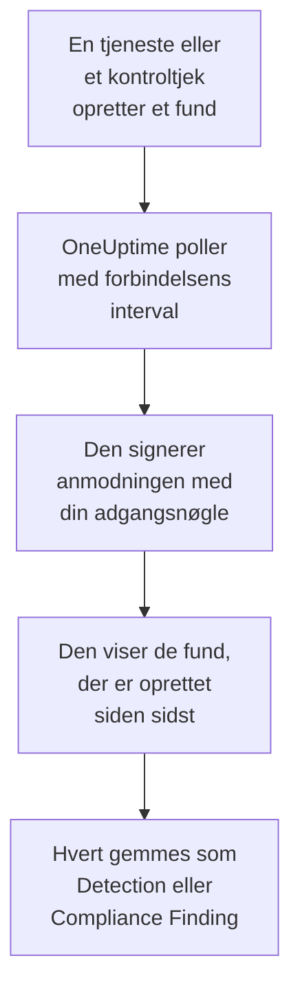

# AWS Security Hub

Importér fund fra [AWS Security Hub](https://aws.amazon.com/security-hub/) i OneUptimes sikkerhedsbegivenheder: fund fra GuardDuty, Inspector, Macie og IAM Access Analyzer, Security Hubs egne kontroltjek og fund fra partnerprodukter. Der søger du i dem ved siden af dine logs, traces og metrikker, korrelerer dem med alle andre kilder og kalder vagten op for dem, der betyder noget. OneUptime læser dem med en adgangsnøgle, du selv opretter, som kun må udføre én skrivebeskyttet handling, og ændrer intet i AWS. Der er ingen agent, EventBridge-regel eller S3-eksport at opsætte.

:::cards
- [Opsæt forbindelsen](#opsæt-forbindelsen): En IAM-politik, en adgangsnøgle og forbindelsens formular.
- [Hvad der importeres](#hvad-der-importeres): Hvordan hvert fund bliver en sikkerhedsbegivenhed.
- [Sådan fungerer polling](#sådan-fungerer-polling): Det vindue, hver poll læser, og hvorfor det overlapper det forrige med 30 minutter.
- [Fejlfinding](#fejlfinding): Hvad hver fejl betyder, og hvad du skal ændre.
:::

## Sådan fungerer det



Hvert minut poller OneUptime hver aktiveret forbindelse, hvis pollinterval er gået. En poll kalder Security Hubs `GetFindings` i din region, signeret med [Signature Version 4](https://docs.aws.amazon.com/IAM/latest/UserGuide/reference_sigv-create-signed-request.html), for de fund, der er oprettet siden sidste poll. Den gemmer hvert som en [OCSF](https://schema.ocsf.io/)-begivenhed: et kontroltjek som et Compliance Finding (klasse `2003`) og ethvert andet fund som et Detection Finding (klasse `2004`). Registreringsregler, monitorer og dashboards behandler det derefter som en sikkerhedsbegivenhed fra enhver anden kilde.

## Før du går i gang

- I OneUptime rollen Project Owner, Project Admin eller Security Admin. Security Member og Security Viewer kan se forbindelser og deres kørselshistorik, men ikke ændre dem.
- En AWS-konto med Security Hub aktiveret i den region, du forbinder. Security Hub er regionalt: en forbindelse læser de fund, én konto har i én region.
- For at læse hver kontos og hver regions fund gennem én forbindelse: Security Hubs delegerede administratorkonto, i dens hjemmeregion, med [krydsregional aggregering](https://docs.aws.amazon.com/securityhub/latest/userguide/finding-aggregation.html) slået til. **Security Hub → Settings → Regions** viser hjemmeregionen.
- Udgående HTTPS fra OneUptime-appen og -workerne til `securityhub.<region>.amazonaws.com`, eller `securityhub.<region>.amazonaws.com.cn` i Kina, og et korrekt ur på deres værter: AWS afviser en anmodning, der er signeret med mere end 5 minutters afvigelse.

## Opsæt forbindelsen

Forbindelsen signerer sine anmodninger med en IAM-adgangsnøgle. Nøglens identitet behøver én handling, `securityhub:GetFindings`, og intet andet: forbindelsen ændrer aldrig et fund.

:::steps
### Tillad læsning af fund

Åbn **Policies → Create policy** i [IAM-konsollen](https://console.aws.amazon.com/iam/), vælg **JSON**, og indsæt denne politik. Giv den et navn, for eksempel `OneUptimeSecurityHubRead`:

```json
{
  "Version": "2012-10-17",
  "Statement": [
    {
      "Effect": "Allow",
      "Action": "securityhub:GetFindings",
      "Resource": "*"
    }
  ]
}
```

`GetFindings` kan ikke begrænses til en ressource, så `Resource` forbliver `*`. Den administrerede politik `AWSSecurityHubReadOnlyAccess` virker også, men tillader mere.

### Opret en adgangsnøgle

1. Åbn **Users → Create user**, giv brugeren et navn, for eksempel `oneuptime-security-hub`, lad konsoladgang være slået fra, og tilknyt politikken. Gør det i den delegerede administratorkonto for andre kontis fund.
2. Åbn brugeren, derefter **Security credentials → Access keys → Create access key**, og vælg **Third-party service**.
3. Kopiér **Adgangsnøgle-id** og **Hemmelig adgangsnøgle**. AWS viser kun hemmeligheden én gang.

### Tilføj forbindelsen i OneUptime

Åbn **Produkter → Security Events → Forbindelser** (`/dashboard/{projectId}/security-events/connections`), klik på **Tilføj forbindelse**, vælg **AWS Security Hub**, og klik på **Næste**. Udfyld indstillingerne i tabellen nedenfor, klik på **Næste**, og indsæt hemmeligheden i **Hemmelig adgangsnøgle**.

### Test den, før du gemmer

Klik på **Test disse indstillinger** under **Test, før du gemmer**. Testen signerer en anmodning med værdierne i formularen og gemmer intet, så en forkert nøgle eller en manglende tilladelse viser sig, før forbindelsen findes. Klik derefter på **Næste**, giv forbindelsen et **Navn**, og opret den.
:::

| Indstilling | Hvad du skal angive |
| --- | --- |
| **Region** | Regionens kode, for eksempel `us-east-1`, `eu-central-1` eller `us-gov-west-1`: for andre kontis fund administratorkontoens hjemmeregion. |
| **Adgangsnøgle-id** | Nøglens ID: 16 til 128 bogstaver eller cifre, som regel 20, der starter med `AKIA`, eller `ASIA` for midlertidige legitimationsoplysninger. |
| **Hemmelig adgangsnøgle** | Nøglens hemmelighed. Den krypteres, returneres aldrig af API'et og vises aldrig igen. Erstat den med **Opdater legitimationsoplysninger** på forbindelsen. |
| **Session token** | Kun til midlertidige legitimationsoplysninger, som har brug for det: en `ASIA`-nøgle afvises uden det, og en `AKIA`-nøgle afvises med det. |

Midlertidige legitimationsoplysninger fra `aws sts assume-role` eller `aws sts get-session-token` udløber, for en antaget rolle efter højst 12 timer, og pollingen stopper, indtil du indsætter nye med **Opdater legitimationsoplysninger**. En langtidsholdbar nøgle med denne snævre politik, roteret efter din egen tidsplan, bliver ved med at polle uden tilsyn. For at skifte fra midlertidige legitimationsoplysninger til en langtidsholdbar nøgle angiver du den nye nøgle i **Opdater legitimationsoplysninger** og slår **Remove the stored Session token** til.

Trinnet **Hentning** har også en valgfri **Beskrivelse**, **Hentningsinterval (minutter)**, et heltal fra `1` til `1440`, der starter på `5`, og **Aktiveret**, som starter slået til.

## Hvad der importeres

Hvert fund bliver én begivenhed med leverandøren `Amazon Web Services` og produktet `AWS Security Hub`. Et fund med et `Compliance`-objekt, et kontroltjek mod en standard som AWS Foundational Security Best Practices eller CIS, bliver et Compliance Finding (OCSF-klasse `2003`). Ethvert andet fund bliver et Detection Finding (OCSF-klasse `2004`).

| Fundfelt | OneUptime-kolonne |
| --- | --- |
| `Id`, et ARN for fund, som AWS opretter | Begivenheds-UID, som også dubletter fjernes efter |
| `CreatedAt`, ellers `UpdatedAt`, ellers `FirstObservedAt` | Begivenhedens tidspunkt |
| `Title` | Regelnavn |
| `GeneratorId`, som GuardDuty-fundtypen eller kontrollens ID | Regel-ID |
| `Title`, ellers `Description` | Meddelelse |
| `Severity.Label`, ellers et bånd af `Severity.Normalized` | Alvorlighed |
| `Workflow.Status`: `NEW`, `NOTIFIED`, `RESOLVED` eller `SUPPRESSED`, ellers det ældre `WorkflowState` | Status |
| `Types` under `TTPs/`: `TTPs/Initial Access/...` bliver `TA0001` | MITRE ATT&CK-taktikker og -teknikker |
| IAM-brugeren for en adgangsnøgle- eller brugerressource, `Network.SourceIpV4` eller `SourceIpV6`, `Process.Name` eller `Process.Path` | Aktørens bruger, IP og proces |
| Instans-ID'et for en `AwsEc2Instance`-ressource, `Network.DestinationIpV4` eller `DestinationIpV6`, `Network.DestinationPort`, det første `Resources[].Id` | Målets vært, IP, port og ressource |
| Disse, hvert `Resources[].Id`, `AwsAccountId`, netværkets domæner, malwarenavne og trusselsefterretningsværdier | Observables |
| Hele fundet, fladet ud til nøgler med punktummer, som `Compliance.Status` og `Remediation.Recommendation.Url` | `attributes` |

Når et fund ikke har nogen `Severity.Label`, afgør `Severity.Normalized`: `0` er Informational, `1` til `39` Low, `40` til `69` Medium, `70` til `89` High og `90` til `100` Critical. Et fund, som Security Hub opdaterer senere, med en ny `Workflow.Status` eller en kontrol, der nu består, beholder sit `Id`, så det importeres ikke igen: begivenheden beholder fundet, som det var ved importen.

## Sådan fungerer polling

Hver poll viser de fund, der er oprettet i dens vindue, de ældste først, 100 pr. side, og følger `NextToken`, indtil den har læst hele vinduet:

```text
POST https://securityhub.{region}.amazonaws.com/findings
    {"Filters": {"CreatedAt": [{"Start": "{window start}", "End": "{window end}"}]},
     "SortCriteria": [{"Field": "CreatedAt", "SortOrder": "asc"}],
     "MaxResults": 100}
```

- **Oprettelsestidspunktet er markøren.** Fund vises efter `CreatedAt`, aldrig efter `FirstObservedAt`. GuardDuty opretter et fund, når den har set nok aktivitet, og et kontroltjek, når Security Hub kontrollerer ressourcen første gang, timer eller dage efter at aktiviteten begyndte. En markør på observationstidspunktet ville springe dem over.
- **Den første poll ser 24 timer tilbage**, så en ny forbindelse straks viser sine nylige fund.
- **Hver senere poll starter 30 minutter før den gemte markør.** `CreatedAt` sættes af den tjeneste, der fandt problemet, og fundet når Security Hub senere: GuardDuty sender nye fund inden for fem minutter, og en mislykket levering via EventBridge forsøges igen i op til 24 timer. Overlappet læser sådanne fund ved den næste poll. Et fund, der ankommer mere end 30 minutter efter sit `CreatedAt`, kan havne bag markøren: importér dets tidsinterval for at hente det.
- **En poll læser højst 24 timer forbi markøren.** En forbindelse, hvis markør er kommet bagud, indhenter i en række vinduer på 24 timer, og dens **Sundhed** viser **Catching up**.
- **Dubletter fjernes efter fundets `Id`** i projektet, så overlappet, et gentaget vindue og en import aldrig gemmer et fund to gange.

### Når et vindue indeholder mere, end én poll kan læse

En poll sender højst 20 anmodninger med 100 fund: 2.000 fund. Når et vindue indeholder flere, er kørslen **Delvis** med en advarsel som:

```text
Stopped after 20 findings requests (the per-run request limit) before the window was fully read. The last finding read was created at 2026-09-14T08:12:44.000Z.
```

Fund læses de ældste først, så OneUptime flytter markøren til oprettelsestidspunktet for det sidst læste fund, og den næste poll starter der, uden overlappet på 30 minutter, med samme vindueslængde. En travl konto indhenter omkring 2.000 fund pr. poll i stedet for at læse de samme igen. Overlappet vender tilbage, når markøren er rykket 30 minutter forbi det punkt.

Når en kørsel slet ikke kan komme forbi den gemte markør, for eksempel fordi overlappets 30 minutter alene indeholder mere end 2.000 fund, gør OneUptime i stedet vinduet kortere:

1. **Indsnævr.** Den næste poll læser et vindue, der er halvt så langt, fra det samme startpunkt, og bliver ved med at halvere, indtil et vindue læses helt, ned til ét minut. Kørslens advarsel siger det: `This window holds more records than one poll can read; the next poll reads a {n} minute window from the same starting point.`
2. **Voks igen.** Når et vindue er læst helt, er det næste igen dobbelt så langt, op til 24 timer.
3. **Gå forbi et enkelt minut.** Hvis selv ét minut indeholder mere, end en poll kan læse, går pollingen forbi det, så nyere fund bliver ved med at komme, og senere pollers overlap når ikke længere tilbage til det. Kørslen forbliver **Delvis**, og **Seneste fejl** lyder `More records were created in the one minute from {cursor} to {end} than one poll can read. Polling moved past this minute so newer records keep arriving; use Import this time range in Diagnostics on this minute to recover what one run can read.` Importér det minut med **Import this time range** for at hente det, én kørsel kan læse.

En kørsel, der mislykkes helt, med en fejl fra AWS, beholder markøren og vindueslængden, og den næste poll læser det samme vindue igen. Den eneste undtagelse er en anmodning, der fik timeout: markøren bliver, men det næste vindue er halvt så langt, fordi et vindue, der er for tungt til at blive besvaret i tide, ville få timeout ved hvert forsøg. At ændre **Hentningsinterval (minutter)** ændrer intet af dette: det afgør, hvor ofte en poll starter, ikke hvor dens vindue begynder.

### Kør, se forhåndsvisning og importér efter behov

Klik på **Diagnosticering** på en forbindelse for at se dens seneste kørsler og arbejde med den manuelt. Alle, der kan ændre forbindelsen, kan starte disse handlinger; alle, der kan se den, kan læse historikken.

- **Kør nu** starter straks en poll med den sædvanlige markør, også når forbindelsen ikke er **Aktiveret**.
- **Preview findings** læser et tidsinterval på op til 7 dage og importerer intet.
- **Import this time range** importerer et interval på op til 7 dage, efter at du har bekræftet, uden at flytte markøren. Fund, der allerede er importeret, springes over.
- **Copy diagnostics** på en kørsel kopierer dens rapport til support. Den indeholder aldrig legitimationsoplysninger.

## Test forbindelse

**Test forbindelse** på en forbindelses række og **Test disse indstillinger** i formularen kører i API-processen, ikke i en baggrundsworker, så en test også svarer, når det er workerne, der er problemet. Den kører disse kontroller i rækkefølge:

| Kontrol | Hvad den kontrollerer |
| --- | --- |
| **Konfiguration** | Hver indstilling er til stede og velformet. Der kontaktes intet, når dette mislykkes. |
| **Authenticate with AWS** | AWS accepterer en signeret `GetFindings`-anmodning for ét fund, der er oprettet inden for de seneste 24 timer. AWS kontrollerer signaturen før IAM-politikken, så en afvisning fra politikken består stadig denne kontrol: nøglen er rigtig. |
| **Read findings** | Security Hub besvarer den anmodning: identiteten må kalde `securityhub:GetFindings`, og Security Hub er aktiveret i regionen. |
| **Findings available to import** | Hvor mange fund der er oprettet inden for de seneste 24 timer og de seneste 7 dage, én side på 100 hver, så `100+` betyder flere. Ingen på 7 dage er en advarsel, ikke en fejl. |
| **Background workers**, **Poll scheduler**, **Security event storage** | OneUptimes egen side: en proces tager jobbene fra Worker-køen, poll-jobbet kører hvert minut, og lageret for sikkerhedsbegivenheder svarer. |
| **Scheduled polling** | For en gemt forbindelse: polling er slået til, ingen kørsel sidder fast og venter på en worker, og polls kører til tiden. |

Hver anmodning i en test har en frist på 20 sekunder. En test importerer aldrig noget og flytter aldrig markøren, og hver mislykket kontrol siger, hvad du skal ændre.

## Fejlfinding

Forbindelsens **Seneste fejl** gemmer hele fejlmeddelelsen, med legitimationsoplysninger maskeret, bag et præfiks, der navngiver det trin, der mislykkedes. Når en forbindelse har en fejl, vælger du **Vis fejl** i dens kolonne **Handlinger** for at læse den og **Kopiér fejl** i dialogen for at kopiere den. Hver meddelelse starter med `AWS Security Hub findings request`; læs, hvad der følger.

:::details Last Error siger `failed (HTTP 401)` eller `failed (HTTP 403)`
AWS afviste anmodningen. Meddelelsen citerer AWS' fejlkode eller AWS' egne ord, når der ikke blev sendt nogen kode:

- `AccessDeniedException`, eller `is not authorized to perform`: nøglen er rigtig, men dens identitet må ikke kalde `securityhub:GetFindings`. Tilknyt politikken fra [Opsæt forbindelsen](#opsæt-forbindelsen). En permissions boundary eller en service control policy kan også nægte den.
- `InvalidAccessException`, eller `is not subscribed to AWS Security Hub`: Security Hub er ikke aktiveret for denne konto i denne **Region**, eller kontoen er ikke dens administrator dér.
- `InvalidSignatureException` eller `SignatureDoesNotMatch`, eller `The request signature we calculated does not match`: **Hemmelig adgangsnøgle** hører ikke til **Adgangsnøgle-id**. Opret en ny adgangsnøgle, og gem den med **Opdater legitimationsoplysninger**.
- `UnrecognizedClientException` eller `InvalidClientTokenId`, eller `The security token included in the request is invalid`: AWS kender ikke **Adgangsnøgle-id**. Det er stavet forkert, slettet, deaktiveret eller fra en anden partition, eller det er en midlertidig nøgle uden sit **Session token**.
- `ExpiredTokenException`, eller `The security token included in the request is expired`: de midlertidige legitimationsoplysninger er udløbet. Udsted nye, eller skift til en langtidsholdbar nøgle.
- `RequestTimeTooSkewed` eller `RequestExpired`, eller `Signature expired`: uret på OneUptime-værterne går mere end 5 minutter forkert. Ret NTP på app- og workerværterne.
- Ingen kode overhovedet: AWS sagde ikke, om det var nøglen eller politikken, der afviste den. Kontrollér nøglen først, derefter politikken.
:::

:::details Last Error siger `failed (HTTP ...)` med en anden status
- `HTTP 404`: intet Security Hub-endpoint svarede i denne **Region**. Sammenlign den med regionsmenuen i AWS-konsollen: `us-east-1`, ikke `us-east1` eller `N. Virginia`.
- `HTTP 429`: kontoen ramte Security Hubs grænse, 3 `GetFindings`-anmodninger i sekundet i en region. Den næste poll prøver igen. Hvis det bliver ved, så led efter et andet værktøj eller en anden forbindelse, der læser samme konto og region.
- `HTTP 5xx`: Security Hub havde et problem i sin ende. Den næste poll prøver igen.
- `HTTP 400`: Security Hub afviste forespørgslen, som OneUptime bygger, ikke dine indstillinger. Send meddelelsen til OneUptimes support.
:::

:::details Last Error siger `returned`, `timed out` eller `Could not reach data source`
- `returned a non-JSON body` eller `returned an unrecognized response shape`: noget andet end Security Hub svarede, for eksempel en proxys loginside eller en gateway, der omskriver svar. Det rapporteres i stedet for at blive taget som et tomt vindue, så markøren aldrig flytter sig forbi fund, som ingen har læst.
- `timed out after 60 seconds with no response`, eller `failed: Could not reach data source`: anmodningen fik intet svar. Security Hubs endpoints er offentlige, så kontrollér DNS, firewalls og proxyer mellem OneUptime-appen og -workerne og `securityhub.<region>.amazonaws.com`.
:::

:::details Last Polled er Never, og Last Error er tom
Ingen poll er blevet færdig for denne forbindelse. Kør **Test forbindelse**: dens kontroller **Background workers** og **Poll scheduler** navngiver årsagen. På en selvhostet installation er den sædvanlige årsag `DISABLE_QUEUE_WORKERS=true` på appen, uden en separat worker-udrulning, der tager jobbene: sæt den til `false`, eller kør worker-udrulningen (Helm: `worker.enabled: true`).
:::

:::details En kørsel er Partial
- `Stopped after 20 findings requests`: vinduet indeholdt mere end de 2.000 fund, én kørsel læser. Intet går tabt: den næste poll starter efter det sidst læste fund. En forbindelse, der forbliver **Delvis** poll efter poll, er ved at indhente et efterslæb, og dens **Senest hentet** og **Seneste importerede hændelse** bliver ved med at rykke frem. Hvis den aldrig indhenter, opretter kontoen mere end 2.000 fund pr. pollinterval: gør **Hentningsinterval (minutter)** kortere.
- `More records were created in the one minute from ... than one poll can read`: pollingen gik forbi det minut. Importér det med **Import this time range** i **Diagnosticering**. En import læser lige så meget som en poll.
:::

:::details Testen lykkes, men intet importeres
Læs **Findings available to import** i testens rapport. `0` inden for de seneste 7 dage betyder, at Security Hub ikke har oprettet noget fund i denne konto og region: kontrollér, at GuardDuty, Inspector eller en sikkerhedsstandard er slået til dér. For at se andre kontis og regioners fund forbinder du administratorkontoen i dens hjemmeregion.
:::

:::details Et fund i Security Hub-konsollen kom aldrig frem
Sammenlign dets `CreatedAt` med dets `ProcessedAt`, hvor Security Hub modtog det. Et fund, der ankom mere end 30 minutter efter sit `CreatedAt`, kan havne bag markøren: importér dets `CreatedAt` med **Import this time range**.
:::

## Hvad du får

- **Søgning.** Filtrér fund efter alvorlighed, status, regel, konto, ressource eller enhver observable i stifinderen for sikkerhedsbegivenheder, ved siden af alle andre kilder.
- **Korrelation.** Hvert funds brugere, instanser, IP'er, ressource-ARN'er og konto-ID'er indekseres som observables, så én søgning finder alt, der nævner dem.
- **Registreringsregler.** Sigma-regler, der kører efter en tidsplan over dine sikkerhedsbegivenheder og åbner advarsler, der kalder vagten op.
- **Monitorer.** Monitorer for sikkerhedsbegivenheder tæller matchende begivenheder, for eksempel nye kritiske GuardDuty-fund eller mislykkede kontroller, og åbner hændelser eller advarsler over en tærskel.

Sikkerhedsbegivenheder faktureres som resten af din telemetri, pr. indtaget GB. Se [Priser](https://oneuptime.com/pricing).

## Næste trin

:::cards
- [Sikkerhedsbegivenheder](/docs/telemetry/security-events): Søg, korrelér og advar på det, du importerer.
- [Okta System Log](/docs/integrations/okta): Importér også logins fra din identitetsudbyder.
- [Roller](/docs/permissions/reference#roller): Hvad Security-rollerne kan se og ændre.
- [Oversigt over integrationer](/docs/integrations/index): De andre værktøjer, du kan forbinde.
:::
