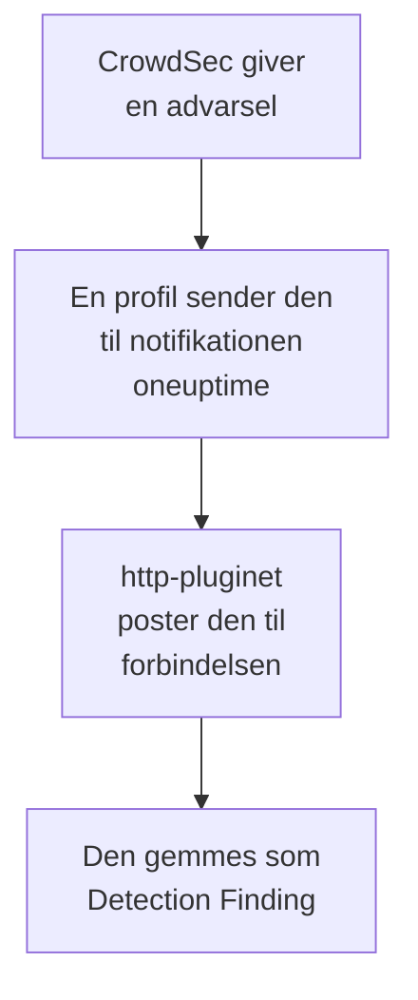

# CrowdSec

Modtag advarslerne fra [CrowdSec](https://www.crowdsec.net/) i OneUptimes sikkerhedsbegivenheder, efterhånden som CrowdSec udløser dem, og blokér adresserne på dit projekts blokeringsliste med CrowdSec. CrowdSecs eget notifikationsplugin sender hver advarsel til en CrowdSec-forbindelse, som åbner sager ud fra CrowdSecs registreringer. Når du slår blokering til, bandlyser OneUptime hver adresse, du blokerer, via CrowdSecs Local API, og hver bouncer, der læser den, blokerer adressen.

:::cards
- [Opsæt forbindelsen](#opsæt-forbindelsen): En forbindelse og den notifikation, der sender CrowdSecs advarsler til den.
- [Hvad der modtages](#hvad-der-modtages): Hvordan hver CrowdSec-advarsel bliver en sikkerhedsbegivenhed.
- [Blokér adresser med CrowdSec](#blokér-adresser-med-crowdsec): Bandlys adresserne på din blokeringsliste i CrowdSec.
- [Læs CrowdSecs blokeringslister](#læs-crowdsecs-blokeringslister): De lister, CrowdSec Console leverer, som et feed med trusselsinformation.
- [Fejlfinding](#fejlfinding): Hvad hver fejl betyder, og hvad du skal ændre.
:::

## Sådan fungerer det



CrowdSecs Local API giver hver advarsel, som en profil sender til en notifikation, videre til den notifikations plugin. Forbindelsens notifikation bruger CrowdSecs `http`-plugin: Det poster advarslen, i CrowdSecs eget JSON, til indtagelsen af sikkerhedsbegivenheder med din indtagelsesnøgle og navngiver forbindelsen. OneUptime gemmer den som en [OCSF](https://schema.ocsf.io/)-begivenhed Detection Finding (klasse `2004`), holder den op mod dine registreringsregler og åbner en sag ud fra hver af CrowdSecs egne registreringer, der når forbindelsens niveau for **Åbn sager fra**. Intet polles: En advarsel kommer frem sekunder efter, at CrowdSec udløser den.

## Før du går i gang

- I OneUptime rollen Projektejer, Projektadministrator eller Sikkerhedsadministrator. Sikkerhedsmedlem og Sikkerhedsseer kan se forbindelser, men ikke ændre dem.
- CrowdSec 1.5 eller nyere, med dens Local API og det `http`-notifikationsplugin, den leveres med. Denne side er skrevet ud fra CrowdSec v1.8.2.
- Udgående HTTPS fra den vært, der kører CrowdSecs Local API, til dit OneUptime.
- For også at blokere adresser: en Local API, som OneUptime kan nå, og en maskine til OneUptime (se [Blokér adresser med CrowdSec](#blokér-adresser-med-crowdsec)).

## Opsæt forbindelsen

:::steps
### Tilføj forbindelsen i OneUptime

Åbn **Produkter → Sikkerhedshændelser → Forbindelser** (`/dashboard/{projectId}/security-events/connections`), klik på **Tilføj forbindelse**, vælg **CrowdSec**, og klik på **Næste**. For kun at modtage advarsler skal du lade alle indstillinger i tabellen nedenfor være tomme; for også at blokere adresser skal du udfylde dem.

### Test den, før du gemmer

Klik på **Test disse indstillinger** under **Test, før du gemmer**. Uden en Local API angivet siger testen det og kontakter intet; med en Local API angivet når testen den, logger på som maskinen og gemmer intet. Klik derefter på **Næste**, giv forbindelsen et **Navn** i trinnet **Advarsler**, vælg værdien for **Åbn sager fra**, og opret den.

### Gem notifikationen på CrowdSec-værten

Når forbindelsen oprettes, åbnes dens **Send advarsler**, som du senere åbner igen fra forbindelsens række. Vælg en nøgle under **Vælg en indtagelsesnøgle**, og gem så den viste notifikation, med din nøgle og din forbindelse allerede udfyldt, på den vært, der kører CrowdSecs Local API:

```yaml title="/etc/crowdsec/notifications/oneuptime.yaml"
type: http
name: oneuptime

# info or quieter: at debug, CrowdSec logs each request's headers.
log_level: info

format: |
  {{.|toJson}}

url: https://oneuptime.com/security-events/v1/ingest?connection=YOUR_CONNECTION_ID&format=crowdsec
method: POST
headers:
  Content-Type: application/json
  x-oneuptime-token: YOUR_INGESTION_TOKEN
```

### Send dine profilers advarsler til den

Tilføj i `/etc/crowdsec/profiles.yaml` `oneuptime` til `notifications` for hver profil, hvis advarsler OneUptime skal modtage, og genindlæs derefter CrowdSec:

```yaml title="/etc/crowdsec/profiles.yaml"
notifications:
  - oneuptime
```

```bash
sudo systemctl reload crowdsec
```

### Send en testadvarsel

```bash
sudo cscli notifications test oneuptime
```

**Send advarsler** viser, hvornår den kommer frem, og **Vis advarsler** åbner den i sikkerhedsbegivenhederne. Det er en begivenhed med alvorligheden Informational, og den åbner ingen sag.
:::

| Indstilling | Hvad du skal angive |
| --- | --- |
| **Local API-URL** | Kun til at blokere adresser: hvor OneUptime når CrowdSecs Local API, fx `https://crowdsec.example.com:8080`. Brug `https`, hvor forbindelsen krydser et netværk. |
| **Maskine-ID** | Kun til at blokere adresser: den maskine, OneUptime logger på som, tilføjet på CrowdSec-værten med `sudo cscli machines add oneuptime --auto -f -`. |
| **Blokér adresser med CrowdSec** | Slået fra på en ny forbindelse. Slået til bandlyser den adresserne og intervallerne på din blokeringsliste i CrowdSec og kræver de tre andre indstillinger (se [Blokér adresser med CrowdSec](#blokér-adresser-med-crowdsec)). |
| **Maskinadgangskode** | Kun til at blokere adresser: den adgangskode, `cscli` udskrev for maskinen. Den krypteres, returneres aldrig af API'et og vises aldrig igen. Erstat den med **Opdater legitimationsoplysninger** på forbindelsen. |

Trinnet **Advarsler** har også en valgfri **Beskrivelse** og **Aktiveret**, som starter slået til. En forbindelse, der ikke er aktiveret, beholder de advarsler, den modtager, som begivenheder og åbner ingen sag ud fra dem.

I en container lægges notifikationen i den mappe, der er monteret på `/etc/crowdsec/notifications/`, og en genstart af containeren indlæser den. En Kubernetes-installation angiver den i sine Helm-værdier under `config.notifications`, med `profiles.yaml` ved siden af under `config`.

## Hvad der modtages

Hver advarsel, CrowdSec sender, bliver én begivenhed Detection Finding (OCSF-klasse `2004`), med leverandør og produkt `CrowdSec`:

| CrowdSec-felt | OneUptime-kolonne |
| --- | --- |
| `uuid`, eller en hash for en advarsel uden et | Begivenheds-UID, som også dubletter fjernes efter |
| `stop_at`, eller `start_at` | Begivenhedens tidspunkt |
| `scenario` | Regel-ID og regelnavnet: scenariets titel på CrowdSec Hub eller dets navn |
| `source.ip`, eller `source.value` for en `Ip`-advarsel | Aktørens IP |
| `target_fqdn` eller `target_host` for advarslen eller dens begivenheder, ellers den `machine`, dens begivenheder nævner | Målvært |
| `target_user`, `target_uri` | Målbruger og -ressource |
| Den første beslutnings `type` | Status: `Blocked` for en bandlysning, `Challenge` for en captcha, `Logged` uden beslutning eller i simuleringstilstand |
| Scenariets adfærd | Alvorlighed og dets MITRE ATT&CK-taktikker og -teknikker |
| Alt andet, som `source.cn`, `source.as_name` og `events_count` | `attributes`: advarslens felter fladet ud til nøgler med punktummer, dens første 10 begivenheder i fuld længde og OneUptimes aflæsning under `crowdsec.` |

En CrowdSec-advarsel har ingen egen alvorlighed, så OneUptime tager den fra det, scenariet registrerer, sådan som CrowdSec Hub mærker det (`ssh:bruteforce`, `http:exploit`):

| Adfærd | Alvorlighed |
| --- | --- |
| Et exploit, fx en CVE eller det, AppSec-komponenten blokerede, eller det, en angriber gør, når vedkommende er kommet ind | High |
| Brute force, denial of service, svindel, et umuligt login eller en adfærd, OneUptime ikke kan placere | Medium |
| Scanninger, sonderinger, crawls, bots, spam og ændringer i cloud-audit | Low |
| CrowdSecs egne testscenarier | Informational |

Med **Åbn sager fra** på **Høj og højere** åbner CrowdSecs exploits sager, og dens daglige bandlysninger af scannere og adgangskodegættere forbliver begivenheder for dine registreringsregler. Kun CrowdSecs egne registreringer åbner sager. En beslutning, som nogen har tilføjet med `cscli` eller i CrowdSecs Console, en adresse på en CrowdSec-blokeringsliste, testadvarslen og OneUptimes egne bandlysninger, der kommer tilbage, er Informational og åbner ingen. En advarsel, der sendes to gange, som `cscli notifications reinject` gør, gemmes én gang.

## Blokér adresser med CrowdSec

Slå **Blokér adresser med CrowdSec** til på en forbindelse, og adresserne og intervallerne på dit projekts [blokeringsliste](/docs/telemetry/security-cases#blokeringsliste) bandlyses i CrowdSec. Hver bouncer, der læser dens Local API, som dens firewall-, nginx- og Traefik-bouncere, blokerer dem, hvor den kører, ligesom den blokerer CrowdSecs egne bandlysninger. Blokeringer går gennem de samme godkendelser og de samme grænser for automatisk reaktion og ophæves med den samme **Ophæv** som alle andre steder, hvor din blokeringsliste håndhæves.

Kontakten er slået fra på en ny forbindelse. Sådan slår du den til:

1. Tilføj en maskine til OneUptime på CrowdSec-værten; kommandoen udskriver dens adgangskode:

   ```bash
   sudo cscli machines add oneuptime --auto -f -
   ```

2. Lad OneUptime nå CrowdSecs Local API, som lytter på `127.0.0.1:8080`, medmindre andet er angivet: Sæt `api.server.listen_uri` i CrowdSecs `config.yaml`, server den over TLS eller bag en `https`-proxy, og lad OneUptimes adresser komme gennem din firewall.
3. Redigér forbindelsen, udfyld **Local API-URL** og **Maskine-ID**, angiv adgangskoden i **Maskinadgangskode**, slå **Blokér adresser med CrowdSec** til, og gem. **Test forbindelse** kontrollerer derefter, at maskinen logger på og læser OneUptimes bandlysninger, uden at ændre noget.

Sådan oprettes en bandlysning, og sådan ophører den:

- Hver blokering er én bandlysningsbeslutning, oprettet sådan som `cscli decisions add` opretter en, under scenariet `oneuptime/blocklist`. CrowdSec gemmer den som en manuel beslutning, så den deles aldrig med CrowdSecs Central API, medmindre du deler manuelle beslutninger. OneUptime læser og fjerner kun sine egne bandlysninger, aldrig en, som en person eller CrowdSec har oprettet.
- En blokering med en slutning er en bandlysning indtil præcis den slutning, og CrowdSec ophæver den da selv, uanset om OneUptime kan nå den eller ej. En blokering, indtil den ophæves, er en bandlysning på 7 dage, der fornyes, når der er 3 dage eller mindre tilbage, så en bandlysning, OneUptime ikke længere holder ved lige, ophører inden for en uge.
- **Ophæv** fjerner bandlysningen ved næste gennemløb, inden for et minut. En bandlysning, der er fjernet i CrowdSec, med `cscli decisions delete` eller en flush, oprettes igen ved næste gennemløb, så længe blokeringen varer.
- En adresse eller et interval på en af CrowdSecs tilladelseslister bandlyses aldrig: Blokeringen viser den som ikke håndhævet dér, med navnet på tilladelseslisten, og en allerede oprettet bandlysning fjernes, så snart en tilladelsesliste indeholder adressen.
- Dit projekts egne adresser, som dine **Betroede proxyer**, load balancere og edge-netværk, blokeres aldrig nogen steder, heller ikke i CrowdSec.
- CrowdSec bandlyser kun: En udfordring anvendes ikke dér, og et domæne, en URL eller en fil sendes ikke til den.

Når CrowdSecs Local API ikke kan nås, ændres intet i CrowdSec: De bandlysninger, den har, bliver og ophører, når de ophører. **Håndhævet hos** på **Blokeringsliste** siger, hvornår CrowdSec sidst havde hver blokering, og OneUptime prøver igen efter 1 minut og venter derefter dobbelt så længe hver gang, op til 30 minutter. En ny blokering venter, indtil den kan oprettes.

## Læs CrowdSecs blokeringslister

CrowdSec Console leverer de blokeringslister, din organisation abonnerer på, som en Raw IP List-integration: én adresse pr. linje, bag et brugernavn og en adgangskode. Et [feed med trusselsinformation](/docs/telemetry/threat-intelligence) læser dem og matcher dine begivenheder mod dem:

1. Opret en Raw IP List-integration i CrowdSec Console, med IP-aggregering slået fra: OneUptime matcher adresser, ikke intervaller. Kopiér dens endpoint, brugernavn og adgangskode.
2. Åbn **Produkter → Sikkerhedshændelser → Detektioner → Trusselsinformation** i OneUptime, klik på **Opret Feed med trusselsinformation**, og vælg **Liste over indikatorer**.
3. Indsæt endpointet som **Liste-URL**, vælg **Brugernavn og adgangskode** under **Login**, og indsæt begge. På CrowdSecs Community-plan, som tillader én download om dagen, skal du sætte **Hentningsinterval (minutter)** til `1440`.

Listerne tilhører CrowdSec: Du må bruge dem i dine egne værktøjer, men ikke give dem videre. OneUptime tilbyder ingen egen liste.

## Test forbindelse

**Test forbindelse** på en forbindelses række og **Test disse indstillinger** i formularen kører i API-processen, ikke i en baggrundsworker. De kører disse kontroller i rækkefølge:

| Kontrol | Hvad den kontrollerer |
| --- | --- |
| **Konfiguration** | Indstillingerne er enten alle tomme eller alle angivet, og velformede. Der kontaktes intet, når dette mislykkes. |
| **Reach CrowdSec's Local API** | `GET /health` svarer. Uden en Local API angivet siger kontrollen, at forbindelsen kun modtager advarsler, og de næste tre køres ikke. |
| **Sign in to the Local API** | `POST /v1/watchers/login` accepterer maskinen og dens adgangskode. |
| **Read CrowdSec's allowlists** | `GET /v1/allowlists` svarer, og hvor mange adresser og intervaller listerne indeholder. En Local API ældre end 1.6.8, som ikke har nogen, består. |
| **Block with CrowdSec** | Kun med **Blokér adresser med CrowdSec** slået til: Maskinen kan læse OneUptimes bandlysninger tilbage, og hvor mange der er i kraft. Kontrollen ændrer intet. |
| **Background workers**, **Security event storage** | OneUptimes egen side: en proces tager jobbene fra Worker-køen, som gemmer det, CrowdSec sender, og lageret for sikkerhedsbegivenheder svarer. |
| **Alerts received** | For en gemt forbindelse: hvornår den seneste advarsel kom frem. Ingen endnu giver en advarsel med en forklaring på, hvordan du sender en testadvarsel. |

En test bandlyser eller fjerner aldrig noget. **Kopiér rapport** kopierer tjeklisten som JSON, uden adgangskoden eller tokens.

## Fejlfinding

Forbindelsens **Sundhed** viser **Venter på advarsler**, indtil den første advarsel kommer frem, derefter **Modtager advarsler**, uanset hvor længe den næste er om at komme; **Sager sat på pause** betyder, at forbindelsen ikke er aktiveret. CrowdSec skriver det, pluginet svarede, i sin egen log, `/var/log/crowdsec.log`, som `HTTP server returned non 200 status code`.

:::details Der kommer ingen advarsel frem
- Kør `sudo cscli notifications list`: `oneuptime` skal være på listen og aktiv i en profil. En notifikation, som ingen profil nævner, sender intet.
- `401`: Indtagelsesnøglen i `x-oneuptime-token` mangler, er forkert eller udløbet, og `422`: Den er slået fra. Vælg en nøgle i **Send advarsler**, og kopiér notifikationen igen.
- `400`: Adressen nævner ingen CrowdSec-forbindelse i dette projekt. Kopiér adressen fra forbindelsens **Send advarsler**: Den ender på forbindelsens ID.
- Slet intet i loggen: CrowdSec-værten kan ikke nå dit OneUptime. Kontrollér udgående HTTPS fra den og dens proxy.
:::

:::details Test forbindelse mislykkes ved Reach CrowdSec's Local API
`CrowdSec Local API health check could not be completed` betyder, at intet svarede: Local API lytter som standard på `127.0.0.1`, så OneUptime kan ikke nå den, før `api.server.listen_uri` og din firewall tillader det. En advarsel om, at den svarer over `http`, betyder, at maskinens adgangskode krydser netværket ukrypteret: Server Local API over TLS, eller sæt en `https`-proxy foran den.
:::

:::details Test forbindelse mislykkes ved Sign in to the Local API
`CrowdSec Local API login failed (HTTP 401)` slutter med, hvad du skal gøre: Kontrollér maskine-ID'et og adgangskoden med `sudo cscli machines list`, validér en maskine, der endnu ikke er valideret, med `sudo cscli machines validate oneuptime`, eller tilføj en maskine, der logger på med en adgangskode. Gem en ny adgangskode med **Opdater legitimationsoplysninger**.
:::

:::details En blokering håndhæves ikke i CrowdSec
Hold musen over dens **Håndhævet hos**: Den nævner en tilladelsesliste, der indeholder adressen, en udfordring, som CrowdSec ikke anvender, eller fejlen fra Local API. Så længe Local API ikke kan nås, bliver OneUptime ved med at prøve, og de bandlysninger, CrowdSec allerede har, forbliver i kraft.
:::

:::details CrowdSec sender sine advarsler, men ingen gemmes
Det, CrowdSec sender, gemmes af baggrundsworkerne: På en selvhostet installation med `DISABLE_QUEUE_WORKERS=true` på appen og uden en separat worker-udrulning modtages advarslerne og gemmes aldrig. **Test forbindelse** viser det som en mislykket kontrol **Background workers**. Sæt den til `false`, eller kør worker-udrulningen (Helm: `worker.enabled: true`).
:::

## Næste trin

:::cards
- [Sikkerhedsbegivenheder](/docs/telemetry/security-events): Søg, korrelér og advar på det, CrowdSec sender.
- [Sikkerhedssager](/docs/telemetry/security-cases): Arbejd med de sager, CrowdSecs registreringer åbner, og blokér ud fra dem.
- [Trusselsintelligens](/docs/telemetry/threat-intelligence): Match dine begivenheder mod CrowdSecs blokeringslister.
- [Oversigt over integrationer](/docs/integrations/index): De andre værktøjer, du kan forbinde.
:::
