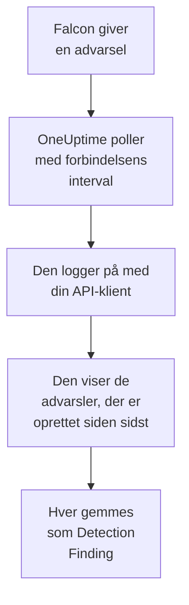

# CrowdStrike Falcon

Importér advarsler fra [CrowdStrike Falcon](https://www.crowdstrike.com/platform/), fra registreringer på endpoints, identiteter og i skyen, i OneUptimes sikkerhedsbegivenheder. Der søger du i dem ved siden af dine logs, traces og metrikker, korrelerer dem med alle andre kilder og kalder vagten op for dem, der betyder noget. OneUptime læser dem via Falcon Alerts API med en API-klient, som du opretter, og skriver aldrig til Falcon.

:::cards
- [Opsæt forbindelsen](#opsæt-forbindelsen): En API-klient med ét omfang og forbindelsens formular.
- [Hvad der importeres](#hvad-der-importeres): Hvordan hver Falcon-advarsel bliver en sikkerhedsbegivenhed.
- [Sådan fungerer polling](#sådan-fungerer-polling): Det vindue, hver poll læser, og hvad et travlt CID gør ved det.
- [Fejlfinding](#fejlfinding): Hvad hver fejl betyder, og hvad du skal ændre.
:::

## Sådan fungerer det



Hvert minut poller OneUptime hver aktiveret forbindelse, hvis pollinterval er gået. En poll logger på din Falcon-sky med API-klientens ID og hemmelighed, beder Alerts API om de advarsler, der er oprettet siden sidste poll, og gemmer hver som en [OCSF](https://schema.ocsf.io/)-begivenhed Detection Finding (klasse `2004`). Registreringsregler, monitorer og dashboards behandler den derefter som en sikkerhedsbegivenhed fra enhver anden kilde.

## Før du går i gang

- I OneUptime rollen Project Owner, Project Admin eller Security Admin. Security Member og Security Viewer kan se forbindelser og deres kørselshistorik, men ikke ændre dem.
- Et Falcon-kunde-ID (CID) og en bruger af Falcon-konsollen, der kan administrere API-klienter: rollen Falcon Administrator eller en brugerdefineret rolle med tilladelsen API clients and keys.
- Udgående HTTPS fra OneUptime-appen og -workerne til API-værten for din Falcon-sky, angivet under **Falcon cloud** nedenfor.

## Opsæt forbindelsen

:::steps
### Opret en API-klient

1. Åbn **Support and resources → API clients and keys** i Falcon-konsollen, og vælg **Create API client**.
2. Giv den et navn, for eksempel `OneUptime security events`. Slå **Alerts → Read** til under **API scopes**, og lad alle andre omfang være slået fra: forbindelsen skriver aldrig til Falcon.
3. Opret klienten. Falcon viser dens klient-ID, dens hemmelighed og dens basis-URL én gang. Kopiér alle tre nu: hemmeligheden kan nulstilles senere, men vises aldrig igen.

### Find din Falcon-sky

Den basis-URL, Falcon viste, fortæller dig, hvilken sky dit CID ligger i. Siden **API clients and keys** viser den også, ved siden af hver klient. En klient fra én sky afvises af de andre.

| Basis-URL, som Falcon viser | Falcon-sky |
| --- | --- |
| `https://api.crowdstrike.com` | US-1 |
| `https://api.us-2.crowdstrike.com` | US-2 |
| `https://api.eu-1.crowdstrike.com` | EU-1 |
| `https://api.laggar.gcw.crowdstrike.com` | US-GOV-1 |

### Tilføj forbindelsen i OneUptime

Åbn **Produkter → Security Events → Forbindelser** (`/dashboard/{projectId}/security-events/connections`), klik på **Tilføj forbindelse**, vælg **CrowdStrike Falcon**, og klik på **Næste**. Udfyld indstillingerne i tabellen nedenfor, klik på **Næste**, og indsæt hemmeligheden i **Klienthemmelighed**.

### Test den, før du gemmer

Klik på **Test disse indstillinger** under **Test, før du gemmer**. Testen logger på og læser advarsler med værdierne i formularen og gemmer intet, så den forkerte sky eller et manglende omfang viser sig, før forbindelsen findes. Klik derefter på **Næste**, giv forbindelsen et **Navn**, og opret den.
:::

| Indstilling | Hvad du skal angive |
| --- | --- |
| **Klient-ID** | API-klientens ID, sådan som Falcon viste det, da du oprettede klienten. |
| **Falcon cloud** | Den sky, dit CID ligger i: **US-1 (api.crowdstrike.com)**, **US-2 (api.us-2.crowdstrike.com)**, **EU-1 (api.eu-1.crowdstrike.com)** eller **US-GOV-1 (api.laggar.gcw.crowdstrike.com)**. Hver anmodning går til den skys API-vært. |
| **Klienthemmelighed** | API-klientens hemmelighed. Den krypteres, returneres aldrig af API'et og vises aldrig igen. Erstat den med **Opdater legitimationsoplysninger** på forbindelsen. |

Trinnet **Hentning** har også en valgfri **Beskrivelse**, **Hentningsinterval (minutter)**, et heltal fra `1` til `1440`, der starter på `5`, og **Aktiveret**, som starter slået til. En forbindelse, der ikke er aktiveret, kan stadig testes og polles manuelt.

## Hvad der importeres

Forbindelsen læser Falcons advarsler: det, Falcon-konsollen viser under **Endpoint security → Endpoint detections** og **Next-Gen SIEM → Alerts**, fra hvert produkt, der giver dem. Hver advarsel bliver én begivenhed Detection Finding (OCSF-klasse `2004`), med leverandøren `CrowdStrike` og produktet `Falcon`:

| Falcon-felt | OneUptime-kolonne |
| --- | --- |
| `composite_id` | Begivenheds-UID, som også dubletter fjernes efter |
| `created_timestamp` | Begivenhedens tidspunkt |
| `display_name`, eller `name` | Regelnavn |
| `pattern_id` | Regel-ID |
| `description`, eller regelnavnet | Meddelelse |
| `severity_name`, eller `severity` fra 0 til 100 | Alvorlighed |
| `status`, som `new`, `in_progress` eller `closed` | Status |
| `tactic_id`, `technique_id` | MITRE ATT&CK-taktikker og -teknikker |
| `device.hostname`, `device.local_ip`, `user_name`, `filename` eller `cmdline` | Aktørens vært, IP, bruger og proces |
| `device.hostname`, `device.local_ip`, `device.external_ip`, `user_name`, `sha256` | Observables |
| Alt andet, som `device.platform_name`, `falcon_host_link`, `product` og `timestamp` | `attributes`, fladet ud til nøgler med punktummer |

Begivenhedens tidspunkt er med vilje det tidspunkt, hvor Falcon oprettede advarslen: tidspunktet for adfærden bag den, `timestamp`, bliver i `attributes.timestamp`.

## Sådan fungerer polling

- **Oprettelsestidspunktet er markøren.** Advarsler vises efter `created_timestamp`, aldrig efter tidspunktet for adfærden bag dem. Falcon kan give en advarsel længe efter den aktivitet, den beskriver, og en markør på aktivitetstidspunktet ville springe hver sådan advarsel over.
- **Den første poll ser 24 timer tilbage**, så en ny forbindelse straks viser sine nylige advarsler.
- **Hver senere poll starter 1 minut før den gemte markør**, så en advarsel, der er oprettet på grænsen mellem to vinduer, aldrig går tabt.
- **En poll læser højst 24 timer forbi markøren.** En forbindelse, hvis markør er kommet bagud, indhenter i en række vinduer på 24 timer.
- **Dubletter fjernes efter `composite_id`** i projektet, så overlappet og et gentaget vindue aldrig gemmer en advarsel to gange.
- **Hvert vindue koster** én tokenanmodning, som beholdes i tokenets levetid, og derefter én advarselsforespørgsel og én hentning af advarsler pr. 1.000 advarsler, hver med sin egen timeout.

### Når et vindue indeholder mere, end én poll kan læse

En poll sender højst 20 anmodninger. Med én tokenanmodning og to anmodninger for hver 1.000 advarsler læser den højst 9.000 advarsler. Når et vindue indeholder flere, er kørslen **Delvis** med en advarsel som:

```text
Stopped after 19 requests before reading the whole window. Alerts are read oldest first; every alert created before 2026-09-14T08:12:44.995Z was read.
```

Advarselsforespørgslen er sorteret efter `created_timestamp`, de ældste først, så OneUptime flytter markøren til oprettelsestidspunktet for den sidst læste advarsel, og den næste poll starter der med samme vindueslængde, fra offset `0`. Et travlt CID indhenter således omkring 9.000 advarsler pr. poll i stedet for at læse de samme igen. Advarsler, der er oprettet på det samme tidspunkt, læses to gange, og dubletkontrollen fjerner den anden kopi.

Falcons advarselsforespørgsel kan ikke bladre forbi 10.000 resultater (`limit` plus `offset`). Anmodningsgrænsen stopper en kørsel ved 9.000 advarsler, før det loft. Hvis loftet nogensinde stopper en læsning, håndteres det på samme måde: kørslen er **Delvis**, markøren flyttes til den sidst læste advarsel, og den næste forespørgsel starter igen fra offset `0`.

Når en kørsel slet ikke kan komme forbi den gemte markør, for eksempel fordi mere end 9.000 advarsler deler overlapsminuttet, gør OneUptime i stedet vinduet kortere:

1. **Indsnævr.** Den næste poll læser et vindue, der er halvt så langt, fra det samme startpunkt, og bliver ved med at halvere, indtil et vindue læses helt, ned til ét minut. Kørslens advarsel siger det: `This window holds more records than one poll can read; the next poll reads a {n} minute window from the same starting point.`
2. **Voks igen.** Når et vindue er læst helt, er det næste igen dobbelt så langt, op til 24 timer.
3. **Gå forbi et enkelt minut.** Hvis selv ét minut indeholder mere, end en poll kan læse, går pollingen forbi det, så nyere advarsler bliver ved med at komme. Kørslen forbliver **Delvis**, og **Seneste fejl** lyder `More records were created in the one minute from {cursor} to {end} than one poll can read. Polling moved past this minute so newer records keep arriving; use Import this time range in Diagnostics on this minute to recover what one run can read.` Importér det minut med **Import this time range** for at hente det, én kørsel kan læse.

En kørsel, der mislykkes helt, med en fejl fra Falcon, beholder markøren og vindueslængden, og den næste poll læser det samme vindue igen. Den eneste undtagelse er en anmodning, der fik timeout: markøren bliver, men det næste vindue er halvt så langt, fordi et vindue, der er for tungt til at blive besvaret i tide, ville få timeout ved hvert forsøg. At ændre **Hentningsinterval (minutter)** ændrer intet af dette: det afgør, hvor ofte en poll starter, ikke hvor dens vindue begynder.

### Kør, se forhåndsvisning og importér efter behov

Klik på **Diagnosticering** på en forbindelse for at se dens seneste kørsler og arbejde med den manuelt. Alle, der kan ændre forbindelsen, kan starte disse handlinger; alle, der kan se den, kan læse historikken.

- **Kør nu** starter straks en poll med den sædvanlige markør, også når forbindelsen ikke er **Aktiveret**.
- **Preview alerts** læser et tidsinterval på op til 7 dage og importerer intet.
- **Import this time range** importerer et interval på op til 7 dage, efter at du har bekræftet, uden at flytte markøren. Advarsler, der allerede er importeret, springes over.
- **Copy diagnostics** på en kørsel kopierer dens rapport til support. Den indeholder aldrig legitimationsoplysninger.

## Test forbindelse

**Test forbindelse** på en forbindelses række og **Test disse indstillinger** i formularen kører i API-processen, ikke i en baggrundsworker, så en test også svarer, når det er workerne, der er problemet. Den kører disse kontroller i rækkefølge:

| Kontrol | Hvad den kontrollerer |
| --- | --- |
| **Konfiguration** | **Klient-ID**, **Falcon cloud** og **Klienthemmelighed** er til stede og velformede. Der kontaktes intet, når dette mislykkes. |
| **Authenticate with CrowdStrike Falcon** | `POST /oauth2/token` med API-klientens ID og hemmelighed, på din skys vært, returnerer et token. |
| **Read alerts from the Falcon Alerts API** | En advarselsforespørgsel efter én advarsel (`limit=1`) over de seneste 24 timer accepteres, hvilket beviser omfanget **Alerts → Read**. |
| **Alerts available to import** | Hvor mange advarsler der er oprettet inden for de seneste 24 timer og de seneste 7 dage. Ingen inden for 7 dage er en advarsel, ikke en fejl: polling importerer nye advarsler, efterhånden som Falcon opretter dem. |
| **Background workers**, **Poll scheduler**, **Security event storage** | OneUptimes egen side: en proces tager jobbene fra Worker-køen, poll-jobbet kører hvert minut, og lageret for sikkerhedsbegivenheder svarer. |
| **Scheduled polling** | For en gemt forbindelse: polling er slået til, ingen kørsel sidder fast og venter på en worker, og polls kører til tiden. |

Hver anmodning i en test har en frist på 20 sekunder. En test importerer aldrig noget og flytter aldrig markøren, og hver mislykket kontrol siger, hvad du skal ændre. **Kopiér rapport** kopierer tjeklisten som JSON, uden legitimationsoplysninger eller tokens.

## Fejlfinding

Forbindelsens **Seneste fejl** og hver mislykket kontrol gemmer hele fejlmeddelelsen, med legitimationsoplysninger maskeret, bag et præfiks, der navngiver det trin, der mislykkedes. Når en forbindelse har en fejl, vælger du **Vis fejl** i dens kolonne **Handlinger** for at læse den og **Kopiér fejl** i dialogboksen for at kopiere den. Læs præfikset først.

:::details Last Error starter med `CrowdStrike Falcon token request`
- `CrowdStrike Falcon token request failed (HTTP 401)` eller `(HTTP 403)`: Falcon afviste API-klientens ID og hemmelighed, før Alerts API blev kontaktet. Kontrollér, at **Falcon cloud** er dit CID's sky, da en klient fra en anden sky afvises her, at **Klient-ID** er klientens, og at **Klienthemmelighed** er den hemmelighed, der blev udstedt med den. Hvis hemmeligheden er gået tabt, så nulstil den i Falcon-konsollen, og gem den med **Opdater legitimationsoplysninger**.
- `CrowdStrike Falcon token request returned ...`: Falcon svarede med noget ubrugeligt, en brødtekst, der ikke er JSON, eller uden `access_token`. Det er som regel en proxy eller gateway imellem, ikke legitimationsoplysningerne.
:::

:::details Last Error starter med `CrowdStrike Falcon alerts`
- `CrowdStrike Falcon alerts query failed (HTTP 403)`: tokenet blev accepteret, men API-klienten har ikke omfanget **Alerts → Read**. Slå det til for klienten under **API clients and keys**, og gem. Det gælder for det næste token, så test igen efter et minut.
- `CrowdStrike Falcon alerts query failed (HTTP 401)`: Alerts API afviste tokenet, hvilket næsten altid betyder, at **Falcon cloud** ikke er den sky, der udstedte klienten.
- `CrowdStrike Falcon alerts query failed (HTTP 429)` eller `CrowdStrike Falcon alerts fetch failed (HTTP 429)`: Falcon begrænser denne API-klients hastighed. OneUptimes HTTP-klient gemmer ikke svarheadere ved en fejl, så meddelelsen slutter som regel med `the X-RateLimit-RetryAfter header was not available` i stedet for at citere den. Planlagte polls prøver selv igen. Bliver det ved, så giv OneUptime sin egen API-klient i stedet for en, der deles med andre værktøjer.
- `CrowdStrike Falcon alerts query failed (HTTP 400)`: Falcon afviste forespørgslen. Forbindelsen sender et fast FQL-filter på `created_timestamp`, så kopiér rapporten, og send den til OneUptimes support.
- `CrowdStrike Falcon alerts query returned ...` eller `CrowdStrike Falcon alerts fetch returned ...`: Falcon svarede `200` med en brødtekst, der ikke er JSON, eller som ikke har en form, forbindelsen kender. Det rapporteres i stedet for at blive opfattet som et tomt vindue, så markøren aldrig går forbi advarsler, som ingen har læst.
- `CrowdStrike Falcon alerts fetch failed (HTTP ...)`: advarslerne blev vist, men hentningen af dem mislykkedes, af de samme grunde som forespørgslen. En `403` her betyder, at omfanget blev fjernet mellem de to kald.
:::

:::details Last Error siger, at anmodningen ikke kunne gennemføres
`CrowdStrike Falcon token request could not be completed`, `CrowdStrike Falcon alerts query could not be completed` og `CrowdStrike Falcon alerts fetch could not be completed` betyder, at der ikke kom noget tilbage: en timeout, en DNS-fejl eller blokeret udgående trafik. Tjek udgående HTTPS fra OneUptime-appen og -workerne til din skys API-vært, som `api.crowdstrike.com`.
:::

:::details Last Error navngiver en ukendt sky
`CrowdStrike Falcon cloud "..." is not one of us-1, us-2, eu-1, us-gov-1` betyder, at den gemte sky ikke er en, som forbindelsen kender. Rediger forbindelsen, og vælg en sky fra listen.
:::

:::details En kørsel er Partial
- `Stopped after 19 requests before reading the whole window`: vinduet indeholdt mere end de 9.000 advarsler, én kørsel læser. Intet går tabt: den næste poll starter efter den sidst læste advarsel. En forbindelse, der forbliver **Delvis** poll efter poll, indhenter et efterslæb, og dens **Senest hentet** og **Seneste importerede hændelse** bliver ved med at rykke frem. Tallet kan ligge lidt over 19, når tokenet blev fornyet under kørslen.
- `Falcon returned alerts out of created_timestamp order, so this run cannot name a point to resume from.`: forespørgslen ignorerede rækkefølgen fra ældst til nyest, så kørslen kan ikke flytte markøren til sin sidste advarsel, og den næste poll læser i stedet et kortere vindue. Hvis det bliver ved, så send kørslens rapport til OneUptimes support.
- `More records were created in the one minute from ... than one poll can read`: pollingen gik forbi det minut. Importér det med **Import this time range** i **Diagnosticering**. En import læser lige så meget som en poll.
:::

:::details Last Polled er Never, og Last Error er tom
Ingen poll har kørt, så intet har nået Falcon. **Test forbindelse** viser det som en mislykket kontrol **Background workers** eller **Poll scheduler**. På en selvhostet installation er den sædvanlige årsag `DISABLE_QUEUE_WORKERS=true` på appen, uden en separat worker-udrulning, der tager jobbene: sæt den til `false`, eller kør worker-udrulningen (Helm: `worker.enabled: true`).
:::

:::details Testen lykkes, men ingen begivenheder vises
Læs **Alerts available to import**: en advarsel dér betyder, at Falcon ikke har oprettet nogen advarsler inden for de seneste 7 dage, så der er intet at importere endnu. Ellers åbner du **Diagnosticering**, tjekker den seneste polls vindue og tal og bruger **View events in this time range** på en kørsel for at åbne tidsintervallet for de advarsler, den importerede.
:::

## Hvad du får

- **Søgning.** Filtrér Falcon-advarsler efter alvorlighed, status, MITRE-taktik, vært, bruger eller enhver observable i stifinderen for sikkerhedsbegivenheder, ved siden af værtens logs og metrikker.
- **Korrelation.** Hver advarsels værtsnavne, IP'er, brugere og filhashes indekseres som observables, så én søgning finder alt, der nævner en vært, på tværs af alle kilder.
- **Registreringsregler.** Sigma-regler, der kører efter en tidsplan over dine sikkerhedsbegivenheder og åbner advarsler, der kalder vagten op.
- **Monitorer.** Monitorer for sikkerhedsbegivenheder tæller matchende begivenheder og åbner hændelser eller advarsler over en tærskel.

Sikkerhedsbegivenheder faktureres som resten af din telemetri, pr. indtaget GB. Se [Priser](https://oneuptime.com/pricing).

## Næste trin

:::cards
- [Sikkerhedsbegivenheder](/docs/telemetry/security-events): Søg, korrelér og advar på det, du importerer.
- [Microsoft Defender XDR](/docs/integrations/microsoft-defender-xdr): Importér også advarslerne fra Microsofts Defender-arbejdsbelastninger.
- [Roller](/docs/permissions/reference#roller): Hvad Security-rollerne kan se og ændre.
- [Oversigt over integrationer](/docs/integrations/index): De andre værktøjer, du kan forbinde.
:::
