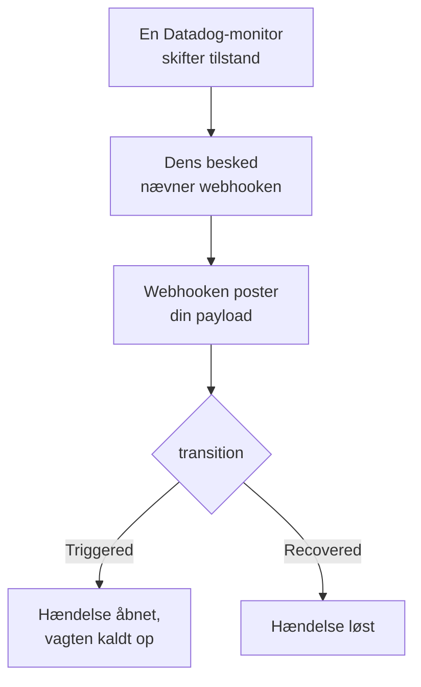

# Datadog

Send advarsler fra [Datadog](https://www.datadoghq.com)-monitorer til OneUptime, så hver advarsel bliver en hændelse, der kalder dit vagthold op og løses, når Datadog-monitoren er kommet sig. Datadog sender sine advarsler via sin [Webhooks-integration](https://docs.datadoghq.com/integrations/webhooks/), så der er intet at installere på nogen af siderne.

:::cards
- [Vælg, hvordan OneUptime modtager advarsler](#vælg-hvordan-oneuptime-modtager-advarsler): En Incoming Request-monitor eller dit eget workflow.
- [Modtag advarsler med en monitor](#modtag-advarsler-med-en-monitor): Én hændelse pr. advarsel, løst ved genopretning.
- [Konfigurer Datadog](#konfigurer-datadog): En webhook og de monitorer, der underretter den.
- [Fejlfinding](#fejlfinding): Når advarsler ikke kommer frem, eller hændelser bliver ved med at være åbne.
:::

## Sådan fungerer det



En Datadog-monitor underretter de webhooks, som dens besked nævner, når den skifter tilstand: når den udløses, advarer, kommer sig eller ikke har data. Webhookens JSON-brødtekst skriver du selv, ud fra Datadogs [skabelonvariabler](https://docs.datadoghq.com/integrations/webhooks/#usage), så denne vejledning giver dig en, der navngiver hver advarsel og siger, hvad der skete med den.

## Før du går i gang

- En Datadog-konto, hvor du kan konfigurere integrationer og redigere monitorer.
- I OneUptime retten til at oprette monitorer, eller workflows, hvis du vælger den vej.

## Vælg, hvordan OneUptime modtager advarsler

Sæt OneUptime op først: det giver dig den URL, Datadog sender til.

| Vej | Brug den, når |
| --- | --- |
| En Incoming Request-monitor (anbefalet) | Du vil have, at hver advarsel bliver en hændelse, der kalder vagten op og løses, når Datadog-monitoren er kommet sig. Der er intet at bygge. |
| Et workflow med en Webhook-trigger | Du har brug for din egen logik: filtrere advarsler, omforme dem eller kalde andre systemer først. Et workflow erklærer en hændelse for hver advarsel, det får, og løser den ikke ved genopretning. |

Begge får den samme JSON fra den samme webhook, så du kan begynde med den ene og skifte senere ved at ændre én URL i Datadog.

## Modtag advarsler med en monitor

En [Incoming Request-monitor](/docs/monitor/incoming-request-monitor) giver dig en URL, og dens kriterier afgør, hvad hver advarsel gør.

:::steps
### Opret monitoren

Gå til **Monitorer**, og klik på **Opret monitor**. Vælg **Incoming Request** under **Monitortype**, kald den `Datadog`, og klik på **Næste**.

### Erklær en hændelse for hver advarsel

Åbn det første kriterium i trinnet **Kriterier**, det, der markerer monitoren som offline. Sæt dets filter til **Anmodningsbrødtekst**, **Indeholder**, `"transition":"Triggered"`. Dette kriterium erklærer allerede en hændelse, når filteret matcher. Udfyld hændelsen:

- **Hændelsestitel**: `{{requestBody.title}}`.
- **Hændelsesbeskrivelse**, under **Beskrivelse**: `{{requestBody.body}}`, derefter `Datadog: {{requestBody.link}}` på en linje for sig.
- **Alvorlighed**: den hændelsesalvorlighed, disse advarsler skal have.
- **Vagtpolitikker**, under **Vagt**: de politikker, der skal kaldes op.
- **Løs hændelse automatisk**, under **Flere felter**: lad den være slået til, som den starter. Uden den ignoreres genopretninger, og hændelser bliver ved med at være åbne.

### Åbn én hændelse pr. advarsel

Åbn **Indstillinger** i samme kriterium, og slå **Group incidents and alerts by a payload field** til. Udfyld den som nedenfor, så hver advarsel får sin egen hændelse, og dens genopretning løser den:

| Felt | Værdi |
| --- | --- |
| **Open a separate incident for each…** | `requestBody.alert_key` |
| **Field that signals recovery** | `requestBody.transition` |
| **Value that means recovered** | `Recovered` |

### Bring monitoren online igen

Åbn det andet kriterium, det, der markerer monitoren som online, og sæt dets filter til **Anmodningsbrødtekst**, **Indeholder**, `"transition":"Recovered"`.

### Kopiér URL'en

Klik på **Opret monitor**. Monitorens side **Oversigt** viser dens **Heartbeat URL**. Kopiér den til Datadog:

```text
https://oneuptime.com/heartbeat/<secret key>
```

En selvhostet installation har sin egen vært i stedet for `oneuptime.com`.
:::

Payloaden nedenfor sætter `alert_key` til Datadog-monitorens ID og tags for den gruppe, der advarede, så hver gruppe i en multi-alert-monitor får sin egen hændelse, og den gruppes genopretning løser den. En monitor, der udløses igen eller genunderretter, mens dens hændelse er åben, åbner ikke en hændelse til. Se [Modtagelse af advarsler fra et andet system](/docs/monitor/incoming-request-monitor#modtagelse-af-advarsler-fra-et-andet-system) for, hvad hver indstilling gør.

> [!NOTE]
> En notifikation **Warn** eller **No Data** åbner ingen hændelse med disse filtre. Vil du også kaldes op for advarselsniveauet, så klik på **Tilføj kriterier**, giv det nye kriterium filteret **Anmodningsbrødtekst**, **Indeholder**, `"transition":"Warn"`, en hændelse med sin egen **Alvorlighed** og de samme grupperingsindstillinger, og træk det derefter op over det første kriterium. Kriterier kontrolleres oppefra, og det første, der matcher, bestemmer.

## Konfigurer Datadog

:::steps
### Tilføj webhooken

Åbn i Datadog [feltet for Webhooks-integrationen](https://app.datadoghq.com/integrations/webhooks), og installer den, hvis den ikke er installeret endnu. Tilføj en webhook med disse indstillinger, og gem den derefter:

- **Name**: `oneuptime`. Monitorer nævner webhooken ved dette navn, som `@webhook-oneuptime`.
- **URL**: den URL, du kopierede fra OneUptime.
- **Payload**:

  ```json
  {
    "alert_key": "$ALERT_ID $ALERT_SCOPE",
    "transition": "$ALERT_TRANSITION",
    "title": "$EVENT_TITLE",
    "body": "$TEXT_ONLY_MSG",
    "host": "$HOSTNAME",
    "priority": "$PRIORITY",
    "link": "$LINK"
  }
  ```

### Nævn webhooken i dine monitorer

Tilføj `@webhook-oneuptime` til monitorens notifikationsbesked i hver Datadog-monitor, der skal kalde op gennem OneUptime, og gem monitoren. Datadog sender så den monitors advarsler og genopretninger til OneUptime.
:::

| Variabel | Hvad Datadog sætter i den |
| --- | --- |
| `$ALERT_ID` | ID'et på den Datadog-monitor, der advarede. |
| `$ALERT_SCOPE` | Tags for den gruppe, der advarede, som `host:web-1`. |
| `$ALERT_TRANSITION` | Hvad der skete: `Triggered`, `Re-Triggered`, `Warn`, `Recovered`, `No Data` eller `Renotify`, blandt andre. |
| `$EVENT_TITLE` | Begivenhedens titel, som `[Triggered] High CPU`. |
| `$TEXT_ONLY_MSG` | Monitorens besked, uden Markdown. |
| `$LINK` | Et link til begivenheden i Datadog. |

## Test det

Send OneUptime en advarsel, sådan som Datadog ville gøre:

```bash
curl -X POST "https://oneuptime.com/heartbeat/<secret key>" \
  -H "Content-Type: application/json" \
  -d '{
    "alert_key": "1234 host:web-1",
    "transition": "Triggered",
    "title": "[Triggered] High CPU",
    "body": "CPU is above 90% on web-1.",
    "host": "web-1",
    "priority": "normal",
    "link": "https://app.datadoghq.com/event/event?id=1"
  }'
```

En hændelse åbnes med titlen `[Triggered] High CPU`. Send den samme anmodning med `transition` sat til `Recovered`, og hændelsen løses.

Test derefter fra Datadog: åbn en monitor, der nævner webhooken, klik på **Test Notifications**, og send dens notifikation **Alert**. Tjek OneUptime-monitorens tidslinje for at se, at den kom frem.

## Modtag advarsler med et workflow

Brug et [workflow](/docs/workflows/index), når du har brug for dine egne trin mellem Datadog og hændelsen.

:::steps
### Opret workflowet

Gå til **Arbejdsgange**, klik på **Opret arbejdsgang** og derefter på **Start fra bunden**. Kald det `Datadog alerts`, og klik på **Opret arbejdsgang**.

### Tilføj Webhook-triggeren

Klik på den stiplede blok **Vælg, hvad der starter denne arbejdsgang**, og vælg **Webhook**. Klik på triggeren, derefter på **Kopiér URL**, og brug den URL i webhooken i Datadog.

### Kontrollér, at monitoren er udløst

Klik på **Tilføj komponent**, tilføj en blok **If / Else**, og forbind triggerens punkt **Out** med den. Sæt **Value to check** til `{{local.components.webhook-1.returnValues.request-body.transition}}`, **Comparison** til **is equal to** og **Compare with** til `Triggered`.

### Erklær hændelsen

Tilføj en blok **Create One Incident**, og forbind siden **Yes** af blokken **If / Else** med den. Vælg under **Incident Template** en skabelon, der sætter alvorligheden og de vagtpolitikker, der skal kaldes op (se [Hændelsesskabeloner](/docs/incidents/settings#hændelsesskabeloner)). Angiv under **JSON Object**, hvad der kommer fra Datadog:

```json
{
  "title": "{{local.components.webhook-1.returnValues.request-body.title}}",
  "description": "{{local.components.webhook-1.returnValues.request-body.body}}\nDatadog: {{local.components.webhook-1.returnValues.request-body.link}}"
}
```

Uden en skabelon skal **JSON Object** også indeholde `incidentSeverityId`, ID'et på en af projektets hændelsesalvorligheder.

### Slå workflowet til

Slå **Aktiveret** til øverst i **Bygger**. Et workflow, der er slået fra, svarer Datadog med `400`.
:::

Hver notifikation `Triggered` erklærer en ny hændelse. En genopretning tager siden **No** af blokken **If / Else**, hvor intet er forbundet, så kørslen slutter der. Brug monitoren til én hændelse pr. advarsel, der løses ved genopretning.

## Fejlfinding

:::details Intet kommer frem til OneUptime
- Kontrollér, at Datadog-monitorens besked nævner `@webhook-oneuptime`, stavet som webhooken hedder.
- Monitoren svarer `200` med det samme, før den kontrollerer noget, også ved en forkert hemmelig nøgle. Tjek monitorens tidslinje for at se, om advarsler kommer frem.
- Et workflow, der er slået fra, svarer `400`. Slå **Aktiveret** til øverst i dets **Bygger**.
:::

:::details Hændelser oprettes, men løses aldrig
- Datadog-monitoren skal også underrette webhooken om sine genopretninger. En besked, der kun nævner webhooken for advarsler, inde i en betingelse, sender ingen genopretning.
- Kriteriets hændelse skal have **Løs hændelse automatisk**, under **Flere felter**.
- **Value that means recovered** skal være præcis `Recovered`. Sammenligningen skelner mellem store og små bogstaver.
- Genopretningens `alert_key` skal være advarslens: behold `$ALERT_ID $ALERT_SCOPE`, som det står i payloaden.
:::

:::details Et felt viser en variabels navn, eller ingenting
Datadog udfylder kun de variabler, der gælder for begivenheden. Send en testnotifikation, og se derefter, hvad der kom frem: i monitorens tidslinje, eller for et workflow i **Protokoller → Kørsler**.
:::

:::details Alle advarsler fra en monitor foldes sammen til én hændelse
Hver gruppe skal have sin egen `alert_key`. Kontrollér, at payloaden sætter den ud fra både `$ALERT_ID` og `$ALERT_SCOPE`, og at grupperingsstien er `requestBody.alert_key`.
:::

## Sikkerhed

- **Behandl URL'en som en adgangskode.** Alle, der har den, kan åbne hændelser. Hvis den slipper ud, så nulstil den: **Nulstil hemmelig nøgle for indgående anmodning** på monitorens side **Indstillinger**, eller **Nulstil URL** i workflowets **Webhook**-trigger. Opdater derefter webhookens **URL** i Datadog.
- **Selvhostet?** Datadog sender webhooks fra internettet, så din OneUptime skal kunne nås derfra over HTTPS.

## Næste trin

:::cards
- [Indgående anmodning-monitor](/docs/monitor/incoming-request-monitor): Hver indstilling for den monitor, der modtager dine advarsler.
- [Prometheus Alertmanager](/docs/integrations/prometheus-alertmanager): Den samme opsætning, til Alertmanager.
- [Eskaleringsregler](/docs/on-call/escalation-rules): Bestem, hvem en vagtpolitik kalder op, og hvornår.
- [Oversigt over integrationer](/docs/integrations/index): De andre værktøjer, du kan forbinde.
:::
