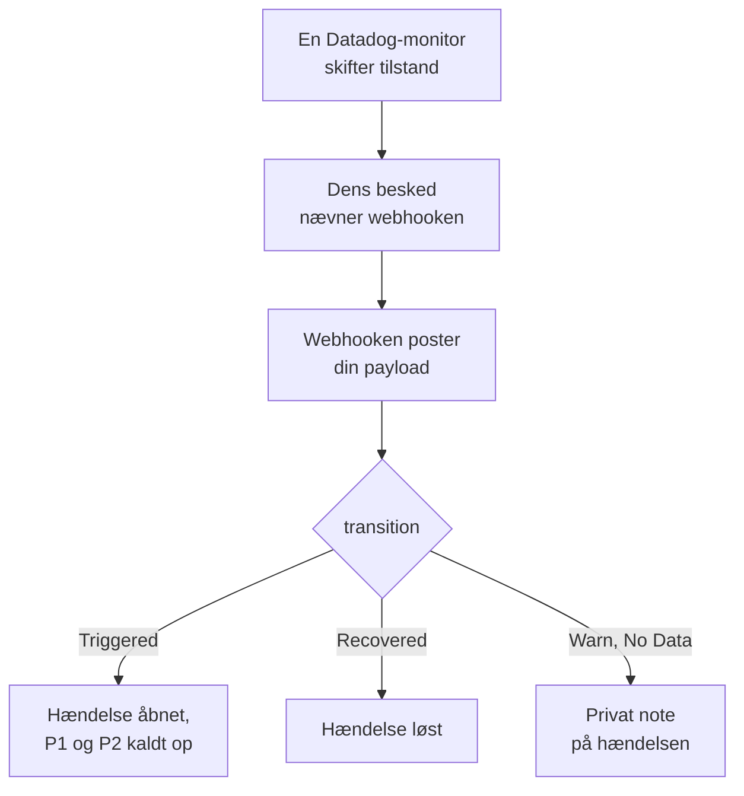

# Datadog

Send advarsler fra [Datadog](https://www.datadoghq.com)-monitorer til OneUptime, så hver af dem bliver en hændelse eller en advarsel, kalder dit vagthold op, når det er presserende, og løses, når Datadog-monitoren er kommet sig. Datadog sender sine advarsler via sin [Webhooks-integration](https://docs.datadoghq.com/integrations/webhooks/), så der er intet at installere på nogen af siderne.

:::cards
- [Vælg, hvordan OneUptime modtager advarsler](#vælg-hvordan-oneuptime-modtager-advarsler): En workflow-skabelon eller en Incoming Request-monitor.
- [Start med skabelonen](#start-med-skabelonen): Vælg, hvem der skal kaldes op, kopiér URL'en, og se, hvad hver advarsel gør.
- [Modtag advarsler med en monitor](#modtag-advarsler-med-en-monitor): Én hændelse pr. advarsel, løst ved genopretning.
- [Konfigurer Datadog](#konfigurer-datadog): En webhook og de monitorer, der underretter den.
- [Fejlfinding](#fejlfinding): Når advarsler ikke kommer frem, eller hændelser bliver ved med at være åbne.
:::

## Sådan fungerer det



En Datadog-monitor underretter de webhooks, som dens besked nævner, når den skifter tilstand: når den udløses, advarer, kommer sig eller ikke har data. Webhookens JSON-brødtekst skriver du selv, ud fra Datadogs [skabelonvariabler](https://docs.datadoghq.com/integrations/webhooks/#usage), så denne vejledning giver dig en, der navngiver hver advarsel og siger, hvad der skete med den.

## Før du går i gang

- En Datadog-konto, hvor du kan konfigurere integrationer og redigere monitorer.
- I OneUptime rettigheden til at oprette workflows, eller monitorer, hvis du vælger den vej. På OneUptime Cloud kræver workflows planen **Growth** eller højere.

## Vælg, hvordan OneUptime modtager advarsler

Sæt OneUptime op først: det giver dig den URL, Datadog sender til.

| Vej | Brug den, når |
| --- | --- |
| Workflow-skabelonen (anbefales) | Du vil have hver advarsel som en hændelse eller en advarsel med en alvorlighed ud fra monitorens prioritet, med vagten kaldt op for P1 og P2, med advarselsniveauer noteret på den og løst ved genopretning. Der er intet at bygge. |
| En Incoming Request-monitor | Du vil have hændelser uden et workflow, på enhver plan, og en monitor, hvis status følger Datadog. |

Begge får den samme JSON fra den samme webhook, så du kan begynde med den ene og skifte senere ved at ændre én URL i Datadog.

## Start med skabelonen

Dialogen **Opret en arbejdsgang** har to Datadog-skabeloner under **Datadog** i kategorilisten: **Declare an incident when a Datadog monitor triggers** og **Create an alert when a Datadog monitor triggers** til advarsler. Begge gør det samme, hver med sin egen slags post.

:::steps
1. Gå til **Arbejdsgange**, og klik på **Opret arbejdsgang**. Under **Eller start fra en skabelon** vælger du **Datadog** i kategorilisten, klikker på **Declare an incident when a Datadog monitor triggers** eller **Create an alert when a Datadog monitor triggers** og klikker på **Brug denne skabelon**.
2. Under **Who to page for P1 and P2 monitors** vælger du de vagtpolitikker, der skal tilkaldes, eller ingen for ikke at tilkalde nogen, og klikker på **Opret arbejdsgang**. Workflowet åbner i **Bygger**, slået fra.
3. Klik på triggeren **Webhook**, derefter på **Kopiér URL**, og gem URL'en til Datadog.
4. Slå **Aktiveret** til øverst i **Bygger**. Et workflow, der er slået fra, svarer Datadog med `400`.
:::

Derefter [konfigurerer du Datadog](#konfigurer-datadog) til at sende sine advarsler til den URL. Workflowets trin `read-event-1` åbner med den samme opsætning, til når du vender tilbage til det i **Bygger**.

### Hvad workflowet gør

Efter triggeren **Webhook** læser trinnet **Check With JavaScript** `read-event-1` den `transition`, Datadog sender, og **Incident From Another Tool**, eller **Alert From Another Tool** i advarselsskabelonen, gør det, den betyder, ud fra advarslens cyklusnøgle. Datadog beholder den nøgle fra det øjeblik, en advarsel udløses, til den kommer sig, og næste gang den udløses, er nøglen ny, så hver gang får sin egen hændelse. Hændelsen gemmer nøglen i sit brugerdefinerede felt `datadogAlertCycleKey`.

| Transition | Hvad workflowet gør |
| --- | --- |
| `Triggered`, `Re-Triggered` | Erklærer en hændelse med titlen `Datadog: <monitor>`, med den alvorlighed, monitorens prioritet svarer til, holdt uden for dine statussider. Dens beskrivelse linker til advarslen i Datadog og viser prioriteten, værten, scope og monitorens besked. En notifikation for en advarsel, der har sin hændelse, opretter ingen ny og kalder ingen op igen. |
| `Recovered` | Løser advarslens hændelse, medmindre den allerede er løst. Hvorfor står på dens tidslinje. |
| `Warn`, `Re-Warn`, `No Data`, `Re-No Data` | Tilføjer en privat note til advarslens hændelse, der siger, hvad monitorens tilstand er nu. |
| `Renotify` | Intet: advarslen er stadig åben. |

En notifikation om Warn eller en genopretning for en advarsel uden hændelse ændrer intet. Alt andet, f.eks. en anmodning fra et andet værktøj, bliver ladt være: `read-event-1` tager **No**, og kørslens **Trin** siger hvorfor. Intet går tilbage til Datadog: det løser selv sine advarsler, når signalet kommer sig, og det er det, der løser hændelsen.

### Prioriteter og opkald

En ny hændelse kalder de vagtpolitikker op, du valgte, når dens monitor er P1 eller P2 eller ikke har nogen prioritet. P3, P4 og P5 åbner en hændelse og kalder ingen op. I et nyt projekt knytter prioriteterne sig til disse hændelses- og advarselsalvorligheder:

| Datadog-prioritet | Hændelse | Advarsel | Vagt |
| --- | --- | --- | --- |
| P1 | Critical Incident | High | Kaldt op |
| P2 | Critical Incident | High | Kaldt op |
| Ingen prioritet | Critical Incident | High | Kaldt op |
| P3 | Major Incident | Low | Ikke kaldt op |
| P4 | Minor Incident | Low | Ikke kaldt op |
| P5 | Minor Incident | Low | Ikke kaldt op |

Med egne alvorligheder går P1, P2 og ingen prioritet til din mest alvorlige, P3 til den midterste, og P4 og P5 til din mindst alvorlige.

- For at knytte en prioritet til en af dine efter navn skal du redigere `SEVERITY_BY_NAME` i trinnet `read-event-1`, f.eks. `{ P3: 'Minor Incident' }`.
- For også at kalde op for P3 skal du sætte **Compare with** i trinnet `if-page-1` **If / Else** til `3`.

## Modtag advarsler med en monitor

En [Incoming Request-monitor](/docs/monitor/incoming-request-monitor) giver dig en URL, og dens kriterier afgør, hvad hver advarsel gør.

:::steps
### Opret monitoren

Gå til **Monitorer**, og klik på **Opret monitor**. Vælg **Incoming Request** under **Monitortype**, kald den `Datadog`, og klik på **Næste**.

### Erklær en hændelse for hver advarsel

Åbn det første kriterium i trinnet **Kriterier**, det, der markerer monitoren som offline. Sæt dets filter til **Anmodningsbrødtekst**, **Indeholder**, `"transition":"Triggered"`. Dette kriterium erklærer allerede en hændelse, når filteret matcher. Udfyld hændelsen:

- **Hændelsestitel**: `{{requestBody.title}}`.
- **Hændelsesbeskrivelse**, under **Beskrivelse**: `{{requestBody.body}}`, derefter `Datadog: {{requestBody.link}}` på en linje for sig.
- **Alvorlighed**: den hændelsesalvorlighed, disse advarsler skal have.
- **Vagtpolitikker**, under **Vagt**: de politikker, der skal kaldes op.
- **Løs hændelse automatisk**, under **Flere felter**: lad den være slået til, som den starter. Uden den ignoreres genopretninger, og hændelser bliver ved med at være åbne.

### Åbn én hændelse pr. advarsel

Åbn **Indstillinger** i samme kriterium, og slå **Group incidents and alerts by a payload field** til. Udfyld den som nedenfor, så hver advarsel får sin egen hændelse, og dens genopretning løser den:

| Felt | Værdi |
| --- | --- |
| **Open a separate incident for each…** | `requestBody.alert_key` |
| **Field that signals recovery** | `requestBody.transition` |
| **Value that means recovered** | `Recovered` |

### Bring monitoren online igen

Åbn det andet kriterium, det, der markerer monitoren som online, og sæt dets filter til **Anmodningsbrødtekst**, **Indeholder**, `"transition":"Recovered"`.

### Kopiér URL'en

Klik på **Opret monitor**. Monitorens side **Oversigt** viser dens **Heartbeat URL**. Kopiér den til Datadog:

```text
https://oneuptime.com/heartbeat/<secret key>
```

En selvhostet installation har sin egen vært i stedet for `oneuptime.com`.
:::

Payloaden nedenfor sætter `alert_key` til Datadog-monitorens ID og tags for den gruppe, der advarede, så hver gruppe i en multi-alert-monitor får sin egen hændelse, og den gruppes genopretning løser den. En monitor, der udløses igen eller genunderretter, mens dens hændelse er åben, åbner ikke en hændelse til. Se [Modtagelse af advarsler fra et andet system](/docs/monitor/incoming-request-monitor#modtagelse-af-advarsler-fra-et-andet-system) for, hvad hver indstilling gør.

> [!NOTE]
> En notifikation **Warn** eller **No Data** åbner ingen hændelse med disse filtre. Vil du også kaldes op for advarselsniveauet, så klik på **Tilføj kriterier**, giv det nye kriterium filteret **Anmodningsbrødtekst**, **Indeholder**, `"transition":"Warn"`, en hændelse med sin egen **Alvorlighed** og de samme grupperingsindstillinger, og træk det derefter op over det første kriterium. Kriterier kontrolleres oppefra, og det første, der matcher, bestemmer.

## Konfigurer Datadog

:::steps
### Tilføj webhooken

Åbn i Datadog [feltet for Webhooks-integrationen](https://app.datadoghq.com/integrations/webhooks), og installer den, hvis den ikke er installeret endnu. Tilføj en webhook med disse indstillinger, og gem den derefter:

- **Name**: `oneuptime`. Monitorer nævner webhooken ved dette navn, som `@webhook-oneuptime`.
- **URL**: den URL, du kopierede fra OneUptime.
- **Payload**:

  ```json
  {
    "alert_key": "$ALERT_ID $ALERT_SCOPE",
    "alert_cycle_key": "$ALERT_CYCLE_KEY",
    "transition": "$ALERT_TRANSITION",
    "alert_priority": "$ALERT_PRIORITY",
    "title": "$EVENT_TITLE",
    "body": "$TEXT_ONLY_MSG",
    "host": "$HOSTNAME",
    "scope": "$ALERT_SCOPE",
    "priority": "$PRIORITY",
    "link": "$LINK"
  }
  ```

### Nævn webhooken i dine monitorer

Tilføj `@webhook-oneuptime` til monitorens notifikationsbesked i hver Datadog-monitor, der skal kalde op gennem OneUptime, og gem monitoren. Datadog sender så den monitors advarsler og genopretninger til OneUptime.
:::

| Variabel | Hvad Datadog sætter i den |
| --- | --- |
| `$ALERT_ID` | ID'et på den Datadog-monitor, der advarede. |
| `$ALERT_SCOPE` | Tags for den gruppe, der advarede, som `host:web-1`. |
| `$ALERT_CYCLE_KEY` | Et ID, der forbliver det samme fra det øjeblik, en advarsel udløses, til den kommer sig. |
| `$ALERT_TRANSITION` | Hvad der skete: `Triggered`, `Re-Triggered`, `Warn`, `Recovered`, `No Data` eller `Renotify`, blandt andre. |
| `$ALERT_PRIORITY` | Prioriteten for Datadog-monitoren, `P1` til `P5`, eller intet for en monitor uden. |
| `$EVENT_TITLE` | Begivenhedens titel, som `[Triggered] High CPU`. |
| `$TEXT_ONLY_MSG` | Monitorens besked, uden Markdown. |
| `$LINK` | Et link til begivenheden i Datadog. |

Én payload tjener begge veje: skabelonen går efter `alert_cycle_key` og `alert_priority`, og monitoren efter `alert_key`. Behold dem alle, og du kan skifte senere ved kun at ændre URL'en.

## Test det

Send en advarsel til den URL, du kopierede, sådan som Datadog ville gøre:

```bash
curl -X POST "<url>" \
  -H "Content-Type: application/json" \
  -d '{
    "alert_key": "1234 host:web-1",
    "alert_cycle_key": "7151157925468446720",
    "transition": "Triggered",
    "alert_priority": "P1",
    "title": "[Triggered] High CPU",
    "body": "CPU is above 90% on web-1.",
    "host": "web-1",
    "scope": "host:web-1",
    "priority": "normal",
    "link": "https://app.datadoghq.com/event/event?id=1"
  }'
```

Med skabelonen åbnes en hændelse med titlen `Datadog: High CPU`, og de vagtpolitikker, du valgte, kaldes op. Med monitoren åbnes en hændelse med titlen `[Triggered] High CPU`. Send den samme anmodning med `transition` sat til `Recovered`, og hændelsen løses.

Test derefter fra Datadog: åbn en monitor, der nævner webhooken, klik på **Test Notifications**, og send dens notifikation **Alert**. For at se, at den kom frem, åbn workflowets **Protokoller → Kørsler** eller OneUptime-monitorens tidslinje.

## Fejlfinding

:::details Intet kommer frem til OneUptime
- Kontrollér, at Datadog-monitorens besked nævner `@webhook-oneuptime`, stavet som webhooken hedder.
- Monitoren svarer `200` med det samme, før den kontrollerer noget, også ved en forkert hemmelig nøgle. Tjek monitorens tidslinje for at se, om advarsler kommer frem.
- Et workflow, der er slået fra, svarer `400`. Slå **Aktiveret** til øverst i dets **Bygger**.
:::

:::details Workflowet kører, men åbner intet
Åbn kørslen i **Protokoller → Kørsler**. Posten `read-event-1` under **Trin** siger, hvorfor den tog **No**.

- `Datadog named no alert cycle key`: tilføj `"alert_cycle_key": "$ALERT_CYCLE_KEY"` til webhookens payload i Datadog.
- `Datadog named no transition`: tilføj `"transition": "$ALERT_TRANSITION"` til webhookens payload i Datadog.
:::

:::details Vagten bliver ikke kaldt op
- Kun P1- og P2-monitorer og monitorer uden prioritet kalder op. Se [Prioriteter og opkald](#prioriteter-og-opkald).
- En notifikation for en advarsel, der har sin hændelse, kalder ingen op igen.
- Hvis ingen er valgt i dialogen **Opret en arbejdsgang**, har workflowet intet trin, der kalder op.
:::

:::details Hændelser oprettes, men løses aldrig
- Datadog-monitoren skal også underrette webhooken om sine genopretninger. En besked, der kun nævner webhooken for advarsler, inde i en betingelse, sender ingen genopretning.
- Med skabelonen: åbn genopretningens kørsel i **Protokoller → Kørsler**: dens sidste trin siger hvorfor. Genopretningens `alert_cycle_key` skal være advarslens, så behold `$ALERT_CYCLE_KEY`, som det står i payloaden.
- Med monitoren skal kriteriets hændelse have **Løs hændelse automatisk**, under **Flere felter**.
- **Value that means recovered** skal være præcis `Recovered`. Sammenligningen skelner mellem store og små bogstaver.
- Genopretningens `alert_key` skal være advarslens: behold `$ALERT_ID $ALERT_SCOPE`, som det står i payloaden.
:::

:::details Et felt viser en variabels navn, eller ingenting
Datadog udfylder kun de variabler, der gælder for begivenheden. Send en testnotifikation, og se derefter, hvad der kom frem: i monitorens tidslinje, eller for et workflow i **Protokoller → Kørsler**.
:::

:::details Alle advarsler fra en monitor foldes sammen til én hændelse
Med monitoren skal hver gruppe have sin egen `alert_key`. Kontrollér, at payloaden sætter den ud fra både `$ALERT_ID` og `$ALERT_SCOPE`, og at grupperingsstien er `requestBody.alert_key`.
:::

## Sikkerhed

- **Behandl URL'en som en adgangskode.** Alle, der har den, kan åbne hændelser. Hvis den slipper ud, så nulstil den: **Nulstil URL** i workflowets **Webhook**-trigger, eller **Nulstil hemmelig nøgle for indgående anmodning** på monitorens side **Indstillinger**. Opdater derefter webhookens **URL** i Datadog.
- **Links går til Datadog.** Skabelonen linker kun en advarsel på et Datadog-websted, uanset hvad en anmodning siger, og skriver det, Datadog sendte, som tekst.
- **Selvhostet?** Datadog sender webhooks fra internettet, så din OneUptime skal kunne nås derfra over HTTPS.

## Næste trin

:::cards
- [Workflow-skabeloner](/docs/workflows/authoring): Opret et workflow fra en skabelon, og ændr det i Bygger.
- [Indgående anmodning-monitor](/docs/monitor/incoming-request-monitor): Hver indstilling for den monitor, der modtager dine advarsler.
- [New Relic](/docs/integrations/new-relic): Den samme skabelon, til New Relic-sager.
- [Eskaleringsregler](/docs/on-call/escalation-rules): Bestem, hvem en vagtpolitik kalder op, og hvornår.
- [Oversigt over integrationer](/docs/integrations/index): De andre værktøjer, du kan forbinde.
:::
