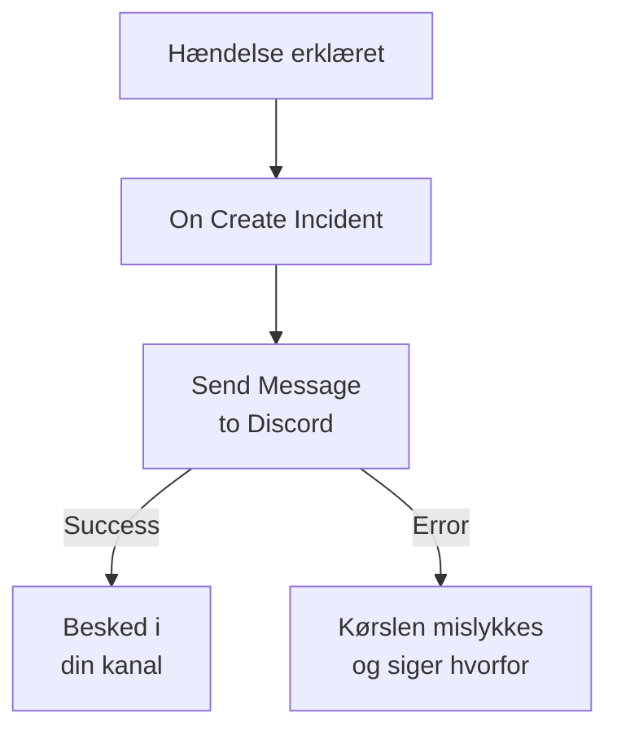

# Discord

Post en besked i en [Discord](https://discord.com)-kanal, når en hændelse åbnes, så de, der følger kanalen, ved det med det samme. OneUptimes workflowtrin **Send Message to Discord** poster via kanalens webhook, og en færdig skabelon bygger hele workflowet for dig. Denne integration er **udgående**: OneUptime poster i kanalen og læser ikke, hvad der bliver sagt der.

:::cards
- [Sådan fungerer det](#sådan-fungerer-det): Hvad workflowet gør, når en hændelse åbnes.
- [Opsætning](#opsæt-integrationen): En webhook i Discord og så workflowet: fra skabelonen eller fra bunden.
- [Tips](#tips): Formatering, lange beskeder og flere begivenheder.
- [Fejlfinding](#fejlfinding): Hvad trinnets fejl betyder, og hvad du skal ændre.
:::

## Sådan fungerer det



Trinnet poster **Message Text** til kanalens webhook. Det tager sin udgang **Success**, når Discord tager imod beskeden, og sin udgang **Error**, med Discords begrundelse, når Discord afviser den. Er intet forbundet til **Error**, som i skabelonen, mislykkes en kørsel, der ikke kunne poste, og dens **Trin** siger hvorfor.

## Før du går i gang

- I Discord tilladelsen **Manage Webhooks** på kanalen.
- I OneUptime retten til at oprette workflows og variabler. På OneUptime Cloud kræver workflows planen **Growth** eller højere.

## Opsæt integrationen

:::steps
### Opret en webhook i Discord

1. Åbn kanalens indstillinger i Discord med **Edit Channel**, derefter **Integrations → Webhooks**, og vælg **New Webhook**.
2. Giv den et navn, for eksempel `OneUptime`, og kontrollér, at den poster i den rigtige kanal.
3. Vælg **Copy Webhook URL**.

Alle, der har URL'en, kan poste i kanalen, så pas lige så godt på den som på en adgangskode.

### Byg workflowet

Start fra skabelonen, der bygger hele workflowet for dig, eller fra bunden.

:::tabs
@tab Fra skabelonen
1. Åbn **Arbejdsgange**, og klik på **Opret arbejdsgang**.
2. Skriv `Discord` i **Søg i skabeloner…**, klik på **Tell Discord when an incident opens**, og klik derefter på **Brug denne skabelon**.
3. Behold navnet **Notify Discord on new incident**, eller ændr det, og klik på **Næste**.
4. Indsæt URL'en i **Discord Webhook URL**, og klik på **Opret arbejdsgang**.

Workflowet åbner i **Bygger** med to trin: **On Create Incident** og **Send Message to Discord**, der poster hændelsens nummer, titel, alvorlighed og tilstand. URL'en gemmes som workflowets hemmelige variabel `discordWebhookUrl`.
@tab Fra bunden
1. Gem URL'en som en hemmelig global variabel: gå til **Arbejdsgange → Globale variabler**, klik på **Opret Workflow Variabel**, giv den navnet `DISCORD_WEBHOOK_URL`, og klik på **Næste**. Indsæt URL'en i **Indhold**, slå **Hemmelighed** til, og klik på **Opret Workflow Variabel**.
2. Gå til **Arbejdsgange**, klik på **Opret arbejdsgang**, vælg **Start fra bunden**, giv workflowet et navn, og klik på **Opret arbejdsgang**.
3. Klik i **Bygger** på **Vælg, hvad der starter denne arbejdsgang**, og vælg **On Create Incident** under **Populære**. Klik på triggeren: dens **Fields to pass on** starter med **Titel**, så klik på **Tilføj felt**, og vælg de andre felter, din besked viser, for eksempel **Incident Number With Prefix**.
4. Klik på **Tilføj komponent**, søg efter `discord`, og klik på **Send Message to Discord**. Forbind triggerens udgang **Success** til den.
5. Klik på det nye trin. Klik i **Discord Incoming Webhook URL** på **{ }**, og vælg `DISCORD_WEBHOOK_URL` under **Global variables**. Skriv beskeden i **Message Text**, og indsæt hændelsens felter med **{ }**.
:::

En besked bygget fra bunden læser hændelsens felter med referencer som disse:

```text
🚨 **Incident {{local.components.incident-on-create-1.returnValues.model.incidentNumberWithPrefix}} declared**
**Title:** {{local.components.incident-on-create-1.returnValues.model.title}}
```

### Slå det til, og test det

Slå **Aktiveret** til øverst i **Bygger**. Fra nu af postes hver ny hændelse i kanalen.

For at teste uden at åbne en hændelse klikker du på **Kør arbejdsgang** og vælger en hændelse, du allerede har, under **Hændelse**: de seneste er vist, og når du skriver dens nummer eller en del af dens titel, finder du en anden. Klik på **Kør arbejdsgang manuelt**, og bekræft med **Kør**. Panelet **Arbejdsgangskørsel** følger kørslen, og beskeden dukker op i kanalen. Tager trinnet i stedet **Error**, mislykkes kørslen, og trinnets post under **Trin** siger hvorfor: se [Fejlfinding](#fejlfinding).
:::

## Tips

- **Formatér med Discords Markdown.** Teksten sendes, som den er skrevet, så Discords Markdown virker i den: stjerner om et ord gør det fedt, og en URL vises som et link.
- **Hold øje med grænsen på 2.000 tegn.** Discord tager imod beskeder på op til 2.000 tegn. En længere bliver afkortet og slutter med "… (truncated — see OneUptime for the full text)" i stedet for at blive afvist.
- **Post mere end nye hændelser.** Byg et andet workflow på **On Update Incident** til tilstandsændringer, eller på **On Create Alert** til advarsler, med det samme trin. For kun at poste nogle hændelser sætter du en blok **If / Else** før trinnet.
- **Kun Discords egne adresser.** Trinnet poster til en `https`-URL på `discord.com` eller `discordapp.com` og følger ikke omdirigeringer, så en URL, der peger andre steder hen, stopper kørslen.

## Fejlfinding

Når trinnet tager **Error**, mislykkes kørslen, og trinnets post under kørslens **Trin** giver Discords begrundelse.

:::details Discord svarer "Unknown Webhook" eller "Invalid Webhook Token"
Webhooken er slettet, eller URL'en er kopieret forkert. Opret en ny webhook, og erstat URL'en: i skabelonens workflow variablen `discordWebhookUrl`, i dit eget workflow indholdet af `DISCORD_WEBHOOK_URL`.
:::

:::details Discord svarer "You are being rate limited"
Discord begrænser, hvor ofte én webhook kan poste. En byge af hændelser kan ramme grænsen: post færre beskeder, for eksempel kun for nogle alvorligheder.
:::

:::details Kørslen stopper med "Discord Webhook URL must be an https URL on discord.com or discordapp.com"
**Discord Incoming Webhook URL** indeholder noget andet end en Discord-webhook, eller den variabel, den læser, er tom. Indsæt URL'en fra **Copy Webhook URL** igen.
:::

## Næste trin

:::cards
- [Workflow-komponenter](/docs/workflows/components#discord): Hver indstilling i trinnet, og hvad dets udgange betyder.
- [Telegram](/docs/integrations/telegram): Den samme idé, i en Telegram-chat.
- [Workflow-kørsler](/docs/workflows/runs-and-logs): Læs, hvad hver kørsel af workflowet gjorde.
- [Oversigt over integrationer](/docs/integrations/index): Det udgående mønster og de andre værktøjer, du kan forbinde.
:::
