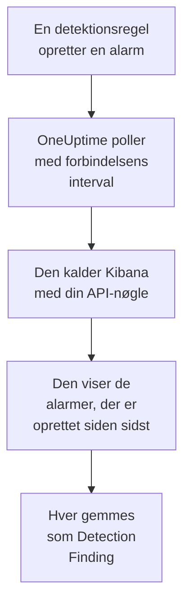

# Elastic Security

Importér de detektionsalarmer, dine regler i [Elastic Security](https://www.elastic.co/security) udløser, i OneUptimes sikkerhedsbegivenheder. Der søger du i dem ved siden af dine logs, traces og metrikker, korrelerer dem med alle andre kilder og kalder vagten op for dem, der betyder noget. OneUptime læser dem via Kibanas detection engine-API med en API-nøgle, du selv opretter, og ændrer intet i Elastic.

:::cards
- [Opsæt forbindelsen](#opsæt-forbindelsen): En API-nøgle, dens rettigheder og forbindelsens formular.
- [Hvad der importeres](#hvad-der-importeres): Hvordan hver detektionsalarm bliver en sikkerhedsbegivenhed.
- [Sådan fungerer polling](#sådan-fungerer-polling): Det vindue, hver poll læser, og hvad et travlt space gør ved det.
- [Fejlfinding](#fejlfinding): Hvad hver fejl betyder, og hvad du skal ændre.
:::

## Sådan fungerer det



Hvert minut poller OneUptime hver aktiveret forbindelse, hvis pollinterval er gået. En poll beder Kibana om de detektionsalarmer, der er oprettet i dit space siden sidste poll, 1.000 ad gangen, og gemmer hver som en [OCSF](https://schema.ocsf.io/) Detection Finding-begivenhed (klasse `2004`). Alle regeltyper tæller med: brugerdefineret forespørgsel, tærskel, EQL, indikatormatch, machine learning og nye termer. Registreringsregler, monitorer og dashboards behandler derefter alarmerne som sikkerhedsbegivenheder fra enhver anden kilde.

## Før du går i gang

- I OneUptime rollen Project Owner, Project Admin eller Security Admin. Security Member og Security Viewer kan se forbindelser og deres kørselshistorik, men ikke ændre dem.
- Elastic Security 8.x eller nyere, på Elastic Cloud eller din egen Elastic-stak, med detektionsregler, der kører i et Kibana-space.
- Kibana-adgang, der kan se detektionsalarmerne i det space: indeksrettighederne `read` og `view_index_metadata` på `.alerts-security.alerts-<space-id>`, og en Kibana-funktionsrettighed til Security, der lader den læse alarmer dér.
- Et Kibana, som OneUptime kan nå over HTTPS. OneUptime Cloud forbinder fra internettet, så Kibana skal have en offentlig adresse, som Elastic Cloud-udrulninger har: private adresser afvises. Et selvhostet OneUptime forbinder fra sine app- og workercontainere og kan nå et Kibana på dit private netværk, medmindre `DATA_SOURCE_BLOCK_PRIVATE_ADDRESSES` er `true`.

## Opsæt forbindelsen

:::steps
### Opret en API-nøgle

1. Åbn **Stack Management → API keys** i Kibana, og vælg **Create API key**.
2. Giv den et navn, for eksempel `oneuptime-security-events`. En nøgle har rettighederne fra den bruger, der opretter den, medmindre du giver den færre: den behøver kun dem ovenfor.
3. Vælg, hvornår den udløber, eller aldrig. En nøgle, der udløber, stopper forbindelsen, indtil du erstatter den.
4. Opret nøglen, og kopiér dens **Base64**-værdi, som Kibana kun viser én gang. Ikke nøglens ID og ikke parret `id:api_key`.

### Find dit spaces ID

Alarmer gemmes pr. space. Åbn det space, hvor dine regler kører: dets ID er den del af Kibana-adressen, der kommer efter `/s/`, for eksempel `security` i `https://kibana.example.com/s/security/app/security`. Standard-spacet har ingen `/s/`-del og behøver intet ID.

### Tilføj forbindelsen i OneUptime

Åbn **Produkter → Security Events → Forbindelser** (`/dashboard/{projectId}/security-events/connections`), klik på **Tilføj forbindelse**, vælg **Elastic Security**, og klik på **Næste**. Udfyld indstillingerne i tabellen nedenfor, klik på **Næste**, og indsæt nøglen i **API-nøgle**.

### Test den, før du gemmer

Klik på **Test disse indstillinger** under **Test, før du gemmer**. Testen godkender og læser alarmer med værdierne i formularen og gemmer intet, så et forkert space eller en manglende rettighed viser sig, før forbindelsen findes. Klik derefter på **Næste**, giv forbindelsen et **Navn**, og opret den.
:::

| Indstilling | Hvad du skal angive |
| --- | --- |
| **Kibana URL** | Adressen, Kibana udstilles fra, for eksempel `https://kibana.example.com` eller `https://<deployment>.kb.<region>.cloud.es.io`. Uden sti: ingen `/app/security`, ingen `/api` og ingen `/s/<space>`-del. |
| **Kibana space** | Spacets ID, ikke dets navn: bogstaver, cifre, bindestreger og understregninger. Lad det være tomt for standard-spacet. |
| **API-nøgle** | Nøglens **Base64**-værdi, alene: OneUptime tilføjer selv skemaet `ApiKey`. Den krypteres, returneres aldrig af API'et og vises aldrig igen. Erstat den med **Opdater legitimationsoplysninger** på forbindelsen. |

Trinnet **Hentning** har også en valgfri **Beskrivelse**, **Hentningsinterval (minutter)**, et heltal fra `1` til `1440`, der starter på `5`, og **Aktiveret**, som starter slået til.

## Hvad der importeres

Hver detektionsalarm bliver en Detection Finding-begivenhed (OCSF-klasse `2004`) med leverandøren `Elastic` og produktet `Elastic Security`:

| Alarmfelt | OneUptime-kolonne |
| --- | --- |
| `_id`, alarmens ID | Begivenheds-UID, som også dubletter fjernes efter |
| `kibana.alert.original_time`, ellers `kibana.alert.start`, ellers `@timestamp` | Begivenhedens tidspunkt |
| `kibana.alert.rule.name` | Regelnavn |
| `kibana.alert.rule.uuid`, ellers `kibana.alert.rule.rule_id` | Regel-ID |
| `kibana.alert.reason`, ellers regelnavnet, ellers `kibana.alert.rule.description` | Meddelelse |
| `kibana.alert.severity`, ellers et bånd af `kibana.alert.risk_score` | Alvorlighed |
| `kibana.alert.workflow_status`: `open`, `acknowledged` eller `closed` | Status |
| `kibana.alert.rule.threat`, inklusive underteknikker | MITRE ATT&CK-taktikker og -teknikker |
| `user.name`, `host.name`, `source.ip` eller `host.ip`, `process.name` eller `process.executable` | Aktørens bruger, vært, IP og proces |
| `user.target.name`, `destination.domain`, `destination.ip`, `destination.port`, `file.path` | Målets bruger, vært, IP, port og ressource |
| Disse samt `related.*`, `dns.question.name`, `url.domain` og filhashes | Observables |
| Hele alarmen, fladet ud til nøgler med punktummer, med `_index` og `_id` | `attributes` |

En alarms tidspunkt er med vilje tidspunktet for den aktivitet, den handler om. Dens `@timestamp`, da reglen oprettede den, er det, pollingen læser, så en alarm, der er oprettet i dag om gårsdagens aktivitet, vises under i går i stifinderen for sikkerhedsbegivenheder. Når en alarm ikke har nogen alvorlighed, afgør dens risikoscore: fra `74` Critical, fra `48` High, fra `22` Medium, og derunder Low.

## Sådan fungerer polling

Hver poll viser de alarmer, der er oprettet i dens vindue, de ældste først, 1.000 pr. side. I et andet space end standard-spacet starter stien med `/s/{Kibana space}`:

```text
POST {Kibana URL}/api/detection_engine/signals/search
    {"query": {"range": {"@timestamp": {"gte": "{window start}", "lt": "{window end}"}}},
     "size": 1000, "sort": [{"@timestamp": "asc"}]}
```

- **Oprettelsestidspunktet er markøren.** Alarmer vises efter deres eget `@timestamp`, da regelkørslen oprettede dem, aldrig efter tidspunktet for den aktivitet, de handler om. En regel, der kører hver time, opretter alarmer om aktivitet, der er op til en time gammel, og en markør på aktivitetstidspunktet ville springe dem alle over.
- **Den første poll ser 24 timer tilbage**, så en ny forbindelse straks viser sine nylige advarsler.
- **Hver senere poll starter 1 minut før den gemte markør**, så en alarm, der er oprettet på grænsen mellem to vinduer, aldrig går tabt.
- **En poll læser højst 24 timer forbi markøren.** En forbindelse, hvis markør er kommet bagud, indhenter i en række vinduer på 24 timer, og dens **Sundhed** viser **Catching up**.
- **Dubletter fjernes efter alarmens `_id`** i projektet, så overlappet, et gentaget vindue og en import aldrig gemmer en alarm to gange.

Kibanas alarmsøgning tager en størrelse og en sortering, men intet sidetoken. Derfor paginerer OneUptime ved at flytte intervallets start til den sidste alarm på hver side og udelader, efter `_id`, de alarmer, den allerede har læst på det tidspunkt. En regelkørsel stempler ofte mange alarmer med samme tidspunkt, og sådan en gruppe læses side for side, ingen to gange og ingen sprunget over.

### Når et vindue indeholder mere, end én poll kan læse

En poll læser højst 10.000 alarmer i højst 20 anmodninger. Når et vindue indeholder flere, er kørslen **Delvis** med en advarsel som:

```text
Stopped after collecting 10000 alerts; the window holds more.
```

Alarmer læses de ældste først, så OneUptime flytter markøren til oprettelsestidspunktet for den sidst læste alarm, og den næste poll starter der med samme vindueslængde. Et travlt space indhenter 10.000 alarmer pr. poll i stedet for at læse de samme igen. Alarmer, der er oprettet i præcis samme øjeblik, læses to gange, og dubletkontrollen fjerner den anden kopi.

De udeladte ID'er sendes med i hver anmodning, og Kibana begrænser størrelsen på en anmodning. Når flere alarmer deler ét øjeblik, end én anmodning kan udelade, omkring 7.800, stopper kørslen dér som **Delvis** med en advarsel, der navngiver øjeblikket.

Når en kørsel slet ikke kan komme forbi den gemte markør, gør OneUptime i stedet vinduet kortere:

1. **Indsnævr.** Den næste poll læser et vindue, der er halvt så langt, fra det samme startpunkt, og bliver ved med at halvere, indtil et vindue læses helt, ned til ét minut. Kørslens advarsel siger det: `This window holds more records than one poll can read; the next poll reads a {n} minute window from the same starting point.`
2. **Voks igen.** Når et vindue er læst helt, er det næste igen dobbelt så langt, op til 24 timer.
3. **Gå forbi et enkelt minut.** Hvis selv ét minut indeholder mere, end en poll kan læse, går pollingen forbi det, så nyere advarsler bliver ved med at komme. Kørslen forbliver **Delvis**, og **Seneste fejl** lyder `More records were created in the one minute from {cursor} to {end} than one poll can read. Polling moved past this minute so newer records keep arriving; use Import this time range in Diagnostics on this minute to recover what one run can read.` Importér det minut med **Import this time range** for at hente det, én kørsel kan læse.

En kørsel, der mislykkes helt, med en fejl fra Kibana, beholder markøren og vindueslængden, og den næste poll læser det samme vindue igen. Den eneste undtagelse er en anmodning, der fik timeout: markøren bliver, men det næste vindue er halvt så langt, fordi et vindue, der er for tungt til at blive besvaret i tide, ville få timeout ved hvert forsøg. At ændre **Hentningsinterval (minutter)** ændrer intet af dette: det afgør, hvor ofte en poll starter, ikke hvor dens vindue begynder.

### Kør, se forhåndsvisning og importér efter behov

Klik på **Diagnosticering** på en forbindelse for at se dens seneste kørsler og arbejde med den manuelt. Alle, der kan ændre forbindelsen, kan starte disse handlinger; alle, der kan se den, kan læse historikken.

- **Kør nu** starter straks en poll med den sædvanlige markør, også når forbindelsen ikke er **Aktiveret**.
- **Preview alerts** læser et tidsinterval på op til 7 dage og importerer intet.
- **Import this time range** importerer et interval på op til 7 dage, efter at du har bekræftet, uden at flytte markøren. Advarsler, der allerede er importeret, springes over.
- **Copy diagnostics** på en kørsel kopierer dens rapport til support. Den indeholder aldrig legitimationsoplysninger.

## Test forbindelse

**Test forbindelse** på en forbindelses række og **Test disse indstillinger** i formularen kører i API-processen, ikke i en baggrundsworker, så en test også svarer, når det er workerne, der er problemet. Den kører disse kontroller i rækkefølge:

| Kontrol | Hvad den kontrollerer |
| --- | --- |
| **Konfiguration** | Hver indstilling er til stede og velformet. Der kontaktes intet, når dette mislykkes. |
| **Authenticate with Kibana** | Kibanas `/api/status` svarer fuldt ud. Kibana svarer også kaldere, den ikke har godkendt, med mindre, så et kort svar får denne kontrol til at mislykkes. |
| **Read detection alerts** | Én alarm, der er oprettet inden for de seneste 24 timer, kan læses. Det beviser rettighederne og spacet. |
| **Alerts available to import** | Hvor mange alarmer der er oprettet inden for de seneste 24 timer og de seneste 7 dage, med `+`, hvor Elasticsearch kun talte en del af dem. Ingen på 7 dage er en advarsel, ikke en fejl. |
| **Background workers**, **Poll scheduler**, **Security event storage** | OneUptimes egen side: en proces tager jobbene fra Worker-køen, poll-jobbet kører hvert minut, og lageret for sikkerhedsbegivenheder svarer. |
| **Scheduled polling** | For en gemt forbindelse: polling er slået til, ingen kørsel sidder fast og venter på en worker, og polls kører til tiden. |

Hver anmodning i en test har en frist på 20 sekunder. En test importerer aldrig noget og flytter aldrig markøren, og hver mislykket kontrol siger, hvad du skal ændre.

## Send sikkerhedshændelser til Elastic Security

OneUptime kan også sende det, den finder, til Elasticsearch som Elastic Common Schema (ECS)-dokumenter i en datastrøm, så Elastic Securitys advarsler, tidslinjer og detektionsregler ser OneUptimes detektioner ved siden af dine egne. En detektion er et dokument med `event.kind` `alert`, og alle andre hændelser har `event.kind` `event`.

:::steps
### Opret en API-nøgle, der må skrive

Åbn **Stack Management → API keys** i Kibana, klik på **Create API key**, giv den rettighederne nedenfor, og kopiér dens **Encoded**-værdi.

### Tilføj destinationen

Åbn **Produkter → Security Events → Forbindelser**. Klik på **Tilføj destination** under **Send til dit SIEM**, vælg Elastic Security under **SIEM**, og klik på **Næste**. Udfyld **Elasticsearch-URL**, deploymentets Elasticsearch-slutpunkt og ikke Kibanas, og indsæt nøglen i **API-nøgle**. **Datastrøm** er valgfri: står den tom, går dokumenterne til `logs-oneuptime.security-default`, som Elasticsearch opretter ved første skrivning.

### Send en testhændelse, og begynd at sende

Klik på **Send en testhændelse**: ét dokument ankommer i datastrømmen. Behold derefter **Kun detektioner** under **Hvad der skal sendes**, eller vælg **Alle sikkerhedshændelser**, og klik på **Begynd at sende**.
:::

Nøglens rettigheder for standarddatastrømmen:

```json title="oneuptime-writer-role.json"
{
  "oneuptime-writer": {
    "indices": [
      {
        "names": [
          "logs-oneuptime.security-*"
        ],
        "privileges": [
          "create_doc",
          "auto_configure"
        ]
      }
    ]
  }
}
```

- Dokumenter sendes i batches på op til 500, hver med sin hændelses eget id, så en hændelse, der sendes to gange, gemmes én gang.
- Et dokument, Elasticsearch ikke kan mappe, udelades og nævnes i **Vis fejl**, og et, den ikke kan tage imod lige nu (`429`), sendes igen.
- Advarsler, som OneUptime har importeret fra Elastic Security, sendes aldrig tilbage dertil.

## Fejlfinding

Forbindelsens **Seneste fejl** gemmer hele fejlmeddelelsen, med legitimationsoplysninger maskeret, bag et præfiks, der navngiver det trin, der mislykkedes. Når en forbindelse har en fejl, vælger du **Vis fejl** i dens kolonne **Handlinger** for at læse den og **Kopiér fejl** i dialogboksen for at kopiere den. Læs præfikset først.

:::details Last Error starter med `Elastic Security status request`
- `Elastic Security status request failed (HTTP ...)`: Kibana afviste statusanmodningen.
  - `HTTP 401`: Kibana accepterede ikke API-nøglen. Det er ikke **Base64**-værdien, eller den er udløbet eller ugyldiggjort. Opret en ny nøgle, og gem den med **Opdater legitimationsoplysninger**.
  - `HTTP 404`: **Kibana URL** har en sti eller er ikke Kibana.
  - `HTTP 503`: Kibana melder sig selv utilgængelig, som regel fordi den ikke kan nå Elasticsearch.
  - `HTTP 3xx`: Kibana omdirigerede anmodningen, og omdirigeringer afvises. Brug den adresse, Kibana udstilles fra.
- `Elastic Security status request returned ...`: noget andet end Kibana svarede, for eksempel en loginside eller en proxy.
- Når kun testen mislykkes og siger, at Kibana `answered without authenticating the request`, nåede nøglen ikke frem til Kibana. Kontrollér, at det er **Base64**-værdien, og at ingen proxy foran Kibana fjerner headeren `Authorization`.
:::

:::details Last Error starter med `Elastic Security alerts search`
- `Elastic Security alerts search failed (HTTP ...)`: Kibana afviste alarmsøgningen.
  - `HTTP 403`: nøglen logger på, men kan ikke læse spacets alarmer. Giv den rettighederne under [Før du går i gang](#før-du-går-i-gang).
  - `HTTP 404`: intet space har det ID i **Kibana space**, eller Elastic Security er ikke aktiveret i det.
  - `HTTP 429` eller `HTTP 5xx`: Kibana eller Elasticsearch begrænser anmodninger eller fejler. Den næste poll prøver igen.
- `Elastic Security alerts search returned ...`: Kibana svarede `200`, men uden en læsbar side med alarmer, for eksempel med sin egen fejl. Meddelelsen citerer den. Det rapporteres i stedet for at blive taget som et tomt vindue, så markøren aldrig flytter sig forbi alarmer, som ingen har læst.
:::

:::details Last Error slutter med `did not complete`
`Elastic Security alerts search did not complete`, og det samme for statusanmodningen, betyder, at anmodningen ikke fik noget svar: en timeout, et navn, der ikke kan slås op, en afvist forbindelse eller en afvist privat adresse. Kontrollér, at OneUptime-appen og workerne kan nå Kibana med det rigtige skema og den rigtige port. Efter en timeout læser den næste poll et vindue, der er halvt så langt.
:::

:::details Last Polled er Never, og Last Error er tom
Ingen poll er blevet færdig for denne forbindelse. Kør **Test forbindelse**: dens kontroller **Background workers** og **Poll scheduler** navngiver årsagen. På en selvhostet installation er den sædvanlige årsag `DISABLE_QUEUE_WORKERS=true` på appen, uden en separat worker-udrulning, der tager jobbene: sæt den til `false`, eller kør worker-udrulningen (Helm: `worker.enabled: true`).
:::

:::details En kørsel er Partial
- `Stopped after collecting 10000 alerts; the window holds more`: vinduet indeholdt mere end de 10.000 alarmer, én kørsel læser. Intet går tabt: den næste poll starter efter den sidst læste alarm. En forbindelse, der forbliver **Delvis** poll efter poll, er ved at indhente et efterslæb, og dens **Senest hentet** og **Seneste importerede hændelse** bliver ved med at rykke frem. Hvis den aldrig indhenter, opretter spacet mere end 10.000 alarmer pr. pollinterval: gør **Hentningsinterval (minutter)** kortere.
- `More records were created in the one minute from ... than one poll can read`: pollingen gik forbi det minut. Importér det med **Import this time range** i **Diagnosticering**. En import læser lige så meget som en poll.
:::

:::details Testen lykkes, men intet importeres
Læs **Alerts available to import** i testens rapport. `0` inden for de seneste 7 dage betyder, at ingen regel har oprettet en alarm i det space: kontrollér, at der er aktiverede regler dér, og at **Kibana space** er det space, de kører i. Hvis der findes alarmer, så udvid tidsintervallet i stifinderen for sikkerhedsbegivenheder: alarmer vises under tidspunktet for deres aktivitet, som kan ligge et godt stykke før deres oprettelse.
:::

## Hvad du får

- **Søgning.** Filtrér alarmer efter alvorlighed, status, regel, MITRE ATT&CK-teknik, bruger, vært eller enhver observable i stifinderen for sikkerhedsbegivenheder, ved siden af alle andre kilder.
- **Korrelation.** Hver alarms brugere, værter, IP'er, domæner og hashes indekseres som observables, så én søgning finder alt, der nævner dem.
- **Registreringsregler.** Sigma-regler, der kører efter en tidsplan over dine sikkerhedsbegivenheder og åbner advarsler, der kalder vagten op.
- **Monitorer.** Monitorer for sikkerhedsbegivenheder tæller matchende begivenheder, for eksempel nye kritiske alarmer, og åbner hændelser eller advarsler over en tærskel.

Sikkerhedsbegivenheder faktureres som resten af din telemetri, pr. indtaget GB. Se [Priser](https://oneuptime.com/pricing).

## Næste trin

:::cards
- [Sikkerhedsbegivenheder](/docs/telemetry/security-events): Søg, korrelér og advar på det, du importerer.
- [Splunk Enterprise Security](/docs/integrations/splunk): Importér også notable events fra et Splunk-search head.
- [Roller](/docs/permissions/reference#roller): Hvad Security-rollerne kan se og ændre.
- [Oversigt over integrationer](/docs/integrations/index): De andre værktøjer, du kan forbinde.
:::
