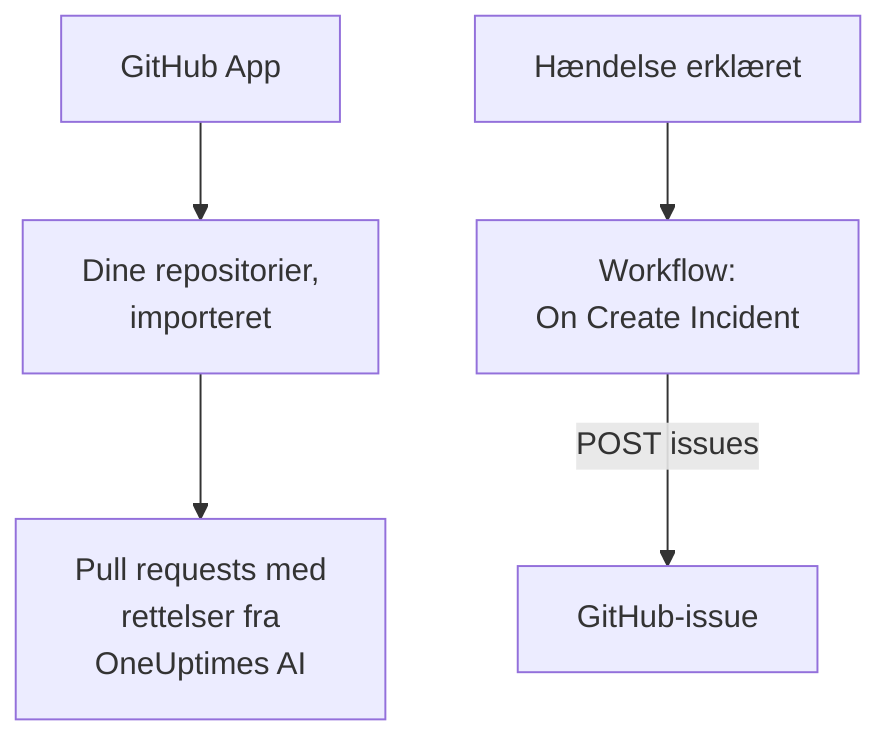

# GitHub

OneUptime arbejder sammen med [GitHub](https://github.com) på to måder. Forbind dine repositorier via OneUptimes GitHub App, så åbner OneUptimes AI pull requests, der retter det, den finder, og svarer, når du nævner den i et issue eller en pull request. Eller byg et workflow, der åbner et GitHub-issue for hver hændelse, så opfølgningsarbejdet spores i det repositorie, der ejer tjenesten.

:::cards
- [Vælg, hvordan du forbinder](#vælg-hvordan-du-forbinder): GitHub App eller et workflow, og hvad hver af dem gør.
- [Forbind dine repositorier](#forbind-dine-repositorier): GitHub App, til pull requests med rettelser.
- [Åbn et issue for hver hændelse](#åbn-et-github-issue-for-hver-hændelse): Ét workflow, to blokke.
- [Fejlfinding](#fejlfinding): Når GitHub afviser en anmodning.
:::

## Sådan fungerer det



De to er adskilte, og du kan bruge den ene eller begge. GitHub App arbejder i de repositorier, du installerer den på. Workflowet behøver kun et token og kalder GitHubs [REST API](https://docs.github.com/en/rest/issues/issues#create-an-issue) som ethvert andet API.

## Vælg, hvordan du forbinder

| Måde | Hvad den gør | Hvad den kræver |
| --- | --- | --- |
| GitHub App | Importerer dine repositorier. OneUptimes AI åbner pull requests i dem, der retter exceptions, langsomme traces og de årsager, dens undersøgelser finder, og svarer på omtaler i issues og pull requests. | En organisation eller konto at installere appen på. På OneUptime Cloud planen **Growth**. |
| Et workflow | Åbner et GitHub-issue for hver hændelse i det repositorie, du vælger. | Et GitHub-token, der kan oprette issues, og et workflow med to blokke. |

## Forbind dine repositorier

Åbn **Produkter → Kode**, og klik på **Forbind GitHub**. GitHub spørger, hvor appen skal installeres, og hvilke repositorier den må bruge. Hvert repositorie i installationen importeres og holdes ajour, når du føjer repositorier til installationen eller fjerner dem.

Hvis appen allerede er installeret på kontoen, til et andet projekt eller direkte fra GitHub, så klik på **Forbind en eksisterende installation** under **Forbind GitHub** i stedet for at installere den igen. Det kræver en GitHub-konto, der administrerer installationen: ejeren af en personlig konto, eller en person med admin-adgang til hvert repositorie, installationen har adgang til, sådan som en ejer af organisationen har.

En selvhostet instans skal først have sin egen GitHub App: [GitHub-integration](/docs/self-hosted/github-integration) viser, hvordan du opretter den. Derefter åbner AI pull requests i dine repositorier fra [Kode](/docs/ai/ai-agent), og siden [GitHub App](/docs/ai/github-app) viser, hvad appen gør, når du nævner den i et issue eller en pull request.

## Før du går i gang

Resten af denne side bygger workflowet. Det kræver:

- Et GitHub-token, der kan oprette issues i repositoriet: et fine-grained personal access token til det repositorie, med tilladelsen **Issues** sat til **Read and write**, eller et klassisk token med omfanget `repo`. Opret et i GitHubs [tokenindstillinger](https://github.com/settings/tokens).
- I OneUptime rettigheden til at oprette workflows og globale variabler. På OneUptime Cloud kræver workflows **Growth**-abonnementet eller højere.

## Gem tokenet

:::steps
1. Gå til **Arbejdsgange → Globale variabler**, og klik på **Opret Workflow Variabel**.
2. Giv den navnet `GITHUB_TOKEN`, og klik på **Næste**.
3. Indsæt tokenet i **Indhold**, slå **Hemmelighed** til, og klik på **Opret Workflow Variabel**.
:::

En hemmelig variabel erstattes med `[REDACTED]` i kørselslogs, så tokenet aldrig vises i en kørsel.

## Åbn et GitHub-issue for hver hændelse

:::steps
### Opret workflowet

Gå til **Arbejdsgange**, klik på **Opret arbejdsgang** og derefter på **Start fra bunden**. Giv det navnet `Incidents to GitHub`, og klik på **Opret arbejdsgang**.

### Tilføj triggeren

Klik på den stiplede blok **Vælg, hvad der starter denne arbejdsgang**, og vælg **On Create Incident**. Klik på triggeren: dens **Fields to pass on** starter med **Titel**, så klik på **Tilføj felt**, og vælg **Beskrivelse** og **Incident Number With Prefix**.

### Åbn issuet

Klik på **Tilføj komponent**, tilføj en blok **API Post (JSON)**, og forbind triggerens punkt **Success** til den. Sæt dens **URL** til `https://api.github.com/repos/your-org/your-repo/issues`, med dit repositories ejer og navn. Sæt under **Flere felter** dens **Request Headers** til:

```json
{
  "Authorization": "Bearer {{global.variables.GITHUB_TOKEN}}",
  "Accept": "application/vnd.github+json",
  "X-GitHub-Api-Version": "2022-11-28"
}
```

Og dens **Request Body** til:

```json
{
  "title": "{{local.components.incident-on-create-1.returnValues.model.title}}",
  "body": "{{local.components.incident-on-create-1.returnValues.model.description}}\n\nOpened by OneUptime for incident {{local.components.incident-on-create-1.returnValues.model.incidentNumberWithPrefix}}.",
  "labels": ["incident"]
}
```

### Test det, og slå det derefter til

Klik på **Kør arbejdsgang**, vælg en testhændelse under **Hændelse**, og kør den. Trinnet **API Post (JSON)** viser et `201`-svar med det nye issue, med dets `number` og dets `html_url`. Slå derefter **Aktiveret** til øverst i **Bygger**.
:::

Issuet forbliver åbent, når hændelsen er løst, da opfølgningsarbejdet som regel lever længere end hændelsen. For tickets, der holdes i takt med hændelsen i begge retninger, se [Jira](/docs/integrations/jira).

## Tips

- **GitHub Enterprise Server.** Send i stedet anmodningen til din server: `https://your-github-host/api/v3/repos/your-org/your-repo/issues`. En server på en privat netværksadresse kræver et selvhostet OneUptime, hvis administrator tillader det: se [Udgående netværksadgang](/docs/workflows/configuration#udgående-netværksadgang).
- **Tildel det.** Føj `"assignees": ["octocat"]` eller `"milestone": 3` til body'en. GitHub dropper labels, tildelte og milepæle uden et ord, når tokenet ikke må pushe til repositoriet.
- **Kun nogle hændelser.** Sæt en blok **If / Else** mellem triggeren og API-blokken, og åbn kun issues på dens **Yes**-side, for eksempel for én alvorlighed.

## Fejlfinding

Trinnet **API Post (JSON)** tager **Error**, når GitHub afviser anmodningen. Dets **Response Status** og **Response Body** i kørslen siger hvorfor.

:::details GitHub svarer 401
Tokenet er forkert, udløbet eller tilbagekaldt. Opret et nyt, og erstat indholdet af `GITHUB_TOKEN`.
:::

:::details GitHub svarer 403
Tokenet kan ikke oprette issues dér: et fine-grained token uden **Issues** sat til **Read and write** på dette repositorie, et token, din organisation ikke har godkendt, eller et klassisk token, der ikke er godkendt til din organisations single sign-on. En 403, hvis body taler om en hastighedsgrænse, betyder, at tokenet har sendt for mange anmodninger: vent, eller åbn issues for færre hændelser.
:::

:::details GitHub svarer 404
Ejeren eller repositoriet i **URL** er forkert, eller tokenet kan ikke se repositoriet. GitHub svarer 404, ikke 403, for et privat repositorie, som et token ikke kan se.
:::

:::details GitHub svarer 410 eller 422
- `410`: issues er slået fra i repositoriets indstillinger.
- `422`: GitHub kan ikke læse body'en. Kontrollér, at den er gyldig JSON, at `title` er sat, og at `labels` og `assignees` er lister.
:::

## Næste trin

:::cards
- [GitHub App](/docs/ai/github-app): Bed OneUptimes AI om en ændring, en revision eller en review direkte fra GitHub.
- [GitLab](/docs/integrations/gitlab): Det samme workflow, for GitLab-issues.
- [Workflow-komponenter](/docs/workflows/components#api): Alle indstillinger for API-blokkene.
- [Oversigt over integrationer](/docs/integrations/index): Mønstrene bag hver integration.
:::
