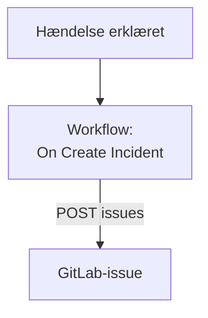

# GitLab

Åbn et [GitLab](https://gitlab.com)-issue for hver OneUptime-hændelse, så opfølgningsarbejdet spores i det projekt, der ejer tjenesten. Et workflow kalder GitLabs [Issues API](https://docs.gitlab.com/api/issues/#new-issue), på GitLab.com eller på dit eget GitLab.

:::cards
- [Gem tokenet](#gem-tokenet): Hold GitLabs token ude af dine workflows.
- [Åbn et issue for hver hændelse](#åbn-et-gitlab-issue-for-hver-hændelse): Ét workflow, to blokke.
- [Tips](#tips): Dit eget GitLab, projektstier og tildelte.
- [Fejlfinding](#fejlfinding): Når GitLab afviser en anmodning.
:::

> [!NOTE]
> OneUptimes AI arbejder også i GitLab-repositorier: forbind dem i Kode med et adgangstoken, så åbner den en merge request for hver rettelse. Se [Forbind et repositorie](/docs/ai/ai-agent#forbind-et-repositorie).

## Sådan fungerer det



Workflowet kører én gang for hver ny hændelse. Dets blok **API Post (JSON)** sender hændelsens titel og beskrivelse til projektets issues, signeret med et adgangstoken.

## Før du går i gang

- GitLab-projektets ID. Vælg handlingsmenuen, de lodrette prikker, på projektets oversigtsside, og derefter **Copy project ID**.
- Et GitLab-adgangstoken med omfanget `api`, til en bruger eller bot, hvis rolle i projektet kan oprette issues: et projekt-, gruppe- eller personligt adgangstoken. Opret det under **Settings → Access tokens** i projektet, gruppen eller dine brugerindstillinger.
- I OneUptime rettigheden til at oprette workflows og globale variabler. På OneUptime Cloud kræver workflows **Growth**-abonnementet eller højere.

## Gem tokenet

:::steps
1. Gå til **Arbejdsgange → Globale variabler**, og klik på **Opret Workflow Variabel**.
2. Giv den navnet `GITLAB_TOKEN`, og klik på **Næste**.
3. Indsæt tokenet i **Indhold**, slå **Hemmelighed** til, og klik på **Opret Workflow Variabel**.
:::

En hemmelig variabel erstattes med `[REDACTED]` i kørselslogs, så tokenet aldrig vises i en kørsel.

## Åbn et GitLab-issue for hver hændelse

:::steps
### Opret workflowet

Gå til **Arbejdsgange**, klik på **Opret arbejdsgang** og derefter på **Start fra bunden**. Giv det navnet `Incidents to GitLab`, og klik på **Opret arbejdsgang**.

### Tilføj triggeren

Klik på den stiplede blok **Vælg, hvad der starter denne arbejdsgang**, og vælg **On Create Incident**. Klik på triggeren: dens **Fields to pass on** starter med **Titel**, så klik på **Tilføj felt**, og vælg **Beskrivelse** og **Incident Number With Prefix**.

### Åbn issuet

Klik på **Tilføj komponent**, tilføj en blok **API Post (JSON)**, og forbind triggerens punkt **Success** til den. Sæt dens **URL** til `https://gitlab.com/api/v4/projects/12345678/issues`, med dit projekts ID i stedet for `12345678`. Sæt under **Flere felter** dens **Request Headers** til:

```json
{
  "PRIVATE-TOKEN": "{{global.variables.GITLAB_TOKEN}}"
}
```

Og dens **Request Body** til:

```json
{
  "title": "{{local.components.incident-on-create-1.returnValues.model.title}}",
  "description": "{{local.components.incident-on-create-1.returnValues.model.description}}\n\nOpened by OneUptime for incident {{local.components.incident-on-create-1.returnValues.model.incidentNumberWithPrefix}}.",
  "labels": "incident,oneuptime"
}
```

### Test det, og slå det derefter til

Klik på **Kør arbejdsgang**, vælg en testhændelse under **Hændelse**, og kør den. Trinnet **API Post (JSON)** viser et `201`-svar med det nye issue, med dets `iid` og dets `web_url`. Slå derefter **Aktiveret** til øverst i **Bygger**.
:::

Blokken sender JSON, så den behøver ingen `Content-Type`-header. GitLab opretter labels, den ikke har set før, så `incident` og `oneuptime` kræver ingen opsætning. Issuet forbliver åbent, når hændelsen er løst, da opfølgningsarbejdet som regel lever længere end hændelsen.

## Tips

- **Dit eget GitLab.** Send i stedet anmodningen til din server: `https://gitlab.example.com/api/v4/projects/12345678/issues`. En server på en privat netværksadresse kræver et selvhostet OneUptime, hvis administrator tillader det: se [Udgående netværksadgang](/docs/workflows/configuration#udgående-netværksadgang).
- **Projektets sti i stedet for dets ID.** Stien virker i stedet for ID'et, med dens `/` skrevet som `%2F`: `projects/your-group%2Fyour-project/issues`. URL'en sendes præcis, som den er skrevet, så kod den selv.
- **Tildel det.** Føj `"assignee_ids": [42]` eller `"due_date": "2026-12-31"` til body'en, eller `"confidential": true` for kun at vise det for projektmedlemmer.
- **Kun nogle hændelser.** Sæt en blok **If / Else** mellem triggeren og API-blokken, og åbn kun issues på dens **Yes**-side, for eksempel for én alvorlighed.

## Fejlfinding

Trinnet **API Post (JSON)** tager **Error**, når GitLab afviser anmodningen. Dets **Response Status** og **Response Body** i kørslen siger hvorfor.

:::details GitLab svarer 401
Tokenet er forkert, udløbet eller tilbagekaldt. Opret et nyt, og erstat indholdet af `GITLAB_TOKEN`.
:::

:::details GitLab svarer 403
Tokenet har ikke omfanget `api`, eller dets brugers rolle i projektet kan ikke oprette issues. Body'en nævner `insufficient_scope`, når det er omfanget.
:::

:::details GitLab svarer 404
Projektets ID i **URL** er forkert, eller tokenet kan ikke se projektet. GitLab svarer 404, ikke 403, for et privat projekt, som et token ikke kan se.
:::

:::details GitLab svarer 400
GitLab kan ikke læse body'en: `title` mangler, eller et felt har den forkerte type. Body'en nævner feltet.
:::

## Næste trin

:::cards
- [GitHub](/docs/integrations/github): Det samme workflow til GitHub, og GitHub App.
- [Workflow-komponenter](/docs/workflows/components#api): Alle indstillinger for API-blokkene.
- [Workflow-kørsler](/docs/workflows/runs-and-logs): Læs, hvad hver anmodning sendte og fik tilbage.
- [Oversigt over integrationer](/docs/integrations/index): Mønstrene bag hver integration.
:::
