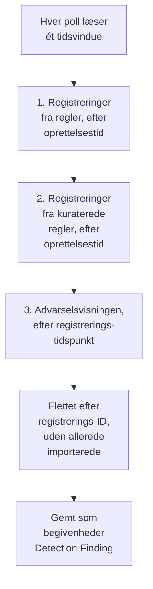

# Google SecOps

Bring advarsler og registreringer fra [Google SecOps](https://cloud.google.com/security/products/security-operations) (tidligere Chronicle) ind i OneUptimes sikkerhedsbegivenheder. Der søger du i dem ved siden af dine logs, traces og metrikker, korrelerer dem med alle andre kilder og kalder vagten op for dem, der betyder noget.

:::cards
- [Vælg, hvordan du forbinder](#vælg-hvordan-du-forbinder): En webhook fra en SOAR-playbook, den administrerede connector eller UDM-videresendelse.
- [Opsæt den administrerede connector](#opsæt-den-administrerede-connector): En nøgle til en tjenestekonto og forbindelsens formular.
- [Sådan poller connectoren](#sådan-poller-connectoren): Tre læsninger af hvert vindue og deres budgetter.
- [Fejlfinding](#fejlfinding): Hvad Last Error siger, og hvad du skal gøre.
- [Send sikkerhedshændelser til Google SecOps](#send-sikkerhedshændelser-til-google-secops): OneUptimes detektioner, i Google SecOps.
:::

## Vælg, hvordan du forbinder

| Vej | Hvad der kommer ind | Brug den, når |
| --- | --- | --- |
| En webhook fra en SOAR-playbook | Hver advarsel, en playbook poster, inden for sekunder | Du kører SOAR-playbooks og vil have deres advarsler i OneUptime uden polling. |
| Den administrerede connector | Advarsler, og registreringer fra regler, hvis du vælger det, pollet efter et interval | Du vil have, at OneUptime henter dem for dig, uden noget at konfigurere i SecOps. |
| Videresendelse af UDM-begivenheder | Rå UDM-begivenheder, til fuld søgning og korrelation | Du eksporterer allerede UDM-begivenheder og vil have dem alle. |

Hver vej normaliserer det, der kommer ind, til [OCSF](https://schema.ocsf.io/), Open Cybersecurity Schema Framework, som OneUptime gemmer hver sikkerhedsbegivenhed i, så registreringsregler og dashboards fungerer på samme måde, uanset kilden.

## Før du går i gang

- Til den administrerede connector i OneUptime rollen Project Owner, Project Admin eller Security Admin. Security Member og Security Viewer kan læse forbindelser, men ikke oprette dem.
- Til webhooken og UDM-videresendelsen en indtagelsesnøgle: åbn **Projektindstillinger → Telemetri og APM → Indtagelsesnøgler**, og klik på **Opret ingestion-nøgle**.
- Til den administrerede connector retten til at oprette en Google Cloud-tjenestekonto i det projekt, din SecOps-instans er bundet til.

## Send advarsler fra en SOAR-playbook

SOAR-playbooks i Google SecOps kan poste advarsler til ethvert HTTP-endpoint. Peg én mod OneUptimes indtagelse af sikkerhedsbegivenheder.

:::steps
### Tilføj en handling HTTP request

Tilføj i din SOAR-playbook i SecOps en handling **HTTP request**, der kører på nye advarsler.

### Peg den mod OneUptime

Sæt dens **Method** til `POST` og dens **URL** til `https://oneuptime.com/security-events/v1/ingest`, eller `https://<your-host>/security-events/v1/ingest` på en selvhostet installation. Tilføj disse headere:

```text
Content-Type: application/json
x-oneuptime-token: <your telemetry ingestion key>
```

Send advarslens JSON som **Body**. En registrering, regeloplysninger med de matchede UDM-begivenheder under `collectionElements`, genkendes af sig selv, gemmes som en begivenhed Detection Finding, og brugerne, værterne og IP'erne fra dens matchede begivenheder bevares som observables.

### Kontrollér, at advarsler kommer frem

Kør playbooken. Dens advarsler vises i **Produkter → Security Events** inden for sekunder.
:::

## Videresend UDM-begivenheder

Til fuld søgning og korrelation videresender du selve UDM-begivenhederne, for eksempel fra en BigQuery-eksportpipeline, en Cloud Function eller en hvilken som helst videresender, du allerede kører:

```bash
curl -X POST "https://oneuptime.com/security-events/v1/ingest?format=udm" \
  -H "Content-Type: application/json" \
  -H "x-oneuptime-token: <your telemetry ingestion key>" \
  -d '{
    "events": [
      {
        "metadata": {
          "event_type": "USER_LOGIN",
          "event_timestamp": "2026-08-21T10:00:00Z",
          "vendor_name": "Google",
          "product_name": "Google SecOps"
        },
        "principal": { "user": { "userid": "alice" }, "ip": ["203.0.113.7"] },
        "target": { "hostname": "vpn-gw-01" },
        "security_result": [{ "severity": "HIGH", "action": ["BLOCK"] }]
      }
    ]
  }'
```

- `format` kan være `udm`, `ocsf`, `google-secops-alert` eller `generic`. Udelader du det, registreres formatet begivenhed for begivenhed.
- Brødteksten kan være én begivenhed, en liste af begivenheder eller `{ "events": [...] }`.
- `x-oneuptime-service-name` navngiver den telemetritjeneste, begivenhederne hører til. Uden den hører de til den tjeneste, der er opkaldt efter payloadens produkt.

## Opsæt den administrerede connector

OneUptime poller din lejers registreringer og advarsler efter et interval, uden SOAR-konfiguration. Google SecOps er en udbyder af Security Event Connections, så den oprettes, testes, polles og diagnosticeres på den samme side og på samme måde som alle andre administrerede connectorer.

:::steps
### Opret en nøgle til en tjenestekonto

Opret i Google Cloud en tjenestekonto i det projekt, din SecOps-instans er bundet til, og giv den rollen **Chronicle API Viewer** (`roles/chronicle.viewer`). Den rolle omfatter tilladelserne `legacySearchDetections`, `legacySearchCuratedDetections`, `countAllCuratedRuleSetDetections` og `legacyFetchAlertsView`, som connectoren læser med.

Tilføj på tjenestekontoens fane **Keys** en nøgle af typen **JSON**, og download den. Du indsætter hele filen i forbindelsen. Dens `token_uri` skal være en `https`-URL på en Google-vært, hvilket en nøgle, der er downloadet fra Google Cloud, allerede er.

### Find regionen og instansens ressourcenavn

Åbn **SIEM Settings → Profile** i Google SecOps. Instansens ressourcenavn har formen `projects/{project}/locations/{location}/instances/{instance}`, hvor instansdelen er SecOps-instansens ID; et visningsnavn for en forbindelse eller navnet på en tjenestekonto kan ikke bruges i stedet. Regionen er det regionale endpoint, der betjener den placering, og den skal passe til locations-segmentet i instansens ressourcenavn, ellers afvises forbindelsen, når du gemmer den.

### Tilføj forbindelsen

Åbn **Produkter → Security Events → Forbindelser** (`/dashboard/{projectId}/security-events/connections`), vælg **Tilføj forbindelse**, vælg **Google SecOps**, og udfyld formularen med indstillingerne i tabellen nedenfor.

### Test, før du gemmer

Vælg **Test disse indstillinger** under **Test, før du gemmer**, før du gemmer. Testen kører med værdierne i formularen uden at gemme noget, så en forkert formateret nøgle, en manglende rolle eller en forkert instans opdages, før forbindelsen findes. I redigeringsformularen tester den samme knap den **Region**, det **Instansens ressourcenavn** og den **Data to import**, der vises på skærmen, med den gemte nøgle; et felt med legitimationsoplysninger, der efterlades tomt, beholder den gemte nøgle. Når noget af det testede afviger fra det, forbindelsen har gemt, også en nyindtastet nøgle, registreres der ingen række i kørselshistorikken, fordi forbindelsen endnu ikke har de indstillinger.
:::

| Indstilling | Hvor du finder den | Påkrævet |
| --- | --- | --- |
| **Region** | Google SecOps' regionale endpoint (`us`, `europe`, `asia-southeast1`, ...), der passer til placeringen i din instans' ressourcenavn. Der er ingen standard, så en lejer uden for USA ikke ved et uheld kan gemme det forkerte endpoint. | Ja |
| **Instansens ressourcenavn** | Google SecOps **SIEM Settings → Profile**: `projects/{project}/locations/{location}/instances/{instance}`. | Ja |
| **Luk advarsler, når deres sag lukkes** | På formularens sidste trin, slået fra, indtil du slår det til. Slået til lukker en lukket sag dens Google SecOps-advarsler: se [Luk advarsler, når deres sag lukkes](#luk-advarsler-når-deres-sag-lukkes). | Nej |
| **Tjenestekontoens JSON** | Google Cloud, tjenestekontoens fane **Keys**. Indsæt hele JSON-nøglefilen. Kun skrivning: krypteret i hvile, returneres aldrig af API'et og vises aldrig igen på siden. Brug **Opdater legitimationsoplysninger** på forbindelsen for at udskifte den. | Ja |
| **Data to import** | **Advarsler** importeres altid, fordi Googles advarsels-API altid returnerer dem. Vælg **Detektioner** for også at importere regelmatch, der ikke gav en advarsel. Det videresender ikke rå UDM-begivenheder: dem videresender du selv, som ovenfor. | Advarsler altid |

Formularens polling-trin beder om et **Navn**, en valgfri **Beskrivelse**, forbindelsens indstilling **Aktiveret** og **Hentningsinterval (minutter)**: et heltal fra `1` til `1440`, standard `5`. Alt uden for det interval afvises, når du gemmer.

Nye registreringer importeres som begivenheder Detection Finding, der tilskrives en telemetritjeneste `Google SecOps`.

## Læs forbindelsens tilstand

Listen over forbindelser viser **Navn**, med forbindelsens udbyder og dens valg af Data to import nedenunder, **Sundhed**, **Senest hentet** og **Seneste importerede hændelse**. **Status** (Enabled eller Disabled), **Interval (minutter)** og **Seneste vellykkede hentning** findes under **Tilpas kolonner**. Når en forbindelse har en fejl, vises **Vis fejl** i dens kolonne **Handlinger**, ved siden af **Test forbindelse**, **Kør nu**, **Diagnosticering**, **Rediger** og **Opdater legitimationsoplysninger**. Enabled betyder, at automatisk polling er sat op. Last Polled registrerer et forsøg; et vellykket tomt vindue beviser ikke, at en bestemt registrering er blevet importeret.

**Sundhed** viser først **Last poll succeeded**, når en begivenhed er blevet importeret. Indtil da viser en forbindelse, der lykkes, **Polling, no events imported yet**, og det er den tilstand, du skal undersøge med Test forbindelse. De andre tilstande er **No records returned**, **Partial import**, **Catching up**, **Last poll failed**, **Poll overdue**, **Schedule paused** og **Venter på første hentning**; hold musen over en tilstand for at se, hvad den betyder.

> [!NOTE]
> Connectoren bruger Chronicles ældre registrerings- og advarsels-API'er `v1alpha`, som Google leverer som pre-GA. Når en poll mislykkes, gemmer forbindelsens felt **Seneste fejl** hele fejlmeddelelsen, med legitimationsoplysninger maskeret, bag et præfiks, der navngiver det trin, der mislykkedes, også når Chronicle svarer `200` og lægger afvisningen i brødteksten. Vælg **Vis fejl** i forbindelsens kolonne **Handlinger** for at læse meddelelsen, og derefter **Kopiér fejl** i dialogboksen for at kopiere den til support.

## Sådan poller connectoren



Én gang i minuttet sætter en baggrundsworker en poll i kø for hver aktiveret forbindelse, hvis interval er gået siden den sidste poll. Hver poll er en kørsel i forbindelsens historik, udført af en worker. Den læser ét tidsvindue på tre måder og fletter resultaterne efter registrerings-ID, så en post, der returneres af mere end én gennemgang, gemmes én gang:

1. **Registreringer fra regler efter oprettelsestid.** `legacy:legacySearchDetections` med `ruleId=-` (hver revision af hver regel) og `listBasis=CREATED_TIME`, hvor `nextPageToken` følges, indtil siden er den sidste.
2. **Registreringer fra kuraterede regler efter oprettelsestid.** `legacy:legacySearchCuratedDetections` på samme måde, én gang pr. kurateret (Google-skrevet) regel. Det endpoint tager ét ID for en kurateret regel (`ur_...`) og har intet jokertegn for "alle regler", så gennemgangen kalder først `:countAllCuratedRuleSetDetections` for ugen før vinduet til dets slutning og søger i hver kurateret regel, der gav registreringer. En kurateret regel, der ikke er udløst i den uge, har intet at importere. En lejer uden adgang til kuraterede regler svarer denne gennemgang med `400`, `403` eller `404`; det registreres som en advarsel på kørslen, ikke som en fejl.
3. **Advarselsvisningen efter registreringstidspunkt.** `legacy:legacyFetchAlertsView`, som dækker telemetriadvarsler, SOAR-advarsler og maskinintelligens-advarsler ud over regeladvarsler. Endpointet har ingen sideinddeling, så et svar, som Google begrænser, deles op i mindre vinduer og læses igen.

Advarselsvisningen kan kun filtrere efter registreringstidspunkt, og Google gør ofte en advarsel læsbar længe efter dens registreringstidspunkt (indtagelsesforsinkelse, planlagte regler, genkørsler over sene data). En planlagt poll **gennemsøger derfor også advarselsvisningen over de 24 timer før dens vindue**, kun advarsler, registreret som kontrollen **Read late alerts by detection time**. Poster, der allerede er importeret, springes over, så gennemsøgningens gentagelser vises under **Already imported**. Gennemsøgningen sker efter bedste evne: når Google begrænser den, dens budget løber tør, eller den mislykkes, får kørslen en advarsel, men pollen bliver ikke Partial eller Mislykkedes, og markøren rykker stadig frem, fordi den dag, den ser tilbage på, allerede er læst af tidligere polls.

Polling efter **oprettelsestid** er hele designet. En regel i Google SecOps kører efter en tidsplan (hvert 10. minut, hver time, hver dag), og den registrering, den opretter, har en `detectionTime`, der er slutningen af reglens tidsvindue eller tidspunktet for den matchede begivenhed, mens `createdTime` er det tidspunkt, hvor registreringsmotoren faktisk oprettede den. En registrering, der er oprettet kl. 10:05 for et vindue, der slutter kl. 09:00, har et registreringstidspunkt, der allerede ligger bag en markør, som gik forbi 09:00 for flere polls siden, så en connector, der poller efter registreringstidspunkt, ser den aldrig, og heller ikke nogen begivenhed, der kommer sent. At læse efter oprettelsestid får hver poll til at spørge "hvad har Google oprettet, siden jeg sidst kiggede", og det er det spørgsmål, der har et svar. Hver kørsel registrerer sin oprettelsesforsinkelse, hvor mange hentede poster der blev oprettet mere end ét pollinterval (plus et minut) efter deres registreringstidspunkt, og den største forskel, så effekten er synlig i Diagnostics.

Den første poll for en ny forbindelse ser **24 timer** tilbage efter oprettelsestid. Hver poll derefter fortsætter fra forbindelsens gemte markør med et overlap på **1 minut**; en post, der er oprettet på en vinduesgrænse, læses af begge polls og gemmes én gang, fordi polls springer begivenheder over, der allerede er gemt med samme kilde-id. Hver planlagt poll læser højst **24 timer** forbi markøren, så en forbindelse med en ældre gemt markør indhenter i på hinanden følgende vinduer på 24 timer (Health viser **Catching up**) i stedet for at kassere registreringerne derimellem. Brug **Import this time range** i Diagnostics til poster, der er oprettet før det første vindue på 24 timer.

### Når et vindue indeholder mere, end én poll kan læse

Connectoren giver hver poll faste budgetter: gennemgangen af registreringer fra regler har **20** søgesider, den kuraterede gennemgang op til **200** anmodninger (optællingen plus mindst én side pr. kurateret regel, der blev udløst i den seneste uge, de travleste regler først), advarselsvisningen og dens gennemsøgning efter sene advarsler deler **16** anmodninger, og hele læsningen stopper efter **4 minutter**. Den kuraterede gennemgang starter ikke flere kuraterede regler, når 60 % af den tid er brugt, så advarselsvisningen stadig kører. Når en poll ikke kan søge i alle aktive kuraterede regler, registrerer den en advarsel, der siger, hvor mange der ikke blev søgt i, i stedet for at holde markøren tilbage, fordi et kortere vindue stadig ville have alle de regler at søge i. En gennemgang, som et budget stoppede halvvejs, registreres som en advarselskontrol, der navngiver budgettet (for eksempel `Read rule detections by created time was stopped by the request budget after 20 requests.`), og en gennemgang, som budgettet aldrig lod starte, er en oversprunget kontrol med samme årsag i kørslens advarsler, aldrig en succes. Et vindue med flere registreringer end det kan ikke læses i én poll, og pollingen læser aldrig det samme vindue igen i det uendelige:

1. **Indsnævr.** Googles søge-endpoints returnerer de nyeste registreringer først, så en poll, der stopper tidligt, har intet punkt at fortsætte fra. Pollen registreres som **Delvis**, markøren bliver, hvor den var, og den næste poll læser et vindue, der er halvt så langt, fra det samme startpunkt, med advarslen `This window holds more records than one poll can read; the next poll reads a {n} minute window from the same starting point.` Halveringen fortsætter ned til ét minut, indtil et vindue passer.
2. **Voks igen.** Hver fuldført poll fordobler det næste vindue, op til det maksimale på 24 timer, så et udbrud koster nogle få korte polls i stedet for en permanent langsom forbindelse.
3. **Gå forbi et enkelt minut.** Hvis selv ét minut indeholder flere registreringer, end en poll kan læse, flytter pollingen markøren forbi det minut, så nyere registreringer bliver ved med at komme. Kørslen er **Delvis**, og den samme tekst står forrest i **Seneste fejl**: `More records were created in the one minute from {start} to {end} than one poll can read. Polling moved past this minute so newer records keep arriving; use Import this time range in Diagnostics on this minute to recover what one run can read.` For at hente det, én kørsel kan læse, åbner du **Diagnosticering**, vælger et brugerdefineret interval, der dækker det minut (intervalfelterne bruger din lokale tid; meddelelsen er i UTC), og kører **Import this time range**; en import har de samme grænser pr. kørsel som en poll. Registreringer, der allerede er importeret, springes over.

En poll, der er Partial, gemmer også sine advarsler i **Seneste fejl**, hvor de bliver, indtil en fuldført poll rydder dem. En poll, der mislykkes helt (en fejl, ikke for mange poster), beholder sin markør og vindueslængde og prøves igen ved næste tik. Den eneste undtagelse er en anmodning, der fik timeout: den næste poll læser et vindue, der er halvt så langt, fra det samme startpunkt (`The source did not answer in time for this window; the next poll reads a {n} minute window from the same starting point.`), fordi et vindue, der er for tungt til at blive besvaret i tide, ellers ville få timeout ved hvert nyt forsøg. Et kortere pollinterval ændrer intet af dette: vinduet afgøres af markøren og resultatet af den seneste poll, ikke af hvor ofte polls kører.

## Test forbindelse

**Test forbindelse**, på forbindelsens række eller i **Diagnosticering**, kører synkront i API-processen. Den behøver ingen baggrundsworker, og det er netop derfor, den kan fortælle dig, når ingen worker kører. Tjeklisten:

1. **Konfiguration**: hvert felt er til stede og velformet: en understøttet **Region**, der passer til instansens placering, et **Instansens ressourcenavn** med den rigtige form og en nøgle **Tjenestekontoens JSON** med `client_email`, en læsbar `private_key` og en Google-`token_uri`. Der kontaktes intet, hvis dette mislykkes.
2. **Authenticate with Google**: nøglen ombyttes til et adgangstoken hos Googles OAuth-endpoint, før Chronicle kontaktes.
3. **Read rule detections**, **Read curated rule detections** og **Read the alerts view**: en prøve med én post for hver gennemgang over de seneste 24 timer. Den kuraterede kontrol læser optællingerne af kuraterede regler for de seneste 7 dage og prøver den kuraterede regel med flest registreringer; hvis ingen kurateret regel blev udløst i den uge, lykkes den uden noget at prøve. En kurateret læsning, der besvares med `400`, `403` eller `404`, er en advarsel, fordi lejeren måske bare ikke har adgang til kuraterede regler.
4. **Detections available to import**: hvad Google har med det gemte valg **Data to import** og med det andet (kun Advarsler, eller Advarsler og **Detektioner**) over de seneste 24 timer og de seneste 7 dage: advarselsvisningens antal match og én søgeside efter oprettelsestid pr. interval, angivet som et tal eller som `1000+`. Når det gemte valg intet har, men det andet har noget, advarer kontrollen: dine regler opretter registreringer, men advarsler er ikke aktiveret for dem. Rediger forbindelsen, og vælg **Detektioner** under **Data to import**, eller aktivér advarsler for reglerne i Google SecOps.
5. **Background workers**, **Poll scheduler** og **Security event storage**: om en proces forbruger OneUptimes Worker-kø, om poll-jobbet med et minuts takt er registreret, og om lageret for sikkerhedsbegivenheder besvarer det samme dubletopslag, som polling kører før hver indsættelse, så en ødelagt analysedatabase fejler her med et navn i stedet for en time senere som en pollfejl.
6. **Scheduled polling** (kun gemte forbindelser): om polling er aktiveret, om en kørsel i kø sidder fast og venter på en worker, og om forbindelsen polles efter tidsplanen.

Hver anmodning i en test har en frist på 20 sekunder. Test rører hverken pollmarkøren eller begivenhedslageret. En gemt forbindelse, der testes med sine gemte indstillinger, får en række i kørselshistorikken af typen test, og rækkens detaljer viser den samme tjekliste.

## Forhåndsvis, kør og importér efter behov

Åbn **Diagnosticering** på en forbindelse for at se de seneste kørsler og betjene connectoren. Projektejere, projektadministratorer og sikkerhedsadministratorer kan starte handlinger. Sikkerhedsmedlemmer og -seere kan læse historikken.

- **Kør nu** sætter straks en poll i kø, med den normale markør og indtagelsesvej, også når planlagt polling er deaktiveret. Tilstandene i kø og kører forbliver synlige, mens workeren udfører anmodningen. Hvis en kørsel bliver stående i kø, så tjek, at workers behandler Worker-køen; kontrollen **Background workers** i Test forbindelse siger, om nogen proces gør det.
- **Preview detections** læser et valgt tidsinterval uden at importere eller ændre markøren. Brug den seneste time, 24 timer, 7 dage eller et brugerdefineret interval på op til 7 dage. Intervallet svarer til SecOps' advarselsvisning, som læser efter registreringstidspunkt, og de to søgegennemgange læser både registreringer, der er oprettet i det, og registreringer, hvis registreringstidspunkt falder i det, så en forhåndsvisning af i går også viser registreringer, der er oprettet i går om ældre begivenheder. Forhåndsvisningen viser registreringstidspunkt og oprettelsestid hver for sig. Resultaterne følger forbindelsens gemte valg **Data to import**.
- **Import this time range** importerer det valgte interval, efter at du har bekræftet, uden at flytte pollmarkøren. Det er også sådan, du henter et minut, pollingen gik forbi, som beskrevet ovenfor. Forhåndsvis intervallet først. Gentagne polls og importer springer begivenheder over, der allerede er gemt med samme kilde-id i projektet. Importer kan udløse konfigurerede registreringsregler og monitorer, præcis som planlagt polling.

Hver kørsels detaljer viser **Requested window (UTC)**, forbindelsens valg **Data to import** og fem tal:

| Tal | Hvad det tæller |
| --- | --- |
| **Returned by Google SecOps** | Poster, som Google returnerede på tværs af de tre gennemgange, efter fletning efter ID. |
| **Imported into OneUptime** | Rækker, der er skrevet til begivenhedslageret. |
| **Already imported** | Poster, der er sprunget over, fordi det samme kilde-id allerede er gemt i dette projekt; overlappet på 1 minut og genkørsler gør det normalt. |
| **Afvist** | Returnerede objekter, der ikke er registreringer fra Google SecOps. De tælles og advares om, prøves aldrig igen og holder ikke markøren tilbage. |
| **Mislykkedes** | Poster, der ikke kunne normaliseres. En poll prøver dem igen i et kortere vindue. |

**Provider details** tilføjer **Time basis read**, posterne **Returned by each pass** (registreringer fra regler, registreringer fra kuraterede regler og advarselsvisningen) og **Creation lag**. Derefter følger kontrollerne, én pr. gennemgang, advarslerne og eksempler på registreringer. En planlagt polls detaljer viser også **Window read by this poll**, og hvad **Next scheduled poll reads**, og en poll, der er Partial, siger, om den beholdt sit startpunkt og indsnævrede det næste vindue, eller gik forbi et enkelt minut, som den navngiver. **Succes**, **No records returned**, **Delvis** og **Mislykkedes** er forskellige udfald.

Brug **View events in this time range** på en kørsel for at åbne begivenhedstidsintervallet for de registreringer, den returnerede. En registrering, der er oprettet i dag med gårsdagens registreringstidspunkt, kan ellers skjules af et filter på nylige begivenheder. Kørselshistorikken bevarer fejl, efter at en senere fuldført poll har ryddet Last Error. Brug **Copy diagnostics**, når du kontakter support; tjenestekontoens legitimationsoplysninger og tokens medtages aldrig.

## Hvorfor ser jeg ingen begivenheder?

Gå disse punkter igennem i rækkefølge. Hvert kan skelnes fra det næste i **Diagnosticering** eller med **Test forbindelse**.

1. **Data to import.** Som standard importeres kun **Advarsler**, og en registrering fra en regel er kun en advarsel, når advarsler er aktiveret for reglen i Google SecOps. En lejer, hvis regler opretter registreringer uden advarsler, poller ærligt tomt for altid. Kør **Test forbindelse**: kontrollen **Detections available to import** tæller med og uden **Detektioner** og siger det, når et valg af dem ville tilføje poster. Rediger forbindelsen, og vælg **Detektioner** under **Data to import**, eller aktivér advarsler for reglerne.
2. **Reglernes kørselshyppighed og registreringsforsinkelse.** Registreringer oprettes, når reglen kører, og det kan være op til en time eller en dag efter de begivenheder, de beskriver. Connectoren poller efter oprettelsestid, så de kommer med den første poll, efter at Google har oprettet dem, ikke på deres registreringstidspunkt. En regel, du lige har aktiveret, har endnu ikke oprettet noget, og en stille lejer har intet at oprette. Tilgængelighedskontrollen rapporterer, hvor mange registreringer der blev oprettet inden for de seneste 24 timer og 7 dage; nul med og uden **Detektioner** betyder, at Google endnu intet har, som OneUptime kan importere.
3. **Læs den seneste kørsels tal.** I Diagnostics er **Returned by Google SecOps** med nul i **Imported into OneUptime** og et tilsvarende tal i **Already imported** connectoren, der virker som tilsigtet: de registreringer blev importeret af en tidligere poll. **Afvist**-poster er objekter, som Google returnerede, og som slet ikke er registreringer.
4. **Poller noget overhovedet?** Last Polled med `Never` og en tom Last Error betyder, at ingen poll er blevet færdig for denne forbindelse. Test forbindelse rapporterer **Background workers** (processer, der forbruger Worker-køen), **Poll scheduler** (registreringen af planlæggeren med et minuts takt) og **Scheduled polling** (denne forbindelses egen tidsplan, herunder en forsinket poll eller en kørsel, der sidder fast i kø). Se punktet om fejlfinding nedenfor for de udrulningsindstillinger, der forårsager det.
5. **Kig det rigtige sted.** Begivenheder gemmes under deres registreringstidspunkt, som kan ligge timer eller dage før det tidspunkt, de blev oprettet og importeret, så et filter på "seneste time" i Security Events skjuler en registrering om i går, der blev importeret for et minut siden. Brug **View events in this time range** på en kørsel i Diagnostics: den åbner begivenhedstidsintervallet for de registreringer, den kørsel returnerede.

## Sådan fastsættes alvorligheden

Google SecOps gemmer en registrerings alvorlighed forskellige steder, afhængigt af hvem der skrev reglen, og OneUptime læser dem i denne rækkefølge og bruger den første, der navngiver en alvorlighed:

1. **Googles egen alvorlighed** (`detection[].severity`). Google sætter den på kuraterede regler, som Applied Threat Intelligence og de kuraterede regelsæt.
2. **Advarslens alvorlighed** (Collectionens `severity`), for SOAR-advarsler og webhook-brødtekster.
3. **Reglens `meta`-alvorlighed.** For en brugerdefineret YARA-L-regel lader Google `detection[].severity` være tom og returnerer reglens afsnit `meta` som `ruleLabels`. OneUptime læser etiketten `severity`, som er den værdi, Google SecOps' regeldashboard viser. Info, Informational, Low, Medium, High og Critical genkendes, uanset store og små bogstaver.
4. **Reglens `$risk_score`-udfald**, hvis reglen ikke sætter nogen alvorlighed, inddelt efter [Googles anbefalede intervaller](https://docs.cloud.google.com/chronicle/docs/yara-l/outcome-syntax): 90–100 Critical, 80–89 High, 50–79 Medium, 20–49 Low, 1–19 Informational. OneUptime bruger kun en score, som reglen selv sætter. Den ignorerer den `riskScore`, Google udfylder for regler uden en (40 for regler, der giver advarsler, ellers 15), fordi den standard ikke siger noget om, hvor alvorlig registreringen er.

En registrering, som ingen af disse inddeler, vises som Unknown. For at inddele en brugerdefineret regel tilføjer du en alvorlighed til dens afsnit `meta` i Google SecOps, for eksempel `severity = "High"`, eller sætter `$risk_score` i dens afsnit `outcome`. Registreringer, som reglen opretter derefter, importeres med den alvorlighed.

## Luk advarsler, når deres sag lukkes

Med **Luk advarsler, når deres sag lukkes** slået til lukker en lukket [sikkerhedssag](/docs/telemetry/security-cases#luk-en-sag) de Google SecOps-advarsler, den kom fra. Hver advarsel markeres som lukket med sagens afgørelse, en True Positive som ondsindet og en False Positive eller Benign Positive som ikke ondsindet, sammen med sagens afslutningsnote og et link tilbage til sagen. Sagens tidslinje fortæller, hvor mange advarsler der blev lukket.

- Tjenestekontoen skal have `chronicle.legacies.legacyUpdateAlert`, som rollen `roles/chronicle.editor` har. Rollen `roles/chronicle.viewer` læser advarsler, men kan ikke lukke dem, og en `403` står så på sagen.
- En advarsel, som Google SecOps ikke længere har, springes over. Når Google SecOps ikke kan nås, prøver OneUptime igen i omkring en time og skriver derefter på sagen, hvad den ikke kunne lukke.

## Hold øje med dine andre begivenheder for dens indikatorer

Et [threat intel-feed](/docs/telemetry/threat-intelligence#sådan-læses-google-secops), hvis **Kilde** er **Google SecOps**, læser gennem denne forbindelse de indikatorer, som Google SecOps' threat intelligence har fundet i dens begivenheder, og holder øje med resten af dit projekts begivenheder for dem: de logins, netværksflow og endpoint-begivenheder, som Google SecOps aldrig så.

## Send sikkerhedshændelser til Google SecOps

OneUptime kan også sende det, det finder, til Google SecOps, så det SIEM, dit team arbejder i, ser OneUptimes detektioner ved siden af sine egne. Hver sikkerhedshændelse importeres som en UDM-hændelse med dens alvorlighed, dens MITRE ATT&CK-tags og den regel, der fandt den:

| Sikkerhedshændelse | UDM-hændelsestype |
| --- | --- |
| Et login | `USER_LOGIN` |
| En proces, der startes, åbnes, injiceres i eller afsluttes | `PROCESS_LAUNCH`, `PROCESS_OPEN`, `PROCESS_INJECTION`, `PROCESS_TERMINATION` |
| En proces, der hævede sine rettigheder | `PROCESS_PRIVILEGE_ESCALATION` |
| Enhver anden procesaktivitet | `PROCESS_UNCATEGORIZED` |
| En netværksforbindelse | `NETWORK_CONNECTION` |
| Alt andet, eller en hændelse uden de felter, dens type kræver | `GENERIC_EVENT` |

I en proceshændelse er `principal` den proces, der handlede, og `target` den proces, den handlede på: ved en start den overordnede proces og den proces, den startede.

:::steps
### Opret en nøgle, der må importere hændelser

Opret i Google Cloud en tjenestekonto i det projekt, din SecOps-instans er knyttet til, og giv den en rolle med tilladelsen `chronicle.events.import`, for eksempel **Chronicle API Editor** (`roles/chronicle.editor`). Tilføj en nøgle af typen **JSON** på dens fane **Keys**, og download den.

### Tilføj destinationen

Åbn **Produkter → Security Events → Forbindelser**. Klik på **Tilføj destination** under **Send til dit SIEM**, vælg Google SecOps under **SIEM**, og klik på **Næste**. Vælg **Region**, udfyld **Instansens ressourcenavn** som for connectoren ovenfor, og indsæt nøglen i **Tjenestekontoens JSON**.

### Send en testhændelse

Klik på **Send en testhændelse**. Én `GENERIC_EVENT` fra produktet `OneUptime Security Events` sendes til Google SecOps med indstillingerne fra formularen, og intet gemmes. Den vises i Google SecOps inden for få minutter.

### Vælg, hvad der sendes

Behold **Kun detektioner** under **Hvad der skal sendes**, altså det, dine regler og din trusselsintelligens fandt, og de alarmer, dine forbundne produkter rejste, eller vælg **Alle sikkerhedshændelser**. Klik på **Begynd at sende**.
:::

- En destination sender de hændelser, der kommer ind fra det øjeblik, den gemmes, aldrig projektets historik, og sender nye hvert minut.
- Alarmer, som OneUptime har importeret fra Google SecOps, sendes aldrig tilbage dertil.
- Når Google SecOps ikke svarer eller afviser en batch, beholder destinationen sin plads og prøver igen ved næste kørsel. Dens **Status** viser **Fejler**, og **Vis fejl** viser, hvad Google SecOps svarede.

## Fejlfinding

:::details Registreringer fra brugerdefinerede regler viser alvorligheden Unknown, mens kuraterede er inddelt
Reglen sætter ingen alvorlighed. Tilføj `severity = "Low"`, `"Medium"`, `"High"` eller `"Critical"` til reglens afsnit `meta`, eller sæt `$risk_score` i dens afsnit `outcome` (se [Sådan fastsættes alvorligheden](#sådan-fastsættes-alvorligheden)). Versioner før denne ændring ignorerede også en brugerdefineret regels `meta`-alvorlighed; en opgradering inddeler de registreringer, som de versioner importerede, igen ud fra de regeletiketter, der er gemt med hver registrering.
:::

:::details Advarsler vises i Google SecOps, men aldrig i OneUptime
Opgrader til en version, der læser registreringer fra kuraterede regler én kurateret regel ad gangen og gennemsøger advarselsvisningen for sene advarsler. Tidligere versioner sendte `ruleId=-` til `legacySearchCuratedDetections`, som ikke har noget jokertegn, så Google besvarede hver kurateret søgning med en tom succes; og de læste kun advarselsvisningen over pollens egne få minutters registreringstid, så en advarsel, som Google gjorde læsbar senere, blev aldrig set. Begge lignede en sund, stille forbindelse. Brug efter opgraderingen **Import this time range** i Diagnostics for at importere de seneste 7 dage.
:::

:::details Google returnerer nul poster
Tjek det præcise tidsvindue, tidsgrundlaget og det gemte valg **Data to import** i Diagnostics, og kør Test forbindelse for at læse tilgængelighedstallene med og uden **Detektioner**. Et regelmatch uden advarsel kræver afkrydsningsfeltet **Detektioner**. Forhåndsvis en periode, der dækker både dens registreringstidspunkt og dens oprettelsestid. Den første planlagte poll ser 24 timer tilbage efter oprettelsestid; brug **Import this time range** til ældre poster.
:::

:::details Health er Partial import
Åbn den seneste kørsel i **Diagnosticering**, og læs dens advarsler; de samme advarsler står i Last Error. `This window holds more records than one poll can read; ...` betyder, at pollingen indsnævrer sit vindue fra det samme startpunkt og ikke kræver nogen handling: det vokser igen, når polls fuldføres. `More records were created in the one minute from ...` betyder, at pollingen gik forbi det minut; importér det med **Import this time range** for at hente de registreringer, den sprang over. En advarsel, der siger, at en gennemgang blev stoppet af, eller ikke kørt på grund af, anmodningsbudgettet eller pollens tidsbudget, navngiver den gennemgang, der blev afkortet. Et kortere pollinterval ændrer ikke vinduet. En tom Last Error alene beviser ikke fuld dækning.
:::

:::details Health er Poll overdue
Planlagte polls kører ikke til tiden. Tjek worker-køen, og kør Test forbindelse for kontrollerne **Background workers** og **Scheduled polling**.
:::

:::details Status er Disabled
Planlagt polling springer forbindelsen over. Autoriserede brugere kan stadig teste, forhåndsvise, køre en poll med **Kør nu** eller importere fra Diagnostics.
:::

:::details Last Polled er `Never`, og Last Error er tom
Ingen poll er blevet færdig for denne forbindelse. Åbn **Diagnosticering**: når dens kørselshistorik ikke indeholder nogen poll, eller kun én, der sidder fast i kø, har baggrundsworkeren slet ikke udført poll-jobbet, så intet har nogensinde nået Chronicle. På selvhostede udrulninger er den sædvanlige årsag `DISABLE_QUEUE_WORKERS=true` på app-containeren uden en separat worker-udrulning, der tømmer køerne. Sæt enten `DISABLE_QUEUE_WORKERS=false` (standarden i `config.example.env`, som Docker Compose leveres med), eller kør den dedikerede worker-udrulning (Helm: `worker.enabled: true`, som er `false` som standard). Test forbindelse rapporterer det som en mislykket kontrol **Background workers**, **Poll scheduler** eller **Scheduled polling**. En poll, der kørte, men stoppede, før den nåede forbindelsen, er i stedet en mislykket kørsel i den historik: `Another poll or import for this source is still running in this project` betyder, at en anden poll eller import fra Google SecOps i dette projekt holdt kildelåsen, og forbindelsen sættes i kø igen ved næste tik. En planlægger, der ikke engang kunne sætte en poll i kø, skriver `Scheduler could not queue a poll:` og årsagen i Last Error.
:::

:::details Last Error er udfyldt
En poll blev forsøgt, og noget i den mislykkedes, en poll kunne ikke læse hele sit vindue, eller planlæggeren kunne ikke sætte en poll i kø. For en mislykket poll gemmer feltet hele fejlmeddelelsen med legitimationsoplysninger maskeret. Når en forbindelse har en fejl, vælger du **Vis fejl** i dens kolonne **Handlinger** for at åbne hele meddelelsen og derefter **Kopiér fejl** i dialogboksen for at kopiere den til support. Feltet ryddes ved den næste fuldførte poll, som også fjerner handlingen **Vis fejl**; kørselshistorikken beholder den. Læs præfikset først. En meddelelse, der begynder med `More records were created in the one minute from`, er det oversprungne minut og ikke en fejl; se **Health er Partial import** ovenfor. Kun fire præfikser har en HTTP-status, så en meddelelse uden status er ikke bevis på en fejl på OneUptimes side:

- `Google token exchange failed (HTTP ...)`: tjenestekontoens legitimationsoplysning blev afvist hos Googles OAuth-endpoint, før Chronicle overhovedet blev kontaktet. Som regel en forkert formateret, tilbagekaldt nøgle eller en nøgle fra det forkerte projekt.
- `Google token exchange returned ...`: det samme OAuth-endpoint svarede, men med noget ubrugeligt: intet `access_token` eller en brødtekst, der ikke er JSON. Stadig før Chronicle og som regel en proxy eller gateway imellem snarere end selve nøglen.
- `Google SecOps detections search failed (HTTP ...)`: Chronicle selv afviste søgningen efter oprettelsestid (`legacySearchDetections` eller `legacySearchCuratedDetections`). En `403` betyder som regel, at tjenestekontoen mangler rollen **Chronicle API Viewer** på det projekt, instansen er bundet til; på den kuraterede gennemgang nedgraderes en `400`, `403` eller `404` til en advarsel, fordi lejeren måske bare ikke har adgang til kuraterede regler.
- `Google SecOps detections search returned ...`: Chronicle svarede `200` på søgningen, men brødteksten var ikke en læsbar side med registreringer: tom, ikke JSON eller en form, som parseren ikke genkender. Rapporteres i stedet for at blive talt som et stille vindue, så markøren ikke kan rykke forbi det, der blev overset.
- `Google SecOps curated rule detection counts failed (HTTP ...)`: Chronicle afviste `countAllCuratedRuleSetDetections`, det kald, der navngiver de kuraterede regler, som den kuraterede gennemgang søger i. En `400`, `403` eller `404` nedgraderes til en advarsel af samme grund som den kuraterede søgning; alt andet får pollen til at mislykkes.
- `Google SecOps curated rule detection counts returned ...`: Chronicle svarede `200` på optællingerne af kuraterede regler, men brødteksten var tom, ikke JSON eller en form, som parseren ikke genkender. Rapporteres i stedet for at blive læst som "ingen kurateret regel blev udløst", så kuraterede registreringer ikke springes over i stilhed.
- `Google SecOps alerts fetch failed (HTTP ...)`: Chronicle selv afviste anmodningen til advarselsvisningen. En `403` betyder som regel, at tjenestekontoen mangler rollen **Chronicle API Viewer** på det projekt, instansen er bundet til; en `404` betyder som regel, at instansens ressourcenavn peger på en anden instans, eller at regionspræfikset ikke er et, Chronicle betjener.
- `Google SecOps alerts fetch returned ...`: Chronicle svarede `200`, men brødteksten var ikke en læsbar strøm af registreringsadvarsler: tom, ikke JSON eller en form, som parseren ikke genkender. Det rapporteres med vilje i stedet for at blive talt som et tomt vindue: at behandle en brødtekst, den ikke kunne læse, som "ingen advarsler" ville flytte markøren forbi alt, der blev overset.
- `Google SecOps alerts query was rejected by Chronicle on an HTTP 200`: Chronicle accepterede anmodningen, kørte den og afviste forespørgslen inde i den brødtekst, den returnerede (`validSnapshotQuery` eller `validBaselineQuery` false, eller `queryValidationErrors`). Det er Googles afvisning, og der er ingen HTTP-status nogen steder i den.
- `timed out after 60 seconds with no response`: hverken Googles OAuth-endpoint eller Chronicle svarede, før klienten gav op (en forbindelsestest bruger en frist på 20 sekunder pr. anmodning og rapporterer den samme ordlyd med det tal). Intet kom tilbage, så meddelelsen peger ikke på nogen side; tjek udgående trafik fra OneUptime-workeren og også lejeren.
- En meddelelse, der ikke passer til noget ovenfor, kom ikke fra Google. En, der begynder med et feltnavn, `Region`, `Instance resource name` eller `Service account JSON`, betyder, at de gemte indstillinger ikke består valideringen: rediger forbindelsen, eller erstat nøglen med **Opdater legitimationsoplysninger**. En forbindelse, der er overført fra den tidligere Google SecOps-connector, og hvis gemte indstillinger ikke længere består de nuværende regler, havner her, indtil den redigeres. Ellers lå fejlen på OneUptimes side: som regel kom registreringerne frem, og det var skrivningen af dem til telemetrilageret, der mislykkedes.
:::

:::details Last Error citerer `Unknown name "pageSize": Cannot bind query parameter`
Meddelelsen lyder `Google SecOps alerts fetch failed (HTTP 400)` og peger på en ikke-understøttet anmodningsparameter på advarselsvisningen. Upstream **13.0.0** har allerede erstattet `pageSize` med `alertListOptions.maxReturnedAlerts` på det endpoint. Inspicér de faktiske app- og worker-images, også egne builds og separat udrullede workers, hvis denne fejl stadig vises. At udskifte tjenestekontoens nøgle retter ikke en ikke-understøttet forespørgselsparameter. En vellykket OAuth-tokenombytning bekræfter, at legitimationsoplysningen blev accepteret; afvisningen af parameteren alene beviser hverken godkendelse eller autorisation.
:::

### En advarselsanmodning returnerer stadig `400 INVALID_ARGUMENT`

En vellykket OAuth-tokenombytning bekræfter, at Google accepterede tjenestekontoens legitimationsoplysning. Den bekræfter ikke SecOps-instansens ressourcenavn eller tilladelsen til at læse den instans. Et generisk svar `Request contains an invalid argument` siger ikke, hvilket argument der mislykkedes.

Upstream-versionen **13.0.0** bruger allerede `alertListOptions.maxReturnedAlerts` på advarselsvisningen. Hvis en udrulning, der rapporterer den version, stadig sender `pageSize` dertil, så tjek de faktiske images, som hver pollende worker bruger, også separat udrullede workers og egne builds.

1. Tjek **versionerne af de kørende app- og worker-images**. At opdatere en lokal kildefil for connectoren eller at uploade tjenestekontoens JSON igen opdaterer ikke en udrullet container. Udrul et image, der indeholder connectorens rettelse, på hver app eller dedikeret worker, der kører poll-jobbet. Bygger du dit eget image, så byg det igen med den rettede kilde, og udrul et nyt, uforanderligt tag; at genstarte en pod med det gamle image er ikke nok.
2. Kontrollér anmodningen til advarselsvisningen mod [Googles API-reference](https://docs.cloud.google.com/chronicle/docs/reference/rest/v1alpha/projects.locations.instances.legacy/legacyFetchAlertsView). Den bruger `timeRange.startTime`, `timeRange.endTime`, `snapshotQuery=` (en tom værdi medtager alle advarselsstatusser), `alertListOptions.maxReturnedAlerts` og `includeNonAlertingDetections`, sat eksplicit ud fra det gemte valg **Data to import**. Den må ikke sende `pageSize` eller `pageToken` til det endpoint. De to gennemgange efter oprettelsestid bruger [`legacySearchDetections`](https://docs.cloud.google.com/chronicle/docs/reference/rest/v1alpha/projects.locations.instances.legacy/legacySearchDetections) og `legacySearchCuratedDetections`, hvor `ruleId`, `listBasis`, `alertState`, `pageSize` og `pageToken` er de dokumenterede parametre, og deres fejl har i stedet præfikset for registreringssøgningen. `legacySearchCuratedDetections` får altid ét ID for en kurateret regel, aldrig `-`. Erstat det ikke med et filter, der udelukker lukkede advarsler, for så går registreringer tabt.
3. Sammenlign hele ressourcen `projects/{project}/locations/{location}/instances/{instance}` med værdierne i din Google SecOps-lejers indstillinger. Instansdelen skal være SecOps-instansens ID; et visningsnavn for en forbindelse eller navnet på en tjenestekonto kan ikke bruges i stedet. Bekræft, at det regionale endpoint passer til instansens placering.
4. Vent på det næste konfigurerede pollinterval, efter at udrulningen er færdig. **Senest hentet** bør rykke frem, og **Seneste fejl** bør ryddes ved en fuldført poll. Indeholder vinduet registreringer, bør de vises under **Produkter → Security Events**; et stille vindue kan med rette indtage nul begivenheder.

Hvis den samme fejl fortsætter, så åbn **Vis fejl** i forbindelsens kolonne **Handlinger**, brug **Kopiér fejl** i dialogboksen, og giv support den meddelelse, image-tagget eller -digesten, regionen og instansens ressourcenavn. Legitimationsoplysninger i den registrerede meddelelse er maskeret; send ikke tjenestekontoens private nøgle, JWT-assertionen eller adgangstokenet separat. Fejl, der er registreret før opgraderingen, kan allerede være afkortet; en senere mislykket poll registrerer hele meddelelsen. En mislykket poll beholder sit vindue til et nyt forsøg, og en poll, der er Partial, indsnævrer sit næste vindue eller går forbi et enkelt minut, som den navngiver i Last Error. Planlagt indhentning behandler op til 24 timer pr. kørsel.

## Opgradering fra den tidligere Google SecOps-connector

Google SecOps havde tidligere sit eget forbindelseskort, sin egen API og sin egen poller. Den er nu en udbyder af Security Event Connections, og en opgradering flytter eksisterende forbindelser for dig.

- **Forbindelser flyttes automatisk.** Når den opgraderede version kører sine datamigreringer, kopieres hver Google SecOps-forbindelse til Security Event Connections med udbyderen `google-secops`. Den beholder sit ID, sit navn, sin **Region**, sit **Instansens ressourcenavn**, sin tjenestekontonøgle, sin tilstand **Aktiveret**, sit pollinterval, sit valg **Data to import**, sin pollmarkør, Last Polled, Last Successful Poll, Last Event Imported og Last Error, så pollingen fortsætter, hvor den slap. Connectoren beholder identiteten `Google` / `Google SecOps`, som den tidligere importerede under, så allerede importerede registreringer tæller som **Already imported** i stedet for at blive gemt to gange.
- **Den seneste kørselshistorik kommer med.** De seneste 500 kørsler for hver forbindelse kopieres til dens kørselshistorik i **Diagnosticering**. En kørsel, der stadig var i kø eller kørte, kopieres som mislykket med `This operation was still in progress when Google SecOps moved to Security Event Connections, so its outcome was not recorded here. Check the imported security events before running it again.`
- **De tidligere rækker deaktiveres, ikke slettes.** En gammel worker, der stadig kører under en rullende udrulning, kan derfor ikke polle den samme instans en gang til. At rulle tilbage til en version med den tidligere connector kræver, at du aktiverer de rækker igen.
- **En forbindelse, der ikke kan flyttes, bliver, hvor den var.** En uden gemt nøgle, eller hvis nøgle ikke kan dekrypteres med denne servers `ENCRYPTION_SECRET`, springes over og navngives i worker-loggen; tilføj den igen under **Produkter → Security Events → Forbindelser**. En, hvis gemte indstillinger ikke længere består den nuværende validering, flyttes alligevel, og dens polls mislykkes med en meddelelse, der navngiver feltet, indtil du redigerer den. En, som en midlertidig databasefejl afbrød, flyttes, når migreringen kører igen ved næste start af en worker, og pollingen fortsætter fra dens kopierede markør.
- **API-ruterne er ændret.** Ruterne `/google-secops-connection` og `/google-secops-connection-run`, herunder `/google-secops-connection/test` og `/google-secops-connection/:connectionId/run`, erstattes af `/security-event-connection` og `/security-event-connection-run` med udbyderen `google-secops`; operationerne er `/security-event-connection/test` og `/security-event-connection/:connectionId/run`. De tidligere felter på øverste niveau flytter ind i `config` og `secrets`:

  ```json
  {
    "data": {
      "name": "Google SecOps production",
      "provider": "google-secops",
      "config": {
        "region": "us",
        "instanceResourceName": "projects/{project}/locations/{location}/instances/{instance}"
      },
      "secrets": {
        "serviceAccountJson": "<the service account key file, as a JSON string>"
      },
      "alertingOnly": true,
      "pollIntervalInMinutes": 5,
      "isEnabled": true
    }
  }
  ```

  `alertingOnly` er det modsatte af den tidligere `includeNonAlertingDetections`: sæt den til `false` for også at importere **Detektioner**. `secrets` er kun til skrivning, som `serviceAccountJson` var.

- **Begivenheder har en ny forbindelsesattribut.** Registreringer, der blev importeret før flytningen, beholder attributten `oneuptime.google_secops.connection_id`. Registreringer, der importeres efter den, har `oneuptime.security_connection.id` (med `oneuptime.security_connection.provider` sat til `google-secops`), som hver administreret connector. Begge indeholder det samme forbindelses-ID, så filtrér på begge for at søge på tværs af opgraderingen. **View events in this time range** på en overført kørsel bruger den attribut, dens begivenheder blev skrevet med.

## Hvad du får

- **Søgning.** Filtrér begivenheder efter alvorlighed, OCSF-klasse, aktør, mål eller enhver observable i stifinderen for sikkerhedsbegivenheder.
- **Korrelation.** Hver begivenheds brugere, værter, IP'er og domæner indekseres som observables, så én søgning finder alt, der nævner en vært, ved siden af værtens logs og metrikker.
- **Registreringsregler.** Sigma-regler, der kører efter en tidsplan over dine sikkerhedsbegivenheder, åbner advarsler, der kalder vagten op, og skriver begivenheder Detection Finding.
- **Monitorer.** Monitorer for sikkerhedsbegivenheder tæller matchende begivenheder og åbner hændelser eller advarsler over en tærskel.
- **Dashboards og AI.** Widgets for sikkerhedsbegivenheder på dashboards, blandt dem en Sankey-flowvisning, og AI-værktøjerne `search_security_events` og `security_event_summary` til spørgsmål på almindeligt sprog.

Sikkerhedsbegivenheder faktureres som resten af din telemetri, pr. indtaget GB. Se [Priser](https://oneuptime.com/pricing).

## Næste trin

:::cards
- [Sikkerhedsbegivenheder](/docs/telemetry/security-events): Søg, korrelér og advar på det, du importerer.
- [Microsoft Sentinel](/docs/integrations/microsoft-sentinel): Importér også hændelserne fra et Sentinel-arbejdsområde.
- [Roller](/docs/permissions/reference#roller): Hvad Security-rollerne kan se og ændre.
- [Oversigt over integrationer](/docs/integrations/index): De andre værktøjer, du kan forbinde.
:::
