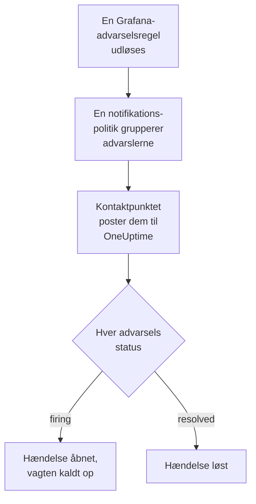

# Grafana

Send advarsler fra [Grafana](https://grafana.com) til OneUptime, så hver advarsel, der udløses, bliver en hændelse, der kalder dit vagthold op og løses, når advarslen er kommet sig. Grafana sender sine advarsler via et webhook-kontaktpunkt, så der er intet at installere på nogen af siderne.

:::cards
- [Vælg, hvordan OneUptime modtager advarsler](#vælg-hvordan-oneuptime-modtager-advarsler): En Incoming Request-monitor eller dit eget workflow.
- [Modtag advarsler med en monitor](#modtag-advarsler-med-en-monitor): Én hændelse pr. advarsel, løst ved genopretning.
- [Konfigurer Grafana](#konfigurer-grafana): Et webhook-kontaktpunkt og den politik, der bruger det.
- [Fejlfinding](#fejlfinding): Når advarsler ikke kommer frem, eller hændelser bliver ved med at være åbne.
:::

## Sådan fungerer det



Grafanas notifikationspolitikker grupperer de advarsler, der udløses, og et webhook-kontaktpunkt poster hver gruppe som én JSON-notifikation. Den har samme form som en notifikation fra [Prometheus Alertmanager](/docs/integrations/prometheus-alertmanager): en `status`, en liste `alerts`, hvor hver advarsel har sin egen `status` og sit eget `fingerprint`, og de `commonLabels` og `commonAnnotations`, som dens advarsler deler. Grafana tilføjer en `title` og en `message`, der er skrevet til mennesker.

## Før du går i gang

- Grafana 9 eller nyere, med Grafana Alerting, standarden siden Grafana 9. Den skal kunne nå din OneUptime over HTTPS.
- I OneUptime retten til at oprette monitorer, eller workflows, hvis du vælger den vej.

## Vælg, hvordan OneUptime modtager advarsler

Sæt OneUptime op først: det giver dig den URL, Grafana sender til.

| Vej | Brug den, når |
| --- | --- |
| En Incoming Request-monitor (anbefalet) | Du vil have, at hver advarsel bliver en hændelse, der kalder vagten op og løses, når advarslen er kommet sig. Der er intet at bygge. |
| Et workflow med en Webhook-trigger | Du har brug for din egen logik: filtrere advarsler, omforme dem eller kalde andre systemer først. Et workflow åbner én hændelse pr. notifikation, ikke pr. advarsel, og løser den ikke ved genopretning. |

Begge får den samme JSON fra det samme kontaktpunkt, så du kan begynde med den ene og skifte senere ved at ændre én URL i Grafana.

## Modtag advarsler med en monitor

En [Incoming Request-monitor](/docs/monitor/incoming-request-monitor) giver dig en URL, og dens kriterier afgør, hvad hver notifikation gør.

:::steps
### Opret monitoren

Gå til **Monitorer**, og klik på **Opret monitor**. Vælg **Incoming Request** under **Monitortype**, kald den `Grafana`, og klik på **Næste**.

### Erklær en hændelse for hver udløst advarsel

Åbn det første kriterium i trinnet **Kriterier**, det, der markerer monitoren som offline. Sæt dets filter til **Anmodningsbrødtekst**, **Indeholder**, `"status":"firing"`. Dette kriterium erklærer allerede en hændelse, når filteret matcher. Udfyld hændelsen:

- **Hændelsestitel**: `{{requestBody.commonLabels.alertname}}`.
- **Hændelsesbeskrivelse**, under **Beskrivelse**: `{{requestBody.message}}`, den tekst, Grafana skriver til notifikationen.
- **Alvorlighed**: den hændelsesalvorlighed, disse advarsler skal have.
- **Vagtpolitikker**, under **Vagt**: de politikker, der skal kaldes op.
- **Løs hændelse automatisk**, under **Flere felter**: lad den være slået til, som den starter. Uden den ignoreres genopretninger, og hændelser bliver ved med at være åbne.

### Åbn én hændelse pr. advarsel

Åbn **Indstillinger** i samme kriterium, og slå **Group incidents and alerts by a payload field** til. Udfyld den som nedenfor, så hver advarsel får sin egen hændelse, og dens genopretning løser den:

| Felt | Værdi |
| --- | --- |
| **Open a separate incident for each…** | `requestBody.alerts[*].fingerprint` |
| **Field that signals recovery** | `requestBody.alerts[*].status` |
| **Value that means recovered** | `resolved` |

### Bring monitoren online igen

Åbn det andet kriterium, det, der markerer monitoren som online, og sæt dets filter til **Anmodningsbrødtekst**, **Indeholder**, `"status":"resolved"`.

### Kopiér URL'en

Klik på **Opret monitor**. Monitorens side **Oversigt** viser dens **Heartbeat URL**. Kopiér den til Grafana:

```text
https://oneuptime.com/heartbeat/<secret key>
```

En selvhostet installation har sin egen vært i stedet for `oneuptime.com`.
:::

Hver advarsel i en notifikation åbner sin egen hændelse, op til **Max incidents per request** (`100`, medmindre du ændrer det), og hver advarsels egen `status` afgør, hvornår dens hændelse løses. Grafanas `fingerprint` identificerer en advarsel ud fra dens etiketter, så det er den værdi, du skal gruppere efter. Se [Modtagelse af advarsler fra et andet system](/docs/monitor/incoming-request-monitor#modtagelse-af-advarsler-fra-et-andet-system) for, hvad hver indstilling gør.

> [!WARNING]
> Gruppér ikke efter en etiket, som alle advarsler i en notifikation deler. Grafanas standardnotifikationspolitik grupperer advarsler efter `grafana_folder` og `alertname`, så alle advarsler i én notifikation har samme `alertname`: gruppering efter `requestBody.alerts[*].labels.alertname` folder hele notifikationen sammen til én hændelse.

`{{requestBody.commonLabels.alertname}}` og `{{requestBody.message}}` beskriver hele notifikationen, som under standardpolitikken er én advarselsregel. Grupperingsnøglen er også en variabel, `{{fingerprint}}`, men den er en hash, der ikke fortæller en responder noget. Se [Hændelse- og advarselsskabeloner](/docs/monitor/incident-alert-templating) for alle de variabler, du kan bruge.

## Konfigurer Grafana

:::steps
### Tilføj et webhook-kontaktpunkt

Gå i Grafana til **Alerting → Contact points**, og klik på **+ Add contact point**. I Grafana 11 og nyere ligger **Alerting** under **Alerts & IRM**, og **Contact points** er en fane i **Notification configuration**.

Kald kontaktpunktet `OneUptime`, vælg **Webhook** under **Integration**, og indsæt den kopierede URL i **URL**. Lad **HTTP Method** stå på `POST`, og klik på **Save contact point**.

### Send advarsler dertil

Gå til **Alerting → Notification policies**. Sæt standardpolitikkens kontaktpunkt til `OneUptime`, eller tilføj en underordnet politik, der matcher de advarsler, OneUptime skal have, med `OneUptime` som kontaktpunkt.
:::

Grafana sender `Content-Type: application/json`, som monitoren skal bruge for at læse felterne i en notifikation. Kontaktpunktets indstilling **Max Alerts** begrænser advarslerne i én notifikation: hold den på `0`, ingen grænse, eller højst på monitorens **Max incidents per request**.

## Test det

1. Åbn kontaktpunktet `OneUptime` i Grafana, og klik på **Test**. Grafana sender en udløst testadvarsel, og en hændelse åbnes i OneUptime. En testadvarsel kommer sig aldrig, så løs den hændelse manuelt.
2. Lad en rigtig advarselsregel udløses, for eksempel ved at sænke dens tærskel et øjeblik, og se dens hændelse åbne og derefter blive løst, når du sætter tærsklen tilbage.

## Modtag advarsler med et workflow

Brug et [workflow](/docs/workflows/index), når du har brug for dine egne trin mellem Grafana og hændelsen.

:::steps
### Opret workflowet

Gå til **Arbejdsgange**, klik på **Opret arbejdsgang** og derefter på **Start fra bunden**. Kald det `Grafana alerts`, og klik på **Opret arbejdsgang**.

### Tilføj Webhook-triggeren

Klik på den stiplede blok **Vælg, hvad der starter denne arbejdsgang**, og vælg **Webhook**. Klik på triggeren, derefter på **Kopiér URL**, og brug den URL i kontaktpunktet i Grafana.

### Kontrollér, at notifikationen er udløst

Klik på **Tilføj komponent**, tilføj en blok **If / Else**, og forbind triggerens punkt **Out** med den. Sæt **Value to check** til `{{local.components.webhook-1.returnValues.request-body.status}}`, **Comparison** til **is equal to** og **Compare with** til `firing`.

### Erklær hændelsen

Tilføj en blok **Create One Incident**, og forbind siden **Yes** af blokken **If / Else** med den. Vælg under **Incident Template** en skabelon, der sætter alvorligheden og de vagtpolitikker, der skal kaldes op (se [Hændelsesskabeloner](/docs/incidents/settings#hændelsesskabeloner)). Angiv under **JSON Object**, hvad der kommer fra Grafana:

```json
{
  "title": "{{local.components.webhook-1.returnValues.request-body.title}}",
  "description": "{{local.components.webhook-1.returnValues.request-body.message}}"
}
```

Uden en skabelon skal **JSON Object** også indeholde `incidentSeverityId`, ID'et på en af projektets hændelsesalvorligheder.

### Slå workflowet til

Slå **Aktiveret** til øverst i **Bygger**. Et workflow, der er slået fra, svarer Grafana med `400`.
:::

En kørsel håndterer én notifikation, så den erklærer én hændelse, uanset hvor mange advarsler notifikationen indeholder. En notifikation, der er `resolved`, tager siden **No** af blokken **If / Else**, hvor intet er forbundet, så kørslen slutter der. Brug monitoren til én hændelse pr. advarsel, der løses ved genopretning.

## Fejlfinding

:::details Intet kommer frem til OneUptime
- Klik på **Test** på kontaktpunktet: Grafana viser en fejl, når den ikke kan nå URL'en. Grafanas serverlog har detaljerne.
- Monitoren svarer `200` med det samme, før den kontrollerer noget, også ved en forkert hemmelig nøgle. Tjek monitorens tidslinje for at se, om notifikationer kommer frem.
- Et workflow, der er slået fra, svarer `400`. Slå **Aktiveret** til øverst i dets **Bygger**.
:::

:::details Hændelser oprettes, men løses aldrig
- Kriteriets hændelse skal have **Løs hændelse automatisk**, under **Flere felter**.
- **Field that signals recovery** skal være `requestBody.alerts[*].status`, og **Value that means recovered** præcis `resolved`. Sammenligningen skelner mellem store og små bogstaver.
- Grupperingsstierne skal starte med `requestBody.`, og kun den første `[*]` i en sti læser en liste. En sti, der bryder en af reglerne, matcher intet, uden nogen fejl.
:::

:::details Én hændelse for en notifikation fuld af advarsler
Du har grupperet efter en etiket, der er den samme for hver advarsel i en notifikation, som `alertname` under standardpolitikken. Gruppér i stedet efter `requestBody.alerts[*].fingerprint`.
:::

:::details Hændelsen viser en henvisning i stedet for en værdi
En henvisning til et felt, som notifikationen ikke har, bliver stående, som den er skrevet, med klammer og det hele. Sammenlign feltets navn med det, Grafana sendte: for et workflow åbner du kørslen i **Protokoller → Kørsler** og sammenligner med det, triggeren modtog.
:::

Vejledningen til [Prometheus Alertmanager](/docs/integrations/prometheus-alertmanager#fejlfinding) dækker flere tilfælde, og de gælder også for Grafanas notifikationer.

## Sikkerhed

- **Behandl URL'en som en adgangskode.** Alle, der har den, kan åbne hændelser. Hvis den slipper ud, så nulstil den: **Nulstil hemmelig nøgle for indgående anmodning** på monitorens side **Indstillinger**, eller **Nulstil URL** i workflowets **Webhook**-trigger. Opdater derefter kontaktpunktets **URL** i Grafana.
- **Selvhostet?** Lad Grafana nå din OneUptime over HTTPS gennem din firewall.

## Næste trin

:::cards
- [Indgående anmodning-monitor](/docs/monitor/incoming-request-monitor): Hver indstilling for den monitor, der modtager dine advarsler.
- [Prometheus Alertmanager](/docs/integrations/prometheus-alertmanager): Den samme opsætning, med en dødemandsknap til dine advarsler.
- [Metrik-monitor](/docs/monitor/metrics-monitor): Advar på de samme metrikker i selve OneUptime.
- [Oversigt over integrationer](/docs/integrations/index): De andre værktøjer, du kan forbinde.
:::
