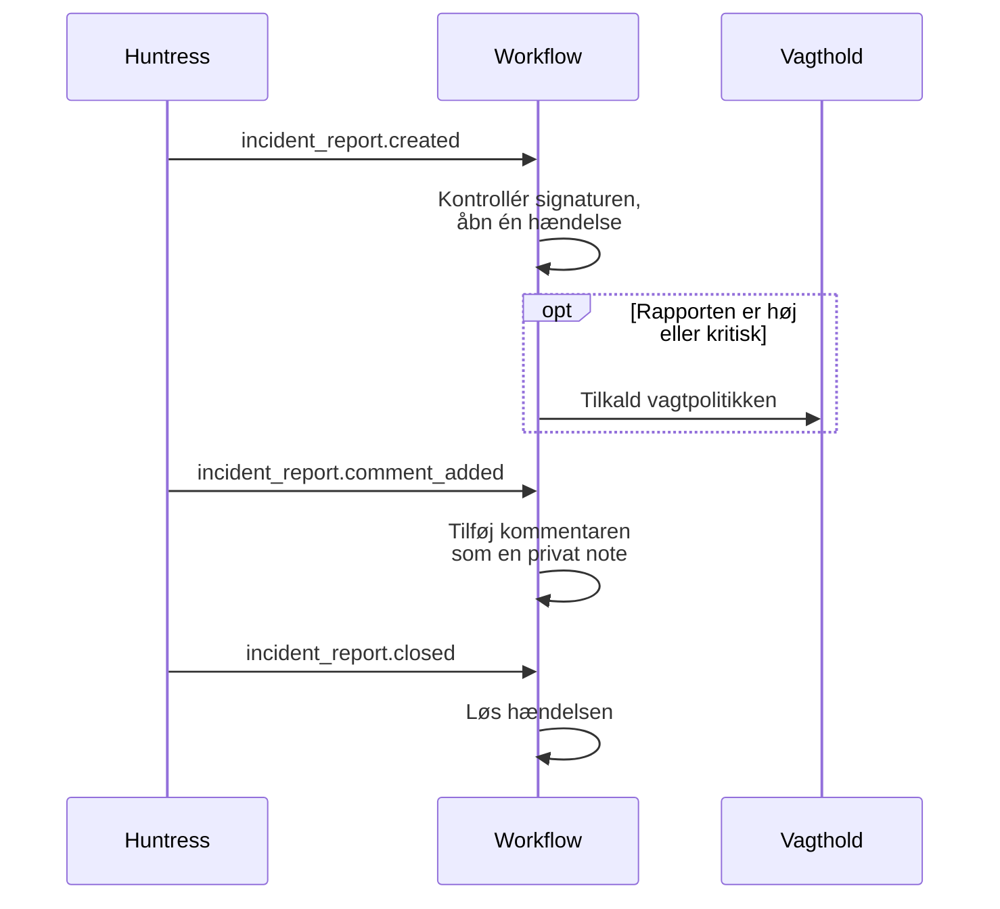

# Huntress-integration

Tilkald dit vagthold ved Huntress-hændelsesrapporter, med et workflow. Når Huntress' SOC sender en hændelsesrapport om et endpoint eller en identitet, åbner workflowet én hændelse for den, tilkalder den vagtpolitik, du vælger, tilføjer kommentarer fra Huntress som private noter og løser hændelsen, når rapporten lukkes i Huntress.

Denne integration er **indgående**: Huntress sender hver begivenhed om en hændelsesrapport til workflowets egen URL, signeret med endpointets signeringshemmelighed. OneUptime kalder aldrig Huntress og har derfor ikke brug for en Huntress-API-nøgle.

:::cards
- [Sådan virker det](#sådan-virker-det): Hvad workflowet gør med hver begivenhed om en rapport.
- [Opsætning](#opsæt-integrationen): Opret workflowet, tilføj endpointet i Huntress, gem dets signeringshemmelighed, send en test.
- [Triggeren](#triggeren-huntress-incident-report): De værdier, en rapport giver workflowet, og triggerens indstillinger.
- [Fejlfinding](#fejlfinding): Hvad triggerens fejl betyder, og hvad der skal ændres.
:::

## Sådan virker det

Huntress sender en begivenhed om en hændelsesrapport, når rapporten sendes, når nogen kommenterer den, og når den lukkes. Triggeren **Huntress Incident Report** starter workflowet én gang for hver begivenhed, og dens **Event** siger, hvilken det var: `created`, `comment-added` eller `closed`.

1. **Kontrollér.** En anmodning skal være signeret med endpointets signeringshemmelighed, højst fem minutter før den ankommer. Alt andet afvises, og triggerens indstillinger fortæller hvorfor.
2. **Start workflowet.** Hver begivenhed starter én kørsel, med rapportens felter som triggerens værdier. En begivenhed, som Huntress sender igen, starter ikke mere.
3. **Åbn én hændelse.** Ved `created` åbner workflowet en hændelse, der er opkaldt efter rapporten, f.eks. `Huntress: Incident on DESKTOP-01 (Acme Corp)`. Dens beskrivelse indeholder rapportens resumé, dens alvorlighed i Huntress, organisationen, den berørte vært eller identitet, de indikatorer, Huntress fandt, og et link til rapporten i Huntress. Hændelsen får en etiket med rapportens organisation og tilkalder den vagtpolitik, du vælger, når rapporten er høj eller kritisk.
4. **Følg rapporten.** Ved `comment-added` bliver kommentaren til en privat note på hændelsen. Ved `closed` løses hændelsen, med årsagen på dens tidslinje.

Hændelsen gemmer rapportens nummer i sine brugerdefinerede felter som `huntressReportId`: Sådan finder workflowet den igen, når Huntress kommenterer eller lukker rapporten. Hændelser, der åbnes på denne måde, vises aldrig på en statusside, og dine hændelsesregler (vagt-, ejer-, etiket- og privatlivsregler) gælder for dem som for enhver anden hændelse.

## Før du begynder

- I OneUptime en rolle, der kan oprette og redigere workflows, f.eks. **Projektejer**, **Projektadministrator** eller **Arbejdsgangsadministrator**.
- I Huntress rollen **Account Admin**: Kun kontoadministratorer kan tilføje webhooks.
- En vagtpolitik at tilkalde.
- På OneUptime Cloud et abonnement med workflows: Growth eller højere. Hver begivenhed, Huntress sender, er én workflowkørsel.
- På en selvhostet installation en OneUptime, som Huntress kan nå fra internettet over HTTPS: Huntress sender kun webhooks til `https://`-URL'er.

## Opsæt integrationen

:::steps
### Opret workflowet

Åbn **Arbejdsgange**, og klik på **Opret arbejdsgang**. Under **Eller start fra en skabelon** vælger du kategorien **Huntress**, vælger **Open an incident for each Huntress incident report**, klikker på **Brug denne skabelon** og opretter workflowet. Det åbner i **Bygger**, slået fra.

### Vælg, hvem der tilkaldes

Klik på trinnet **Page an On-Call Policy**, vælg de **Vagtpolitikker**, der skal tilkaldes, og gem trinnet.

### Tilføj et webhook-endpoint i Huntress

Klik på triggeren **Huntress Incident Report**, og klik på **Kopiér URL** under **Tilføj et webhook-endpoint i Huntress**. URL'en ser ud som `https://oneuptime.com/workflow/huntress/<key>`; på en selvhostet installation begynder den med din egen vært.

Åbn menuen øverst til højre i Huntress, og vælg **Integrations**. Klik på **Add an Integration**, vælg **Webhooks**, og klik på **Add Endpoint**. Indsæt URL'en, slå **Incident Reports** til, og gem. Lad **Escalations**, **Platform Actions** og **Account Notices** være slået fra: Triggeren tager imod de begivenheder og starter intet for dem.

### Gem endpointets signeringshemmelighed

Åbn endpointets menu (⋯) i Huntress, og vælg **View Signing Secret**. Kopiér hele den: Den starter med `whsec_`. Klik på **Gem signeringshemmelighed** i triggeren, indsæt den, og klik på **Gem signeringshemmelighed**. Hemmeligheden krypteres og vises aldrig igen.

Indtil hemmeligheden er gemt, afviser triggeren enhver anmodning. Huntress sender en afvist begivenhed igen senere, så en begivenhed, der afvises nu, når alligevel frem.

### Slå workflowet til, og send en test

Slå **Aktiveret** til øverst i **Bygger**. Åbn endpointets menu (⋯) i Huntress, og vælg **Send Test**. Inden for få sekunder viser triggeren **Modtager rapporter**.

> [!NOTE]
> Uanset hvad testen indeholder, viser triggeren, at den er ankommet. En test med en hændelsesrapport starter workflowet som enhver anden rapport.
:::

## Hvad workflowet gør

Skabelonen tager én vej for hver **Event**, med en **Switch / Case** efter triggeren:

| Event | Hvad workflowet gør |
| --- | --- |
| `created` | Åbner en hændelse med triggerens **Incident Severity ID**, med etiketten fra dens **Organization Label ID**. Ved en høj eller kritisk rapport tilkalder **Page an On-Call Policy** din politik; en lav rapport tilkalder ingen. En rapport, der allerede har en hændelse, åbner ikke en til. |
| `comment-added` | Finder rapportens hændelse og tilføjer kommentaren til den som en privat note. |
| `closed` | Finder rapportens hændelse og løser den, medmindre den allerede er løst. Årsagen står på dens tidslinje: Huntress lukkede rapporten. |

Det er et workflow som alle andre, så du kan ændre, hvad det gør: tilkald kun ved kritiske rapporter ved at ændre, hvad **If / Else** efter **Create One Incident** sammenligner, post hver rapport i en chatkanal med et Slack- eller Microsoft Teams-trin, eller send hver organisation til dens egen vagtpolitik med en **Switch / Case** på **Organization**. Hver kørsel står blandt workflowets kørsler, med hvad hvert trin gjorde.

### Alvorligheder

Huntress giver hver hændelsesrapport én af tre alvorligheder. Triggerens **Incident Severity ID** er den hændelsesalvorlighed, rapporten åbner med: den, dens indstilling vælger, eller ellers rækkefølgen af dine hændelsesalvorligheder, som **Hændelser → Indstillinger → Hændelsesalvor** viser dem:

| Alvorlighed i Huntress | Hvad Huntress mener med den | Indstilling | Hændelsesalvorlighed, når indstillingen er tom |
| --- | --- | --- | --- |
| Critical | Angribere ved tastaturet, farlig malware eller aktiv kompromittering, der skal inddæmmes med det samme. | **Alvorlighed for kritiske rapporter** | Den højeste |
| High | Bekræftet malware, der kræver hurtig afhjælpning, eller kompromittering af en identitet, der skal handles på. | **Alvorlighed for høje rapporter** | Den anden |
| Low | Potentielt uønskede programmer, rester af malware og ældre fund om identiteter. | **Alvorlighed for lave rapporter** | Den tredje |

Et projekt med færre alvorligheder bruger sin laveste til resten. En rapport uden alvorlighed behandles som høj. Hvis en alvorlighed, du har valgt, slettes, afgør rækkefølgen igen.

### Organisationer

Triggerens **Organization Label ID** er en etiket, der er opkaldt efter rapportens Huntress-organisation, f.eks. _Acme Corp_, og som den opretter, første gang en rapport fra den organisation ankommer. Ét workflow modtager rapporterne fra alle organisationer i din Huntress-konto, og triggerens **Kun disse organisationer** indsnævrer det: ét organisationsnavn eller -id pr. linje, hvor navne ikke skelner mellem store og små bogstaver.

> [!TIP]
> For at tilkalde hver kundes eget team skal du tilføje en vagtregel for hændelser pr. organisation, f.eks. »Hvis **Hændelsesetiketter** har en af _Acme Corp_«, der udfører kundens politik. Se [Vagtregler for hændelser](/docs/incidents/settings#vagtregler-for-hændelser).

## Triggeren Huntress Incident Report

Triggeren åbner på Huntress: dens URL, et flueben ved hvert opsætningstrin, der er gjort, og hvad Huntress sendte sidst. Dens indstillinger, der alle er valgfrie, er foldet sammen under **Flere felter**: **Kun disse organisationer**, **Alvorlighed for kritiske rapporter**, **Alvorlighed for høje rapporter** og **Alvorlighed for lave rapporter**.

| Værdi | Hvad den indeholder |
| --- | --- |
| **Event** | `created`, `comment-added` eller `closed`. En rapport, der allerede er lukket eller afvist, er `closed`, uanset hvilken begivenhed der bragte den. |
| **Report ID** | Rapportens nummer i Huntress. |
| **Severity** | `critical`, `high` eller `low`. |
| **Status** | Rapportens status i Huntress, f.eks. `sent`, `closed` eller `dismissed`. |
| **Subject** | Rapportens emne, som Huntress skriver det. |
| **Summary** | Hvad SOC-analytikeren skrev. |
| **Organization**, **Organization ID** | Den Huntress-organisation, rapporten handler om. |
| **Affected** | Den vært eller identitet, rapporten handler om. |
| **Platform**, **Indicators** | Hvor Huntress fandt det, og hvad den fandt. |
| **Comment** | Den kommentar, nogen tilføjede, ved `comment-added`. |
| **Report URL** | Hvor rapporten åbner i Huntress. |
| **Incident Title**, **Incident Description** | En titel og en Markdown-beskrivelse til en hændelse om rapporten. |
| **Note** | Markdown til en note om begivenheden: kommentaren, eller at Huntress lukkede rapporten. |
| **Incident Severity ID**, **Organization Label ID** | Hændelsesalvorligheden og etiketten, som ovenfor. |
| **Received At** | Hvornår OneUptime modtog begivenheden. |

**Summary** og **Comment** er tekst, som Huntress' analytikere har skrevet. Brug **Incident Description** og **Note** for at sætte dem i en hændelse eller en note: De bevarer formateringen, og intet i dem henter et billede eller nævner nogen.

For at prøve workflowet uden Huntress skal du klikke på **Kør arbejdsgang** i **Bygger** og skrive en **Event**, et **Report ID** og de felter, du har brug for. Brug det samme **Report ID** for at følge én rapport fra `created` til `closed`.

## Huntress-forbindelser oprettet tidligere

Huntress blev tidligere sat op under **Hændelser → Integrationer → Huntress**. Hver Huntress-forbindelse blev til et workflow med samme navn, slået til, som gør det, forbindelsen gjorde: Det tilkalder de samme vagtpolitikker ved de samme rapporter, tilføjer de samme etiketter og løser (eller noterer kun) på samme måde. Dets URL er stadig forbindelsens, `https://oneuptime.com/api/huntress/webhook/<connection-id>`, og dets signeringshemmelighed er den samme, så der er intet at ændre i Huntress. De hændelser, forbindelsen åbnede, beholder deres rapports nummer, så workflowet finder dem, når Huntress kommenterer eller lukker de rapporter.

## Sikkerhed

- **Kun signerede anmodninger.** Triggeren kontrollerer de headere `svix-id`, `svix-timestamp` og `svix-signature`, som Huntress sender, mod anmodningens brødtekst, præcis som den ankom. En anmodning, der ikke er signeret med den gemte hemmelighed eller blev signeret mere end fem minutter før eller efter, afvises.
- **Hemmeligheden forbliver hemmelig.** Den gemmes krypteret, returneres aldrig af API'et og vises aldrig igen. **Erstat signeringshemmelighed** i triggeren gemmer en anden, f.eks. hemmeligheden for et nyt endpoint.
- **URL'en er en adresse, ikke en adgangskode.** Den ender på workflowets nøgle; kun en anmodning signeret med endpointets hemmelighed starter workflowet.
- **Ét endpoint pr. workflow.** Hvert workflow har sin egen URL og hemmelighed. Opret et andet workflow for at modtage rapporterne fra en anden Huntress-konto.

## Brug e-mail i stedet

Huntress sender også hændelsesrapporter med e-mail, og en [monitor for indgående e-mail](/docs/monitor/incoming-email-monitor) kan åbne hændelser ud fra de e-mails, f.eks. når emnet indeholder `Critical Incident Report`. Den behandler dog e-mailsene som én monitors status: Mens dens hændelse er åben, åbner den næste rapport ingen, og hændelsen løses af monitorens kriterier i stedet for, når Huntress lukker rapporten. Workflowet åbner én hændelse pr. rapport og løser hver enkelt med dens rapport, så foretræk det. Så snart workflowet modtager rapporter, skal du holde op med at sende e-mailsene til monitoren, ellers tilkalder hver rapport to gange.

## Fejlfinding

Når triggeren afviser en anmodning, viser dens indstillinger årsagen under **Den seneste anmodning blev afvist**. I Huntress viser **View Delivery Attempts** i endpointets menu (⋯) hver levering med OneUptimes svar.

:::details "A request arrived but was refused, because no signing secret is saved for this workflow yet"
Gem endpointets signeringshemmelighed: se [Opsæt integrationen](#opsæt-integrationen). Huntress sender den afviste anmodning igen.
:::

:::details "The request's signature does not match the signing secret"
Den gemte hemmelighed hører ikke til dette endpoint. Hvert endpoint har sin egen: Åbn endpointets menu (⋯) i Huntress, vælg **View Signing Secret**, kopiér hele den, og gem den med **Erstat signeringshemmelighed**.
:::

:::details "The request was signed more than five minutes from now"
Urene hos Huntress og på din OneUptime-server er mere end fem minutter fra hinanden, eller anmodningen er en gentagelse. På en selvhostet installation skal du kontrollere, at serverens ur går rigtigt.
:::

:::details "A request arrived while this workflow is off"
Slå **Aktiveret** til øverst i **Bygger**. Huntress sender den afviste anmodning igen, og så starter den workflowet.
:::

:::details "No Huntress workflow has this address."
Workflowet er slettet eller arkiveret, dets trigger er ikke længere **Huntress Incident Report**, eller endpointets URL i Huntress er ikke workflowets. Kopiér URL'en fra triggeren, og indsæt den i endpointet i Huntress igen.
:::

:::details Der blev ikke åbnet nogen hændelse
Åbn workflowets kørsler og rapportens kørsel. Hvis **Create One Incident** mislykkedes, fordi hændelsesalvorligheden er tom, har projektet ingen hændelsesalvorligheder: Tilføj en under **Hændelser → Indstillinger → Hændelsesalvor**.
:::

:::details Ingen blev tilkaldt
En lav rapport åbner en hændelse uden at tilkalde nogen. Ellers fortæller rapportens kørsel, hvad **Page an On-Call Policy** gjorde, og hændelsens side **Vagtudførelser** viser, hvad hver politik gjorde.
:::

## Næste trin

:::cards
- [Workflow-triggere](/docs/workflows/triggers): De andre måder at starte et workflow på.
- [Vagtregler for hændelser](/docs/incidents/settings#vagtregler-for-hændelser): Tilkald hver organisations eget team via dens etiket.
- [Hændelsestilstande og alvorsgrader](/docs/incidents/states-and-severities): Ordn de alvorligheder, som Huntress-rapporter åbner med.
- [Oversigt over integrationer](/docs/integrations/index): De andre værktøjer, du kan forbinde.
:::
