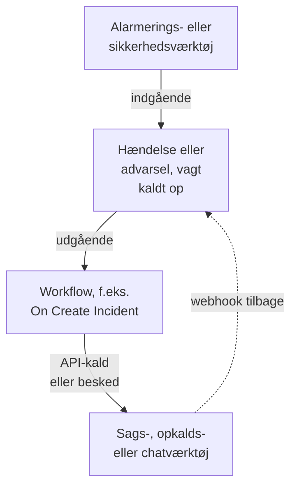

# Oversigt over integrationer

OneUptime arbejder sammen med de værktøjer, dit team allerede bruger. Alarmeringsværktøjer opretter hændelser i det, og det opretter sager, vagtopkald og chatbeskeder i andre værktøjer. Nogle værktøjer forbindes fra en formular, andre fra en færdig workflowskabelon. Alle andre værktøjer med en webhook eller et API forbindes via et workflow, som du selv bygger.

:::cards
- [Vælg, hvordan du forbinder](#vælg-hvordan-du-forbinder): De fire måder at forbinde på, og hvornår du bruger hver af dem.
- [Katalog](#katalog): Alle værktøjer med en vejledning, grupperet efter, hvad de gør.
- [Byg din egen integration](#byg-din-egen-integration): Mønstrene for indgående og udgående data, til ethvert andet værktøj.
- [Hold loginoplysninger sikre](#hold-loginoplysninger-sikre): Hemmelige variabler og de headere, hvert værktøj forventer.
:::

## Sådan fungerer integrationer

Hver integration flytter data i én retning eller i begge. **Indgående**: et andet værktøj fortæller OneUptime, at noget er galt, og OneUptime opretter en hændelse eller en advarsel og kalder vagtholdet op. **Udgående**: der sker noget i OneUptime, og et workflow fortæller det til et andet værktøj: det opretter en sag, kalder nogen op eller sender en besked.



En tovejsintegration som Jira eller Dynamics 365 bruger begge retninger: ét workflow sender hændelsen ud, og et andet, startet af det andet værktøjs webhook, bringer ændringer tilbage.

## Vælg, hvordan du forbinder

| Måde | Bedst til | Eksempler |
| --- | --- | --- |
| En indbygget forbindelse | Værktøjer, som OneUptime selv forbinder til. Du udfylder en formular, og der er intet at bygge. | [Slack](/docs/workspace-connections/slack), [Microsoft Teams](/docs/workspace-connections/microsoft-teams), forbindelserne til [Sikkerhedshændelser](/docs/telemetry/security-events) |
| En workflowskabelon | Sagsværktøjer, holdt i takt begge veje, overvågningsproblemer, sikkerhedshændelsesrapporter og chatbeskeder. Du vælger en skabelon og udfylder nogle få indstillinger. | [Jira](/docs/integrations/jira), [Microsoft Dynamics 365](/docs/integrations/microsoft-dynamics-365), [Huntress](/docs/integrations/huntress), [Zabbix](/docs/integrations/zabbix) |
| En Incoming Request-monitor | Alarmeringsværktøjer, der sender en webhook. Du får én hændelse pr. alarm, sendt til vagten og løst, når alarmen er overstået, uden workflow. | [Zabbix](/docs/integrations/zabbix), [Prometheus Alertmanager](/docs/integrations/prometheus-alertmanager), [Grafana](/docs/integrations/grafana) |
| Et workflow, du selv bygger | Ethvert værktøj med en webhook eller et REST API, og al din egen logik. | [PagerDuty](/docs/integrations/pagerduty), [Opsgenie](/docs/integrations/opsgenie), [ServiceNow](/docs/integrations/servicenow) |

Start fra toppen af tabellen: jo højere en måde står, jo mindre er der at vedligeholde.

## Katalog

### Overvågnings- og alarmeringsværktøjer

| Værktøj | Retning | Hvad det gør |
| --- | --- | --- |
| [Zabbix](/docs/integrations/zabbix) | Begge | Gør Zabbix-problemer til hændelser eller advarsler, løser dem, når de er kommet sig, og kvitterer for eller lukker problemerne fra OneUptime. |
| [Prometheus Alertmanager](/docs/integrations/prometheus-alertmanager) | Indgående | Gør Alertmanager-notifikationer til hændelser. |
| [Grafana](/docs/integrations/grafana) | Indgående | Gør Grafana-alarmer til hændelser. |
| [Datadog](/docs/integrations/datadog) | Indgående | Gør alarmer fra Datadog-monitorer til hændelser. |

### Sikkerhedsværktøjer

| Værktøj | Retning | Hvad det gør |
| --- | --- | --- |
| [Huntress](/docs/integrations/huntress) | Indgående | Kalder vagten op ved hændelsesrapporter fra Huntress og løser hændelsen, når rapporten lukkes. |
| [Google SecOps](/docs/integrations/google-secops) | Begge | Henter detektioner og indikatorer fra Google SecOps ind i Sikkerhedshændelser og sender det, OneUptime finder, dertil. |
| [Microsoft Sentinel](/docs/integrations/microsoft-sentinel) | Begge | Henter hændelser fra Microsoft Sentinel ind i Sikkerhedshændelser og sender det, OneUptime finder, dertil. |
| [Microsoft Defender XDR](/docs/integrations/microsoft-defender-xdr) | Indgående | Henter alarmer fra Microsoft Defender XDR ind i Sikkerhedshændelser. |
| [CrowdStrike Falcon](/docs/integrations/crowdstrike-falcon) | Indgående | Henter alarmer fra CrowdStrike Falcon ind i Sikkerhedshændelser. |
| [Splunk Enterprise Security](/docs/integrations/splunk) | Begge | Henter notable events fra Splunk ind i Sikkerhedshændelser og sender det, OneUptime finder, dertil. |
| [Elastic Security](/docs/integrations/elastic-security) | Begge | Henter detektionsalarmer fra Elastic Security ind i Sikkerhedshændelser og sender det, OneUptime finder, dertil. |
| [AWS Security Hub](/docs/integrations/aws-security-hub) | Indgående | Henter fund fra AWS Security Hub ind i Sikkerhedshændelser. |
| [Okta System Log](/docs/integrations/okta) | Indgående | Henter logins, kontoændringer og trusselsdetektioner fra Okta ind i Sikkerhedshændelser. |

### Sagsstyring og IT-servicestyring

| Værktøj | Retning | Hvad det gør |
| --- | --- | --- |
| [Jira](/docs/integrations/jira) | Begge | Opretter en Jira-sag for hver hændelse eller advarsel og bringer statusændringer og kommentarer tilbage. |
| [Microsoft Dynamics 365](/docs/integrations/microsoft-dynamics-365) | Begge | Opretter en Dynamics 365-sag for hver hændelse eller advarsel og bringer statusændringer og noter tilbage. |
| [ServiceNow](/docs/integrations/servicenow) | Udgående | Opretter en hændelse i ServiceNow for hver OneUptime-hændelse og løser den sammen med hændelsen. |
| [GitHub](/docs/integrations/github) | Udgående | Opretter et GitHub-issue for en hændelse. |
| [GitLab](/docs/integrations/gitlab) | Udgående | Opretter et GitLab-issue for en hændelse. |

### Opkaldsværktøjer

| Værktøj | Retning | Hvad det gør |
| --- | --- | --- |
| [PagerDuty](/docs/integrations/pagerduty) | Udgående | Udløser en hændelse i PagerDuty for hver OneUptime-hændelse og løser den sammen med hændelsen. |
| [Opsgenie](/docs/integrations/opsgenie) | Udgående | Opretter en Opsgenie-alarm for hver OneUptime-hændelse og lukker den sammen med hændelsen. |

### Chatværktøjer

| Værktøj | Retning | Hvad det gør |
| --- | --- | --- |
| [Slack](/docs/workspace-connections/slack) | Begge | En indbygget forbindelse: hændelseskanaler, handlinger fra Slack og vagter. |
| [Microsoft Teams](/docs/workspace-connections/microsoft-teams) | Begge | En indbygget forbindelse: hændelseskanaler, handlinger fra Teams og vagter. |
| [Mattermost](/docs/workflows/components#mattermost) | Udgående | Sender opdateringer om hændelser til en Mattermost-kanal. |
| [Discord](/docs/integrations/discord) | Udgående | Sender opdateringer om hændelser til en Discord-kanal. |
| [Telegram](/docs/integrations/telegram) | Udgående | Sender en besked til en Telegram-chat, når en advarsel udløses. |
| [IRC](/docs/integrations/irc) | Udgående | Sender opdateringer om hændelser til en IRC-kanal. |

> [!TIP]
> Slack og Microsoft Teams har også workflowtrin. Brug den indbyggede forbindelse til hændelseskanaler og vagter, og et workflowtrin, når du kun har brug for en besked i en kanal.

### Hostingplatforme

| Værktøj | Retning | Hvad det gør |
| --- | --- | --- |
| [Vercel](/docs/integrations/vercel) | Indgående | Tilføj OneUptime fra Vercel Marketplace: traces, logs, oppetidsmonitorer og en statusside til dine Vercel-projekter. |

## Skift fra et andet værktøj

For at forlade et andet værktøj til vagter, oppetid eller statussider henter du dit team over i stedet for at forbinde de to. **Projektindstillinger → Avanceret → Importér fra et andet værktøj** læser din konto med en API-nøgle, viser dig, hvad det fandt, og opretter det, du sætter flueben ved. Hvert værktøj har en vejledning:

- Værktøjer til vagter og hændelser: [Opsgenie](/docs/moving-to-oneuptime/opsgenie), [PagerDuty](/docs/moving-to-oneuptime/pagerduty), [incident.io](/docs/moving-to-oneuptime/incident-io), [Splunk On-Call](/docs/moving-to-oneuptime/splunk-on-call) og [Grafana OnCall](/docs/moving-to-oneuptime/grafana-oncall).
- Værktøjer til oppetid og statussider: [UptimeRobot](/docs/moving-to-oneuptime/uptimerobot), [Atlassian Statuspage](/docs/moving-to-oneuptime/atlassian-statuspage), [Better Stack](/docs/moving-to-oneuptime/better-stack), [Pingdom](/docs/moving-to-oneuptime/pingdom), [StatusCake](/docs/moving-to-oneuptime/statuscake) og [Uptime Kuma](/docs/moving-to-oneuptime/uptime-kuma).

## Byg din egen integration

Et værktøj uden vejledning passer stadig ind i et af to mønstre. Kan det sende en webhook, så brug det indgående mønster. Har det et REST API, så brug det udgående mønster. Begge er workflows: se [Workflows – Oversigt](/docs/workflows/index) for at komme i gang.

### Indgående: et andet værktøj sender data til OneUptime

Til et alarmeringsværktøj starter du med en [Incoming Request-monitor](/docs/monitor/incoming-request-monitor#modtagelse-af-advarsler-fra-et-andet-system): den opretter én hændelse pr. alarm og løser den, når alarmen er overstået, uden at du skal bygge noget. Byg et workflow, når du har brug for din egen logik:

:::steps
1. Åbn **Arbejdsgange**, klik på **Opret arbejdsgang** og derefter på **Start fra bunden**. Giv workflowet et navn, og klik på **Opret arbejdsgang**.
2. Klik på den stiplede blok **Vælg, hvad der starter denne arbejdsgang**, og vælg **Webhook**. Klik på triggeren og derefter på **Kopiér URL**.
3. Send det andet værktøjs webhook til den URL som en `POST` med `Content-Type: application/json`.
4. Tilføj de blokke, der handler på den. De læser anmodningen med referencer som `{{local.components.webhook-1.returnValues.request-body.status}}`: en **If / Else**-blok til at kontrollere et felt og derefter **Create One Incident** til at erklære en hændelse.
5. Slå **Aktiveret** til øverst i **Bygger**, send en test fra det andet værktøj, og åbn **Protokoller → Kørsler** for at se, hvad der kom ind.
:::

URL'en er den eneste loginoplysning, så behandl den som en adgangskode. Se [Webhook](/docs/workflows/triggers#webhook).

### Udgående: OneUptime sender data til et andet værktøj

:::steps
1. Gem værktøjets API-nøgle som en hemmelig global variabel, som vist [nedenfor](#hold-loginoplysninger-sikre).
2. Opret et workflow, klik på den stiplede blok, og vælg en begivenhedstrigger, f.eks. **On Create Incident**. Klik på triggeren: dens **Fields to pass on** starter med **Titel**, så klik på **Tilføj felt**, og vælg de andre felter, der skal sendes, f.eks. **Beskrivelse**.
3. Klik på **Tilføj komponent**, og tilføj en **API Post (JSON)**-blok. Forbind triggerens **Success**-punkt med den.
4. Udfyld dens **URL**, dens **Request Headers** med `Authorization`-headeren og dens **Request Body** med hændelsens felter, f.eks. `{{local.components.incident-on-create-1.returnValues.model.title}}`.
5. Klik på **Kør arbejdsgang**, vælg en hændelse under **Hændelse**, og kør den. En testkørsel sender anmodningen for alvor. Slå derefter **Aktiveret** til.
:::

Når værktøjet skal have dataene i en anden form, tilføjer du en [Run Custom JavaScript](/docs/workflows/components#custom-code)-blok mellem de to. Opskriften er den samme for Zendesk, New Relic, AWS (via SNS), StatusCake og alle de andre: kun URL'en og brødteksten ændrer sig.

## Hold loginoplysninger sikre

Indsæt aldrig en API-nøgle eller et token i en blok. Gem den én gang som en hemmelig global variabel:

:::steps
1. Gå til **Arbejdsgange → Globale variabler**, og klik på **Opret Workflow Variabel**.
2. Giv den et navn, f.eks. `JIRA_AUTH`, og klik på **Næste**.
3. Indsæt nøglen i **Indhold**, slå **Hemmelighed** til, og klik på **Opret Workflow Variabel**.
:::

Enhver blok læser den som `{{global.variables.JIRA_AUTH}}`. En variabels indhold kan ikke læses igen, når det er gemt, og indholdet af en hemmelig variabel erstattes med `[REDACTED]` i kørselslogs. Til tokens, der udløber, som dem fra Microsoft Entra ID, henter en [OAuth 2.0-variabel](/docs/workflows/variables#oauth-20-variabler-tokens-der-fornyer-sig-selv) selv et nyt. Se [Workflow-variabler](/docs/workflows/variables#globale-variabler).

### Snydeark til godkendelse

De fleste udgående integrationer lægger nøglen i en header i anmodningen. De almindelige former:

| Skema | Hvad du sender | Bruges af |
| --- | --- | --- |
| Bearer-token | `Authorization: Bearer {{global.variables.TOKEN}}` | GitHub og de fleste moderne API'er |
| Basic-godkendelse | `Authorization: Basic {{global.variables.BASE64_USER_PASS}}` | Jira Cloud, ServiceNow |
| Header med API-nøgle | `Authorization: GenieKey {{global.variables.OPSGENIE_KEY}}` | Opsgenie |
| Header med privat token | `PRIVATE-TOKEN: {{global.variables.GITLAB_TOKEN}}` | GitLab |
| Nøgle i brødteksten | `routing_key` i JSON-brødteksten | PagerDuty Events API |
| OAuth 2.0-klientlegitimationsoplysninger | `Authorization: Bearer {{local.variables.dynamicsAccessToken}}`, fra en OAuth 2.0-variabel | Microsoft Dynamics 365 |

Til Basic-godkendelse koder du `username:password`, eller `email:api_token`, én gang og gemmer resultatet som hemmeligheden. På macOS eller Linux:

```bash
printf '%s' 'you@example.com:your_api_token' | base64 | tr -d '\n'
```

Brug `printf`, ikke `echo`: `echo` tilføjer et linjeskift, som kodes sammen med resten og ødelægger loginoplysningerne. `tr` holder et langt resultat på én linje.

## Selvhostede installationer

En selvhostet OneUptime kalder andre værktøjer fra dit netværk, og andre værktøjer kalder den fra deres:

- **Udgående:** workflowanmodninger til private netværksadresser afvises, medmindre en administrator tillader dem. Se [Udgående netværksadgang](/docs/workflows/configuration#udgående-netværksadgang).
- **Indgående:** et værktøjs webhooks skal nå din OneUptime via HTTPS, så et værktøj i skyen har brug for en offentlig adresse at kalde.
- **Indbyggede integrationer** har hver deres opsætningsvejledning: [Slack](/docs/self-hosted/slack-integration), [Microsoft Teams](/docs/self-hosted/microsoft-teams-integration), [GitHub](/docs/self-hosted/github-integration), [Twilio](/docs/self-hosted/twilio-integration), [SendGrid Inbound Email](/docs/self-hosted/sendgrid-inbound-email) og [Push Notifications](/docs/self-hosted/push-notifications).

## Næste trin

:::cards
- [Workflows – Oversigt](/docs/workflows/index): Hvordan workflows kører, og hvordan du bygger dit første.
- [Indgående anmodning-monitor](/docs/monitor/incoming-request-monitor): Modtag alarmer fra ethvert værktøj uden workflow.
- [Jira](/docs/integrations/jira): En komplet tovejsintegration ud fra skabeloner.
- [Workflow-variabler](/docs/workflows/variables): Send data mellem blokke, og hold hemmeligheder ude af dem.
:::
