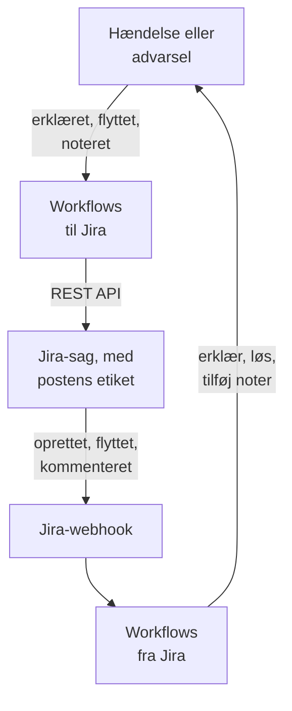

# Jira

Hold [Jira](https://www.atlassian.com/software/jira)-sager i takt med dine OneUptime-hændelser og -advarsler, begge veje. Færdige workflowskabeloner opretter en sag for hver hændelse eller advarsel, flytter den, efterhånden som posten bevæger sig, og kopierer noter ind i den som kommentarer. Andre erklærer hændelser ud fra nye sager og bringer statusændringer, kommentarer og redigeringer tilbage. Der er intet plugin: workflowene kalder Jiras REST API, og Jira kalder deres webhook-URL'er.

:::cards
- [Start fra en skabelon](#start-fra-en-skabelon): De 17 skabeloner, hvad de beder om, og hvordan du sætter dem op.
- [Sådan fungerer skabelonerne](#sådan-fungerer-skabelonerne): Hvordan sager og poster forbliver forbundet, uden løkker.
- [Byg det selv](#byg-det-selv): Hver retning i hånden, når en skabelon ikke passer.
- [Fejlfinding](#fejlfinding): Hvad Jiras svar betyder.
:::

> [!NOTE]
> Atlassian omdøber ting i Jira Cloud: et **projekt** hedder nu et **område** i store dele af brugerfladen, og en **sag** hedder et **arbejdselement**. Websteder bruger begge ord, så hvor ordvalget betyder noget, finder du begge her.

## Sådan fungerer det



Hver skabelon er et lille workflow, så du tager kun de retninger, du vil have, for hændelser, advarsler eller begge. Skabelonerne OneUptime → Jira starter fra en begivenhed i OneUptime og kalder Jiras REST API. Skabelonerne Jira → OneUptime starter fra en Jira-webhook. De finder alle hinandens poster via to etiketter på sagen.

Alt på denne side er skrevet til **Jira Cloud**. [Jira Data Center](#jira-data-center) viser, hvad der ændrer sig på en selvadministreret Jira.

## Før du går i gang

- Et Jira Cloud-websted, f.eks. `https://your-domain.atlassian.net`, og et projekt at oprette sager i.
- En Jira-bruger til integrationen og et API-token til den. Giv brugeren **Browse Projects**, **Create Issues**, **Edit Issues**, **Add Comments** og **Transition Issues** i projektet.
- En Jira-administrator til at registrere de webhooks, som skabelonerne Jira → OneUptime har brug for.
- I OneUptime rettigheden til at oprette workflows. På OneUptime Cloud kræver workflows **Growth**-abonnementet eller højere.

## Start fra en skabelon

Dialogboksen **Opret en arbejdsgang** har 17 Jira-skabeloner under **Jira** i sin kategoriliste: ni til hændelser og derefter otte til advarsler, hver gruppe under sin egen overskrift. De deler én konvention, etiketter på Jira-sagen, så enhver kombination af dem fungerer sammen.

### Skabeloner til hændelser

| Skabelon | Hvad den gør | Hvad den beder om |
| --- | --- | --- |
| **OneUptime → Jira** | | |
| Create a Jira issue when an incident is declared | Opretter en sag for hver ny hændelse og tilføjer hændelsens ID som etiket. Hændelser erklæret fra Jira og private hændelser springes over. | API URL, API token, project key, issue type, OneUptime URL |
| Move the Jira issue when the incident is acknowledged or resolved | Flytter den forbundne sag frem: til en In Progress-status, når hændelsen kvitteres, og til en Done-status, når den løses. Flytter den aldrig tilbage. | API URL, API token |
| Copy incident private notes to the Jira issue | Sender hver ny privat note som kommentar på den forbundne sag, som en intern kommentar i Jira Service Management. | API URL, API token |
| Copy incident public notes to the Jira issue | Sender hver ny offentlig note som kommentar på den forbundne sag. | API URL, API token |
| Comment on the Jira issue when the incident is edited | Når hændelsens titel, alvorlighed, beskrivelse, grundårsag eller afhjælpningsnoter ændres, sender den, hvordan hændelsen ser ud nu, som en intern kommentar i Jira Service Management. | API URL, API token |
| **Jira → OneUptime** | | |
| Declare an incident when a Jira issue is created | Erklærer en hændelse for hver ny sag, holdt væk fra dine statussider, med en alvorlighed valgt ud fra sagens prioritet, og sætter derefter etiket på sagen for at forbinde de to. | Site URL, API URL, API token og en Jira-webhook til **Issue created** |
| Acknowledge or resolve the incident when its Jira issue moves | Kvitterer hændelsen, når den forbundne sag flyttes til en In Progress-status, og løser den, når sagen flyttes til en Done-status. | En Jira-webhook til **Issue updated** |
| Add Jira comments to the incident as private notes | Kopierer hver kommentar fra en forbundet sag over på hændelsen som en privat note. | Site URL, API URL, API token og en Jira-webhook til **Comment created** |
| Add Jira issue changes to the incident as private notes | Noterer hver redigering af en forbundet sag, f.eks. prioriteten, den ansvarlige eller resuméet, på hændelsen som en privat note. Statusændringer overlades til skabelonen ovenfor. | Site URL og en Jira-webhook til **Issue updated** |

### Skabeloner til advarsler

Skabelonerne til advarsler gør det samme arbejde for advarsler. Der er én mindre, fordi advarsler ikke har offentlige noter. [Hvad der er anderledes for advarsler](#hvad-der-er-anderledes-for-advarsler) viser resten.

| Skabelon | Hvad den gør | Hvad den beder om |
| --- | --- | --- |
| **OneUptime → Jira** | | |
| Create a Jira issue when an alert is created | Opretter en sag for hver ny advarsel, også hver advarsel, en monitor udløser, og tilføjer advarslens ID som etiket. Advarsler oprettet fra Jira og private advarsler springes over. | API URL, API token, project key, issue type, OneUptime URL |
| Move the Jira issue when the alert is acknowledged or resolved | Flytter den forbundne sag frem: til en In Progress-status, når advarslen kvitteres, og til en Done-status, når den løses. Flytter den aldrig tilbage. | API URL, API token |
| Copy alert private notes to the Jira issue | Sender hver ny privat note som kommentar på den forbundne sag, som en intern kommentar i Jira Service Management. | API URL, API token |
| Comment on the Jira issue when the alert is edited | Når advarslens titel, alvorlighed, beskrivelse, grundårsag eller afhjælpningsnoter ændres, sender den, hvordan advarslen ser ud nu, som en intern kommentar i Jira Service Management. | API URL, API token |
| **Jira → OneUptime** | | |
| Create an alert when a Jira issue is created | Opretter en advarsel for hver ny sag, med en alvorlighed valgt ud fra sagens prioritet, og sætter derefter etiket på sagen for at forbinde de to. | Site URL, API URL, API token og en Jira-webhook til **Issue created** |
| Acknowledge or resolve the alert when its Jira issue moves | Kvitterer advarslen, når den forbundne sag flyttes til en In Progress-status, og løser den, når sagen flyttes til en Done-status. | En Jira-webhook til **Issue updated** |
| Add Jira comments to the alert as private notes | Kopierer hver kommentar fra en forbundet sag over på advarslen som en privat note. | Site URL, API URL, API token og en Jira-webhook til **Comment created** |
| Add Jira issue changes to the alert as private notes | Noterer hver redigering af en forbundet sag, f.eks. prioriteten, den ansvarlige eller resuméet, på advarslen som en privat note. Statusændringer overlades til skabelonen ovenfor. | Site URL og en Jira-webhook til **Issue updated** |

Ingen af skabelonerne OneUptime → Jira sender en hændelse markeret som [**Privat hændelse**](/docs/incidents/declaring-incidents#trin-1-hændelsesdetaljer) eller en advarsel markeret som **Privat advarsel** til Jira: hverken posten, dens tilstand, dens noter eller dens redigeringer, medmindre du slår det til. Se [Begrænsninger](#begrænsninger).

### Hvad der er anderledes for advarsler

Hver skabelon til advarsler er bygget som sin tvilling til hændelser, trin for trin. Hvor advarsler adskiller sig fra hændelser, gør skabelonerne det også:

- **Ingen offentlige noter.** Advarsler har kun private noter, så hver kommentar, skabelonerne til advarsler sender, er en intern kommentar i Jira Service Management.
- **Ingen statusside.** En advarsel når aldrig en statusside, så **Create an alert when a Jira issue is created** skriver alvorligheden, titlen, beskrivelsen og `customFields.jiraIssueKey` og intet andet.
- **To alvorligheder, så Medium bliver Low.** Et nyt projekt har to alvorligheder for advarsler, High og Low, hvor det har tre for hændelser. Oprettelsesskabelonen fordeler Jiras prioriteter over de alvorligheder, projektet har. Med de to standardalvorligheder bliver Highest, High, Critical og Blocker til High, og enhver anden prioritet bliver til Low, også Medium og Major. For at sende Medium til High ændrer du `medium: 1` til `medium: 0` i `PRIORITY_RANK` i scriptet `prepare-alert-1`.
- **Advarslers links og etiketter.** Sagen linker til `/dashboard/<project id>/alerts/<alert id>` og får etiketten `oneuptime-alert-<alert id>`.
- **Numre siger, hvad de nummererer.** Med standardpræfikset `#` kan en advarsel og en hændelse begge være `#12`, så skabelonerne skriver `Alert #12` eller `Incident #12`. Et nummer med sit eget præfiks, f.eks. `ALT-12`, skrives, som det er.
- **Private advarsler.** En advarsel markeret som **Privat advarsel**, i hånden eller af en privatlivsregel for advarsler, holdes ude af Jira, medmindre du sætter `SYNC_PRIVATE_ALERTS` til `true`.

**Monitorer udløser selv advarsler, og det kan blive mange.** **Create a Jira issue when an alert is created** opretter en sag for hver eneste. Medmindre hver advarsel fortjener en sag, så sæt en betingelse foran Jira-trinnet. For kun at oprette sager for advarsler med High:

1. Åbn workflowets **Bygger**, og tilføj en **If / Else**-blok.
2. Sæt **Value to check** til `{{local.components.alert-on-create-1.returnValues.model.alertSeverity.name}}`, **Comparison** til **is equal to** og **Compare with** til `High`.
3. Fjern linjen fra `alert-on-create-1` til `prepare-issue-1` ved at trække dens ende væk fra punktet (se [Ryd op](/docs/workflows/authoring#ryd-op)). Forbind triggerens **Success** med **If / Else**-blokken og dens **Yes** med `prepare-issue-1`.

En advarsel, der tager **No**-siden, afslutter kørslen der, og der oprettes ingen sag for den.

### Hvad skabelonerne beder om

Trinnet **Konfigurer** i oprettelsesguiden beder om op til fem værdier. Tabellerne ovenfor viser, hvilke hver skabelon har brug for.

- **Jira Site URL** — den adresse, du åbner Jira på, f.eks. `https://your-domain.atlassian.net`. På Jira Data Center dens basis-URL, f.eks. `https://jira.example.com:8443` eller `https://example.com/jira`. Skabelonerne, der bringer Jira ind i OneUptime, linker til sagen i den beskrivelse eller note, de skriver, og det link går altid til dette websted, uanset hvad begivenheden siger. Derfor accepterer feltet et websteds adresse og intet andet: et skema, en vært, en port, hvis der er en, og på Data Center den sti, Jira kører under. Det afviser adressen på en side på webstedet, en forespørgsel eller et brugernavn og siger, hvad du skal skrive i stedet. En skråstreg til sidst er i orden. Hvis variablen senere tømmes, nævnes sagen uden link.
- **Jira API URL** — hvor workflowet sender sine Jira-anmodninger hen: dit websted, f.eks. `https://your-domain.atlassian.net`, uden skråstreg til sidst. Med et API-token med scopes, hvilket omfatter ethvert token til en tjenestekonto, bruger du `https://api.atlassian.com/ex/jira/<cloudId>` i stedet. Dit `cloudId` står i JSON'en på `https://your-domain.atlassian.net/_edge/tenant_info`. Med et klassisk token er det den samme adresse som **Jira Site URL**, så i de skabeloner, der beder om begge, udfylder guiden den ud fra **Jira Site URL**, indtil du selv skriver i den.
- **Jira API Token (base64 of email:token)** — ikke tokenet alene, men kontoens e-mail og tokenet kodet sammen, sådan som Jira Cloud tager imod Basic-godkendelse. [Opret API-tokenet](#opret-api-tokenet) viser hvordan. Tokens udløber, som standard et år efter oprettelsen, så skriv datoen ned et sted.
- **Jira Project Key** — det projekt (område), nye sager oprettes i: `OPS` i `OPS-123`.
- **Jira Issue Type** — den type sag, der skal oprettes, stavet præcis som i det projekt, f.eks. `Task`, `Bug` eller `Incident`.
- **OneUptime URL** — den adresse, du åbner OneUptime på: `https://oneuptime.com` eller din egen vært. Sagens beskrivelse linker med den tilbage til hændelsen eller advarslen.

### Opret API-tokenet

:::steps
1. Opret et token til en dedikeret Jira-bruger, en almindelig Atlassian-konto, som kun integrationen bruger, i stedet for til en person: sager og kommentarer tilskrives tokenets ejer. Log ind som den bruger, og opret tokenet på [id.atlassian.com/manage-profile/security/api-tokens](https://id.atlassian.com/manage-profile/security/api-tokens). Et klassisk token (**Create API token**) virker med dit websteds URL. Et token med scopes (**Create API token with scopes**) virker kun med `api.atlassian.com`-adressen ovenfor. De klassiske scopes `read:jira-work` og `write:jira-work` dækker alle de kald, skabelonerne foretager.
2. Kod kontoens e-mail og tokenet:

   ```bash
   printf '%s' 'jira-bot@example.com:your_api_token' | base64 | tr -d '\n'
   ```

   Brug `printf`, ikke `echo`: `echo` tilføjer et linjeskift, som kodes sammen med resten, og så accepterer Jira ikke længere loginoplysningerne. På dit websteds URL viser det sig sjældent som en `401` (se [Begrænsninger](#begrænsninger)). `tr` holder outputtet på én linje: GNU `base64` på Linux ombryder for hver 76 tegn, og et nutidigt token er langt nok til at blive ombrudt.

3. Indsæt outputtet i **Jira API Token (base64 of email:token)**.
:::

En Atlassian-**tjenestekonto** virker også. En organisationsadministrator opretter den og dens token i [admin.atlassian.com](https://admin.atlassian.com) under **Directory → Service accounts**. Det token har altid scopes, så **Jira API URL** skal være adressen `https://api.atlassian.com/ex/jira/<cloudId>` (**Jira Site URL** forbliver dit websted), og den e-mail, du koder, er tjenestekontoens egen. Giv tjenestekontoen de projektrettigheder, der er nævnt ovenfor, ligesom du ville give enhver anden bruger.

### Opret workflowene

:::steps
1. Åbn **Arbejdsgange → Opret arbejdsgang**. Vælg **Jira** i kategorilisten under **Eller start fra en skabelon**, eller skriv `Jira` i **Søg i skabeloner…**, og klik på den skabelon, du vil have. Den åbnes og viser, hvad den gør, og hvilke indstillinger den vil bede om. Klik på **Brug denne skabelon**.
2. **Navn** udfyldes ud fra skabelonen. Skift det, hvis du vil.
3. **Konfigurer** beder om værdierne ovenfor. De gemmes som workflowets egne variabler under **Arbejdsgangsvariabler** i dets menu. API-tokenet gemmes som en hemmelighed: det skjules i **Protokoller → Kørsler** og bruges kun i `Authorization`-headeren i Jira-kaldene.
4. Klik på **Opret arbejdsgang**. Hvert workflow oprettes slået fra: slå **Aktiveret** til øverst i dets **Bygger**.
:::

Start med **Create a Jira issue when an incident is declared**, eller **Create a Jira issue when an alert is created** til advarsler: alle andre skabeloner OneUptime → Jira af samme slags finder sagen via den etiket, som denne tilføjer. Slå den til, erklær en testhændelse eller opret en testadvarsel, og åbn workflowets **Protokoller → Kørsler**. Kørslens sidste trin bør vise `✅ Created Jira issue` og nævne den nye sag.

Hvert workflow har sin egen kopi af disse værdier. Når du udskifter tokenet, opdaterer du `jiraBasicAuthToken` under **Arbejdsgangsvariabler** i hvert Jira-workflow, der bad om det. Hvis Jira flytter til en anden adresse, opdaterer du `jiraSiteUrl` og `jiraBaseUrl` på samme måde.

### Forbind webhook-skabelonerne

Skabelonerne Jira → OneUptime, fire til hændelser og fire til advarsler, starter fra en [Webhook-trigger](/docs/workflows/triggers#webhook), så Jira skal have at vide, hvor det skal sende sine begivenheder hen. Gør det i denne rækkefølge:

1. Opret workflowet, og **slå det til først**. Et workflow, der er slået fra, svarer Jira med `400`, og Jira prøver ikke en levering igen, der blev afvist med en `4xx`. Begivenheder, der sendes, før du slår det til, går tabt og sættes ikke i kø.
2. Åbn workflowets **Bygger**, klik på triggerblokken **Webhook** (`webhook-1`), og klik på **Kopiér URL** øverst i dens indstillinger. URL'en ser sådan ud:

   ```text
   https://<your OneUptime host>/workflow/trigger/<webhook secret key>
   ```

3. Gå i Jira til **Settings → System → WebHooks** (under **Advanced**), og klik på **Create a WebHook**. Indsæt URL'en, sæt flueben ved begivenheden fra tabellen nedenfor under **Issue related events**, og angiv et JQL-filter, så kun dit projekts sager udløser den. Lad **Exclude body** være uden flueben: workflowet læser alt fra brødteksten.

| Skabelon | Jira-begivenhed | JQL-filter |
| --- | --- | --- |
| **Hændelser** | | |
| Declare an incident when a Jira issue is created | **Issue created** | `project = OPS AND (labels is EMPTY OR labels != oneuptime)` |
| Acknowledge or resolve the incident when its Jira issue moves | **Issue updated** | `project = OPS` |
| Add Jira comments to the incident as private notes | **Comment created** | `project = OPS` |
| Add Jira issue changes to the incident as private notes | **Issue updated** | `project = OPS` |
| **Advarsler** | | |
| Create an alert when a Jira issue is created | **Issue created** | `project = OPS AND (labels is EMPTY OR labels != oneuptime)` |
| Acknowledge or resolve the alert when its Jira issue moves | **Issue updated** | `project = OPS` |
| Add Jira comments to the alert as private notes | **Comment created** | `project = OPS` |
| Add Jira issue changes to the alert as private notes | **Issue updated** | `project = OPS` |

Erstat `OPS` med din projektnøgle. Filteret på de to skabeloner, der opretter en post, holder de sager, OneUptime har oprettet, helt væk fra dem: de ville springe dem over alligevel, men en begivenhed, der aldrig kommer frem, koster ingen kørsel. `labels != oneuptime` alene ville også udelade alle sager uden etiketter, og derfor er `labels is EMPTY` med. De andre skabeloner handler kun på forbundne sager, så `project = OPS AND labels = oneuptime` er et strammere filter til dem.

Hvert workflow har sin egen URL, så hvert workflow har brug for sin egen Jira-webhook. To skabeloner på **Issue updated** betyder to webhooks, og fire, hvis du også bruger versionerne til advarsler.

**Bruger du begge skabeloner, der opretter en post?** **Declare an incident when a Jira issue is created** og **Create an alert when a Jira issue is created** lytter begge på **Issue created**. Hver af dem tjekker sagens etiketter hos Jira, før den opretter noget, men de to leveringer kommer samtidig, så en ny sag kan få både en hændelse og en advarsel. Registrer de to til forskellige sager, efter projekt eller efter sagstype:

```text
project = OPS AND issuetype = Incident AND (labels is EMPTY OR labels != oneuptime)
project = OPS AND issuetype = Alert AND (labels is EMPTY OR labels != oneuptime)
```

Brug sagstyper, der findes i dit projekt, stavet som Jira staver dem.

Før du stoler på det:

- **Jira kalder kun via HTTPS, på sine tilladte porte.** OneUptime Cloud er i orden. En selvhostet installation skal kunne nås fra internettet via HTTPS på en port fra Jiras liste.
- **Alle, der har URL'en, kan udløse workflowet.** Jiras webhooks indeholder intet, et workflow kan verificere, så URL'en er den eneste hemmelighed. Den, der har den, kan erklære hændelser eller oprette advarsler (skabelonerne, der opretter en post, spørger Jira, om den nævnte sag findes og endnu ikke er forbundet, men tager titlen, beskrivelsen og prioriteten fra anmodningen) og kan flytte eller tilføje noter til hændelser og advarsler, hvis ID eller Jira-sagsnøgle de kender. Det, sådan en anmodning siger, skrives som tekst (se [Begrænsninger](#begrænsninger)), og linket til sagen går til det websted, din **Jira Site URL** angiver, uanset hvad anmodningen siger. Opbevar kun URL'en i Jira. Hvis den slipper ud, så klik på **Webhook**-triggeren i workflowets **Bygger**, klik på **Nulstil URL**, og indsæt den nye URL i Jira-webhooken. Den gamle URL holder op med at virke med det samme.
- **Hver begivenhed er en kørsel.** På OneUptime Cloud tæller hver levering med i dit abonnements workflowkørsler, også dem, en skabelon springer over. JQL-filteret holder det tal nede. Se [Abonnementsgrænser](/docs/workflows/configuration#plangrænser).

### Kontrollér, at det virker

Hver skabelon slutter med et **Log**-trin, der siger, hvad der skete, så det sidste trin i en kørsel i **Protokoller → Kørsler** er stedet at kigge:

- `✅` — den gjorde sit arbejde og nævner sagen, hændelsen eller advarslen.
- `ℹ️` — den sprang begivenheden over med vilje og siger hvorfor: sagen er ikke forbundet med en post af denne slags, noten kom fra Jira, posten er privat, eller der er ingen Jira-status knyttet til den nye tilstand.
- `❌` — et kald mislykkedes. Ved et Jira-kald indeholder linjen Jiras svar.
- `⚠️` — en skabelon, der opretter en post ud fra en Jira-sag, oprettede den, men Jira tog ikke imod forbindelsesetiketterne, så de andre skabeloner kan ikke finde den endnu. Tilføj etiketterne i hånden.

En kørsel, der springes over, slutter stadig som **Udført**. Det er normalt at springe over: de fleste Jira-begivenheder er ikke nogen, en given skabelon handler på. Se [Workflow-kørsler](/docs/workflows/runs-and-logs).

## Sådan fungerer skabelonerne

### Sådan forbliver de to sider forbundet

Jira holder forbindelsen. En sag, der hører til en hændelse eller en advarsel, har to etiketter:

- `oneuptime`, som markerer sagen som forbundet.
- `oneuptime-incident-<incident id>` for en hændelse, eller `oneuptime-alert-<alert id>` for en advarsel, som nævner posten. ID'et er den sidste del af postens adresse i dashboardet: `/dashboard/<project id>/incidents/<incident id>`.

De to skabeloner, der opretter en sag, tilføjer begge etiketter, når de opretter sagen, og de to skabeloner, der opretter en post ud fra en Jira-sag, tilføjer dem, så snart posten findes. Alle andre skabeloner krydser over via dem: dem fra OneUptime → Jira søger i Jira efter postens etiket, og dem fra Jira → OneUptime læser postens ID ud fra sagens etiketter. Så omdøb eller fjern dem ikke. For at forbinde en sag, der er oprettet i hånden, tilføjer du selv de to etiketter, men kun når posten endnu ikke har en sag.

**En sag er forbundet med en hændelse eller en advarsel, aldrig begge.** Skabelonerne, der opretter en post, springer enhver sag over, der har `oneuptime` eller en etiket, der begynder med `oneuptime-incident-` eller `oneuptime-alert-`, og skabelonerne af den ene slags ignorerer sager, der er forbundet med den anden. Når du forbinder en sag i hånden, så giv den én postetiket, ikke én af hver.

**En post har én sag.** Skabelonerne, der sender til en sag eller flytter den, handler kun, når præcis én sag har postens etiket. Når du kloner en sag i Jira, kopieres dens etiketter, så en klon af en forbundet sag gør krav på den samme post. Fra da af stopper de skabeloner, og hver kørsel slutter med en overspringning, der nævner begge sager:

```text
More than one Jira issue is labelled oneuptime-incident-<id> (OPS-17, OPS-30). A cloned issue copies the label: remove it from every issue except the one filed for the incident.
```

Den anden retning har ikke den kontrol: statusændringer, kommentarer og redigeringer på klonen når posten, som om de var lavet på originalen. Så når du kloner en forbundet sag, skal du fjerne begge etiketter fra klonen.

Hændelser og advarsler oprettet fra Jira gemmer også sagsnøglen i `customFields.jiraIssueKey`, skrevet når de oprettes. Det er sådan, skabelonerne, der opretter en sag, ved, at posten allerede har en.

### Sådan undgår skabelonerne løkker

Hver skrivning i én retning er en begivenhed i den anden: en kommentar, der sendes i Jira, kommer tilbage som en **Comment created**-webhook, og en note, der tilføjes i OneUptime, udløser notetriggeren. Tre ting stopper ekkoet:

- **Markører i teksten.** Hver kommentar, skabelonerne sender i Jira, begynder med `Synced from OneUptime`. Hver note skrevet fra Jira, og grundårsagen til hver tilstandsændring foretaget fra Jira, begynder med `Synced from Jira`. Hver retning springer tekst over, der har den anden sides markør, selv i en kommentar, som nogen skrev, og som citerer en.
- **Etiketter på nye sager.** Sager, som OneUptime oprettede, har etiketten `oneuptime`, og skabelonerne, der opretter en post, springer dem over. De spørger Jira om sagens etiketter, før de opretter noget, i stedet for at stole på begivenheden. Poster oprettet fra Jira har `customFields.jiraIssueKey`, og skabelonerne, der opretter en sag, springer dem over.
- **Tilstande går kun fremad, på begge sider.** Statusskabelonerne skriver en ny række i postens tilstandstidslinje, som knappen **Løs** gør, og altid til en senere tilstand. Overgangsskabelonerne flytter heller aldrig en sag tilbage. Så når den ene side løser, er den anden allerede færdig og ændrer intet.

Behold markørerne, når du redigerer skabelonerne. De er konstanterne `FROM_ONEUPTIME` og `FROM_JIRA` i hjælpeblokken øverst i hvert script. En kommentar eller note, der skrives uden sin markør, kopieres straks tilbage.

### Sådan vælger overgangsskabelonen en status

Jira har intet kald, der hedder "flyt til Done". En sag flyttes via en overgang, og hvilke overgange den har, afhænger af dens workflow og dens status. Så **Move the Jira issue when the incident is acknowledged or resolved** og dens tvilling til advarsler læser de overgange, der er åbne for sagen, og vælger en ud fra den status, den fører til:

- **Kun fremad.** Jira inddeler statusser i tre kategorier, To Do, In Progress og Done, og skabelonen vælger aldrig en overgang til en tidligere kategori end sagens, heller ikke for en status, der er nævnt i `STATE_TO_JIRA_STATUS`. At kvittere en hændelse, hvis sag allerede er Done, ender med `Jira issue OPS-17 is already Done, so it was not moved back to an In Progress status.`
- **De sædvanlige navne først.** For en løst post vinder en status ved navn Done, Resolved, Closed, Complete, Completed eller Fixed. For en kvitteret vinder In Progress eller Work in Progress. En status med et andet navn i den rigtige kategori bruges, når den er den eneste, der passer.
- **Aldrig et gæt, der dropper arbejdet.** En status, hvis navn ligner Canceled, Declined, Rejected, Won't Do, Duplicate, Obsolete, Waiting, Pending, Escalated, On Hold eller Blocked, vælges aldrig, medmindre `STATE_TO_JIRA_STATUS` nævner den. Så en Jira Service Management-anmodning, der kan gå til Resolved eller til Canceled, går til Resolved.
- **To veje til samme status.** Når to overgange fører til samme status, tager den den uden skærmbillede.

Når den stadig er i tvivl, flytter den intet og siger hvorfor: to statusser passer lige godt, eller ingen af overgangene er en, den må vælge på egen hånd.

```text
Jira issue OPS-17 could move to Released or Deployed for a Done status. Name the one to use in STATE_TO_JIRA_STATUS.
Jira issue OPS-17 has no transition from In Review to a Done status that can be chosen without naming it in STATE_TO_JIRA_STATUS.
```

Nævn så statussen i `STATE_TO_JIRA_STATUS` øverst i scriptet `plan-transition-1` ud fra navnene på dine OneUptime-tilstande. En tilstand, der står der, flytter sagen til den status ved navn, uanset kategori, så længe det ikke er bagud:

```javascript
const STATE_TO_JIRA_STATUS = {
  Resolved: "Resolved",
  Acknowledged: "In Progress",
};
```

### Ændr, hvad en skabelon gør

Åbn workflowets **Bygger**, og klik på den blok, du vil ændre. De indstillinger, du mest sandsynligt vil ændre, er konstanter øverst i et script, **JavaScript Code** i en **Run Custom JavaScript**-blok, lige under den fælles hjælpeblok. Versionerne til hændelser og til advarsler af en skabelon har de samme konstanter i de samme blokke:

| Konstant | Skabelon og blok | Hvad den styrer |
| --- | --- | --- |
| `STATE_TO_JIRA_STATUS` | Move the Jira issue when the incident (or alert) is acknowledged or resolved — `plan-transition-1` | Knytter et OneUptime-tilstandsnavn til et Jira-statusnavn, f.eks. `{ Resolved: 'Resolved', Acknowledged: 'In Progress' }`. Tilstande, der ikke står her, går efter betydning: kvitteret flytter sagen til en In Progress-status, løst til en Done-status, og enhver anden tilstand springes over. Nævn en status her, når kørselsloggen beder dig om det — se [Sådan vælger overgangsskabelonen en status](#sådan-vælger-overgangsskabelonen-en-status). |
| `PREFERRED_STATUS`, `NEVER_GUESS` | Move the Jira issue when the incident (or alert) is acknowledged or resolved — `plan-transition-1` | De statusnavne, skabelonen foretrækker, når den går efter betydning, og dem, den aldrig vælger, medmindre `STATE_TO_JIRA_STATUS` nævner dem. Begge er regulære udtryk, der matches mod statusnavnet uden hensyn til store og små bogstaver. |
| `SYNC_PRIVATE_INCIDENTS` | Hver skabelon til hændelser OneUptime → Jira — `prepare-issue-1`, `plan-transition-1` eller `build-comment-1` | `false` holder hændelser markeret som **Privat hændelse** ude af Jira: der oprettes ingen sag for dem, deres sag flyttes ikke, og hverken deres noter eller deres redigeringer sendes. Sæt den til `true` for at sende dem alligevel. Hver skabelon har sin egen kopi, så sæt den i hver skabelon, der skal sende dem. |
| `SYNC_PRIVATE_ALERTS` | Hver skabelon til advarsler OneUptime → Jira — `prepare-issue-1`, `plan-transition-1` eller `build-comment-1` | Det samme for advarsler markeret som **Privat advarsel**: `false` holder dem ude af Jira på samme måder, og `true` sender dem alligevel. Sæt den i hver skabelon til advarsler, der skal sende dem. |
| `JIRA_STATUS_TO_STATE` | Acknowledge or resolve the incident (or alert) when its Jira issue moves — `decide-state-1` | Knytter et Jira-statusnavn til et OneUptime-tilstandsnavn, f.eks. `{ 'In Review': 'Monitoring' }`. Statusser, der ikke står her, går efter Jiras statuskategori: In Progress kvitterer hændelsen eller advarslen, Done løser den, og To Do svarer til intet. |
| `PRIORITY_RANK` | Declare an incident when a Jira issue is created — `prepare-incident-1`; Create an alert when a Jira issue is created — `prepare-alert-1` | Knytter en Jira-prioritet, skrevet med små bogstaver, til `0` (din mest alvorlige alvorlighed), `1` eller `2` (den mindst alvorlige), med dem imellem fordelt over intervallet. Prioriteter, der ikke står her, lander i midten. Med de to alvorligheder for advarsler, et nyt projekt har, er `0` High, og både `1` og `2` er Low, så Medium bliver Low, medmindre du ændrer det til `medium: 0`. |
| `EVENTS` | Add Jira comments to the incident (or alert) as private notes — `read-comment-1` | De kommentarbegivenheder, der bliver til noter. Tilføj `'comment_updated'` for også at kopiere redigeringer — hver redigering bliver en ny note — og sæt også flueben ved **Comment updated** på Jira-webhooken. |
| `IGNORED_FIELDS` | Add Jira issue changes to the incident (or alert) as private notes — `read-changes-1` | De Jira-felter, med små bogstaver, hvis ændringer ikke er en note værd. En ændring udelades, når enten dens felt-ID eller dens navn står på listen, og det er sådan, `'rank'` fanger Rank, et brugerdefineret felt, der kommer med et ID som `customfield_10019`. Status står på listen, fordi statusskabelonen håndterer den. |

Tilstands- og statusnavne, der bruges som nøgler, skal staves præcis, som de hedder, inklusive store bogstaver. Hold `{{` ude af koden: et script udfyldes som enhver anden indstilling, før det kører, så to åbne krøllede parenteser i træk ville blive læst som en reference.

For at sende flere felter på nye sager redigerer du **Request Body** i blokken `create-issue-1` i skabelonerne, der opretter en sag. Den indeholder sagens projekt, type, resumé, etiketter og beskrivelse, og du kan tilføje en prioritet, komponenter, en ansvarlig eller brugerdefinerede felter inde i `fields` i de former, som [Udfyld flere felter](#udfyld-flere-felter) beskriver. Behold begge etiketter. Ordlyden af resuméet og beskrivelsen står i scriptet `prepare-issue-1`. Beskrivelsen angiver postens alvorlighed, tilstand og beskrivelse og derefter dens grundårsag og afhjælpningsnoter, når den har dem: en monitor udfylder dem, når den udløser en hændelse eller en advarsel, og de forklarer den ofte.

Private noter og redigeringskommentarer markeres som interne af `properties`-posten, `sd.public.comment`, i **Request Body** i deres `post-comment-1`-blok. Kun Jira Service Management læser den. Slet den kun, hvis kunderne skal se de kommentarer.

### Begrænsninger

- **Kun Jira Cloud.** Skabelonerne kalder Jira Clouds REST API v3 med Basic-godkendelse. Data Center har ingen v3 og tager et personligt adgangstoken som `Bearer`, så hver API-blok har brug for ændringerne i [Jira Data Center](#jira-data-center): stier som `/rest/api/2/...`, almindelige strenge i stedet for brødtekster i Atlassian Document Format og headeren. Blokkene `find-issue-1` ændrer sig mest: Data Center har ingen `/search/jql`, så de skal i stedet lave en `POST` til `/rest/api/2/search`.
- **Hændelser erklæret fra Jira er stille.** De oprettes skjult fra dine statussider uden at give statussidernes abonnenter besked, fordi en sags tekst ikke er skrevet til kunder. For at vise en slår du **Synlig på statussiden** til på hændelsens side **Indstillinger** (se [Hold en hændelse væk fra statussiden](/docs/incidents/states-and-severities#hold-en-hændelse-væk-fra-statussiden)), eller ændrer `isVisibleOnStatusPage` og `shouldStatusPageSubscribersBeNotifiedOnIncidentCreated` i skabelonens `create-incident-1`-blok.
- **Private hændelser og advarsler bliver i OneUptime.** Skabelonerne OneUptime → Jira springer dem over, og hver overspringning står i **Protokoller → Kørsler**. For at sende dem alligevel sætter du `SYNC_PRIVATE_INCIDENTS` eller `SYNC_PRIVATE_ALERTS` til `true`. At gøre en post privat senere stopper synkroniseringen fra da af, men tager ikke det tilbage, som Jira allerede har. Skabelonerne Jira → OneUptime kontrollerer det ikke, så kommentarer, redigeringer og statusændringer på en forbundet sag når stadig en privat post.
- **Intet går baglæns.** At genåbne en Jira-sag ændrer intet i OneUptime, og en status i kategorien To Do svarer ikke til nogen tilstand. Se [Rækkefølgen er en reel begrænsning](/docs/incidents/states-and-severities#rækkefølgen-er-en-reel-begrænsning-ikke-en-visningspræference). Overgangsskabelonerne flytter heller aldrig en sag til en tidligere statuskategori.
- **Hver advarsel får en sag.** Bortset fra private advarsler opretter skabelonen til advarsler, der opretter sager, en sag for hver advarsel, også hver advarsel, en monitor udløser. [Hvad der er anderledes for advarsler](#hvad-der-er-anderledes-for-advarsler) viser, hvordan du tilføjer en betingelse.
- **De første sekunder kan misse sagen.** Jiras søgning halter et øjeblik efter, at en sag ændres, så en note, en tilstandsændring eller en redigering i de første sekunder efter, at en post er oprettet, kan misse den nye sag og ende med overspringningen `No Jira issue is labelled …`. Den kørsel prøves ikke igen. Det samme gælder lige efter, at en post er oprettet fra Jira, indtil dens etiketter er tilføjet.
- **Privat og offentlig betyder noget forskelligt i Jira.** I et Jira Service Management-projekt bliver private noter og redigeringskommentarer, som indeholder grundårsagen og afhjælpningen, til interne kommentarer, mens en hændelses offentlige noter bliver til kommentarer, som kunden kan se. I enhver anden slags projekt er de alle almindelige kommentarer, som alle, der kan se sagen, kan læse.
- **Redigeringskommentarer følger gemninger, ikke ændringer.** Detaljeformularerne for hændelser og advarsler sender titlen og alvorligheden, hver gang de gemmes, så hvis du gemmer en efter kun at have ændret dens etiketter eller dens indstilling for privat, sendes der også en kommentar med de samme værdier som den forrige. Triggeren giver workflowet posten, som den ser ud nu, ikke hvad der ændrede sig.
- **Formatering følger ikke med over.** Noter sendes til Jira som almindelig tekst, så Markdown kommer frem som sine rå tegn. Jiras formaterede tekst kommer ind i OneUptime som den wikimarkering, Jiras webhooks sender, f.eks. `*bold*`, og læses præcis, som den blev skrevet: et billede, et link, HTML, et diagram eller en chatomtale som `<!channel>`, der er skrevet i en sag, en kommentar, en status eller et navn, vises som sine tegn og gør intet, fordi en usynlig word joiner sættes efter det tegn, der ville starte det. En kopi af teksten beholder word joineren. Linket til sagen går til det websted, workflowets **Jira Site URL** angiver. Et workflow beholder de scripts, det blev oprettet med, så et workflow oprettet ud fra en ældre version af en skabelon skriver tekst, som den version gjorde: opret det igen ud fra skabelonen for at få dette.
- **Workflows oprettet før Jira Site URL linker til sagen på det websted, begivenheden angiver.** Et workflow beholder de scripts og indstillinger, det blev oprettet med, så et workflow til oprettelse fra sag, kommentarer eller sagsændringer, der blev lavet, før dets skabelon bad om **Jira Site URL**, tager stadig sagslinkets websted fra sagens adresse i begivenheden. For at linke til dit eget websted opretter du workflowet igen ud fra skabelonen, som beder om **Jira Site URL**. Slå det nye workflow til, indsæt dets webhook-URL i Jira-webhooken i stedet for den gamle (hvert workflow har sin egen URL), og slet derefter det gamle workflow.
- **Et forkert eller udløbet token siger det sjældent.** På dit websteds URL svarer Jira på et kald, den ikke kan godkende, som den ville svare en anonym besøgende, ikke med en `401`. Så et forkert eller udløbet token viser sig som oprettelsesskabelonens `The target project doesn't exist or you don't have permission to create issues in it` (en `400`), som `Issue does not exist or you do not have permission to see it` (en `404`) eller som overspringningen `No Jira issue is labelled oneuptime-incident-<id>, or the Jira credentials cannot see it.` En ren `401` er mest det, adressen `api.atlassian.com` svarer. For at teste værdien sender du den til `/rest/api/3/myself`: den svarer med kontoens navn og e-mail, når værdien virker, og `401`, når den ikke gør.

  ```bash
  curl -H 'Authorization: Basic <the encoded value>' https://your-domain.atlassian.net/rest/api/3/myself
  ```

- **Den samme begivenhed kan komme to gange.** Jira prøver en levering igen, der mislykkedes med en serverfejl eller fik timeout. Hvis OneUptime allerede havde startet kørslen, tilføjer skabelonerne til kommentarer og sagsændringer en ekstra note. Skabelonerne, der opretter en post, opretter ikke en til: de spørger først Jira om sagens etiketter, og når et nyt forsøg kommer, har den første kørsel allerede sat etiket på sagen. Det hjælper ikke, når den første kørsel oprettede posten, men Jira afviste etiketterne: kørslen slutter med en `⚠️`-linje, og du skal tilføje etiketterne i hånden.

## Byg det selv

Skabelonerne dækker de almindelige tilfælde. For at bygge en retning selv, eller ændre den ud over dens konstanter, bygger dette afsnit begge retninger i hånden, til hændelser. [Gør det samme for advarsler](#gør-det-samme-for-advarsler) overfører det til advarsler.

### Gem Jira-loginoplysningerne

Jira Cloud tager imod Basic-godkendelse bygget ud fra kontoens e-mail og et API-token, kodet sammen, som i [Hvad skabelonerne beder om](#hvad-skabelonerne-beder-om).

1. Gå til **Arbejdsgange → Globale variabler**, og klik på **Opret Workflow Variabel**. Giv den navnet `JIRA_AUTH`, indsæt den kodede værdi i **Indhold**, slå **Hemmelighed** til, og opret den.
2. Opret en anden variabel, `JIRA_URL`, med `https://your-domain.atlassian.net` uden skråstreg til sidst, og lad **Hemmelighed** være slået fra.

Enhver blok kan så sende `Basic {{global.variables.JIRA_AUTH}}` som sin `Authorization`-header, og tokenet vises aldrig i workflowet eller i dets kørsler. Med et token med scopes er `JIRA_URL` i stedet `https://api.atlassian.com/ex/jira/<cloudId>`, og hver sti nedenfor hænger uændret på den.

Tokens udløber som standard efter et år og fornyes ikke. For at slippe for at udskifte et i hånden kan en organisation med Atlassians centrale brugeradministration give en tjenestekonto en [OAuth 2.0-legitimationsoplysning](https://support.atlassian.com/user-management/docs/create-oauth-2-0-credential-for-service-accounts/): et klient-ID og en hemmelighed, som et workflow bytter til et kortlivet token, sådan som siden [Microsoft Dynamics 365](/docs/integrations/microsoft-dynamics-365) gør.

### Opret en Jira-sag for hver hændelse

:::steps
1. Opret et workflow fra bunden med navnet `Incidents to Jira`. Klik på den stiplede blok, og tilføj triggeren **On Create Incident**. Dens **Fields to pass on** starter med **Titel**: klik på **Tilføj felt**, og vælg **Beskrivelse** og **Hændelsesnummer**. ID'et sendes altid videre. Lad dens **Identifier** være `incident-on-create-1`.
2. Klik på **Tilføj komponent**, tilføj en **API Post (JSON)**-blok, og forbind triggerens **Success**-punkt med den. Sæt dens **Identifier** til `create-issue`, dens **URL** til `{{global.variables.JIRA_URL}}/rest/api/3/issue` og, under **Flere felter**, dens **Request Headers** til `{"Authorization": "Basic {{global.variables.JIRA_AUTH}}", "Accept": "application/json"}`.
3. Sæt dens **Request Body** til sagen, og erstat `OPS` og `Bug` med din projektnøgle og en sagstype i det projekt:

   ```json
   {
     "fields": {
       "project": { "key": "OPS" },
       "issuetype": { "name": "Bug" },
       "summary": "OneUptime #{{local.components.incident-on-create-1.returnValues.model.incidentNumber}}: {{local.components.incident-on-create-1.returnValues.model.title}}",
       "labels": ["oneuptime"],
       "description": {
         "type": "doc",
         "version": 1,
         "content": [
           {
             "type": "paragraph",
             "content": [
               {
                 "type": "text",
                 "text": "{{local.components.incident-on-create-1.returnValues.model.description}}"
               }
             ]
           }
         ]
       }
     }
   }
   ```

4. Slå **Aktiveret** til, erklær en testhændelse, og åbn **Protokoller → Kørsler**. Trinnet `create-issue` viser en `201` og en brødtekst med den nye sags `id`, `key` og `self`.
:::

Beskrivelsen ser tung ud, fordi Jira Clouds v3-API tager formateret tekst som **Atlassian Document Format**, et dokumenttræ i stedet for en streng. Brødteksten ovenfor indeholder det mindste gyldige dokument: ét afsnit med én tekstnode. Det samme gælder `environment` og brugerdefinerede tekstfelter med flere linjer. En senere blok læser den nye nøgle som `{{local.components.create-issue.returnValues.response-body.key}}`.

### Udfyld flere felter

Inde i `fields` kan du tilføje:

- **Prioritet**: `"priority": { "id": "20000" }`, med et prioritets-ID fra dit websted.
- **Ansvarlig**: `"assignee": { "id": "<accountId>" }`. Jira Cloud angiver personer ved deres Atlassian-konto-ID.
- **Etiketter**: `"labels": ["oneuptime", "sev1"]`, en liste med strenge uden mellemrum.
- **Komponenter**: `"components": [{ "id": "10000" }]`.
- **Brugerdefinerede felter**: `"customfield_10034": "..."`, ved feltets eget ID. Et felt med enkeltvalg tager `{"value": "red"}`, et tekstfelt med flere linjer et dokument som beskrivelsen.

Spørg Jira, hvad et projekt har brug for, i stedet for at gætte. Det første kald viser et projekts sagstyper, og det andet felterne i en af dem, hvilke der er obligatoriske, og deres `customfield_NNNNN`-ID'er:

```bash
curl -u 'you@example.com:your_api_token' \
  'https://your-domain.atlassian.net/rest/api/3/issue/createmeta/OPS/issuetypes'

curl -u 'you@example.com:your_api_token' \
  'https://your-domain.atlassian.net/rest/api/3/issue/createmeta/OPS/issuetypes/10001'
```

### Tag hændelsens ID med til Jira

Hver halvdel af en tovejssynkronisering har brug for, at ét system gemmer det andets ID. Gem hændelsens ID på sagen: Jira sender det så tilbage med hver begivenhed, og det indgående workflow læser det fra anmodningen. Læg det i en etiket, den samme som [skabelonerne](#sådan-forbliver-de-to-sider-forbundet) bruger, så dine workflows og skabelonerne finder hinandens sager:

```json
"labels": ["oneuptime", "oneuptime-incident-{{local.components.incident-on-create-1.returnValues.model._id}}"]
```

En Jira-administrator kan i stedet tilføje et kort brugerdefineret tekstfelt, f.eks. med navnet OneUptime Incident ID, som du sætter som `"customfield_10050": "{{local.components.incident-on-create-1.returnValues.model._id}}"`. Det er nemmere at læse tilbage end en etiket.

For at give alle i Jira en vej tilbage tilføjer du efter `create-issue` en **API Post (JSON)**-blok, der sender et fjernlink til `{{global.variables.JIRA_URL}}/rest/api/3/issue/{{local.components.create-issue.returnValues.response-body.key}}/remotelink`:

```json
{
  "globalId": "system=https://oneuptime.com&id={{local.components.incident-on-create-1.returnValues.model._id}}",
  "object": {
    "url": "https://oneuptime.com/dashboard/{{local.components.incident-on-create-1.returnValues.model.projectId.value}}/incidents/{{local.components.incident-on-create-1.returnValues.model._id}}",
    "title": "OneUptime incident #{{local.components.incident-on-create-1.returnValues.model.incidentNumber}}"
  }
}
```

Klik til dette på **Tilføj felt** i triggerens **Fields to pass on**, vælg **Projekt-ID**, og behold `.value`: en kolonne, der indeholder en anden posts ID, kommer frem som `{"_type": "ObjectID", "value": "..."}`. `globalId` gør kaldet sikkert at gentage: Jira opdaterer det link, der har det, i stedet for at tilføje et nyt.

### Kommentér og lav overgange, mens hændelsen skrider frem

Byg dette som et andet workflow, så en fejl her aldrig forhindrer, at der oprettes sager.

:::steps
1. Opret et workflow med navnet `Incident updates to Jira`, med triggeren **On Update Incident**. Klik på **Tilføj felt** i **Fields to watch**, og vælg **Current Incident State**. Klik på **Tilføj felt** i **Fields to pass on**, åbn **Current Incident State**, og vælg **Navn**.
2. Tilføj en **If / Else**-blok: **Value to check** `{{local.components.incident-on-update-1.returnValues.model.currentIncidentState.name}}`, **Comparison** **is equal to**, **Compare with** `Resolved` eller navnet på din løste tilstand.
3. Find sagen efter dens **Yes**-side med en **API Post (JSON)**-blok, hvis **Identifier** er `find-issue`, og som sender til `{{global.variables.JIRA_URL}}/rest/api/3/search/jql`:

   ```json
   {
     "jql": "project = OPS AND labels = \"oneuptime-incident-{{local.components.incident-on-update-1.returnValues.model._id}}\"",
     "fields": ["key"],
     "maxResults": 1
   }
   ```

4. Læs sagens ID som `{{local.components.find-issue.returnValues.response-body.issues[0].id}}`, og brug det i kaldene nedenfor.
:::

Send JQL'en i brødteksten i stedet for at lægge den i URL'en: en URL sendes præcis, som den er skrevet, uden at blive kodet for dig, og JQL er fuld af mellemrum, anførselstegn og `=`-tegn. En forespørgsel skal være afgrænset, og derfor er `project =`-delen med. På Cloud er endpointet `/rest/api/3/search/jql`; det ældre `/rest/api/3/search` findes ikke længere.

- **Kommentar**: en **API Post (JSON)**-blok til `{{global.variables.JIRA_URL}}/rest/api/3/issue/<id>/comment`, med et dokument som sin `body`: `{"body": {"type": "doc", "version": 1, "content": [{"type": "paragraph", "content": [{"type": "text", "text": "Resolved in OneUptime."}]}]}}`.
- **Overgang**: en **API Get (JSON)**-blok på `{{global.variables.JIRA_URL}}/rest/api/3/issue/<id>/transitions` viser de overgange, der er åbne fra sagens status, hver med et `id`, et `name` og den status, den fører til, `to`. En **API Post (JSON)**-blok til samme URL med `{"transition": {"id": "31"}}` udfører en og svarer `204`.

Et overgangs-ID hører til sagens Jira-workflow, så en Jira-administrator, der redigerer det workflow, kan ødelægge et fastkodet ID. At læse listen, når workflowet kører, som skabelonerne gør, undgår det.

### Modtag ændringer fra Jira

Byg først det modtagende workflow:

1. Opret et workflow med navnet `Jira to OneUptime`, med triggeren **Webhook**.
2. Åbn workflowets **Bygger**, klik på **Webhook**-triggeren, og klik på **Kopiér URL** øverst i dens indstillinger. URL'en ser sådan ud:

   ```text
   https://oneuptime.com/workflow/trigger/<webhook secret key>
   ```

   En selvhostet installation bruger sin egen vært. Behandl URL'en som en adgangskode: alle, der har den, kan starte workflowet. Hvis den slipper ud, så klik på **Nulstil URL** samme sted, og den gamle URL holder op med at virke med det samme.

3. Tilføj fra triggeren en **Update One Incident**-blok. Sæt dens **Query** til `{"_id": "{{local.components.webhook-1.returnValues.request-body.oneuptimeIncidentId}}"}` og dens **Data (JSON Object)** til ændringen, f.eks. et nyt `currentIncidentStateId`. En **Find One Incident State**-blok med forespørgslen `{"name": "Resolved"}` giver dig det ID som `{{local.components.incident-state-find-one-1.returnValues.model._id}}`.

Slå det til, og få derefter Jira til at kalde det, fra en automatiseringsregel eller fra en webhook:

:::tabs
@tab Automation rule
1. Åbn projektets automatisering i Jira: **Space settings → Automation**, eller **Project settings → Automation** på ældre websteder. Til flere projekter bruger du **Settings → System → Global automation**.
2. Opret en regel med triggeren **Work item transitioned** (**Issue transitioned** på ældre websteder), sat til at køre, når statussen flytter til **Done**. Triggeren **Work item updated** udelader statusændringer.
3. Tilføj handlingen **Send web request**: **Web request URL** workflowets URL, **HTTP method** `POST`, en `Content-Type: application/json`-header og en **Custom data**-brødtekst:

   ```json
   {
     "oneuptimeIncidentId": "{{issue.customfield_10050}}",
     "issueKey": "{{issue.key}}",
     "status": "{{issue.status.name}}"
   }
   ```

   Med en etiket i stedet for et brugerdefineret felt sender du `"labels": "{{issue.labels}}"` og trækker ID'et ud med en **Run Custom JavaScript**-blok.

4. Slå reglen til, og flyt en testsag til Done. Tjek reglens revisionslog i Jira og **Protokoller → Kørsler** i OneUptime.

For at være sikker på, at en anmodning kommer fra din regel, tilføjer du en ekstra header, `X-OneUptime-Secret`, med en værdi, du selv finder på, og bruger handlingens indstilling **Hide** på den. Sæt i workflowet en **If / Else**-blok før opdateringen: **Value to check** `{{local.components.webhook-1.returnValues.request-headers.x-oneuptime-secret}}`, **Comparison** **is equal to** og **Compare with** den samme værdi, gemt i en hemmelig global variabel.

Send web request kalder kun portene 80, 8080, 443, 6017, 8443, 8444, 7990, 8090, 8085, 8060, 8900 og 9900. Jira Cloud trækker regelkørsler fra en månedlig kvote, der afhænger af dit abonnement, så en regel på hver overgang i et travlt projekt løber op.
@tab Jira webhook
1. Gå som Jira-administrator til **Settings → System → WebHooks** (under **Advanced**), og klik på **Create a WebHook**.
2. Indsæt workflowets URL, sæt flueben ved **Issue updated**, og angiv et JQL-filter, f.eks. `project = OPS AND labels = oneuptime`.
3. Læs Jiras egen payload i workflowet: `issue` indeholder sagen, og `changelog.items` indeholder hvert ændret felt, før og efter. Ved en statusændring tager du det element, hvis `field` er `status`. En **Run Custom JavaScript**-blok er den nemmeste måde at læse det på.

En webhook kan have en hemmelighed, og så signerer Jira brødteksten i en `X-Hub-Signature`-header. Et workflow kan ikke kontrollere den, fordi Webhook-triggeren videregiver en brødtekst, der allerede er læst som JSON. Jira prøver en mislykket levering igen op til fem gange, så workflowet skal kunne klare den samme begivenhed to gange.
:::

Uanset hvad er workflowets URL en loginoplysning: opbevar den i Jira, og nulstil den, hvis den slipper ud.

### Gør det samme for advarsler

Start med skabelonerne til advarsler i [Start fra en skabelon](#start-fra-en-skabelon). For at bygge et workflow til advarsler i hånden følger du trinnene ovenfor med advarselsversionen af hver blok og hvert felt:

| Hændelse | Advarsel |
| --- | --- |
| **On Create Incident** (`incident-on-create-1`) | **On Create Alert** (`alert-on-create-1`) |
| **On Update Incident** (`incident-on-update-1`) | **On Update Alert** (`alert-on-update-1`) |
| **On Create Incident Internal Note** | **On Create Alert Internal Note** |
| **On Create Incident Public Note** | Ingen: advarsler har ingen offentlige noter |
| `incidentNumber`, `currentIncidentState`, `incidentSeverity` | `alertNumber`, `currentAlertState`, `alertSeverity` |
| **Find One Incident State** | **Find One Alert State** |
| **Update One Incident** | **Update One Alert** |
| Etiket `oneuptime-incident-<incident id>` | Etiket `oneuptime-alert-<alert id>` |
| `/dashboard/<project id>/incidents/<incident id>` | `/dashboard/<project id>/alerts/<alert id>` |

Et workflow har præcis én trigger, så hændelser og advarsler skal have ét workflow hver. For at udføre det samme Jira-arbejde for begge bygger du det én gang i et workflow med en **Manual**-trigger og starter det fra begge med en **Execute Workflow**-blok.

## Jira Data Center

Selvadministreret Jira fungerer på samme måde med en håndfuld udskiftninger. Jira Server nåede slutningen af sin support i februar 2024, så Data Center er det selvadministrerede mål.

| Cloud | Data Center |
| --- | --- |
| `/rest/api/3/...` | `/rest/api/2/...`: der er ingen v3 på Data Center |
| `POST /rest/api/3/search/jql` for at søge med JQL | `POST /rest/api/2/search`: der er ingen `/search/jql` på Data Center. Brødteksten beholder `jql`, `fields` og `maxResults`; send `expand` som en liste, `["transitions"]` |
| `description` som et Atlassian Document Format-dokument | `description` som en almindelig streng i wikimarkering |
| `Authorization: Basic base64(email:api_token)` | `Authorization: Bearer <personal access token>` |
| API-token fra id.atlassian.com | **Profile → Personal access tokens → Create token** på din egen Jira-konto |
| Automatiseringshandlingen **Send web request** | Automatiseringshandlingen **Send outgoing web request** |

Så blokken, der opretter sagen, bliver en `POST` til `/rest/api/2/issue` med en almindelig beskrivelse:

```json
{
  "fields": {
    "project": { "key": "OPS" },
    "issuetype": { "name": "Bug" },
    "summary": "OneUptime #123: Checkout is down",
    "description": "Plain text goes straight in here."
  }
}
```

Andre forskelle at planlægge efter:

- **Jira Site URL er din basis-URL**, som **Administration → System → General configuration** viser den, med dens port og den sti, Jira kører under: `https://jira.example.com:8443` eller `https://example.com/jira`. Skabelonerne linker en sag på `<base URL>/browse/<key>`. Feltet tager en sti med ét segment, f.eks. `/jira`, og afviser en længere, som er adressen på en side i Jira og ikke dens basis-URL.
- **Personlige adgangstokens** findes fra Jira Core og Jira Software 8.14 og Jira Service Management 4.15. De udløber, som standard efter 365 dage. Basic-godkendelse med en adgangskode virker stadig, men nogle få mislykkede logins udløser en CAPTCHA, der låser kontoen ude af REST API'et, indtil nogen løser den i en browser. Foretræk et token.
- **Automatisering er indbygget** fra Jira Data Center 10.0. Før det var det appen Automation for Jira, som blev installeret separat.
- **Levering af webhooks er asynkron** fra Data Center 10.0, så begivenheder kan komme i forkert rækkefølge. Sørg for, at det modtagende workflow kan klare det.

## Fejlfinding

Åbn først det mislykkede trin i **Protokoller → Kørsler**. Jira svarer med en JSON-brødtekst, der nævner, hvad den afviste, og API-blokken gemmer den i `response-body`.

:::details 401 Unauthorized
Kod `email:api_token` igen med `printf`, ikke `echo`, og opdater tokenet: et linjeskift til sidst er den sædvanlige årsag. Kontrollér derefter, at tokenets konto kan oprette sager i projektet. På Data Center kontrollerer du, at du sender `Bearer`, ikke `Basic`. På et Cloud-websteds URL ligner forkerte loginoplysninger oftere det næste punkt.
:::

:::details Jira siger, at et projekt eller en sag, der findes, ikke findes, eller en søgning finder intet
På et Cloud-websteds URL skyldes det som regel loginoplysningerne, ikke dataene: Jira svarer på et kald, den ikke kan godkende, som den ville svare en anonym besøgende. Send den kodede værdi til `/rest/api/3/myself`, som [Begrænsninger](#begrænsninger) viser. Svarer den `401`, så kod den igen, eller udskift tokenet. Svarer den med den rigtige konto, mangler kontoen en rettighed i projektet: **Browse Projects** for at se dets sager, **Create Issues** for at oprette en.
:::

:::details 400 Bad Request, der nævner et felt
Sagstypen findes ikke i projektet, eller projektet har et obligatorisk felt, som du ikke sender. Kør `createmeta`-kaldene i [Udfyld flere felter](#udfyld-flere-felter) mod det projekt og den sagstype, og sammenlign. En `400` om `description` betyder, at Clouds v3-API fik en streng i stedet for et Atlassian Document Format-dokument.
:::

:::details 404 Not Found
Tjek basis-URL'en og API-versionen: `/rest/api/3/...` på Cloud, `/rest/api/2/...` på Data Center.
:::

:::details 429 Too Many Requests
Jira begrænser, hvor hurtigt du kalder den. Svaret indeholder `Retry-After` i sekunder. Skrivninger til én sag er stramt begrænset, så et workflow, der kommenterer og laver en overgang hurtigt efter hinanden, kan ramme grænsen. Sæt en **Sleep**-blok mellem kaldene, eller flyt massearbejde til et planlagt workflow.
:::

:::details Overgangskaldet svarer 400
Overgangs-ID'et er ikke åbent fra sagens nuværende status. Hent `/transitions` for den sag, og brug et ID fra svaret.
:::

:::details Jira viser, at reglen eller webhooken kørte, men intet når OneUptime
Tjek porten først: Jira kalder kun sine tilladte porte. Send derefter selv en anmodning til workflowets URL med `curl`, og find den i **Protokoller → Kørsler**. Hvis din kommer frem, og Jiras ikke gør, ligger problemet på Jiras side. Hvis kørslen er der, men blev afvist, så kontrollér, at workflowet er slået til.
:::

:::details Workflowet kører, men hændelsen ændrer sig ikke
En **Update One Incident**-blok rapporterer `Items Updated: 0`, når dens forespørgsel ikke matchede noget, og det er en succes, ikke en fejl. Kontrollér, at ID'et i anmodningen virkelig er OneUptime-hændelsens, og at du forespørger på `_id`.
:::

:::details En reference vises, som den er skrevet, i en Jira-sag
En reference, der ikke kan opløses, sendes, som den er skrevet, krøllede parenteser og det hele, i stedet for at blive tømt. På kørslens fane **Trin** er den indstilling, den stod i, markeret med **Did not resolve**: som regel en fejlskrevet blok-identifier eller en omdøbt variabel.
:::

## Næste trin

:::cards
- [Microsoft Dynamics 365](/docs/integrations/microsoft-dynamics-365): Den samme tovejssynkronisering til Dynamics 365-sager.
- [Workflow-variabler](/docs/workflows/variables): Hemmeligheder, og hvordan du læser én bloks værdier fra den næste.
- [Workflow-konfiguration & sikkerhed](/docs/workflows/configuration): Webhooksikkerhed, udgående netværksadgang og abonnementsgrænser.
- [Oversigt over integrationer](/docs/integrations/index): De andre værktøjer, du kan forbinde.
:::
