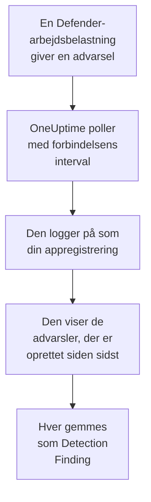

# Microsoft Defender XDR

Importér advarslerne fra hver [Microsoft Defender XDR](https://learn.microsoft.com/en-us/defender-xdr/)-arbejdsbelastning, fra endpoints, identiteter, mail og cloudapps, i OneUptimes sikkerhedsbegivenheder. Der søger du i dem ved siden af dine logs, traces og metrikker, korrelerer dem med alle andre kilder og kalder vagten op for dem, der betyder noget. OneUptime læser dem via Microsoft Graphs sikkerheds-API med en appregistrering, som du opretter: der kræves ingen agent, playbook eller Sentinel-arbejdsområde.

:::cards
- [Opsæt forbindelsen](#opsæt-forbindelsen): En appregistrering, én tilladelse og forbindelsens formular.
- [Hvad der importeres](#hvad-der-importeres): Hvordan hver Defender-advarsel bliver en sikkerhedsbegivenhed.
- [Sådan fungerer polling](#sådan-fungerer-polling): Det vindue, hver poll læser, og hvad en travl lejer gør ved det.
- [Fejlfinding](#fejlfinding): Hvad hver fejl betyder, og hvad du skal ændre.
:::

## Sådan fungerer det



Hvert minut poller OneUptime hver aktiveret forbindelse, hvis pollinterval er gået. En poll logger på Microsoft Entra ID som din appregistrering, beder Microsoft Graph om de advarsler, der er oprettet siden sidste poll ([List alerts_v2](https://learn.microsoft.com/en-us/graph/api/security-list-alerts_v2)), og gemmer hver som en [OCSF](https://schema.ocsf.io/)-begivenhed Detection Finding (klasse `2004`). Registreringsregler, monitorer og dashboards behandler den derefter som en sikkerhedsbegivenhed fra enhver anden kilde.

## Før du går i gang

- I OneUptime rollen Project Owner, Project Admin eller Security Admin. Security Member og Security Viewer kan se forbindelser og deres kørselshistorik, men ikke ændre dem.
- En Microsoft Entra-lejer med en licens til Microsoft Defender XDR: enhver Defender-arbejdsbelastning, der er tilsluttet Microsoft Defender-portalen, som Defender for Endpoint, for Identity, for Office 365 eller for Cloud Apps.
- En Entra-rolle, der kan registrere programmer, som Programadministrator, og en Global administrator eller Administrator af privilegerede roller til at give administratorsamtykke.
- Udgående HTTPS fra OneUptime-appen og -workerne til `login.microsoftonline.com` og `graph.microsoft.com`, eller til `login.microsoftonline.us` og `graph.microsoft.us` for Azure Government.

## Opsæt forbindelsen

Forbindelsen logger på med [OAuth 2.0-flowet for klientlegitimationsoplysninger](https://learn.microsoft.com/en-us/entra/identity-platform/v2-oauth2-client-creds-grant-flow): som et program, aldrig som en person, med én programtilladelse.

:::steps
### Registrér et program

1. Log på [Azure-portalen](https://portal.azure.com), og åbn **Microsoft Entra ID**.
2. Gå til **App registrations → New registration**. Kald den `OneUptime Security Events`, lad **Supported account types** stå på **Accounts in this organizational directory only**, lad omdirigerings-URI'en være tom, og vælg **Register**.
3. Kopiér **Program-id (klient)** og **Mappe-id (tenant)** fra appens side **Overview**.

### Lad den læse advarsler

1. Gå til **API permissions → Add a permission → Microsoft Graph → Application permissions**, vælg `SecurityAlert.Read.All`, og vælg **Add permissions**. Det er den tilladelse med færrest rettigheder, som kaldet [List alerts_v2](https://learn.microsoft.com/en-us/graph/api/security-list-alerts_v2#permissions) accepterer for et program: tilføj ikke `SecurityAlert.ReadWrite.All`.
2. Vælg **Grant admin consent for** din lejer, og bekræft. Tilladelsens status skal være **Granted**: uden samtykke afvises hver læsning med `403`.

### Opret en klienthemmelighed

Gå til **Certificates & secrets → Client secrets → New client secret**, vælg, hvornår den udløber, og vælg **Add**. Kopiér hemmelighedens **Value**, ikke dens **Secret ID**, før du forlader siden: den vises aldrig igen.

Notér, hvornår hemmeligheden udløber. Den dag stopper pollingen med `Microsoft Defender XDR token request failed (HTTP 401)`, indtil du erstatter den med **Opdater legitimationsoplysninger**.

### Tilføj forbindelsen i OneUptime

Åbn **Produkter → Security Events → Forbindelser** (`/dashboard/{projectId}/security-events/connections`), klik på **Tilføj forbindelse**, vælg **Microsoft Defender XDR** under **EDR / XDR**, og klik på **Næste**. Udfyld indstillingerne i tabellen nedenfor, klik på **Næste**, og indsæt hemmelighedens værdi i **Klienthemmelighed**.

### Test den, før du gemmer

Klik på **Test disse indstillinger** under **Test, før du gemmer**. Testen logger på og læser advarsler med værdierne i formularen og gemmer intet, så en forkert hemmelighed eller et manglende samtykke viser sig, før forbindelsen findes. Klik derefter på **Næste**, giv forbindelsen et **Navn**, og opret den.
:::

| Indstilling | Hvor du finder den |
| --- | --- |
| **Mappe-id (tenant)** | Appens side **Overview**. Lejerens GUID eller et verificeret domæne som `contoso.onmicrosoft.com`. |
| **Program-id (klient)** | Appens side **Overview**. GUID'et for den app, der har `SecurityAlert.Read.All`. |
| **Cloud** | **Offentlig Azure-sky**, som også betjener Microsoft 365 GCC, eller **Azure Government (USA)** til GCC High (`login.microsoftonline.us` og `graph.microsoft.us`). Microsoft 365 DoD og 21Vianet-skyen i Kina understøttes ikke. |
| **Klienthemmelighed** | Hemmelighedens **Value**. Den krypteres, returneres aldrig af API'et og vises aldrig igen. Erstat den med **Opdater legitimationsoplysninger** på forbindelsen. |

Trinnet **Hentning** har også en valgfri **Beskrivelse**, **Hentningsinterval (minutter)**, et heltal fra `1` til `1440`, der starter på `5`, og **Aktiveret**, som starter slået til.

## Hvad der importeres

Hver [advarsel](https://learn.microsoft.com/en-us/graph/api/resources/security-alert) fra Defender XDR bliver én begivenhed Detection Finding (OCSF-klasse `2004`), med leverandøren `Microsoft` og produktet `Microsoft Defender XDR`, tilskrevet telemetritjenesten `Microsoft Defender XDR`:

| OCSF-kolonne | Felt i advarslen |
| --- | --- |
| `eventUid` | `id`, Graph-advarslens ID, som også dubletter fjernes efter |
| `time` | `firstActivityDateTime`, eller `createdDateTime`, hvis det mangler |
| `message`, `ruleName` | `title` |
| `ruleId` | `detectorId`, eller `alertPolicyId`, hvis det mangler |
| `severityName` | `severity`: `informational`, `low`, `medium` eller `high`, og `unknown` forbliver Unknown |
| `statusName` | `status`: `new` bliver New, `inProgress` In Progress, `resolved` Resolved |
| `mitreTechniques` | `mitreTechniques` |
| `mitreTactics` | `categories` eller `category`, når det er en ATT&CK-taktik: `CredentialAccess` bliver `TA0006`. Andre kategorier bliver i `attributes`. |
| `principalHost`, `principalUser`, `principalIp`, `principalProcess` | Den `evidence` med rollen `source`, `attacker` eller `compromised`, ellers den første af hver slags |
| `processName`, `processPath`, `processCommandLine`, `parentProcessName`, `parentProcessPath` | Det procesbevis, `principalProcess` kommer fra: dets `imageFile`, `processCommandLine` og `parentProcessImageFile`. Graph giver ingen kommandolinje for den overordnede proces. |
| `targetHost`, `targetUser`, `targetIp`, `targetResource` | Den `evidence` med en målrolle, som `destination` eller `attacked`. URL'er, postkasser og cloudressourcer udfylder `targetResource`. |
| `observables` | Hvert værtsnavn, IP, bruger, filnavn, SHA-1 og SHA-256, URL, domæne, postkasse og ressource-ID i `evidence` |
| `attributes` | Hele advarslen, fladet ud til nøgler med punktummer som `evidence.0.hostName`, `serviceSource` og `incidentId` |

Advarsler fra hver `serviceSource` importeres, også Microsoft Sentinels, når Sentinel er forbundet til Defender-portalen. Hændelser importeres ikke, men hver advarsel beholder sit `incidentId` og sit `incidentWebUrl` i `attributes`.

## Sådan fungerer polling

Hver poll viser de advarsler, der er oprettet i dens vindue, 100 pr. side, og følger Graphs `@odata.nextLink`, indtil den har læst hele vinduet:

```text
GET https://graph.microsoft.com/v1.0/security/alerts_v2?$filter=createdDateTime ge {start} and createdDateTime lt {end}&$top=100
```

- **Oprettelsestidspunktet er markøren.** Defender opretter ofte en advarsel timer efter dens `firstActivityDateTime`, og en markør på aktivitetstidspunktet ville springe hver sådan advarsel over.
- **Den første poll ser 24 timer tilbage**, så en ny forbindelse straks viser sine nylige advarsler.
- **Hver senere poll starter 1 minut før den gemte markør**, så en advarsel, der er oprettet på grænsen mellem to vinduer, læses to gange og importeres én gang.
- **En poll læser højst 24 timer forbi markøren.** En forbindelse, hvis markør er kommet bagud, mens workerne var nede, eller lejeren blev begrænset, indhenter i en række vinduer på 24 timer.
- **Dubletter fjernes efter advarslens `id`** blandt projektets begivenheder fra `Microsoft` / `Microsoft Defender XDR`, så overlappet, et gentaget vindue og en import aldrig gemmer en advarsel to gange.
- **En mislykket kørsel ændrer intet.** Efter en netværksfejl eller en fejlstatus fra Graph forbliver markøren og vindueslængden, som de var, og den næste poll læser det samme vindue igen. Den eneste undtagelse er en anmodning, der fik timeout: markøren bliver, men det næste vindue er halvt så langt, fordi et vindue, der er for tungt til at blive besvaret i tide, ville få timeout ved hvert forsøg.

### Når et vindue indeholder mere, end én poll kan læse

En poll læser højst 20 sider med 100 advarsler: 2.000 advarsler. Når den grænse stopper den før slutningen af dens vindue, er kørslen **Delvis** med denne advarsel:

```text
Stopped after 20 alerts requests (the per-run request limit) before reading the whole window. Microsoft Graph lists alerts newest first and documents no way to sort them oldest first, so this run cannot name a point to resume from.
```

[List alerts_v2](https://learn.microsoft.com/en-us/graph/api/security-list-alerts_v2) dokumenterer `$filter`, `$top`, `$skip` og `$count`, men ikke `$orderby`, og returnerer de nyeste advarsler først. De 2.000 advarsler, en stoppet kørsel læste, er de nyeste i dens vindue, så at flytte markøren forbi dem ville springe de ældre over, som den aldrig nåede. OneUptime gør i stedet vinduet kortere:

1. **Indsnævr.** Den næste poll læser et vindue, der er halvt så langt, fra det samme startpunkt, og bliver ved med at halvere, indtil et vindue læses helt, ned til ét minut. Kørslens advarsel siger det: `This window holds more records than one poll can read; the next poll reads a {n} minute window from the same starting point.` Advarsler, der allerede er importeret fra det længere vindue, springes over som dubletter.
2. **Voks igen.** Når et vindue er læst helt, flyttes markøren til dets slutning, og det næste vindue er igen dobbelt så langt, op til 24 timer.
3. **Gå forbi et enkelt minut.** Hvis selv ét minut indeholder mere end 2.000 advarsler, går pollingen forbi det, så nyere advarsler bliver ved med at komme. Kørslen forbliver **Delvis**, og **Seneste fejl** lyder `More records were created in the one minute from {cursor} to {end} than one poll can read. Polling moved past this minute so newer records keep arriving; use Import this time range in Diagnostics on this minute to recover what one run can read.` Importér det minut med **Import this time range** for at hente det, én kørsel kan læse.

En kørsel, der er **Delvis** af en anden grund, for eksempel en advarsel, der ikke kunne læses som en sikkerhedsbegivenhed, prøves igen på samme måde fra det samme startpunkt. At ændre **Hentningsinterval (minutter)** ændrer intet af dette: det afgør, hvor ofte en poll starter, ikke hvor dens vindue begynder.

### Kør, se forhåndsvisning og importér efter behov

Klik på **Diagnosticering** på en forbindelse for at se dens seneste kørsler og arbejde med den manuelt. Alle, der kan ændre forbindelsen, kan starte disse handlinger; alle, der kan se den, kan læse historikken.

- **Kør nu** starter straks en poll med den sædvanlige markør, også når forbindelsen ikke er **Aktiveret**.
- **Preview alerts** læser et tidsinterval på op til 7 dage og importerer intet.
- **Import this time range** importerer et interval på op til 7 dage, efter at du har bekræftet, uden at flytte markøren. Advarsler, der allerede er importeret, springes over.
- **Copy diagnostics** på en kørsel kopierer dens rapport til support. Den indeholder aldrig legitimationsoplysninger.

## Test forbindelse

**Test forbindelse** på en forbindelses række og **Test disse indstillinger** i formularen kører i API-processen, ikke i en baggrundsworker, så en test også svarer, når det er workerne, der er problemet. Den kører disse kontroller i rækkefølge:

| Kontrol | Hvad den kontrollerer |
| --- | --- |
| **Konfiguration** | De fire indstillinger er til stede og velformede. Der kontaktes intet, når dette mislykkes. |
| **Authenticate with Microsoft Entra** | Microsoft Entra ID udsteder et token til Microsoft Graph i den sky, du valgte. Det mislykkes ved en forkert eller udløbet hemmelighed, et forkert lejer- eller klient-ID eller den forkerte sky. |
| **Read alerts from Microsoft Graph** | Én advarsel, der er oprettet inden for de seneste 24 timer, kan læses (`$top=1`). En `403` her er den manglende tilladelse `SecurityAlert.Read.All`, det manglende administratorsamtykke eller en lejer uden Defender XDR. |
| **Alerts available to import** | Hvor mange advarsler der er oprettet inden for de seneste 24 timer og de seneste 7 dage, én side med 100 for hver, så `100+` betyder flere. Ingen inden for 7 dage er en advarsel, ikke en fejl. |
| **Background workers**, **Poll scheduler**, **Security event storage** | OneUptimes egen side: en proces tager jobbene fra Worker-køen, poll-jobbet kører hvert minut, og lageret for sikkerhedsbegivenheder svarer. |
| **Scheduled polling** | For en gemt forbindelse: polling er slået til, ingen kørsel sidder fast og venter på en worker, og polls kører til tiden. |

Hver anmodning i en test har en frist på 20 sekunder. En test importerer aldrig noget og flytter aldrig markøren, og hver mislykket kontrol siger, hvad du skal ændre.

## Fejlfinding

Forbindelsens **Seneste fejl** gemmer hele fejlmeddelelsen, med legitimationsoplysninger maskeret, bag et præfiks, der navngiver det trin, der mislykkedes. Når en forbindelse har en fejl, vælger du **Vis fejl** i dens kolonne **Handlinger** for at læse den og **Kopiér fejl** i dialogboksen for at kopiere den. Læs præfikset først.

:::details Last Error starter med `Microsoft Defender XDR token request`
- `Microsoft Defender XDR token request failed (HTTP ...)`: Microsoft Entra ID nægtede at udstede et token, så Graph blev aldrig kontaktet. Meddelelsen slutter med et tip ud fra Entras `error`-kode:
  - `invalid_client` (`AADSTS7000215`): hemmeligheden er forkert, udløbet eller tilhører en anden app. Opret en ny under **Certificates & secrets**, og gem den med **Opdater legitimationsoplysninger**.
  - `unauthorized_client` (`AADSTS700016`): **Program-id (klient)** findes ikke i det **Mappe-id (tenant)**, eller **Cloud** er forkert.
  - `AADSTS90002`: den lejer findes ikke.
  - `invalid_scope`: Graph-omfanget findes ikke i den sky, du valgte. Tjek **Cloud**.
- `Microsoft Defender XDR token request returned ...`: Microsoft Entra ID svarede med noget ubrugeligt, en brødtekst, der ikke er JSON, eller uden `access_token`. Det er som regel en proxy eller gateway imellem, ikke legitimationsoplysningerne.
- `Microsoft Defender XDR token request did not complete: ...`: token-endpointet kunne ikke nås eller svarede ikke i tide. Tjek udgående HTTPS fra OneUptime-appen og -workerne til `login.microsoftonline.com` eller `login.microsoftonline.us`.
:::

:::details Last Error starter med `Microsoft Defender XDR alerts request`
- `Microsoft Defender XDR alerts request failed (HTTP ...)`: Graph nægtede at vise advarslerne. Meddelelsen navngiver Graphs fejlkode og et tip:
  - `403` (`Authorization_RequestDenied`): `SecurityAlert.Read.All` eller dens administratorsamtykke mangler, eller lejeren har ingen licens til Defender XDR. Samtykke tager et par minutter om at træde i kraft.
  - `401` (`InvalidAuthenticationToken`) efter et udstedt token: **Cloud** passer som regel ikke til lejeren.
  - `429` (`TooManyRequests`): Graph begrænser appen, og den næste poll læser det samme vindue igen. Meddelelsen kan ikke citere Graphs `Retry-After`, fordi OneUptimes HTTP-klient ikke gemmer svarheadere ved en fejl. Bliver det ved, så hæv **Hentningsinterval (minutter)**.
  - `5xx`: et problem på Graphs side. Den næste poll prøver igen.
  - `400`: Graph ville ikke køre forespørgslen, som OneUptime bygger, ikke dine indstillinger. Kopiér meddelelsen til OneUptimes support.
- `Microsoft Defender XDR alerts request returned ...`: Graph svarede `200`, men med noget, connectoren ikke kunne bruge: en brødtekst, der ikke er JSON, ingen liste `value` eller et `@odata.nextLink`, der ikke er et `https://`-link på din skys Graph-vært. Sådan et link afvises, så tokenet aldrig sendes andre steder hen. Det rapporteres i stedet for at blive opfattet som et tomt vindue, så markøren aldrig går forbi advarsler, som ingen har læst.
- `Microsoft Defender XDR alerts request did not complete: ...`: Graph kunne ikke nås eller svarede ikke i tide: 60 sekunder for en poll, 20 for en test. Tjek udgående HTTPS til `graph.microsoft.com` eller `graph.microsoft.us`.
:::

:::details Testen lykkes, men Last Polled er Never
Poll-jobbet har aldrig kørt. Læs kontrollerne **Background workers** og **Poll scheduler**. På en selvhostet installation er den sædvanlige årsag `DISABLE_QUEUE_WORKERS=true` på appen, uden en separat worker-udrulning, der tager jobbene: sæt den til `false`, eller kør worker-udrulningen (Helm: `worker.enabled: true`, som er `false` som standard).
:::

:::details Polls lykkes, men en advarsel, du kender, mangler
Sammenlign advarslens `createdDateTime` i Defender-portalen med kørslens vindue i **Diagnosticering**: vinduer går efter oprettelsestidspunkt, ikke aktivitetstidspunkt.

- En advarsel, der blev oprettet, før forbindelsen fandtes, er ældre end det første tilbageblik på 24 timer. Importér den med **Import this time range**.
- En kørsel, der er **Delvis**, blev stoppet af grænsen på 2.000 advarsler. Den næste poll læser et kortere vindue fra den samme start, så advarslen importeres, så snart et vindue, der indeholder den, er læst helt.
- Hvis **Seneste fejl** navngiver et minut, pollingen gik forbi, så importér det minut med **Import this time range**.
:::

:::details Den samme advarsel vises to gange
Overlappet på 1 minut er ikke årsagen: den anden læsning tælles som en dublet og gemmes ikke. To begivenheder med det samme `eventUid` blev importeret under forskellige produkter, for eksempel den samme advarsel, der også kommer via en Microsoft Sentinel-forbindelse. Dubletter fjernes pr. leverandør og produkt.
:::

## Hvad du får

- **Søgning.** Filtrér Defender-advarsler efter alvorlighed, status, MITRE-teknik, vært, bruger, IP eller enhver observable i stifinderen for sikkerhedsbegivenheder, ved siden af værtens logs og metrikker.
- **Korrelation.** Hver advarsels beviser, dens enheder, brugere, IP'er, filer og URL'er, indekseres som observables, så én søgning finder alt, der nævner en vært, på tværs af alle kilder.
- **Registreringsregler.** Sigma-regler, der kører efter en tidsplan over dine sikkerhedsbegivenheder og åbner advarsler, der kalder vagten op.
- **Monitorer.** Monitorer for sikkerhedsbegivenheder tæller matchende begivenheder og åbner hændelser eller advarsler over en tærskel.

Sikkerhedsbegivenheder faktureres som resten af din telemetri, pr. indtaget GB. Se [Priser](https://oneuptime.com/pricing).

## Næste trin

:::cards
- [Sikkerhedsbegivenheder](/docs/telemetry/security-events): Søg, korrelér og advar på det, du importerer.
- [Microsoft Sentinel](/docs/integrations/microsoft-sentinel): Importér også hændelserne fra et Sentinel-arbejdsområde.
- [Roller](/docs/permissions/reference#roller): Hvad Security-rollerne kan se og ændre.
- [Oversigt over integrationer](/docs/integrations/index): De andre værktøjer, du kan forbinde.
:::
