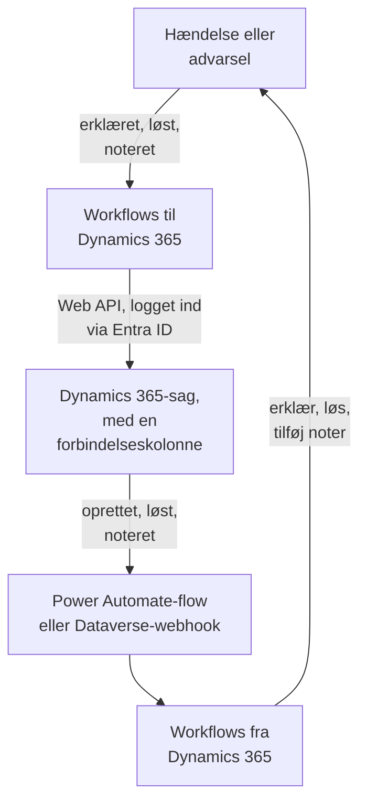

# Microsoft Dynamics 365

Hold [Microsoft Dynamics 365](https://www.microsoft.com/dynamics-365)-sager i takt med dine OneUptime-hændelser og -advarsler, begge veje. Færdige workflowskabeloner opretter en sag for hver hændelse eller advarsel, lukker den, når posten er løst, og kopierer noter ind i den. Andre erklærer hændelser ud fra nye sager og bringer løsninger og noter tilbage. Der er intet plugin: workflowene kalder Dataverse Web API, og Dynamics 365 kalder deres webhook-URL'er.

:::cards
- [Forbered Dynamics 365](#forbered-dynamics-365): En appregistrering, en programbruger og en forbindelseskolonne.
- [Start fra en skabelon](#start-fra-en-skabelon): De 13 skabeloner, hvad de beder om, og hvordan du sætter dem op.
- [Sådan fungerer skabelonerne](#sådan-fungerer-skabelonerne): Hvordan sager og poster forbliver forbundet, uden løkker.
- [Byg det selv](#byg-det-selv): Hver retning i hånden, når en skabelon ikke passer.
:::

## Sådan fungerer det



Hver skabelon er et lille workflow, så du tager kun de retninger, du vil have, for hændelser, advarsler eller begge. Skabelonerne OneUptime → Dynamics 365 kalder Dataverse Web API, logget ind som et program via Microsoft Entra ID. Skabelonerne Dynamics 365 → OneUptime starter, når et Power Automate-flow eller en Dataverse-webhook kalder dem. En tekstkolonne, som du tilføjer til tabellen Case, forbinder hver sag med dens post.

## Før du går i gang

- Et Dynamics 365-miljø med tabellen **Case**. Sager kommer fra Dynamics 365 Customer Service: et Dataverse-miljø uden det har ingen `incident`-tabel at skrive til.
- Rettigheder til at registrere et program i **Microsoft Entra ID** og til at oprette en programbruger i miljøet. Det er ofte to forskellige administratorer.
- I OneUptime rettigheden til at oprette workflows. På OneUptime Cloud kræver workflows **Growth**-abonnementet eller højere.

> [!NOTE]
> Denne side bruger Dataverses navne, ikke etiketterne på Dynamics-formularerne. En sag er tabellen `incident`, dens samling i en URL er `incidents`, dens nøgle er `incidentid`, og dens titelkolonne er `title`. Det sagsnummer, du ser, er `ticketnumber`.

## Forbered Dynamics 365

Både skabelonerne og et workflow, du selv bygger, har brug for dette. OneUptime logger ind som et program, ikke som en person, med OAuth 2.0-flowet for klientlegitimationsoplysninger.

:::steps
### Registrer et program i Microsoft Entra ID

1. Log ind på [Azure-portalen](https://portal.azure.com) som administrator af lejeren for dit Dynamics-miljø, og åbn **Microsoft Entra ID**.
2. Gå til **App registrations → New registration**. Giv den navnet `OneUptime Integration`, lad **Supported account types** stå på **Accounts in this organizational directory only**, og vælg **Register**.
3. Kopiér **Application (client) ID** og **Directory (tenant) ID** fra appens side **Overview**.
4. Gå til **Certificates & secrets → Client secrets → New client secret**, og kopiér hemmelighedens **Value**, ikke dens ID, før du forlader siden: den vises aldrig igen. En klienthemmelighed lever højst 24 måneder, så skriv ned, hvornår den udløber.

Tilføj ingen API-tilladelser, og giv ikke administratorsamtykke: uden en logget ind bruger gør de intet. Dynamics 365 bestemmer, hvad programmet må, via dets programbruger.

### Opret programbrugeren

1. Vælg **Manage → Environments** i [Power Platform Administration](https://admin.powerplatform.microsoft.com/), og derefter dit miljø.
2. Vælg **Settings → Users + permissions → Application users**, derefter **+ New app user** og **+ Add an app**. Vælg registreringen, og vælg **Add**.
3. Vælg en **Business unit**, og giv den derefter en brugerdefineret sikkerhedsrolle med redigeringsikonet ved siden af **Security roles**. På niveauet Organization har rollen brug for:
   - **Case**: Create, Read, Write, Append og Append To.
   - **Note**: Create, Read og Append, til noteskabelonerne.
   - **Activity**: Create, Read og Append, fordi lukning af en sag registrerer en Case Resolution, som er en aktivitet.
   - **Account**, og **Contact** hvis sager oprettes i en kontaktpersons navn: Read og Append To.
4. Vælg **Save** og derefter **Create**.

En programbruger kan kun have en brugerdefineret rolle: kopiér en eksisterende, og skær den ned. Uden denne bruger udsteder Microsoft Entra ID stadig tokens, men hvert kald til Dynamics 365 mislykkes med `403` og `0x80072560`, "The user isn't a member of the organization."

### Tilføj en forbindelseskolonne til tabellen Case

Dataverse har intet, der ligner Jiras etiketter, så en sag og en OneUptime-post finder hinanden via en kolonne, du tilføjer.

1. Vælg dit miljø i [make.powerapps.com](https://make.powerapps.com), åbn **Tables → Case → Columns**, og vælg **New column**.
2. Giv den navnet `OneUptime Link`, behold **Data type** som **Single line of text**, og gem. Standardmaksimumlængden på 100 er rigeligt: skabelonerne skriver højst 55 tegn.
3. Åbn den nye kolonne, og kopiér dens **Logical name**, f.eks. `new_oneuptimelink`. Præfikset kommer fra din løsnings udgiver, så dit kan være anderledes, f.eks. `cr4f2_oneuptimelink`.

Tilføj kolonnen til formularen Case, hvis agenterne skal kunne se forbindelsen.
:::

## Start fra en skabelon

Dialogboksen **Opret en arbejdsgang** har 13 Dynamics 365-skabeloner under **Dynamics 365** i sin kategoriliste: syv til hændelser og derefter seks til advarsler, hver gruppe under sin egen overskrift. De deler forbindelseskolonnen, så enhver kombination af dem fungerer sammen.

### Skabeloner til hændelser

| Skabelon | Hvad den gør | Hvad den beder om |
| --- | --- | --- |
| **OneUptime → Dynamics 365** | | |
| Create a Dynamics 365 case when an incident is declared | Opretter en sag for hver ny hændelse, med en prioritet valgt ud fra dens alvorlighed og hændelsens ID i forbindelseskolonnen. Hændelser erklæret fra Dynamics 365 og private hændelser springes over. | De fem Dynamics 365-indstillinger, kunden til nye sager og OneUptime-URL'en |
| Resolve the Dynamics 365 case when the incident is resolved | Lukker den forbundne sag som **Problem Solved**, når hændelsen er løst, og registrerer en Case Resolution, sådan som det sker, når man løser den i hånden. Genåbner aldrig en sag. | De fem Dynamics 365-indstillinger |
| Copy incident private notes to the Dynamics 365 case | Tilføjer hver ny privat note til den forbundne sag som en note. | De fem Dynamics 365-indstillinger |
| Copy incident public notes to the Dynamics 365 case | Tilføjer hver ny offentlig note til den forbundne sag som en note, så agenterne kan fortælle kunderne, hvad statussiden siger. | De fem Dynamics 365-indstillinger |
| **Dynamics 365 → OneUptime** | | |
| Declare an incident when a Dynamics 365 case is created | Erklærer en hændelse for hver ny sag, holdt væk fra dine statussider, med en alvorlighed valgt ud fra sagens prioritet, og skriver derefter hændelsens ID i sagens forbindelseskolonne. | De fem Dynamics 365-indstillinger og et flow eller en webhook til nye sager |
| Resolve the incident when its Dynamics 365 case is resolved | Løser hændelsen, når dens forbundne sag er løst. | De fem Dynamics 365-indstillinger og et flow eller en webhook til sagers statusændringer |
| Add Dynamics 365 case notes to the incident as private notes | Kopierer hver note, en agent tilføjer til en forbundet sag, over på hændelsen som en privat note. | De fem Dynamics 365-indstillinger og et flow eller en webhook til nye noter |

### Skabeloner til advarsler

Skabelonerne til advarsler gør det samme arbejde for advarsler. Der er én mindre, fordi advarsler ikke har offentlige noter, og **Create an alert when a Dynamics 365 case is created** skriver ingen statussideindstillinger, fordi en advarsel aldrig når en statusside.

| Skabelon | Hvad den gør | Hvad den beder om |
| --- | --- | --- |
| **OneUptime → Dynamics 365** | | |
| Create a Dynamics 365 case when an alert is created | Opretter en sag for hver ny advarsel, også hver advarsel, en monitor udløser. Advarsler oprettet fra Dynamics 365 og private advarsler springes over. | De fem Dynamics 365-indstillinger, kunden til nye sager og OneUptime-URL'en |
| Resolve the Dynamics 365 case when the alert is resolved | Lukker den forbundne sag som **Problem Solved**, når advarslen er løst. | De fem Dynamics 365-indstillinger |
| Copy alert private notes to the Dynamics 365 case | Tilføjer hver ny privat note til den forbundne sag som en note. | De fem Dynamics 365-indstillinger |
| **Dynamics 365 → OneUptime** | | |
| Create an alert when a Dynamics 365 case is created | Opretter en advarsel for hver ny sag, med en alvorlighed valgt ud fra sagens prioritet, og skriver derefter advarslens ID i sagens forbindelseskolonne. | De fem Dynamics 365-indstillinger og et flow eller en webhook til nye sager |
| Resolve the alert when its Dynamics 365 case is resolved | Løser advarslen, når dens forbundne sag er løst. | De fem Dynamics 365-indstillinger og et flow eller en webhook til sagers statusændringer |
| Add Dynamics 365 case notes to the alert as private notes | Kopierer hver note, en agent tilføjer til en forbundet sag, over på advarslen som en privat note. | De fem Dynamics 365-indstillinger og et flow eller en webhook til nye noter |

Ingen af skabelonerne OneUptime → Dynamics 365 sender en hændelse markeret som **Privat hændelse** eller en advarsel markeret som **Privat advarsel** til Dynamics 365: hverken posten, dens tilstand eller dens noter, medmindre du slår det til. Se [Ændr, hvad en skabelon gør](#ændr-hvad-en-skabelon-gør).

**Monitorer udløser selv advarsler, og det kan blive mange.** **Create a Dynamics 365 case when an alert is created** opretter en sag for hver eneste. Medmindre hver advarsel fortjener en sag, så sæt en **If / Else**-blok mellem triggeren og resten af workflowet, f.eks. på `{{local.components.alert-on-create-1.returnValues.model.alertSeverity.name}}`, og forbind kun dens **Yes**-side videre.

### Hvad skabelonerne beder om

Trinnet **Konfigurer** i oprettelsesguiden beder om op til syv værdier: hver skabelon beder om de første fem, Dynamics 365-indstillingerne, og de to skabeloner, der opretter en sag, beder også om de sidste to. Trinnet kontrollerer formen på hver Dynamics 365-indstilling, før noget oprettes, og siger, hvad du skal skrive i stedet, fordi en værdi med forkert form ikke giver fejl nogen steder før en kørsel.

- **Dynamics 365 Environment URL** — dit miljøs adresse, f.eks. `https://yourorg.crm.dynamics.com`, fra [Power Platform Administration](https://admin.powerplatform.microsoft.com/) under **Environments**, dit miljø, **Environment URL**. Kun adressen: ikke Web API-endpointet, som slutter på `/api/data/v9.2`, og ingen skråstreg til sidst.
- **Directory (Tenant) ID** — fra appregistreringens side **Overview**.
- **Application (Client) ID** — fra samme side.
- **Client Secret Value** — klienthemmelighedens **Value** fra **Certificates & secrets**. Ikke dens **Secret ID**, som er en GUID: guiden afviser en GUID her.
- **Case Link Column** — forbindelseskolonnens logiske navn, f.eks. `new_oneuptimelink`.
- **Customer for New Cases** — kun de to skabeloner, der opretter en sag, beder om den. Hver sag skal have en kunde, og en OneUptime-hændelse har ingen, så alle nye sager oprettes i én kundes navn: indsæt ID'et for en konto, eller `contacts(<id>)` for en kontaktperson. Åbn posten i Dynamics 365: dens ID er delen efter `id=` i adressen.
- **OneUptime URL** — kun de to skabeloner, der opretter en sag, beder om den: den adresse, du åbner OneUptime på, f.eks. `https://oneuptime.com`. Sagens beskrivelse linker med den tilbage til hændelsen eller advarslen.

**Sådan logger skabelonerne ind.** Guiden gemmer lejeren, klient-ID'et og hemmeligheden i én [OAuth 2.0-variabel](/docs/workflows/variables#oauth-20-variabler-tokens-der-fornyer-sig-selv), `dynamicsAccessToken`, under workflowets **Arbejdsgangsvariabler**: Client Credentials, token-URL'en `https://login.microsoftonline.com/<tenant>/oauth2/v2.0/token`, scopet `<environment URL>/.default` og klienthemmeligheden, sendt i anmodningens brødtekst og gemt krypteret. Hvert kald til Dynamics 365 sender `Authorization: Bearer {{local.variables.dynamicsAccessToken}}`. OneUptime henter tokenet første gang, et trin har brug for det, henter et nyt, før det udløber, og erstatter det med `[REDACTED]` i kørselslogs og trinspor.

For at kontrollere login, før noget kører, åbner du **Arbejdsgangsvariabler**, klikker på **Vis** ved `dynamicsAccessToken` og klikker på **Opdater nu**. **Access Token Fetched** betyder, at appregistreringen er i orden. Ellers nævner fejlen fra Microsoft Entra ID, hvad der er galt, f.eks. `AADSTS7000215: Invalid client secret provided`.

Hvert workflow har sin egen kopi. Når du udskifter klienthemmeligheden, åbner du `dynamicsAccessToken` i hvert Dynamics 365-workflow og bruger **Opdater legitimationsoplysninger**.

### Opret workflowene

:::steps
1. Åbn **Arbejdsgange → Opret arbejdsgang**. Vælg **Dynamics 365** i kategorilisten under **Eller start fra en skabelon**, eller skriv `Dynamics` i **Søg i skabeloner…**, og klik på den skabelon, du vil have. Den åbnes og viser, hvad den gør, og hvilke indstillinger den vil bede om. Klik på **Brug denne skabelon**.
2. **Navn** udfyldes ud fra skabelonen. Skift det, hvis du vil.
3. **Konfigurer** beder om værdierne ovenfor.
4. Klik på **Opret arbejdsgang**. Hvert workflow oprettes slået fra: slå **Aktiveret** til øverst i dets **Bygger**.
:::

Start med **Create a Dynamics 365 case when an incident is declared**, eller **Create a Dynamics 365 case when an alert is created** til advarsler: alle andre skabeloner OneUptime → Dynamics 365 af samme slags finder sagen via den forbindelse, som denne skriver. Slå den til, erklær en testhændelse eller opret en testadvarsel, og åbn workflowets **Protokoller → Kørsler**. Kørslen bør slutte som **Udført**, og **Response Body** i dens sidste trin, `create-case-1`, indeholder den nye sags `ticketnumber`, for eksempel `CAS-01001-X1Y2Z3`.

### Forbind skabelonerne Dynamics 365 → OneUptime

Skabelonerne Dynamics 365 → OneUptime, tre til hændelser og tre til advarsler, starter fra en [Webhook-trigger](/docs/workflows/triggers#webhook), så Dynamics 365 skal have at vide, hvor det skal sende sine begivenheder hen. Gør det i denne rækkefølge:

1. Opret workflowet, og **slå det til først**. Et workflow, der er slået fra, afviser leveringer, og de sættes ikke i kø.
2. Åbn workflowets **Bygger**, klik på triggerblokken **Webhook** (`webhook-1`), og klik på **Kopiér URL** øverst i dens indstillinger. URL'en ser sådan ud:

   ```text
   https://<your OneUptime host>/workflow/trigger/<webhook secret key>
   ```

3. Få Dynamics 365 til at sende til den, fra et Power Automate-flow eller fra en Dataverse-webhook.

Hver skabelon behøver kun at vide, hvilken række der ændrede sig. Den læser rækken igen fra Dynamics 365, før den gør noget, så den tager aldrig en sags titel, status eller forbindelse fra anmodningen, og det er ligegyldigt, hvilken af de to der sender den.

:::tabs
@tab Power Automate flow
Opret i [Power Automate](https://make.powerautomate.com) et **Automated cloud flow** med **Microsoft Dataverse**-triggeren **When a row is added, modified or deleted**, sat op som nedenfor, med **Scope** sat til **Organization**. Tilføj den indbyggede handling **HTTP**: **Method** `POST`, **URI** workflowets URL, en `Content-Type: application/json`-header og brødteksten nedenfor, med rækkens ID valgt fra triggerens dynamiske indhold.

| Skabelon | Change type | Table name | Select columns | Body |
| --- | --- | --- | --- | --- |
| Erklær en hændelse / opret en advarsel, når en sag oprettes | Added | Cases | | `{"PrimaryEntityId": "<Case>"}` |
| Løs hændelsen / advarslen, når dens sag løses | Modified | Cases | `statecode,statuscode` | `{"PrimaryEntityId": "<Case>"}` |
| Tilføj sagsnoter til hændelsen / advarslen som private noter | Added | Notes | | `{"PrimaryEntityId": "<Note>"}` |

For kun at sende nogle sager bruger du triggerens **Filter rows**, f.eks. `prioritycode eq 1` for sager med høj prioritet. Brødteksten nævner rækken som `PrimaryEntityId`, som et Dataverse-webhook gør: skabelonerne læser selve rækken tilbage fra Dynamics 365.
@tab Dataverse webhook
Registrer URL'en med [Plug-in Registration Tool](https://learn.microsoft.com/en-us/power-apps/developer/data-platform/register-web-hook): **Register New WebHook**, med **HttpHeader**-godkendelse og en header, du selv vælger; selve URL'en er hemmeligheden. Registrer derefter et trin på den for hver begivenhed nedenfor, med **Event Pipeline Stage of Execution** sat til **PostOperation** og **Execution Mode** til **Asynchronous**.

| Skabelon | Message | Primary Entity | Filtering Attributes |
| --- | --- | --- | --- |
| Erklær en hændelse / opret en advarsel, når en sag oprettes | `Create` | `incident` | |
| Løs hændelsen / advarslen, når dens sag løses | `Close`, og `Update` for statusændringer foretaget af andre | `incident` | `statecode, statuscode` (Update) |
| Tilføj sagsnoter til hændelsen / advarslen som private noter | `Create` | `annotation` | |

Når en sag løses, udløses meddelelsen **Close**, ikke **Update**, og derfor har den skabelon brug for begge. En webhook sender plug-in'ets kørselskontekst, som angiver rækken i `PrimaryEntityId`, eller for **Close** i dens `IncidentResolution`, og skabelonerne læser den derfra. En Dataverse-webhook kalder kun portene 80 og 443 og har intet eget rækkefilter: hver ny sag når oprettelsesskabelonen, medmindre du indsnævrer den med `ONLY_PRIORITIES`.
:::

Før du stoler på en af dem:

- **Alle, der har URL'en, kan udløse workflowet.** Fordi skabelonerne læser hver række igen fra Dynamics 365, kan en anmodning kun få dem til at se på en rigtig sag eller note. Den kan stadig få oprettelsesskabelonerne til at handle på en sag, der endnu ikke er forbundet. Opbevar kun URL'en i flowet eller webhooken. Hvis den slipper ud, så klik på **Webhook**-triggeren i workflowets **Bygger**, klik på **Nulstil URL**, og indsæt den nye URL i flowet eller webhooken. Den gamle URL holder op med at virke med det samme.
- **Hver begivenhed er en kørsel**, også dem, en skabelon springer over. På OneUptime Cloud tæller hver af dem med i dit abonnements workflowkørsler, og filtrering i flowet holder tallet nede. Se [Abonnementsgrænser](/docs/workflows/configuration#plangrænser).
- **Bruger du begge skabeloner, der opretter en post ud fra en sag?** **Declare an incident when a Dynamics 365 case is created** og **Create an alert when a Dynamics 365 case is created** handler begge på hver sag, de får sendt. Hver af dem tjekker forbindelseskolonnen først, men to leveringer for én ny sag kommer samtidig, så sagen kan ende med både en hændelse og en advarsel. Send de to forskellige sager, f.eks. efter sagstype.

### Kontrollér, at det virker

Hver kørsels **Trin** siger, hvad skabelonen gjorde, så åbn kørslen i **Protokoller → Kørsler** og se, hvordan den sluttede:

- **Udført**: den gjorde sit arbejde, og dens sidste trin nævner sagen, hændelsen eller advarslen.
- **Udført**, med trinnet **Check With JavaScript** på **No**: den sprang begivenheden over med vilje, og trinnet siger hvorfor: sagen er ikke forbundet med en post af denne slags, noten kom fra den anden side, posten er privat, eller den nye tilstand lukker ikke sagen.
- **Fejl**: et trin mislykkedes, og dets post under **Trin** siger hvorfor. Ved et Dynamics 365-kald indeholder den Dynamics 365's svar.
- **Fejl** ved `link-case-1`: en skabelon, der opretter en post ud fra en sag, oprettede den, men Dynamics 365 tog ikke imod forbindelsen, så de andre skabeloner kan ikke finde den endnu. Skriv forbindelsen i sagens kolonne i hånden.

Hvis en kørsel stopper ved det første Dynamics 365-trin med `Could not get an OAuth 2.0 access token for {{local.variables.dynamicsAccessToken}}`, er login-indstillingerne forkerte, og meddelelsen citerer svaret fra Microsoft Entra ID. Se [Hvad skabelonerne beder om](#hvad-skabelonerne-beder-om).

## Sådan fungerer skabelonerne

### Sådan forbliver de to sider forbundet

Sagen holder forbindelsen. En sag, der hører til en hændelse, har `oneuptime-incident-<incident id>` i sin forbindelseskolonne, og en, der hører til en advarsel, har `oneuptime-alert-<alert id>`. ID'et er den sidste del af postens adresse i dashboardet.

Skabelonerne, der opretter en sag, skriver den, når de opretter sagen, og skabelonerne, der opretter en post ud fra en sag, skriver den, så snart posten findes. Alle andre skabeloner krydser over via den: dem fra OneUptime → Dynamics 365 slår sagen op via dens forbindelse, og dem fra Dynamics 365 → OneUptime læser postens ID fra sagen. For at forbinde en sag, der er oprettet i hånden, skriver du selv værdien i dens forbindelseskolonne, men kun når posten endnu ikke har en sag.

**En sag er forbundet med en hændelse eller en advarsel, aldrig begge.** Én kolonne tjener begge slags. Skabelonerne til hændelser ignorerer en sag, der er forbundet med en advarsel, og omvendt, og skabelonerne, der opretter en post ud fra en sag, lader enhver sag være, hvis forbindelseskolonne indeholder noget som helst.

**En post har én sag.** Skabelonerne, der skriver til en sag, handler kun, når præcis én sag har postens forbindelse. Hvis forbindelsen kopieres til en anden sag, stopper de, og hver kørsel slutter med en overspringning, der nævner begge:

```text
More than one Dynamics 365 case holds the link oneuptime-incident-<id> (CAS-01001-X1Y2Z3, CAS-01002-K4L5M6). Clear it on every case except the one opened for the incident.
```

Hændelser og advarsler oprettet ud fra en sag gemmer også sagens ID og nummer i `customFields.dynamicsCaseId` og `customFields.dynamicsCaseNumber`, skrevet når de oprettes. Det er sådan, skabelonerne, der opretter en sag, ved, at posten allerede har en.

### Sådan undgår skabelonerne løkker

Hver skrivning i én retning er en begivenhed i den anden: en note, der tilføjes til en sag, kommer tilbage som en ny note, og en privat note, der tilføjes i OneUptime, udløser notetriggeren. Fire ting stopper ekkoet:

- **Markører i teksten.** Hver note, skabelonerne tilføjer til en sag, har titlen `Synced from OneUptime: …`, og det samme har emnet på hver Case Resolution, de registrerer. Hver note skrevet fra Dynamics 365, og grundårsagen til hver tilstandsændring foretaget derfra, begynder med `Synced from Dynamics 365`. Hver retning springer tekst over, der har den anden sides markør, selv i en note, som nogen skrev, og som citerer en.
- **Forbindelsen fra første gemning.** En sag, som OneUptime opretter, har sin forbindelse fra det øjeblik, den findes, så når dens **Create** kommer tilbage, finder skabelonen, der opretter en post ud fra en sag, den forbundet og gør intet.
- **`customFields.dynamicsCaseId`.** En post oprettet ud fra en sag har den, og skabelonerne, der opretter en sag, springer sådanne poster over.
- **Tilstande går kun fremad, på begge sider.** Når posten løses, lukkes sagen, og sagens **Close** finder så posten allerede løst. Når sagen løses først, løses posten, og dens opdatering finder sagen allerede lukket. En sag, der allerede er løst eller annulleret, genåbnes aldrig.

Behold markørerne, når du redigerer skabelonerne. De er konstanterne `FROM_ONEUPTIME` og `FROM_DYNAMICS` i hjælpeblokken øverst i hvert script.

### Ændr, hvad en skabelon gør

Åbn workflowets **Bygger**, og klik på den blok, du vil ændre. De indstillinger, du mest sandsynligt vil ændre, er konstanter øverst i et script, **JavaScript Code** i en **Check With JavaScript**-blok, lige under den fælles hjælpeblok. Versionerne til hændelser og til advarsler har de samme konstanter i de samme blokke.

| Konstant | Skabelon og blok | Hvad den styrer |
| --- | --- | --- |
| `SYNC_PRIVATE_INCIDENTS`, `SYNC_PRIVATE_ALERTS` | Hver skabelon OneUptime → Dynamics 365 — `prepare-case-1`, `plan-case-1`, `build-note-1` | `false` holder private poster ude af Dynamics 365: der oprettes ingen sag for dem, deres sag ændres ikke, og deres noter tilføjes ikke. Sæt den til `true` i hver skabelon, der skal sende dem. |
| `SEVERITY_TO_PRIORITY`, `DEFAULT_PRIORITY` | Opret en Dynamics 365-sag — `prepare-case-1` | Projektets alvorligheder fordeles over sagsprioriteterne efter deres rækkefølge: den mest alvorlige opretter en High-sag (`1`), den mindst alvorlige en Low-sag (`3`), og dem imellem Normal-sager (`2`). Angiv en alvorlighed ved navn, med små bogstaver, for selv at vælge dens prioritet, f.eks. `{ 'major incident': 1 }`. `DEFAULT_PRIORITY` (`2`) gælder for en alvorlighed, som projektets liste ikke har, eller et projekt med kun én. |
| `CASE_ORIGIN`, `CASE_TYPE` | Opret en Dynamics 365-sag — `prepare-case-1` | Den nye sags `caseorigincode` (`3`, Web) og `casetypecode` (`2`, Problem). For at sætte en anden kolonne tilføjer du den til `CASE` i samme script under dens logiske navn. |
| `MAX_TITLE_LENGTH`, `MAX_DESCRIPTION_LENGTH` | Opret en Dynamics 365-sag — `prepare-case-1` | Tabellen Cases egne grænser, 200 og 2000 tegn. Beskrivelsen beholder linket tilbage til OneUptime, uanset hvor meget der skæres væk. Hæv dem, hvis din tabel Case tillader mere. |
| `RESOLVED_CASE_STATUS` | Løs Dynamics 365-sagen — `plan-case-1` | Den status, en løst post lukker sin sag med: `5` er Problem Solved, `1000` Information Provided. |
| `STATE_TO_CASE_STATUS` | Løs Dynamics 365-sagen — `plan-case-1` | Lukker sagen med en anden løst status ved en løst tilstand, du selv har oprettet, ud fra tilstandens navn: `{ Closed: 1000 }` lukker den som Information Provided. Kun når posten løses, ændres dens sag: en aktiv status som Researching sættes aldrig. |
| `PRIORITY_RANK` | Opret ud fra en Dynamics 365-sag — `prepare-incident-1`, `prepare-alert-1` | Knytter en sagsprioritet (`1` High, `2` Normal, `3` Low) til `0` (din mest alvorlige alvorlighed), `1` eller `2` (den mindst alvorlige). Prioriteter, der ikke står her, lander i midten. Med de to alvorligheder for advarsler, et nyt projekt har, bliver Normal til Low, medmindre du ændrer `2: 1` til `2: 0`. |
| `ONLY_PRIORITIES` | Opret ud fra en Dynamics 365-sag — `prepare-incident-1`, `prepare-alert-1` | Tom tager den hver sag, flowet eller webhooken sender. `[1]` opretter kun poster for sager med høj prioritet. |
| `CASE_STATUS_TO_STATE`, `CASE_STATE_TO_STATE_FLAG` | Løs, når Dynamics 365-sagen er løst — `decide-state-1` | En sagsstatus, ved navn, til en OneUptime-tilstand, f.eks. `{ Researching: 'Acknowledged' }`. Ellers afgør sagens tilstand det: Resolved løser posten. Tilføj `2: 'isResolvedState'` for også at løse den, når dens sag annulleres. |
| `MESSAGES` | Hver skabelon Dynamics 365 → OneUptime — `read-event-1`, eller `prepare-incident-1` og `prepare-alert-1` | De begivenheder, skabelonen handler på. Tilføj `'Update'` til noteskabelonens liste for også at kopiere redigerede noter: hver redigering bliver en ny note. |
| `MAX_NOTE_LENGTH` | Noteskabelonerne — `build-note-1`, `read-note-1` | Den længste note, hver af dem skriver: 100.000 tegn til Dynamics 365, som er en notes egen grænse, og 30.000 til OneUptime. |

Tilstands- og statusnavne, der bruges som nøgler, skal staves præcis, som de hedder, inklusive store bogstaver. Hold `{{` ude af koden: et script udfyldes som enhver anden indstilling, før det kører, så to åbne krøllede parenteser i træk ville blive læst som en reference.

### Begrænsninger

- **Microsofts kommercielle sky.** Token-URL'en er `login.microsoftonline.com`. Til skyerne US Government (GCC High, DoD) eller Kina åbner du `dynamicsAccessToken`, bruger **Rediger indstillinger** og ændrer token-URL'en til din skys login-vært, f.eks. `login.microsoftonline.us`.
- **Dynamics 365 kan nægte at løse en sag.** Dine Customer Service-indstillinger kan forhindre, at en sag løses, mens den har åbne aktiviteter eller åbne undersager, og en forretningsregel eller et plug-in kan også afvise det. Kørslen mislykkes ved `close-case-1` med Dynamics 365's begrundelse, og sagen forbliver, som den var.
- **Poster og sager går aldrig baglæns.** At genåbne en sag ændrer intet i OneUptime, og en løst post genåbnes aldrig. En sag, der allerede er løst eller annulleret, genåbnes aldrig for at blive lukket igen.
- **Noter og beskrivelser er almindelig tekst.** En note skrevet i Dynamics 365's editor til formateret tekst kommer ind i OneUptime som den tekst, den viser, og det samme gør en sagsbeskrivelse, der er skrevet i editoren eller hentet fra en e-mail: afsnit og linjeskift bevares, mens formatering, billeder og e-mailens egne typografier forsvinder. En OneUptime-note kommer frem i Dynamics 365 som sine rå tegn, Markdown og det hele. Tekst fra Dynamics 365 — en sags titel og beskrivelse, en note, navnene på statusser, prioriteter, kunder og personer — læses præcis, som den blev skrevet: et billede, et link, HTML, et diagram eller en chatomtale som `<!channel>`, der er skrevet i den, vises som sine tegn og gør intet, fordi en usynlig word joiner sættes efter det tegn, der ville starte det. En kopi af teksten beholder word joineren. Et workflow beholder de scripts, det blev oprettet med, så et workflow oprettet ud fra en ældre version af en skabelon skriver tekst, som den version gjorde: opret det igen ud fra skabelonen for at få dette. Vedhæftede filer bliver i Dynamics 365; noten i OneUptime nævner filen.
- **Redigerede noter kopieres ikke**, kun nye, medmindre du tilføjer `'Update'` til `MESSAGES`.
- **Private hændelser og advarsler bliver i OneUptime**, men skabelonerne Dynamics 365 → OneUptime kontrollerer det ikke: noter og statusændringer på en forbundet sag når stadig en privat post.
- **Hver sag får en post.** Medmindre du filtrerer flowet eller sætter `ONLY_PRIORITIES`, opretter skabelonerne, der opretter en post ud fra en sag, en hændelse eller advarsel for hver ny sag, de får sendt. I et travlt kundeservicemiljø er det mange.
- **Den samme begivenhed kan komme to gange.** En Dataverse-webhook prøver igen én gang, når OneUptime svarer `502`, `503` eller `504`. En gentaget **Create**, der kommer, efter at den første kørsel har forbundet sagen, lades være. En, der kommer, mens den første kørsel stadig er i gang, kan oprette en ekstra post.

## Byg det selv

Skabelonerne dækker de almindelige tilfælde. For at bygge en retning selv bygger dette afsnit begge i hånden, til hændelser, efter [Forbered Dynamics 365](#forbered-dynamics-365). [Gør det samme for advarsler](#gør-det-samme-for-advarsler) overfører det til advarsler.

### Log ind med en OAuth 2.0-variabel

Opret tokenet én gang, til alle workflows, som en [OAuth 2.0-variabel](/docs/workflows/variables#oauth-20-variabler-tokens-der-fornyer-sig-selv):

1. Gå til **Arbejdsgange → Globale variabler**, åbn menuen **Mere** (**⋯**) ved siden af **Opret Workflow Variabel**, og vælg **Create OAuth 2.0 Variable**. Giv den navnet `DYNAMICS_TOKEN`.
2. Vælg **Microsoft Entra ID** under **Udbyder**, erstat `{tenant-id}` i **Token-URL** med dit Directory (tenant) ID, og vælg **Client Credentials**.
3. Indtast **Klient-ID** og **Klienthemmelighed** under **Loginoplysninger**. Sæt under **Avanceret** scopet til `https://yourorg.crm.dynamics.com/.default`, og opret derefter variablen.

Enhver blok sender så `Bearer {{global.variables.DYNAMICS_TOKEN}}` i sin `Authorization`-header. OneUptime henter tokenet, henter et nyt, før det udløber, og holder det ude af kørselslogs.

Scopet skal være din miljø-URL efterfulgt af `/.default`. En forkert miljø-URL er den sædvanlige årsag til `AADSTS70011: The provided value for the input parameter 'scope' is not valid`.

### Opret en sag for hver hændelse

:::steps
1. Opret et workflow fra bunden med navnet `Incidents to Dynamics 365`. Klik på den stiplede blok, og tilføj triggeren **On Create Incident**. Dens **Fields to pass on** starter med **Titel**: klik på **Tilføj felt**, og vælg **Beskrivelse** og **Hændelsesnummer**. ID'et sendes altid videre.
2. Klik på **Tilføj komponent**, tilføj en **API Post (JSON)**-blok, og forbind triggerens **Success**-punkt med den. Sæt dens **Identifier** til `create-case` og dens **URL** til `https://yourorg.crm.dynamics.com/api/data/v9.2/incidents?$select=incidentid,ticketnumber`.
3. Sæt under **Flere felter** dens **Request Headers** til:

   ```json
   {
     "Authorization": "Bearer {{global.variables.DYNAMICS_TOKEN}}",
     "OData-MaxVersion": "4.0",
     "OData-Version": "4.0",
     "Accept": "application/json",
     "If-None-Match": "null",
     "Prefer": "return=representation"
   }
   ```

4. Sæt dens **Request Body** til sagen, med GUID'en for den konto, dine sager hører til:

   ```json
   {
     "title": "OneUptime #{{local.components.incident-on-create-1.returnValues.model.incidentNumber}}: {{local.components.incident-on-create-1.returnValues.model.title}}",
     "description": "{{local.components.incident-on-create-1.returnValues.model.description}}",
     "caseorigincode": 3,
     "prioritycode": 1,
     "new_oneuptimelink": "oneuptime-incident-{{local.components.incident-on-create-1.returnValues.model._id}}",
     "customerid_account@odata.bind": "/accounts(00000000-0000-0000-0000-000000000000)"
   }
   ```

5. Slå **Aktiveret** til, erklær en testhændelse, og åbn **Protokoller → Kørsler**. Trinnet `create-case` viser en `201` og en brødtekst med det nye `incidentid` og `ticketnumber`.
:::

Hver sag skal have en kunde, så `customerid` er påkrævet. Den kan pege på en konto eller en kontaktperson, og derfor skriver du `customerid_account@odata.bind` eller `customerid_contact@odata.bind`, stavet præcist. `Prefer: return=representation` gør svaret til `201` med selve sagen, så den næste blok kan læse `{{local.components.create-case.returnValues.response-body.incidentid}}`. Uden den svarer Dynamics 365 `204` uden brødtekst.

`new_oneuptimelink` er forbindelseskolonnen fra [Forbered Dynamics 365](#forbered-dynamics-365), med den samme værdi, som skabelonerne skriver, så dine workflows og skabelonerne finder hinandens sager. Brug din kolonnes logiske navn.

### Tilknyt prioritet og status

Dynamics 365 leveres med `severitycode` med en enkelt mulighed, så sæt i stedet `prioritycode`, og forgren på hændelsens alvorlighed med en **If / Else**-blok for at få en prioritet pr. alvorlighed. Send disse kolonner som tal:

| Kolonne | Værdier |
| --- | --- |
| `prioritycode` | `1` High, `2` Normal, `3` Low |
| `caseorigincode` | `1` Phone, `2` Email, `3` Web, `2483` Facebook, `3986` Twitter, `700610000` IoT |
| `casetypecode` | `1` Question, `2` Problem, `3` Request |
| `statecode` | `0` Active, `1` Resolved, `2` Cancelled |
| `statuscode` | `1` In Progress, `2` On Hold, `3` Waiting for Details, `4` Researching, `5` Problem Solved, `6` Cancelled, `1000` Information Provided, `2000` Merged |

`statuscode` kan tilpasses, så dit miljø kan have sine egne værdier.

### Løs sagen, når hændelsen løses

Byg dette som et andet workflow, så en fejl her aldrig forhindrer, at der oprettes sager.

:::steps
1. Opret et workflow med navnet `Close Dynamics 365 cases`, med triggeren **On Update Incident**. Klik på **Tilføj felt** i **Fields to watch**, og vælg **Current Incident State**. Klik på **Tilføj felt** i **Fields to pass on**, åbn **Current Incident State**, og vælg **Is Resolved State**.
2. Tilføj en **If / Else**-blok: **Value to check** `{{local.components.incident-on-update-1.returnValues.model.currentIncidentState.isResolvedState}}`, **Comparison** **is true**.
3. Tilføj efter dens **Yes**-side en **API Get (JSON)**-blok med **Identifier** `find-case`, de samme headere uden `Prefer` og denne **URL**:

   ```text
   https://yourorg.crm.dynamics.com/api/data/v9.2/incidents?$select=incidentid&$filter=new_oneuptimelink%20eq%20'oneuptime-incident-{{local.components.incident-on-update-1.returnValues.model._id}}'
   ```

4. Tilføj efter den en **API Post (JSON)**-blok til `https://yourorg.crm.dynamics.com/api/data/v9.2/CloseIncident`, med de samme headere og denne brødtekst:

   ```json
   {
     "IncidentResolution": {
       "@odata.type": "Microsoft.Dynamics.CRM.incidentresolution",
       "subject": "Resolved in OneUptime",
       "incidentid@odata.bind": "/incidents({{local.components.find-case.returnValues.response-body.value[0].incidentid}})"
     },
     "Status": 5
   }
   ```
:::

URL'en sendes præcis, som den er skrevet, så mellemrummene i `$filter` skrives som `%20`. En forespørgsel svarer med en `value`-liste, og `value[0]` er dens første sag. `Status` er en `statuscode` for tilstanden Resolved: `5` er Problem Solved.

Brug `CloseIncident` til at løse i stedet for en `PATCH` af `statecode`: den registrerer den Case Resolution, som en løst sag forventes at have, og en `PATCH` afvises, hvor en administrator har konfigureret statusovergange. Til alt andet, f.eks. en prioritet eller en titel, sender du en **API Patch (JSON)**-blok til `https://yourorg.crm.dynamics.com/api/data/v9.2/incidents(<the case id>)` med en `If-Match: *`-header, som forhindrer den i at oprette en ny sag, og kun de kolonner, du ændrer.

### Modtag ændringer fra Dynamics 365

Byg først det modtagende workflow:

1. Opret et workflow med navnet `Dynamics 365 to OneUptime`, med triggeren **Webhook**.
2. Åbn workflowets **Bygger**, klik på **Webhook**-triggeren, og klik på **Kopiér URL** øverst i dens indstillinger. URL'en ser sådan ud:

   ```text
   https://oneuptime.com/workflow/trigger/<webhook secret key>
   ```

   På en selvhostet installation har URL'en din egen vært. Behandl URL'en som en adgangskode: alle, der har den, kan starte workflowet. Hvis den slipper ud, så klik på **Nulstil URL** samme sted, og den gamle URL holder op med at virke med det samme.

3. Tilføj en **If / Else**-blok, der tjekker en delt hemmelighed før alt andet: **Value to check** `{{local.components.webhook-1.returnValues.request-headers.x-oneuptime-secret}}`, **Comparison** **is equal to**, **Compare with** en værdi, du selv finder på, gemt i en hemmelig global variabel.
4. Tilføj efter dens **Yes**-side en **Update One Incident**-blok. Sæt dens **Query** til `{"_id": "{{local.components.webhook-1.returnValues.request-body.oneuptimeIncidentId}}"}` og dens **Data (JSON Object)** til ændringen, f.eks. et nyt `currentIncidentStateId`. En **Find One Incident State**-blok med forespørgslen `{"name": "Resolved"}` giver dig det ID som `{{local.components.incident-state-find-one-1.returnValues.model._id}}`.

Slå det til, og få derefter Dynamics 365 til at kalde det:

:::tabs
@tab Power Automate flow
1. Opret i [Power Automate](https://make.powerautomate.com) et **Automated cloud flow** med **Microsoft Dataverse**-triggeren **When a row is added, modified or deleted**: **Change type** `Modified`, **Table name** `Cases`, **Scope** `Organization` og **Select columns** `statecode,statuscode`, så den kun udløses ved statusændringer.
2. Tilføj **Get a row by ID** på `Cases`, med rækkens ID fra triggeren: en opdatering indeholder kun de kolonner, der ændrede sig.
3. Tilføj den indbyggede handling **HTTP**: **Method** `POST`, **URI** workflowets URL, headerne `Content-Type: application/json` og `X-OneUptime-Secret: <your secret>` og en brødtekst bygget ud fra rækken: `oneuptimeIncidentId` er forbindelseskolonnen uden `oneuptime-incident-`, f.eks. `replace(<link column>, 'oneuptime-incident-', '')`, ved siden af `ticketnumber` og `statecode`.
4. Gem flowet, og slå det til.

Microsoft Dataverse-connectoren er premium: flowets ejer skal have licensen, og flowet stopper, hvis den udløber. Levering tager som regel få sekunder.
@tab Dataverse webhook
1. Registrer workflowets URL med [Plug-in Registration Tool](https://learn.microsoft.com/en-us/power-apps/developer/data-platform/register-web-hook): **Register New WebHook**, med **HttpHeader**-godkendelse og headeren `X-OneUptime-Secret`.
2. Registrer et trin for meddelelsen **Update** på `incident`, med **Filtering Attributes** begrænset til de kolonner, du har brug for, **PostOperation** og **Asynchronous**.
3. Læs payloaden i workflowet: det er plug-in'ets kørselskontekst, hvor `InputParameters` er en liste af `{key, value}`-par, og den ændrede række ligger under `Target`. En **Run Custom JavaScript**-blok er den nemmeste måde at læse den på.

Dataverse kalder kun portene 80 og 443, venter 60 sekunder på et svar og prøver igen én gang, kun ved `502`, `503` og `504`. En opdatering indeholder kun de kolonner, der ændrede sig, så registrer et post-image til de andre.
:::

### Gør det samme for advarsler

Advarsler fungerer på samme måde. Skift posttypen, og intet andet ændrer sig:

| Hændelse | Advarsel |
| --- | --- |
| **On Create Incident** (`incident-on-create-1`) | **On Create Alert** (`alert-on-create-1`) |
| **On Update Incident** (`incident-on-update-1`) | **On Update Alert** (`alert-on-update-1`) |
| `incidentNumber`, `currentIncidentState`, `incidentSeverity` | `alertNumber`, `currentAlertState`, `alertSeverity` |
| **Find One Incident State** | **Find One Alert State** |
| **Update One Incident** | **Update One Alert** |

Et workflow har præcis én trigger, så hændelser og advarsler skal have ét workflow hver. For at udføre det samme Dynamics 365-arbejde for begge bygger du det én gang i et workflow med en **Manual**-trigger og starter det fra begge med en **Execute Workflow**-blok.

## Fejlfinding

Åbn først det mislykkede trin i **Protokoller → Kørsler**. Begge Microsoft-endpoints svarer med en JSON-brødtekst, der forklarer problemet, og API-blokken gemmer den i `response-body`.

:::details 400 med AADSTS70011, scopet er ikke gyldigt
Scopet er ikke din miljø-URL efterfulgt af `/.default`. Kopiér URL'en fra Power Platform Administration, og fjern en eventuel skråstreg til sidst og enhver `/api/data/...`-sti.
:::

:::details 401 Unauthorized fra Dynamics 365
`Authorization`-headeren mangler eller er forkert opbygget. Den skal indeholde `Bearer`, ét mellemrum og derefter tokenet.
:::

:::details 403 Forbidden med 0x80072560
"The user isn't a member of the organization": programbrugeren mangler eller hører til en anden appregistrering. Tokenet er i orden. Opret brugeren som i [Forbered Dynamics 365](#forbered-dynamics-365).
:::

:::details 403 Forbidden med en rettighedsfejl
Programbrugeren findes, men dens sikkerhedsrolle mangler en rettighed, som kaldet kræver, f.eks. Create, Read eller Write på **Case**.
:::

:::details 400 Bad Request om kunden
`customerid` er påkrævet. Send `customerid_account@odata.bind` eller `customerid_contact@odata.bind`, stavet præcist, med en adresse som `/accounts(<guid>)`.
:::

:::details 404 Not Found på CloseIncident
`CloseIncident` følger med Dynamics 365 Customer Service, ikke med Dataverse alene. Søg efter den i dit miljøs `$metadata`.
:::

:::details 412 Precondition Failed med DuplicateRecord
En regel til dubletregistrering gav et match. Indsnævr reglen, eller stop med at sende det felt, den matcher på.
:::

:::details 429 Too Many Requests
Dataverses grænser for tjenestebeskyttelse tillader omkring 6.000 anmodninger og 20 minutters kørselstid pr. bruger i enhver periode på fem minutter. Svaret indeholder `Retry-After` i sekunder. Sæt en **Sleep**-blok i et workflow, der sender i bølger, eller flyt arbejdet til et planlagt workflow.
:::

:::details Intet når OneUptime
Send selv en anmodning til webhook-URL'en med `curl`, og find den i **Protokoller → Kørsler**. Hvis din kommer frem, og Dynamics 365's ikke gør, så kig længere oppe i kæden: flowets egen kørselshistorik eller de mislykkede System Jobs for en Dataverse-webhook.
:::

:::details Workflowet kører, men hændelsen ændrer sig ikke
En **Update One Incident**-blok rapporterer `Items Updated: 0`, når dens forespørgsel ikke matchede noget, og det er en succes, ikke en fejl. Kontrollér, at ID'et i anmodningen virkelig er OneUptime-hændelsens, og at du forespørger på `_id`.
:::

## Næste trin

:::cards
- [Jira](/docs/integrations/jira): Den samme tovejssynkronisering til Jira-sager.
- [Workflow-variabler](/docs/workflows/variables#oauth-20-variabler-tokens-der-fornyer-sig-selv): OAuth 2.0-variabler og de tokens, de holder friske.
- [Workflow-konfiguration & sikkerhed](/docs/workflows/configuration): Webhooksikkerhed, udgående netværksadgang og abonnementsgrænser.
- [IP-adresser](/docs/configuration/ip-addresses): OneUptimes udgående adresser, hvis Dynamics 365 står bag en tilladelsesliste.
:::
