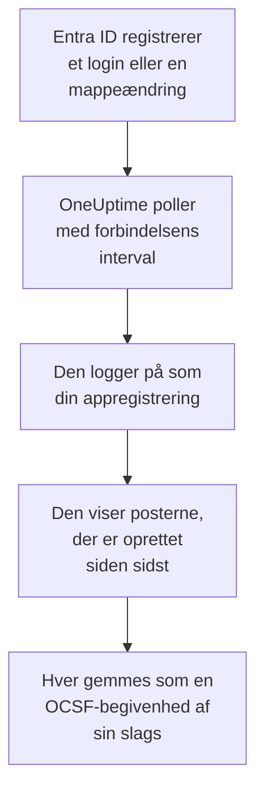

# Microsoft Entra ID

Importér logins og mappeændringer fra [Microsoft Entra ID](https://learn.microsoft.com/en-us/entra/identity/) i OneUptimes sikkerhedsbegivenheder og, hvis du vil, aktiviteten i Exchange, SharePoint, OneDrive og Teams fra [Microsoft 365-auditloggen](https://learn.microsoft.com/en-us/purview/audit-log-activities). Der søger du i dem ved siden af dine logs, traces og metrikker, korrelerer dem med alle andre kilder og kalder vagten op for dem, der betyder noget. OneUptime læser dem med en appregistrering, som du opretter, og ændrer intet i din lejer.

:::cards
- [Opsæt forbindelsen](#opsæt-forbindelsen): En appregistrering, dens tilladelser og forbindelsens formular.
- [Hvad der importeres](#hvad-der-importeres): Hvilke poster, og hvordan hver bliver en sikkerhedsbegivenhed.
- [Sådan fungerer polling](#sådan-fungerer-polling): Det vindue, hver poll læser, og hvorfor det overlapper det forrige med 30 minutter.
- [Fejlfinding](#fejlfinding): Hvad hver fejl betyder, og hvad du skal ændre.
:::

## Sådan fungerer det

Hvert minut poller OneUptime hver aktiveret forbindelse, hvis pollinterval er gået. En poll logger på Microsoft Entra ID som din appregistrering og læser, i denne rækkefølge, mappeændringerne ([List directoryAudits](https://learn.microsoft.com/en-us/graph/api/directoryaudit-list)) og de logins ([List signIns](https://learn.microsoft.com/en-us/graph/api/signin-list)), der er registreret siden sidste poll, og derefter, når indstillingen **Microsoft 365-auditlog** er slået til, auditloggens nye indhold ([Office 365 Management Activity API](https://learn.microsoft.com/en-us/office/office-365-management-api/office-365-management-activity-api-reference)). Hver post gemmes som en [OCSF](https://schema.ocsf.io/)-begivenhed: et login som en begivenhed Authentication, en tildelt rolle som en begivenhed User Access Management, en phishingdom som et Detection Finding.

## Før du går i gang

- I OneUptime rollen Project Owner, Project Admin eller Security Admin. Security Member og Security Viewer kan se forbindelser og deres kørselshistorik, men ikke ændre dem.
- Til logins: Microsoft Entra ID P1 eller P2, som Microsoft 365 E3, E5 og Business Premium indeholder: Microsoft Graph giver kun logins til sådanne lejere. Mappeændringer læses i enhver lejer.
- En Entra-rolle, der kan registrere programmer, som Programadministrator, og en Global administrator eller Administrator af privilegerede roller til at give administratorsamtykke.
- Til Microsoft 365-auditloggen: overvågning slået til for lejeren, som den er som standard: i [Microsoft Purview-portalen](https://purview.microsoft.com) må **Audit** ikke tilbyde **Start recording user and admin activity**.
- Udgående HTTPS fra OneUptimes app og workere til `login.microsoftonline.com`, `graph.microsoft.com` og `manage.office.com`, eller til `login.microsoftonline.us`, `graph.microsoft.us` og `manage.office365.us` for Azure Government.

## Opsæt forbindelsen

Forbindelsen logger på med [OAuth 2.0-flowet for klientlegitimationsoplysninger](https://learn.microsoft.com/en-us/entra/identity-platform/v2-oauth2-client-creds-grant-flow): som et program, aldrig som en person, med skrivebeskyttede tilladelser.

:::steps
### Registrér et program

1. Log på [Microsoft Entra Administration](https://entra.microsoft.com), og åbn **App registrations**.
2. Vælg **New registration**. Kald den `OneUptime Security Events`, lad **Supported account types** stå på **Accounts in this organizational directory only**, lad omdirigerings-URI'en være tom, og vælg **Register**.
3. Kopiér **Program-id (klient)** og **Mappe-id (tenant)** fra appens side **Overview**.

### Lad den læse loggene

1. Gå til **API permissions → Add a permission → Microsoft Graph → Application permissions**, vælg `AuditLog.Read.All`, og vælg **Add permissions**. Microsoft dokumenterer, at listen over logins også kan kræve `Directory.Read.All`: tilføj den, hvis logins afvises med `403`, når samtykket er givet.
2. Til Microsoft 365-auditloggen tilføjer du en anden tilladelse: **Add a permission → Office 365 Management APIs → Application permissions** og derefter `ActivityFeed.Read`.
3. For at lade playbooks deaktivere, aktivere og logge brugere ud (se [Inddæmning](/docs/telemetry/security-cases#inddæmning)) tilføjer du på samme måde `User.Read.All`, `User.EnableDisableAccount.All` og `User.RevokeSessions.All`. Microsoft lader kun en app, der også har rollen Privileged Authentication Administrator, ændre en administrators konto.
4. Vælg **Grant admin consent for** din lejer, og bekræft. Hver tilladelses status skal være **Granted**: uden samtykke afvises hver læsning med `403`.

### Opret en klienthemmelighed

Gå til **Certificates & secrets → Client secrets → New client secret**, vælg, hvornår den udløber, og vælg **Add**. Kopiér hemmelighedens **Value**, ikke dens **Secret ID**, før du forlader siden: den vises aldrig igen. Den dag, den udløber, stopper pollingen med `Microsoft Entra ID token request failed (HTTP 401)`, indtil du erstatter den med **Opdater legitimationsoplysninger**.

### Tilføj forbindelsen i OneUptime

Åbn **Produkter → Security Events → Forbindelser** (`/dashboard/{projectId}/security-events/connections`), klik på **Tilføj forbindelse**, vælg **Microsoft Entra ID** under **Identitet**, og klik på **Næste**. Udfyld indstillingerne i tabellen nedenfor, klik på **Næste**, og indsæt hemmelighedens værdi i **Klienthemmelighed**. Slå **Microsoft 365-auditlog** til i trinnet **Hentning** for også at læse den.

### Test den, før du gemmer

Klik på **Test disse indstillinger** under **Test, før du gemmer**. Testen logger på og læser hver log med værdierne i formularen og gemmer intet, så en forkert hemmelighed eller et manglende samtykke viser sig, før forbindelsen findes. Klik derefter på **Næste**, giv forbindelsen et **Navn**, og opret den.
:::

| Indstilling | Hvor du finder den |
| --- | --- |
| **Mappe-id (tenant)** | Appens side **Overview**. Lejerens GUID eller et verificeret domæne som `contoso.onmicrosoft.com`. Med **Microsoft 365-auditlog** slået til GUID'et: Management API'et kender kun en lejer ved det. |
| **Program-id (klient)** | Appens side **Overview**. GUID'et for den app, der har `AuditLog.Read.All`. |
| **Cloud** | **Offentlig Azure-sky** eller **Azure Government (USA)** til GCC High (`login.microsoftonline.us`, `graph.microsoft.us` og `manage.office365.us`). |
| **Microsoft 365-auditlog** | Valgfri, slået fra som standard. Slået til læser hver poll også Microsoft 365-auditloggen. Appen skal have `ActivityFeed.Read`. |
| **Klienthemmelighed** | Hemmelighedens **Value**. Den krypteres, returneres aldrig af API'et og vises aldrig igen. Erstat den med **Opdater legitimationsoplysninger** på forbindelsen. |

Trinnet **Hentning** har også en valgfri **Beskrivelse**, **Hentningsinterval (minutter)**, et heltal fra `1` til `1440`, der starter på `5`, og **Aktiveret**, som starter slået til.

## Hvad der importeres

Hver begivenhed har leverandøren `Microsoft` og produktet `Microsoft Entra ID`. Dens attribut `entra.log` angiver, hvilken log et login eller en ændring kom fra, og en Microsoft 365-posts `microsoft365.contentType` dens indholdstype.

| Post | OCSF-klasse | Alvorlighed |
| --- | --- | --- |
| Et login, der lykkedes | Authentication (`3002`), status `Success` | Informational |
| Et login, der venter på et andet trin, som MFA (`50074`, `50076`) eller en opfordring til at skifte adgangskode | Authentication (`3002`), status `Interrupted` | Informational: et trin, ikke en fejl |
| Et login, der mislykkedes, med Entras årsag og fejlkode | Authentication (`3002`), status `Failure` | Low |
| Et login, som Identity Protection vurderede til middel eller høj risiko | Authentication (`3002`) | Medium eller High |
| En bruger, gruppe eller rolle, der er ændret, efter dens kategori | Account Change (`3001`), Group Management (`3006`), User Access Management (`3005`) eller Entity Management (`3004`) for resten | Medium for en privilegeret rolle, som Global Administrator; Low for en ændring, der mislykkedes |

Med **Microsoft 365-auditlog** slået til importeres de poster, et sikkerhedsteam handler på, fra den, og resten, som en åbnet fil eller en læst mail, tælles kun:

| Microsoft 365-post | OCSF-klasse | Alvorlighed |
| --- | --- | --- |
| En Exchange-cmdlet, som `New-InboxRule` eller `Set-Mailbox`, en indbakkeregel oprettet i Outlook, eller mail sendt som en anden | API Activity (`6003`) | Medium, når den videresender mail, med `microsoft365.forwardsMail` sat til `true` |
| En tildelt postkassetilladelse, som `Add-MailboxPermission` | User Access Management (`3005`) | Low |
| En fil delt i SharePoint eller OneDrive | File Hosting Activity (`6006`) | Low med en gæst eller et link, som alle kan åbne, med `microsoft365.sharedOutside` sat til `true` |
| En administrator af en webstedssamling tilføjet eller fjernet | User Access Management (`3005`) | Low |
| Mail med malware eller phishing fundet af Microsoft Defender for Office 365 | Detection Finding (`2004`) | High for malware, Medium for phishing |
| En advarsel, som Microsoft 365 udløste | Detection Finding (`2004`) | Advarslens egen |
| En app, en bot eller en connector tilføjet til et team | Application Lifecycle (`6002`) | Low |

Exchanges egen vedligeholdelse, der kører som dens systemkonto, udelades, medmindre den videresender mail. Hver begivenhed beholder hele posten, fladgjort til nøgler med punktum som `status.errorCode` eller `Parameters.ForwardTo`, så en regel læser ethvert felt under Microsofts navn for det. Regelbibliotekets regler for Entra ID læser dem, som de importeres her.

De samme logins og mappeændringer kan i stedet nå OneUptime som logs, eksporteret af en diagnosticeringsindstilling i Azure og læst af [Dine logs](/docs/telemetry/security-events#find-sikkerhedshændelser-i-dine-logs). Hver post får det samme begivenheds-id ad begge veje, men en post, der læses ad begge veje, gemmes to gange: læs Entra ID ad én vej.

## Sådan fungerer polling

- **Poster læses efter, hvornår Entra ID registrerede dem**, `activityDateTime` for en ændring og `createdDateTime` for et login.
- **Den første poll ser 24 timer tilbage**, så en ny forbindelse straks viser sine nylige poster.
- **Hver senere poll starter 30 minutter før den gemte markør.** Microsoft dokumenterer, at begge logs ankommer minutter for sent, så overlappet læser en forsinket post ved den næste poll, og dubletter kasseres efter post-id i projektet.
- **En poll læser højst 24 timer forbi markøren.** En forbindelse, hvis markør er kommet bagud, indhenter i en række vinduer på 24 timer.
- **En lejer uden Microsoft Entra ID P1 eller P2** importerer sine mappeændringer, og hver kørsels kontrol **Read sign-ins** advarer om, at logins ikke blev læst.
- **En mislykket kørsel ændrer intet.** Efter en netværksfejl eller en fejlstatus fra Graph forbliver markøren og vindueslængden, som de var, og den næste poll læser det samme vindue igen. Den eneste undtagelse er en anmodning, der fik timeout: markøren bliver, men det næste vindue er halvt så langt, fordi et vindue, der er for tungt til at blive besvaret i tide, ville få timeout ved hvert forsøg.

Microsoft 365-auditloggen læses efter, hvornår Microsoft gjorde hver indholdsblob tilgængelig, én dag ad gangen, og ikke længere tilbage end de 7 dage, Microsoft gemmer den. Den første poll abonnerer appen på `Audit.Exchange`, `Audit.SharePoint` og `Audit.General`, og Microsoft gør de første poster i et nyt abonnement tilgængelige inden for 12 timer. Auditloggen stopper aldrig Entra ID's logs: en manglende tilladelse er en advarsel, og vinduet går videre, mens en fejl på Microsofts side, som `HTTP 503`, gør kørslen **Delvis**, så vinduet læses igen.

### Når et vindue indeholder mere, end én poll kan læse

Hver log har sit eget budget: 10 sider med 500 mappeændringer, 20 sider med 500 logins og, for Microsoft 365-auditloggen, 120 anmodninger og 10.000 poster. En poll stopper efter 4 minutter. Når et budget stopper en log før slutningen af dens vindue, er kørslen **Delvis**, og dens advarsel navngiver loggen og budgettet. Microsoft Graph viser de nyeste poster først, så OneUptime forkorter vinduet i stedet for at flytte markøren forbi poster, den aldrig nåede:

1. **Indsnævr.** Den næste poll læser et vindue, der er halvt så langt, fra det samme startpunkt, og bliver ved med at halvere, indtil et vindue læses helt, ned til ét minut. Kørslens advarsel siger det: `This window holds more records than one poll can read; the next poll reads a {n} minute window from the same starting point.` Poster, der allerede er importeret fra det længere vindue, springes over som dubletter.
2. **Voks igen.** Når et vindue er læst helt, flyttes markøren til dets slutning, og det næste vindue er igen dobbelt så langt, op til 24 timer.
3. **Gå forbi et enkelt minut.** Hvis selv ét minut indeholder mere, end en poll kan læse, går pollingen forbi det, så nyere poster bliver ved med at komme. Kørslen forbliver **Delvis**, og **Seneste fejl** lyder `More records were created in the one minute from {cursor} to {end} than one poll can read. Polling moved past this minute so newer records keep arriving; use Import this time range in Diagnostics on this minute to recover what one run can read.` Importér det minut med **Import this time range** for at hente det, én kørsel kan læse.

At ændre **Hentningsinterval (minutter)** ændrer intet af dette: det afgør, hvor ofte en poll starter, ikke hvor dens vindue begynder.

### Kør, se forhåndsvisning og importér efter behov

Klik på **Diagnosticering** på en forbindelse for at se dens seneste kørsler og arbejde med den manuelt. Alle, der kan ændre forbindelsen, kan starte disse handlinger; alle, der kan se den, kan læse historikken.

- **Kør nu** starter straks en poll med den sædvanlige markør, også når forbindelsen ikke er **Aktiveret**.
- **Preview records** læser et tidsinterval på op til 7 dage og importerer intet.
- **Import this time range** importerer et interval på op til 7 dage, efter at du har bekræftet, uden at flytte markøren. Poster, der allerede er importeret, springes over. Microsoft Entra ID gemmer 30 dages logins og mappeændringer med P1 eller P2, og 7 dage uden.
- **Copy diagnostics** på en kørsel kopierer dens rapport til support. Den indeholder aldrig legitimationsoplysninger.

## Test forbindelse

**Test forbindelse** på en forbindelses række og **Test disse indstillinger** i formularen kører i API-processen, ikke i en baggrundsworker, så en test også svarer, når det er workerne, der er problemet. Den kører disse kontroller i rækkefølge:

| Kontrol | Hvad den kontrollerer |
| --- | --- |
| **Konfiguration** | Hver indstilling er til stede og velformet. Der kontaktes intet, når dette mislykkes. |
| **Authenticate with Microsoft Entra** | Entra ID udsteder et token til Microsoft Graph til appen, i den cloud, du valgte. |
| **Read sign-ins** | Logins fra de seneste 24 timer kan læses. En advarsel, ikke en fejl, i en lejer uden P1 eller P2. |
| **Read directory changes** | Mappeændringer fra de seneste 24 timer kan læses. |
| **Read the Microsoft 365 audit log** | Kun med indstillingen slået til: Management API'et svarer, og hvilke indholdstyper appen abonnerer på. |
| **Records available to import** | Hvor mange logins og mappeændringer de seneste 24 timer indeholder, højst 500 af hver, så `500+` betyder flere. Ingen er en advarsel. |
| **Background workers**, **Poll scheduler**, **Security event storage** | OneUptimes egen side: en proces tager jobbene fra Worker-køen, poll-jobbet kører hvert minut, og lageret for sikkerhedsbegivenheder svarer. |
| **Scheduled polling** | For en gemt forbindelse: polling er slået til, ingen kørsel sidder fast og venter på en worker, og polls kører til tiden. |

Hver anmodning i en test har en frist på 20 sekunder. En test importerer aldrig noget og flytter aldrig markøren, og hver mislykket kontrol siger, hvad du skal ændre.

## Fejlfinding

Forbindelsens **Seneste fejl** gemmer hele fejlmeddelelsen, med legitimationsoplysninger maskeret. Når en forbindelse har en fejl, vælger du **Vis fejl** i dens kolonne **Handlinger** for at læse den og **Kopiér fejl** i dialogen for at kopiere den. Hver meddelelse starter med `Microsoft Entra ID`, navngiver derefter den anmodning, der mislykkedes, og citerer Microsofts fejlkode, når der er en.

:::details Seneste fejl siger `token request failed`
- `HTTP 401` med `invalid_client`: klienthemmeligheden er forkert eller udløbet. Opret en ny, og gem den med **Opdater legitimationsoplysninger**.
- `HTTP 400`, der navngiver program-id'et (klient) eller lejeren: tjek begge på appens side **Overview**, og at **Cloud** er lejerens.
:::

:::details Seneste fejl siger `sign-ins request failed (HTTP 403)` eller `audit logs request failed (HTTP 403)`
- Fejlkode `Authorization_RequestDenied`: appen mangler `AuditLog.Read.All`, eller samtykket blev ikke givet. Giv administratorsamtykke, vent et par minutter, og test igen. Giv også `Directory.Read.All` til logins.
- Fejlkode `Authentication_RequestFromNonPremiumTenantOrB2CTenant`: lejeren har ikke Microsoft Entra ID P1 eller P2. Mappeændringer importeres stadig.
:::

:::details Microsoft 365-auditloggen læses ikke
- `subscriptions request failed (HTTP 401)` eller `(HTTP 403)`, med `AF10001`: appen mangler `ActivityFeed.Read` fra Office 365 Management APIs, eller samtykket blev ikke givet.
- `AF20010` til `AF20013`: Management API'et kender ikke **Mappe-id (tenant)**. Brug lejerens GUID.
- `subscription start failed` med `AF20023`: en administrator har slået abonnementet fra. En indholdstype, der ikke kan abonneres på, navngives i kørslens advarsler, og de andre læses stadig.
- Ingen poster i timevis efter den første poll: Microsoft gør et nyt abonnements første indhold tilgængeligt inden for 12 timer.
:::

:::details Seneste fejl siger `did not complete`
Anmodningen fik intet svar: en timeout, et navn, der ikke kan slås op, eller en afvist adresse. Tjek, at OneUptimes app og workere kan nå værterne i [Før du går i gang](#før-du-går-i-gang), gennem enhver proxy, du bruger.
:::

:::details Testen lykkes, men Last Polled er Never
Poll-jobbet har aldrig kørt. Læs kontrollerne **Background workers** og **Poll scheduler**. På en selvhostet installation er den sædvanlige årsag `DISABLE_QUEUE_WORKERS=true` på appen, uden en separat worker-udrulning, der tager jobbene: sæt den til `false`, eller kør worker-udrulningen (Helm: `worker.enabled: true`, som er `false` som standard).
:::

## Næste trin

:::cards
- [Sikkerhedsbegivenheder](/docs/telemetry/security-events): Søg, korrelér og advar på det, du importerer.
- [Okta-systemlog](/docs/integrations/okta): Importér logins fra en anden identitetsudbyder.
- [Google Workspace](/docs/integrations/google-workspace): Importér Googles logins og administratorændringer.
- [Oversigt over integrationer](/docs/integrations/index): De andre værktøjer, du kan forbinde.
:::
