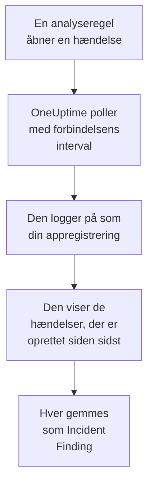

# Microsoft Sentinel

Importér de hændelser, som dine [Microsoft Sentinel](https://learn.microsoft.com/en-us/azure/sentinel/overview)-analyseregler åbner, i OneUptimes sikkerhedsbegivenheder. Der søger du i dem ved siden af dine logs, traces og metrikker, korrelerer dem med alle andre kilder og kalder vagten op for dem, der betyder noget. OneUptime læser dem med en appregistrering, som du opretter, og ændrer intet i Azure.

:::cards
- [Opsæt forbindelsen](#opsæt-forbindelsen): En appregistrering, en rolle og forbindelsens formular.
- [Hvad der importeres](#hvad-der-importeres): Hvordan hver Sentinel-hændelse bliver en sikkerhedsbegivenhed.
- [Sådan fungerer polling](#sådan-fungerer-polling): Det vindue, hver poll læser, og hvad et travlt arbejdsområde gør ved det.
- [Fejlfinding](#fejlfinding): Hvad hver fejl betyder, og hvad du skal ændre.
:::

## Sådan fungerer det



Hvert minut poller OneUptime hver aktiveret forbindelse, hvis pollinterval er gået. En poll logger på Microsoft Entra ID som din appregistrering, beder Azure Resource Manager om de hændelser, der er oprettet siden sidste poll, og gemmer hver som en [OCSF](https://schema.ocsf.io/)-begivenhed Incident Finding (klasse `2005`). Registreringsregler, monitorer og dashboards behandler den derefter som en sikkerhedsbegivenhed fra enhver anden kilde.

## Før du går i gang

- I OneUptime rollen Project Owner, Project Admin eller Security Admin. Security Member og Security Viewer kan se forbindelser og deres kørselshistorik, men ikke ændre dem.
- Et Log Analytics-arbejdsområde med Microsoft Sentinel aktiveret, i Azures offentlige sky eller i Azure Government (US).
- I Microsoft Entra ID retten til at oprette en appregistrering og en klienthemmelighed.
- På den ressourcegruppe, der indeholder arbejdsområdet, retten til at tildele roller, som Ejer eller Administrator af brugeradgang.

## Opsæt forbindelsen

Forbindelsen logger på med OAuth 2.0-flowet for klientlegitimationsoplysninger: som et program, aldrig som en person. Dens adgang kommer fra en Azure-rolle, så appregistreringen behøver ingen API-tilladelser.

:::steps
### Registrér et program

1. Log på [Azure-portalen](https://portal.azure.com), og åbn **Microsoft Entra ID**.
2. Gå til **App registrations → New registration**. Kald den `OneUptime Sentinel connector`, lad **Supported account types** stå på **Accounts in this organizational directory only**, lad omdirigerings-URI'en være tom, og vælg **Register**.
3. Kopiér **Program-id (klient)** og **Mappe-id (tenant)** fra appens side **Overview**.
4. Gå til **Certificates & secrets → Client secrets → New client secret**, vælg, hvornår den udløber, og vælg **Add**. Kopiér hemmelighedens **Value**, ikke dens **Secret ID**, før du forlader siden: den vises aldrig igen.

### Lad den læse hændelser

1. Åbn i Azure-portalen den ressourcegruppe, der indeholder dit Log Analytics-arbejdsområde.
2. Vælg **Access control (IAM) → Add → Add role assignment**.
3. Vælg **Microsoft Sentinel Reader** på fanen **Role**.
4. Vælg **User, group, or service principal** på fanen **Members**, klik på **Select members**, og vælg din appregistrering ud fra dens navn.
5. Vælg **Review + assign**.

Rollen lader appen læse hændelser (`Microsoft.SecurityInsights/incidents/read`) og intet skrive. Microsoft anbefaler at tildele den på ressourcegruppen i stedet for på arbejdsområdet, så den også dækker løsningen `SecurityInsights`, som hændelserne leveres fra. En ny tildeling kan tage et par minutter om at træde i kraft.

### Find arbejdsområdets oplysninger

Åbn Log Analytics-arbejdsområdet i Azure-portalen. Dets side **Overview** viser **Abonnements-id**, **Resource group** og arbejdsområdets navn. Arbejdsområdets ressource-ID indeholder de samme tre:

```text
/subscriptions/{Subscription ID}/resourceGroups/{Resource group}/providers/Microsoft.OperationalInsights/workspaces/{Workspace name}
```

### Tilføj forbindelsen i OneUptime

Åbn **Produkter → Security Events → Forbindelser** (`/dashboard/{projectId}/security-events/connections`), klik på **Tilføj forbindelse**, vælg **Microsoft Sentinel**, og klik på **Næste**. Udfyld indstillingerne i tabellen nedenfor, klik på **Næste**, og indsæt hemmelighedens værdi i **Klienthemmelighed**.

### Test den, før du gemmer

Klik på **Test disse indstillinger** under **Test, før du gemmer**. Testen logger på og læser hændelser med værdierne i formularen og gemmer intet, så en forkert hemmelighed eller en manglende rolle viser sig, før forbindelsen findes. Klik derefter på **Næste**, giv forbindelsen et **Navn**, og opret den.
:::

| Indstilling | Hvor du finder den |
| --- | --- |
| **Mappe-id (tenant)** | Appens side **Overview**. Lejerens GUID eller et verificeret domæne som `contoso.onmicrosoft.com`. |
| **Program-id (klient)** | Appens side **Overview**. Et GUID. |
| **Abonnements-id** | Arbejdsområdets side **Overview**. Et GUID. |
| **Resource group** | Arbejdsområdets side **Overview**. 1 til 90 bogstaver, cifre, understregninger, bindestreger, punktummer eller parenteser, ikke afsluttet med et punktum. |
| **Workspace name** | Arbejdsområdets side **Overview**. 3 til 90 bogstaver, cifre eller bindestreger, der starter og slutter med et bogstav eller et ciffer. |
| **Cloud** | **Offentlig Azure-sky** (`login.microsoftonline.com`, `management.azure.com`) eller **Azure Government (USA)** (`login.microsoftonline.us`, `management.usgovcloudapi.net`). |
| **Klienthemmelighed** | Hemmelighedens **Value**. Den krypteres, returneres aldrig af API'et og vises aldrig igen. Erstat den med **Opdater legitimationsoplysninger** på forbindelsen. |

Trinnet **Hentning** har også en valgfri **Beskrivelse**, **Hentningsinterval (minutter)**, et heltal fra `1` til `1440`, der starter på `5`, og **Aktiveret**, som starter slået til.

## Hvad der importeres

Hver Sentinel-hændelse bliver én begivenhed Incident Finding (OCSF-klasse `2005`, aktivitet `Create`), tilskrevet telemetritjenesten `Microsoft Sentinel`:

| OCSF-kolonne | Felt i Sentinel-hændelsen |
| --- | --- |
| `time` | `properties.createdTimeUtc`, da Sentinel oprettede hændelsen |
| `eventUid` | `name`, hændelsens GUID, som også dubletter fjernes efter |
| `message`, `ruleName` | `properties.title` |
| `ruleId` | Regel-GUID'et i slutningen af den første post i `properties.relatedAnalyticRuleIds` |
| `severityName` | `properties.severity`: `High`, `Medium`, `Low` eller `Informational` |
| `statusName` | `properties.status`: `New`, `Active` eller `Closed` |
| `mitreTactics` | `properties.additionalData.tactics`, som ATT&CK-ID'er: `Persistence` bliver `TA0003` |
| `principalUser` | `properties.owner.userPrincipalName` eller `properties.owner.email` |
| `targetResource` | `properties.incidentUrl`, et link til hændelsen i Azure-portalen |
| `observables` | Ejerens UPN, e-mail og objekt-ID og navnet på hver etiket |
| `attributes` | Hele hændelsen, fladet ud til nøgler med punktummer som `properties.classification` og `properties.firstActivityTimeUtc` |

Lukkede hændelser, der er oprettet i en polls vindue, importeres også. Filtrér på `statusName` i stifinderen for sikkerhedsbegivenheder for kun at se de åbne.

## Sådan fungerer polling

Hver poll viser de hændelser, der er oprettet i dens vindue, de ældste først, 50 pr. side, og følger API'ets `nextLink`, indtil den har læst hele vinduet:

```text
GET https://management.azure.com/subscriptions/{sub}/resourceGroups/{rg}/providers/Microsoft.OperationalInsights/workspaces/{ws}/providers/Microsoft.SecurityInsights/incidents
    ?api-version=2024-03-01
    &$filter=(properties/createdTimeUtc ge {windowStart}) and (properties/createdTimeUtc lt {windowEnd})
    &$orderby=properties/createdTimeUtc asc
    &$top=50
```

- **Oprettelsestidspunktet er markøren.** En planlagt analyseregel, der kører hver time, åbner sin hændelse længe efter den aktivitet, den opdagede, og hændelsens `firstActivityTimeUtc` kan ligge timer eller dage tidligere. En markør på aktivitetstidspunktet ville springe hver sådan hændelse over. Aktivitetstidspunkterne bliver i `attributes`, og eksemplerne i diagnosticeringen viser begge.
- **Den første poll ser 24 timer tilbage**, så en ny forbindelse straks viser sine nylige hændelser.
- **Hver senere poll starter 1 minut før den gemte markør**, så en hændelse, der er oprettet på grænsen mellem to vinduer, aldrig springes over.
- **En poll læser højst 24 timer forbi markøren.** En forbindelse, hvis markør er kommet bagud, indhenter i en række vinduer på 24 timer, og dens **Sundhed** viser **Catching up**.
- **Dubletter fjernes efter hændelsens GUID** (`name`) i projektet, så overlappet, et gentaget vindue og en import aldrig gemmer en hændelse to gange.

### Når et vindue indeholder mere, end én poll kan læse

En poll læser højst 20 sider med 50 hændelser: 1.000 hændelser. Når den grænse stopper den før slutningen af dens vindue, er kørslen **Delvis** med en advarsel som:

```text
Stopped after 20 incidents requests (the per-run request limit) before reading the whole window. Incidents are read oldest first; every incident created before 2026-09-14T08:12:44.000Z was read.
```

Hændelser læses fra ældst til nyest, så OneUptime flytter markøren til oprettelsestidspunktet for den sidst læste hændelse, og den næste poll starter der med samme vindueslængde. Et travlt arbejdsområde indhenter således omkring 1.000 hændelser pr. poll i stedet for at læse de samme igen. Hændelser, der er oprettet på det samme tidspunkt, læses to gange, og dubletkontrollen fjerner den anden kopi.

Når en kørsel slet ikke kan komme forbi den gemte markør, gør OneUptime i stedet vinduet kortere:

1. **Indsnævr.** Den næste poll læser et vindue, der er halvt så langt, fra det samme startpunkt, og bliver ved med at halvere, indtil et vindue læses helt, ned til ét minut. Kørslens advarsel siger det: `This window holds more records than one poll can read; the next poll reads a {n} minute window from the same starting point.`
2. **Voks igen.** Når et vindue er læst helt, er det næste igen dobbelt så langt, op til 24 timer.
3. **Gå forbi et enkelt minut.** Hvis selv ét minut indeholder mere, end en poll kan læse, går pollingen forbi det, så nyere hændelser bliver ved med at komme. Kørslen forbliver **Delvis**, og **Seneste fejl** lyder `More records were created in the one minute from {cursor} to {end} than one poll can read. Polling moved past this minute so newer records keep arriving; use Import this time range in Diagnostics on this minute to recover what one run can read.` Importér det minut med **Import this time range** for at hente det, én kørsel kan læse.

En kørsel, der mislykkes helt, med en fejl fra Microsoft Entra ID eller Azure Resource Manager, beholder markøren og vindueslængden, og den næste poll læser det samme vindue igen. Den eneste undtagelse er en anmodning, der fik timeout: markøren bliver, men det næste vindue er halvt så langt, fordi et vindue, der er for tungt til at blive besvaret i tide, ville få timeout ved hvert forsøg. At ændre **Hentningsinterval (minutter)** ændrer intet af dette: det afgør, hvor ofte en poll starter, ikke hvor dens vindue begynder.

### Kør, se forhåndsvisning og importér efter behov

Klik på **Diagnosticering** på en forbindelse for at se dens seneste kørsler og arbejde med den manuelt. Alle, der kan ændre forbindelsen, kan starte disse handlinger; alle, der kan se den, kan læse historikken.

- **Kør nu** starter straks en poll med den sædvanlige markør, også når forbindelsen ikke er **Aktiveret**.
- **Preview incidents** læser et tidsinterval på op til 7 dage og importerer intet.
- **Import this time range** importerer et interval på op til 7 dage, efter at du har bekræftet, uden at flytte markøren. Hændelser, der allerede er importeret, springes over.
- **Copy diagnostics** på en kørsel kopierer dens rapport til support. Den indeholder aldrig legitimationsoplysninger.

## Test forbindelse

**Test forbindelse** på en forbindelses række og **Test disse indstillinger** i formularen kører i API-processen, ikke i en baggrundsworker, så en test også svarer, når det er workerne, der er problemet. Den kører disse kontroller i rækkefølge:

| Kontrol | Hvad den kontrollerer |
| --- | --- |
| **Konfiguration** | Hver indstilling er til stede og velformet. Der kontaktes intet, når dette mislykkes. |
| **Authenticate with Microsoft Entra** | Microsoft Entra ID udsteder et token til Azure Resource Manager til din appregistrering. |
| **Read incidents** | Én hændelse, der er oprettet inden for de seneste 24 timer, kan læses (`$top=1`). Det beviser rollen og arbejdsområdets oplysninger. |
| **Incidents available to import** | Hvor mange hændelser der er oprettet inden for de seneste 24 timer og de seneste 7 dage, én side med 50 for hver, så `50+` betyder flere. Ingen inden for 7 dage er en advarsel, ikke en fejl. |
| **Background workers**, **Poll scheduler**, **Security event storage** | OneUptimes egen side: en proces tager jobbene fra Worker-køen, poll-jobbet kører hvert minut, og lageret for sikkerhedsbegivenheder svarer. |
| **Scheduled polling** | For en gemt forbindelse: polling er slået til, ingen kørsel sidder fast og venter på en worker, og polls kører til tiden. |

Hver anmodning i en test har en frist på 20 sekunder. En test importerer aldrig noget og flytter aldrig markøren, og hver mislykket kontrol siger, hvad du skal ændre.

## Send sikkerhedshændelser til Microsoft Sentinel

OneUptime kan også sende det, den finder, til Microsoft Sentinel gennem Azure Monitors Logs Ingestion API, ind i en brugerdefineret tabel i det arbejdsområde, Sentinel kører på. Dine analyseregler, hunting-forespørgsler og projektmapper forespørger derefter `OneUptimeSecurityEvents_CL` ved siden af dine andre tabeller.

:::steps
### Opret tabellen og dens dataindsamlingsregel

Åbn arbejdsområdets **Tables → Create → New custom log (DCR-based)** i Azure-portalen. Kald tabellen `OneUptimeSecurityEvents`, opret en ny dataindsamlingsregel og et dataindsamlingsslutpunkt, hvis formularen beder om et. Upload eksemplet nedenfor som eksempelfil, behold transformationen, som den er, og opret tabellen.

### Lad et program sende til den

Registrér et program, og giv det en klienthemmelighed som i [Registrér et program](#registrér-et-program). Åbn derefter dataindsamlingsreglen, **Access control (IAM) → Add → Add role assignment**, vælg **Monitoring Metrics Publisher**, og vælg programmet.

### Tilføj destinationen

Åbn **Produkter → Security Events → Forbindelser**. Klik på **Tilføj destination** under **Send til dit SIEM**, vælg Microsoft Sentinel under **SIEM**, og klik på **Næste**. Udfyld **Mappe-id (tenant)**, **Program-id (klient)** og **Klienthemmelighed**, **Slutpunkt til logindtagelse** fra dataindsamlingsslutpunktets (eller reglens) **Overview** og **Uforanderligt ID for dataindsamlingsreglen** fra reglens **JSON View**. **Strøm** er valgfri: står den tom, er den `Custom-OneUptimeSecurityEvents_CL`.

### Send en testhændelse, og begynd at sende

Klik på **Send en testhændelse**: én række når tabellen inden for få minutter. Behold derefter **Kun detektioner** under **Hvad der skal sendes**, eller vælg **Alle sikkerhedshændelser**, og klik på **Begynd at sende**.
:::

Eksempelfilen, én række med alle tabellens kolonner:

```json title="oneuptime-security-events-sample.json"
[
  {
    "TimeGenerated": "2026-10-21T10:00:00.000Z",
    "EventId": "0193c0de-cccc-4aaa-8bbb-000000000001",
    "EventUid": "okta-1",
    "ClassName": "Authentication",
    "CategoryName": "Identity & Access Management",
    "ActivityName": "Logon",
    "Severity": "Medium",
    "SeverityId": 3,
    "Status": "Failure",
    "Message": "Failed sign-in for alice",
    "VendorName": "Okta",
    "ProductName": "Okta System Log",
    "RuleId": "",
    "RuleName": "",
    "MitreTactics": [],
    "MitreTechniques": [],
    "PrincipalUser": "alice@example.com",
    "PrincipalHost": "laptop-7",
    "PrincipalIp": "203.0.113.7",
    "TargetUser": "",
    "TargetHost": "app.example.com",
    "TargetIp": "198.51.100.20",
    "TargetPort": 443,
    "TargetResource": "",
    "ProcessName": "",
    "ProcessCommandLine": "",
    "ParentProcessName": "",
    "Observables": [
      "alice@example.com",
      "203.0.113.7"
    ],
    "Attributes": {
      "okta.outcome.reason": "INVALID_CREDENTIALS"
    }
  }
]
```

- Logs Ingestion API tager op til 1 MB pr. kald, så rækker sendes i batches på op til 500. En batch, Azure afviser, deles, indtil den række, den ikke vil tage, er fundet og udeladt, og begrænsning (`429`) prøves igen.
- En `403` betyder, at programmet mangler **Monitoring Metrics Publisher** på reglen, og en `404` et forkert uforanderligt ID eller en forkert strøm.
- Hændelser, som OneUptime har importeret fra Microsoft Sentinel, sendes aldrig tilbage dertil.

## Fejlfinding

Forbindelsens **Seneste fejl** gemmer hele fejlmeddelelsen, med legitimationsoplysninger maskeret, bag et præfiks, der navngiver det trin, der mislykkedes. Når en forbindelse har en fejl, vælger du **Vis fejl** i dens kolonne **Handlinger** for at læse den og **Kopiér fejl** i dialogboksen for at kopiere den. Læs præfikset først.

:::details Last Error starter med `Microsoft Sentinel token request`
- `Microsoft Sentinel token request failed (HTTP ...)`: Microsoft Entra ID nægtede at udstede et token, så Azure blev aldrig kontaktet. Meddelelsen citerer Entras kode:
  - `AADSTS7000215` eller `invalid_client`: **Klienthemmelighed** er forkert eller udløbet, eller det er hemmelighedens ID i stedet for dens værdi. Opret en ny hemmelighed, og gem den med **Opdater legitimationsoplysninger**.
  - `AADSTS700016` eller `unauthorized_client`: **Program-id (klient)** findes ikke i det angivne **Mappe-id (tenant)**. Sammenlign begge med appens side **Overview**.
  - `AADSTS90002` eller `HTTP 404`: den lejer findes ikke. **Mappe-id (tenant)** er forkert, eller den ligger i den anden sky: tjek **Cloud**.
  - `HTTP 429` eller `HTTP 5xx`: Microsoft Entra ID begrænser anmodninger eller er utilgængelig. Den næste poll prøver igen.
- `Microsoft Sentinel token request returned ...`: Microsoft Entra ID svarede med noget ubrugeligt, for eksempel en brødtekst, der ikke er JSON, eller uden `access_token`. Det er som regel en proxy eller gateway imellem.
- `Microsoft Sentinel token request failed:`, uden status, eller `Microsoft Sentinel token request timed out after ... seconds with no response`: anmodningen fik intet svar. Tjek DNS, TLS og udgående HTTPS fra OneUptime-appen og -workerne til `login.microsoftonline.com`.
:::

:::details Last Error starter med `Microsoft Sentinel incidents list`
- `Microsoft Sentinel incidents list failed (HTTP ...)`: Azure Resource Manager afviste anmodningen.
  - `HTTP 401`: den accepterede ikke tokenet. Næsten altid passer **Cloud** ikke til lejeren, eller appregistreringen er slettet. Et token, der udløber mellem to sider, fornyes og prøves igen én gang af sig selv.
  - `HTTP 403` eller `AuthorizationFailed`: appen har endnu ikke **Microsoft Sentinel Reader** på ressourcegruppen. Tildel den, og vent et par minutter.
  - `HTTP 404`: intet arbejdsområde har det **Abonnements-id**, den **Resource group** og det **Workspace name**, eller Microsoft Sentinel er ikke aktiveret der. Kopiér dem fra arbejdsområdets side **Overview**.
  - `HTTP 429` eller `HTTP 5xx`: Azure Resource Manager begrænser anmodninger eller er utilgængelig. Den næste poll prøver igen.
  - `HTTP 400`: Azure Resource Manager afviste anmodningen, som OneUptime bygger, ikke dine indstillinger. Send meddelelsen til OneUptimes support.
- `Microsoft Sentinel incidents list returned ...`: Azure svarede `200`, men uden en læsbar side med hændelser eller med et `nextLink` til en anden vært, som forbindelsen afviser, så tokenet aldrig forlader Azure Resource Manager. Det rapporteres i stedet for at blive opfattet som et tomt vindue, så markøren aldrig går forbi hændelser, som ingen har læst.
- `Microsoft Sentinel incidents list failed:`, uden status, eller `Microsoft Sentinel incidents list timed out after ... seconds with no response`: anmodningen fik intet svar. Tjek udgående HTTPS fra OneUptime-workerne til `management.azure.com` eller `management.usgovcloudapi.net`.
:::

:::details Last Polled er Never, og Last Error er tom
Ingen poll er blevet færdig for denne forbindelse. Kør **Test forbindelse**: dens kontroller **Background workers** og **Poll scheduler** navngiver årsagen. På en selvhostet installation er den sædvanlige årsag `DISABLE_QUEUE_WORKERS=true` på appen, uden en separat worker-udrulning, der tager jobbene: sæt den til `false`, eller kør worker-udrulningen (Helm: `worker.enabled: true`).
:::

:::details En kørsel er Partial
- `Stopped after 20 incidents requests (the per-run request limit) before reading the whole window`: vinduet indeholdt mere end de 1.000 hændelser, én kørsel læser. Intet går tabt: den næste poll starter efter den sidst læste hændelse. En forbindelse, der forbliver **Delvis** poll efter poll, indhenter et efterslæb, og dens **Senest hentet** og **Seneste importerede hændelse** bliver ved med at rykke frem.
- `Microsoft Sentinel returned incidents out of creation-time order, so this run cannot name a point to resume from.`: API'et ignorerede rækkefølgen fra ældst til nyest, så kørslen kan ikke flytte markøren til sin sidste hændelse, og den næste poll læser i stedet et kortere vindue. Hvis det bliver ved, så send kørslens rapport til OneUptimes support.
- `More records were created in the one minute from ... than one poll can read`: pollingen gik forbi det minut. Importér det med **Import this time range** i **Diagnosticering**. En import læser lige så meget som en poll.
:::

:::details Testen lykkes, men intet importeres
Læs **Incidents available to import** i testens rapport. `0` inden for de seneste 7 dage betyder, at arbejdsområdets analyseregler ikke har åbnet nogen hændelser, og det er ikke en fejl i forbindelsen. Kontrollér i Microsoft Sentinel, at reglerne er aktiveret og sat til at oprette hændelser.
:::

## Azure Government

Sæt **Cloud** til **Azure Government (USA)**. Forbindelsen logger så på `login.microsoftonline.us` med omfanget `https://management.usgovcloudapi.net/.default` og læser hændelser fra `management.usgovcloudapi.net`. Alt andet, også rolletildelingen, er det samme.

## Hvad du får

- **Søgning.** Filtrér hændelser efter alvorlighed, status, ejer, etiket eller taktik i stifinderen for sikkerhedsbegivenheder, ved siden af alle andre kilder.
- **Korrelation.** Hver hændelses ejer og etiketter indekseres som observables, så én søgning finder alt, der nævner dem.
- **Registreringsregler.** Sigma-regler, der kører efter en tidsplan over dine sikkerhedsbegivenheder og åbner advarsler, der kalder vagten op.
- **Monitorer.** Monitorer for sikkerhedsbegivenheder tæller matchende begivenheder, for eksempel nye High-hændelser, og åbner hændelser eller advarsler over en tærskel.

Sikkerhedsbegivenheder faktureres som resten af din telemetri, pr. indtaget GB. Se [Priser](https://oneuptime.com/pricing).

## Næste trin

:::cards
- [Sikkerhedsbegivenheder](/docs/telemetry/security-events): Søg, korrelér og advar på det, du importerer.
- [Microsoft Defender XDR](/docs/integrations/microsoft-defender-xdr): Importér også advarslerne fra hver Defender-arbejdsbelastning.
- [Roller](/docs/permissions/reference#roller): Hvad Security-rollerne kan se og ændre.
- [Oversigt over integrationer](/docs/integrations/index): De andre værktøjer, du kan forbinde.
:::
