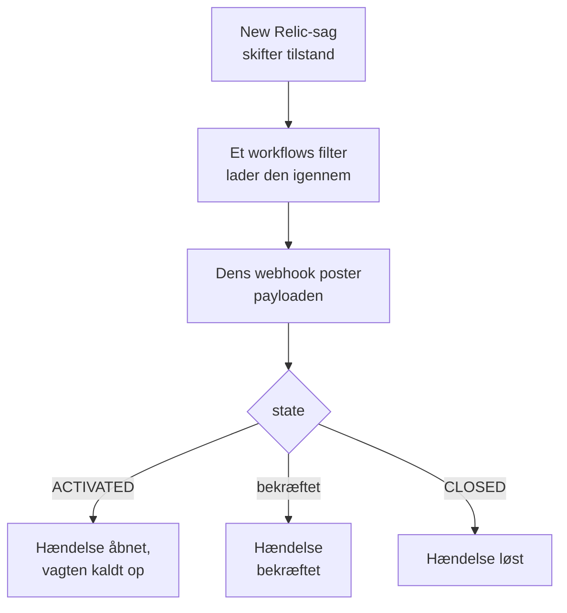

# New Relic

Send [New Relic](https://newrelic.com)-sager til OneUptime, så hver sag bliver en hændelse eller en advarsel, der kalder dit vagthold op, bekræftes, når nogen bekræfter sagen, og løses, når sagen lukkes. New Relic sender sine sager via en [webhook-destination](https://docs.newrelic.com/docs/alerts/get-notified/notification-integrations/), så der er intet at installere på nogen af siderne.

:::cards
- [Start med skabelonen](#start-med-skabelonen): Vælg, hvem der skal kaldes op, kopiér URL'en, og se, hvad hver sag gør.
- [Konfigurer New Relic](#konfigurer-new-relic): En webhook-destination og det workflow, der underretter den.
- [Test det](#test-det): Send en sag selv, og derefter en fra New Relic.
- [Fejlfinding](#fejlfinding): Når sager ikke kommer frem, eller hændelser bliver ved med at være åbne.
:::

## Sådan fungerer det



Et New Relic-workflow vælger de sager, der skal sendes, med sit filter, og underretter en webhook-destination, når en sag aktiveres, bekræftes eller lukkes, med en JSON-payload, som New Relic udfylder. Sagens ID er den måde, OneUptime finder den hændelse, den åbnede.

## Før du går i gang

- En New Relic-konto, hvor du kan oprette destinationer og workflows.
- I OneUptime retten til at oprette workflows. I OneUptime Cloud kræver workflows planen **Growth** eller højere.

## Start med skabelonen

Sæt OneUptime op først: det giver dig den URL, New Relic sender til. Dialogen **Opret en arbejdsgang** har to New Relic-skabeloner under **New Relic** i kategorilisten: **Declare an incident for each New Relic issue** og **Create an alert for each New Relic issue** til advarsler. Begge gør det samme, hver med sin egen slags post.

:::steps
1. Gå til **Arbejdsgange**, og klik på **Opret arbejdsgang**. Under **Eller start fra en skabelon** vælger du **New Relic** i kategorilisten, klikker på **Declare an incident for each New Relic issue** eller **Create an alert for each New Relic issue** og klikker på **Brug denne skabelon**.
2. Under **Who to page for new New Relic issues** vælger du de vagtpolitikker, der skal tilkaldes, eller ingen for ikke at tilkalde nogen, og klikker på **Opret arbejdsgang**. Workflowet åbner i **Bygger**, slået fra.
3. Klik på triggeren **Webhook**, derefter på **Kopiér URL**, og gem URL'en til New Relic.
4. Slå **Aktiveret** til øverst i **Bygger**. Et workflow, der er slået fra, svarer New Relic med `400`.
:::

Derefter [konfigurerer du New Relic](#konfigurer-new-relic) til at sende sine sager til den URL. Workflowets trin `read-event-1` åbner med den samme opsætning, til når du vender tilbage til det i **Bygger**.

### Hvad workflowet gør

Efter triggeren **Webhook** læser trinnet **Check With JavaScript** `read-event-1` den `state`, New Relic sender, og **Incident From Another Tool**, eller **Alert From Another Tool** i advarselsskabelonen, gør det, den betyder, ud fra sagens ID. Hændelsen gemmer ID'et i sit brugerdefinerede felt `newRelicIssueId`.

| Hvad New Relic sender | Hvad workflowet gør |
| --- | --- |
| `state` er `ACTIVATED` eller `CREATED` | Erklærer en hændelse med titlen `New Relic: <issue>`, med den alvorlighed, sagens prioritet svarer til, holdt uden for dine statussider. Dens beskrivelse linker til sagen i New Relic og viser prioriteten, entiteterne, politikkerne og betingelserne. Den kalder de vagtpolitikker op, du valgte. Den samme sag igen, f.eks. når New Relic hæver den til CRITICAL, opretter ingen ny hændelse og kalder ingen op igen. |
| `state` er `ACTIVATED`, og `isAcknowledged` er `true` | Bekræfter sagens hændelse, så vagten holder op med at eskalere den. Hvorfor står på dens tidslinje. |
| `state` er `CLOSED` | Løser sagens hændelse, medmindre den allerede er løst. Hvorfor står på dens tidslinje. |

En bekræftelse eller en lukning for en sag uden hændelse ændrer intet. Alt andet, f.eks. en anmodning fra et andet værktøj, bliver ladt være: `read-event-1` tager **No**, og kørslens **Trin** siger hvorfor. Intet går tilbage til New Relic: det lukker selv sine sager, når signalet kommer sig, og det er det, der løser hændelsen.

### Prioriteter og opkald

Hver ny sag kalder de vagtpolitikker op, du valgte, uanset prioritet: New Relic hæver en sag fra HIGH til CRITICAL på stedet, på samme sag, så at vente på CRITICAL ville aldrig kalde op for en sag, der blev åbnet som HIGH og blev værre. For at kalde op for færre sager skal du indsnævre filteret for workflowet i New Relic: kun det, der passerer det, når OneUptime. I et nyt projekt knytter prioriteterne sig til disse hændelses- og advarselsalvorligheder:

| New Relic-prioritet | Hændelse | Advarsel | Vagt |
| --- | --- | --- | --- |
| CRITICAL | Critical Incident | High | Kaldt op |
| HIGH | Major Incident | Low | Kaldt op |
| MEDIUM | Minor Incident | Low | Kaldt op |
| LOW | Minor Incident | Low | Kaldt op |

Med egne alvorligheder går CRITICAL til din mest alvorlige, HIGH til den midterste, og MEDIUM og LOW til din mindst alvorlige. En hændelse beholder den alvorlighed, den blev åbnet med, når New Relic hæver sin sag.

For at knytte en prioritet til en af dine efter navn skal du redigere `SEVERITY_BY_NAME` i trinnet `read-event-1`, f.eks. `{ HIGH: 'Critical Incident' }`.

## Konfigurer New Relic

:::steps
### Tilføj webhook-destinationen

I New Relic går du til **Alerts → Destinations** og tilføjer en destination af typen **Webhook**. Sæt **Webhook name** til `OneUptime` og **Endpoint URL** til den URL, du kopierede fra OneUptime, og gem den. Lad **Use authorization** være slået fra: URL'en er den eneste legitimation.

### Tilføj workflowet

Gå til **Alerts → Workflows**, og klik på **Add a workflow**. Kald det `OneUptime`. Dets filter afgør, hvilke sager der når OneUptime, f.eks. kun CRITICAL-sager eller ét teams.

### Underret destinationen

Føj den **Webhook**-destination, du lavede, til workflowet. Behold den payload, New Relic udfylder, og tilføj en linje for `isAcknowledged` efter `state`, så hændelsen bekræftes sammen med sin sag:

```json
{
  "id": {{ json issueId }},
  "issueUrl": {{ json issuePageUrl }},
  "title": {{ json annotations.title.[0] }},
  "priority": {{ json priority }},
  "impactedEntities": {{ json entitiesData.names }},
  "totalIncidents": {{ json totalIncidents }},
  "state": {{ json state }},
  "isAcknowledged": {{ json isAcknowledged }},
  "trigger": {{ json triggerEvent }},
  "isCorrelated": {{ json isCorrelated }},
  "createdAt": {{ createdAt }},
  "updatedAt": {{ updatedAt }},
  "sources": {{ json accumulations.source }},
  "alertPolicyNames": {{ json accumulations.policyName }},
  "alertConditionNames": {{ json accumulations.conditionName }},
  "workflowName": {{ json workflowName }}
}
```

Linjen, der skal tilføjes, er `"isAcknowledged": {{ json isAcknowledged }},`. Klik derefter på **Update message**.

### Underret ved aktiveret, bekræftet og lukket

Klik på de tre prikker på destinationen, og vælg **Notify when**. Behold **Activated**, **Acknowledged** og **Closed** slået til.

### Aktivér workflowet

Klik på **Activate workflow**.
:::

OneUptime-workflowet læser disse felter i payloaden og lader de andre være:

| Felt | Hvad New Relic sætter i det |
| --- | --- |
| `id` | ID'et på sagen. |
| `issueUrl` | Et link til sagen i New Relic. |
| `title` | Sagens titel. |
| `priority` | Hvor presserende sagen er: `CRITICAL`, `HIGH`, `MEDIUM` eller `LOW`. |
| `state` | Hvor sagen står: `CREATED`, `ACTIVATED` eller `CLOSED`. |
| `isAcknowledged` | `true`, så snart nogen bekræfter sagen i New Relic. |
| `impactedEntities` | Navnene på de entiteter, sagen handler om. |
| `alertPolicyNames` | Navnene på de politikker bag sagen. |
| `alertConditionNames` | Navnene på de betingelser bag sagen. |

## Test det

Send en sag til den URL, du kopierede, sådan som New Relic ville gøre:

```bash
curl -X POST "<url>" \
  -H "Content-Type: application/json" \
  -d '{
    "id": "7d4a2e1c-3b5f-4c8e-9a1d-2f6b8c0e4a71",
    "issueUrl": "https://radar-api.service.newrelic.com/accounts/1234567/issues/7d4a2e1c-3b5f-4c8e-9a1d-2f6b8c0e4a71?notifier=WEBHOOK",
    "title": "High CPU on checkout-service",
    "priority": "CRITICAL",
    "impactedEntities": ["checkout-service"],
    "state": "ACTIVATED",
    "isAcknowledged": false,
    "alertPolicyNames": ["Production"],
    "alertConditionNames": ["CPU above 90%"]
  }'
```

En hændelse åbnes med titlen `New Relic: High CPU on checkout-service`, og de vagtpolitikker, du valgte, kaldes op. Send den samme anmodning med `isAcknowledged` sat til `true`, og hændelsen bekræftes. Send den med `state` sat til `CLOSED`, og hændelsen løses.

Test derefter fra New Relic: åbn workflowets webhook-besked, og klik på **Send test notification**. For at se, at den kom frem, åbn OneUptime-workflowets **Protokoller → Kørsler**.

## Fejlfinding

:::details Intet kommer frem til OneUptime
- Kontrollér, at workflowet i New Relic er aktivt, og at dets filter lader sagen igennem.
- Kontrollér, at destinationens **Endpoint URL** er URL'en for triggeren **Webhook**.
- Et workflow, der er slået fra, svarer `400`. Slå **Aktiveret** til øverst i dets **Bygger**.
:::

:::details Workflowet kører, men åbner intet
Åbn kørslen i **Protokoller → Kørsler**. Posten `read-event-1` under **Trin** siger, hvorfor den tog **No**.

- `New Relic named no issue ID`: behold linjen `"id": {{ json issueId }},` i payloaden.
- `is in no state`: behold linjen `"state": {{ json state }},` i payloaden.
:::

:::details Hændelser bliver ikke bekræftet
- Payloaden skal have linjen `"isAcknowledged": {{ json isAcknowledged }},`. Uden den åbnes en hændelse og løses sammen med sin sag, men bekræftes aldrig.
- Workflowet i New Relic skal have **Acknowledged** slået til under **Notify when**.
:::

:::details Hændelser oprettes, men løses aldrig
- Workflowet i New Relic skal have **Closed** slået til under **Notify when**.
- Åbn lukningens kørsel i **Protokoller → Kørsler**: dens sidste trin siger hvorfor. Lukningens `id` skal være sagens, så behold `"id": {{ json issueId }},` som det står i payloaden.
:::

:::details Vagten kaldes op for for mange sager
Hver ny sag, der når OneUptime, kalder op. Indsnævr filteret for workflowet i New Relic, så kun de sager, der skal kalde op, når det. Se [Prioriteter og opkald](#prioriteter-og-opkald).
:::

:::details Vagten bliver ikke kaldt op
- En notifikation for en sag, der har sin hændelse, kalder ingen op igen, så en forhøjelse til CRITICAL kalder ingen op.
- Hvis ingen er valgt i dialogen **Opret en arbejdsgang**, har workflowet intet trin, der kalder op.
:::

## Sikkerhed

- **Behandl URL'en som en adgangskode.** Alle, der har den, kan åbne hændelser. Hvis den slipper ud, så klik på **Nulstil URL** i workflowets **Webhook**-trigger. Opdater derefter destinationens **Endpoint URL** i New Relic.
- **Links går til New Relic.** Skabelonen linker kun en sag på et New Relic-websted, uanset hvad en anmodning siger, og skriver det, New Relic sendte, som tekst.
- **Selvhostet?** New Relic sender webhooks fra internettet, så din OneUptime skal kunne nås derfra over HTTPS.

## Næste trin

:::cards
- [Workflow-skabeloner](/docs/workflows/authoring): Opret et workflow fra en skabelon, og ændr det i Bygger.
- [Datadog](/docs/integrations/datadog): Den samme skabelon, til Datadog-monitorer.
- [Eskaleringsregler](/docs/on-call/escalation-rules): Bestem, hvem en vagtpolitik kalder op, og hvornår.
- [Oversigt over integrationer](/docs/integrations/index): De andre værktøjer, du kan forbinde.
:::
