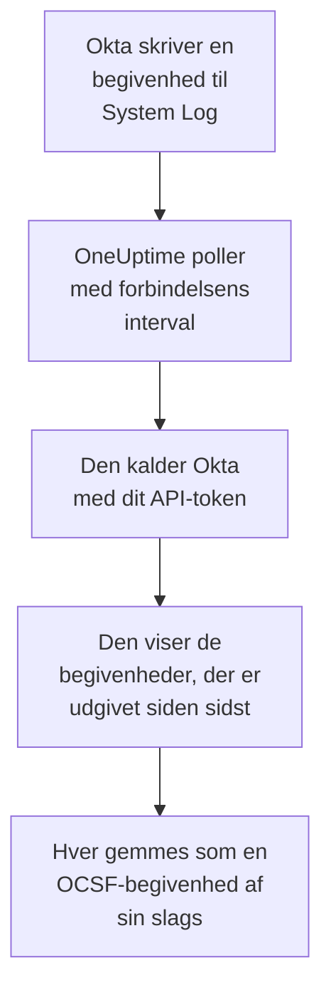

# Okta-systemlog

Importér [Okta System Log](https://developer.okta.com/docs/reference/system-log-query/) i OneUptimes sikkerhedsbegivenheder: logins, MFA-udfordringer, konto- og gruppeændringer og Oktas egne trusselsregistreringer. Der søger du i dem ved siden af dine logs, traces og metrikker, korrelerer dem med alle andre kilder og kalder vagten op for dem, der betyder noget. OneUptime læser dem med et API-token, du selv opretter, og ændrer intet i Okta.

:::cards
- [Opsæt forbindelsen](#opsæt-forbindelsen): Et API-token og forbindelsens formular.
- [Hvad der importeres](#hvad-der-importeres): Hvilke begivenheder, og hvordan hver bliver en sikkerhedsbegivenhed.
- [Sådan fungerer polling](#sådan-fungerer-polling): Det vindue, hver poll læser, og hvorfor det overlapper det forrige med 15 minutter.
- [Fejlfinding](#fejlfinding): Hvad hver fejl betyder, og hvad du skal ændre.
:::

## Sådan fungerer det



Hvert minut poller OneUptime hver aktiveret forbindelse, hvis pollinterval er gået. En poll beder Okta om de System Log-begivenheder, der er udgivet siden sidste poll, og gemmer hver som en [OCSF](https://schema.ocsf.io/)-begivenhed: et login som en Authentication-begivenhed, en kontoredigering som en Account Change og en Okta-registrering som et Detection Finding. Registreringsregler, monitorer og dashboards behandler den derefter som en sikkerhedsbegivenhed fra enhver anden kilde. Det virker med alle Okta-celler, `okta.com`, `oktapreview.com` og `okta-emea.com`, og med en organisation på et brugerdefineret domæne.

## Før du går i gang

- I OneUptime rollen Project Owner, Project Admin eller Security Admin. Security Member og Security Viewer kan se forbindelser og deres kørselshistorik, men ikke ændre dem.
- En Okta-administrator, der kan se System Log, til at oprette tokenet. Et token kan det, dets administrator kan, så brug en Read-only Administrator: den læser System Log og ændrer intet. En skrivebeskyttet administrator ser også brugere, grupper, apps og indstillinger, så pas lige så godt på tokenet som på en adgangskode.
- Helst en tjenestekonto til den administrator. Okta deaktiverer et token, når dets administrator deaktiveres, og når det står ubrugt i 30 dage. Pollingen bruger det hvert par minutter, så det forbliver i brug, så længe forbindelsen er aktiveret.
- Hvis din organisation kun tager imod API-kald fra en netværkszone, en zone, der indeholder de adresser, OneUptime kalder fra: på OneUptime Cloud dens udgående adresser og på en selvhostet installation den offentlige adresse på dine app- og workerværter.

## Opsæt forbindelsen

:::steps
### Opret et API-token

1. Log på Oktas **Admin Console** som den skrivebeskyttede administrator.
2. Åbn **Security → API**, derefter fanen **Tokens**, og vælg **Create token**.
3. Giv det et navn, for eksempel `OneUptime security events`. Lad **Any IP** stå som det sted, dets kald må komme fra, medmindre din organisation har brug for en zone.
4. Vælg **Create token**, og kopiér **Token Value**. Okta viser den kun én gang.

Hvert token må bruge en andel af organisationens API-hastighedsgrænse, som dets række på fanen **Tokens** viser. En poll laver højst 20 anmodninger, så standardandelen er rigeligt, medmindre andre værktøjer bruger det samme token.

### Tilføj forbindelsen i OneUptime

Åbn **Produkter → Security Events → Forbindelser** (`/dashboard/{projectId}/security-events/connections`), klik på **Tilføj forbindelse**, vælg **Okta System Log**, og klik på **Næste**. Udfyld indstillingerne i tabellen nedenfor, klik på **Næste**, og indsæt tokenet i **API token**.

### Test den, før du gemmer

Klik på **Test disse indstillinger** under **Test, før du gemmer**. Testen logger på og læser begivenheder med værdierne i formularen og gemmer intet, så en forkert URL eller et ugyldigt filter viser sig, før forbindelsen findes. Klik derefter på **Næste**, giv forbindelsen et **Navn**, og opret den.
:::

| Indstilling | Hvad du skal angive |
| --- | --- |
| **Okta organization URL** | Adressen, dine brugere logger på hos, for eksempel `https://acme.okta.com`, `https://acme.oktapreview.com` eller `https://login.example.com`. Den skal bruge `https`, uden sti. Ikke Admin Consoles `-admin`-adresse, som ikke udstiller API'et. |
| **Event filter** | Valgfrit. Et [System Log-filter](https://developer.okta.com/docs/reference/core-okta-api/#filter), der vælger de begivenheder, der skal importeres, for eksempel `eventType sw "user.session" or eventType sw "security"`. Tomt importerer familierne nedenfor. Højst 2.000 tegn, på én linje, og ikke på `published`: OneUptime sætter selv tidsintervallet. |
| **API token** | Tokenets værdi, alene: OneUptime tilføjer selv skemaet `SSWS`. Den krypteres, returneres aldrig af API'et og vises aldrig igen. Erstat den med **Opdater legitimationsoplysninger** på forbindelsen. |

Trinnet **Hentning** har også en valgfri **Beskrivelse**, **Hentningsinterval (minutter)**, et heltal fra `1` til `1440`, der starter på `5`, og **Aktiveret**, som starter slået til.

## Hvad der importeres

Uden **Event filter** importerer OneUptime de begivenhedsfamilier, et sikkerhedsteam holder øje med, efter `eventType`-præfiks. Et filter af dit eget erstatter denne liste i stedet for at føje til den:

| Præfiks | Begivenheder |
| --- | --- |
| `user.session` | Logins og logouts, adgang til Admin Console, personificering |
| `user.authentication` | Godkendelsesresultater, inklusive single sign-on |
| `user.mfa` | Tilmelding, udfordringer og nulstillinger af faktorer |
| `user.account` | Adgangskodeændringer og -nulstillinger, spærringer, profil- og rettighedsændringer |
| `user.lifecycle` | Brugere, der er oprettet, aktiveret, suspenderet, deaktiveret og slettet |
| `security.` | ThreatInsight, rapporter om mistænkelig aktivitet og Oktas andre registreringer |
| `policy.` | Evalueringer af login-politikker og politikændringer |
| `system.api_token` | API-tokens, der er oprettet og tilbagekaldt |
| `application.user_membership` | App-tildelinger |
| `group.user_membership` | Ændringer i gruppemedlemskab |

Hver begivenhed bliver én OCSF-begivenhed med leverandøren `Okta` og produktet `Okta System Log`, af den klasse, dens `eventType` kræver:

| `eventType` | OCSF-klasse | Aktivitet |
| --- | --- | --- |
| `user.session.start` | Authentication (`3002`) | `Logon` |
| `user.session.end` | Authentication (`3002`) | `Logoff` |
| `user.authentication.*` | Authentication (`3002`) | `Logon` |
| `user.mfa.*` | Authentication (`3002`) | `Authentication Ticket` |
| Andre `user.session.*`-begivenheder | Authentication (`3002`) | `Other` |
| `user.account.*`, `user.lifecycle.*` | Account Change (`3001`) | Den sidste del af begivenhedstypen, for eksempel `Update Password` |
| `group.*` | Group Management (`3006`) | Den sidste del af begivenhedstypen, for eksempel `Add` |
| `security.*` og en `policy.evaluate_sign_on`, der nægtede adgang | Detection Finding (`2004`) | `Create`, med begivenhedstypen som regelnavn |
| Alt andet | `0`, opkaldt efter begivenhedstypen | Den sidste del af begivenhedstypen |

En begivenhed, der ikke hører under nogen af disse klasser, beholder alligevel hvert felt og kan stadig søges efter ethvert af dem. Hver begivenhed udfylder disse kolonner:

| Okta-felt | OneUptime-kolonne |
| --- | --- |
| `uuid` | Begivenheds-UID, som også dubletter fjernes efter |
| `published`, da begivenheden skete | Begivenhedens tidspunkt |
| `displayMessage`, ellers begivenhedstypen og `outcome.reason` | Meddelelse |
| `severity`: `DEBUG` og `INFO` er Informational, `WARN` Medium, `ERROR` High | Alvorlighed |
| `outcome.result`, som `SUCCESS`, `FAILURE`, `ALLOW` eller `DENY` | Status |
| `actor.alternateId`, ellers `actor.displayName`; `client.ipAddress` | Aktørens bruger og IP |
| `alternateId` for `User` i `target` | Målbruger |
| `alternateId` for `AppInstance` i `target` | Målressource |
| Aktøren, hvert mål og klientens IP | Observables |
| Hele begivenheden, fladet ud til nøgler med punktummer, som `client.userAgent.browser` og `debugContext.debugData.requestUri` | `attributes` |

Et mislykket eller nægtet login på `INFO` hæves til Low, så det skiller sig ud fra et vellykket. System Log indeholder ingen MITRE ATT&CK-referencer, så de kolonner forbliver tomme.

## Sådan fungerer polling

Hver poll viser de begivenheder, der er udgivet i dens vindue, de ældste først, 1.000 pr. side, og følger det `next`-link, Okta sender, indtil den sidste side:

```text
GET {Okta organization URL}/api/v1/logs?since={window start}&until={window end}&sortOrder=ASCENDING&limit=1000&filter={Event filter}
```

- **Udgivelsestidspunktet er markøren.** En System Log-begivenhed er selve aktiviteten, så `published` er både, hvornår den skete, og det, pollingen læser.
- **Den første poll ser 24 timer tilbage**, så en ny forbindelse straks viser sine nylige begivenheder.
- **Hver senere poll starter 15 minutter før den gemte markør.** Okta advarer om, at en anmodning med et sluttidspunkt kan udelade forsinkede begivenheder, hvilket Okta kalder sjældent. Overlappet læser dem ved den næste poll. En begivenhed, der er forsinket mere end 15 minutter, kan havne bag markøren: importér dens tidsinterval for at hente den.
- **En poll læser højst 24 timer forbi markøren.** En forbindelse, hvis markør er kommet bagud, indhenter i en række vinduer på 24 timer, og dens **Sundhed** viser **Catching up**.
- **Dubletter fjernes efter `uuid`** i projektet, så overlappet, et gentaget vindue og en import aldrig gemmer en begivenhed to gange.

Et `next`-link, der peger andre steder hen end din **Okta organization URL**, følges aldrig, da tokenet sendes med hver anmodning.

### Når et vindue indeholder mere, end én poll kan læse

En poll læser højst 10.000 begivenheder i højst 20 anmodninger. Når et vindue indeholder flere, er kørslen **Delvis** med en advarsel som:

```text
Stopped after collecting 10000 events; the window holds more. The last event read was published at 2026-09-14T08:12:44.000Z.
```

Begivenheder læses de ældste først, så OneUptime flytter markøren til udgivelsestidspunktet for den sidst læste begivenhed, og den næste poll starter der, uden overlappet på 15 minutter, med samme vindueslængde. En travl organisation indhenter 10.000 begivenheder pr. poll i stedet for at læse de samme igen. Overlappet vender tilbage, når markøren er rykket 15 minutter forbi det punkt.

Når en kørsel slet ikke kan komme forbi den gemte markør, for eksempel fordi overlappets 15 minutter alene indeholder mere end 10.000 begivenheder, gør OneUptime i stedet vinduet kortere:

1. **Indsnævr.** Den næste poll læser et vindue, der er halvt så langt, fra det samme startpunkt, og bliver ved med at halvere, indtil et vindue læses helt, ned til ét minut. Kørslens advarsel siger det: `This window holds more records than one poll can read; the next poll reads a {n} minute window from the same starting point.`
2. **Voks igen.** Når et vindue er læst helt, er det næste igen dobbelt så langt, op til 24 timer.
3. **Gå forbi et enkelt minut.** Hvis selv ét minut indeholder mere, end en poll kan læse, går pollingen forbi det, så nyere begivenheder bliver ved med at komme, og senere pollers overlap når ikke længere tilbage til det. Kørslen forbliver **Delvis**, og **Seneste fejl** lyder `More records were created in the one minute from {cursor} to {end} than one poll can read. Polling moved past this minute so newer records keep arriving; use Import this time range in Diagnostics on this minute to recover what one run can read.` Importér det minut med **Import this time range** for at hente det, én kørsel kan læse, eller indsnævr **Event filter**.

En kørsel, der mislykkes helt, med en fejl fra Okta, beholder markøren og vindueslængden, og den næste poll læser det samme vindue igen. Den eneste undtagelse er en anmodning, der fik timeout: markøren bliver, men det næste vindue er halvt så langt, fordi et vindue, der er for tungt til at blive besvaret i tide, ville få timeout ved hvert forsøg. At ændre **Hentningsinterval (minutter)** ændrer intet af dette: det afgør, hvor ofte en poll starter, ikke hvor dens vindue begynder.

### Kør, se forhåndsvisning og importér efter behov

Klik på **Diagnosticering** på en forbindelse for at se dens seneste kørsler og arbejde med den manuelt. Alle, der kan ændre forbindelsen, kan starte disse handlinger; alle, der kan se den, kan læse historikken.

- **Kør nu** starter straks en poll med den sædvanlige markør, også når forbindelsen ikke er **Aktiveret**.
- **Preview log events** læser et tidsinterval på op til 7 dage og importerer intet.
- **Import this time range** importerer et interval på op til 7 dage, efter at du har bekræftet, uden at flytte markøren. Begivenheder, der allerede er importeret, springes over. Okta gemmer 90 dages System Log.
- **Copy diagnostics** på en kørsel kopierer dens rapport til support. Den indeholder aldrig legitimationsoplysninger.

## Test forbindelse

**Test forbindelse** på en forbindelses række og **Test disse indstillinger** i formularen kører i API-processen, ikke i en baggrundsworker, så en test også svarer, når det er workerne, der er problemet. Den kører disse kontroller i rækkefølge:

| Kontrol | Hvad den kontrollerer |
| --- | --- |
| **Konfiguration** | Hver indstilling er til stede og velformet. Der kontaktes intet, når dette mislykkes. |
| **Authenticate with Okta** | Okta accepterer tokenet til System Log, med én begivenhed læst og intet filter. |
| **Read System Log events** | Én begivenhed fra de seneste 24 timer kan læses gennem det filter, pollingen bruger, dit eget eller standardfilteret, så et ugyldigt **Event filter** fejler her i stedet for ved den første poll. |
| **Events available to import** | Hvor mange begivenheder der er udgivet inden for de seneste 24 timer og de seneste 7 dage, én side på 1.000 hver, så `1000+` betyder flere. Ingen på 7 dage er en advarsel, ikke en fejl. |
| **Background workers**, **Poll scheduler**, **Security event storage** | OneUptimes egen side: en proces tager jobbene fra Worker-køen, poll-jobbet kører hvert minut, og lageret for sikkerhedsbegivenheder svarer. |
| **Scheduled polling** | For en gemt forbindelse: polling er slået til, ingen kørsel sidder fast og venter på en worker, og polls kører til tiden. |

Hver anmodning i en test har en frist på 20 sekunder. En test importerer aldrig noget og flytter aldrig markøren, og hver mislykket kontrol siger, hvad du skal ændre.

## Fejlfinding

Forbindelsens **Seneste fejl** gemmer hele fejlmeddelelsen, med legitimationsoplysninger maskeret, bag et præfiks, der navngiver det trin, der mislykkedes. Når en forbindelse har en fejl, vælger du **Vis fejl** i dens kolonne **Handlinger** for at læse den og **Kopiér fejl** i dialogen for at kopiere den. Hver meddelelse starter med `Okta System Log events request` og citerer Oktas egen fejlkode efter statussen; læs, hvad der følger.

:::details Last Error siger `failed (HTTP 400)`
Okta afviste anmodningens parametre, `E0000053`. Når tokenet virkede, er det næsten altid **Event filter**: kontrollér dets operatorer, `eq`, `ne`, `co`, `sw`, `ew`, `pr`, `gt`, `ge`, `lt` og `le`, dets `and` og `or` og de dobbelte anførselstegn om dets værdier, eller tøm det for at bruge standardfamilierne. Ved en import kan det også betyde, at intervallet starter for mere end 180 dage siden.
:::

:::details Last Error siger `failed (HTTP 401)` eller `failed (HTTP 403)`
- `HTTP 401`: Okta accepterede ikke tokenet, `E0000011`. Det er tilbagekaldt, har stået ubrugt i 30 dage eller er deaktiveret sammen med sin administrator; eller det er indsat med `SSWS` eller et overskydende tegn. Opret et nyt token som skrivebeskyttet administrator, og gem det med **Opdater legitimationsoplysninger**.
- `HTTP 403`: tokenet logger på, men dets administrator kan ikke læse System Log, `E0000006`. Opret det som Read-only Administrator eller Super Administrator, og kontrollér, at dets netværkszone tillader de adresser, OneUptime kalder fra.
:::

:::details Last Error siger `failed (HTTP ...)` med en anden status
- `HTTP 404`: URL'en udstiller ikke Oktas API. Brug organisationens egen adresse, for eksempel `https://acme.okta.com`, uden sti og ikke `-admin`-adressen.
- `HTTP 3xx`: Okta omdirigerede anmodningen, og omdirigeringer afvises, da tokenet sendes med hver anmodning. Brug organisationens egen adresse.
- `HTTP 429`: Okta begrænser tokenet, `E0000047`. Den næste poll prøver igen. Hvis det bliver ved, så hæv tokenets andel af hastighedsgrænsen på fanen **Tokens**, giv OneUptime sit eget token, eller poll sjældnere.
- `HTTP 5xx`: Okta fejlede, eller forespørgslen løb over Oktas grænse på 30 sekunder, `E0000009`. Den næste poll prøver igen; hvis det bliver ved, så tjek [status.okta.com](https://status.okta.com).
:::

:::details Last Error siger `returned` eller `did not complete`
- `returned a non-JSON body.` eller `returned an unrecognized response shape`: noget andet end Oktas API svarede, for eksempel en loginside eller en proxy, eller Okta svarede med en fejl. Det rapporteres i stedet for at blive taget som et tomt vindue, så markøren aldrig flytter sig forbi begivenheder, som ingen har læst.
- `returned a next link outside the Okta organization URL`: et `next`-link pegede et andet sted hen og blev ikke fulgt. Okta selv gør aldrig det: led efter en proxy, der omskriver headers.
- `did not complete`: anmodningen fik intet svar: en timeout, et navn, der ikke kan slås op, et certifikat, OneUptime ikke har tillid til, eller en afvist adresse. Kontrollér, at OneUptime-appen og -workerne kan nå din organisation over HTTPS, gennem den proxy, du eventuelt bruger.
:::

:::details Last Polled er Never, og Last Error er tom
Ingen poll er blevet færdig for denne forbindelse. Kør **Test forbindelse**: dens kontroller **Background workers** og **Poll scheduler** navngiver årsagen. På en selvhostet installation er den sædvanlige årsag `DISABLE_QUEUE_WORKERS=true` på appen, uden en separat worker-udrulning, der tager jobbene: sæt den til `false`, eller kør worker-udrulningen (Helm: `worker.enabled: true`).
:::

:::details En kørsel er Partial
- `Stopped after collecting 10000 events`: vinduet indeholdt mere end de 10.000 begivenheder, én kørsel læser. Intet går tabt: den næste poll starter efter den sidst læste begivenhed. En forbindelse, der forbliver **Delvis** poll efter poll, er ved at indhente et efterslæb, og dens **Senest hentet** og **Seneste importerede hændelse** bliver ved med at rykke frem. Hvis den aldrig indhenter, udgiver organisationen flere matchende begivenheder, end et pollinterval kan rumme: indsnævr **Event filter**, eller gør **Hentningsinterval (minutter)** kortere.
- `More records were created in the one minute from ... than one poll can read`: pollingen gik forbi det minut. Importér det med **Import this time range** i **Diagnosticering**. En import læser lige så meget som en poll.
:::

:::details Testen lykkes, men intet importeres
Læs **Events available to import** i testens rapport. Med standardfilteret udgiver en organisation med brugere logins hele tiden, så `0` inden for de seneste 7 dage betyder, at URL'en er en sandkasse eller en ubrugt organisation. Med dit eget **Event filter** betyder det, at filteret ikke fandt noget: sammenlign det med begivenhedstyperne i Admin Consoles System Log.
:::

## Hvad du får

- **Søgning.** Filtrér logins, MFA-resultater, kontoændringer og Okta-registreringer efter alvorlighed, status, bruger, IP eller enhver observable i stifinderen for sikkerhedsbegivenheder, ved siden af alle andre kilder.
- **Korrelation.** Hver begivenheds brugere, apps og IP'er indekseres som observables, så én søgning finder alt, hvad én bruger gjorde, ved siden af appens egne logs.
- **Registreringsregler.** Sigma-regler, der kører efter en tidsplan over dine sikkerhedsbegivenheder, som mislykkede logins pr. IP eller MFA-afvisninger pr. bruger, og åbner advarsler, der kalder vagten op.
- **Monitorer.** Monitorer for sikkerhedsbegivenheder tæller matchende begivenheder og åbner hændelser eller advarsler over en tærskel.

Sikkerhedsbegivenheder faktureres som resten af din telemetri, pr. indtaget GB. Se [Priser](https://oneuptime.com/pricing).

## Næste trin

:::cards
- [Sikkerhedsbegivenheder](/docs/telemetry/security-events): Søg, korrelér og advar på det, du importerer.
- [AWS Security Hub](/docs/integrations/aws-security-hub): Importér også fund fra din sky.
- [Roller](/docs/permissions/reference#roller): Hvad Security-rollerne kan se og ændre.
- [Oversigt over integrationer](/docs/integrations/index): De andre værktøjer, du kan forbinde.
:::
