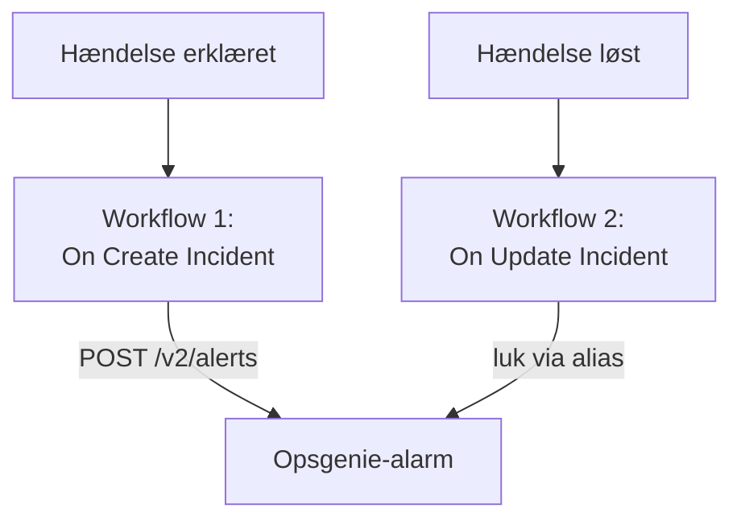

# Opsgenie

Send OneUptime-hændelser til [Opsgenie](https://www.atlassian.com/software/opsgenie). Ét workflow opretter en Opsgenie-alarm, når en OneUptime-hændelse erklæres, og et andet lukker den, når OneUptime-hændelsen er løst. Brug det, så længe Opsgenie stadig kalder dit team op, og OneUptime overvåger dine systemer.

:::cards
- [Gem API-nøglen](#gem-api-nøglen): Hold Opsgenies nøgle ude af dine workflows.
- [Opret Opsgenie-alarmer](#opret-en-opsgenie-alarm-for-hver-hændelse): Ét workflow, to blokke.
- [Luk dem](#luk-opsgenie-alarmen): Et andet workflow, der følger hændelsens tilstand.
- [Fejlfinding](#fejlfinding): Når Opsgenie afviser en anmodning.
:::

> [!IMPORTANT]
> Atlassian stoppede salget af Opsgenie i juni 2025 og afslutter supporten i april 2027. OneUptime kalder også folk op, med vagtpolitikker, vagtplaner og eskaleringsregler. Se [Skift fra Opsgenie](/docs/moving-to-oneuptime/opsgenie) for at flytte dit team over: en import henter dine brugere, teams, vagtplaner og eskaleringer over.

## Sådan fungerer det



Begge workflows kalder [Opsgenie Alert API](https://docs.opsgenie.com/docs/alert-api). Det første giver alarmen et `alias` dannet ud fra OneUptime-hændelsens ID, og det andet lukker alarmen via det alias.

## Før du går i gang

- En Opsgenie-integration af typen **API** og dens **API Key**. Tilføj en under **Settings → Integrations** i Opsgenie, eller under et teams **Integrations** for at sende alarmer til det team.
- Din Opsgenie-region. Konti i Europa, som logger ind på `app.eu.opsgenie.com`, bruger `api.eu.opsgenie.com`. Alle andre bruger `api.opsgenie.com`.
- I OneUptime rettigheden til at oprette workflows og globale variabler. På OneUptime Cloud kræver workflows **Growth**-abonnementet eller højere.

## Gem API-nøglen

:::steps
1. Gå til **Arbejdsgange → Globale variabler**, og klik på **Opret Workflow Variabel**.
2. Giv den navnet `OPSGENIE_KEY`, og klik på **Næste**.
3. Indsæt API-nøglen i **Indhold**, slå **Hemmelighed** til, og klik på **Opret Workflow Variabel**.
:::

En hemmelig variabel erstattes med `[REDACTED]` i kørselslogs, så nøglen vises aldrig i en kørsel.

## Opret en Opsgenie-alarm for hver hændelse

:::steps
### Opret workflowet

Gå til **Arbejdsgange**, klik på **Opret arbejdsgang** og derefter på **Start fra bunden**. Giv det navnet `Incidents to Opsgenie`, og klik på **Opret arbejdsgang**.

### Tilføj triggeren

Klik på den stiplede blok **Vælg, hvad der starter denne arbejdsgang**, og vælg **On Create Incident**. Klik på triggeren: dens **Fields to pass on** starter med **Titel**, så klik på **Tilføj felt**, og vælg **Beskrivelse**.

### Opret alarmen

Klik på **Tilføj komponent**, tilføj en **API Post (JSON)**-blok, og forbind triggerens **Success**-punkt med den. Sæt dens **URL** til `https://api.opsgenie.com/v2/alerts`, eller `https://api.eu.opsgenie.com/v2/alerts` i Europa. Sæt under **Flere felter** dens **Request Headers** til:

```json
{ "Authorization": "GenieKey {{global.variables.OPSGENIE_KEY}}" }
```

Og dens **Request Body** til:

```json
{
  "message": "{{local.components.incident-on-create-1.returnValues.model.title}}",
  "alias": "oneuptime-{{local.components.incident-on-create-1.returnValues.model._id}}",
  "description": "{{local.components.incident-on-create-1.returnValues.model.description}}",
  "priority": "P1",
  "source": "OneUptime"
}
```

### Test det, og slå det derefter til

Klik på **Kør arbejdsgang**, vælg en testhændelse under **Hændelse**, og kør den. Trinnet **API Post (JSON)** viser et `202`-svar, og alarmen dukker op i Opsgenie et øjeblik senere. Slå derefter **Aktiveret** til øverst i **Bygger**.
:::

Opsgenies skema er ordet `GenieKey`, et mellemrum og derefter nøglen. Opsgenie begrænser `message` til 130 tegn, og prioriteterne går fra `P1` til `P5`: se [Tilknyt prioriteter](#tilknyt-prioriteter) for at sende hver hændelses egen.

## Luk Opsgenie-alarmen

Et workflow har én trigger, så det kræver et andet workflow at lukke den, startet når en hændelses tilstand ændres.

:::steps
### Tilføj triggeren On Update Incident

Opret et workflow med navnet `Close Opsgenie alerts`, og vælg **On Update Incident** som trigger. Klik på **Tilføj felt** i **Fields to watch**, og vælg **Current Incident State**, så det kun kører, når tilstanden ændres. Spørg i **Fields to pass on**, om den nye tilstand er en løst tilstand: klik på **Tilføj felt**, åbn **Current Incident State**, og vælg **Is Resolved State**. Eller klik på **Rediger som JSON**, og erstat JSON'en med:

```json
{ "_id": true, "currentIncidentState": { "isResolvedState": true } }
```

### Kontrollér, at hændelsen er løst

Tilføj en **If / Else**-blok efter triggeren. Sæt **Value to check** til `{{local.components.incident-on-update-1.returnValues.model.currentIncidentState.isResolvedState}}` og **Comparison** til **is true**.

### Luk alarmen

Tilføj en **API Post (JSON)**-blok efter **Yes**-siden, med de samme **Request Headers** og denne **URL**:

```text
https://api.opsgenie.com/v2/alerts/oneuptime-{{local.components.incident-on-update-1.returnValues.model._id}}/close?identifierType=alias
```

Sæt dens **Request Body** til `{ "source": "OneUptime", "note": "Resolved in OneUptime" }`.

### Slå det til

Slå **Aktiveret** til, og løs derefter en testhændelse i OneUptime. Opsgenie lukker sin alarm.
:::

`identifierType=alias` fortæller Opsgenie, at adressen angiver alarmen ved dens alias og ikke ved dens eget ID.

## Tilknyt prioriteter

For at sende hver hændelses alvorlighed som en Opsgenie-prioritet tilføjer du en **Run Custom JavaScript**-blok mellem triggeren og **API Post (JSON)**-blokken.

1. Klik på **Tilføj felt** i triggerens **Fields to pass on**, åbn **Hændelsesalvor**, og vælg **Navn**.
2. Sæt blokkens **Arguments** til `{ "severity": "{{local.components.incident-on-create-1.returnValues.model.incidentSeverity.name}}" }` og dens **JavaScript Code** til:

   ```javascript
   // Your incident severities, by name, to Opsgenie's priorities.
   const PRIORITY = {
     "Critical Incident": "P1",
     "Major Incident": "P2",
     "Minor Incident": "P3",
   };

   return { priority: PRIORITY[args.severity] || "P3" };
   ```

3. Sæt `"priority"` i anmodningens brødtekst til `"{{local.components.javascript-1.returnValues.returnValue.priority}}"`.

Navnene ovenfor er de tre alvorligheder, et nyt projekt starter med. Brug dine egne, hvis du har omdøbt dem.

## Fejlfinding

:::details Opsgenie svarer 401 eller 403
Nøglen er forkert, eller den hører til den anden region. Kontrollér, at headeren indeholder `GenieKey`, et mellemrum og nøglen, at nøglen tilhører en **API**-integration, og at værten passer til din region: `api.opsgenie.com` eller `api.eu.opsgenie.com`.
:::

:::details Lukningen svarer 404
Ingen alarm har det alias. Begge workflows skal danne aliasset på samme måde, `oneuptime-` efterfulgt af hændelsens `_id`, og URL'en skal ende på `?identifierType=alias`.
:::

:::details Alarmen dukker aldrig op, selvom trinnet viser 202
Opsgenie svarer `202`, før den behandler anmodningen, så en anmodning, den senere afviser, viser stadig `202`. Find anmodningen i Opsgenies logs for at se, hvorfor den blev afvist, f.eks. en integration, der er slået fra.
:::

:::details Workflowet kører aldrig
Kontrollér, at det er slået til: **Aktiveret**, øverst i dets **Bygger**. Åbn derefter **Protokoller → Kørsler**: en kørsel, der tog **No**-siden af **If / Else**-blokken, er en opdatering, der ikke var en løsning.
:::

## Næste trin

:::cards
- [Skift fra Opsgenie](/docs/moving-to-oneuptime/opsgenie): Hent dit team, dine vagtplaner og eskaleringer over, før Opsgenie lukker.
- [Eskaleringsregler](/docs/on-call/escalation-rules): Kald folk op fra OneUptime selv.
- [PagerDuty](/docs/integrations/pagerduty): De samme to workflows til PagerDuty.
- [Oversigt over integrationer](/docs/integrations/index): Mønstrene bag hver integration.
:::
