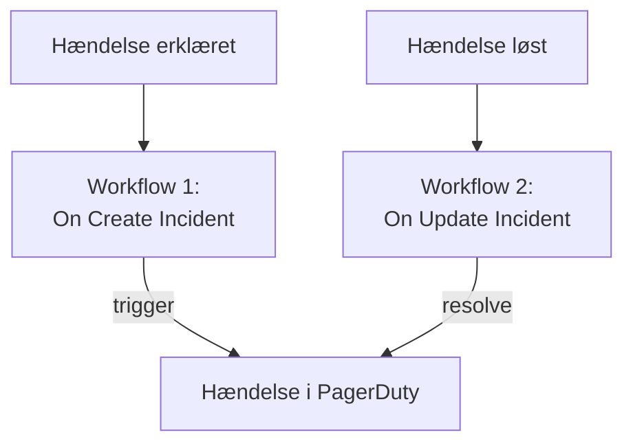

# PagerDuty

Send OneUptime-hændelser til [PagerDuty](https://www.pagerduty.com). Ét workflow udløser en hændelse i PagerDuty, når en OneUptime-hændelse erklæres, og et andet løser den, når OneUptime-hændelsen er løst. Brug det, når PagerDuty kalder dit team op, og OneUptime overvåger dine systemer.

:::cards
- [Gem routing key'en](#gem-routing-keyen): Hold PagerDutys nøgle ude af dine workflows.
- [Udløs hændelser i PagerDuty](#udløs-en-hændelse-i-pagerduty-for-hver-hændelse): Ét workflow, to blokke.
- [Løs dem](#løs-hændelsen-i-pagerduty): Et andet workflow, der følger hændelsens tilstand.
- [Fejlfinding](#fejlfinding): Når PagerDuty afviser en begivenhed.
:::

> [!TIP]
> OneUptime kalder også folk op, med vagtpolitikker, vagtplaner og eskaleringsregler. Se [Skift fra PagerDuty](/docs/moving-to-oneuptime/pagerduty) for at flytte dit team væk fra PagerDuty: en import henter dine brugere, vagtplaner og eskaleringspolitikker over.

## Sådan fungerer det



Begge workflows kalder PagerDutys [Events API v2](https://developer.pagerduty.com/docs/events-api-v2/overview/) med den samme `dedup_key`, dannet ud fra OneUptime-hændelsens ID. Det er på den nøgle, PagerDuty ved, at resolve-begivenheden lukker den hændelse, som trigger-begivenheden åbnede.

## Før du går i gang

- En PagerDuty-tjeneste med en Events API v2-integration. Åbn tjenesten i PagerDuty, derefter **Integrations**, klik på **Add an integration**, og vælg **Events API V2**. Kopiér dens **Integration Key**: Events API kalder den routing key.
- I OneUptime rettigheden til at oprette workflows og globale variabler. På OneUptime Cloud kræver workflows **Growth**-abonnementet eller højere.

## Gem routing key'en

:::steps
1. Gå til **Arbejdsgange → Globale variabler**, og klik på **Opret Workflow Variabel**.
2. Giv den navnet `PAGERDUTY_ROUTING_KEY`, og klik på **Næste**.
3. Indsæt integrationsnøglen i **Indhold**, slå **Hemmelighed** til, og klik på **Opret Workflow Variabel**.
:::

En hemmelig variabel erstattes med `[REDACTED]` i kørselslogs, så nøglen vises aldrig i en kørsel.

## Udløs en hændelse i PagerDuty for hver hændelse

:::steps
### Opret workflowet

Gå til **Arbejdsgange**, klik på **Opret arbejdsgang** og derefter på **Start fra bunden**. Giv det navnet `Incidents to PagerDuty`, og klik på **Opret arbejdsgang**.

### Tilføj triggeren

Klik på den stiplede blok **Vælg, hvad der starter denne arbejdsgang**, og vælg **On Create Incident**. Klik på triggeren: dens **Fields to pass on** starter med **Titel**, så klik på **Tilføj felt**, og vælg **Beskrivelse**.

### Send trigger-begivenheden

Klik på **Tilføj komponent**, tilføj en **API Post (JSON)**-blok, og forbind triggerens **Success**-punkt med den. Sæt dens **URL** til `https://events.pagerduty.com/v2/enqueue` og dens **Request Body** til:

```json
{
  "routing_key": "{{global.variables.PAGERDUTY_ROUTING_KEY}}",
  "event_action": "trigger",
  "dedup_key": "oneuptime-{{local.components.incident-on-create-1.returnValues.model._id}}",
  "payload": {
    "summary": "{{local.components.incident-on-create-1.returnValues.model.title}}",
    "source": "OneUptime",
    "severity": "critical",
    "custom_details": {
      "description": "{{local.components.incident-on-create-1.returnValues.model.description}}"
    }
  }
}
```

### Test det, og slå det derefter til

Klik på **Kør arbejdsgang**, vælg en testhændelse under **Hændelse**, og kør den. Trinnet **API Post (JSON)** viser et `202`-svar med `"status": "success"`, og PagerDuty opretter en hændelse. Slå derefter **Aktiveret** til øverst i **Bygger**.
:::

Blokken sender JSON, så den behøver ingen `Content-Type`-header. PagerDutys `severity` er en af `critical`, `error`, `warning` og `info`: se [Tilknyt alvorligheder](#tilknyt-alvorligheder) for at sende hver hændelses egen.

## Løs hændelsen i PagerDuty

Et workflow har én trigger, så det kræver et andet workflow at løse den, startet når en hændelses tilstand ændres.

:::steps
### Tilføj triggeren On Update Incident

Opret et workflow med navnet `Resolve PagerDuty incidents`, og vælg **On Update Incident** som trigger. Klik på **Tilføj felt** i **Fields to watch**, og vælg **Current Incident State**, så det kun kører, når tilstanden ændres. Spørg i **Fields to pass on**, om den nye tilstand er en løst tilstand: klik på **Tilføj felt**, åbn **Current Incident State**, og vælg **Is Resolved State**. Eller klik på **Rediger som JSON**, og erstat JSON'en med:

```json
{ "_id": true, "currentIncidentState": { "isResolvedState": true } }
```

### Kontrollér, at hændelsen er løst

Tilføj en **If / Else**-blok efter triggeren. Sæt **Value to check** til `{{local.components.incident-on-update-1.returnValues.model.currentIncidentState.isResolvedState}}` og **Comparison** til **is true**.

### Send resolve-begivenheden

Tilføj en **API Post (JSON)**-blok efter **Yes**-siden, med samme **URL** og denne **Request Body**:

```json
{
  "routing_key": "{{global.variables.PAGERDUTY_ROUTING_KEY}}",
  "event_action": "resolve",
  "dedup_key": "oneuptime-{{local.components.incident-on-update-1.returnValues.model._id}}"
}
```

### Slå det til

Slå **Aktiveret** til, og løs derefter en testhændelse i OneUptime. PagerDuty løser sin hændelse.
:::

At kontrollere `isResolvedState` i stedet for navnet på en tilstand bliver ved med at virke, når du omdøber dine tilstande. Se [Hændelsestilstande og alvorsgrader](/docs/incidents/states-and-severities).

## Tilknyt alvorligheder

For at sende hver hændelses alvorlighed tilføjer du en **Run Custom JavaScript**-blok mellem triggeren og **API Post (JSON)**-blokken og læser dens svar i brødteksten.

1. Klik på **Tilføj felt** i triggerens **Fields to pass on**, åbn **Hændelsesalvor**, og vælg **Navn**.
2. Sæt blokkens **Arguments** til `{ "severity": "{{local.components.incident-on-create-1.returnValues.model.incidentSeverity.name}}" }` og dens **JavaScript Code** til:

   ```javascript
   // Your incident severities, by name, to PagerDuty's.
   const SEVERITY = {
     "Critical Incident": "critical",
     "Major Incident": "error",
     "Minor Incident": "warning",
   };

   return { severity: SEVERITY[args.severity] || "info" };
   ```

3. Sæt `"severity"` i anmodningens brødtekst til `"{{local.components.javascript-1.returnValues.returnValue.severity}}"`.

Navnene ovenfor er de tre alvorligheder, et nyt projekt starter med. Brug dine egne, hvis du har omdøbt dem.

## Fejlfinding

:::details PagerDuty svarer 400
Svarets brødtekst siger, hvad PagerDuty afviste, og kørslens **API Post (JSON)**-trin viser det. Som regel er routing key'en ikke en Events API v2-integrationsnøgle: kopiér den igen fra tjenestens **Integrations**. En begivenhed uden `summary`, `source` eller `severity` afvises også.
:::

:::details Resolve-begivenheden lukker ingenting
Begge begivenheder skal have præcis den samme `dedup_key`. Kontrollér, at begge brødtekster danner den som `oneuptime-` efterfulgt af hændelsens `_id`, og at resolve-workflowet er slået til.
:::

:::details Workflowet kører aldrig
Kontrollér, at det er slået til: **Aktiveret**, øverst i dets **Bygger**. Åbn derefter **Protokoller → Kørsler**: en kørsel, der tog **No**-siden af **If / Else**-blokken, er en opdatering, der ikke var en løsning.
:::

:::details PagerDuty viser en reference i stedet for en værdi
En reference, der ikke kan opløses, sendes, som den er skrevet, krøllede parenteser og det hele. Tjek blokkens identifier, feltnavnet og variablens navn, der skelner mellem store og små bogstaver. På kørslens fane **Trin** er en indstilling med sådan en reference markeret med **Did not resolve**.
:::

## Næste trin

:::cards
- [Skift fra PagerDuty](/docs/moving-to-oneuptime/pagerduty): Hent dit team, dine vagtplaner og eskaleringspolitikker over.
- [Eskaleringsregler](/docs/on-call/escalation-rules): Kald folk op fra OneUptime selv.
- [Opsgenie](/docs/integrations/opsgenie): De samme to workflows til Opsgenie.
- [Oversigt over integrationer](/docs/integrations/index): Mønstrene bag hver integration.
:::
