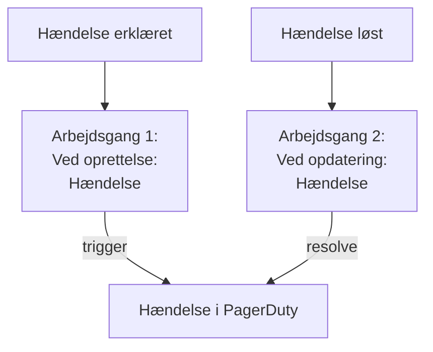

# PagerDuty

Send OneUptime-hændelser til [PagerDuty](https://www.pagerduty.com). Én arbejdsgang udløser en hændelse i PagerDuty, når en OneUptime-hændelse erklæres, og en anden løser den, når OneUptime-hændelsen er løst. Brug det, når PagerDuty kalder dit team op, og OneUptime overvåger dine systemer.

:::cards
- [Gem routing key'en](#gem-routing-keyen): Hold PagerDutys nøgle ude af dine arbejdsgange.
- [Udløs hændelser i PagerDuty](#udløs-en-hændelse-i-pagerduty-for-hver-hændelse): én arbejdsgang, to blokke.
- [Løs dem](#løs-hændelsen-i-pagerduty): En anden arbejdsgang, der følger hændelsens tilstand.
- [Fejlfinding](#fejlfinding): Når PagerDuty afviser en begivenhed.
:::

> [!TIP]
> OneUptime kalder også folk op, med vagtpolitikker, vagtplaner og eskaleringsregler. Se [Skift fra PagerDuty](/docs/moving-to-oneuptime/pagerduty) for at flytte dit team væk fra PagerDuty: en import henter dine brugere, vagtplaner og eskaleringspolitikker over.

## Sådan fungerer det



Begge arbejdsgange kalder PagerDutys [Events API v2](https://developer.pagerduty.com/docs/events-api-v2/overview/) med den samme `dedup_key`, dannet ud fra OneUptime-hændelsens ID. Det er på den nøgle, PagerDuty ved, at resolve-begivenheden lukker den hændelse, som trigger-begivenheden åbnede.

## Før du går i gang

- En PagerDuty-tjeneste med en Events API v2-integration. Åbn tjenesten i PagerDuty, derefter **Integrations**, klik på **Add an integration**, og vælg **Events API V2**. Kopiér dens **Integration Key**: Events API kalder den routing key.
- I OneUptime rettigheden til at oprette arbejdsgange og globale variabler. På OneUptime Cloud kræver arbejdsgange **Growth**-abonnementet eller højere.

## Gem routing key'en

:::steps
1. Gå til **Arbejdsgange → Globale variabler**, og klik på **Opret Arbejdsgangsvariabel**.
2. Giv den navnet `PAGERDUTY_ROUTING_KEY`, og klik på **Næste**.
3. Indsæt integrationsnøglen i **Indhold**, slå **Hemmelighed** til, og klik på **Opret Arbejdsgangsvariabel**.
:::

En hemmelig variabel erstattes med `[REDACTED]` i kørselslogs, så nøglen vises aldrig i en kørsel.

## Udløs en hændelse i PagerDuty for hver hændelse

:::steps
### Opret arbejdsgangen

Gå til **Arbejdsgange**, klik på **Opret arbejdsgang** og derefter på **Start fra bunden**. Giv den navnet `Incidents to PagerDuty`, og klik på **Opret arbejdsgang**.

### Tilføj triggeren

Klik på den stiplede blok **Vælg, hvad der starter denne arbejdsgang**, og vælg **Ved oprettelse: Hændelse**. Klik på triggeren: dens **Felter, der sendes videre** starter med **Titel**, så klik på **Tilføj felt**, og vælg **Beskrivelse**.

### Send trigger-begivenheden

Klik på **Tilføj komponent**, tilføj en **API-kald POST (JSON)**-blok, og forbind triggerens **Succes**-punkt med den. Sæt dens **URL** til `https://events.pagerduty.com/v2/enqueue` og dens **Anmodningsbrødtekst** til:

```json
{
  "routing_key": "{{global.variables.PAGERDUTY_ROUTING_KEY}}",
  "event_action": "trigger",
  "dedup_key": "oneuptime-{{local.components.incident-on-create-1.returnValues.model._id}}",
  "payload": {
    "summary": "{{local.components.incident-on-create-1.returnValues.model.title}}",
    "source": "OneUptime",
    "severity": "critical",
    "custom_details": {
      "description": "{{local.components.incident-on-create-1.returnValues.model.description}}"
    }
  }
}
```

### Test det, og slå det derefter til

Klik på **Kør arbejdsgang**, vælg en testhændelse under **Hændelse**, og kør den. Trinnet **API-kald POST (JSON)** viser et `202`-svar med `"status": "success"`, og PagerDuty opretter en hændelse. Slå derefter **Aktiveret** til øverst i **Bygger**.
:::

Blokken sender JSON, så den behøver ingen `Content-Type`-header. PagerDutys `severity` er en af `critical`, `error`, `warning` og `info`: se [Tilknyt alvorligheder](#tilknyt-alvorligheder) for at sende hver hændelses egen.

## Løs hændelsen i PagerDuty

En arbejdsgang har én trigger, så det kræver en anden arbejdsgang at løse den, startet når en hændelses tilstand ændres.

:::steps
### Tilføj triggeren "Ved opdatering: Hændelse"

Opret en arbejdsgang med navnet `Resolve PagerDuty incidents`, og vælg **Ved opdatering: Hændelse** som trigger. Klik på **Tilføj felt** i **Felter, der holdes øje med**, og vælg **Current Incident State**, så den kun kører, når tilstanden ændres. Spørg i **Felter, der sendes videre**, om den nye tilstand er en løst tilstand: klik på **Tilføj felt**, åbn **Current Incident State**, og vælg **Is Resolved State**. Eller klik på **Rediger som JSON**, og erstat JSON'en med:

```json
{ "_id": true, "currentIncidentState": { "isResolvedState": true } }
```

### Kontrollér, at hændelsen er løst

Tilføj en **Hvis / Ellers**-blok efter triggeren. Sæt **Værdi, der skal tjekkes** til `{{local.components.incident-on-update-1.returnValues.model.currentIncidentState.isResolvedState}}` og **Sammenligning** til **er sand**.

### Send resolve-begivenheden

Tilføj en **API-kald POST (JSON)**-blok efter **Ja**-siden, med samme **URL** og denne **Anmodningsbrødtekst**:

```json
{
  "routing_key": "{{global.variables.PAGERDUTY_ROUTING_KEY}}",
  "event_action": "resolve",
  "dedup_key": "oneuptime-{{local.components.incident-on-update-1.returnValues.model._id}}"
}
```

### Slå det til

Slå **Aktiveret** til, og løs derefter en testhændelse i OneUptime. PagerDuty løser sin hændelse.
:::

At kontrollere `isResolvedState` i stedet for navnet på en tilstand bliver ved med at virke, når du omdøber dine tilstande. Se [Hændelsestilstande og alvorsgrader](/docs/incidents/states-and-severities).

## Tilknyt alvorligheder

For at sende hver hændelses alvorlighed tilføjer du en **Kør egen JavaScript**-blok mellem triggeren og **API-kald POST (JSON)**-blokken og læser dens svar i brødteksten.

1. Klik på **Tilføj felt** i triggerens **Felter, der sendes videre**, åbn **Hændelsesalvor**, og vælg **Navn**.
2. Sæt blokkens **Argumenter** til `{ "severity": "{{local.components.incident-on-create-1.returnValues.model.incidentSeverity.name}}" }` og dens **JavaScript-kode** til:

   ```javascript
   // Your incident severities, by name, to PagerDuty's.
   const SEVERITY = {
     "Critical Incident": "critical",
     "Major Incident": "error",
     "Minor Incident": "warning",
   };

   return { severity: SEVERITY[args.severity] || "info" };
   ```

3. Sæt `"severity"` i anmodningens brødtekst til `"{{local.components.javascript-1.returnValues.returnValue.severity}}"`.

Navnene ovenfor er de tre alvorligheder, et nyt projekt starter med. Brug dine egne, hvis du har omdøbt dem.

## Fejlfinding

:::details PagerDuty svarer 400
Svarets brødtekst siger, hvad PagerDuty afviste, og kørslens **API-kald POST (JSON)**-trin viser det. Som regel er routing key'en ikke en Events API v2-integrationsnøgle: kopiér den igen fra tjenestens **Integrations**. En begivenhed uden `summary`, `source` eller `severity` afvises også.
:::

:::details Resolve-begivenheden lukker ingenting
Begge begivenheder skal have præcis den samme `dedup_key`. Kontrollér, at begge brødtekster danner den som `oneuptime-` efterfulgt af hændelsens `_id`, og at resolve-arbejdsgangen er slået til.
:::

:::details Arbejdsgangen kører aldrig
Kontrollér, at den er slået til: **Aktiveret**, øverst i dens **Bygger**. Åbn derefter **Kørsler**: en kørsel, der tog **Nej**-siden af **Hvis / Ellers**-blokken, er en opdatering, der ikke var en løsning.
:::

:::details PagerDuty viser en reference i stedet for en værdi
En reference, der ikke kan opløses, sendes, som den er skrevet, krøllede parenteser og det hele. Tjek blokkens identifier, feltnavnet og variablens navn, der skelner mellem store og små bogstaver. På kørslens fane **Trin** er en indstilling med sådan en reference markeret med **Did not resolve**.
:::

## Næste trin

:::cards
- [Skift fra PagerDuty](/docs/moving-to-oneuptime/pagerduty): Hent dit team, dine vagtplaner og eskaleringspolitikker over.
- [Eskaleringsregler](/docs/on-call/escalation-rules): Kald folk op fra OneUptime selv.
- [Opsgenie](/docs/integrations/opsgenie): De samme to arbejdsgange til Opsgenie.
- [Oversigt over integrationer](/docs/integrations/index): Mønstrene bag hver integration.
:::
