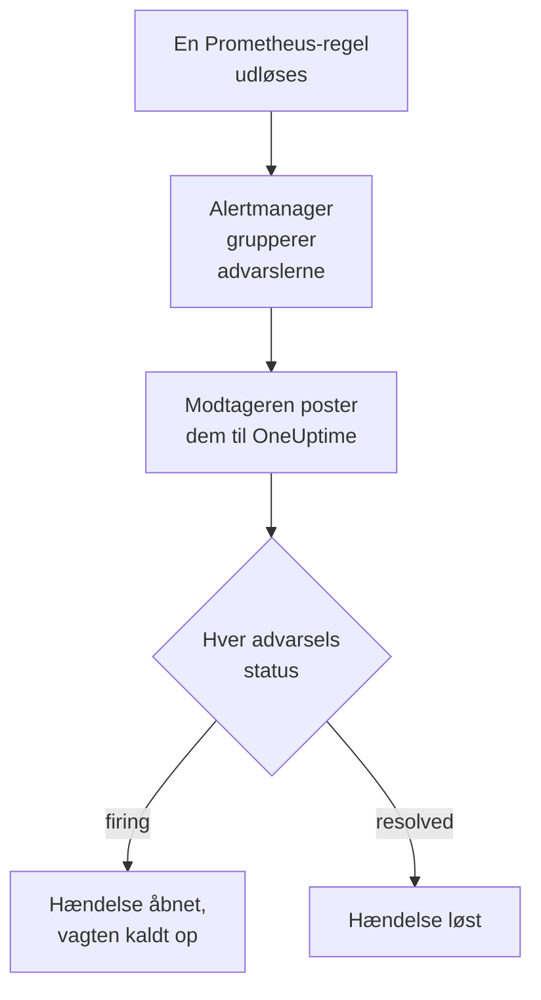

# Prometheus Alertmanager

Send advarsler fra [Prometheus Alertmanager](https://prometheus.io/docs/alerting/latest/alertmanager/) til OneUptime, så hver advarsel, der udløses, bliver en hændelse, der kalder dit vagthold op og løses, når advarslen er kommet sig. Alertmanager poster sine notifikationer til en webhook-modtager, så der er intet at installere på nogen af siderne.

:::cards
- [Vælg, hvordan OneUptime modtager advarsler](#vælg-hvordan-oneuptime-modtager-advarsler): En Incoming Request-monitor eller dit eget workflow.
- [Modtag advarsler med en monitor](#modtag-advarsler-med-en-monitor): Én hændelse pr. advarsel, løst ved genopretning.
- [Konfigurer Alertmanager](#konfigurer-alertmanager): En webhook-modtager og den rute, der bruger den.
- [Fejlfinding](#fejlfinding): Når advarsler ikke kommer frem, eller hændelser bliver ved med at være åbne.
:::

## Sådan fungerer det



Prometheus evaluerer dine advarselsregler og sender de advarsler, der udløses, til Alertmanager. Alertmanager grupperer dem efter etiketterne i din rutes `group_by` og poster hver gruppe til webhook-modtageren som én JSON-notifikation. Notifikationens liste `alerts` indeholder hver advarsel i gruppen, hver med sin egen `status`, `firing` eller `resolved`, sine etiketter og annotationer og et `fingerprint`, der identificerer den.

## Før du går i gang

- En Alertmanager, hvis `alertmanager.yml` du kan redigere, og som kan nå din OneUptime over HTTPS.
- I OneUptime retten til at oprette monitorer, eller workflows, hvis du vælger den vej.

## Vælg, hvordan OneUptime modtager advarsler

Sæt OneUptime op først: det giver dig den URL, Alertmanager sender til.

| Vej | Brug den, når |
| --- | --- |
| En Incoming Request-monitor (anbefalet) | Du vil have, at hver advarsel bliver en hændelse, der kalder vagten op og løses, når advarslen er kommet sig. Der er intet at bygge. |
| Et workflow med en Webhook-trigger | Du har brug for din egen logik: filtrere advarsler, omforme dem eller kalde andre systemer først. Et workflow åbner én hændelse pr. notifikation, ikke pr. advarsel, og løser den ikke ved genopretning. |

Begge får den samme JSON fra den samme modtager, så du kan begynde med den ene og skifte senere ved at ændre én URL i `alertmanager.yml`.

## Modtag advarsler med en monitor

En [Incoming Request-monitor](/docs/monitor/incoming-request-monitor) giver dig en URL, og dens kriterier afgør, hvad hver notifikation gør.

:::steps
### Opret monitoren

Gå til **Monitorer**, og klik på **Opret monitor**. Vælg **Incoming Request** under **Monitortype**, kald den `Alertmanager`, og klik på **Næste**.

### Erklær en hændelse for hver udløst advarsel

Åbn det første kriterium i trinnet **Kriterier**, det, der markerer monitoren som offline. Sæt dets filter til **Anmodningsbrødtekst**, **Indeholder**, `"status":"firing"`. Dette kriterium erklærer allerede en hændelse, når filteret matcher. Udfyld hændelsen:

- **Hændelsestitel**: `{{requestBody.commonLabels.alertname}} on {{requestBody.commonLabels.instance}}`.
- **Alvorlighed**: den hændelsesalvorlighed, disse advarsler skal have.
- **Vagtpolitikker**, under **Vagt**: de politikker, der skal kaldes op.
- **Løs hændelse automatisk**, under **Flere felter**: lad den være slået til, som den starter. Uden den ignoreres genopretninger, og hændelser bliver ved med at være åbne.

### Åbn én hændelse pr. advarsel

Åbn **Indstillinger** i samme kriterium, og slå **Group incidents and alerts by a payload field** til. Udfyld den som nedenfor, så hver advarsel får sin egen hændelse, og dens genopretning løser den:

| Felt | Værdi |
| --- | --- |
| **Open a separate incident for each…** | `requestBody.alerts[*].fingerprint` |
| **Field that signals recovery** | `requestBody.alerts[*].status` |
| **Value that means recovered** | `resolved` |

### Bring monitoren online igen

Åbn det andet kriterium, det, der markerer monitoren som online, og sæt dets filter til **Anmodningsbrødtekst**, **Indeholder**, `"status":"resolved"`.

### Kopiér URL'en

Klik på **Opret monitor**. Monitorens side **Oversigt** viser dens **Heartbeat URL**. Kopiér den til Alertmanager:

```text
https://oneuptime.com/heartbeat/<secret key>
```

En selvhostet installation har sin egen vært i stedet for `oneuptime.com`.
:::

`[*]` læser hver advarsel i en notifikation, så en notifikation med tre advarsler kan åbne tre hændelser, op til **Max incidents per request** (`100`, medmindre du ændrer det). Hver advarsels egen `status` afgør, hvad der sker med dens hændelse: når én advarsel i en notifikation er løst, og to stadig er udløst, lukkes kun den løste advarsels hændelse. Se [Modtagelse af advarsler fra et andet system](/docs/monitor/incoming-request-monitor#modtagelse-af-advarsler-fra-et-andet-system) for, hvad hver indstilling gør.

> [!WARNING]
> Gruppér efter en værdi, der er forskellig fra advarsel til advarsel inden for én notifikation. Alertmanagers `fingerprint` er en hash af en advarsels samlede etiketsæt, så den er altid forskellig. En etiket i din rutes `group_by` er aldrig forskellig: det er netop den, der samler advarslerne i én notifikation. Gruppering efter `requestBody.alerts[*].labels.alertname` med ruten nedenfor folder hver advarsel i en notifikation sammen til én hændelse, som får den første advarsels status.

## Navngiv hændelserne

Titlen ovenfor læser etiketter, som alle advarsler i notifikationen deler: `commonLabels` indeholder de etiketter, og `commonAnnotations` de annotationer, de deler. Med ruten nedenfor, som grupperer efter `alertname` og `instance`, er begge til stede. Giv under **Beskrivelse** hændelsen en **Hændelsesbeskrivelse** som denne:

```text
{{requestBody.commonAnnotations.summary}}

{{requestBody.commonAnnotations.description}}
Severity: {{requestBody.commonLabels.severity}}
Alertmanager: {{requestBody.externalURL}}
```

- Grupperingsnøglen er også en variabel, opkaldt efter det sidste segment i dens sti: `{{fingerprint}}`. Den er en hash, så den fortæller ikke en responder noget.
- `{{requestBody.alerts[0].annotations.summary}}` læser notifikationens første advarsel, og det er ikke altid den advarsel, hændelsen blev åbnet for.
- En henvisning til et felt, som notifikationen ikke har, bliver stående, som den er skrevet, med klammer og det hele, i stedet for at blive tømt.

Se [Hændelse- og advarselsskabeloner](/docs/monitor/incident-alert-templating) for alle de variabler, du kan bruge.

## Konfigurer Alertmanager

:::steps
### Tilføj en webhook-modtager

Tilføj i `alertmanager.yml` en modtager, der sender til den kopierede URL, og gør den til rutens modtager:

```yaml title="alertmanager.yml"
route:
  receiver: oneuptime
  group_by: ["alertname", "instance"]

receivers:
  - name: oneuptime
    webhook_configs:
      - url: "https://oneuptime.com/heartbeat/<secret key>"
        send_resolved: true
```

`send_resolved: true` er Alertmanagers standard, skrevet ud, så den forbliver slået til: uden den får OneUptime aldrig at vide, at en advarsel er kommet sig. Alertmanager sender `Content-Type: application/json`, som monitoren skal bruge for at læse felterne i en notifikation.

### Genindlæs Alertmanager

Genindlæs konfigurationen, eller genstart Alertmanager:

```bash
curl -X POST http://localhost:9093/-/reload
```
:::

Ruten beholder Alertmanagers standardtider. Den venter `30s`, før den sender en ny gruppe (`group_wait`), `5m`, før den sender en gruppe med nye advarsler igen (`group_interval`), og `4h`, før den gentager en notifikation, der ikke har ændret sig (`repeat_interval`).

## Test det

Send OneUptime en notifikation med to udløste advarsler, sådan som Alertmanager ville gøre:

```bash
curl -X POST "https://oneuptime.com/heartbeat/<secret key>" \
  -H "Content-Type: application/json" \
  -d '{
    "version": "4",
    "status": "firing",
    "receiver": "oneuptime",
    "groupLabels": { "alertname": "DiskFull", "instance": "web-1" },
    "commonLabels": { "alertname": "DiskFull", "instance": "web-1", "severity": "critical" },
    "commonAnnotations": { "summary": "Disk almost full on web-1" },
    "externalURL": "http://alertmanager:9093",
    "alerts": [
      {
        "status": "firing",
        "labels": { "alertname": "DiskFull", "instance": "web-1", "severity": "critical", "device": "/dev/sda1" },
        "fingerprint": "a1b2c3d4e5f60001"
      },
      {
        "status": "firing",
        "labels": { "alertname": "DiskFull", "instance": "web-1", "severity": "critical", "device": "/dev/sdb1" },
        "fingerprint": "a1b2c3d4e5f60002"
      }
    ]
  }'
```

To hændelser åbnes, én pr. `fingerprint`, hver med titlen `DiskFull on web-1`. Send den samme anmodning med hver `status` sat til `resolved`, og begge løses.

For at teste hele vejen fra Alertmanager udløser du en advarsel med `amtool`. Alertmanager sender den efter `group_wait` og sender derefter dens genopretning, når advarslen udløber nogle minutter senere:

```bash
amtool alert add test_alert severity=warning \
  --annotation=summary="Test from Alertmanager" \
  --alertmanager.url=http://localhost:9093
```

## Modtag advarsler med et workflow

Brug et [workflow](/docs/workflows/index), når du har brug for dine egne trin mellem Alertmanager og hændelsen.

:::steps
### Opret workflowet

Gå til **Arbejdsgange**, klik på **Opret arbejdsgang** og derefter på **Start fra bunden**. Kald det `Alertmanager alerts`, og klik på **Opret arbejdsgang**.

### Tilføj Webhook-triggeren

Klik på den stiplede blok **Vælg, hvad der starter denne arbejdsgang**, og vælg **Webhook**. Klik på triggeren, derefter på **Kopiér URL**, og brug den URL i modtageren i `alertmanager.yml`.

### Kontrollér, at notifikationen er udløst

Klik på **Tilføj komponent**, tilføj en blok **If / Else**, og forbind triggerens punkt **Out** med den. Sæt **Value to check** til `{{local.components.webhook-1.returnValues.request-body.status}}`, **Comparison** til **is equal to** og **Compare with** til `firing`.

### Erklær hændelsen

Tilføj en blok **Create One Incident**, og forbind siden **Yes** af blokken **If / Else** med den. Vælg under **Incident Template** en skabelon, der sætter alvorligheden og de vagtpolitikker, der skal kaldes op (se [Hændelsesskabeloner](/docs/incidents/settings#hændelsesskabeloner)). Angiv under **JSON Object**, hvad der kommer fra Alertmanager:

```json
{
  "title": "{{local.components.webhook-1.returnValues.request-body.commonLabels.alertname}}",
  "description": "{{local.components.webhook-1.returnValues.request-body.commonAnnotations.summary}}\nAlertmanager: {{local.components.webhook-1.returnValues.request-body.externalURL}}"
}
```

Uden en skabelon skal **JSON Object** også indeholde `incidentSeverityId`, ID'et på en af projektets hændelsesalvorligheder.

### Slå workflowet til

Slå **Aktiveret** til øverst i **Bygger**. Et workflow, der er slået fra, svarer Alertmanager med `400`.
:::

En kørsel håndterer én notifikation, så den erklærer én hændelse, uanset hvor mange advarsler notifikationen indeholder. En notifikation, der er `resolved`, tager siden **No** af blokken **If / Else**, hvor intet er forbundet, så kørslen slutter der. Brug monitoren til én hændelse pr. advarsel, der løses ved genopretning.

## Overvåg selve Alertmanager

Ingen af vejene opdager, når Prometheus eller Alertmanager holder op med at virke: at få ingen advarsler ligner præcis, at alt er i orden. Send derfor en advarsel, der altid er udløst, til en anden monitor, som erklærer en hændelse, når den advarsel holder op med at komme. [kube-prometheus-stack](https://github.com/prometheus-community/helm-charts/tree/main/charts/kube-prometheus-stack) leveres med sådan en advarsel, ved navn `Watchdog`. På en almindelig Prometheus tilføjer du en advarselsregel ved navn `Watchdog`, hvis udtryk altid er sandt, for eksempel `vector(1)`.

:::steps
### Opret watchdog-monitoren

Opret en anden Incoming Request-monitor, ved navn `Alertmanager watchdog`. Sæt filteret for dens første kriterium, det, der markerer monitoren som offline, til **Incoming Request**, **Not Recieved In Minutes**, `10`, og filteret for dens andet kriterium til **Incoming Request**, **Recieved In Minutes**, `10`. Dashboardet staver begge sådan. Kopiér den nye monitors **Heartbeat URL**.

### Send watchdog-advarslen dertil

Tilføj en modtager til watchdog-monitorens URL og en rute, der sender `Watchdog` dertil hvert femte minut. En underordnet rute kontrolleres før sin overordnede rutes modtager, så `Watchdog` går til watchdog-monitoren, og alle andre advarsler går stadig til den første:

```yaml title="alertmanager.yml"
route:
  receiver: oneuptime
  group_by: ["alertname", "instance"]
  routes:
    - receiver: oneuptime-watchdog
      matchers:
        - alertname = "Watchdog"
      group_wait: 0s
      group_interval: 5m
      repeat_interval: 5m

receivers:
  - name: oneuptime
    webhook_configs:
      - url: "https://oneuptime.com/heartbeat/<secret key>"
        send_resolved: true
  - name: oneuptime-watchdog
    webhook_configs:
      - url: "https://oneuptime.com/heartbeat/<watchdog secret key>"
```
:::

Når watchdog-advarslen ikke er kommet i ti minutter, går watchdog-monitoren offline og erklærer en hændelse. Den næste watchdog-notifikation bringer monitoren online igen og løser hændelsen.

## Fejlfinding

:::details Intet kommer frem til OneUptime
- Tjek Alertmanagers log for fejl ved levering til modtageren.
- Monitoren svarer `200` med det samme, før den kontrollerer noget, også ved en forkert hemmelig nøgle. Tjek monitorens tidslinje for at se, om notifikationer kommer frem.
- Et workflow, der er slået fra, svarer `400`. Slå **Aktiveret** til øverst i dets **Bygger**.
:::

:::details Hændelser oprettes, men løses aldrig
- Kontrollér, at ingen modtager sætter `send_resolved: false`: så sender Alertmanager aldrig en genopretning.
- Kriteriets hændelse skal have **Løs hændelse automatisk**, under **Flere felter**.
- **Field that signals recovery** skal være `requestBody.alerts[*].status`, og **Value that means recovered** præcis `resolved`. Sammenligningen skelner mellem store og små bogstaver.
- Advarsler i en notifikation ud over **Max incidents per request** læses slet ikke, så deres genopretninger går også tabt.
- En genopretning, der springes over i et udbrud (se nedenfor), lader sin hændelse stå åben for altid: Alertmanager gentager udløste advarsler, men aldrig en genopretning. Løs sådan en hændelse manuelt.
:::

:::details Ingen hændelse åbnes
Grupperingsstierne skal starte med `requestBody.`, og kun den første `[*]` i en sti læser en liste. En sti, der bryder en af reglerne, matcher intet, uden nogen fejl.
:::

:::details Én hændelse for en notifikation fuld af advarsler
Du har grupperet efter en etiket, der er den samme for hver advarsel i en notifikation, oftest en etiket fra din rutes `group_by`. Gruppér i stedet efter `requestBody.alerts[*].fingerprint`.
:::

:::details Hændelsen viser en henvisning i stedet for en værdi
En henvisning til et felt, som notifikationen ikke har, bliver stående, som den er skrevet, med klammer og det hele. Regler sætter forskellige annotationer, så brug de felter, dine regler sætter: i `commonAnnotations` eller i hver advarsels `annotations`.
:::

:::details For mange hændelser
Gruppér din rute efter færre etiketter, eller hæv `group_interval`, så Alertmanager sender relaterede advarsler sammen. En lavere **Max incidents per request** begrænser hændelserne fra én notifikation, men advarsler ud over grænsen læses ikke, så deres genopretninger går også tabt.
:::

:::details Notifikationer springes over under et udbrud
Når en nyere anmodning når en monitor, før en tidligere er evalueret, evaluerer OneUptime kun den nyeste, så én afsender ikke kan oversvømme en monitor. Den sidste notifikation i et udbrud evalueres altid, men en tidligere om andre advarsler kan blive sprunget over, fordi Alertmanager sender hver gruppe til den samme URL. Hæv `group_wait` og `group_interval` for at sprede notifikationerne. På en selvhostet installation sætter du `INCOMING_REQUEST_INGEST_COALESCE_ENABLED=false` i OneUptime-appens miljø for at evaluere hver anmodning.
:::

## Sikkerhed

- **Behandl URL'en som en adgangskode.** Alle, der har den, kan åbne hændelser. Hvis den slipper ud, så nulstil den: **Nulstil hemmelig nøgle for indgående anmodning** på monitorens side **Indstillinger**, eller **Nulstil URL** i workflowets **Webhook**-trigger. Opdater derefter modtagerens `url` i `alertmanager.yml`.
- **Selvhostet?** Lad Alertmanager nå din OneUptime over HTTPS gennem din firewall.

## Næste trin

:::cards
- [Indgående anmodning-monitor](/docs/monitor/incoming-request-monitor): Hver indstilling for den monitor, der modtager dine advarsler.
- [Grafana](/docs/integrations/grafana): Den samme opsætning, til Grafana-advarsler.
- [Eskaleringsregler](/docs/on-call/escalation-rules): Bestem, hvem en vagtpolitik kalder op, og hvornår.
- [Oversigt over integrationer](/docs/integrations/index): De andre værktøjer, du kan forbinde.
:::
