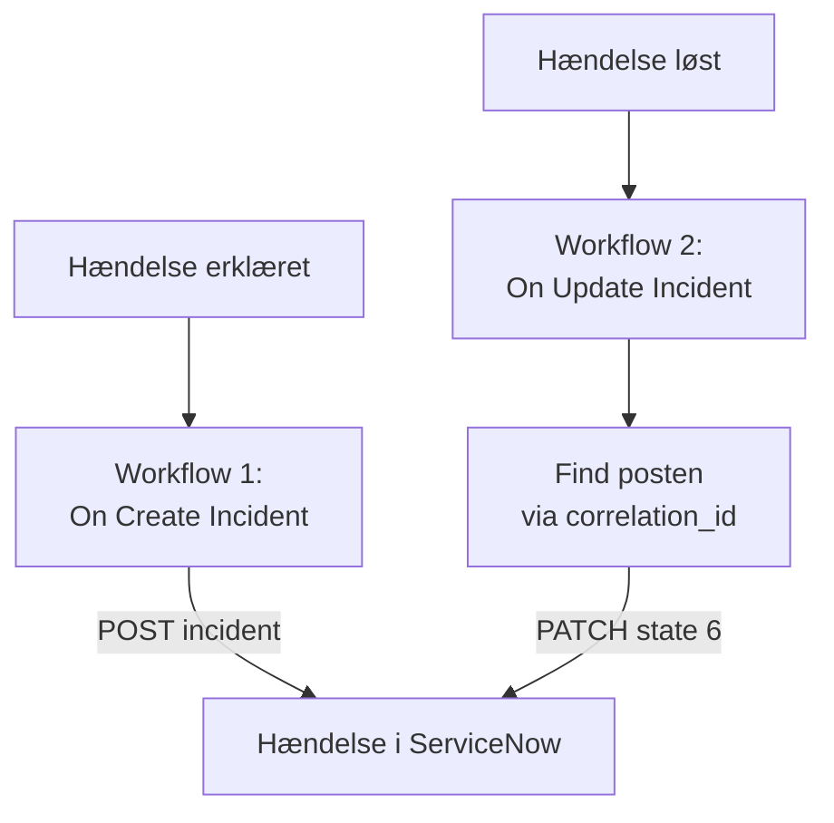

# ServiceNow

Opret en hændelse i [ServiceNow](https://www.servicenow.com) for hver OneUptime-hændelse, og løs den, når OneUptime-hændelsen er løst, så din servicedesk følger det, din overvågning ser. To workflows kalder ServiceNows [Table API](https://developer.servicenow.com/dev.do#!/reference/api/latest/rest/c_TableAPI).

:::cards
- [Gem loginoplysningerne](#gem-loginoplysningerne): Hold ServiceNow-adgangskoden ude af dine workflows.
- [Opret hændelser i ServiceNow](#opret-en-hændelse-i-servicenow-for-hver-hændelse): Ét workflow, to blokke.
- [Løs dem](#løs-hændelsen-i-servicenow): Find posten, og luk den derefter.
- [Fejlfinding](#fejlfinding): Når ServiceNow afviser en anmodning.
:::

## Sådan fungerer det



Det første workflow skriver OneUptime-hændelsens ID i postens `correlation_id`. Det andet finder posten via det ID og løser den derefter.

## Før du går i gang

- En ServiceNow-instans, f.eks. `https://your-instance.service-now.com`.
- En ServiceNow-bruger til integrationen, der kan oprette og opdatere poster i tabellen `incident`, som regel med rollen `itil`. Brugerens navn og adgangskode signerer anmodningerne.
- I OneUptime rettigheden til at oprette workflows og globale variabler. På OneUptime Cloud kræver workflows **Growth**-abonnementet eller højere.

## Gem loginoplysningerne

Table API accepterer Basic-godkendelse: brugerens navn og adgangskode, kodet sammen.

:::steps
1. Kod dem én gang, på macOS eller Linux:

   ```bash
   printf '%s' 'integration.user:password' | base64 | tr -d '\n'
   ```

   Brug `printf`, ikke `echo`: `echo` tilføjer et linjeskift, som kodes sammen med resten og ødelægger loginoplysningerne.

2. Gå i OneUptime til **Arbejdsgange → Globale variabler**, og klik på **Opret Workflow Variabel**. Giv den navnet `SERVICENOW_AUTH`, og klik på **Næste**.
3. Indsæt den kodede værdi i **Indhold**, slå **Hemmelighed** til, og klik på **Opret Workflow Variabel**.
:::

## Opret en hændelse i ServiceNow for hver hændelse

:::steps
### Opret workflowet

Gå til **Arbejdsgange**, klik på **Opret arbejdsgang** og derefter på **Start fra bunden**. Giv det navnet `Incidents to ServiceNow`, og klik på **Opret arbejdsgang**.

### Tilføj triggeren

Klik på den stiplede blok **Vælg, hvad der starter denne arbejdsgang**, og vælg **On Create Incident**. Klik på triggeren: dens **Fields to pass on** starter med **Titel**, så klik på **Tilføj felt**, og vælg **Beskrivelse**.

### Opret posten

Klik på **Tilføj komponent**, tilføj en **API Post (JSON)**-blok, og forbind triggerens **Success**-punkt med den. Sæt dens **URL** til `https://your-instance.service-now.com/api/now/table/incident`. Sæt under **Flere felter** dens **Request Headers** til:

```json
{
  "Authorization": "Basic {{global.variables.SERVICENOW_AUTH}}",
  "Accept": "application/json"
}
```

Og dens **Request Body** til:

```json
{
  "short_description": "OneUptime: {{local.components.incident-on-create-1.returnValues.model.title}}",
  "description": "{{local.components.incident-on-create-1.returnValues.model.description}}",
  "urgency": "1",
  "impact": "1",
  "correlation_id": "oneuptime-{{local.components.incident-on-create-1.returnValues.model._id}}"
}
```

### Test det, og slå det derefter til

Klik på **Kør arbejdsgang**, vælg en testhændelse under **Hændelse**, og kør den. Trinnet **API Post (JSON)** viser et `201`-svar med den nye post, med dens `sys_id` og dens `number`, f.eks. `INC0012345`. Slå derefter **Aktiveret** til øverst i **Bygger**.
:::

`urgency` og `impact` tager `1` for høj, `2` for middel og `3` for lav, og ServiceNow udleder prioriteten af de to. Enhver anden kolonne i tabellen `incident` kan komme med i brødteksten under sit kolonnenavn.

## Løs hændelsen i ServiceNow

Et workflow har én trigger, så det kræver et andet workflow at løse den, startet når en hændelses tilstand ændres.

:::steps
### Tilføj triggeren On Update Incident

Opret et workflow med navnet `Resolve ServiceNow incidents`, og vælg **On Update Incident** som trigger. Klik på **Tilføj felt** i **Fields to watch**, og vælg **Current Incident State**, så det kun kører, når tilstanden ændres. Spørg i **Fields to pass on**, om den nye tilstand er en løst tilstand: klik på **Tilføj felt**, åbn **Current Incident State**, og vælg **Is Resolved State**. Eller klik på **Rediger som JSON**, og erstat JSON'en med:

```json
{ "_id": true, "currentIncidentState": { "isResolvedState": true } }
```

### Kontrollér, at hændelsen er løst

Tilføj en **If / Else**-blok efter triggeren. Sæt **Value to check** til `{{local.components.incident-on-update-1.returnValues.model.currentIncidentState.isResolvedState}}` og **Comparison** til **is true**.

### Find posten

Tilføj en **API Get (JSON)**-blok efter **Yes**-siden, med de samme **Request Headers** og denne **URL**:

```text
https://your-instance.service-now.com/api/now/table/incident?sysparm_query=correlation_id=oneuptime-{{local.components.incident-on-update-1.returnValues.model._id}}&sysparm_fields=sys_id&sysparm_limit=1
```

### Løs posten

Tilføj en **API Patch (JSON)**-blok efter søgeblokkens **Success**, med de samme **Request Headers** og denne **URL**:

```text
https://your-instance.service-now.com/api/now/table/incident/{{local.components.api-get-1.returnValues.response-body.result[0].sys_id}}
```

Sæt dens **Request Body** til:

```json
{
  "state": "6",
  "close_code": "Solution provided",
  "close_notes": "Resolved in OneUptime"
}
```

### Slå det til

Slå **Aktiveret** til, og løs derefter en testhændelse i OneUptime. Dens hændelse i ServiceNow skifter til Resolved.
:::

`state` `6` er Resolved i ServiceNows standardtilstande for hændelser. `close_code` skal være en af din instans' løsningskoder. Mange instanser løser ikke en hændelse uden en løsningskode og noter, så send begge.

## Fejlfinding

:::details ServiceNow svarer 401
Loginoplysningerne er forkerte. Kod `username:password` igen med `printf`, ikke `echo`, og erstat indholdet af `SERVICENOW_AUTH`.
:::

:::details ServiceNow svarer 403
Brugeren kan ikke skrive til tabellen `incident`. Giv brugeren rollen `itil`, eller en rolle med de samme rettigheder, og kontrollér, at ingen adgangsregel blokerer Table API for brugeren.
:::

:::details ServiceNow svarer 400, eller løsningen ændrer ingenting
Et kolonnenavn eller en værdi passer ikke til din instans: en tilpasset `state`-liste eller en `close_code`, som din instans ikke har. Sammenlign med tabellen `incident` under **System Definition → Tables** i ServiceNow og med postens egen formular.
:::

:::details Løsningen svarer 404
Søgetrinnet fandt ingen post, så URL'en beholdt referencen, som den er skrevet. Kontrollér, at det første workflow skrev `correlation_id`, og at begge workflows danner den på samme måde: `oneuptime-` efterfulgt af hændelsens `_id`.
:::

## Næste trin

:::cards
- [Jira](/docs/integrations/jira): En tovejsintegration, holdt i takt af færdige skabeloner.
- [Workflow-komponenter](/docs/workflows/components#api): Alle indstillinger for API-blokkene.
- [Workflow-kørsler](/docs/workflows/runs-and-logs): Læs, hvad hver anmodning sendte og fik tilbage.
- [Oversigt over integrationer](/docs/integrations/index): Mønstrene bag hver integration.
:::
