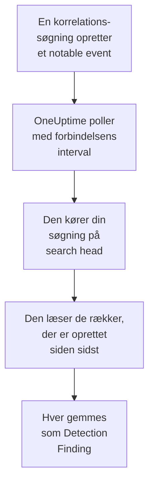

# Splunk Enterprise Security

Importér de notable events, som korrelationssøgningerne i [Splunk Enterprise Security](https://www.splunk.com/en_us/products/enterprise-security.html) opretter, i OneUptimes sikkerhedsbegivenheder. Der søger du i dem ved siden af dine logs, traces og metrikker, korrelerer dem med alle andre kilder og kalder vagten op for dem, der betyder noget. OneUptime læser dem ved at køre en søgning på dit search head som en Splunk-bruger, du selv opretter, og ændrer intet i Splunk. Fordi det blot er en søgning, importerer den ethvert indeks eller outputtet af enhver gemt søgning, ikke kun notable events.

:::cards
- [Opsæt forbindelsen](#opsæt-forbindelsen): Et token, en rolle og forbindelsens formular.
- [Hvad der importeres](#hvad-der-importeres): Hvordan hver række i søgningen bliver en sikkerhedsbegivenhed.
- [Sådan fungerer polling](#sådan-fungerer-polling): Det vindue, hver poll læser, og hvad et travlt search head gør ved det.
- [Fejlfinding](#fejlfinding): Hvad hver fejl betyder, og hvad du skal ændre.
:::

## Sådan fungerer det



Hvert minut poller OneUptime hver aktiveret forbindelse, hvis pollinterval er gået. En poll kører din søgning via search headets REST API over de rækker, der er oprettet siden sidste poll, og gemmer hver række som en [OCSF](https://schema.ocsf.io/) Detection Finding-begivenhed (klasse `2004`). Registreringsregler, monitorer og dashboards behandler den derefter som en sikkerhedsbegivenhed fra enhver anden kilde.

## Før du går i gang

- I OneUptime rollen Project Owner, Project Admin eller Security Admin. Security Member og Security Viewer kan se forbindelser og deres kørselshistorik, men ikke ændre dem.
- Et search head med Splunk Enterprise 9.0.1 eller nyere, eller Splunk Cloud Platform. OneUptime taler med dets REST API på administrationsporten, normalt `8089`. Splunk Web, på port `8000`, udstiller ikke REST API'et.
- En Splunk-bruger til OneUptime, hvis rolle har capability'en `search` og kan læse det indeks, søgningen læser: `notable` for notable events. Enterprise Security-rollerne `ess_analyst` og `ess_user` giver begge dele. Forbindelsen læser kun, så rollen behøver intet andet.
- Et search head, som OneUptime kan nå over HTTPS. OneUptime Cloud forbinder fra internettet, så search headet skal have en offentlig adresse: private adresser afvises. Et selvhostet OneUptime forbinder fra sine app- og workercontainere og kan nå et search head på dit private netværk, medmindre `DATA_SOURCE_BLOCK_PRIVATE_ADDRESSES` er `true`.

## Opsæt forbindelsen

Forbindelsen godkender med et Splunk-godkendelsestoken eller med et brugernavn og en adgangskode.

:::steps
### Opret et godkendelsestoken

1. Åbn **Settings → Tokens** i Splunk Web. Hvis Splunk siger, at tokengodkendelse er slået fra, så vælg først **Enable Token Authentication**.
2. Vælg **New Token**. Angiv i **User** den Splunk-bruger, der er oprettet til OneUptime, og sig i **Audience**, hvad tokenet er til, for eksempel `OneUptime security events`.
3. Vælg en **Expiration**, eller ingen. Et token, der udløber, stopper forbindelsen, indtil du erstatter det.
4. Vælg **Create**, og kopiér tokenet. Splunk viser det kun én gang.

Vil du hellere godkende med en adgangskode, så spring dette trin over, og hav brugerens navn og adgangskode klar.

### Tilføj forbindelsen i OneUptime

Åbn **Produkter → Security Events → Forbindelser** (`/dashboard/{projectId}/security-events/connections`), klik på **Tilføj forbindelse**, vælg **Splunk Enterprise Security**, og klik på **Næste**. Udfyld indstillingerne i tabellen nedenfor, klik på **Næste**, og indsæt tokenet i **Authentication token** eller adgangskoden i **Adgangskode**.

### Test den, før du gemmer

Klik på **Test disse indstillinger** under **Test, før du gemmer**. Testen godkender og kører din søgning med værdierne i formularen og gemmer intet, så en forkert port eller en manglende rolle viser sig, før forbindelsen findes. Klik derefter på **Næste**, giv forbindelsen et **Navn**, og opret den.
:::

| Indstilling | Hvad du skal angive |
| --- | --- |
| **Splunk management URL** | Search headets REST API, for eksempel `https://splunk.example.com:8089`. Den skal bruge `https`, uden forespørgselsstreng. En sti bevares, til en reverse proxy, der udstiller API'et under en sti. |
| **Søg** | Søgningen, der vælger, hvad der skal importeres, `index=notable`, indtil du ændrer den. Indsnævr den, for eksempel med `index=notable urgency IN (high, critical)`. OneUptime tilføjer selv tidsintervallet, så søgningen kan ikke sætte `earliest` eller `latest` og kan ikke starte med en pipe. Et indledende `search` fjernes. |
| **Brugernavn** | Splunk-brugerens navn, kun hvis den godkender med en adgangskode. |
| **Authentication token** | Tokenet fra første trin. Når et token er gemt, er det det, der bruges, og ikke brugernavnet eller adgangskoden. |
| **Adgangskode** | Splunk-brugerens adgangskode, kun når der ikke bruges noget token. |

**Authentication token** og **Adgangskode** krypteres, returneres aldrig af API'et og vises aldrig igen. Erstat dem med **Opdater legitimationsoplysninger** på forbindelsen. For at skifte fra den ene godkendelse til den anden angiver du den nye dér og slår **Remove the stored Authentication token** eller **Remove the stored Password** til.

Trinnet **Hentning** har også en valgfri **Beskrivelse**, **Hentningsinterval (minutter)**, et heltal fra `1` til `1440`, der starter på `5`, og **Aktiveret**, som starter slået til.

## Hvad der importeres

Hver række, søgningen returnerer, bliver en Detection Finding-begivenhed (OCSF-klasse `2004`) med leverandøren `Splunk` og produktet `Splunk Enterprise Security`. For et notable event:

| Splunk-felt | OneUptime-kolonne |
| --- | --- |
| `event_id`, ellers `_bkt` og `_cd`, ellers en hash af rækken | Begivenheds-UID, som også dubletter fjernes efter |
| `_time`, da korrelationssøgningen oprettede det notable event | Begivenhedens tidspunkt |
| `rule_name`, ellers `search_name`, ellers `source` | Regelnavn |
| `search_name`, ellers `source`, ellers `rule_name` | Regel-ID |
| `rule_title`, ellers `rule_description`, ellers regelnavnet | Meddelelse |
| `urgency`, ellers `severity` | Alvorlighed |
| `status_label`, ellers `status_description`, ellers navnet på den gennemgangsstatus, `status` indeholder | Status |
| `annotations.mitre_attack` og felter som `mitre_technique_id` og `mitre_tactic` | MITRE ATT&CK-taktikker og -teknikker |
| `user` eller `src_user`; `src`, `src_ip` eller `src_host`; `process`, `process_name` eller `parent_process` | Aktørens bruger, IP, vært og proces |
| `process_name` eller `process_exec`, `process_path` og `process`; `parent_process_name` eller `parent_process_exec`, `parent_process_path` og `parent_process` | Processens navn, sti og kommandolinje; navn, sti og kommandolinje for den overordnede proces |
| `dest_user`; `dest`, `dest_ip` eller `dest_host`; `dest_port` | Målets bruger, IP, vært og port |
| `file_path`, `url` eller `risk_object` | Målressource |
| Hver bruger, vært og IP samt `dvc`, `host`, `file_hash`, `file_name`, `url`, `domain`, `query` og `risk_object` | Observables |
| Hvert felt i rækken, for eksempel `security_domain`, `owner`, `orig_sid` og `_raw` | `attributes`, under feltets eget navn |

En række fra et andet indeks importeres på samme måde. De kolonner, dens felter ikke udfylder, forbliver tomme, og hvert felt kan stadig søges i `attributes`.

## Sådan fungerer polling

Hver poll kører en eksportsøgning over sit vindue, de ældste først:

```text
POST {Splunk management URL}/services/search/v2/jobs/export
    search=search index=notable | fields * | sort 0 _time | head 10001
    earliest_time={window start}
    latest_time={window end}
    output_mode=json
```

- **Oprettelsestidspunktet er markøren.** Vinduet gælder `_time`, som for et notable event er, da korrelationssøgningen oprettede det, ikke da den fundne aktivitet fandt sted. En søgning, der kører hver time, daterer sine notable events til tidspunktet for sin kørsel, så ingen havner bag markøren.
- **Den første poll ser 24 timer tilbage**, så en ny forbindelse straks viser sine nylige notable events.
- **Hver senere poll starter 1 minut før den gemte markør**, så en række, der er oprettet på grænsen mellem to vinduer, aldrig går tabt.
- **En poll læser højst 24 timer forbi markøren.** En forbindelse, hvis markør er kommet bagud, indhenter i en række vinduer på 24 timer, og dens **Sundhed** viser **Catching up**.
- **Dubletter fjernes efter `event_id`**, eller Splunks egne `_bkt` og `_cd`, i projektet, så overlappet, et gentaget vindue og en import aldrig gemmer en række to gange.

Et search head, der er ældre end 9.0.1, svarer `404` på anmodningen til `search/v2/jobs/export`. OneUptime sender den så til det forældede `search/jobs/export`, og kørslen siger det i en advarsel. Opgradér search headet: aktuelle versioner slår det endpoint fra.

### Når et vindue indeholder mere, end én poll kan læse

En poll læser højst 10.000 rækker. Når et vindue indeholder flere, er kørslen **Delvis** med en advarsel som:

```text
Stopped after collecting 10000 records; the window holds more. Records are read oldest first, and the last one read was created at 2026-09-14T08:12:44.000Z, where the next poll can resume.
```

Søgningen sorterer vinduet efter `_time`, de ældste først, så OneUptime flytter markøren til oprettelsestidspunktet for den sidst læste række, og den næste poll starter der med samme vindueslængde. Et travlt search head indhenter 10.000 rækker pr. poll i stedet for at læse de samme igen. Rækker, der er oprettet i samme øjeblik, læses to gange, og dubletkontrollen fjerner den anden kopi. Splunk sorterer hele vinduet, før den returnerer en række, så en søgning i **Søg**, der finder langt mere end nødvendigt, gør hver poll langsommere. Hold den målrettet.

Når en kørsel slet ikke kan komme forbi den gemte markør, gør OneUptime i stedet vinduet kortere:

1. **Indsnævr.** Den næste poll læser et vindue, der er halvt så langt, fra det samme startpunkt, og bliver ved med at halvere, indtil et vindue læses helt, ned til ét minut. Kørslens advarsel siger det: `This window holds more records than one poll can read; the next poll reads a {n} minute window from the same starting point.`
2. **Voks igen.** Når et vindue er læst helt, er det næste igen dobbelt så langt, op til 24 timer.
3. **Gå forbi et enkelt minut.** Hvis selv ét minut indeholder mere, end en poll kan læse, går pollingen forbi det, så nyere notable events bliver ved med at komme. Kørslen forbliver **Delvis**, og **Seneste fejl** lyder `More records were created in the one minute from {cursor} to {end} than one poll can read. Polling moved past this minute so newer records keep arriving; use Import this time range in Diagnostics on this minute to recover what one run can read.` Importér det minut med **Import this time range** for at hente det, én kørsel kan læse.

En kørsel, der mislykkes helt, med en fejl fra Splunk, beholder markøren og vindueslængden, og den næste poll læser det samme vindue igen. Den eneste undtagelse er en anmodning, der fik timeout: markøren bliver, men det næste vindue er halvt så langt, fordi et vindue, der er for tungt til at blive besvaret i tide, ville få timeout ved hvert forsøg. At ændre **Hentningsinterval (minutter)** ændrer intet af dette: det afgør, hvor ofte en poll starter, ikke hvor dens vindue begynder.

### Kør, se forhåndsvisning og importér efter behov

Klik på **Diagnosticering** på en forbindelse for at se dens seneste kørsler og arbejde med den manuelt. Alle, der kan ændre forbindelsen, kan starte disse handlinger; alle, der kan se den, kan læse historikken.

- **Kør nu** starter straks en poll med den sædvanlige markør, også når forbindelsen ikke er **Aktiveret**.
- **Preview notable events** læser et tidsinterval på op til 7 dage og importerer intet.
- **Import this time range** importerer et interval på op til 7 dage, efter at du har bekræftet, uden at flytte markøren. Rækker, der allerede er importeret, springes over.
- **Copy diagnostics** på en kørsel kopierer dens rapport til support. Den indeholder aldrig legitimationsoplysninger.

## Test forbindelse

**Test forbindelse** på en forbindelses række og **Test disse indstillinger** i formularen kører i API-processen, ikke i en baggrundsworker, så en test også svarer, når det er workerne, der er problemet. Den kører disse kontroller i rækkefølge:

| Kontrol | Hvad den kontrollerer |
| --- | --- |
| **Konfiguration** | Hver indstilling er til stede og velformet. Der kontaktes intet, når dette mislykkes. |
| **Authenticate with Splunk** | Splunk accepterer tokenet, eller brugernavnet og adgangskoden, og navngiver brugeren og dens roller, så du kan sammenligne dem med den rolle, du ville give. |
| **Run the search on Splunk** | Søgningen i **Søg** kører over de seneste 24 timer for én række og siger, hvilket eksport-endpoint der svarede. |
| **Notable events available to import** | Hvor mange rækker søgningen i **Søg** finder inden for de seneste 24 timer og de seneste 7 dage. Ingen på 7 dage er en advarsel, ikke en fejl. |
| **Background workers**, **Poll scheduler**, **Security event storage** | OneUptimes egen side: en proces tager jobbene fra Worker-køen, poll-jobbet kører hvert minut, og lageret for sikkerhedsbegivenheder svarer. |
| **Scheduled polling** | For en gemt forbindelse: polling er slået til, ingen kørsel sidder fast og venter på en worker, og polls kører til tiden. |

Hver anmodning i en test har en frist på 20 sekunder. En test importerer aldrig noget og flytter aldrig markøren, og hver mislykket kontrol siger, hvad du skal ændre.

## Send sikkerhedshændelser til Splunk

OneUptime kan også sende det, den finder, til Splunk gennem dens HTTP Event Collector (HEC), så dine søgninger og dashboards ser OneUptimes detektioner ved siden af dine egne. Hver sikkerhedshændelse er én HEC-hændelse med sourcetypen `oneuptime:security`, og dens felter hedder det, som Splunks Common Information Model kalder dem: `src`, `src_ip`, `src_user`, `dest`, `dest_ip`, `dest_port`, `user`, `signature` og `severity`.

:::steps
### Opret et HEC-token

Åbn **Settings → Data inputs → HTTP Event Collector** i Splunk Web, og klik på **New Token**. Giv det et navn, vælg de indekser, det må skrive til, og dets standardindeks, og kopiér tokenets værdi. På Splunk Cloud lytter HEC på `https://http-inputs-<stack>.splunkcloud.com`; på Splunk Enterprise på port `8088`, når **Global Settings** har slået tokens til.

### Tilføj destinationen

Åbn **Produkter → Security Events → Forbindelser**. Klik på **Tilføj destination** under **Send til dit SIEM**, vælg Splunk under **SIEM**, og klik på **Næste**. Udfyld **HEC-URL**, og indsæt tokenet i **HEC-token**. **Indeks** og **Kildetype** er valgfrie: står de tomme, går hændelserne til tokenets standardindeks med sourcetypen `oneuptime:security`.

### Send en testhændelse, og begynd at sende

Klik på **Send en testhændelse**: én informativ hændelse går til Splunk med indstillingerne i formularen, og intet gemmes. Søg efter den med `sourcetype="oneuptime:security"`. Behold derefter **Kun detektioner** under **Hvad der skal sendes**, eller vælg **Alle sikkerhedshændelser**, og klik på **Begynd at sende**.
:::

- **HEC-URL** skal bruge `https` med et certifikat, OneUptime har tillid til: certifikatkontroller springes aldrig over.
- Hændelser sendes i batches på op til 500. En hændelse, Splunk afviser, udelades og nævnes i **Vis fejl**, en travl collector (`503`) prøves igen, og et afvist token eller indeks stopper afsendelsen, indtil du retter det.
- Notable events, som OneUptime har importeret fra Splunk, sendes aldrig tilbage dertil.

## Fejlfinding

Forbindelsens **Seneste fejl** gemmer hele fejlmeddelelsen, med legitimationsoplysninger maskeret, bag et præfiks, der navngiver det trin, der mislykkedes. Når en forbindelse har en fejl, vælger du **Vis fejl** i dens kolonne **Handlinger** for at læse den og **Kopiér fejl** i dialogboksen for at kopiere den. Læs præfikset først.

:::details Last Error starter med `Splunk Enterprise Security authentication request`
- `Splunk Enterprise Security authentication request failed (HTTP ...)`: Splunk nægtede at sige, hvem kalderen er.
  - `HTTP 401`: Splunk accepterede ikke legitimationsoplysningerne. Tokenet er forkert, udløbet eller slettet, tokengodkendelse er slået fra på search headet, eller brugernavnet eller adgangskoden er forkert. Opret et nyt token, og gem det med **Opdater legitimationsoplysninger**.
  - `HTTP 404`: **Splunk management URL** er ikke REST API'et. Den peger på Splunk Web på port `8000`, eller den har en sti, som search headet ikke udstiller.
- `Splunk Enterprise Security authentication request returned ...`: noget andet end search headets REST API svarede, for eksempel HTML'en fra Splunk Web på port `8000` eller en proxys side. Peg URL'en på administrationsporten.
:::

:::details Last Error starter med `Splunk Enterprise Security search export` eller `Splunk Enterprise Security count search`
- `Splunk Enterprise Security search export failed (HTTP ...)`: Splunk nægtede at køre søgningen.
  - `HTTP 400`: Splunk kan ikke fortolke søgningen. Kør søgningen fra **Søg** i Splunk Web for at læse dens fejl.
  - `HTTP 403`: brugerens rolle mangler capability'en `search` eller kan ikke læse indekset. Føj `notable`, eller dit indeks, til de indekser, rollen må søge i.
  - `HTTP 404`: ingen af de to eksport-endpoints findes på den URL, så den er ikke administrationsporten på et search head.
  - `HTTP 429` eller `HTTP 5xx`: Splunk begrænser brugeren, er overbelastet, eller søgningen ramte en af sine grænser. Den næste poll prøver igen.
- `Splunk Enterprise Security search export was rejected by Splunk on an HTTP 200`: Splunk svarede, men stoppede søgningen med en fejl. Meddelelsen citerer den.
- `Splunk Enterprise Security search export returned a body that is not newline-delimited JSON.`: noget andet end REST API'et svarede, for eksempel Splunk Web eller en proxys loginside. Det rapporteres i stedet for at blive taget som et tomt vindue, så markøren aldrig flytter sig forbi rækker, som ingen har læst.
- `Splunk Enterprise Security count search ...`: de samme fejl, fra optællingen til **Notable events available to import**, som kun en test kører.
:::

:::details Last Error slutter med `did not complete`
`Splunk Enterprise Security search export did not complete`, og det samme for de andre trin, betyder, at anmodningen ikke fik noget svar: en timeout, et navn, der ikke kan slås op, et certifikat, OneUptime ikke har tillid til, eller en afvist privat adresse. Kontrollér, at OneUptime-appen og workerne kan åbne en HTTPS-forbindelse til administrationsporten. Et search head, der svarer på andre anmodninger, men får timeout på søgningen, sorterer for meget: den næste poll læser et vindue, der er halvt så langt, og en mere målrettet søgning i **Søg** løser det for godt.
:::

:::details Last Polled er Never, og Last Error er tom
Ingen poll er blevet færdig for denne forbindelse. Kør **Test forbindelse**: dens kontroller **Background workers** og **Poll scheduler** navngiver årsagen. På en selvhostet installation er den sædvanlige årsag `DISABLE_QUEUE_WORKERS=true` på appen, uden en separat worker-udrulning, der tager jobbene: sæt den til `false`, eller kør worker-udrulningen (Helm: `worker.enabled: true`).
:::

:::details En kørsel er Partial
- `Stopped after collecting 10000 records; the window holds more`: vinduet indeholdt mere end de 10.000 rækker, én kørsel læser. Intet går tabt: den næste poll starter efter den sidst læste række. En forbindelse, der forbliver **Delvis** poll efter poll, er ved at indhente et efterslæb, og dens **Senest hentet** og **Seneste importerede hændelse** bliver ved med at rykke frem. Hvis den aldrig indhenter, finder søgningen i **Søg** mere end 10.000 rækker pr. pollinterval: indsnævr den, eller gør **Hentningsinterval (minutter)** kortere.
- `More records were created in the one minute from ... than one poll can read`: pollingen gik forbi det minut. Importér det med **Import this time range** i **Diagnosticering**. En import læser lige så meget som en poll.
:::

:::details Testen lykkes, men intet importeres
Læs **Notable events available to import** i testens rapport. `0` inden for de seneste 7 dage betyder, at søgningen i **Søg** ikke fandt noget i Splunk: kontrollér i Incident Review, at korrelationssøgningerne er aktiveret og opretter notable events, og at søgningen i **Søg** ikke er snævrere end tilsigtet.
:::

## Hvad du får

- **Søgning.** Filtrér notable events efter hastende grad, status, regel, bruger, vært eller enhver observable i stifinderen for sikkerhedsbegivenheder, ved siden af alle andre kilder.
- **Korrelation.** Hver rækkes brugere, værter, IP'er og domæner indekseres som observables, så én søgning finder alt, der nævner dem.
- **Registreringsregler.** Sigma-regler, der kører efter en tidsplan over dine sikkerhedsbegivenheder og åbner advarsler, der kalder vagten op.
- **Monitorer.** Monitorer for sikkerhedsbegivenheder tæller matchende begivenheder, for eksempel nye kritiske notable events, og åbner hændelser eller advarsler over en tærskel.

Sikkerhedsbegivenheder faktureres som resten af din telemetri, pr. indtaget GB. Se [Priser](https://oneuptime.com/pricing).

## Næste trin

:::cards
- [Sikkerhedsbegivenheder](/docs/telemetry/security-events): Søg, korrelér og advar på det, du importerer.
- [Elastic Security](/docs/integrations/elastic-security): Importér også detektionsalarmerne fra en Elastic-stak.
- [Roller](/docs/permissions/reference#roller): Hvad Security-rollerne kan se og ændre.
- [Oversigt over integrationer](/docs/integrations/index): De andre værktøjer, du kan forbinde.
:::
