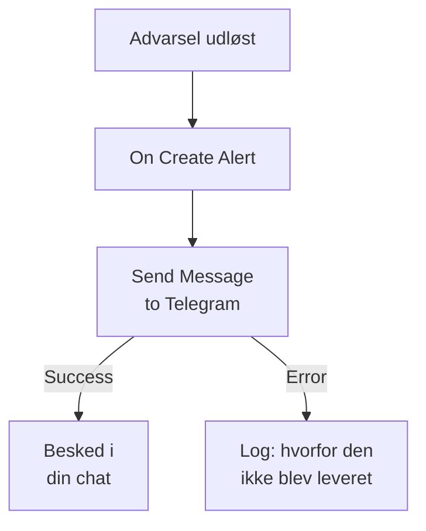

# Telegram

Send en besked til en [Telegram](https://telegram.org)-chat, -gruppe eller -kanal, når en advarsel udløses eller en hændelse åbnes. OneUptimes workflowtrin **Send Message to Telegram** sender den som en bot, du selv opretter, og en færdig skabelon bygger workflowet til advarsler. Denne integration er **udgående**: botten sender beskeder og læser ikke, hvad der bliver sagt i chatten.

:::cards
- [Sådan fungerer det](#sådan-fungerer-det): Hvad workflowet gør, når en advarsel udløses.
- [Opsætning](#opsæt-integrationen): En bot, dens chat og så workflowet: fra skabelonen eller fra bunden.
- [Tips](#tips): Ren tekst, lange beskeder og hændelser.
- [Fejlfinding](#fejlfinding): Hvad Telegrams fejl betyder, og hvad du skal ændre.
:::

## Sådan fungerer det



Trinnet sender **Message Text** til chatten som din bot via Telegrams Bot API. Det tager sin udgang **Success**, når Telegram tager imod beskeden, og sin udgang **Error**, med Telegrams begrundelse, når Telegram afviser den. Skabelonen forbinder et trin **Log** til **Error**, så en kørsel, der ikke kunne sende, siger hvorfor.

## Før du går i gang

- En Telegram-konto til at oprette botten og føje den til chatten.
- I OneUptime retten til at oprette workflows og variabler. På OneUptime Cloud kræver workflows planen **Growth** eller højere.

## Opsæt integrationen

:::steps
### Opret en bot

Send `/newbot` til [@BotFather](https://t.me/BotFather) i Telegram, og besvar dens spørgsmål. Den giver dig bottens token, for eksempel `123456789:ABCdefGhIJKlmnoPQRstuVWxyz`. Alle, der har tokenet, kan sende beskeder som din bot, så pas lige så godt på det som på en adgangskode.

### Find chattens ID

1. Føj botten til gruppen, eller gør den til administrator af kanalen. For at skrive til en person starter vedkommende først en chat med botten.
2. Send en besked i gruppen, der nævner botten, for eksempel `/start@your_bot`, så botten ser den.
3. Åbn `https://api.telegram.org/bot<token>/getUpdates` i en browser, med bottens token i stedet for `<token>`.
4. Find `"chat":{"id":` i svaret. Tallet efter det er chattens ID. En gruppes ID starter med `-`, og en stor gruppes med `-100`.

En offentlig kanal kan angives med sit `@username` i stedet for et ID.

### Byg workflowet

Start fra skabelonen, der bygger hele workflowet til advarsler, eller fra bunden.

:::tabs
@tab Fra skabelonen
1. Åbn **Arbejdsgange**, og klik på **Opret arbejdsgang**.
2. Skriv `Telegram` i **Søg i skabeloner…**, klik på **Tell Telegram when an alert fires**, og klik derefter på **Brug denne skabelon**.
3. Behold navnet **Notify Telegram on new alert**, eller ændr det, og klik på **Næste**.
4. Indsæt tokenet i **Telegram Bot Token** og ID'et i **Telegram Chat ID**, og klik på **Opret arbejdsgang**.

Workflowet åbner i **Bygger** med tre trin: **On Create Alert**; **Send Message to Telegram**, der sender advarslens nummer, titel, alvorlighed og tilstand; og et trin **Log** på dets udgang **Error**. Tokenet gemmes som workflowets hemmelige variabel `telegramBotToken` og ID'et som `telegramChatId`.
@tab Fra bunden
1. Gem tokenet som en hemmelig global variabel: gå til **Arbejdsgange → Globale variabler**, klik på **Opret Workflow Variabel**, giv den navnet `TELEGRAM_BOT_TOKEN`, og klik på **Næste**. Indsæt tokenet i **Indhold**, slå **Hemmelighed** til, og klik på **Opret Workflow Variabel**.
2. Gå til **Arbejdsgange**, klik på **Opret arbejdsgang**, vælg **Start fra bunden**, giv workflowet et navn, og klik på **Opret arbejdsgang**.
3. Klik i **Bygger** på **Vælg, hvad der starter denne arbejdsgang**, og vælg **On Create Alert** under **Populære**. Klik på triggeren: dens **Fields to pass on** starter med **Titel**, så klik på **Tilføj felt**, og vælg de andre felter, din besked viser, for eksempel **Alert Number With Prefix**.
4. Klik på **Tilføj komponent**, søg efter `telegram`, og klik på **Send Message to Telegram**. Forbind triggerens udgang **Success** til den.
5. Klik på det nye trin. Klik i **Telegram Bot Token** på **{ }**, og vælg `TELEGRAM_BOT_TOKEN` under **Global variables**. Angiv chattens ID i **Chat ID**, skriv beskeden i **Message Text**, og indsæt advarslens felter med **{ }**.
:::

En besked bygget fra bunden læser advarslens felter med referencer som disse:

```text
🚨 Alert {{local.components.alert-on-create-1.returnValues.model.alertNumberWithPrefix}} fired
Title: {{local.components.alert-on-create-1.returnValues.model.title}}
```

### Slå det til, og test det

Slå **Aktiveret** til øverst i **Bygger**. Fra nu af sendes hver ny advarsel til chatten.

For at teste uden at udløse en advarsel klikker du på **Kør arbejdsgang** og vælger en advarsel, du allerede har, under **Advarsel**: de seneste er vist, og når du skriver dens nummer eller en del af dens titel, finder du en anden. Klik på **Kør arbejdsgang manuelt**, og bekræft med **Kør**. Panelet **Arbejdsgangskørsel** følger kørslen, og beskeden dukker op i chatten. Tager trinnet i stedet **Error**, siger linjen fra trinnet **Log** hvorfor: se [Fejlfinding](#fejlfinding).
:::

## Tips

- **Ren tekst.** Trinnet sender teksten, som den er skrevet, uden Telegrams formatering, så `*` og `_` vises, som de er.
- **Hold øje med grænsen på 4.096 tegn.** Telegram tager imod beskeder på op til 4.096 tegn. En længere bliver afkortet og slutter med "… (truncated — see OneUptime for the full text)" i stedet for at blive afvist.
- **Også hændelser.** Byg det samme workflow på **On Create Incident**, eller på **On Update Incident** til tilstandsændringer. For kun at sende nogle advarsler sætter du en blok **If / Else** før trinnet.
- **Tokenets form kontrolleres.** Et token, der ikke har formen `123456789:ABCdef…`, stopper kørslen, før noget sendes, og tokenet skrives aldrig til loggen.

## Fejlfinding

Når trinnet tager **Error**, siger kørslen hvorfor: skabelonens trin **Log** skriver `❌ Telegram could not deliver the alert notification:`, Telegrams begrundelse og en påmindelse om, at botten skal være i chatten.

:::details Telegram svarer "Bad Request: chat not found"
**Chat ID** er forkert, eller botten kan ikke se chatten: føj botten til gruppen, gør den til administrator af kanalen, eller bed personen om at starte en chat med botten. En gruppes ID starter med `-`.
:::

:::details Telegram svarer "Forbidden: bot was blocked by the user" eller "bot is not a member"
Personen har blokeret botten, eller botten er fjernet fra gruppen eller kanalen. Føj den til igen, eller send til en anden chat.
:::

:::details Telegram svarer "Unauthorized"
Telegram accepterede ikke tokenet: det er tilbagekaldt hos @BotFather eller kopieret forkert. Kopiér bottens aktuelle token fra @BotFather, og erstat variablens værdi.
:::

:::details Telegram svarer "Too Many Requests: retry after"
Telegram begrænser, hvor hurtigt én bot sender, især til en gruppe. En byge af advarsler kan ramme grænsen: send færre beskeder, for eksempel kun for nogle alvorligheder.
:::

## Næste trin

:::cards
- [Workflow-komponenter](/docs/workflows/components#telegram): Hver indstilling i trinnet, og hvad dets udgange betyder.
- [Discord](/docs/integrations/discord): Den samme idé, i en Discord-kanal.
- [Workflow-kørsler](/docs/workflows/runs-and-logs): Læs, hvad hver kørsel af workflowet gjorde.
- [Oversigt over integrationer](/docs/integrations/index): Det udgående mønster og de andre værktøjer, du kan forbinde.
:::
