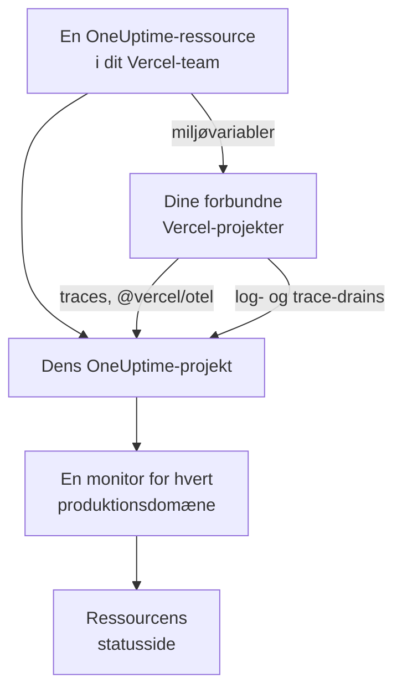

# Vercel

Tilføj OneUptime til dit Vercel-team fra [Vercel Marketplace](https://vercel.com/marketplace). Du logger ind med din Vercel-konto og betaler via din Vercel-regning, og dine Vercel-projekter får traces, logs, oppetidsovervågning og en statusside i OneUptime, uden at du skal sætte noget op i hånden.

:::cards
- [Tilføj OneUptime til dit Vercel-team](#tilføj-oneuptime-til-dit-vercel-team): En ressource, en plan og dine projekter, i Vercel-dashboardet.
- [Send traces med @vercel/otel](#send-traces-med-vercelotel): Miljøvariablerne er der allerede.
- [Send logs og traces med drains](#send-logs-og-traces-med-drains): Vercels egne logs og spans, på Pro og Enterprise.
- [Planer og fakturering](#planer-og-fakturering): OneUptimes planer, på din Vercel-faktura.
:::

## Sådan fungerer det

Hver OneUptime-ressource, du tilføjer i Vercel, er et OneUptime-projekt for sig. Vercel giver hvert Vercel-projekt, du forbinder til ressourcen, ressourcens miljøvariabler, og de sender projektets traces til OneUptime. Drains sender Vercels logs og spans, og hvert forbundet projekts produktionsdomæne får en oppetidsmonitor på ressourcens statusside.



Integrationen er til OneUptime Cloud (`oneuptime.com`). Et selvhostet OneUptime kan ikke tilføjes fra Vercel Marketplace: se [Selvhostet OneUptime](#selvhostet-oneuptime).

## Før du går i gang

- **Et Vercel-team**, på en hvilken som helst plan. Log- og trace-drains kræver Vercels Pro- eller Enterprise-plan; traces fra `@vercel/otel` virker på alle planer.
- **En bekræftet e-mailadresse** på din Vercel-konto. OneUptime logger dig ind med den og opretter din OneUptime-konto med den, hvis du ikke har en.
- **En betalingsmetode i Vercel**, for alle planer: monitorer og telemetri faktureres efter forbrug, også på Free-planen. Se [Planer og fakturering](#planer-og-fakturering).

## Tilføj OneUptime til dit Vercel-team

:::steps
### Åbn OneUptime på Vercel Marketplace

Åbn **Integrations** i Vercel-dashboardet, derefter **Browse Marketplace**, og find OneUptime under **Observability**. Klik på **Installation**, og acceptér OneUptimes vilkår.

### Vælg en plan

Vælg **Gratis**, **Growth** eller **Scale**. Planerne er OneUptimes egne, til priserne på [oneuptime.com/pricing](https://oneuptime.com/pricing).

### Navngiv ressourcen, og vælg dens indstillinger

Navngiv ressourcen efter det, den overvåger, for eksempel `storefront`: dens OneUptime-projekt og dens statusside får navn efter den. To indstillinger er slået til fra start:

- **Monitor production domains**: en webstedsmonitor for produktionsdomænet for hvert Vercel-projekt, du forbinder.
- **Create a status page**: en offentlig statusside for ressourcen, som viser de monitorer.

### Forbind dine projekter

Vælg de Vercel-projekter, der sender til denne ressource, og de miljøer, der får dens miljøvariabler. Giv ikke forbindelsen et brugerdefineret præfiks: `@vercel/otel` læser variablerne under deres egne navne.
:::

Ressourcen er klar på få sekunder. Klik på **Open in OneUptime** for at se dens projekt.

## Hvad du får med hver ressource

| Hvad | Hvor du finder det |
| --- | --- |
| Et OneUptime-projekt, opkaldt efter ressourcen | Du ejer det. Dine teamkammerater kommer med i det, når de åbner det fra Vercel. |
| En indtagelsesnøgle med navnet `Vercel` | **Projektindstillinger → Telemetri og APM → Indtagelsesnøgler** |
| Miljøvariabler i hvert forbundet Vercel-projekt | Projektets **Settings → Environment Variables** i Vercel |
| En webstedsmonitor for hvert forbundet projekt | **Monitorer**, opkaldt efter Vercel-projektet |
| En offentlig statusside | **Statussider**, opkaldt efter ressourcen |

Miljøvariablerne er de samme i alle forbundne projekter:

| Variabel | Værdi |
| --- | --- |
| `OTEL_EXPORTER_OTLP_ENDPOINT` | `https://oneuptime.com/otlp` |
| `OTEL_EXPORTER_OTLP_HEADERS` | `x-oneuptime-token=` og ressourcens indtagelsesnøgle |
| `OTEL_EXPORTER_OTLP_PROTOCOL` | `http/protobuf` |
| `ONEUPTIME_TELEMETRY_INGESTION_KEY` | Indtagelsesnøglen alene, som drains sender |

En udrulning får variablerne, når den bygges: udrul igen, når du har forbundet et projekt.

## Send traces med @vercel/otel

`@vercel/otel` er Vercels OpenTelemetry-pakke til Next.js og de andre frameworks, Vercel kører. Den læser `OTEL_EXPORTER_OTLP_*`-variablerne, så et projekt, der er forbundet til ressourcen, behøver kun pakken.

:::steps
### Installér pakken

```bash
npm install @vercel/otel @opentelemetry/api @opentelemetry/api-logs
```

### Registrér pakken

Opret `instrumentation.ts` i projektets rod, eller i `src`, hvis projektet har den mappe, og navngiv tjenesten:

```ts title="instrumentation.ts"
import { registerOTel } from "@vercel/otel";

export function register(): void {
  registerOTel({ serviceName: "storefront" });
}
```

### Udrul

Udrul projektet. Dets traces vises i **Spor** under tjenestenavnet.
:::

På Vercels Pro- og Enterprise-planer skal du også tilføje et trace-drain: Vercel sender så OneUptime sine egne spans for hver anmodning sammen med din applikations, og `@vercel/otel` overlader dem til drainet, så intet ankommer to gange.

## Send logs og traces med drains

Et drain sender det, Vercel registrerer om dine projekter, til OneUptime: et log-drain sender deres build-, funktions-, edge- og anmodningslogs, og et trace-drain deres spans. Drains kræver Vercels Pro- eller Enterprise-plan, og Vercel fakturerer de data, de sender, på din Vercel-regning.

:::steps
### Tilføj et drain

Åbn **Team Settings → Drains** i Vercel, og klik på **Add Drain**. Vælg **Logs** eller **Traces** og derefter OneUptime under **Native Integrations**.

### Vælg projekterne

Vælg projekterne og, for logs, kilderne og miljøerne. Drainet sender med ressourcens indtagelsesnøgle: der er intet at taste.
:::

Hvert Vercel-projekt er en tjeneste i OneUptime, opkaldt efter projektet. En log beholder sit tidspunkt, sit niveau og sin besked, og dens anmodning gemmes under OpenTelemetrys navne:

| Vercel-felt | I OneUptime |
| --- | --- |
| `projectName` | Tjenesten, `service.name` |
| `timestamp`, `level`, `message` | Loggens tidspunkt, alvorlighed og brødtekst |
| `deploymentId`, `environment` | `vercel.deployment.id`, `deployment.environment.name` |
| `proxy.method`, `proxy.path`, `proxy.statusCode` | `http.request.method`, `url.path`, `vercel.proxy.status_code` |
| `traceId`, `spanId` | Loggens trace, linket til tracet i **Spor** |
| Alle andre felter | En attribut under `vercel.`, for eksempel `vercel.source` |

## Oppetidsmonitorer og statussiden

Når du forbinder et Vercel-projekt, opretter OneUptime en webstedsmonitor for dets produktionsdomæne, som tjekkes fra OneUptimes sonder, og føjer den til ressourcens statusside. Et projekt, der forbindes før sin første produktionsudrulning, har endnu intet domæne: dets monitor oprettes ved den udrulning. Når du frakobler projektet, slettes dets monitor.

Hver monitor er en aktiv monitor, der faktureres som enhver anden og virker som en, du selv har oprettet: se [Websted-monitor](/docs/monitor/website-monitor). Vil du ikke have nogen, så slå **Monitor production domains** fra i ressourcens indstillinger i Vercel. Slår du den til igen, oprettes de monitorer, der stadig mangler.

## Åbn OneUptime fra Vercel

Klik på **Open in OneUptime** på ressourcen, eller på et af dens links i Vercel, så er du logget ind i OneUptime med din Vercel-kontos e-mailadresse. Første gang kommer du med i ressourcens projekt: som administrator, hvis du er ejer eller medlem af Vercel-teamet, og som medlem, hvis du har en af teamets skrivebeskyttede roller.

Findes der allerede en OneUptime-konto med den e-mailadresse, er det den, du logger ind på. En konto, der har totrinsgodkendelse slået til, eller som tilhører en OneUptime-administrator, logger i stedet ind med sin adgangskode. Du er med i projektet alligevel.

## Planer og fakturering

| | Sådan fungerer det |
| --- | --- |
| Planer | **Gratis**, **Growth** og **Scale**, til priserne på oneuptime.com: planens pris pr. bruger, aktive monitorer til $1 pr. monitor pr. måned og telemetri pr. GB. |
| Hvor du betaler | På din Vercel-faktura, én gang om måneden, for hver ressource. Vercel viser månedens forbrug indtil nu på ressourcen, opdateret hver time. |
| Prøveperioder | Ingen betaling, så længe planens prøveperiode varer: hverken for brugerne, monitorerne eller telemetrien. |
| Skift af plan | I Vercel, på ressourcen, eller i OneUptime under **Projektindstillinger → Fakturering og fakturaer → Fakturering**. En ændring det ene sted gælder begge steder. |
| Ubetalte fakturaer | Vercel prøver betalingen igen i 15 dage. Derefter er projektet utilgængeligt, indtil fakturaen er betalt: dets data bevares, og intet slettes. |

På fakturaen har hver ressource en linje for sine brugere, sine aktive monitorer, sin telemetri og eventuelle genopfyldninger af saldoen, i forbrugsenheder på $0.01.

## Fjern OneUptime

| Du | Hvad der sker |
| --- | --- |
| Sletter en ressource i Vercel | Dens projekt slettes, efter at forbruget indtil da er faktureret. De forbundne Vercel-projekter mister dens miljøvariabler ved deres næste udrulning. |
| Afinstallerer OneUptime fra teamet | Hver ressources projekt slettes, og den endelige faktura sendes. |
| Sletter projektet i OneUptime | Ressourcen slettes også i Vercel. |

> [!CAUTION]
> At slette et projekt sletter dets monitorer, statusside, hændelser og telemetri for altid. Eksportér først alt, du vil beholde.

## Selvhostet OneUptime

Et selvhostet OneUptime kan ikke tilføjes fra Vercel Marketplace, som kun klargør OneUptime Cloud. Dine Vercel-projekter kan stadig sende til det:

- **Traces**: angiv variablerne fra [Hvad du får med hver ressource](#hvad-du-får-med-hver-ressource) i Vercel-projektets **Settings → Environment Variables**, med `https://YOUR-ONEUPTIME-HOST/otlp` som endpoint og en indtagelsesnøgle fra dit projekt.
- **Logs**: tilføj et brugerdefineret log-drain i **Team Settings → Drains** til `https://YOUR-ONEUPTIME-HOST/telemetry/vercel/v1/logs`, i JSON eller NDJSON. Tilføj headeren `x-oneuptime-token` med din indtagelsesnøgle, og sæt drainets signeringshemmelighed til den samme nøgle: OneUptime tager kun imod leveringer, som Vercel har signeret med den.

Det samme brugerdefinerede drain virker på OneUptime Cloud, med `oneuptime.com` som vært.

## Fejlfinding

:::details Der kommer ingen traces
- Udrul projektet igen: en udrulning, der blev bygget, før projektet blev forbundet, har ingen `OTEL_EXPORTER_OTLP_*`-variabler.
- Kontrollér variablernes navne i projektets **Settings → Environment Variables**. En forbindelse, der er oprettet med et brugerdefineret præfiks, omdøber dem, og så læser `@vercel/otel` dem ikke længere: forbind projektet igen uden præfiks.
- Kontrollér, at `instrumentation.ts` kalder `registerOTel`, og, på Next.js 14 og ældre, at `experimental.instrumentationHook` er slået til i `next.config.js`.
:::

:::details Vercel viser drainet med fejl
Vercel viser OneUptimes svar på drainets leveringer:

- `403` med `x-vercel-signature` i beskeden: Vercel signerede ikke leveringen med den nøgle, Vercel sender. For et brugerdefineret drain skal du kontrollere dets `x-oneuptime-token`-header og sætte dets signeringshemmelighed til den samme nøgle.
- `401`: OneUptime kender intet projekt med den nøgle, drainet sender: den er slettet eller tastet forkert begge steder. Brug en nøgle fra **Projektindstillinger → Telemetri og APM → Indtagelsesnøgler**.
- `422`: nøglen er slået fra. Slå den til igen på samme side, eller brug en anden.
:::

:::details Et forbundet projekt har ingen monitor
- **Monitor production domains** er slået fra i ressourcens indstillinger i Vercel.
- Projektet har endnu intet produktionsdomæne: dets monitor oprettes ved dets første produktionsudrulning.
- Projektets plan har så mange aktive monitorer, som den tillader: opgradér planen, og slå derefter **Monitor production domains** fra og til igen.
:::

:::details Vercel beder dig bekræfte din e-mailadresse
OneUptime kræver en e-mailadresse, som Vercel har bekræftet, og en eksisterende OneUptime-konto med den adresse skal også selv have fået adressen bekræftet. Bekræft adressen, og tilføj derefter ressourcen, eller åbn OneUptime igen.
:::

## Næste trin

:::cards
- [Sporudforsker](/docs/telemetry/traces-explorer): Find en langsom anmodning og dens spans.
- [Protokoludforsker](/docs/telemetry/logs-explorer): Søg i dine Vercel-logs.
- [Statussider](/docs/status-pages/index): Giv ressourcens statusside dit eget brand, og tilføj abonnenter.
- [Indtagelsesnøgler](/docs/telemetry/ingestion-keys): Udskift ressourcens nøgle, eller slå den fra.
:::
