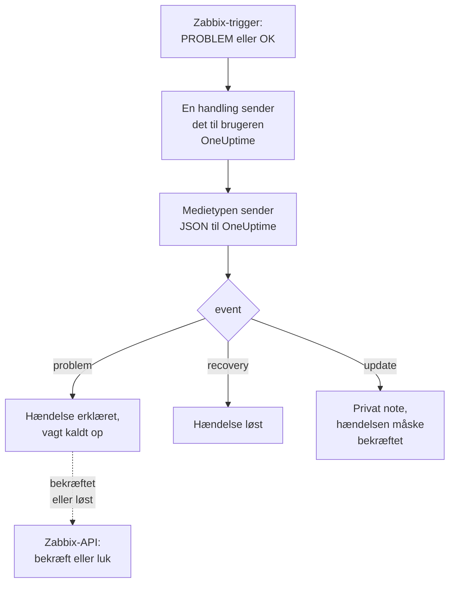

# Zabbix

Send [Zabbix](https://www.zabbix.com)-problemer til OneUptime, så hvert problem bliver en hændelse, der kalder dit vagthold op og løses, når Zabbix er kommet sig. Færdige workflow-skabeloner holder begge sider i takt: det, folk gør i Zabbix, noteres på hændelsen, og at bekræfte eller løse hændelsen bekræfter eller lukker problemet i Zabbix. Zabbix sender hvert problem via en webhook-medietype, så der er intet at installere på nogen af siderne.

:::cards
- [Vælg, hvordan OneUptime modtager problemer](#vælg-hvordan-oneuptime-modtager-problemer): Workflow-skabeloner eller en Incoming Request-monitor.
- [Start med skabelonerne](#start-med-skabelonerne): Seks skabeloner, hvad de gør, og hvad de beder om.
- [Konfigurer Zabbix](#konfigurer-zabbix): En medietype, en bruger og en handling.
- [Fejlfinding](#fejlfinding): Når problemer ikke kommer frem, eller hændelser forbliver åbne.
:::

## Sådan fungerer det



Zabbix sender et problem til en bruger via brugerens medier. Her er mediet en webhook-medietype ved navn **OneUptime**: dens script sender et lille JSON-dokument til OneUptime for hvert problem, for gendannelsen af det og for hver opdatering, nogen laver på det i Zabbix, med problemets hændelses-ID, navn, vært og alvorlighed. Det er med hændelses-ID'et, at OneUptime finder den hændelse, et problem oprettede.

## Før du går i gang

- En Zabbix-server, som du administrerer. Denne vejledning er skrevet til Zabbix 6.0 LTS og 7.0 LTS. Webhook-medietyper fungerer på samme måde fra Zabbix 5.0. Skabelonerne, der kalder Zabbix' API, kræver Zabbix 6.4 eller nyere eller [én ændring på Zabbix 6.0](#på-zabbix-60).
- En Zabbix-server, der kan nå din OneUptime via HTTPS, og til skabelonerne, der kalder Zabbix, en OneUptime, der kan nå Zabbix.
- I OneUptime rettigheden til at oprette workflows, eller monitorer, hvis du vælger den vej. På OneUptime Cloud kræver workflows planen **Growth** eller højere.

## Vælg, hvordan OneUptime modtager problemer

Sæt OneUptime op først: det giver dig den URL, som Zabbix sender til.

| Måde | Brug den, når |
| --- | --- |
| Workflow-skabelonerne (anbefales) | Du vil have hvert problem som en hændelse eller en advarsel med dets Zabbix-alvorlighed, med vagten kaldt op for High og Disaster, løst ved gendannelse, med det, folk gør i Zabbix, noteret på den, og Zabbix bekræftet eller lukket fra OneUptime. |
| En Incoming Request-monitor | Du vil have hændelser uden et workflow, på enhver plan, og en monitor, hvis status følger Zabbix. Intet går tilbage til Zabbix. |

Begge får den samme JSON fra den samme medietype, så du kan starte med den ene og skifte senere ved at ændre én URL i Zabbix.

## Start med skabelonerne

Dialogen **Opret en arbejdsgang** har seks Zabbix-skabeloner under **Zabbix** i kategorilisten: tre til hændelser og derefter de samme tre til advarsler.

| Skabelon | Hvad den gør | Hvad den beder om |
| --- | --- | --- |
| **Hændelser** | | |
| Declare an incident for each Zabbix problem | Det workflow, Zabbix sender alle sine beskeder til. Det erklærer en hændelse for hvert problem, kalder vagten op for High og Disaster, noterer opdateringer foretaget i Zabbix og løser hændelsen ved gendannelse. | Zabbix URL |
| Acknowledge or close the Zabbix problem with the incident | Når hændelsen bekræftes, bekræfter den sit problem. Når den løses, lukker den problemet, eller bekræfter det, hvor Zabbix ikke tillader at lukke det manuelt. | Zabbix URL, Zabbix API Token |
| Copy incident private notes to the Zabbix problem | Tilføjer hver privat note på hændelsen til dens problem som en besked. | Zabbix URL, Zabbix API Token |
| **Advarsler** | | |
| Create an alert for each Zabbix problem | Det samme som for hændelser, med en advarsel for hvert problem. | Zabbix URL |
| Acknowledge or close the Zabbix problem with the alert | Det samme som for hændelser, ud fra advarslens tilstand. | Zabbix URL, Zabbix API Token |
| Copy alert private notes to the Zabbix problem | Tilføjer hver privat note på advarslen til dens problem som en besked. | Zabbix URL, Zabbix API Token |

Start med **Declare an incident for each Zabbix problem**, eller **Create an alert for each Zabbix problem** til advarsler: den hændelse eller advarsel, den opretter, gemmer problemets hændelses-ID i sit brugerdefinerede felt `zabbixEventId`, og de to andre skabeloner finder problemet med det.

### Hvad skabelonerne beder om

- **Zabbix URL**: den adresse, du åbner Zabbix på, f.eks. `https://zabbix.example.com`, eller `https://example.com/zabbix`, når Zabbix kører under en sti. Links til et problem går dertil, og skabelonerne, der kalder Zabbix, sender deres anmodninger til dets `api_jsonrpc.php`. Feltet afviser adressen på en side i Zabbix.
- **Zabbix API Token**: et API-token for den Zabbix-bruger, workflowet handler som. [Opret API-tokenet](#opret-api-tokenet) viser hvordan. Det gemmes som en hemmelig variabel og sendes kun til Zabbix: i headeren `Authorization`, eller i anmodningens brødtekst på Zabbix 6.0.

### Modtag problemer med skabelonen

:::steps
1. Gå til **Arbejdsgange**, og klik på **Opret arbejdsgang**. Under **Eller start fra en skabelon** vælger du **Zabbix** i kategorilisten, klikker på **Declare an incident for each Zabbix problem** og klikker på **Brug denne skabelon**.
2. Udfyld **Zabbix URL**. Under **Who to page for High and Disaster problems** vælger du de vagtpolitikker, der skal tilkaldes, eller ingen for ikke at tilkalde nogen, og klikker på **Opret arbejdsgang**. Workflowet åbner i **Bygger**, slået fra.
3. Klik på triggeren **Webhook**, derefter på **Kopiér URL**, og gem URL'en til Zabbix.
4. Slå **Aktiveret** til øverst i **Bygger**. Et workflow, der er slået fra, svarer Zabbix med `400`.
:::

Derefter [konfigurerer du Zabbix](#konfigurer-zabbix) til at sende sine problemer til den URL.

### Hvad workflowet gør

Efter triggeren **Webhook** læser trinnet **Check With JavaScript** `read-event-1` den `event`, medietypen sender, og **Incident From Another Tool**, eller **Alert From Another Tool** i advarselsskabelonen, gør det, den betyder, ud fra problemets hændelses-ID:

| Event | Hvad workflowet gør |
| --- | --- |
| `problem` | Erklærer en hændelse med titlen `Zabbix: <problem> on <host>`, med den alvorlighed, Zabbix-alvorligheden svarer til, holdt uden for dine statussider. Dens beskrivelse linker til problemet i Zabbix og viser værten, alvorligheden, hvornår det startede, dets driftsdata og dets tags. For et problem med High eller Disaster kalder den den vagtpolitik op, du valgte. Et problem, som Zabbix sender igen, med samme hændelses-ID, opretter ingen ny hændelse. |
| `recovery` | Løser problemets hændelse, medmindre den allerede er løst. Hvorfor står på dens tidslinje. |
| `update` | Tilføjer det, der blev gjort i Zabbix, til hændelsen som en privat note: hvem der gjorde det, hvad de gjorde, og hvad de skrev. Når opdateringen bekræftede problemet, bekræfter den også hændelsen, så vagten holder op med at eskalere den. |

Alt andet, f.eks. en anmodning fra et andet værktøj, bliver ladt være: `read-event-1` tager **No**, og kørslens **Trin** siger hvorfor. Et trin, der fejler, får kørslen til at mislykkes, og dets post under **Trin** siger hvorfor.

### Alvorligheder

I et nyt projekt knytter skabelonen Zabbix' seks alvorligheder til disse hændelses- og advarselsalvorligheder:

| Zabbix-alvorlighed | Hændelse | Advarsel | Vagt |
| --- | --- | --- | --- |
| Disaster | Critical Incident | High | Kaldt op |
| High | Critical Incident | High | Kaldt op |
| Average | Major Incident | Low | Ikke kaldt op |
| Warning | Major Incident | Low | Ikke kaldt op |
| Information | Minor Incident | Low | Ikke kaldt op |
| Not classified | Minor Incident | Low | Ikke kaldt op |

Med egne alvorligheder går Disaster og High til din mest alvorlige, Average og Warning til den midterste, og Information og Not classified til din mindst alvorlige. Zabbix nummererer sine alvorligheder fra 0 (Not classified) til 5 (Disaster), og skabelonen læser nummeret, så at omdøbe en alvorlighed i Zabbix ændrer intet.

- For at knytte en alvorlighed til en af dine efter navn skal du redigere `SEVERITY_BY_NAME` i trinnet `read-event-1`, f.eks. `{ 2: 'Minor Incident' }` for Warning.
- For også at kalde op for Average-problemer skal du sætte **Compare with** i trinnet `if-page-1` **If / Else** til `3`.

### Send bekræftelser og noter tilbage til Zabbix

:::steps
1. [Opret API-tokenet](#opret-api-tokenet).
2. Opret et workflow fra **Acknowledge or close the Zabbix problem with the incident**. Udfyld **Zabbix URL** og **Zabbix API Token**, klik på **Opret arbejdsgang**, og slå **Aktiveret** til.
3. Hvis du også vil have noter i Zabbix, så gør det samme med **Copy incident private notes to the Zabbix problem**.
:::

Tilstandsskabelonen spørger først Zabbix om problemet, så et problem, som Zabbix allerede har bekræftet eller løst, bliver ladt, som det er. For at lukke et problem skal dets trigger have **Allow manual close** i Zabbix. Uden det bliver problemet bekræftet i stedet, med en besked om, at hændelsen blev løst, og Zabbix lukker det, når det er kommet sig. Hændelser, som intet Zabbix-problem oprettede, og hændelser markeret **Privat hændelse**, sendes aldrig til Zabbix.

### Opret API-tokenet

:::steps
1. Brug brugeren `OneUptime`, der [modtager problemerne](#opret-en-bruger-der-modtager-problemer). Zabbix sender ikke en bruger dens egne opdateringer, så med denne brugers token kommer OneUptimes bekræftelser og beskeder aldrig tilbage til OneUptime som opdateringer.
2. Tjek brugerens rolle i **Users → User roles**. Den skal have **Access to API** slået til, og **Acknowledge problems**, **Add problem comments** og **Close problems** tilladt. **User role** tillader dem, medmindre nogen har ændret den.
3. Tjek brugerens gruppe i **Users → User groups**. Tilladelsen **Read** på værtsgrupperne er nok til at bekræfte problemer og tilføje beskeder. For at lukke problemer skal den have **Read-write**.
4. Gå til **Users → API tokens**, og klik på **Create API token**. Vælg brugeren `OneUptime`, fjern markeringen i **Set expiration date and time**, eller notér datoen, og klik på **Add**.
5. Kopiér **Auth token**: Zabbix viser den kun én gang. Indsæt den i **Zabbix API Token**.
:::

### På Zabbix 6.0

Zabbix 6.0 læser API-tokenet fra anmodningens brødtekst, ikke fra headeren `Authorization`. I trinnet **Update Zabbix Problem** i hver skabelon, der kalder Zabbix, slår du **Zabbix 6.0** til under **Flere felter**. Zabbix 7.2 og nyere afviser et token i brødteksten, så slå det fra igen, når du opgraderer.

## Modtag problemer med en monitor

En [Incoming Request-monitor](/docs/monitor/incoming-request-monitor) giver dig en URL, og dens kriterier afgør, hvad hver anmodning gør.

:::steps
### Opret monitoren

Gå til **Monitorer**, og klik på **Opret monitor**. Vælg **Incoming Request** under **Monitortype**, giv den navnet `Zabbix`, og klik på **Næste**.

### Erklær en hændelse for hvert problem

I trinnet **Kriterier** åbner du det første kriterium, det der markerer monitoren som offline. Sæt dets filter til **Anmodningsbrødtekst**, **Indeholder**, `"status":"1"`. Dette kriterium erklærer allerede en hændelse, når filteret matcher. Udfyld hændelsen:

- **Hændelsestitel**: `Zabbix: {{requestBody.name}} on {{requestBody.host}}`.
- **Alvorlighed**: den hændelsesalvorlighed, Zabbix-problemer skal have.
- **Vagtpolitikker**, under **Vagt**: de politikker, der skal kaldes op.
- **Løs hændelse automatisk**, under **Flere felter**: lad den være slået til, som den starter. Uden den ignoreres gendannelser, og hændelser forbliver åbne.

### Opret én hændelse pr. problem

Åbn **Indstillinger** i samme kriterium, og slå **Group incidents and alerts by a payload field** til. Udfyld det som nedenfor, så hvert problem får sin egen hændelse, og gendannelsen af det løser den:

| Felt | Værdi |
| --- | --- |
| **Open a separate incident for each…** | `requestBody.event_id` |
| **Field that signals recovery** | `requestBody.status` |
| **Value that means recovered** | `0` |

### Bring monitoren online igen

Åbn det andet kriterium, det der markerer monitoren som online, og sæt dets filter til **Anmodningsbrødtekst**, **Indeholder**, `"status":"0"`.

### Kopiér URL'en

Klik på **Opret monitor**. Monitorens side **Oversigt** viser dens **Heartbeat URL**. Kopiér den til Zabbix:

```text
https://oneuptime.com/heartbeat/<secret key>
```

En selvhostet installation har sin egen vært i stedet for `oneuptime.com`.
:::

Monitoren læser anmodningens JSON, som den er skrevet: `"status":"1"`, uden mellemrum. Se [Modtag alarmer fra et andet system](/docs/monitor/incoming-request-monitor#modtagelse-af-advarsler-fra-et-andet-system) for, hvad hver indstilling gør. En opdatering foretaget i Zabbix sendes også med `"status":"1"`, som monitoren læser som problemet igen, uden at oprette en ny hændelse.

## Konfigurer Zabbix

Zabbix har brug for tre ting: en medietype, der sender til OneUptime, en bruger at sende den til og en handling, der sender problemer til den bruger.

:::steps
### Opret medietypen OneUptime

1. Gå til **Alerts → Media types**, eller **Administration → Media types** i Zabbix 6.0, og klik på **Create media type**.
2. Sæt **Name** til `OneUptime` og **Type** til **Webhook**.
3. Tilføj disse **Parameters**. Hver af dem fører en Zabbix-[makro](https://www.zabbix.com/documentation/current/en/manual/appendix/macros/supported_by_location) ind i anmodningen:

   | Navn | Værdi |
   | --- | --- |
   | `url` | `{ALERT.SENDTO}` |
   | `event_id` | `{EVENT.ID}` |
   | `event_name` | `{EVENT.NAME}` |
   | `event_value` | `{EVENT.VALUE}` |
   | `event_severity` | `{EVENT.SEVERITY}` |
   | `event_nseverity` | `{EVENT.NSEVERITY}` |
   | `host` | `{HOST.NAME}` |
   | `event_date` | `{EVENT.DATE}` |
   | `event_time` | `{EVENT.TIME}` |
   | `event_opdata` | `{EVENT.OPDATA}` |
   | `event_tags` | `{EVENT.TAGSJSON}` |
   | `trigger_id` | `{TRIGGER.ID}` |
   | `event_update_status` | `{EVENT.UPDATE.STATUS}` |
   | `event_update_action` | `{EVENT.UPDATE.ACTION}` |
   | `event_update_message` | `{EVENT.UPDATE.MESSAGE}` |
   | `event_update_user` | `{USER.FULLNAME}` |

4. Indsæt dette i **Script**:

   ```javascript
   var params = JSON.parse(value);

   // Zabbix leaves a macro it has no value for as it is written, such as
   // {EVENT.UPDATE.MESSAGE} on a problem: it is sent as nothing.
   function given(text) {
     var written = String(text === undefined || text === null ? "" : text);
     return /^\{[A-Z0-9_.]+\}$/.test(written) || written === "*UNKNOWN*"
       ? ""
       : written;
   }

   var isUpdate = given(params.event_update_status) === "1";
   var payload = {
     source: "zabbix",
     // "problem", "recovery" or "update".
     event: isUpdate
       ? "update"
       : params.event_value === "0"
         ? "recovery"
         : "problem",
     event_id: params.event_id,
     name: params.event_name,
     host: params.host,
     severity: params.event_severity,
     // 0 Not classified, 1 Information, 2 Warning, 3 Average, 4 High, 5 Disaster.
     severity_number: params.event_nseverity,
     // "1" for a problem, "0" for its recovery.
     status: params.event_value,
     date: params.event_date,
     time: params.event_time,
     opdata: given(params.event_opdata),
     tags: [],
     trigger_id: params.trigger_id,
   };

   try {
     var tags = JSON.parse(given(params.event_tags) || "[]");
     payload.tags = Array.isArray(tags) ? tags : [];
   } catch (error) {
     payload.tags = [];
   }

   if (isUpdate) {
     payload.update = {
       action: given(params.event_update_action),
       message: given(params.event_update_message),
       user: given(params.event_update_user),
     };
   }

   var request = new HttpRequest();
   request.addHeader("Content-Type: application/json");

   var response = request.post(params.url, JSON.stringify(payload));

   if (request.getStatus() < 200 || request.getStatus() >= 300) {
     throw (
       "OneUptime responded with HTTP " + request.getStatus() + ": " + response
     );
   }

   return "OK";
   ```

5. Tilføj på fanen **Message templates** en skabelon til **Problem**, en til **Problem recovery** og en til **Problem update**. Lad deres tekst være tom: scriptet bygger anmodningen. Zabbix bruger kun en medietype til de slags hændelser, den har en skabelon til.
6. Klik på **Add**.

### Opret en bruger, der modtager problemer

1. Gå til **Users → Users**, eller **Administration → Users** i Zabbix 6.0, og klik på **Create user**. Giv brugeren navnet `OneUptime`, og giv den en brugergruppe og en rolle, der kan modtage notifikationer, f.eks. **User role**.
2. Klik på **Add** på fanen **Media**. Sæt **Type** til `OneUptime` og **Send to** til den URL, du kopierede fra OneUptime. Lad **When active** og alvorlighederne være, som de er, eller fjern fluebenet ved de alvorligheder, OneUptime ikke skal have.
3. Klik på **Add** og derefter på **Add** igen for at gemme brugeren.

### Send problemer til OneUptime med en handling

1. Gå til **Alerts → Actions → Trigger actions**, eller **Configuration → Actions** i Zabbix 6.0, og klik på **Create action**. Giv den navnet `Notify OneUptime`.
2. Afgræns den under **Conditions**, hvis du vil, f.eks. med **Trigger severity is greater than or equals Warning**. Uden betingelser sendes hvert problem.
3. Tilføj på fanen **Operations** en operation, der sender til brugeren `OneUptime` via medietypen `OneUptime`.
4. Tilføj den samme operation under **Recovery operations**, så gendannelser også sendes, og under **Update operations**, så bekræftelser og kommentarer foretaget i Zabbix sendes.
5. Klik på **Add**, og kontrollér, at handlingen er aktiveret.
:::

For at sende nogle problemer til hændelsesskabelonen og andre til advarselsskabelonen skal du give brugeren `OneUptime` to medier af typen `OneUptime`: hvert sender til ét workflows URL, med de alvorligheder, det skal have.

## Test det

1. Åbn **Alerts → Media types** i Zabbix, og klik på **Test** ved siden af `OneUptime`. Udfyld den URL, du kopierede, og eksempelværdier som `event_id` `12345`, `event_name` `Test problem`, `host` `web-1`, `event_nseverity` `4` og `event_value` `1`. Klik på **Test**: Zabbix viser scriptets svar, `OK`, eller den fejl, det kastede.
2. Åbn workflowets **Protokoller → Kørsler** i OneUptime, og tjek kørslen, eller åbn monitoren, og kontrollér, at der blev oprettet en hændelse.
3. Test igen med `event_value` `0` og samme `event_id`. Hændelsen bliver løst.

Lad derefter en rigtig trigger udløses, f.eks. ved at sænke en tærskel et øjeblik, og se problemet komme ind. For at prøve en opdatering skal du bekræfte problemet i Zabbix med en besked: hændelsen får en privat note og bliver bekræftet.

## Tilknyt Zabbix-alvorligheder

Zabbix sender sin alvorlighed som tekst: `Not classified`, `Information`, `Warning`, `Average`, `High` eller `Disaster`.

- **Med skabelonerne** bliver alvorlighederne knyttet for dig: se [Alvorligheder](#alvorligheder).
- **Med monitoren** klikker du på **Tilføj kriterier** for hver gruppe af alvorligheder og trækker det nye kriterium op over det første: kriterierne kontrolleres fra toppen, og det første, der matcher, afgør det. Giv hvert kriterium to filtre, `"status":"1"` og en alvorlighed som `"severity":"Disaster"`, med **Matchbetingelse** sat til **Alle**. Giv hvert kriterium en hændelse med sin egen **Alvorlighed** og **Løs hændelse automatisk** og de samme grupperingsindstillinger.

## Fejlfinding

:::details Intet kommer frem til OneUptime
- Åbn **Reports → Action log** i Zabbix, og kontrollér, at handlingen sendte problemet, og hvad der kom tilbage.
- Send selv en anmodning fra Zabbix-serveren: `curl -i -X POST <url> -H 'Content-Type: application/json' -d '{"source":"zabbix","event":"problem","event_id":"1","name":"Test","host":"test","severity_number":"4","status":"1"}'`.
- Monitoren svarer `200` med det samme, før den kontrollerer noget, selv ved en forkert hemmelig nøgle. Tjek monitorens tidslinje for at se, om anmodningerne kommer frem.
- Et workflow, der er slået fra, svarer `400`. Slå **Aktiveret** til øverst i dets **Bygger**.
:::

:::details Zabbix rapporterer en scriptfejl
Åbn medietypen, og brug **Test**: Zabbix viser scriptets resultat eller den fejl, det kastede. Et svar fra OneUptime, der ikke er `2xx`, kastes af scriptet sammen med dets status, så tjek URL'en først.
:::

:::details Hændelser oprettes, men løses aldrig
- Handlingen skal have **Recovery operations**, ellers sender Zabbix aldrig gendannelsen.
- Med skabelonen åbner du workflowets **Protokoller → Kørsler** og gendannelsens kørsel: dens sidste trin siger hvorfor. En gendannelse for et problem, der ikke oprettede nogen hændelse, ændrer intet.
- Med monitoren skal kriteriets hændelse have **Løs hændelse automatisk** under **Flere felter**. **Field that signals recovery** skal være `requestBody.status`, og **Value that means recovered** præcis `0`.
:::

:::details Zabbix-problemet bliver ikke bekræftet eller lukket
Åbn tilstandsskabelonens kørsel i **Protokoller → Kørsler**: dens sidste trin siger, hvad Zabbix svarede.

- `Not authorized`: API-tokenet er forkert, udløbet eller deaktiveret, eller Zabbix er ældre end 6.4 (se [På Zabbix 6.0](#på-zabbix-60)).
- `Cannot close problem: trigger does not allow manual closing`: slå **Allow manual close** til på triggeren. Skabelonen bekræfter allerede sådanne problemer i stedet for at lukke dem.
- `No permissions to referred object or it does not exist!`: brugeren kan se problemet, men skal have tilladelsen **Read-write** for at lukke det.
- `Zabbix has no problem with event ID`: brugeren kan ikke se problemets vært. Giv dens brugergruppe tilladelsen **Read** på værtsgruppen.
:::

:::details Hændelsen viser en reference i stedet for en værdi
En reference til et felt, som anmodningen ikke har, bliver stående, som den er skrevet, krøllede parenteser og det hele, i stedet for at blive tømt. Kontrollér, at Zabbix sender `Content-Type: application/json`, og at de feltnavne, du bruger (`name`, `host`, `severity`, `status`, `event_id`), passer til scriptets payload. Ved et workflow åbner du kørslen i **Protokoller → Kørsler** og sammenligner med det, triggeren modtog. Se [Faldgruber](/docs/workflows/variables#fælder).
:::

:::details Hvert problem kommer to gange
Handlingen har sandsynligvis to operationer, der sender til den samme bruger, f.eks. et første trin og et eskaleringstrin. Skabelonen opretter én hændelse pr. hændelses-ID, uanset hvad der kommer, men hver levering er en kørsel. Tjek handlingens **Operations**.
:::

## Sikkerhed

- **Behandl URL'en som en adgangskode.** Alle, der har den, kan oprette hændelser. Hvis den slipper ud, så nulstil den: **Nulstil URL** i workflowets **Webhook**-trigger, eller **Nulstil hemmelig nøgle for indgående anmodning** på monitorens side **Indstillinger**. Opdater derefter **Send to** i Zabbix-brugerens medie.
- **Links går til dit Zabbix.** Skabelonen linker et problem på det websted, som dens **Zabbix URL** navngiver, uanset hvad en anmodning siger, og skriver det, Zabbix sendte, som tekst.
- **Begræns API-tokenet til det, workflowet gør.** Det er en hemmelig variabel, skjult i kørselslogge og kun sendt til Zabbix, i headeren `Authorization`, medmindre **Zabbix 6.0** er slået til. Giv dens bruger en rolle med intet ud over handlingerne ovenfor, og slet tokenet i **Users → API tokens**, hvis det slipper ud.
- **Send kun det, der kræver en hændelse.** Brug handlingens betingelser, eller alvorlighederne i brugerens medie, til at holde problemer med lav alvorlighed i Zabbix.
- **Selvhostet?** Lad din Zabbix-server nå din OneUptime via HTTPS gennem din firewall. For at kalde et Zabbix på et privat netværk skal workflowet have [udgående netværksadgang](/docs/workflows/configuration#udgående-netværksadgang).

## Næste trin

:::cards
- [Workflow-skabeloner](/docs/workflows/authoring): Opret et workflow fra en skabelon, og ændr det i Bygger.
- [Indgående anmodning-monitor](/docs/monitor/incoming-request-monitor): Alle indstillinger for den monitor, der modtager Zabbix-problemer.
- [Eskaleringsregler](/docs/on-call/escalation-rules): Bestem, hvem en vagtpolitik kalder op, og hvornår.
- [Oversigt over integrationer](/docs/integrations/index): De andre værktøjer, du kan forbinde.
:::
