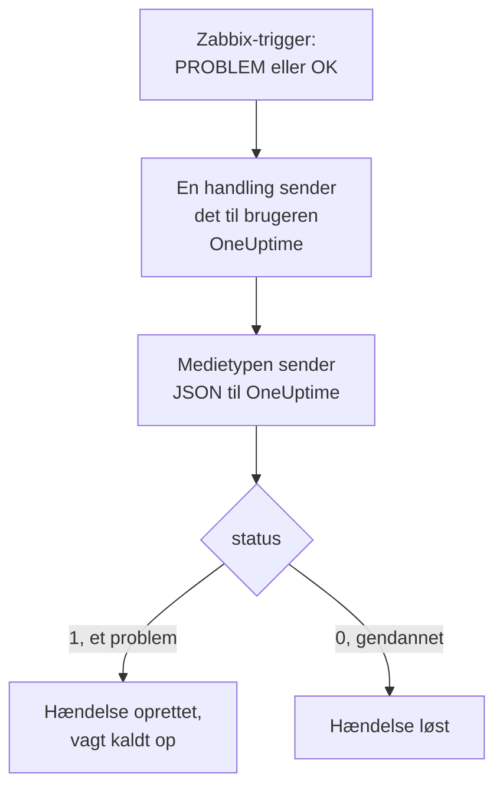

# Zabbix

Send [Zabbix](https://www.zabbix.com)-problemer til OneUptime, så hvert problem bliver en hændelse, der kalder dit vagthold op og løses, når Zabbix er kommet sig. Zabbix sender hvert problem via en webhook-medietype, så der er intet at installere på nogen af siderne.

:::cards
- [Vælg, hvordan OneUptime modtager problemer](#vælg-hvordan-oneuptime-modtager-problemer): En Incoming Request-monitor eller dit eget workflow.
- [Modtag problemer med en monitor](#modtag-problemer-med-en-monitor): Én hændelse pr. problem, løst ved gendannelse.
- [Konfigurer Zabbix](#konfigurer-zabbix): En medietype, en bruger og en handling.
- [Fejlfinding](#fejlfinding): Når problemer ikke kommer frem, eller hændelser forbliver åbne.
:::

## Sådan fungerer det



Zabbix sender et problem til en bruger via brugerens medier. Her er mediet en webhook-medietype ved navn **OneUptime**: dens script sender et lille JSON-dokument til OneUptime med problemets hændelses-ID, navn, vært, alvorlighed og status. Status er `1` for et problem og `0` for gendannelsen af det.

## Før du går i gang

- En Zabbix-server, som du administrerer. Denne vejledning er skrevet til Zabbix 6.0 LTS og 7.0 LTS. Webhook-medietyper fungerer på samme måde fra Zabbix 5.0.
- En Zabbix-server, der kan nå din OneUptime via HTTPS.
- I OneUptime rettigheden til at oprette monitorer, eller workflows, hvis du vælger den vej.

## Vælg, hvordan OneUptime modtager problemer

Sæt OneUptime op først: det giver dig den URL, som Zabbix sender til.

| Måde | Brug den, når |
| --- | --- |
| En Incoming Request-monitor (anbefales) | Du vil have, at hvert Zabbix-problem bliver en hændelse, der kalder vagten op og løses, når Zabbix er kommet sig. Der er intet at bygge. |
| Et workflow med en Webhook-trigger | Du har brug for din egen logik: filtrere problemer, give dem en anden form eller kalde andre systemer først. Et workflow løser ikke selv hændelsen ved gendannelse. |

Begge får den samme JSON fra den samme medietype, så du kan starte med den ene og skifte senere ved at ændre én URL i Zabbix.

## Modtag problemer med en monitor

En [Incoming Request-monitor](/docs/monitor/incoming-request-monitor) giver dig en URL, og dens kriterier afgør, hvad hver anmodning gør.

:::steps
### Opret monitoren

Gå til **Monitorer**, og klik på **Opret monitor**. Vælg **Incoming Request** under **Monitortype**, giv den navnet `Zabbix`, og klik på **Næste**.

### Erklær en hændelse for hvert problem

I trinnet **Kriterier** åbner du det første kriterium, det der markerer monitoren som offline. Sæt dets filter til **Anmodningsbrødtekst**, **Indeholder**, `"status":"1"`. Dette kriterium erklærer allerede en hændelse, når filteret matcher. Udfyld hændelsen:

- **Hændelsestitel**: `Zabbix: {{requestBody.name}} on {{requestBody.host}}`.
- **Alvorlighed**: den hændelsesalvorlighed, Zabbix-problemer skal have.
- **Vagtpolitikker**, under **Vagt**: de politikker, der skal kaldes op.
- **Løs hændelse automatisk**, under **Flere felter**: lad den være slået til, som den starter. Uden den ignoreres gendannelser, og hændelser forbliver åbne.

### Opret én hændelse pr. problem

Åbn **Indstillinger** i samme kriterium, og slå **Group incidents and alerts by a payload field** til. Udfyld det som nedenfor, så hvert problem får sin egen hændelse, og gendannelsen af det løser den:

| Felt | Værdi |
| --- | --- |
| **Open a separate incident for each…** | `requestBody.event_id` |
| **Field that signals recovery** | `requestBody.status` |
| **Value that means recovered** | `0` |

### Bring monitoren online igen

Åbn det andet kriterium, det der markerer monitoren som online, og sæt dets filter til **Anmodningsbrødtekst**, **Indeholder**, `"status":"0"`.

### Kopiér URL'en

Klik på **Opret monitor**. Monitorens side **Oversigt** viser dens **Heartbeat URL**. Kopiér den til Zabbix:

```text
https://oneuptime.com/heartbeat/<secret key>
```

En selvhostet installation har sin egen vært i stedet for `oneuptime.com`.
:::

Monitoren læser anmodningens JSON, som den er skrevet: `"status":"1"`, uden mellemrum. Se [Modtag alarmer fra et andet system](/docs/monitor/incoming-request-monitor#modtagelse-af-advarsler-fra-et-andet-system) for, hvad hver indstilling gør.

## Modtag problemer med et workflow

Brug et [workflow](/docs/workflows/index), når du har brug for dine egne trin mellem Zabbix og hændelsen.

:::steps
### Opret workflowet

Gå til **Arbejdsgange**, klik på **Opret arbejdsgang** og derefter på **Start fra bunden**. Giv det navnet `Zabbix problems`, og klik på **Opret arbejdsgang**.

### Tilføj Webhook-triggeren

Klik på den stiplede blok **Choose what starts this workflow**, og vælg **Webhook**. Klik på triggeren og derefter på **Kopiér URL**, og gem URL'en til Zabbix.

### Kontrollér, at det er et problem

Klik på **Tilføj komponent**, tilføj en **If / Else**-blok, og forbind triggerens **Out**-punkt med den. Sæt **Value to check** til `{{local.components.webhook-1.returnValues.request-body.status}}`, **Comparison** til **is equal to** og **Compare with** til `1`.

### Erklær hændelsen

Tilføj en **Create One Incident**-blok, og forbind **Yes**-siden af **If / Else**-blokken med den. Vælg i **Incident Template** en skabelon, der sætter alvorligheden og de vagtpolitikker, der skal kaldes op (se [Hændelsesskabeloner](/docs/incidents/settings#hændelsesskabeloner)). Sæt i **JSON Object** det, der kommer fra Zabbix:

```json
{
  "title": "Zabbix: {{local.components.webhook-1.returnValues.request-body.name}}",
  "description": "Host: {{local.components.webhook-1.returnValues.request-body.host}}\nSeverity: {{local.components.webhook-1.returnValues.request-body.severity}}\nZabbix event: {{local.components.webhook-1.returnValues.request-body.event_id}}"
}
```

Uden en skabelon skal **JSON Object** også have `incidentSeverityId`, ID'et for en af projektets hændelsesalvorligheder.

### Slå det til

Slå **Aktiveret** til øverst i **Bygger**. Et workflow, der er slået fra, svarer Zabbix med `400`.
:::

En gendannelse tager **No**-siden af **If / Else**-blokken, hvor intet er forbundet, så kørslen slutter der. Brug monitoren til at løse hændelser ved gendannelse.

## Konfigurer Zabbix

Zabbix har brug for tre ting: en medietype, der sender til OneUptime, en bruger at sende den til og en handling, der sender problemer til den bruger.

:::steps
### Opret medietypen OneUptime

1. Gå til **Alerts → Media types**, eller **Administration → Media types** i Zabbix 6.0, og klik på **Create media type**.
2. Sæt **Name** til `OneUptime` og **Type** til **Webhook**.
3. Tilføj disse **Parameters**. Hver af dem fører en Zabbix-[makro](https://www.zabbix.com/documentation/current/en/manual/appendix/macros/supported_by_location) ind i anmodningen:

   | Navn | Værdi |
   | --- | --- |
   | `url` | `{ALERT.SENDTO}` |
   | `event_id` | `{EVENT.ID}` |
   | `event_name` | `{EVENT.NAME}` |
   | `event_value` | `{EVENT.VALUE}` |
   | `event_severity` | `{EVENT.SEVERITY}` |
   | `host` | `{HOST.NAME}` |
   | `event_date` | `{EVENT.DATE}` |
   | `event_time` | `{EVENT.TIME}` |

4. Indsæt dette i **Script**:

   ```javascript
   var params = JSON.parse(value);
   var request = new HttpRequest();
   request.addHeader("Content-Type: application/json");

   var payload = {
     source: "zabbix",
     event_id: params.event_id,
     name: params.event_name,
     host: params.host,
     severity: params.event_severity,
     // "1" for a problem, "0" for its recovery.
     status: params.event_value,
     date: params.event_date,
     time: params.event_time,
   };

   var response = request.post(params.url, JSON.stringify(payload));

   if (request.getStatus() < 200 || request.getStatus() >= 300) {
     throw (
       "OneUptime responded with HTTP " + request.getStatus() + ": " + response
     );
   }

   return "OK";
   ```

5. Tilføj på fanen **Message templates** en skabelon til **Problem** og en til **Problem recovery**. Lad deres tekst være tom: scriptet bygger anmodningen. Zabbix bruger kun en medietype til de slags hændelser, den har en skabelon til.
6. Klik på **Add**.

### Opret en bruger, der modtager problemer

1. Gå til **Users → Users**, eller **Administration → Users** i Zabbix 6.0, og klik på **Create user**. Giv brugeren navnet `OneUptime`, og giv den en brugergruppe og en rolle, der kan modtage notifikationer, f.eks. **User role**.
2. Klik på **Add** på fanen **Media**. Sæt **Type** til `OneUptime` og **Send to** til den URL, du kopierede fra OneUptime. Lad **When active** og alvorlighederne være, som de er, eller fjern fluebenet ved de alvorligheder, OneUptime ikke skal have.
3. Klik på **Add** og derefter på **Add** igen for at gemme brugeren.

### Send problemer til OneUptime med en handling

1. Gå til **Alerts → Actions → Trigger actions**, eller **Configuration → Actions** i Zabbix 6.0, og klik på **Create action**. Giv den navnet `Notify OneUptime`.
2. Afgræns den under **Conditions**, hvis du vil, f.eks. med **Trigger severity is greater than or equals Warning**. Uden betingelser sendes hvert problem.
3. Tilføj på fanen **Operations** en operation, der sender til brugeren `OneUptime` via medietypen `OneUptime`.
4. Tilføj den samme operation under **Recovery operations**, så gendannelser også sendes.
5. Klik på **Add**, og kontrollér, at handlingen er aktiveret.
:::

## Test det

1. Åbn **Alerts → Media types** i Zabbix, og klik på **Test** ved siden af `OneUptime`. Udfyld den URL, du kopierede, og eksempelværdier som `event_id` `12345`, `event_name` `Test problem`, `host` `web-1` og `event_value` `1`. Klik på **Test**: Zabbix viser scriptets svar, `OK`, eller den fejl, det kastede.
2. Åbn monitoren i OneUptime, og kontrollér, at der blev oprettet en hændelse, eller åbn workflowets **Protokoller → Kørsler**, og tjek kørslen.
3. Test igen med `event_value` `0` og samme `event_id`. Med monitoren bliver hændelsen løst.

Lad derefter en rigtig trigger udløses, f.eks. ved at sænke en tærskel et øjeblik, og se problemet komme ind.

## Tilknyt Zabbix-alvorligheder

Zabbix sender sin alvorlighed som tekst: `Not classified`, `Information`, `Warning`, `Average`, `High` eller `Disaster`.

- **Med monitoren** klikker du på **Tilføj kriterier** for hver gruppe af alvorligheder og trækker det nye kriterium op over det første: kriterierne kontrolleres fra toppen, og det første, der matcher, afgør det. Giv hvert kriterium to filtre, `"status":"1"` og en alvorlighed som `"severity":"Disaster"`, med **Matchbetingelse** sat til **Alle**. Giv hvert kriterium en hændelse med sin egen **Alvorlighed** og **Løs hændelse automatisk** og de samme grupperingsindstillinger.
- **Med workflowet** tilføjer du en [Switch / Case](/docs/workflows/components#switch-case)-blok på `{{local.components.webhook-1.returnValues.request-body.severity}}`, med en case for hver alvorlighed, og en **Create One Incident**-blok med sin egen skabelon efter hver case.

## Fejlfinding

:::details Intet kommer frem til OneUptime
- Åbn **Reports → Action log** i Zabbix, og kontrollér, at handlingen sendte problemet, og hvad der kom tilbage.
- Send selv en anmodning fra Zabbix-serveren: `curl -i -X POST <url> -H 'Content-Type: application/json' -d '{"status":"1","event_id":"1","name":"Test","host":"test"}'`.
- Monitoren svarer `200` med det samme, før den kontrollerer noget, selv ved en forkert hemmelig nøgle. Tjek monitorens tidslinje for at se, om anmodningerne kommer frem.
- Et workflow, der er slået fra, svarer `400`. Slå **Aktiveret** til øverst i dets **Bygger**.
:::

:::details Zabbix rapporterer en scriptfejl
Åbn medietypen, og brug **Test**: Zabbix viser scriptets resultat eller den fejl, det kastede. Et svar fra OneUptime, der ikke er `2xx`, kastes af scriptet sammen med dets status, så tjek URL'en først.
:::

:::details Hændelser oprettes, men løses aldrig
- Handlingen skal have **Recovery operations**, ellers sender Zabbix aldrig gendannelsen.
- Kriteriets hændelse skal have **Løs hændelse automatisk**, under **Flere felter**.
- **Field that signals recovery** skal være `requestBody.status`, og **Value that means recovered** præcis `0`.
- Et workflow løser ikke hændelser ved gendannelse. Brug monitoren.
:::

:::details Hændelsen viser en reference i stedet for en værdi
En reference til et felt, som anmodningen ikke har, bliver stående, som den er skrevet, krøllede parenteser og det hele, i stedet for at blive tømt. Kontrollér, at Zabbix sender `Content-Type: application/json`, og at de feltnavne, du bruger (`name`, `host`, `severity`, `status`, `event_id`), passer til scriptets payload. Ved et workflow åbner du kørslen i **Protokoller → Kørsler** og sammenligner med det, triggeren modtog. Se [Faldgruber](/docs/workflows/variables#fælder).
:::

:::details Hvert problem kommer to gange
Handlingen har sandsynligvis to operationer, der sender til den samme bruger, f.eks. et første trin og et eskaleringstrin. Tjek handlingens **Operations**.
:::

## Sikkerhed

- **Behandl URL'en som en adgangskode.** Alle, der har den, kan oprette hændelser. Hvis den slipper ud, så nulstil den: **Nulstil hemmelig nøgle for indgående anmodning** på monitorens side **Indstillinger**, eller **Nulstil URL** i workflowets **Webhook**-trigger. Opdater derefter **Send to** i Zabbix-brugerens medie.
- **Send kun det, der kræver en hændelse.** Brug handlingens betingelser, eller alvorlighederne i brugerens medie, til at holde problemer med lav alvorlighed i Zabbix.
- **Selvhostet?** Lad din Zabbix-server nå din OneUptime via HTTPS gennem din firewall.

## Næste trin

:::cards
- [Indgående anmodning-monitor](/docs/monitor/incoming-request-monitor): Alle indstillinger for den monitor, der modtager Zabbix-problemer.
- [Eskaleringsregler](/docs/on-call/escalation-rules): Bestem, hvem en vagtpolitik kalder op, og hvornår.
- [Workflow-triggere](/docs/workflows/triggers#webhook): Sådan fungerer et workflows webhook-URL.
- [Oversigt over integrationer](/docs/integrations/index): De andre værktøjer, du kan forbinde.
:::
