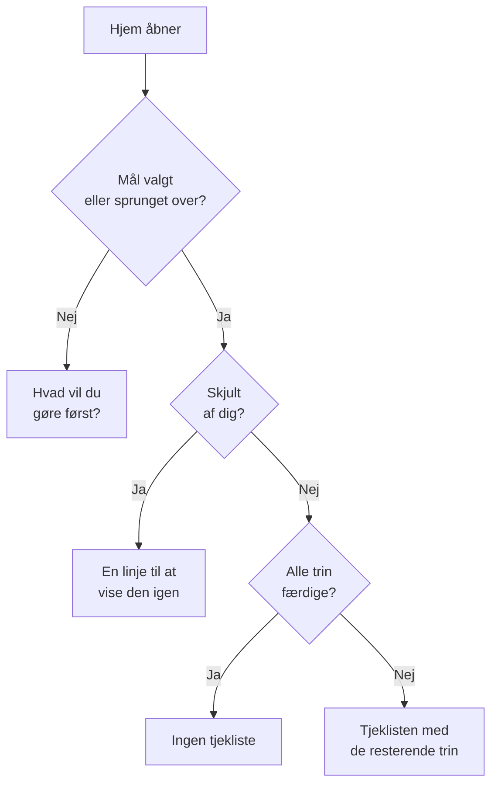

# Startside og genveje

Hjem er den første side, du ser i et projekt. Den viser med et blik, om noget har brug for dig lige nu, og fører et nyt projekt gennem den første opsætning. Denne side forklarer, hvad Hjem viser, hvordan du finder ethvert produkt, enhver side og handling i dashboardet, og de tastaturgenveje, der sparer dig for ture gennem menuerne.

:::cards
- [Hvad Hjem viser](#hvad-hjem-viser): Om noget er galt, hvad der har brug for dig, hvad projektet rummer, og alle produkter.
- [Find rundt](#find-rundt): Menuen Produkter og bjælkerne øverst på hver side.
- [Søg](#søg-efter-en-side-en-indstilling-eller-en-handling): Find enhver side, indstilling eller handling ved at skrive dens navn.
- [Tastaturgenveje](#tastaturgenveje): Gå til Hjem, Overvågninger eller Hændelser med to taster.
:::

## Hvad Hjem viser

Åbn **Hjem** i bjælken øverst, eller tryk `g` og derefter `h` hvor som helst. Hjem er oversigten over dit projekt, én side uden sidemenu. Fra top til bund viser den:

1. Et søgefelt med **Erklær hændelse** og **Opret** ved siden af.
2. Én linje, der siger, om noget er galt, over fem tal, der tæller det, der kræver opmærksomhed.
3. **Velkommen til OneUptime 👋**, en tjekliste til et nyt projekt, indtil den er gennemført.
4. **Kræver opmærksomhed**, hvert problem, der er åbent lige nu, ved navn.
5. **Dit projekt**, hvad projektet består af, og **Kommende vedligeholdelse**, når der er planlagt noget.
6. **Udforsk OneUptime**, alle produkter, én kategori ad gangen.

### Søg og opret

Søgefeltet åbner søgningen, ligesom `Mod` + `K`: skriv navnet på en side, monitor, hændelse, advarsel, statusside eller vagtpolitik. Se [Søg](#søg-efter-en-side-en-indstilling-eller-en-handling). **Erklær hændelse** åbner formularen, hvor du erklærer en hændelse. **Opret** tilbyder **Opret monitor**, **Planlæg vedligeholdelse** og **Opret meddelelse**. Hver af dem vises kun for dem, der må bruge den.

### Overskriften

Linjen øverst nævner det mest presserende, der er åbent, i en tilsvarende farve:

| Når | Hjem siger |
| --- | --- |
| En hændelse er åben | Hvor mange hændelser der er aktive, med rødt |
| Ingen hændelse er åben, men der er åbne advarsler, monitorer, der ikke er i drift, eller SLO'er i fare | Hvor mange problemer der kræver opmærksomhed, med ravgult |
| Intet er galt, og en vedligeholdelse er i gang | Hvor mange vedligeholdelser der er i gang |
| Monitorer kører, og intet er åbent | **Alle systemer er i drift** |
| Projektet har ingen monitorer endnu | **Der overvåges ikke noget endnu** |

Ved siden af siger Hjem, hvornår den sidst læste projektet, og **Opdater** læser det igen. Når du vender tilbage til en fane med Hjem efter et minut eller mere, opdaterer den sig selv.

Så længe intet overvåges endnu, slutter linjen med knappen **Opret din første overvågning**, som åbner den guidede opsætning **Vide, når mit website eller API er nede**. Kun personer, der har lov til at oprette monitorer, ser den.

### De fem tal

Hvert tal tæller noget, siger, om det kræver din opmærksomhed, og åbner listen bag det i det produkt, den hører til.

| Tal | Hvad det tæller | Når tallet er nul | Åbner |
| --- | --- | --- | --- |
| **Aktive hændelser** | Hændelser, der ikke er løst | **Alt er i orden** | **Hændelser → Aktive hændelser** |
| **Aktive advarsler** | Advarsler, der ikke er løst | **Alt er i orden** | **Advarsler → Aktive advarsler** |
| **Ikke-operationelle monitorer** | Monitorer, hvis status ikke er en driftsstatus. Arkiverede monitorer, og monitorer med overvågning slået fra, tæller ikke med. | **Alle i drift** | **Monitorer → Ikke operationel** |
| **Igangværende vedligeholdelse** | Planlagte vedligeholdelser, der er i gang | **Ingen i gang** | **Planlagt vedligeholdelse → Igangværende vedligeholdelseshændelser** |
| **SLO'er i fare** | Aktive SLO'er, der er i fare eller har brugt deres fejlbudget op | **Budgetterne er sunde** | **SLOs** |

Et tal over nul viser **Kræver opmærksomhed**, eller **I gang** og **Budgettet bruges op** for vedligeholdelse og SLO'er. Så længe en SLO er i fare, åbner **SLO'er i fare** listen **SLOs** filtreret til netop dem. Et projekt uden monitorer ser **Ingen monitorer endnu**, og et uden SLO'er ser **Ingen SLO'er endnu**: et tomt projekt er ikke det samme som et sundt. De to åbner så listerne **Monitorer** og **SLOs**, hvor du opretter en.

### Velkomsttjeklisten

Første gang en projektejer eller projektadministrator åbner Hjem i et nyt projekt, spørger kortet **Hvad vil du gøre først?** Sæt flueben ved et eller flere mål, fx **Vide, når mit website eller API er nede** eller **Jeg kigger bare**, og klik på **Fortsæt**: tjeklisten indeholder så de trin, som målene kræver. **Spring over** giver de fire trin, som alle projekter får. For at svare igen senere skal du klikke på **Skift** i tjeklisten. Et projekt, der allerede bruger overvågninger, telemetri eller vagter, bliver ikke spurgt.

Hvert trin krydser sig selv af, når tingen virker, ikke når en post findes, og alle, der sætter projektet op, ser den samme liste på alle enheder:

| Trin | Gennemført, når | Åbner |
| --- | --- | --- |
| **Importér fra dit nuværende værktøj** | En import fra et andet værktøj er gennemført. | **Importér fra et andet værktøj** |
| **Opret din første overvågning** | Den første kontrol kommer ind. | Den guidede opsætning **Vide, når mit website eller API er nede**, eller listen **Monitorer** for den, der ikke må oprette overvågninger. |
| **Forbind en server eller en klynge** | De første metrikker kommer ind. | **Værter** |
| **Send dine første logs, metrikker eller traces** | Projektets første logs, metrikker, traces, undtagelser eller profiler kommer ind. | Den guidede opsætning **Send protokoller, metrikker og spor, og få derefter advarsler** |
| **Opsæt en vagtpolitik** | En testalarm bliver kvitteret, en alarm når nogen, eller en vagtregel kører en politik, der kan nå nogen. | Den guidede opsætning **Tilkalde den rette person, når noget går ned** |
| **Udgiv en statusside** | En statusside viser en overvågning. | Den guidede opsætning **Udgiv en statusside**, eller listen **Statussider** for den, der ikke må oprette statussider. |
| **Inviter dit team** | Nogen accepterer din invitation. | **Brugere** |

Det trin, du skal tage først, er markeret med **Næste trin**. På OneUptime Clouds Free-abonnement, der har én person, siger **Inviter dit team**, at det kræver Growth-abonnementet, og åbner **Fakturering**. På en selvhostet server, der endnu ikke kan sende e-mail, ser serverens administratorer først **Denne server kan ikke sende e-mail endnu**; det åbner administrationsdashboardet.

En guidet opsætning klarer hele opgaven på én side, et trin ad gangen, og slutter med, hvad den har sat op, og hvad du kan gøre bagefter. Søg efter dens navn for at åbne den igen senere.

Under trinene viser **Sådan virker OneUptime** de fire kerneprodukter i den rækkefølge, et problem bevæger sig gennem dem: **Monitorer**, **Hændelser og advarsler**, **Vagt** og **Statussider**. Klik på et for at åbne det. Under dem står, hvad der fodrer kredsløbet, telemetri og infrastruktur, med links til [Grundbegreber](/docs/introduction/core-concepts) og [Ordliste](/docs/introduction/glossary).

Tjeklisten forsvinder for alle, når hvert trin er færdigt. For at skjule den før, skal du klikke på **Skjul**: den er så kun skjult for dig, på alle enheder, og en linje bliver stående med **Vis den** og **Sådan virker OneUptime**. Folk, der er inviteret til projektet som medlemmer, ser ikke tjeklisten. **Sådan virker OneUptime** er stadig ét klik væk i alle projekter: åbn det fra **Hjælp** eller med knappen ved siden af **Udforsk OneUptime**.

### Kræver opmærksomhed

**Kræver opmærksomhed** viser ved navn det, tallene tæller: de åbne hændelser, de åbne advarsler, de monitorer, der ikke er i drift, SLO'erne i fare og de igangværende vedligeholdelser, det mest presserende først. Hver række viser sin alvor eller status, siger, hvornår en hændelse eller advarsel begyndte, og hvornår vedligeholdelsen slutter, og åbner posten. Hver slags viser op til fem, med **Vis alle** for resten, som åbner den samme liste som dens tal. Når intet er åbent, står der **Intet kræver din opmærksomhed**.

### Opsætningens tilstand

Når noget i projektets opsætning ville forhindre, at folk får besked, slutter **Kræver opmærksomhed** med **Opsætning**: hvor mange ting der bør ses på. Den åbner **Opsætningens tilstand**, som viser, hvad der er sat forkert op, det værste først, under **Tilkald når ikke frem**, **Værd at rette** og **Forslag**: en monitor, der ikke tilkalder nogen, en vagtpolitik, som intet kører, en person, der ikke kan tilkaldes, SMS slået fra, en vagttidsplan uden nogen på vagt, en statusside, der ikke viser nogen monitor. Hvert fund siger med én sætning, hvad der er galt, med knappen, der åbner rettelsen, og en monitors fund er de brud, som dens kort **Når den går ned** nævner. Et fund, som jeres team bevidst lader være, kan skjules med en begrundelse, for alle, og gendannes fra **Afvist**. Søg finder siden som **Opsætningens tilstand**, og Spørg AI svarer på "er min opsætning i orden?" ud fra den.

### Dit projekt

**Dit projekt** tæller projektets **Monitorer**, **Statussider**, **Vagtpolitikker**, **SLOs**, **Tjenester**, **Dashboards** og **Arbejdsgange**, uden de arkiverede. Hver række åbner sin liste. En slags, som projektet ikke har nogen af, viser **Konfigurer** i stedet for et tal.

**Kommende vedligeholdelse** viser de næste tre planlagte vedligeholdelsesvinduer, det tidligste først. Den udelades, når intet er planlagt.

### Udforsk OneUptime

**Udforsk OneUptime** viser produkterne i menuen **Produkter** én kategori ad gangen, begyndende med det grundlæggende. Hvert produkt siger, hvad det er til, og åbnes, når du klikker på det. De produkter, dit projekt skjuler, er ikke med.

## Find rundt

Alt i OneUptime ligger under **Produkter** i topbjælken. Menuen viser sine grupper som rækkerne i én liste og åbner altid med den første af dem, det grundlæggende, foldet ud: Overvågninger, Hændelser, Advarsler, Vagt, Statussider, Planlagt vedligeholdelse og SLOs. Hver anden gruppe (Observabilitet, Sikkerhed, AI, Kode, Ressourcer, Infrastruktur, Cloud, Dashboards og automatisering og Indstillinger) er foldet sammen til en række i den samme liste. Hver række nævner gruppens produkter og siger, hvor mange der er. Klik på en række for at folde den ud eller sammen, eller gå til den med piletasterne og tryk på **Enter**.

- **Søgning finder alt.** Skriv i menuens søgefelt for at finde ethvert produkt på navn, på hvad det gør, eller på et velkendt ord som `k8s` eller `RUM`. Søgningen kigger også i de sammenfoldede grupper.
- **Du starter, hvor du er.** Gruppen for den side, du er på, folder sig selv ud, og de produkter, du har åbnet for nylig, står øverst.
- **Dine valg bliver.** Menuen husker i din browser, hvilke af de andre grupper du har foldet ud eller sammen. Det grundlæggende er foldet ud igen, hver gang du åbner menuen, også selvom du foldede det sammen.
- **På en telefon** viser menuknappen produkterne på samme måde: det grundlæggende foldet ud øverst og hver anden gruppe som én række, der åbner med et tryk.
- **Produkter, projektet ikke bruger.** En projektejer eller -administrator kan skjule dem under **Projektindstillinger → Grundlæggende → Produkter**. Et skjult produkt flytter ned under **Flere produkter**, menuens sidste række: Søgning finder det stadig, dets sider virker fortsat, og dets data bliver ved med at komme. Når et af dem begynder at modtage data, siger Hjem det til dem, der kan vise det igen.
- **Fastgør.** Hold et produkt i den øverste bjælke ved siden af **Hjem** og **Produkter**: tryk på nålen på dets kort i menuen, eller på **Fastgør** ved siden af dets sides titel. Du kan fastgøre fem, og de følger dig til alle browsere. På en telefon kommer dine fastgjorte produkter først i menuen.
- **Hvad der er i brug.** I hver gruppe undtagen det grundlæggende og indstillingerne kommer de produkter, dit projekt bruger, først, og et, du endnu ikke har sat op, siger **Ikke sat op**. I OneUptime Cloud nævner et produkt, som dit abonnement ikke omfatter, det abonnement, der omfatter det.

### Bjælkerne øverst

To bjælker løber hen over toppen af hver side.

| Hvor | Hvad der er |
| --- | --- |
| Øverst til venstre | Projektvælgeren: skift til et andet af dine projekter, eller opret et nyt. |
| Øverst til højre | **Søg** og **Spørg AI**, notifikationsklokken med det, der kræver dig nu (aktive hændelser og advarsler, de vagtpolitikker, du har vagt i, ventende invitationer), **Hjælp**, og dit billede, som åbner menuen for din [konto](/docs/introduction/your-account). |
| Under dem | **Hjem** og **Produkter** til venstre, **Brugerindstillinger** til højre: hvordan OneUptime kontakter dig i dette projekt. |

**Hjælp** starter med det, der hjælper dig med at lære: **Hurtigstart**, **Sådan virker OneUptime**, **Ordliste** og denne dokumentation (**Dokumentation**). Under dem ligger listen **Tastaturgenveje** og support via e-mail og på Slack. På en tablet eller i et smalt vindue er **Spørg AI** udeladt for at spare plads: den findes blandt handlingerne i **Søg**. På en telefon flytter **Søg** og **Hjælp** ind i menuknappens liste, øverst og nederst; klokken og dit billede bliver.

Et ord med en prikket linje under, som **Sonder** i formularen til en ny monitor, fortæller, hvad det betyder, når du peger på det, tabber til det eller trykker på det. Dets **Læs mere** åbner ordet i [Ordliste](/docs/introduction/glossary).

### Sider og lister

Over hver sides titel viser et spor som *Projekt › Docker › Indstillinger › Ejerregler*, hvor siden ligger. Hvert trin før det sidste åbner sin side.

- **Lister holder sig selv opdaterede.** Når en hændelse eller advarsel oprettes, kvitteres eller løses et sted, viser listerne over hændelser, advarsler og episoder det inden for få sekunder, uden at du skal genindlæse. Mens du er midt i noget på en liste, for eksempel med rækker markeret eller en dialog åben, venter den og indhenter det, når du er færdig.
- **På en telefon foldes filterchipsene væk** bag **Filter**, så listen starter længere oppe. De chips, du har sat, bliver i syne sammen med **Ryd alt**. Tryk på **Filter** for at se alle chips, og igen for at folde dem væk.
- **Kolonner**, i menuen **⋯** på en liste, vælger, hvilke kolonner listen viser og i hvilken rækkefølge, og husker dem for dig i denne browser. En projektejer eller en projektadministrator kan også sætte flueben ved **Vis disse kolonner for alle i dette projekt** der: alle, der ikke har valgt deres egne kolonner til listen, ser dem, og **Nulstil til projektets standard** sætter dine egne tilbage til dem.
- **Kompakte rækker**, i samme menu, gør rækkerne i alle lister lavere, så en lang liste viser omkring en femtedel flere af dem. Valget huskes i denne browser.
- **På en telefon, eller i et kort, der er for smalt til sine rækker, vises en liste som kort, ét pr. række.** Båndet over dem siger, hvilken rækkefølge de står i, for eksempel **Sorteret efter Navn**: tryk på det for at vælge den kolonne, der sorteres efter, og **Stigende** eller **Faldende**.
- **En hændelses sider starter med dens nummer.** Overskriften, dens trin i sporet og browserfanen viser `INC-42 Checkout is down`, og det gør de dialoger, der nævner den, også, så hændelser med samme titel kan kendes fra hinanden. Advarsler, planlagte vedligeholdelsesbegivenheder og episoder gør det samme.

## Søg efter en side, en indstilling eller en handling

Tryk på **Cmd+K** (Mac) eller **Ctrl+K** (Windows og Linux), eller klik på søgeikonet i topbjælken, og begynd at skrive. Søgningen finder:

- **Hver side i menuerne**, under det navn, menuen giver den: API-nøgler, Farezone, Vagtplaner, Hændelsesalvor, dine egne Notifikationsmetoder. Hvert resultat siger, hvor det ligger, for eksempel *Projektindstillinger › Avanceret*, så sider med samme navn (Brugerdefinerede felter under Hændelser, Advarsler og Monitorer) er lette at skelne.
- **Indstillingerne på en side**, under det navn, deres kort eller kontakt viser: *Kræv SSO til login* finder SSO, og *Brugerdefinerede SMTP-konfigurationer* finder Notifikationskanaler. Skriv navnet på engelsk eller på dit eget sprog.
- **Handlinger**, efter hvad du vil gøre: Erklær hændelse, Opret monitor eller Delete Project, som åbner Farezone. En handling, der ændrer noget, tilbydes kun til dem, der må udføre den.
- **Dine monitorer, hændelser, advarsler, statussider og vagtpolitikker**, efter navn, og hændelser og advarsler også efter nummer, for eksempel `INC-42`. Hvert resultat for en hændelse eller advarsel starter med dens nummer, så to med samme titel kan kendes fra hinanden.
- **Dokumentationen**, i en gruppe *Dokumentation* under alt det andet: de sider og afsnit, hvis ord passer til det, du skriver, på dit sprog, også med en tastefejl. Hver åbner i en ny fane, så du beholder din plads.

Søgningen læser det, du skriver, som du mener det:

- Store og små bogstaver, accenter, mellemrum og bindestreger er ligegyldige: *on-call*, *on call* og *oncall* finder de samme sider, og ordene kan stå i vilkårlig rækkefølge.
- Den kender andre ord for mange sider, på engelsk: *pager* eller *escalation* for Vagtpolitikker, *rota* for Vagtplaner, *2fa* for totrinsgodkendelse, *delete project* for Farezone.
- Tilføj produktets navn for at indsnævre en søgning: *incident custom fields* finder siden Brugerdefinerede felter under Hændelser.
- En lille tastefejl, som *incidnet*, finder stadig det, du mente, når intet passer præcist.

Med et tomt søgefelt viser søgningen de sider, du har åbnet for nylig, handlingerne og produkterne.

## Tastaturgenveje

Tryk på `?` hvor som helst i dashboardet for at se alle genveje, eller åbn **Hjælp** og vælg **Tastaturgenveje**. På en Mac er `Mod` Command-tasten; på Windows og Linux er det Ctrl.

| Taster | Hvad de gør |
| --- | --- |
| `Mod` + `K` | Åbn kommandopaletten: søg efter enhver side, indstilling eller handling. |
| `Mod` + `I` | Spørg AI om det, du kigger på. |
| `/` | Søg i listen på denne side. |
| `?` | Vis tastaturgenvejene. |
| `Esc` | Luk en dialog eller et panel. |

### Gå til et produkt

Tryk på `g` og derefter et bogstav for at gå direkte til et produkt. Tryk bogstavet inden for halvanden sekund efter `g`.

| Taster | Går til |
| --- | --- |
| `g` derefter `h` | Hjem |
| `g` derefter `m` | Overvågninger |
| `g` derefter `i` | Hændelser |
| `g` derefter `a` | Advarsler |
| `g` derefter `o` | Vagt |
| `g` derefter `s` | Statussider |
| `g` derefter `e` | Planlagt vedligeholdelse |
| `g` derefter `d` | Dashboards |
| `g` derefter `l` | Protokoller |
| `g` derefter `t` | Spor |

Genvejene står ikke i vejen. `?`, `/` og `g` gør intet, mens du skriver i et felt, og intet navigerer væk, mens en dialog er åben, så et forkert tastetryk ikke kan koste dig en halvt udfyldt formular. Ethvert andet produkt er én søgning væk med `Mod` + `K`.

## Næste trin

:::cards
- [Hurtigstart](/docs/introduction/quickstart): Gå velkomsttjeklisten igennem, trin for trin.
- [Din konto](/docs/introduction/your-account): Din profil, sikkerheden ved dit login, sprog og tema.
- [Spørg AI](/docs/ai/ask-ai): Hvad Ask AI kan svare på og gøre for dig.
- [Grundbegreber](/docs/introduction/core-concepts): Hvad monitorer, hændelser, advarsler og vagter er.
:::
