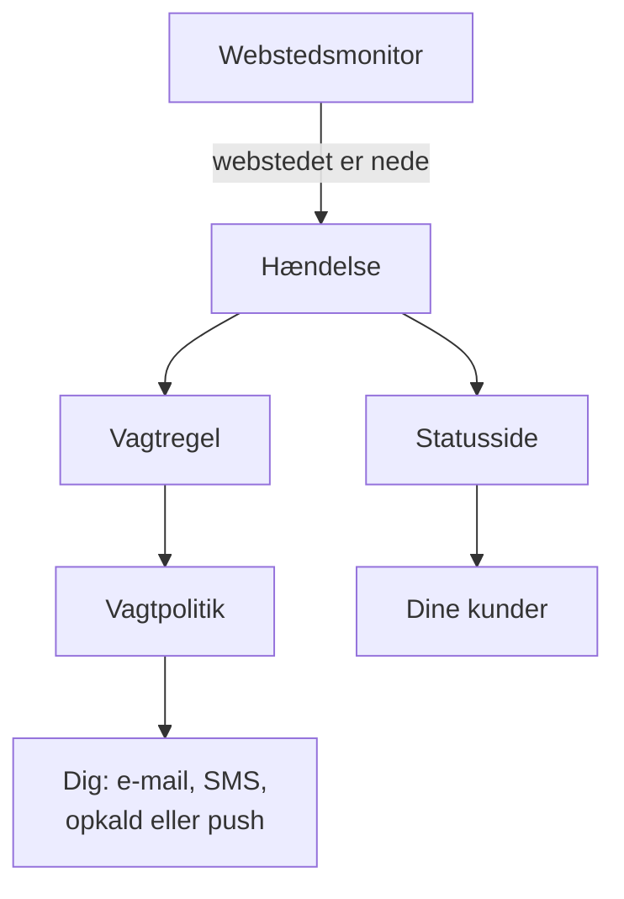

# Hurtigstart

Denne guide fører dig fra en ny konto til en fungerende opsætning på omkring femten minutter: en monitor, der tjekker dit websted hvert femte minut, en vagtpolitik, der tilkalder dig, når webstedet går ned, og en statusside, der informerer dine kunder. Den følger tjeklisten **Velkommen til OneUptime 👋** på dit projekts startside og de guidede opsætninger, som dens trin åbner.

Kommer du fra et andet værktøj? [Importér din opsætning](/docs/introduction/getting-started#hvis-du-kommer-fra-et-andet-værktøj) først: dine monitorer, vagtplaner og statussider følger med.

## Før du begynder

- **En konto.** På OneUptime Cloud tilmelder du dig på [oneuptime.com](https://oneuptime.com/accounts/register) og åbner linket i den e-mail, du får. På din egen installation åbner du den i din browser og tilmelder dig: den første konto bliver hovedadministrator. Se [Docker Compose](/docs/installation/docker-compose) for at installere en.
- **Et websted at holde øje med.** Enhver adresse, der svarer over HTTP eller HTTPS, for eksempel din virksomheds forside.

## Opret et projekt

I OneUptime ligger alt i et projekt: dine monitorer, hændelser, vagtpolitikker, statussider og de personer, der arbejder med dem.

:::steps
### Start et nyt projekt

Første gang du logger ind, viser OneUptime **Ingen projekter**. Klik på **Opret nyt projekt**. Hvis nogen allerede har inviteret dig til et projekt, accepterer du i stedet invitationen på samme side.

### Giv det et navn

Indtast et **Projektnavn**, for eksempel din virksomheds navn. På OneUptime Cloud vælger du også en plan lige nedenunder: Free er allerede valgt, og de betalte planer starter med en gratis prøveperiode.

### Opret det

Klik på **Opret projekt**. Dit projekts startside åbner, med tjeklisten **Velkommen til OneUptime 👋** øverst. Først spørger den **Hvad vil du gøre først?**: sæt flueben ved **Vide, når mit website eller API er nede**, **Tilkalde den rette person, når noget går ned** og **Fortælle mine kunder det via en statusside**, og klik på **Fortsæt**.
:::

## Overvåg dit websted

:::steps
### Åbn opsætningen af webstedet

Klik på **Opret din første overvågning** i tjeklisten. Det åbner den guidede opsætning **Vide, når mit website eller API er nede**, som tjekker dit websted, vælger, hvem der får besked, og sender en test, på én side. En person, der ikke må oprette monitorer, får i stedet listen **Monitorer**.

### Indtast adressen

Under **Hvad skal vi tjekke?** indtaster du hele adressen på dit websted i **Adresse på website eller API**, for eksempel `https://example.com`, og klikker på **Start tjekket**. Sonderne tjekker det med det samme og derefter hvert 5. minut: Når webstedet ikke svarer, eller svarer med en fejl, skifter monitoren til **Offline** og erklærer en hændelse. Klik på **Fortsæt**.

På Free-planen i OneUptime Cloud faktureres monitorer efter forbrug, så projektet skal have en betalingsmetode, før det kan tjekke dit websted: uden en beder trinnet dig om at [tilføje en betalingsmetode](/docs/configuration/billing#betalingsmetoder).

### Vælg, hvem der får besked

Under **Hvem skal have besked?** står du allerede i **Hvem der tilkaldes**. Klik på **Gem og fortsæt**: Det opretter `Default on-call policy`, som tilkalder dig ved hver ny hændelse og hver ny advarsel i projektet, til at begynde med via e-mail. Vil du også tilkalde teammedlemmer, der allerede er i projektet, så klik først på **Tilføj teammedlemmer**.

### Send dig selv en test

Under **Send en test** klikker du på **Send mig et testkald**, vælger en **Alvorlighed** og klikker på **Send testkald**. Åbn linket i e-mailen, hvor der står TEST, og bekræft kaldet der. Klik derefter på **Færdig** i dialogen og på **Fortsæt**: Opsætningen slutter med en oversigt over, hvad den har sat op.
:::

Vil du selv indstille hver mulighed, eller tjekke noget andet end et websted, så åbn **Monitorer** fra menuen **Produkter**, og klik på **Opret monitor**. [Opret en monitor](/docs/monitor/create-monitor) beskriver formularen og alle monitortyper.

Vil du også tjekke et API, og se, hvad du gør, når det første tjek aldrig kommer tilbage, så følg [Få besked, når dit websted eller API går ned](/docs/guides/website-down).

## Bliv tilkaldt, når det går ned

Opsætningen af webstedet har allerede oprettet `Default on-call policy`, som tilkalder dig via e-mail ved hver ny hændelse og hver ny advarsel, så tjeklisten markerer **Opsæt en vagtpolitik** som udført. Dens guidede opsætning tilføjer alligevel din telefon, de personer, der tilkaldes sammen med dig, og hvad der sker, når ingen svarer.

:::steps
### Åbn vagtopsætningen

Tryk på `Ctrl+K` (`Cmd+K` på en Mac), skriv `get paged`, og vælg **Tilkalde den rette person, når noget går ned**. Så længe tjeklisten ikke har markeret **Opsæt en vagtpolitik**, åbner det trin den samme guidede opsætning.

### Vælg, hvordan du bliver kontaktet

Under **Hvordan skal vi nå dig?** står din login-e-mail allerede. For push-notifikationer installerer du appen OneUptime On-Call fra App Store eller Google Play, logger ind og klikker på **Kontrollér igen**. Vil du også have sms og opkald, så klik på **Slå sms og opkald til**, indtast dit nummer i **Dit telefonnummer**, og klik på **Send mig en kode på sms**: På OneUptime Cloud betales sms og opkald af projektets saldo, så trinnet beder dig først om at fylde saldoen op. Klik på **Fortsæt**.

### Vælg, hvem der ellers tilkaldes

Under **Hvem har ellers vagt?** beholder du `Default on-call policy` under **Vagtpolitik**. Vil du tilkalde teammedlemmer sammen med dig, så tilføj dem under **Føj til den første eskaleringsregel**. Klik på **Gem og fortsæt**.

### Beslut, hvad der sker, hvis ingen svarer

Under **Hvad hvis ingen svarer?** vælger du **Tilkald de samme personer igen**, så længe du er den eneste person i projektet. Når der er kommet teammedlemmer til, tilkalder **Tilkald en anden** den person, du vælger under **Tilkaldes derefter**. I OneUptime Cloud tilbyder kun de betalte planer det valg. Klik på **Gem og fortsæt**.

### Send et testkald

Under **Send et testkald** klikker du på **Test denne politik**, vælger en **Alvorlighed** og klikker på **Send testkald**. Bekræft kaldet fra e-mailen, sms'en eller opkaldet, klik derefter på **Færdig** i dialogen og på **Fortsæt**. Opsætningen slutter på **Tilkaldelse er sat op**.
:::

> [!NOTE]
> SMS og telefonopkald er slået fra i et nyt projekt. En projektejer, en Billing Admin eller en person med Manage Billing slår dem til i kortet **Notifikationskanaler** under **Projektindstillinger → Notifikationer → Notifikationskanaler**.

To vagtregler udløser politikken: en ved hver ny hændelse og en ved hver ny advarsel. For at se den første åbner du **Hændelser** fra menuen **Produkter**, folder **Regler** ud i sidemenuen og vælger **Vagtregler**: Den matcher **Alle hændelser**. For kun at udløse politikken ved nogle hændelser, for eksempel kritiske, redigerer du reglen der, eller klikker på **Opret Incident On-Call Rule** for at tilføje din egen.

Vil du i stedet bygge en politik felt for felt, så åbn **Vagt** fra menuen **Produkter**, og klik på **Opret Vagtpolitik**. Se [Eskaleringsregler](/docs/on-call/escalation-rules) og [Vagtplaner](/docs/on-call/schedules) for flere niveauer, rotationer og hvor længe hvert niveau venter.

Vil du se hvert skærmbillede i opsætningen, og hvad du gør, når et kald ikke kommer frem, så følg [Bliv tilkaldt via opkald, SMS eller push](/docs/guides/paging).

## Udgiv en statusside

:::steps
### Åbn opsætningen af statussiden

Klik på **Udgiv en statusside** i tjeklisten. Det åbner den guidede opsætning **Udgiv en statusside**, som giver siden et navn, sætter din monitor på den og viser, hvad dine kunder ser. En person, der ikke må oprette statussider, får i stedet listen **Statussider**. Oversigten i opsætningen af webstedet åbner den samme opsætning som **Vis den på en statusside**.

### Giv den et navn, og vælg din monitor

Under **Giv den et navn, og vælg, hvad den viser** beholder du det **Statussidens navn**, den foreslår, eller skriver dit eget. Under **Hvad den viser** sætter du flueben ved din webstedsmonitor og klikker på **Opret statussiden**. Fra dette øjeblik er siden offentlig på sit link: Alle med adressen kan åbne den.

### Åbn siden

Under **Det er dette, dine kunder ser** åbner du adressen under **Offentligt link**: Dit websted vises som i drift. Tilbage i opsætningen klikker du på **Ser godt ud**. Opsætningen slutter med en oversigt over, hvad du kan gøre bagefter.
:::

Vil du i stedet lave en side i hånden, så åbn **Statussider** fra menuen **Produkter**, og klik på **Opret statusside**. Tilføj derefter din monitor med **Tilføj monitorer** på dens **Oversigt**. Se [Statusside – branding og domæner](/docs/status-pages/branding-and-domains) for at give siden dit eget logo og dine egne farver.

Vil du have statussiden på dit eget domæne, over HTTPS, så følg [Udgiv en statusside](/docs/guides/status-page).

## Invitér dit team

Klik på **Inviter dit team** i tjeklisten, eller åbn **Brugere** fra menuen **Produkter**, under **Indstillinger**. Klik på **Inviter bruger**, indtast personens **E-mail**, og vælg et **Team**: medlemsteamet er valgt fra start. Klik på **Inviter**. OneUptime sender invitationen med e-mail, og teamet bestemmer, hvad personen må. Se [Brugere, teams og tilladelser](/docs/permissions/index).

## Prøv det

Erklær en testhændelse for at se hele kæden virke.

:::steps
### Erklær en testhændelse

Åbn **Hændelser**, og klik på **Erklær hændelse**. Indtast en **Titel**, for eksempel `Test incident`, vælg en **Hændelsesalvor**, og klik på **Næste**. Under **Monitorer** vælger du din webstedsmonitor, så hændelsen vises på din statusside. Klik på **Næste**, indtil du når oversigten, og klik så på **Erklær hændelse**.

### Se, hvad der sker

Inden for et minut eller to tilkalder din vagtpolitik dig, og hændelsen vises på din statusside.

### Løs den

Klik på **Løs** på hændelsens side. Tilkaldene stopper, og hændelsen forsvinder fra din statusside.
:::

> [!WARNING]
> Alle, der åbner din statusside, ser testhændelsen, indtil du løser den. Kør testen, før du deler sidens adresse.

## Fejlfinding

:::details Jeg blev ikke tilkaldt
Åbn hændelsen, og vælg **Vagtudførelser** i dens sidemenu: der kan du se, om din politik kørte, og hvem den tilkaldte. Kørte den ikke, så tjek, at din vagtregel er slået til og nævner politikken. Kørte den, så tjek, at dine metoder under **Brugerindstillinger → Notifikationsmetoder** er bekræftet.
:::

:::details Hændelsen vises ikke på min statusside
En statusside viser en hændelse, når en af hændelsens monitorer er på siden. Tjek, at hændelsen har din monitor blandt sine berørte ressourcer, og at monitoren er på statussiden.
:::

:::details Monitoren siger offline, men mit websted virker
Åbn monitoren, og se, hvad sonderne modtog. Se fejlfindingsafsnittet i [Websted-monitor](/docs/monitor/website-monitor).
:::

## Næste trin

:::cards
- [Grundbegreber](/docs/introduction/core-concepts): Idéerne bag det, du lige har sat op.
- [Ordliste](/docs/introduction/glossary): Hvert ord, du mødte undervejs, forklaret med en sætning eller to.
- [Vagtplaner](/docs/on-call/schedules): Del vagterne med dit team.
- [Statusside – branding og domæner](/docs/status-pages/branding-and-domains): Gør statussiden til din egen.
- [OpenTelemetry](/docs/telemetry/open-telemetry): Send logs, metrikker og traces fra dine applikationer.
:::
