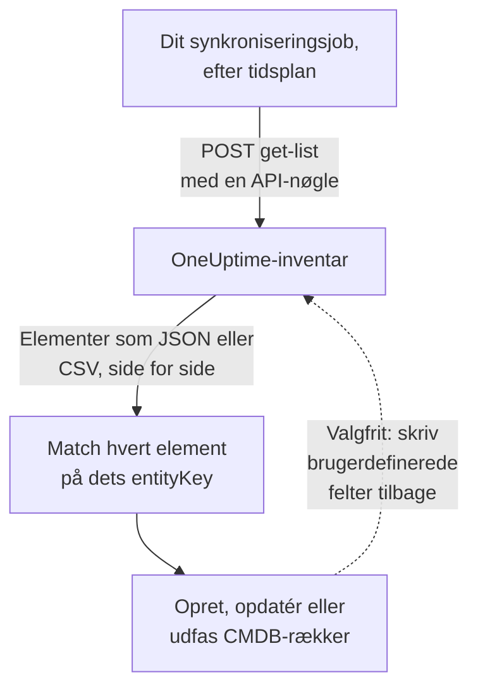

# Eksport til en CMDB

Hvis du allerede har en CMDB eller et aktivregister, prøver OneUptime ikke at erstatte det. Det, OneUptime har, og som en CMDB som regel mangler, er et billede af, hvad der faktisk kører, holdt ajour uden at nogen vedligeholder det: fundet ud fra telemetri og fra de pollere, der allerede holder øje med dit netværk og dine cloudkonti. Denne side er opskriften på at hente det billede ind i dit eget styrende system.

:::cards
- [Sådan fungerer en synkronisering](#sådan-fungerer-en-synkronisering): Et planlagt job, der læser listen og matcher på en stabil nøgle.
- [Hent kataloget](#hent-kataloget): Forespørgslen, side for side, som JSON eller CSV.
- [Aktivdetaljer](#aktivdetaljer): De samme oplysninger og nøgler for værter og netværksenheder.
- [Skriv tilbage](#skriv-tilbage): Send dine aktivmærker ind i OneUptime, og tilføj det, det ikke kan se.
:::

## Sådan fungerer en synkronisering

En synkronisering er et job, du kører efter en tidsplan. Det læser inventarlisten via REST API'et med en API-nøgle, matcher hvert element med en række i din CMDB via dets identitetsnøgle og opretter, opdaterer eller udfaser rækker, så de passer. Det kan også skrive værdier tilbage i elementernes brugerdefinerede felter.



## Hvad du kan hente

Tre REST-ressourcer, hver med standardendpoints i [OneUptime API'et](/docs/api-reference/api-reference):

| Ressource | Endpoint | Hvad den indeholder |
| --- | --- | --- |
| Inventarelement | `/api/inventory-item` | Én række pr. ting i miljøet |
| Definitioner af brugerdefinerede felter | `/api/inventory-item-custom-field` | Dit projekts eget feltordforråd |
| Relationer | `/api/inventory-item-relationship` | De rettede forbindelser mellem elementer |

De nyttige kolonner i et inventarelement:

| Kolonne | Betydning |
| --- | --- |
| `_id` | OneUptimes ID: brug det som din eksterne reference |
| `entityType` | `host`, `k8s.pod`, `network.device`, `appliance`, … |
| `entityKey` | En stabil identitetshash. Den overlever omdøbninger og er derfor den bedste nøgle at matche på |
| `displayName` | Det navn, mennesker læser |
| `source` | `discovered`, `inventory` eller `manual` |
| `description` | Fritekst |
| `identifyingAttributes` | De attributter, der gør elementet til det, det er, og som aldrig ændres |
| `descriptiveAttributes` | Alt andet, der er observeret på det: se [Aktivdetaljer](#aktivdetaljer), [Aktivattributter for værter](#aktivattributter-for-værter) og [Aktivattributter for netværksenheder](#aktivattributter-for-netværksenheder) nedenfor |
| `customFields` | Dine egne felter, efter feltnavn |
| `resourceType` / `resourceId` | En henvisning til den mere detaljerede OneUptime-post, når der er en |
| `firstSeenAt` / `lastSeenAt` | Hvornår det første og sidste gang blev observeret |
| `isArchived` | Om det er taget ud af den aktive liste |

## Før du begynder

En synkronisering skal bruge en API-nøgle, der må læse inventaret. I OneUptime Cloud kræver API-nøgler abonnementet **Growth** eller derover.

:::steps
### Opret en API-nøgle

Åbn **Projektindstillinger → Avanceret → API-nøgler**, og klik på **Opret API-nøgle**. Giv den et **Navn**, og vælg under **Adgang** **Seer** for at læse alt i projektet, eller **Vælg tilladelser senere** for kun at give den det, en synkronisering skal bruge.

### Giv den kun det, den skal bruge

En skrivebeskyttet eksport skal bruge én tilladelse, **Read Telemetry Service**: inventaret deler telemetritilladelserne i stedet for at have sine egne. Klik på **Tilføj tilladelse** på nøglens side, og vælg den. For at skrive værdier tilbage tilføjer du også **Edit Telemetry Service**.

### Kopiér nøglen

Kopiér **API-nøgle** fra nøglens side, og gør den tilgængelig for dit job:

```bash
export ONEUPTIME_API_KEY="your-api-key"
```
:::

Nøglen sendes i headeren `ApiKey` i hver forespørgsel og læser sit eget projekts inventar, så en forespørgsel nævner intet projekt.

## Hent kataloget

Send en `POST` til listeendpointet med de kolonner, du vil have. `select` er påkrævet: API'et returnerer kun det, du beder om.

```bash
curl -X POST 'https://oneuptime.com/api/inventory-item/get-list' \
  -H "ApiKey: $ONEUPTIME_API_KEY" \
  -H 'Content-Type: application/json' \
  -d '{
    "query": { "isArchived": false },
    "select": {
      "_id": true,
      "entityType": true,
      "entityKey": true,
      "displayName": true,
      "source": true,
      "customFields": true,
      "descriptiveAttributes": true,
      "lastSeenAt": true
    },
    "sort": { "displayName": "ASC" },
    "limit": 100,
    "skip": 0
  }'
```

På en selvhostet installation bruger du din egen OneUptime-adresse i stedet for `https://oneuptime.com`. Svaret er `{ "data": [...], "count": ... }`, hvor `count` er, hvor mange elementer der passer i alt. Bladr ved at hæve `skip` med din `limit`, indtil du har dem alle; `limit` går op til 10.000. Datoer og id'er ud over `_id` kommer pakket ind, som `{ "_type": "DateTime", "value": "..." }` og `{ "_type": "ObjectID", "value": "..." }`: læs dem fra `value`.

### Kun netværksenhederne

Afgræns listen med `entityType`:

```bash
curl -X POST 'https://oneuptime.com/api/inventory-item/get-list' \
  -H "ApiKey: $ONEUPTIME_API_KEY" \
  -H 'Content-Type: application/json' \
  -d '{
    "query": { "entityType": "network.device", "isArchived": false },
    "select": { "_id": true, "entityKey": true, "displayName": true, "customFields": true },
    "limit": 100,
    "skip": 0
  }'
```

Hver netværksenheds `descriptiveAttributes` indeholder dens værtsnavn, IP-adresse, serienummer, MAC-adresse, mærke, model, firmware, operativsystem, rolle, site og placering: se [Aktivattributter for netværksenheder](#aktivattributter-for-netværksenheder) nedenfor. Det, polleren ellers ved, som interfaces og naboer, ligger på selve Network Device-posten: følg `resourceId` til `/api/network-device/:id/get-item`, eller hent `/api/network-device/get-list` direkte.

### Som CSV

Ethvert listeendpoint svarer i CSV i stedet for JSON med `?output-type=csv`:

```bash
curl -X POST 'https://oneuptime.com/api/inventory-item/get-list?output-type=csv' \
  -H "ApiKey: $ONEUPTIME_API_KEY" \
  -H 'Content-Type: application/json' \
  -d '{ "query": {}, "select": { "displayName": true, "entityType": true, "customFields": true }, "limit": 500, "skip": 0 }' \
  -o inventory.csv
```

Listen **All Items** i dashboardet eksporterer på samme måde, med de kolonner for brugerdefinerede felter, du har slået til. Hver [aktivdetalje](#aktivdetaljer) er også en kolonne dér: **Værtsnavn**, **IP-adresse**, **Serienummer**, **Model** og resten starter skjult, så slå dem til fra kolonnevælgeren, og eksporten indeholder én kolonne pr. oplysning, uanset om en række er en vært eller en netværksenhed.

## Aktivdetaljer

Værter og netværksenheder beskrives med de samme oplysninger, gemt under de samme nøgler. Én CMDB-kolonne indeholder serienummeret, uanset om en række er en server eller en switch, og et elements kort **Aktivdetaljer** i dashboardet viser hver oplysning i samme rækkefølge for begge. En oplysning, som intet har rapporteret, står som **Ukendt** i stedet for at blive udeladt, så et hul er synligt.

| Oplysning | Nøgle | På en vært | På en netværksenhed |
| --- | --- | --- | --- |
| Værtsnavn | `host.name` | Værtens navn. Det er værtens identitet, så det står i `identifyingAttributes` | Enhedens eget navn: dens SNMP-`sysName`, ellers det NetBIOS- eller DNS-navn, opdagelsen fandt. Aldrig dens IP-adresse |
| IP-adresse | `host.ip` | Hver adresse, collectoren rapporterer | Den adresse, OneUptime poller, når den er en IP-adresse, ellers den adresse, dens sonde slog det DNS-navn op til |
| MAC-adresse | `host.mac` | Registreret | Skrevet på enheden eller lært fra ARP-tabellen i en gennemgået router |
| Serienummer | `host.serial_number` | Stemplet | ENTITY-MIB |
| Manufacturer | `device.manufacturer` | Stemplet | ENTITY-MIB, ellers det, `sysDescr` eller `sysObjectID` nævner |
| Model | `device.model.name` | Stemplet | ENTITY-MIB, ellers det, `sysDescr` nævner |
| Firmwareversion | `device.firmware.version` | Stemplet | ENTITY-MIB, ellers det, `sysDescr` nævner |
| Operativsystem | `os.name` | `os.description` (eller `os.type`) | Det, `sysDescr` nævner: Cisco IOS, Junos OS, Arista EOS, Linux |
| OS-version | `os.version` | Registreret | ENTITY-MIB, ellers det, `sysDescr` nævner |
| Device Type | `device.type` | Stemplet. Ellers klassificerer kortet den ud fra operativsystem og navn (Server, Firewall, ...) | Dens rolle: den, du tildelte, ellers den, topologikortet tegner den som |
| Location | `device.location` | Stemplet. Ellers viser kortet dens cloudzone | `sysLocation`. Kortet viser først dens site |

[Værtstabellen](#aktivattributter-for-værter) og [tabellen over netværksenheder](#aktivattributter-for-netværksenheder) nedenfor fortæller i detaljer, hvor hver værdi kommer fra.

## Aktivattributter for værter

`descriptiveAttributes` på en vært indeholder de aktivoplysninger, en CMDB-række som regel vil have, efter deres OpenTelemetry-attributnavn:

| Felt | Nøgle | Indsamles som standard? |
| --- | --- | --- |
| IP-adresser | `host.ip` | Ja: kommasepareret, når maskinen har flere |
| MAC-adresser | `host.mac` | Ja: kommasepareret, én pr. aktivt interface, som `AC-DE-48-23-45-67` |
| Arkitektur | `host.arch` | Ja |
| Maskin-ID | `host.id` | Ja: maskinens GUID på Windows, `/etc/machine-id` på Linux |
| Operativsystem | `os.type`, `os.description`, `os.version` | Ja |
| Cloudplacering | `cloud.provider`, `cloud.region`, `cloud.availability_zone` | Kun med en clouddetektor |
| Serienummer | `host.serial_number` | Kræver ét konfigurationstrin |
| Mærke | `device.manufacturer` | Kræver ét konfigurationstrin |
| Model | `device.model.name` | Kræver ét konfigurationstrin |
| Firmwareversion (BIOS eller UEFI) | `device.firmware.version` | Kræver ét konfigurationstrin |
| Navn på operativsystem | `os.name` | Kun fra SDK'er, der rapporterer det: ellers nævner `os.description` operativsystemet |
| Enhedstype | `device.type` | Valgfrit: stempl det på samme måde (`Hypervisor`, `Workstation`) |
| Placering | `device.location` | Valgfrit: stempl det på samme måde (`Frankfurt DC, Rack B4`) |

Alt, der er markeret med Ja, kommer fra collectorens processor `resourcedetection` og står allerede i den konfiguration, OneUptime genererer for dig.

Nøglerne `cloud.*` kræver en clouddetektor i den processor: `detectors: [system, env, ec2]`, eller `gcp` eller `azure` for de andre. Den medfølgende konfiguration kører kun `[system, env]`, så de tre forbliver tomme, indtil du tilføjer en.

Serienummer, mærke, model og firmware har ingen ressourcedetektor: de ligger i maskinens firmware, læses via WMI på Windows og DMI på Linux, og stemples derfor på ressourcen én gang, når maskinen klargøres. En enhedstype eller placering, du vil have på rækken, stemples på samme måde. [Inventarattributter](/docs/telemetry/host-otel-collector#inventarattributter-ip-mac-serienummer-fabrikat-model-firmware) har det præcise uddrag for hvert operativsystem. `host.manufacturer`, `host.model.name`, `host.firmware.version` og `host.bios.version` accepteres som andre stavemåder og gemmes under nøglerne `device.*` (og `device.serial_number` under `host.serial_number`), så en synkronisering kun læser én nøgle pr. oplysning.

`host.id` er værd at se på som matchnøgle, hvis din CMDB allerede bruger en hardware-ID: i modsætning til `entityKey` er det maskinens eget ID, så det svarer til det, et værktøj til endpointstyring rapporterer for samme maskine.

Attributter tilføjes og tømmes aldrig: en attribut, der holder op med at blive rapporteret, bliver på rækken, så en værdi, din synkronisering allerede har læst, aldrig forsvinder i stilhed.

## Aktivattributter for netværksenheder

En netværksenhed (`entityType: network.device`) spejles fra sin Network Device-post, og dens `descriptiveAttributes` bruger de samme nøgler, som en vært bruger for de samme oplysninger, så én CMDB-kolonne indeholder serienummeret, uanset om rækken er en server eller en switch:

| Felt | Nøgle | Hvor det kommer fra |
| --- | --- | --- |
| Værtsnavn | `host.name` | Enhedens eget navn: dens SNMP-`sysName`, ellers det NetBIOS- eller reverse-DNS-navn, opdagelsen fandt. Udelades, når kun dens IP-adresse navngiver den |
| IP-adresse | `host.ip` | Den adresse, OneUptime poller, når den er en IP-adresse. For en enhed, der polles på et DNS-navn, den adresse, dens sonde senest slog navnet op til |
| DNS-navn | `net.device.dns_name` | Det reverse-DNS-navn, der blev fundet ved opdagelsen, eller det DNS-navn, OneUptime poller |
| MAC-adresse | `host.mac` | Skrevet på enheden eller lært fra ARP-tabellen i en gennemgået router |
| Mærke | `device.manufacturer` | ENTITY-MIB `entPhysicalMfgName`, ellers den producent, `sysDescr` nævner, ellers leverandøren af `sysObjectID` |
| Model | `device.model.name` | ENTITY-MIB `entPhysicalModelName`, ellers den model, `sysDescr` nævner |
| Serienummer | `host.serial_number` | ENTITY-MIB `entPhysicalSerialNum` |
| Firmwareversion | `device.firmware.version` | ENTITY-MIB `entPhysicalFirmwareRev`, ellers den firmware, `sysDescr` nævner på Ubiquiti-, HPE- og Aruba-enheder |
| Operativsystem | `os.name` | Det operativsystem, `sysDescr` nævner |
| Software- eller OS-version | `os.version` | ENTITY-MIB `entPhysicalSoftwareRev`, ellers den udgivelse, `sysDescr` nævner |
| Systembeskrivelse | `os.description` | `sysDescr` |
| Enhedstype | `device.type` | Den rolle, du har tildelt enheden, ellers den rolle, topologikortet klassificerer den som, under dit projekts navn for den |
| Placering | `device.location` | `sysLocation`, medmindre det er en agents standardværdi, som Net-SNMP's "Sitting on the Dock of the Bay" |
| Site | `oneuptime.site.name` | Det Network Site, enheden er tildelt |
| Pollet adresse | `net.device.hostname` | Den adresse, OneUptime poller: en IP-adresse eller et DNS-navn. Beholdt til synkroniseringer, der blev skrevet, før `host.name` og `host.ip` fandtes |

ENTITY-MIB-rækkerne udfyldes efter enhedens første SNMP-walk. En enhed, der ikke gennemgås, fordi den kun overvåges med ping eller endnu ikke er pollet, får stadig sit navn, mærke, operativsystem og placering fra det, den seneste discovery-scanning af dens adresse læste over SNMP, og sin MAC-adresse fra ARP-tabellen i en gennemgået router. En enhed, der ikke implementerer ENTITY-MIB, har intet serienummer eller firmware at rapportere. Dens `sysDescr` nævner stadig modellen og operativsystemet for mange platforme: en Cisco Meraki MX rapporterer `Meraki MX85`, hvilket udfylder mærke og model. En platform, hvis `sysDescr` ikke har en kendt form, tilføjer intet i stedet for at gætte.

En værdi, der er gemt på enheden, skrevet ind eller sat via API'et, erstattes aldrig af det, discovery læser. Af en værdi, enhedens egen walk læste, og en, en scanning læste, bruges den nyeste. En scannings aflæsning bruges kun, når scanningen fandt den samme maskine på adressen: når det systemnavn, den `sysObjectID` eller det NetBIOS-navn, den læste, modsiger enhedens, bruges intet af det, den læste der. Elementets kort **Aktivdetaljer** viser, hvor hver værdi kom fra, og hvornår.

Værtsnavnet er aldrig IP-adressen. En enhed, som kun dens adresse navngiver, har `host.ip` og intet `host.name`. Når dens SNMP-walk rapporterer et systemnavn, følger `host.name` ved næste gennemløb.

Disse værdier kopieres fra Network Device-posten hvert femtende minut, og de **erstatter** de tidligere værdier i stedet for at lægge sig oven i dem, så en værdi, der ryddes på enheden (en fjernet MAC-adresse, for eksempel), også forsvinder fra inventarelementet.

Der er ingen version for en *tilgængelig opgradering*: SNMP har intet standardobjekt til det, så OneUptime registrerer den version, enheden kører.

## Match elementer med CMDB-rækker

Match på `entityKey`, ikke på `displayName`. Den er en hash af elementets identificerende attributter, så den overlever omdøbninger og nye mærkater: en vært, der får ny etiket, beholder samme nøgle, mens dens visningsnavn ændres. `_id` er lige så stabil og er den enkleste fremmednøgle, hvis du kun nogensinde taler med ét projekt.

Datoer i `customFields` er ISO-8601-strenge i UTC, og CSV-eksporten skriver dem sådan i stedet for i den mere venlige form, dashboardet viser, så de importeres uden overraskelser ved fortolkningen.

## Hold det ajour

Der er intet ændringsfeed. Poll listeendpointet med det interval, der passer dig, og sammenlign på `entityKey`. `lastSeenAt` fortæller, hvornår et element sidst blev observeret, hvilket som regel er den billigste måde at opdage det, der er blevet stille siden din sidste kørsel.

Et element, der forsvinder mellem to kørsler, er enten udløbet (et fundet element, der var stille længere end sit vindue) eller har fået sin egen post slettet. Et spejlet element, der bærer værdier i brugerdefinerede felter, arkiveres i stedet for at blive slettet, når dets post forsvinder, så forespørg med `"isArchived": true` for at se, hvad der er udfaset, uden at miste de tilknyttede aktivdata.

## Skriv tilbage

De samme endpoints tager imod skrivninger, så en synkronisering kan skubbe værdier ind i `customFields`: for eksempel det aktivmærke, din CMDB allerede ejer, stemplet på det tilsvarende OneUptime-element. Nøglen skal bruge **Edit Telemetry Service** til det.

Du kan også tilføje elementer for ting, OneUptime ikke kan se, med `POST /api/inventory-item`, en `entityType` af `external.service`, `external.database` eller `appliance` og et `displayName`. OneUptime udregner identitetsnøglen for dig, og de elementer udløber aldrig. Nøglen skal have **Create Telemetry Service** til det.

## Fejlfinding

:::details Hver forespørgsel afvises med 402 Payment Required
I OneUptime Cloud virker API-nøgler kun, mens projektet er på abonnementet **Growth** eller derover. Intet slettes: nøglen virker igen, som den er, så snart projektet er tilbage på abonnementet. Se [API-nøgler og SCIM under deres abonnement](/docs/api-reference/api-reference#api-nøgler-og-scim-under-deres-abonnement).
:::

:::details Hver forespørgsel svarer 422 You do not have permissions
Nøglen har ingen tilladelse, der læser inventaret. En nøgle oprettet med **Vælg tilladelser senere** kan intet, før den får en: tilføj **Read Telemetry Service** på dens side, som i [Før du begynder](#før-du-begynder).
:::

:::details Listen kommer tilbage uden de kolonner, jeg skal bruge
Listen returnerer kun de kolonner, `select` nævner, og `_id`. Tilføj hver kolonne, du læser, til `select`, inklusive `descriptiveAttributes` og `customFields`.
:::

:::details Et element, jeg forventede, mangler
Arkiverede elementer udelades, når du sender `"isArchived": false`. Et fundet element fjernes, når det har været stille længere end sit vindue, og et spejlet forsvinder sammen med sin post. Bed om `"isArchived": true` for at se de arkiverede.
:::

## Næste trin

:::cards
- [Inventar – Oversigt](/docs/inventory/overview): Hvor elementer kommer fra, og hvor længe hvert bliver.
- [Brugerdefinerede inventarfelter](/docs/inventory/custom-fields): Definér de felter, din synkronisering læser og skriver.
- [OneUptime API-reference](/docs/api-reference/api-reference): Forespørgsler, statuskoder og de regler, hver skrivning følger.
:::
