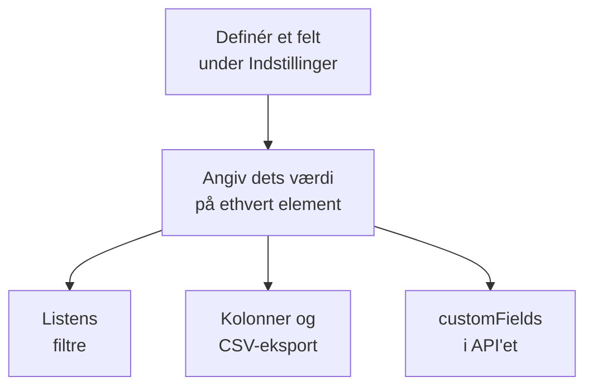

# Brugerdefinerede inventarfelter

OneUptime finder ud af, hvad der er i dit miljø. Brugerdefinerede felter registrerer det, ingen overvågning kan fortælle: serienummeret på mærkaten, datoen hvor garantien udløber, hvilket team der ejer en ting, om den er i drift eller ligger i en skuffe med reservedele. Definér felterne én gang for projektet, og udfyld dem derefter på hvert element.

:::cards
- [Sådan fungerer brugerdefinerede felter](#sådan-fungerer-brugerdefinerede-felter): Ét ordforråd, på hvert element, uanset kilde.
- [Definér felter](#definér-felter): Opret et felt, vælg dets type, angiv en rullemenus valgmuligheder.
- [Filtrér listen](#filtrér-listen): Find det, der udløber næste kvartal, med to klik.
- [Bemærkninger og begrænsninger](#bemærkninger-og-begrænsninger): Omdøbninger, dubletter, datoer og slettede felter.
:::

## Sådan fungerer brugerdefinerede felter

Et felt defineres én gang for projektet, og hvert element kan have en værdi for det: dem, OneUptime har fundet, dem, det spejler, og dem, du har tilføjet manuelt. Et felt bliver til et filter over listen, en valgfri kolonne og en kolonne i CSV-eksporten. API'et læser og skriver de samme værdier, under hvert elements `customFields`.

> [!NOTE]
> I OneUptime Cloud er brugerdefinerede felter en del af abonnementet **Growth** og derover. Under det kan felter hverken defineres, vises eller ændres: API'et svarer `402 Payment Required`, og listen viser ingen filtre eller kolonner for brugerdefinerede felter.

## Definér felter

:::steps
### Åbn siden med brugerdefinerede felter

Gå til **Produkter → Ressourcer → Inventar**, åbn **Indstillinger** i sidemenuen, og derefter **Brugerdefinerede felter**.

### Opret et felt

Klik på **Opret Inventory Item Custom Field**. Giv det et **Feltnavn**, en valgfri **Feltbeskrivelse** og en **Felttype** fra tabellen nedenfor.

### Angiv en rullemenus valgmuligheder

For en rullemenutype tilføjer du dens valgmuligheder under **Rullemenuindstillinger**. Hver valgmulighed kan have en farve, som bruges på samme måde i tabelcellen og i filteret: vælg en af de navngivne farver, **Ingen farve**, eller **Brugerdefineret farve** for en præcis farvekode. Træk en valgmulighed i dens håndtag for at ændre dens plads i listen.
:::

| Type | Brug den til |
| --- | --- |
| **Tekst** | Serienummer, aktivmærke, placering i racket, indkøbsordrenummer |
| **Tal** | Omkostning, rackenhed, antal porte |
| **Boolesk** | Under support, inden for PCI-scope |
| **Rullemenu (enkeltvalg)** | Livscyklusstatus, miljø, kritikalitet: ét svar fra en fast liste |
| **Rullemenu (flervalg)** | Compliance-områder, tags: flere svar fra en fast liste |
| **Dato** | Købsdato, garantiudløb, dato for end-of-life |
| **Dato og klokkeslæt** | Senest auditeret den, taget ud af drift den |
| **Lang tekst** | Adgangsinstruktioner, noter: flere linjer ren tekst |
| **Formateret tekst (Markdown)** | Noter med formatering og links, skrevet i Markdown-editoren |
| **Fil** | Et garantibevis, en underskrevet indkøbsordre, et foto af rackets etiket: én fil |
| **Flere filer** | Manualer, fakturaer og fotos: op til 10 filer |

## Et gennemarbejdet aktivordforråd

Et typisk register over hardwareaktiver passer direkte ind i disse felter:

| Feltnavn | Type | Eksempel |
| --- | --- | --- |
| `Serial Number` | Tekst | `FDO24160ABC` |
| `Asset Tag` | Tekst | `IT-004821` |
| `Purchase Date` | Dato | 2024-03-11 |
| `Warranty Expiry` | Dato | 2027-03-10 |
| `Lifecycle Status` | Rullemenu | I drift, Reserve, Til reparation, Udfaset |
| `Assigned Site` | Rullemenu | Datacenter London, Datacenter Frankfurt, Hovedkontor |
| `Owner Team` | Rullemenu | Netværk, Platform, Sikkerhed |
| `Cost Centre` | Tekst | `CC-4410` |

Angiv værdierne på et elements side **Brugerdefinerede felter**. Ethvert element tager imod dem, uanset kilde, så de switche, OneUptime har fundet, og de netværksenheder, det spejler, bærer samme aktivordforråd som de appliances, du har tilføjet manuelt.

## Filtrér listen

Hvert brugerdefineret felt bliver til et filter over listen **All Items**, og filteret tilbyder de sammenligninger, der passer til dets type:

| Felttype | Sammenligninger |
| --- | --- |
| **Tekst**, **Lang tekst**, **Formateret tekst (Markdown)** | er, er ikke, indeholder, indeholder ikke, begynder med, slutter med, er tom, er ikke tom |
| **Tal** | er, er ikke, er større end, er større end eller lig med, er mindre end, er mindre end eller lig med, er tom, er ikke tom |
| **Boolesk**, **Rullemenu (enkeltvalg)**, **Rullemenu (flervalg)** | er, er ikke, er tom, er ikke tom |
| **Dato**, **Dato og klokkeslæt** | er, er før, er efter, er mellem, er tom, er ikke tom |
| **Fil**, **Flere filer** | er |

En chip for **Fil** eller **Flere filer** spørger kun om én ting: om feltet **Har filer** eller har **Ingen filer**.

Filtre kombineres med OG, så "Warranty Expiry er før 2026-10-01 OG Lifecycle Status er I drift" er én visning af listen. Det er det spørgsmål, et aktivregister findes for at besvare, og grunden til at bruge datotyperne i stedet for en dato i et tekstfelt: et tekstfelt gemmer gladeligt `2026-10-01` og kan så ikke fortælle dig, hvad der udløber næste kvartal.

Kolonner for brugerdefinerede felter starter skjult: slå dem til fra kolonnevælgeren. De kan ikke sorteres, fordi værdierne ligger samlet i én JSON-kolonne, som listen ikke kan sortere efter.

## Bemærkninger og begrænsninger

- Værdier gemmes på hvert element under feltets navn. At omdøbe et felt flytter ikke de værdier, der allerede er gemt under det gamle navn. Brugerdefinerede felter på hændelser er undtagelsen: omdøber du et, flytter dets værdier med (se [Omdøb et felt](/docs/incidents/settings#omdøb-et-felt)).
- En rullemenus valgmuligheder kan tilføjes, omdøbes, trækkes i en ny rækkefølge og fjernes, efter at elementer har værdier. En omdøbt valgmulighed ændres på hvert element, der har den; en fjernet valgmulighed bliver på de elementer, der har den, vist som ikke længere en valgmulighed, medmindre du vælger en anden til dem (se [Ændr en rullemenus valgmuligheder](/docs/incidents/settings#skift-en-rullemenus-muligheder)).
- Intet gør en værdi unik. To elementer kan have samme serienummer, og intet stopper dig.
- Datoer gemmes som ISO-8601-tidsstempler i UTC og vises i din egen tidszone.
- At slette et felt fjerner det fra listen og fra filterbjælken. De værdier, der allerede er skrevet, bliver på elementerne.
- Et felt af typen **Fil** eller **Flere filer** tager filer på op til 10 MB hver, af de slags, der står under [Filfelter](/docs/incidents/settings#filfelter), uploadet i projektet. Kun den, der må se elementet, kan downloade dem, og en fil slettes, når intet længere holder den.

## Næste trin

:::cards
- [Inventar – Oversigt](/docs/inventory/overview): Hvor elementer kommer fra, og hvad hver side viser.
- [Eksport til en CMDB](/docs/inventory/cmdb-sync): Hent elementerne og deres brugerdefinerede felter ind i et andet system.
- [Brugerdefinerede felter på hændelser](/docs/incidents/settings#brugerdefinerede-felter): De samme felttyper på hændelser, med et par ekstra.
:::
